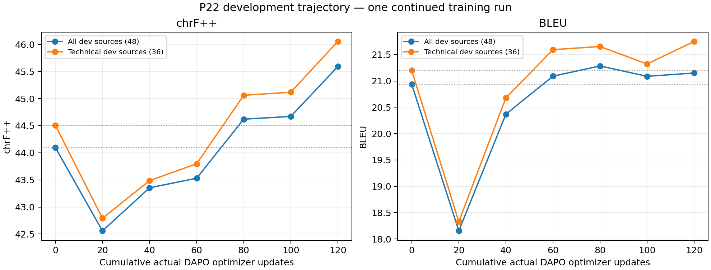

# P22 observed status and results

2026-11-23 · Europe/Berlin

Updated: 2026-11-23T14:23:33.861163+00:00

## Conclusion

**The run completed all120 DAPO updates and recovered after an initial dev decline. Independent heldout metrics and blinded semantic review do not support superiority over the originalR0. KeepP18 as the commonR0; retainP22 as an experimental checkpoint without automatic promotion.**

This is not a verdict based on the20step decline, nor evidence that more steps would guarantee success. Dev chrF++ goes44.0975→42.5586→45.5915. On the separate96-source final panel,chrF++ goes49.0667→48.9096 andBLEU23.2898→22.6208;both paired95%intervals include0. Dev and final absolute scores are not one learning curve.

**Cause:the evidence directly shows weak candidate support on technical long sentences. It does not quantify candidate-support versus reward-error causal contributions, establish a3B capacity ceiling,or mandate moreSFT.**Among24technicalG8 groups,8per length stratum,both models have0confirmed-P long groups:7all-F groups and1with uncertainty. Reranking alone cannot fix the observed all-F groups;this is not a population-wide claim.

**Completed 120 actual DAPO updates; selected checkpoint at step 120. Semantic review completed.**

<details><summary>Executed training summary</summary>

```json
{
  "total_optimizer_updates": 120,
  "selected_step": 120,
  "selected_tag": "user_continued_selected_full",
  "stop_reason": "maximum120_updates",
  "reward_recipe": "raw",
  "new_SFT_updates": 0,
  "all_GPU_work_finished": true,
  "source_attempts": 249,
  "automatic_proxy_not_human_semantic_truth": true,
  "user_disabled_metric_early_stopping": true,
  "resumed_from_step": 40,
  "user_continuation_control_SHA256": "c95ec3440b47d0a5bedeb93d2b940737384a4c8b650b8b7302745a8e0eefb935"
}
```

</details>

<details><summary>Current background state</summary>

```json
{
  "UTC": "2026-11-23T14:21:19.286300+00:00",
  "unix": 1795443679.2864287,
  "phase": "OWNED_GPU_RELEASED_VERIFIED_EXPORT_SAVED",
  "controller_pid": 9004,
  "new_checkpoint": true
}
```

</details>

## Full development trajectory

Each point uses the same 48-source dev set. Dev metrics implement the frozen checkpoint-selection rule; they are not independent final evidence.

|Updates|Overall chrF++|BLEU|Technical chrF++|Technical BLEU|Truncated|
|---:|---:|---:|---:|---:|---:|

|0|44.0975|20.9381|44.5066|21.1988|0|

|20|42.5586|18.1540|42.7908|18.3293|2|

|40|43.3537|20.3682|43.4869|20.6783|1|

|60|43.5303|21.0899|43.7965|21.5932|1|

|80|44.6209|21.2845|45.0615|21.6532|0|

|100|44.6714|21.0878|45.1186|21.3219|0|

|120|45.5915|21.1502|46.0557|21.7495|0|



## Blinded semantic review

The same assistant reads source, reference and candidate with model identity and reward hidden. Exact source/candidate duplicates share a single judgment. P preserves critical meaning, F confirms a critical error, U denotes genuine uncertainty. This is not native Icelandic or clinical certification and does not select checkpoints.

|Panel|Sources|R0 confirmed P|DAPO confirmed P|Net gain|Paired 95% CI (sources)|
|---|---:|---:|---:|---:|---|

|greedy|64|23|20|-3|[-7, 0]|

|g8|24|11|9|-2|[-5, 0]|

On64greedy sources,R0 has23P/36F/5U versus20P/37F/7U.G8 measures source coverage with at least one confirmed-P untruncated draw;it is not per-candidate accuracy or an iid theoretical pass@k estimate.

|Panel|Stratum|R0 P/F/U|DAPO P/F/U|
|---|---|---|---|

|greedy|general|6/6/4|5/8/3|

|greedy|technical_short|9/7/0|9/6/1|

|greedy|technical_medium|6/9/1|4/10/2|

|greedy|technical_long|2/14/0|2/13/1|

|g8|technical_short|5/2/1|5/2/1|

|g8|technical_medium|6/2/0|4/2/2|

|g8|technical_long|0/7/1|0/7/1|

<details><summary>Paired transitions and exact translation evidence</summary>

```json
{
  "UTC": "2026-11-23T13:48:46.410100+00:00",
  "transitions": {
    "greedy": {
      "F->F": 33,
      "P->F": 3,
      "P->P": 20,
      "F->U": 3,
      "U->U": 4,
      "U->F": 1
    },
    "g8": {
      "P->U": 2,
      "F->F": 11,
      "P->P": 9,
      "U->U": 2
    }
  },
  "changed_sources": {
    "greedy": [
      {
        "id": "p22official21:test:eea:1388",
        "stratum": "technical_medium",
        "before_grade": "P",
        "after_grade": "F",
        "source": "Port security plans shall be approved by the Member State concerned before implementation.",
        "reference": "Hlutaðeigandi aðildarríki skal samþykkja verndaráætlanir hafna áður en þeim er hrint í framkvæmd.",
        "before_hypothesis": "Portverndaráætlanir skulu samþykktar af hlutaðeigandi aðildarríki áður en þær eru framkvæmdar.",
        "after_hypothesis": "Portvæntaráðstafanir skulu samþykktar af hlutaðeigandi aðildarríki áður en þær eru framkvæmdar."
      },
      {
        "id": "p22official21:test:ema:116",
        "stratum": "technical_medium",
        "before_grade": "P",
        "after_grade": "F",
        "source": "Cases of photosensitivity reactions have been reported with thiazides diuretics (see section 4.8).",
        "reference": "Greint hefur verið frá tilfellum um ljósnæmisviðbrögð við gjöf tíazíð þvagræsilyfja (sjá kafla 4.8).",
        "before_hypothesis": "Greint hefur verið frá ljósnæmisviðbrögðum af völdum tíazíð þvagræsilyfja (sjá kafla 4.8).",
        "after_hypothesis": "Greint hefur verið frá sýkingum af ljósnæmi með tilliti til tiazíða þvagræsilyfja (sjá kafla 4.8)."
      },
      {
        "id": "p22official21:test:ema:2271",
        "stratum": "technical_long",
        "before_grade": "F",
        "after_grade": "U",
        "source": "The MAH commits to performing the studies and additional pharmacovigilance activities detailed in the Pharmacovigilance Plan, as agreed in the version dated 28 February 2005 of the Risk Management Plan (RMP) presented in Module 1.8.2. of the Marketing Authorisation and any subsequent updates of the RMP agreed by the CHMP.",
        "reference": "Markaðsleyfishafi skuldbindur sig til að gera rannsóknir og vinna viðbótarverkefni tengd lyfjagát sem tilgreind eru í áætlun um lyfjagát, eins og fram kemur í útgáfu dagsett 28. febrúar 2005 af áætlun um áhættustjórnun sem lýst er í kafla 1.8.2. í markaðsleyfinu og öllum uppfærslum á áætlun um áhættustjórnun sem CHMP samþykkir.",
        "before_hypothesis": "Markaðsleyfishafi skulur að framkvæma þær rannsóknir og viðbótar- lyfjafræðilegar aðgerðir sem tilgreindar eru í áætlun um lyfjagát, eins og komið var á í útgáfu frá 28. febrúar 2005 af áætlun um áhættustýringu sem er að finna í 1.8.2. hluta markaðsleyfisins og öllum síðari uppfærslum á áætlun um áhættustýringu sem CHMP hefur samþykkt.",
        "after_hypothesis": "Markaðsleyfishafi skulur að framkvæma rannsóknirnar og viðbótarviðmiðunarverkefni varðandi lyfjagát sem tilgreind eru í lyfjagátáætluninni, eins og komið var í samyni við útgáfu þess, sem er á þeirri dag 28. febrúar 2005, af áætlun um áhættustýringu sem er sett fram í 1.8.2. hluta markaðsleyfisins og öll síðari uppfærslur á áætluninni um áhættustýringu sem CHMP samiði við."
      },
      {
        "id": "p22official21:test:ema:2586",
        "stratum": "technical_medium",
        "before_grade": "F",
        "after_grade": "U",
        "source": "Non-clinical data from cynomolgus monkeys revealed no special hazards for humans based on repeat- dose toxicity studies, safety pharmacology evaluations, and reproductive and developmental toxicity studies.",
        "reference": "Forklínískar upplýsingar úr rannsóknum á cynomolgus-öpum sýndu ekki fram á sérstaka áhættu fyrir menn á grundvelli rannsókna á eiturverkunum eftir endurtekna skammta, lyfjafræðilegu öryggi og eiturverkunum á æxlun og þroska.",
        "before_hypothesis": "Ekki kom fram nein sérstakur hætta vegna manna úr upplýsingum frá rannsóknum án klínískra áhrifa hjá cynomolgus öpum, á grundvelli endurtekna rannsókna á eiturverkunum við endurtekna skammta, matarlyfjaskoðana á öryggi og rannsókna á eiturverkunum á æxlun og þroska.",
        "after_hypothesis": "Ekki kom fram neinar sérstöðugir hætta vegna manna úr upplýsingum sem ekki eru klínískar úr cynomolgus öpum og varða eiturverkanir eftir endurtekna skammta, öryggisprófir á lyfjafræði og eiturverkanir á æxlun og þroska."
      },
      {
        "id": "p22official21:test:ema:48",
        "stratum": "technical_short",
        "before_grade": "F",
        "after_grade": "U",
        "source": "After preparing the Enbrel solution, immediate use is recommended.",
        "reference": "Ráðlagt er að nota Enbrel lausn strax eftir blöndun.",
        "before_hypothesis": "Eftir að lausninn hefur verið búinn skal nota Enbrel tafarlaust.",
        "after_hypothesis": "Eftir að undirbúin varði Enbrel lausnin er ráðlagt að nota hana tafarlaust."
      },
      {
        "id": "p22official21:test:opensubtitles:1258",
        "stratum": "general",
        "before_grade": "P",
        "after_grade": "F",
        "source": "It has to mean something.",
        "reference": "Hún hlýtur að hafa merkingu.",
        "before_hypothesis": "Það þarf að þýða eitthvað.",
        "after_hypothesis": "Það þarf að koma fyrir eitthvað."
      },
      {
        "id": "p22official21:test:opensubtitles:2999",
        "stratum": "general",
        "before_grade": "U",
        "after_grade": "F",
        "source": "I want you to train me.",
        "reference": "Ég vil að þú þjálfir mig.",
        "before_hypothesis": "Ég vil að þú ættir að þjála mér.",
        "after_hypothesis": "Ég vil að þú ættir að þróa mig."
      }
    ],
    "g8": [
      {
        "id": "p22official21:test:eea:1272",
        "stratum": "technical_medium",
        "before_grade": "P",
        "after_grade": "U",
        "source": "The Commission shall make available to the Agency any information the latter considers relevant to that evaluation.",
        "reference": "Framkvæmdastjórnin skal láta stofnuninni í té hvers kyns upplýsingar sem stofnunin telur að skipti máli í tengslum við matið.",
        "before_correct_indices": [
          1
        ],
        "after_correct_indices": []
      },
      {
        "id": "p22official21:test:eso:546",
        "stratum": "technical_medium",
        "before_grade": "P",
        "after_grade": "U",
        "source": "The strikingly different colours of NGC 2014 and NGC 200 are the result of both the different chemical makeup of the surrounding gas and the temperatures of the stars that are causing the clouds to glow.",
        "reference": "Litamuninn á NGC 2014 og NGC 200 má bæði rekja til mismunandi efnasamsetningar gassins í kring og hitastigs stjarnanna sem lýsa upp skýin.",
        "before_correct_indices": [
          1
        ],
        "after_correct_indices": []
      }
    ]
  },
  "strata": {
    "greedy": {
      "general": {
        "before": {
          "F": 6,
          "U": 4,
          "P": 6
        },
        "after": {
          "F": 8,
          "P": 5,
          "U": 3
        }
      },
      "technical_short": {
        "before": {
          "P": 9,
          "F": 7
        },
        "after": {
          "P": 9,
          "F": 6,
          "U": 1
        }
      },
      "technical_medium": {
        "before": {
          "U": 1,
          "F": 9,
          "P": 6
        },
        "after": {
          "U": 2,
          "F": 10,
          "P": 4
        }
      },
      "technical_long": {
        "before": {
          "F": 14,
          "P": 2
        },
        "after": {
          "F": 13,
          "P": 2,
          "U": 1
        }
      }
    },
    "g8": {
      "general": {
        "before": {},
        "after": {}
      },
      "technical_short": {
        "before": {
          "U": 1,
          "F": 2,
          "P": 5
        },
        "after": {
          "U": 1,
          "F": 2,
          "P": 5
        }
      },
      "technical_medium": {
        "before": {
          "F": 2,
          "P": 6
        },
        "after": {
          "F": 2,
          "P": 4,
          "U": 2
        }
      },
      "technical_long": {
        "before": {
          "F": 7,
          "U": 1
        },
        "after": {
          "F": 7,
          "U": 1
        }
      }
    }
  }
}
```

</details>

The2-sourceG8 confirmed-P decrease is entirelyP→U;it is not2new confirmed all-wrong groups. Greedy has3P→F cases involving port-security plans,photosensitivity reactions becoming infections,andmean becominghappen;also3F→U and1U→F.AllU labels reflect genuine linguistic uncertainty,not unread outputs.

<details><summary>Full stratified semantic results and annotation hashes</summary>

```json
{
  "UTC": "2026-11-23T13:48:06.661146+00:00",
  "models": {
    "before": {
      "greedy": {
        "n": 64,
        "counts": {
          "F": 36,
          "U": 5,
          "P": 23
        },
        "strata": {
          "general": {
            "F": 6,
            "U": 4,
            "P": 6
          },
          "technical_short": {
            "P": 9,
            "F": 7
          },
          "technical_medium": {
            "U": 1,
            "F": 9,
            "P": 6
          },
          "technical_long": {
            "F": 14,
            "P": 2
          }
        },
        "records": [
          {
            "id": "p22official21:test:opensubtitles:1715",
            "stratum": "general",
            "grade": "F",
            "correct_untruncated_indices": [],
            "text_grades": [
              "F"
            ],
            "truncated": [
              false
            ]
          },
          {
            "id": "p22official21:test:opensubtitles:1892",
            "stratum": "general",
            "grade": "F",
            "correct_untruncated_indices": [],
            "text_grades": [
              "F"
            ],
            "truncated": [
              false
            ]
          },
          {
            "id": "p22official21:test:opensubtitles:2999",
            "stratum": "general",
            "grade": "U",
            "correct_untruncated_indices": [],
            "text_grades": [
              "U"
            ],
            "truncated": [
              false
            ]
          },
          {
            "id": "p22official21:test:opensubtitles:1258",
            "stratum": "general",
            "grade": "P",
            "correct_untruncated_indices": [
              0
            ],
            "text_grades": [
              "P"
            ],
            "truncated": [
              false
            ]
          },
          {
            "id": "p22official21:test:opensubtitles:3227",
            "stratum": "general",
            "grade": "F",
            "correct_untruncated_indices": [],
            "text_grades": [
              "F"
            ],
            "truncated": [
              false
            ]
          },
          {
            "id": "p22official21:test:opensubtitles:354",
            "stratum": "general",
            "grade": "P",
            "correct_untruncated_indices": [
              0
            ],
            "text_grades": [
              "P"
            ],
            "truncated": [
              false
            ]
          },
          {
            "id": "p22official21:test:opensubtitles:3355",
            "stratum": "general",
            "grade": "U",
            "correct_untruncated_indices": [],
            "text_grades": [
              "U"
            ],
            "truncated": [
              false
            ]
          },
          {
            "id": "p22official21:test:opensubtitles:1951",
            "stratum": "general",
            "grade": "P",
            "correct_untruncated_indices": [
              0
            ],
            "text_grades": [
              "P"
            ],
            "truncated": [
              false
            ]
          },
          {
            "id": "p22official21:test:opensubtitles:1162",
            "stratum": "general",
            "grade": "U",
            "correct_untruncated_indices": [],
            "text_grades": [
              "U"
            ],
            "truncated": [
              false
            ]
          },
          {
            "id": "p22official21:test:opensubtitles:115",
            "stratum": "general",
            "grade": "U",
            "correct_untruncated_indices": [],
            "text_grades": [
              "U"
            ],
            "truncated": [
              false
            ]
          },
          {
            "id": "p22official21:test:opensubtitles:685",
            "stratum": "general",
            "grade": "F",
            "correct_untruncated_indices": [],
            "text_grades": [
              "F"
            ],
            "truncated": [
              false
            ]
          },
          {
            "id": "p22official21:test:opensubtitles:373",
            "stratum": "general",
            "grade": "P",
            "correct_untruncated_indices": [
              0
            ],
            "text_grades": [
              "P"
            ],
            "truncated": [
              false
            ]
          },
          {
            "id": "p22official21:test:opensubtitles:1",
            "stratum": "general",
            "grade": "P",
            "correct_untruncated_indices": [
              0
            ],
            "text_grades": [
              "P"
            ],
            "truncated": [
              false
            ]
          },
          {
            "id": "p22official21:test:opensubtitles:530",
            "stratum": "general",
            "grade": "P",
            "correct_untruncated_indices": [
              0
            ],
            "text_grades": [
              "P"
            ],
            "truncated": [
              false
            ]
          },
          {
            "id": "p22official21:test:opensubtitles:779",
            "stratum": "general",
            "grade": "F",
            "correct_untruncated_indices": [],
            "text_grades": [
              "F"
            ],
            "truncated": [
              false
            ]
          },
          {
            "id": "p22official21:test:opensubtitles:3625",
            "stratum": "general",
            "grade": "F",
            "correct_untruncated_indices": [],
            "text_grades": [
              "F"
            ],
            "truncated": [
              false
            ]
          },
          {
            "id": "p22official21:test:ema:1115",
            "stratum": "technical_short",
            "grade": "P",
            "correct_untruncated_indices": [
              0
            ],
            "text_grades": [
              "P"
            ],
            "truncated": [
              false
            ]
          },
          {
            "id": "p22official21:test:eea:2003",
            "stratum": "technical_short",
            "grade": "F",
            "correct_untruncated_indices": [],
            "text_grades": [
              "F"
            ],
            "truncated": [
              false
            ]
          },
          {
            "id": "p22official21:test:ema:2134",
            "stratum": "technical_short",
            "grade": "F",
            "correct_untruncated_indices": [],
            "text_grades": [
              "F"
            ],
            "truncated": [
              false
            ]
          },
          {
            "id": "p22official21:test:eea:1324",
            "stratum": "technical_short",
            "grade": "F",
            "correct_untruncated_indices": [],
            "text_grades": [
              "F"
            ],
            "truncated": [
              false
            ]
          },
          {
            "id": "p22official21:test:ema:973",
            "stratum": "technical_short",
            "grade": "P",
            "correct_untruncated_indices": [
              0
            ],
            "text_grades": [
              "P"
            ],
            "truncated": [
              false
            ]
          },
          {
            "id": "p22official21:test:ema:144",
            "stratum": "technical_short",
            "grade": "P",
            "correct_untruncated_indices": [
              0
            ],
            "text_grades": [
              "P"
            ],
            "truncated": [
              false
            ]
          },
          {
            "id": "p22official21:test:ema:1929",
            "stratum": "technical_short",
            "grade": "P",
            "correct_untruncated_indices": [
              0
            ],
            "text_grades": [
              "P"
            ],
            "truncated": [
              false
            ]
          },
          {
            "id": "p22official21:test:ema:48",
            "stratum": "technical_short",
            "grade": "F",
            "correct_untruncated_indices": [],
            "text_grades": [
              "F"
            ],
            "truncated": [
              false
            ]
          },
          {
            "id": "p22official21:test:ema:2673",
            "stratum": "technical_short",
            "grade": "P",
            "correct_untruncated_indices": [
              0
            ],
            "text_grades": [
              "P"
            ],
            "truncated": [
              false
            ]
          },
          {
            "id": "p22official21:test:ema:1466",
            "stratum": "technical_short",
            "grade": "P",
            "correct_untruncated_indices": [
              0
            ],
            "text_grades": [
              "P"
            ],
            "truncated": [
              false
            ]
          },
          {
            "id": "p22official21:test:eso:1067",
            "stratum": "technical_short",
            "grade": "P",
            "correct_untruncated_indices": [
              0
            ],
            "text_grades": [
              "P"
            ],
            "truncated": [
              false
            ]
          },
          {
            "id": "p22official21:test:ema:959",
            "stratum": "technical_short",
            "grade": "P",
            "correct_untruncated_indices": [
              0
            ],
            "text_grades": [
              "P"
            ],
            "truncated": [
              false
            ]
          },
          {
            "id": "p22official21:test:ema:3088",
            "stratum": "technical_short",
            "grade": "P",
            "correct_untruncated_indices": [
              0
            ],
            "text_grades": [
              "P"
            ],
            "truncated": [
              false
            ]
          },
          {
            "id": "p22official21:test:ema:1359",
            "stratum": "technical_short",
            "grade": "F",
            "correct_untruncated_indices": [],
            "text_grades": [
              "F"
            ],
            "truncated": [
              false
            ]
          },
          {
            "id": "p22official21:test:ema:2646",
            "stratum": "technical_short",
            "grade": "F",
            "correct_untruncated_indices": [],
            "text_grades": [
              "F"
            ],
            "truncated": [
              false
            ]
          },
          {
            "id": "p22official21:test:ema:1851",
            "stratum": "technical_short",
            "grade": "F",
            "correct_untruncated_indices": [],
            "text_grades": [
              "F"
            ],
            "truncated": [
              false
            ]
          },
          {
            "id": "p22official21:test:eso:162",
            "stratum": "technical_medium",
            "grade": "U",
            "correct_untruncated_indices": [],
            "text_grades": [
              "U"
            ],
            "truncated": [
              false
            ]
          },
          {
            "id": "p22official21:test:eso:431",
            "stratum": "technical_medium",
            "grade": "F",
            "correct_untruncated_indices": [],
            "text_grades": [
              "F"
            ],
            "truncated": [
              false
            ]
          },
          {
            "id": "p22official21:test:ema:116",
            "stratum": "technical_medium",
            "grade": "P",
            "correct_untruncated_indices": [
              0
            ],
            "text_grades": [
              "P"
            ],
            "truncated": [
              false
            ]
          },
          {
            "id": "p22official21:test:eso:215",
            "stratum": "technical_medium",
            "grade": "F",
            "correct_untruncated_indices": [],
            "text_grades": [
              "F"
            ],
            "truncated": [
              false
            ]
          },
          {
            "id": "p22official21:test:eea:1388",
            "stratum": "technical_medium",
            "grade": "P",
            "correct_untruncated_indices": [
              0
            ],
            "text_grades": [
              "P"
            ],
            "truncated": [
              false
            ]
          },
          {
            "id": "p22official21:test:ema:151",
            "stratum": "technical_medium",
            "grade": "P",
            "correct_untruncated_indices": [
              0
            ],
            "text_grades": [
              "P"
            ],
            "truncated": [
              false
            ]
          },
          {
            "id": "p22official21:test:ema:2302",
            "stratum": "technical_medium",
            "grade": "P",
            "correct_untruncated_indices": [
              0
            ],
            "text_grades": [
              "P"
            ],
            "truncated": [
              false
            ]
          },
          {
            "id": "p22official21:test:ema:2586",
            "stratum": "technical_medium",
            "grade": "F",
            "correct_untruncated_indices": [],
            "text_grades": [
              "F"
            ],
            "truncated": [
              false
            ]
          },
          {
            "id": "p22official21:test:eea:198",
            "stratum": "technical_medium",
            "grade": "P",
            "correct_untruncated_indices": [
              0
            ],
            "text_grades": [
              "P"
            ],
            "truncated": [
              false
            ]
          },
          {
            "id": "p22official21:test:eso:546",
            "stratum": "technical_medium",
            "grade": "F",
            "correct_untruncated_indices": [],
            "text_grades": [
              "F"
            ],
            "truncated": [
              false
            ]
          },
          {
            "id": "p22official21:test:eso:605",
            "stratum": "technical_medium",
            "grade": "F",
            "correct_untruncated_indices": [],
            "text_grades": [
              "F"
            ],
            "truncated": [
              false
            ]
          },
          {
            "id": "p22official21:test:ema:3131",
            "stratum": "technical_medium",
            "grade": "F",
            "correct_untruncated_indices": [],
            "text_grades": [
              "F"
            ],
            "truncated": [
              false
            ]
          },
          {
            "id": "p22official21:test:ema:2726",
            "stratum": "technical_medium",
            "grade": "P",
            "correct_untruncated_indices": [
              0
            ],
            "text_grades": [
              "P"
            ],
            "truncated": [
              false
            ]
          },
          {
            "id": "p22official21:test:eea:931",
            "stratum": "technical_medium",
            "grade": "F",
            "correct_untruncated_indices": [],
            "text_grades": [
              "F"
            ],
            "truncated": [
              false
            ]
          },
          {
            "id": "p22official21:test:eea:1272",
            "stratum": "technical_medium",
            "grade": "F",
            "correct_untruncated_indices": [],
            "text_grades": [
              "F"
            ],
            "truncated": [
              false
            ]
          },
          {
            "id": "p22official21:test:ema:2285",
            "stratum": "technical_medium",
            "grade": "F",
            "correct_untruncated_indices": [],
            "text_grades": [
              "F"
            ],
            "truncated": [
              false
            ]
          },
          {
            "id": "p22official21:test:ema:2334",
            "stratum": "technical_long",
            "grade": "F",
            "correct_untruncated_indices": [],
            "text_grades": [
              "F"
            ],
            "truncated": [
              false
            ]
          },
          {
            "id": "p22official21:test:eea:1295",
            "stratum": "technical_long",
            "grade": "F",
            "correct_untruncated_indices": [],
            "text_grades": [
              "F"
            ],
            "truncated": [
              false
            ]
          },
          {
            "id": "p22official21:test:eso:1000",
            "stratum": "technical_long",
            "grade": "F",
            "correct_untruncated_indices": [],
            "text_grades": [
              "F"
            ],
            "truncated": [
              false
            ]
          },
          {
            "id": "p22official21:test:eea:1959",
            "stratum": "technical_long",
            "grade": "F",
            "correct_untruncated_indices": [],
            "text_grades": [
              "F"
            ],
            "truncated": [
              false
            ]
          },
          {
            "id": "p22official21:test:eea:326",
            "stratum": "technical_long",
            "grade": "F",
            "correct_untruncated_indices": [],
            "text_grades": [
              "F"
            ],
            "truncated": [
              false
            ]
          },
          {
            "id": "p22official21:test:eea:1608",
            "stratum": "technical_long",
            "grade": "F",
            "correct_untruncated_indices": [],
            "text_grades": [
              "F"
            ],
            "truncated": [
              false
            ]
          },
          {
            "id": "p22official21:test:eea:41",
            "stratum": "technical_long",
            "grade": "F",
            "correct_untruncated_indices": [],
            "text_grades": [
              "F"
            ],
            "truncated": [
              false
            ]
          },
          {
            "id": "p22official21:test:eea:1980",
            "stratum": "technical_long",
            "grade": "F",
            "correct_untruncated_indices": [],
            "text_grades": [
              "F"
            ],
            "truncated": [
              false
            ]
          },
          {
            "id": "p22official21:test:eso:944",
            "stratum": "technical_long",
            "grade": "F",
            "correct_untruncated_indices": [],
            "text_grades": [
              "F"
            ],
            "truncated": [
              false
            ]
          },
          {
            "id": "p22official21:test:eea:45",
            "stratum": "technical_long",
            "grade": "F",
            "correct_untruncated_indices": [],
            "text_grades": [
              "F"
            ],
            "truncated": [
              false
            ]
          },
          {
            "id": "p22official21:test:eea:1927",
            "stratum": "technical_long",
            "grade": "F",
            "correct_untruncated_indices": [],
            "text_grades": [
              "F"
            ],
            "truncated": [
              false
            ]
          },
          {
            "id": "p22official21:test:ema:938",
            "stratum": "technical_long",
            "grade": "F",
            "correct_untruncated_indices": [],
            "text_grades": [
              "F"
            ],
            "truncated": [
              false
            ]
          },
          {
            "id": "p22official21:test:eea:1597",
            "stratum": "technical_long",
            "grade": "P",
            "correct_untruncated_indices": [
              0
            ],
            "text_grades": [
              "P"
            ],
            "truncated": [
              false
            ]
          },
          {
            "id": "p22official21:test:ema:2271",
            "stratum": "technical_long",
            "grade": "F",
            "correct_untruncated_indices": [],
            "text_grades": [
              "F"
            ],
            "truncated": [
              false
            ]
          },
          {
            "id": "p22official21:test:eea:2080",
            "stratum": "technical_long",
            "grade": "F",
            "correct_untruncated_indices": [],
            "text_grades": [
              "F"
            ],
            "truncated": [
              false
            ]
          },
          {
            "id": "p22official21:test:eea:478",
            "stratum": "technical_long",
            "grade": "P",
            "correct_untruncated_indices": [
              0
            ],
            "text_grades": [
              "P"
            ],
            "truncated": [
              false
            ]
          }
        ]
      },
      "g8": {
        "n": 24,
        "counts": {
          "U": 2,
          "F": 11,
          "P": 11
        },
        "strata": {
          "general": {},
          "technical_short": {
            "U": 1,
            "F": 2,
            "P": 5
          },
          "technical_medium": {
            "F": 2,
            "P": 6
          },
          "technical_long": {
            "F": 7,
            "U": 1
          }
        },
        "records": [
          {
            "id": "p22official21:test:ema:2134",
            "stratum": "technical_short",
            "grade": "U",
            "correct_untruncated_indices": [],
            "text_grades": [
              "F",
              "F",
              "F",
              "F",
              "F",
              "U",
              "F",
              "F"
            ],
            "truncated": [
              false,
              false,
              false,
              false,
              false,
              false,
              false,
              false
            ]
          },
          {
            "id": "p22official21:test:eea:1324",
            "stratum": "technical_short",
            "grade": "F",
            "correct_untruncated_indices": [],
            "text_grades": [
              "F",
              "F",
              "F",
              "F",
              "F",
              "F",
              "F",
              "F"
            ],
            "truncated": [
              false,
              false,
              false,
              false,
              false,
              false,
              false,
              false
            ]
          },
          {
            "id": "p22official21:test:ema:973",
            "stratum": "technical_short",
            "grade": "P",
            "correct_untruncated_indices": [
              0,
              1,
              2,
              3,
              4,
              5,
              6
            ],
            "text_grades": [
              "P",
              "P",
              "P",
              "P",
              "P",
              "P",
              "P",
              "U"
            ],
            "truncated": [
              false,
              false,
              false,
              false,
              false,
              false,
              false,
              false
            ]
          },
          {
            "id": "p22official21:test:ema:144",
            "stratum": "technical_short",
            "grade": "P",
            "correct_untruncated_indices": [
              0,
              1,
              2,
              3,
              5,
              6,
              7
            ],
            "text_grades": [
              "P",
              "P",
              "P",
              "P",
              "U",
              "P",
              "P",
              "P"
            ],
            "truncated": [
              false,
              false,
              false,
              false,
              false,
              false,
              false,
              false
            ]
          },
          {
            "id": "p22official21:test:ema:48",
            "stratum": "technical_short",
            "grade": "P",
            "correct_untruncated_indices": [
              1,
              2
            ],
            "text_grades": [
              "U",
              "P",
              "P",
              "F",
              "U",
              "U",
              "U",
              "U"
            ],
            "truncated": [
              false,
              false,
              false,
              false,
              false,
              false,
              false,
              false
            ]
          },
          {
            "id": "p22official21:test:eso:1067",
            "stratum": "technical_short",
            "grade": "P",
            "correct_untruncated_indices": [
              6
            ],
            "text_grades": [
              "F",
              "F",
              "F",
              "F",
              "F",
              "F",
              "P",
              "F"
            ],
            "truncated": [
              false,
              false,
              false,
              false,
              false,
              false,
              false,
              false
            ]
          },
          {
            "id": "p22official21:test:ema:959",
            "stratum": "technical_short",
            "grade": "P",
            "correct_untruncated_indices": [
              0,
              1,
              2,
              3
            ],
            "text_grades": [
              "P",
              "P",
              "P",
              "P",
              "U",
              "U",
              "U",
              "F"
            ],
            "truncated": [
              false,
              false,
              false,
              false,
              false,
              false,
              false,
              false
            ]
          },
          {
            "id": "p22official21:test:ema:1851",
            "stratum": "technical_short",
            "grade": "F",
            "correct_untruncated_indices": [],
            "text_grades": [
              "F",
              "F",
              "F",
              "F",
              "F",
              "F",
              "F",
              "F"
            ],
            "truncated": [
              false,
              false,
              false,
              false,
              false,
              false,
              false,
              false
            ]
          },
          {
            "id": "p22official21:test:eso:215",
            "stratum": "technical_medium",
            "grade": "F",
            "correct_untruncated_indices": [],
            "text_grades": [
              "F",
              "F",
              "F",
              "F",
              "F",
              "F",
              "F",
              "F"
            ],
            "truncated": [
              false,
              false,
              false,
              false,
              false,
              false,
              false,
              false
            ]
          },
          {
            "id": "p22official21:test:eea:1388",
            "stratum": "technical_medium",
            "grade": "P",
            "correct_untruncated_indices": [
              4
            ],
            "text_grades": [
              "F",
              "F",
              "U",
              "F",
              "P",
              "F",
              "F",
              "F"
            ],
            "truncated": [
              true,
              false,
              false,
              false,
              false,
              false,
              false,
              false
            ]
          },
          {
            "id": "p22official21:test:ema:151",
            "stratum": "technical_medium",
            "grade": "P",
            "correct_untruncated_indices": [
              0,
              2,
              5,
              6,
              7
            ],
            "text_grades": [
              "P",
              "F",
              "P",
              "F",
              "F",
              "P",
              "P",
              "P"
            ],
            "truncated": [
              false,
              false,
              false,
              false,
              false,
              false,
              false,
              false
            ]
          },
          {
            "id": "p22official21:test:ema:2302",
            "stratum": "technical_medium",
            "grade": "P",
            "correct_untruncated_indices": [
              2,
              4,
              5
            ],
            "text_grades": [
              "F",
              "F",
              "P",
              "F",
              "P",
              "P",
              "F",
              "F"
            ],
            "truncated": [
              false,
              false,
              false,
              false,
              false,
              false,
              false,
              false
            ]
          },
          {
            "id": "p22official21:test:eea:198",
            "stratum": "technical_medium",
            "grade": "P",
            "correct_untruncated_indices": [
              4,
              6,
              7
            ],
            "text_grades": [
              "F",
              "F",
              "U",
              "F",
              "P",
              "F",
              "P",
              "P"
            ],
            "truncated": [
              false,
              false,
              false,
              false,
              false,
              false,
              false,
              false
            ]
          },
          {
            "id": "p22official21:test:eso:546",
            "stratum": "technical_medium",
            "grade": "P",
            "correct_untruncated_indices": [
              1
            ],
            "text_grades": [
              "F",
              "P",
              "F",
              "F",
              "F",
              "F",
              "F",
              "F"
            ],
            "truncated": [
              false,
              false,
              false,
              false,
              false,
              false,
              false,
              false
            ]
          },
          {
            "id": "p22official21:test:eea:1272",
            "stratum": "technical_medium",
            "grade": "P",
            "correct_untruncated_indices": [
              1
            ],
            "text_grades": [
              "F",
              "P",
              "F",
              "F",
              "F",
              "F",
              "F",
              "F"
            ],
            "truncated": [
              false,
              false,
              false,
              false,
              false,
              false,
              false,
              false
            ]
          },
          {
            "id": "p22official21:test:ema:2285",
            "stratum": "technical_medium",
            "grade": "F",
            "correct_untruncated_indices": [],
            "text_grades": [
              "F",
              "F",
              "F",
              "F",
              "F",
              "F",
              "F",
              "F"
            ],
            "truncated": [
              false,
              false,
              false,
              false,
              false,
              false,
              false,
              false
            ]
          },
          {
            "id": "p22official21:test:eso:1000",
            "stratum": "technical_long",
            "grade": "F",
            "correct_untruncated_indices": [],
            "text_grades": [
              "F",
              "F",
              "F",
              "F",
              "F",
              "F",
              "F",
              "F"
            ],
            "truncated": [
              false,
              false,
              false,
              false,
              false,
              false,
              false,
              false
            ]
          },
          {
            "id": "p22official21:test:eea:326",
            "stratum": "technical_long",
            "grade": "F",
            "correct_untruncated_indices": [],
            "text_grades": [
              "F",
              "F",
              "F",
              "F",
              "F",
              "F",
              "F",
              "F"
            ],
            "truncated": [
              false,
              false,
              false,
              false,
              false,
              false,
              false,
              false
            ]
          },
          {
            "id": "p22official21:test:eso:944",
            "stratum": "technical_long",
            "grade": "F",
            "correct_untruncated_indices": [],
            "text_grades": [
              "F",
              "F",
              "F",
              "F",
              "F",
              "F",
              "F",
              "F"
            ],
            "truncated": [
              false,
              false,
              false,
              false,
              false,
              false,
              false,
              false
            ]
          },
          {
            "id": "p22official21:test:eea:45",
            "stratum": "technical_long",
            "grade": "F",
            "correct_untruncated_indices": [],
            "text_grades": [
              "F",
              "F",
              "F",
              "F",
              "F",
              "F",
              "F",
              "F"
            ],
            "truncated": [
              false,
              false,
              false,
              false,
              false,
              false,
              false,
              false
            ]
          },
          {
            "id": "p22official21:test:eea:1927",
            "stratum": "technical_long",
            "grade": "F",
            "correct_untruncated_indices": [],
            "text_grades": [
              "F",
              "F",
              "F",
              "F",
              "F",
              "F",
              "F",
              "F"
            ],
            "truncated": [
              false,
              false,
              false,
              false,
              false,
              false,
              false,
              false
            ]
          },
          {
            "id": "p22official21:test:ema:938",
            "stratum": "technical_long",
            "grade": "F",
            "correct_untruncated_indices": [],
            "text_grades": [
              "F",
              "F",
              "F",
              "F",
              "F",
              "F",
              "F",
              "F"
            ],
            "truncated": [
              false,
              false,
              false,
              false,
              false,
              false,
              false,
              false
            ]
          },
          {
            "id": "p22official21:test:eea:1597",
            "stratum": "technical_long",
            "grade": "U",
            "correct_untruncated_indices": [],
            "text_grades": [
              "F",
              "F",
              "U",
              "F",
              "U",
              "F",
              "F",
              "F"
            ],
            "truncated": [
              false,
              false,
              false,
              false,
              false,
              false,
              false,
              false
            ]
          },
          {
            "id": "p22official21:test:eea:2080",
            "stratum": "technical_long",
            "grade": "F",
            "correct_untruncated_indices": [],
            "text_grades": [
              "F",
              "F",
              "F",
              "F",
              "F",
              "F",
              "F",
              "F"
            ],
            "truncated": [
              false,
              false,
              false,
              false,
              false,
              false,
              false,
              false
            ]
          }
        ]
      }
    },
    "after": {
      "greedy": {
        "n": 64,
        "counts": {
          "F": 37,
          "P": 20,
          "U": 7
        },
        "strata": {
          "general": {
            "F": 8,
            "P": 5,
            "U": 3
          },
          "technical_short": {
            "P": 9,
            "F": 6,
            "U": 1
          },
          "technical_medium": {
            "U": 2,
            "F": 10,
            "P": 4
          },
          "technical_long": {
            "F": 13,
            "P": 2,
            "U": 1
          }
        },
        "records": [
          {
            "id": "p22official21:test:opensubtitles:1715",
            "stratum": "general",
            "grade": "F",
            "correct_untruncated_indices": [],
            "text_grades": [
              "F"
            ],
            "truncated": [
              false
            ]
          },
          {
            "id": "p22official21:test:opensubtitles:1892",
            "stratum": "general",
            "grade": "F",
            "correct_untruncated_indices": [],
            "text_grades": [
              "F"
            ],
            "truncated": [
              false
            ]
          },
          {
            "id": "p22official21:test:opensubtitles:2999",
            "stratum": "general",
            "grade": "F",
            "correct_untruncated_indices": [],
            "text_grades": [
              "F"
            ],
            "truncated": [
              false
            ]
          },
          {
            "id": "p22official21:test:opensubtitles:1258",
            "stratum": "general",
            "grade": "F",
            "correct_untruncated_indices": [],
            "text_grades": [
              "F"
            ],
            "truncated": [
              false
            ]
          },
          {
            "id": "p22official21:test:opensubtitles:3227",
            "stratum": "general",
            "grade": "F",
            "correct_untruncated_indices": [],
            "text_grades": [
              "F"
            ],
            "truncated": [
              false
            ]
          },
          {
            "id": "p22official21:test:opensubtitles:354",
            "stratum": "general",
            "grade": "P",
            "correct_untruncated_indices": [
              0
            ],
            "text_grades": [
              "P"
            ],
            "truncated": [
              false
            ]
          },
          {
            "id": "p22official21:test:opensubtitles:3355",
            "stratum": "general",
            "grade": "U",
            "correct_untruncated_indices": [],
            "text_grades": [
              "U"
            ],
            "truncated": [
              false
            ]
          },
          {
            "id": "p22official21:test:opensubtitles:1951",
            "stratum": "general",
            "grade": "P",
            "correct_untruncated_indices": [
              0
            ],
            "text_grades": [
              "P"
            ],
            "truncated": [
              false
            ]
          },
          {
            "id": "p22official21:test:opensubtitles:1162",
            "stratum": "general",
            "grade": "U",
            "correct_untruncated_indices": [],
            "text_grades": [
              "U"
            ],
            "truncated": [
              false
            ]
          },
          {
            "id": "p22official21:test:opensubtitles:115",
            "stratum": "general",
            "grade": "U",
            "correct_untruncated_indices": [],
            "text_grades": [
              "U"
            ],
            "truncated": [
              false
            ]
          },
          {
            "id": "p22official21:test:opensubtitles:685",
            "stratum": "general",
            "grade": "F",
            "correct_untruncated_indices": [],
            "text_grades": [
              "F"
            ],
            "truncated": [
              false
            ]
          },
          {
            "id": "p22official21:test:opensubtitles:373",
            "stratum": "general",
            "grade": "P",
            "correct_untruncated_indices": [
              0
            ],
            "text_grades": [
              "P"
            ],
            "truncated": [
              false
            ]
          },
          {
            "id": "p22official21:test:opensubtitles:1",
            "stratum": "general",
            "grade": "P",
            "correct_untruncated_indices": [
              0
            ],
            "text_grades": [
              "P"
            ],
            "truncated": [
              false
            ]
          },
          {
            "id": "p22official21:test:opensubtitles:530",
            "stratum": "general",
            "grade": "P",
            "correct_untruncated_indices": [
              0
            ],
            "text_grades": [
              "P"
            ],
            "truncated": [
              false
            ]
          },
          {
            "id": "p22official21:test:opensubtitles:779",
            "stratum": "general",
            "grade": "F",
            "correct_untruncated_indices": [],
            "text_grades": [
              "F"
            ],
            "truncated": [
              false
            ]
          },
          {
            "id": "p22official21:test:opensubtitles:3625",
            "stratum": "general",
            "grade": "F",
            "correct_untruncated_indices": [],
            "text_grades": [
              "F"
            ],
            "truncated": [
              false
            ]
          },
          {
            "id": "p22official21:test:ema:1115",
            "stratum": "technical_short",
            "grade": "P",
            "correct_untruncated_indices": [
              0
            ],
            "text_grades": [
              "P"
            ],
            "truncated": [
              false
            ]
          },
          {
            "id": "p22official21:test:eea:2003",
            "stratum": "technical_short",
            "grade": "F",
            "correct_untruncated_indices": [],
            "text_grades": [
              "F"
            ],
            "truncated": [
              false
            ]
          },
          {
            "id": "p22official21:test:ema:2134",
            "stratum": "technical_short",
            "grade": "F",
            "correct_untruncated_indices": [],
            "text_grades": [
              "F"
            ],
            "truncated": [
              false
            ]
          },
          {
            "id": "p22official21:test:eea:1324",
            "stratum": "technical_short",
            "grade": "F",
            "correct_untruncated_indices": [],
            "text_grades": [
              "F"
            ],
            "truncated": [
              false
            ]
          },
          {
            "id": "p22official21:test:ema:973",
            "stratum": "technical_short",
            "grade": "P",
            "correct_untruncated_indices": [
              0
            ],
            "text_grades": [
              "P"
            ],
            "truncated": [
              false
            ]
          },
          {
            "id": "p22official21:test:ema:144",
            "stratum": "technical_short",
            "grade": "P",
            "correct_untruncated_indices": [
              0
            ],
            "text_grades": [
              "P"
            ],
            "truncated": [
              false
            ]
          },
          {
            "id": "p22official21:test:ema:1929",
            "stratum": "technical_short",
            "grade": "P",
            "correct_untruncated_indices": [
              0
            ],
            "text_grades": [
              "P"
            ],
            "truncated": [
              false
            ]
          },
          {
            "id": "p22official21:test:ema:48",
            "stratum": "technical_short",
            "grade": "U",
            "correct_untruncated_indices": [],
            "text_grades": [
              "U"
            ],
            "truncated": [
              false
            ]
          },
          {
            "id": "p22official21:test:ema:2673",
            "stratum": "technical_short",
            "grade": "P",
            "correct_untruncated_indices": [
              0
            ],
            "text_grades": [
              "P"
            ],
            "truncated": [
              false
            ]
          },
          {
            "id": "p22official21:test:ema:1466",
            "stratum": "technical_short",
            "grade": "P",
            "correct_untruncated_indices": [
              0
            ],
            "text_grades": [
              "P"
            ],
            "truncated": [
              false
            ]
          },
          {
            "id": "p22official21:test:eso:1067",
            "stratum": "technical_short",
            "grade": "P",
            "correct_untruncated_indices": [
              0
            ],
            "text_grades": [
              "P"
            ],
            "truncated": [
              false
            ]
          },
          {
            "id": "p22official21:test:ema:959",
            "stratum": "technical_short",
            "grade": "P",
            "correct_untruncated_indices": [
              0
            ],
            "text_grades": [
              "P"
            ],
            "truncated": [
              false
            ]
          },
          {
            "id": "p22official21:test:ema:3088",
            "stratum": "technical_short",
            "grade": "P",
            "correct_untruncated_indices": [
              0
            ],
            "text_grades": [
              "P"
            ],
            "truncated": [
              false
            ]
          },
          {
            "id": "p22official21:test:ema:1359",
            "stratum": "technical_short",
            "grade": "F",
            "correct_untruncated_indices": [],
            "text_grades": [
              "F"
            ],
            "truncated": [
              false
            ]
          },
          {
            "id": "p22official21:test:ema:2646",
            "stratum": "technical_short",
            "grade": "F",
            "correct_untruncated_indices": [],
            "text_grades": [
              "F"
            ],
            "truncated": [
              false
            ]
          },
          {
            "id": "p22official21:test:ema:1851",
            "stratum": "technical_short",
            "grade": "F",
            "correct_untruncated_indices": [],
            "text_grades": [
              "F"
            ],
            "truncated": [
              false
            ]
          },
          {
            "id": "p22official21:test:eso:162",
            "stratum": "technical_medium",
            "grade": "U",
            "correct_untruncated_indices": [],
            "text_grades": [
              "U"
            ],
            "truncated": [
              false
            ]
          },
          {
            "id": "p22official21:test:eso:431",
            "stratum": "technical_medium",
            "grade": "F",
            "correct_untruncated_indices": [],
            "text_grades": [
              "F"
            ],
            "truncated": [
              false
            ]
          },
          {
            "id": "p22official21:test:ema:116",
            "stratum": "technical_medium",
            "grade": "F",
            "correct_untruncated_indices": [],
            "text_grades": [
              "F"
            ],
            "truncated": [
              false
            ]
          },
          {
            "id": "p22official21:test:eso:215",
            "stratum": "technical_medium",
            "grade": "F",
            "correct_untruncated_indices": [],
            "text_grades": [
              "F"
            ],
            "truncated": [
              false
            ]
          },
          {
            "id": "p22official21:test:eea:1388",
            "stratum": "technical_medium",
            "grade": "F",
            "correct_untruncated_indices": [],
            "text_grades": [
              "F"
            ],
            "truncated": [
              false
            ]
          },
          {
            "id": "p22official21:test:ema:151",
            "stratum": "technical_medium",
            "grade": "P",
            "correct_untruncated_indices": [
              0
            ],
            "text_grades": [
              "P"
            ],
            "truncated": [
              false
            ]
          },
          {
            "id": "p22official21:test:ema:2302",
            "stratum": "technical_medium",
            "grade": "P",
            "correct_untruncated_indices": [
              0
            ],
            "text_grades": [
              "P"
            ],
            "truncated": [
              false
            ]
          },
          {
            "id": "p22official21:test:ema:2586",
            "stratum": "technical_medium",
            "grade": "U",
            "correct_untruncated_indices": [],
            "text_grades": [
              "U"
            ],
            "truncated": [
              false
            ]
          },
          {
            "id": "p22official21:test:eea:198",
            "stratum": "technical_medium",
            "grade": "P",
            "correct_untruncated_indices": [
              0
            ],
            "text_grades": [
              "P"
            ],
            "truncated": [
              false
            ]
          },
          {
            "id": "p22official21:test:eso:546",
            "stratum": "technical_medium",
            "grade": "F",
            "correct_untruncated_indices": [],
            "text_grades": [
              "F"
            ],
            "truncated": [
              false
            ]
          },
          {
            "id": "p22official21:test:eso:605",
            "stratum": "technical_medium",
            "grade": "F",
            "correct_untruncated_indices": [],
            "text_grades": [
              "F"
            ],
            "truncated": [
              false
            ]
          },
          {
            "id": "p22official21:test:ema:3131",
            "stratum": "technical_medium",
            "grade": "F",
            "correct_untruncated_indices": [],
            "text_grades": [
              "F"
            ],
            "truncated": [
              false
            ]
          },
          {
            "id": "p22official21:test:ema:2726",
            "stratum": "technical_medium",
            "grade": "P",
            "correct_untruncated_indices": [
              0
            ],
            "text_grades": [
              "P"
            ],
            "truncated": [
              false
            ]
          },
          {
            "id": "p22official21:test:eea:931",
            "stratum": "technical_medium",
            "grade": "F",
            "correct_untruncated_indices": [],
            "text_grades": [
              "F"
            ],
            "truncated": [
              false
            ]
          },
          {
            "id": "p22official21:test:eea:1272",
            "stratum": "technical_medium",
            "grade": "F",
            "correct_untruncated_indices": [],
            "text_grades": [
              "F"
            ],
            "truncated": [
              false
            ]
          },
          {
            "id": "p22official21:test:ema:2285",
            "stratum": "technical_medium",
            "grade": "F",
            "correct_untruncated_indices": [],
            "text_grades": [
              "F"
            ],
            "truncated": [
              false
            ]
          },
          {
            "id": "p22official21:test:ema:2334",
            "stratum": "technical_long",
            "grade": "F",
            "correct_untruncated_indices": [],
            "text_grades": [
              "F"
            ],
            "truncated": [
              false
            ]
          },
          {
            "id": "p22official21:test:eea:1295",
            "stratum": "technical_long",
            "grade": "F",
            "correct_untruncated_indices": [],
            "text_grades": [
              "F"
            ],
            "truncated": [
              false
            ]
          },
          {
            "id": "p22official21:test:eso:1000",
            "stratum": "technical_long",
            "grade": "F",
            "correct_untruncated_indices": [],
            "text_grades": [
              "F"
            ],
            "truncated": [
              false
            ]
          },
          {
            "id": "p22official21:test:eea:1959",
            "stratum": "technical_long",
            "grade": "F",
            "correct_untruncated_indices": [],
            "text_grades": [
              "F"
            ],
            "truncated": [
              false
            ]
          },
          {
            "id": "p22official21:test:eea:326",
            "stratum": "technical_long",
            "grade": "F",
            "correct_untruncated_indices": [],
            "text_grades": [
              "F"
            ],
            "truncated": [
              false
            ]
          },
          {
            "id": "p22official21:test:eea:1608",
            "stratum": "technical_long",
            "grade": "F",
            "correct_untruncated_indices": [],
            "text_grades": [
              "F"
            ],
            "truncated": [
              false
            ]
          },
          {
            "id": "p22official21:test:eea:41",
            "stratum": "technical_long",
            "grade": "F",
            "correct_untruncated_indices": [],
            "text_grades": [
              "F"
            ],
            "truncated": [
              false
            ]
          },
          {
            "id": "p22official21:test:eea:1980",
            "stratum": "technical_long",
            "grade": "F",
            "correct_untruncated_indices": [],
            "text_grades": [
              "F"
            ],
            "truncated": [
              false
            ]
          },
          {
            "id": "p22official21:test:eso:944",
            "stratum": "technical_long",
            "grade": "F",
            "correct_untruncated_indices": [],
            "text_grades": [
              "F"
            ],
            "truncated": [
              false
            ]
          },
          {
            "id": "p22official21:test:eea:45",
            "stratum": "technical_long",
            "grade": "F",
            "correct_untruncated_indices": [],
            "text_grades": [
              "F"
            ],
            "truncated": [
              false
            ]
          },
          {
            "id": "p22official21:test:eea:1927",
            "stratum": "technical_long",
            "grade": "F",
            "correct_untruncated_indices": [],
            "text_grades": [
              "F"
            ],
            "truncated": [
              false
            ]
          },
          {
            "id": "p22official21:test:ema:938",
            "stratum": "technical_long",
            "grade": "F",
            "correct_untruncated_indices": [],
            "text_grades": [
              "F"
            ],
            "truncated": [
              false
            ]
          },
          {
            "id": "p22official21:test:eea:1597",
            "stratum": "technical_long",
            "grade": "P",
            "correct_untruncated_indices": [
              0
            ],
            "text_grades": [
              "P"
            ],
            "truncated": [
              false
            ]
          },
          {
            "id": "p22official21:test:ema:2271",
            "stratum": "technical_long",
            "grade": "U",
            "correct_untruncated_indices": [],
            "text_grades": [
              "U"
            ],
            "truncated": [
              false
            ]
          },
          {
            "id": "p22official21:test:eea:2080",
            "stratum": "technical_long",
            "grade": "F",
            "correct_untruncated_indices": [],
            "text_grades": [
              "F"
            ],
            "truncated": [
              false
            ]
          },
          {
            "id": "p22official21:test:eea:478",
            "stratum": "technical_long",
            "grade": "P",
            "correct_untruncated_indices": [
              0
            ],
            "text_grades": [
              "P"
            ],
            "truncated": [
              false
            ]
          }
        ]
      },
      "g8": {
        "n": 24,
        "counts": {
          "U": 4,
          "F": 11,
          "P": 9
        },
        "strata": {
          "general": {},
          "technical_short": {
            "U": 1,
            "F": 2,
            "P": 5
          },
          "technical_medium": {
            "F": 2,
            "P": 4,
            "U": 2
          },
          "technical_long": {
            "F": 7,
            "U": 1
          }
        },
        "records": [
          {
            "id": "p22official21:test:ema:2134",
            "stratum": "technical_short",
            "grade": "U",
            "correct_untruncated_indices": [],
            "text_grades": [
              "F",
              "F",
              "F",
              "F",
              "F",
              "U",
              "F",
              "F"
            ],
            "truncated": [
              false,
              false,
              false,
              false,
              false,
              false,
              false,
              false
            ]
          },
          {
            "id": "p22official21:test:eea:1324",
            "stratum": "technical_short",
            "grade": "F",
            "correct_untruncated_indices": [],
            "text_grades": [
              "F",
              "F",
              "F",
              "F",
              "F",
              "F",
              "F",
              "F"
            ],
            "truncated": [
              false,
              false,
              false,
              false,
              false,
              false,
              false,
              false
            ]
          },
          {
            "id": "p22official21:test:ema:973",
            "stratum": "technical_short",
            "grade": "P",
            "correct_untruncated_indices": [
              0,
              1,
              2,
              4,
              5,
              6,
              7
            ],
            "text_grades": [
              "P",
              "P",
              "P",
              "U",
              "P",
              "P",
              "P",
              "P"
            ],
            "truncated": [
              false,
              false,
              false,
              false,
              false,
              false,
              false,
              false
            ]
          },
          {
            "id": "p22official21:test:ema:144",
            "stratum": "technical_short",
            "grade": "P",
            "correct_untruncated_indices": [
              0,
              1,
              2,
              3,
              5,
              6,
              7
            ],
            "text_grades": [
              "P",
              "P",
              "P",
              "P",
              "U",
              "P",
              "P",
              "P"
            ],
            "truncated": [
              false,
              false,
              false,
              false,
              false,
              false,
              false,
              false
            ]
          },
          {
            "id": "p22official21:test:ema:48",
            "stratum": "technical_short",
            "grade": "P",
            "correct_untruncated_indices": [
              1,
              2,
              4,
              7
            ],
            "text_grades": [
              "F",
              "P",
              "P",
              "U",
              "P",
              "F",
              "U",
              "P"
            ],
            "truncated": [
              false,
              false,
              false,
              false,
              false,
              false,
              false,
              false
            ]
          },
          {
            "id": "p22official21:test:eso:1067",
            "stratum": "technical_short",
            "grade": "P",
            "correct_untruncated_indices": [
              2,
              3,
              5,
              6,
              7
            ],
            "text_grades": [
              "U",
              "F",
              "P",
              "P",
              "F",
              "P",
              "P",
              "P"
            ],
            "truncated": [
              false,
              false,
              false,
              false,
              false,
              false,
              false,
              false
            ]
          },
          {
            "id": "p22official21:test:ema:959",
            "stratum": "technical_short",
            "grade": "P",
            "correct_untruncated_indices": [
              0,
              1,
              2,
              3,
              4
            ],
            "text_grades": [
              "P",
              "P",
              "P",
              "P",
              "P",
              "U",
              "U",
              "F"
            ],
            "truncated": [
              false,
              false,
              false,
              false,
              false,
              false,
              false,
              false
            ]
          },
          {
            "id": "p22official21:test:ema:1851",
            "stratum": "technical_short",
            "grade": "F",
            "correct_untruncated_indices": [],
            "text_grades": [
              "F",
              "F",
              "F",
              "F",
              "F",
              "F",
              "F",
              "F"
            ],
            "truncated": [
              false,
              false,
              false,
              false,
              false,
              false,
              false,
              false
            ]
          },
          {
            "id": "p22official21:test:eso:215",
            "stratum": "technical_medium",
            "grade": "F",
            "correct_untruncated_indices": [],
            "text_grades": [
              "F",
              "F",
              "F",
              "F",
              "F",
              "F",
              "F",
              "F"
            ],
            "truncated": [
              false,
              false,
              false,
              false,
              false,
              false,
              false,
              false
            ]
          },
          {
            "id": "p22official21:test:eea:1388",
            "stratum": "technical_medium",
            "grade": "P",
            "correct_untruncated_indices": [
              0
            ],
            "text_grades": [
              "P",
              "F",
              "F",
              "U",
              "F",
              "F",
              "F",
              "F"
            ],
            "truncated": [
              false,
              false,
              false,
              false,
              false,
              false,
              false,
              false
            ]
          },
          {
            "id": "p22official21:test:ema:151",
            "stratum": "technical_medium",
            "grade": "P",
            "correct_untruncated_indices": [
              2,
              4,
              5
            ],
            "text_grades": [
              "U",
              "F",
              "P",
              "U",
              "P",
              "P",
              "U",
              "F"
            ],
            "truncated": [
              false,
              false,
              false,
              false,
              false,
              false,
              false,
              false
            ]
          },
          {
            "id": "p22official21:test:ema:2302",
            "stratum": "technical_medium",
            "grade": "P",
            "correct_untruncated_indices": [
              2,
              4,
              5
            ],
            "text_grades": [
              "F",
              "F",
              "P",
              "F",
              "P",
              "P",
              "F",
              "F"
            ],
            "truncated": [
              false,
              false,
              false,
              false,
              false,
              false,
              false,
              false
            ]
          },
          {
            "id": "p22official21:test:eea:198",
            "stratum": "technical_medium",
            "grade": "P",
            "correct_untruncated_indices": [
              1,
              3,
              4,
              6,
              7
            ],
            "text_grades": [
              "F",
              "P",
              "U",
              "P",
              "P",
              "F",
              "P",
              "P"
            ],
            "truncated": [
              false,
              false,
              false,
              false,
              false,
              false,
              false,
              false
            ]
          },
          {
            "id": "p22official21:test:eso:546",
            "stratum": "technical_medium",
            "grade": "U",
            "correct_untruncated_indices": [],
            "text_grades": [
              "F",
              "U",
              "F",
              "F",
              "F",
              "F",
              "F",
              "F"
            ],
            "truncated": [
              false,
              false,
              false,
              false,
              false,
              false,
              false,
              false
            ]
          },
          {
            "id": "p22official21:test:eea:1272",
            "stratum": "technical_medium",
            "grade": "U",
            "correct_untruncated_indices": [],
            "text_grades": [
              "F",
              "F",
              "F",
              "F",
              "U",
              "F",
              "F",
              "F"
            ],
            "truncated": [
              false,
              false,
              false,
              false,
              false,
              false,
              false,
              false
            ]
          },
          {
            "id": "p22official21:test:ema:2285",
            "stratum": "technical_medium",
            "grade": "F",
            "correct_untruncated_indices": [],
            "text_grades": [
              "F",
              "F",
              "F",
              "F",
              "F",
              "F",
              "F",
              "F"
            ],
            "truncated": [
              false,
              false,
              false,
              false,
              false,
              false,
              false,
              false
            ]
          },
          {
            "id": "p22official21:test:eso:1000",
            "stratum": "technical_long",
            "grade": "F",
            "correct_untruncated_indices": [],
            "text_grades": [
              "F",
              "F",
              "F",
              "F",
              "F",
              "F",
              "F",
              "F"
            ],
            "truncated": [
              false,
              false,
              false,
              false,
              false,
              false,
              false,
              false
            ]
          },
          {
            "id": "p22official21:test:eea:326",
            "stratum": "technical_long",
            "grade": "F",
            "correct_untruncated_indices": [],
            "text_grades": [
              "F",
              "F",
              "F",
              "F",
              "F",
              "F",
              "F",
              "F"
            ],
            "truncated": [
              false,
              false,
              false,
              false,
              false,
              false,
              false,
              false
            ]
          },
          {
            "id": "p22official21:test:eso:944",
            "stratum": "technical_long",
            "grade": "F",
            "correct_untruncated_indices": [],
            "text_grades": [
              "F",
              "F",
              "F",
              "F",
              "F",
              "F",
              "F",
              "F"
            ],
            "truncated": [
              false,
              false,
              false,
              false,
              false,
              false,
              false,
              false
            ]
          },
          {
            "id": "p22official21:test:eea:45",
            "stratum": "technical_long",
            "grade": "F",
            "correct_untruncated_indices": [],
            "text_grades": [
              "F",
              "F",
              "F",
              "F",
              "F",
              "F",
              "F",
              "F"
            ],
            "truncated": [
              false,
              false,
              false,
              false,
              false,
              false,
              false,
              false
            ]
          },
          {
            "id": "p22official21:test:eea:1927",
            "stratum": "technical_long",
            "grade": "F",
            "correct_untruncated_indices": [],
            "text_grades": [
              "F",
              "F",
              "F",
              "F",
              "F",
              "F",
              "F",
              "F"
            ],
            "truncated": [
              false,
              false,
              false,
              false,
              false,
              false,
              false,
              false
            ]
          },
          {
            "id": "p22official21:test:ema:938",
            "stratum": "technical_long",
            "grade": "F",
            "correct_untruncated_indices": [],
            "text_grades": [
              "F",
              "F",
              "F",
              "F",
              "F",
              "F",
              "F",
              "F"
            ],
            "truncated": [
              false,
              false,
              false,
              false,
              false,
              false,
              false,
              false
            ]
          },
          {
            "id": "p22official21:test:eea:1597",
            "stratum": "technical_long",
            "grade": "U",
            "correct_untruncated_indices": [],
            "text_grades": [
              "F",
              "F",
              "U",
              "F",
              "F",
              "F",
              "F",
              "F"
            ],
            "truncated": [
              false,
              false,
              false,
              false,
              false,
              false,
              false,
              false
            ]
          },
          {
            "id": "p22official21:test:eea:2080",
            "stratum": "technical_long",
            "grade": "F",
            "correct_untruncated_indices": [],
            "text_grades": [
              "F",
              "F",
              "F",
              "F",
              "F",
              "F",
              "F",
              "F"
            ],
            "truncated": [
              false,
              false,
              false,
              false,
              false,
              false,
              false,
              false
            ]
          }
        ]
      }
    }
  },
  "labels_SHA256": "583fbc13c10340037374fef4b57c9943bc172dbb3d0561dd4124c9e2afc95100",
  "cards_SHA256": "3fc89427a7976843363a3f2157cf58c945c5ff38a4fc16710d0ae4fadcf5e266",
  "mapping_SHA256": "03b177d2532be918d3c3a99328aa5f0b3562b538ed6562e8fd429924af26e191",
  "reviewed_unique_candidates": 461,
  "not_native_certified": true,
  "not_used_for_checkpoint_selection": true,
  "exact_duplicate_judgments_shared": true,
  "paired": {
    "greedy": {
      "n": 64,
      "before_P": 23,
      "after_P": 20,
      "net_confirmed_P_gain": -3,
      "gain95CI_sources": [
        -7,
        0
      ],
      "bootstrap_replicates": 2000,
      "U_not_interpreted_as_wrong": true,
      "not_native_certified": true,
      "conditional_on_single_training_seed": true
    },
    "g8": {
      "n": 24,
      "before_P": 11,
      "after_P": 9,
      "net_confirmed_P_gain": -2,
      "gain95CI_sources": [
        -5,
        0
      ],
      "bootstrap_replicates": 2000,
      "U_not_interpreted_as_wrong": true,
      "not_native_certified": true,
      "conditional_on_single_training_seed": true
    }
  }
}
```

</details>

## User-directed removal of metric early stopping

At the40step check,the user requested allowing an initial decline followed by recovery. Single/multiple metric-regression early stops are removed.Maximum120actual updates,the15:19:30CET training cutoff and16:49:30CET absolute deadline remain.Evaluate/save every20steps;retain the dev-based selection rule and originalR0.

Resume from the complete40step weights,AdamW,RNG and source cursor,then continue at41 without resetting toR0/optimizer or replaying prior updates.AST comparison verifies identical per-update mathematics and non-main functions.This is a user-directed continuation of the same trajectory,not an independent replication;final heldout outputs do not inform the change.

Interim dev: chrF++ **44.0975→42.5586→43.3537** at0/20/40updates; truncated outputs **0→2→1**. The40-step recovery does not exceed original R0 or establish final improvement. Numerical, effective-group and runtime protections and time limits remain.

<details><summary>User continuation control</summary>

```json
{
  "UTC": "2026-11-23T12:02:06.847776+00:00",
  "user_request": "Do not stop early on temporary score drops;allow initial decline then recovery",
  "disable_metric_early_stopping": true,
  "resume_from_step": 40,
  "maximum_actual_updates": 120,
  "training_deadline_unix": 1795443570.0,
  "hard_deadline_unix": 1795448970.0,
  "same_weights_optimizer_rng_cursor": true,
  "same_R0_reward_data_LR_sampling_clipping": true,
  "no_SFT": true,
  "numerical_and_runtime_failure_protection_retained": true,
  "all_dev_checkpoints_preserved": true,
  "original_protocol_SHA256": "afda1c70fb7f3c46014b861ca72f713c685dd0a5b4cc182834abae93c970b4b7"
}
```

</details>

<details><summary>Full-state continuation record</summary>

```json
{
  "unix": 1795435498.4962273,
  "old_pid": 6844,
  "new_pid": 18711,
  "resume_checkpoint": "run/checkpoints/step_040",
  "old_updates": 40,
  "model_SHA256": "5922513564a141d986a83dc00f2dc43de6f6998c781569fb7bddbd3db4e53db4",
  "no_optimizer_reset": true,
  "no_RNG_reset": true,
  "quality_early_stopping_disabled": true
}
```

</details>

<details><summary>Recipe choice and validation under frozen gate</summary>

```json
{
  "recipe": "raw",
  "fit_pair_accuracy": {
    "raw": 0.9045138888888888,
    "guarded": 0.9045138888888888
  },
  "threshold_selection": {
    "threshold": 0.96828125,
    "tp": 19,
    "fp": 2,
    "tn": 40,
    "fn": 17,
    "precision": 0.9047619047619048,
    "recall": 0.5277777777777778,
    "balanced_accuracy": 0.7400793650793651,
    "predicted_positive": 21,
    "mixed_proxy_groups": 9
  },
  "validation": {
    "source_balanced_pair_accuracy": 0.774074074074074,
    "technical_medium_long_pair_accuracy": 0.7142857142857143,
    "classifier": {
      "tp": 9,
      "fp": 1,
      "tn": 38,
      "fn": 27,
      "precision": 0.9,
      "recall": 0.25,
      "balanced_accuracy": 0.6121794871794872,
      "predicted_positive": 10,
      "mixed_proxy_groups": 5
    },
    "sources": 15,
    "candidates": 75
  },
  "checks": {
    "fit_threshold_exists": true,
    "overall_pair_ranking": true,
    "technical_medium_long_pair_ranking": true,
    "positive_precision": true,
    "enough_positive_candidates": true,
    "enough_mixed_proxy_groups": true
  },
  "passed": true,
  "UTC": "2026-11-23T10:58:29.157280+00:00",
  "scores_SHA256": "20fb2d50bf1cba2b99a371e3479049a9e0b5ddadcdd0f579904c8d4a888266fc",
  "input_manifest_SHA256": "80c6dd594801e8fabed6bfd58d9362d2e1e6ef5d678c06f220ef2ab1e1a30e53",
  "actual_fit_sources": 16,
  "actual_validation_sources": 15,
  "new_policy_updates": 0,
  "no_validation_based_recipe_switch": true,
  "diagnostic_only_all_recipes": {
    "raw": {
      "fit": {
        "all": 0.9045138888888888,
        "general": 0.9722222222222222,
        "technical_short": 0.9375,
        "technical_medium": 0.7638888888888888,
        "technical_long": 0.9444444444444444
      },
      "validation": {
        "all": 0.774074074074074,
        "general": 0.8194444444444444,
        "technical_short": 0.8333333333333334,
        "technical_medium": 0.8333333333333334,
        "technical_long": 0.625
      }
    },
    "guarded": {
      "fit": {
        "all": 0.9045138888888888,
        "general": 0.9722222222222222,
        "technical_short": 0.9375,
        "technical_medium": 0.7638888888888888,
        "technical_long": 0.9444444444444444
      },
      "validation": {
        "all": 0.774074074074074,
        "general": 0.8194444444444444,
        "technical_short": 0.8333333333333334,
        "technical_medium": 0.8333333333333334,
        "technical_long": 0.625
      }
    }
  }
}
```

</details>

Calibration uses historical same-assistant semantic labels:16fit/15validation sources,correlated candidate pairs. Onlyfit selects the recipe;validation does not switch it or relax thresholds.

Failure only shows insufficient support for this frozen reward/proxy recipe;it does not prove mandatory SFT,a capacity ceiling,or universal DAPO failure.

## Important amendment before policy training

The global absolute threshold gives9/10overall precision yet misses all7known-P medium and9known-P long validation candidates. Using it for group eligibility would starve the target strata. Upload was paused before any actor worker or new policy output;the sameL4 and original protocol/bundle were preserved.

The amendment uses standard relative DAPO filtering:≥2valid candidates and nonzero actual reward variance. Absolute proxies remain diagnostic only. R0,data partitions,MetricX/raw reward,LR,clipping,G8/T.7 and deadlines remain. Groups with no confirmed-P candidate may learn from graded differences;they are not relabeled correct.

**Independence limit:validation diagnosed an eligibility-design defect and informed the amendment;it is not untouched independent validation of the entire revised pipeline. Final96-source translations remain unused for this amendment/checkpoint selection.**

<details><summary>Pre-policy amendment and original bundle hash</summary>

```json
{
  "UTC": "2026-11-23T11:05:09.004283+00:00",
  "reason": "Global absolute quality threshold has zero recall for known-correct validation technical medium/long candidates;would bias eligibility toward easy short sources",
  "evidence_SHA256": "25add9be6fbbab9b39ebd48afc0f591d4807f554ed425a15529131fa945e1c6f",
  "before": "At least2valid,at least1above and1below fixed absolute proxy threshold,nonzero reward variance",
  "after": "Standard DAPO relative dynamic sampling:at least2valid candidates and nonzero actual group reward variance;absolute proxy labels retained for diagnostics only",
  "same_parent_SHA256": "7f7a4914c5f403e757fdb882c3576ac68f2b0fa6edc00e537087716b28ddb07e",
  "same_reward_recipe": "raw reference MetricX",
  "same_calibration_score_SHA256": "20fb2d50bf1cba2b99a371e3479049a9e0b5ddadcdd0f579904c8d4a888266fc",
  "same_data_SHA256": {
    "calibration.jsonl": "610978c08820359f782e7732428f791c22ae1c5c3d4f532a921fbf9da109d862",
    "dev.jsonl": "9cfeb3d810b625da28f81fcd54309fb4dc7ea6394f750580ded80f14f34ca1d3",
    "evaluation.jsonl": "8c3f315418c67470af56f38bfdacd6107bb768a66e4a0bad99303a9fcca5d35c",
    "review_selection.json": "34c9319fb5aa503ec4433953d20808598e00420d2d30c2f966b585af12f106a6",
    "train.jsonl": "57d8a74744d8c880c30232f2b4fefeddb7c162e3dbc572880daf41dcdccf25e1"
  },
  "policy_workers_launched": 0,
  "policy_updates": 0,
  "new_actor_outputs_observed": 0,
  "final_heldout_outputs_observed": 0,
  "original_protocol_archived": true,
  "original_bundle_SHA256": "6299460988f4ae417707b40a14eae35aa04b161e8b0aade67429f126d2eb2f9e",
  "independence_limitation": "Validation diagnosed an eligibility-design defect and informed this amendment;it is not untouched independent validation of the entire revised pipeline. Final96-source evaluation remains unused for design/selection.",
  "no_gate_threshold_relaxation": true,
  "original_deadline_preserved": true
}
```

</details>

<details><summary>Stratified recall and small-sample uncertainty</summary>

```json
{
  "UTC": "2026-11-23T11:01:05.824684+00:00",
  "diagnostic_only_no_recipe_change": true,
  "decision_SHA256": "0e9c3753d814dbc2e6d7b76487ea78bcc16dc1d482fe9604f890abc5ac961d36",
  "source_bootstrap_rank_accuracy_95CI": [
    0.6444444444444444,
    0.9
  ],
  "source_bootstrap_replicates": 2000,
  "positive_precision_Wilson95CI": [
    0.5958499732047615,
    0.9821237869049271
  ],
  "positive_recall_Wilson95CI": [
    0.13750477662994837,
    0.4107045376672835
  ],
  "conditional_on_fixed_fit_rule_and_same_AI_labels": true,
  "not_native_validation": true,
  "by_stratum": {
    "general": {
      "tp": 3,
      "fp": 1,
      "tn": 7,
      "fn": 7,
      "precision": 0.75,
      "recall": 0.3,
      "balanced_accuracy": 0.5875,
      "predicted_positive": 4,
      "mixed_proxy_groups": 2
    },
    "technical_short": {
      "tp": 6,
      "fp": 0,
      "tn": 10,
      "fn": 4,
      "precision": 1.0,
      "recall": 0.6,
      "balanced_accuracy": 0.8,
      "predicted_positive": 6,
      "mixed_proxy_groups": 3
    },
    "technical_medium": {
      "tp": 0,
      "fp": 0,
      "tn": 9,
      "fn": 7,
      "precision": 0,
      "recall": 0.0,
      "balanced_accuracy": 0.5,
      "predicted_positive": 0,
      "mixed_proxy_groups": 0
    },
    "technical_long": {
      "tp": 0,
      "fp": 0,
      "tn": 12,
      "fn": 9,
      "precision": 0,
      "recall": 0.0,
      "balanced_accuracy": 0.5,
      "predicted_positive": 0,
      "mixed_proxy_groups": 0
    }
  },
  "per_source": [
    {
      "id": "ParIce21:tatoeba:1307",
      "stratum": "general",
      "source_balanced_pair_accuracy": 0.7777777777777778,
      "classifier": {
        "tp": 0,
        "fp": 0,
        "tn": 3,
        "fn": 3,
        "precision": 0,
        "recall": 0.0,
        "balanced_accuracy": 0.5,
        "predicted_positive": 0,
        "mixed_proxy_groups": 0
      },
      "highest_reward_candidate": {
        "id": "ParIce21:tatoeba:1307",
        "panel": "validation",
        "stratum": "general",
        "source": "We were talking to each other all the time.",
        "reference": "Við töluðum við hvorn annan sí og æ.",
        "hypothesis": "Við talaðum við hvorn annan alltaf saman.",
        "grade": "P",
        "note": "We talked to each other always/together retained.",
        "error": 2.265625,
        "raw": 2.265625,
        "input_tokens": 47,
        "truncated": false,
        "batch_seconds": 0.07752945200002159,
        "raw_reward": 0.909375,
        "guarded_reward": 0.909375,
        "guard_reasons": []
      }
    },
    {
      "id": "OpenSubtitles18:1512181",
      "stratum": "general",
      "source_balanced_pair_accuracy": 0.5,
      "classifier": {
        "tp": 1,
        "fp": 1,
        "tn": 0,
        "fn": 1,
        "precision": 0.5,
        "recall": 0.5,
        "balanced_accuracy": 0.25,
        "predicted_positive": 2,
        "mixed_proxy_groups": 1
      },
      "highest_reward_candidate": {
        "id": "OpenSubtitles18:1512181",
        "panel": "validation",
        "stratum": "general",
        "source": "Well, the kids are asleep.",
        "reference": "Jæja, krakkarnir eru sofandi.",
        "hypothesis": "Jæja, krakkarnir eru sofandi.",
        "grade": "P",
        "note": "Children are asleep correctly conveyed.",
        "error": 0.0,
        "raw": -0.251953125,
        "input_tokens": 38,
        "truncated": false,
        "batch_seconds": 0.07724168800001507,
        "raw_reward": 1.0,
        "guarded_reward": 1.0,
        "guard_reasons": []
      }
    },
    {
      "id": "OpenSubtitles18:950499",
      "stratum": "general",
      "source_balanced_pair_accuracy": 1.0,
      "classifier": {
        "tp": 2,
        "fp": 0,
        "tn": 1,
        "fn": 1,
        "precision": 1.0,
        "recall": 0.6666666666666666,
        "balanced_accuracy": 0.8333333333333333,
        "predicted_positive": 2,
        "mixed_proxy_groups": 1
      },
      "highest_reward_candidate": {
        "id": "OpenSubtitles18:950499",
        "panel": "validation",
        "stratum": "general",
        "source": "I mean, he laughs like this.",
        "reference": "Ég meina, hann hlær svona.",
        "hypothesis": "Ég meina, hann hlær svona.",
        "grade": "P",
        "note": "I mean, he laughs like this retained; minor inflection acceptable.",
        "error": 0.0,
        "raw": -0.2177734375,
        "input_tokens": 39,
        "truncated": false,
        "batch_seconds": 0.07763907899999367,
        "raw_reward": 1.0,
        "guarded_reward": 1.0,
        "guard_reasons": []
      }
    },
    {
      "id": "OpenSubtitles18:1347949",
      "stratum": "general",
      "source_balanced_pair_accuracy": 1.0,
      "classifier": {
        "tp": 0,
        "fp": 0,
        "tn": 3,
        "fn": 2,
        "precision": 0,
        "recall": 0.0,
        "balanced_accuracy": 0.5,
        "predicted_positive": 0,
        "mixed_proxy_groups": 0
      },
      "highest_reward_candidate": {
        "id": "OpenSubtitles18:1347949",
        "panel": "validation",
        "stratum": "general",
        "source": "Chon is cold metal.",
        "reference": "Chon er kaldur málmur.",
        "hypothesis": "Chon er kaldur metal.",
        "grade": "P",
        "note": "Chon,cold and metal identity retained; nonidiomatic recognizable loan/English noun and adjective agreement,not native-fluency certification.",
        "error": 5.15625,
        "raw": 5.15625,
        "input_tokens": 25,
        "truncated": false,
        "batch_seconds": 0.0744647719999989,
        "raw_reward": 0.79375,
        "guarded_reward": 0.79375,
        "guard_reasons": []
      }
    },
    {
      "id": "ParIce21:ema:174449",
      "stratum": "technical_short",
      "source_balanced_pair_accuracy": 0.3333333333333333,
      "classifier": {
        "tp": 0,
        "fp": 0,
        "tn": 3,
        "fn": 1,
        "precision": 0,
        "recall": 0.0,
        "balanced_accuracy": 0.5,
        "predicted_positive": 0,
        "mixed_proxy_groups": 0
      },
      "highest_reward_candidate": {
        "id": "ParIce21:ema:174449",
        "panel": "validation",
        "stratum": "technical_short",
        "source": "IMVANEX may not fully protect all people who are vaccinated.",
        "reference": "Hugsanlegt er að IMVANEX verndi ekki fyllilega alla bólusetta einstaklinga.",
        "hypothesis": "IMVANEX kannast ekki að vera fullkomlega verndandi öllum sem bólusetta voru.",
        "grade": "F",
        "note": "kannast ekki means does not recognize rather than may not, changing the knowledge/protection proposition.",
        "error": 1.2421875,
        "raw": 1.2421875,
        "input_tokens": 71,
        "truncated": false,
        "batch_seconds": 0.07797178499998836,
        "raw_reward": 0.9503125,
        "guarded_reward": 0.9503125,
        "guard_reasons": []
      }
    },
    {
      "id": "ParIce21:ema:304926",
      "stratum": "technical_short",
      "source_balanced_pair_accuracy": 1.0,
      "classifier": {
        "tp": 1,
        "fp": 0,
        "tn": 2,
        "fn": 2,
        "precision": 1.0,
        "recall": 0.3333333333333333,
        "balanced_accuracy": 0.6666666666666666,
        "predicted_positive": 1,
        "mixed_proxy_groups": 1
      },
      "highest_reward_candidate": {
        "id": "ParIce21:ema:304926",
        "panel": "validation",
        "stratum": "technical_short",
        "source": "Steady-state was achieved within two weeks.",
        "reference": "Jafnvægi náðist innan tveggja vikna.",
        "hypothesis": "Jafnvægi náðist innan tveggja vikna.",
        "grade": "P",
        "note": "Pharmacological equilibrium/steady state was reached within two weeks; complete meaning retained.",
        "error": 0.0,
        "raw": -0.330078125,
        "input_tokens": 46,
        "truncated": false,
        "batch_seconds": 0.0749848539999789,
        "raw_reward": 1.0,
        "guarded_reward": 1.0,
        "guard_reasons": []
      }
    },
    {
      "id": "ParIce21:ema:93435",
      "stratum": "technical_short",
      "source_balanced_pair_accuracy": 1.0,
      "classifier": {
        "tp": 2,
        "fp": 0,
        "tn": 3,
        "fn": 1,
        "precision": 1.0,
        "recall": 0.6666666666666666,
        "balanced_accuracy": 0.8333333333333333,
        "predicted_positive": 2,
        "mixed_proxy_groups": 1
      },
      "highest_reward_candidate": {
        "id": "ParIce21:ema:93435",
        "panel": "validation",
        "stratum": "technical_short",
        "source": "Do not eat or drink for 10 minutes after taking this medicine.",
        "reference": "Hvorki skal borða né drekka í 10 mínútur eftir að lyfið er tekið.",
        "hypothesis": "Ekki má borða eða drekka í 10 mínútur eftir að lyfið er tekið.",
        "grade": "P",
        "note": "Do not eat or drink for10minutes after taking the medicine; prohibition, interval and after relation retained.",
        "error": 0.0,
        "raw": -0.11328125,
        "input_tokens": 71,
        "truncated": false,
        "batch_seconds": 0.07809552800000574,
        "raw_reward": 1.0,
        "guarded_reward": 1.0,
        "guard_reasons": []
      }
    },
    {
      "id": "ParIce21:ema:204738",
      "stratum": "technical_short",
      "source_balanced_pair_accuracy": 1.0,
      "classifier": {
        "tp": 3,
        "fp": 0,
        "tn": 2,
        "fn": 0,
        "precision": 1.0,
        "recall": 1.0,
        "balanced_accuracy": 1.0,
        "predicted_positive": 3,
        "mixed_proxy_groups": 1
      },
      "highest_reward_candidate": {
        "id": "ParIce21:ema:204738",
        "panel": "validation",
        "stratum": "technical_short",
        "source": "It is not recommended to drink alcohol during treatment with Leflunomide Winthrop.",
        "reference": "Ekki er ráðlegt að neyta áfengis á meðan á Leflunomide Winthrop meðferð stendur.",
        "hypothesis": "Ekki er mælt með að neyta áfengis meðan á meðferð með Leflunomide Winthrop stendur.",
        "grade": "P",
        "note": "Alcohol drinking/consumption not recommended during Leflunomide Winthrop treatment retained despite inflection.",
        "error": 0.0,
        "raw": -0.015869140625,
        "input_tokens": 86,
        "truncated": false,
        "batch_seconds": 0.07806781400000773,
        "raw_reward": 1.0,
        "guarded_reward": 1.0,
        "guard_reasons": []
      }
    },
    {
      "id": "ParIce21:ema:345823",
      "stratum": "technical_medium",
      "source_balanced_pair_accuracy": 0.6666666666666666,
      "classifier": {
        "tp": 0,
        "fp": 0,
        "tn": 3,
        "fn": 2,
        "precision": 0,
        "recall": 0.0,
        "balanced_accuracy": 0.5,
        "predicted_positive": 0,
        "mixed_proxy_groups": 0
      },
      "highest_reward_candidate": {
        "id": "ParIce21:ema:345823",
        "panel": "validation",
        "stratum": "technical_medium",
        "source": "The pharmacodynamic effect of factor VIIa gives rise to an increased local formation of factor Xa, thrombin and fibrin.",
        "reference": "Lyfhrif storkuþáttar VIIa auka staðbundna myndun á storkuþætti Xa, trombíni og fíbríni.",
        "hypothesis": "Lyfhrif storkuþætti VIIa leiðir til aukinnar staðbundið myndunar storkuþættis Xa, trombíns og fibríns.",
        "grade": "P",
        "note": "FactorVIIa pharmacodynamic effect increases local formation of factorXa,thrombin and fibrin retained; factor-word inflection minor.",
        "error": 3.015625,
        "raw": 3.015625,
        "input_tokens": 106,
        "truncated": false,
        "batch_seconds": 0.07897867399998404,
        "raw_reward": 0.879375,
        "guarded_reward": 0.879375,
        "guard_reasons": []
      }
    },
    {
      "id": "ParIce21:ema:252360",
      "stratum": "technical_long",
      "source_balanced_pair_accuracy": 0.8333333333333334,
      "classifier": {
        "tp": 0,
        "fp": 0,
        "tn": 3,
        "fn": 2,
        "precision": 0,
        "recall": 0.0,
        "balanced_accuracy": 0.5,
        "predicted_positive": 0,
        "mixed_proxy_groups": 0
      },
      "highest_reward_candidate": {
        "id": "ParIce21:ema:252360",
        "panel": "validation",
        "stratum": "technical_long",
        "source": "Overall, the safety profile in patients co-infected with hepatitis B and/or C was similar to that observed in patients without hepatitis B or C co-infection, although the rates of AST and ALT abnormalities were higher in the subgroup with hepatitis B and/or C co-infection for all treatment groups.",
        "reference": "Í öllum meðferðarhópum var almennt aukaverkanamynstur hjá sjúklingum með samhliða sýkingu lifrarbólgu B og/eða C svipað og hjá sjúklingum sem ekki voru einnig sýktir af lifrarbólgu B og/eða C, þó tíðni frávika í AST og ALT væri hærri í undirhópnum með samhliða sýkingu lifrarbólgu B og/eða C í öllum meðferðarhópum.",
        "hypothesis": "Heildarmynstursniðaður öryggi hjá sjúklingum sem voru samhliða sýktir af lifrarbólgu B og/eða C var svipuð og hjá sjúklingum án lifrarbólgu B og C sýkingar, þó tíðni óeðlilegra gildi AST og ALT verði hærri í undirhópnum þar sem lifrarbólgu B og/eða C sýkingar voru til staðar í öllum meðferðarhópum.",
        "grade": "P",
        "note": "Overall safety profile similar with versus without hepatitis B/C, yet AST/ALT abnormalities higher in co-infected subgroup across all treatment groups; awkward inflections do not change these key relations.",
        "error": 8.8125,
        "raw": 8.8125,
        "input_tokens": 331,
        "truncated": false,
        "batch_seconds": 0.07964636700000938,
        "raw_reward": 0.6475,
        "guarded_reward": 0.6475,
        "guard_reasons": []
      }
    },
    {
      "id": "ParIce21:ema:177724",
      "stratum": "technical_long",
      "source_balanced_pair_accuracy": 1.0,
      "classifier": {
        "tp": 0,
        "fp": 0,
        "tn": 3,
        "fn": 2,
        "precision": 0,
        "recall": 0.0,
        "balanced_accuracy": 0.5,
        "predicted_positive": 0,
        "mixed_proxy_groups": 0
      },
      "highest_reward_candidate": {
        "id": "ParIce21:ema:177724",
        "panel": "validation",
        "stratum": "technical_long",
        "source": "In a randomised, open label, controlled clinical trial, chemotherapy (oxaliplatin or irinotecan) and bevacizumab were given with and without panitumumab in the first-line treatment of patients with metastatic colorectal cancer (n = 1,053 n = 823 oxaliplatin cohort, n = 230 irinotecan cohort).",
        "reference": "Í slembaðri, opinni, klínískri samanburðarrannsókn var gefin lyfjameðferð (oxaliplatin eða irinotecan) og bevacizumab, með og án panitumumabs, sem fyrsta meðferð við krabbameini í ristli eða endaþarmi með meinvörpum (n = 1.053 n = 823 oxaliplatin hópur, n = 230 irinotecan hópur).",
        "hypothesis": "Í slembaðri, opinni, klínísku samanburðarrannsókn var meðferð með krabbameinslyfjum (oxaliplatini eða irinotecani) og bevacizumabi gefin bæði með og án panitumumabs í fyrsta meðferðarstigi hjá sjúklingum með krabbamein í ristli eða endaþarmi með meinvörpum (n = 1.053, n = 823 í oxaliplatini hópnum, n = 230 í irinotecan hópnum).",
        "grade": "P",
        "note": "All trial design, drugs, with/without panitumumab, initial/first treatment setting, metastatic colon/rectal cancer and1053/823/230cohort counts retained. Icelandic1.053is a thousands separator, not a wrong count.",
        "error": 0.84765625,
        "raw": 0.84765625,
        "input_tokens": 314,
        "truncated": false,
        "batch_seconds": 0.0783994330000155,
        "raw_reward": 0.96609375,
        "guarded_reward": 0.96609375,
        "guard_reasons": []
      }
    },
    {
      "id": "ParIce21:eso:7407",
      "stratum": "technical_medium",
      "source_balanced_pair_accuracy": 1.0,
      "classifier": {
        "tp": 0,
        "fp": 0,
        "tn": 3,
        "fn": 3,
        "precision": 0,
        "recall": 0.0,
        "balanced_accuracy": 0.5,
        "predicted_positive": 0,
        "mixed_proxy_groups": 0
      },
      "highest_reward_candidate": {
        "id": "ParIce21:eso:7407",
        "panel": "validation",
        "stratum": "technical_medium",
        "source": "Its formation is closely linked to two other familiar molecules, oxygen and water, which are critical for life.",
        "reference": "Myndun hennar er nátengd tveimur öðrum kunnuglegum sameindum, súrefni og vatni, sem eru lífi nauðsynlegar.",
        "hypothesis": "Myndun þessarar er nákvæmlega tengd tveimur öðrum þekknum sameindum, súrefni og vatni, sem eru mikilvæg fyrir líf.",
        "grade": "P",
        "note": "Formation linked to two other familiar molecules oxygen and water important for life; inflection awkward but key facts retained.",
        "error": 1.5,
        "raw": 1.5,
        "input_tokens": 109,
        "truncated": false,
        "batch_seconds": 0.07785573799998247,
        "raw_reward": 0.94,
        "guarded_reward": 0.94,
        "guard_reasons": []
      }
    },
    {
      "id": "ParIce21:ema:342400",
      "stratum": "technical_medium",
      "source_balanced_pair_accuracy": 0.8333333333333334,
      "classifier": {
        "tp": 0,
        "fp": 0,
        "tn": 3,
        "fn": 2,
        "precision": 0,
        "recall": 0.0,
        "balanced_accuracy": 0.5,
        "predicted_positive": 0,
        "mixed_proxy_groups": 0
      },
      "highest_reward_candidate": {
        "id": "ParIce21:ema:342400",
        "panel": "validation",
        "stratum": "technical_medium",
        "source": "The needle cap of the pre-filled pen contains latex (dry natural rubber) that may cause hypersensitivity reactions when handled by or when Enbrel is administered to persons with known or possible latex sensitivity.",
        "reference": "Nálarhlífin fyrir áfyllta lyfjapennann inniheldur latex (þurrkað náttúrulegt gúmmí) sem getur valdið ofnæmisviðbrögðum þegar það er handleikið eða þegar Enbrel er gefið einstaklingi sem vitað er að sé, eða er hugsanlega viðkvæmur fyrir latexi.",
        "hypothesis": "Nálarhlíf á áfylltu lyfjapennann inniheldur latex (þurrkur náttúrulegur gúmmíð) sem getur valdið ofnæmisviðbrögðum við meðhöndlun eða við gjöf Enbrel hjá einstaklingum með þekkt eða hugsanleg ofnæmi fyrir latex.",
        "grade": "P",
        "note": "Retains the prefilled pen needle shield, latex/natural dry rubber, possible allergic reaction on handling or Enbrel administration, and known/possible latex allergy; inflection of dry/rubber is awkward but recognizable.",
        "error": 2.515625,
        "raw": 2.515625,
        "input_tokens": 224,
        "truncated": false,
        "batch_seconds": 0.07958415999999602,
        "raw_reward": 0.899375,
        "guarded_reward": 0.899375,
        "guard_reasons": []
      }
    },
    {
      "id": "ParIce21:eea:302109",
      "stratum": "technical_long",
      "source_balanced_pair_accuracy": 0.3333333333333333,
      "classifier": {
        "tp": 0,
        "fp": 0,
        "tn": 3,
        "fn": 3,
        "precision": 0,
        "recall": 0.0,
        "balanced_accuracy": 0.5,
        "predicted_positive": 0,
        "mixed_proxy_groups": 0
      },
      "highest_reward_candidate": {
        "id": "ParIce21:eea:302109",
        "panel": "validation",
        "stratum": "technical_long",
        "source": "Commission Decision 2010/193/EU of 29 March 2010 amending Decision 2003/135/EC as regards the eradication and emergency vaccination plans for classical swine fever in feral pigs in certain areas of North Rhine-Westphalia and Rhineland-Palatinate (Germany)8 is to be incorporated into the Agreement.",
        "reference": "Fella ber inn í samninginn ákvörðun framkvæmdastjórnarinnar 2010/193/ESB frá 29. mars 2010 um breytingu á ákvörðun 2003/135/EB að því er varðar áætlanir um útrýmingu og neyðarbólusetningu gegn svínapest í villtum svínum á tilteknum svæðum í sambandslöndunum Nordrhein-Westfalen og Rheinland-Pfalz (Þýskalandi) (8).",
        "hypothesis": "Fella ber inn í samninginn ákvörðun framkvæmdastjórnarinnar 2010/193/ESB frá 29. mars 2010 um breytingu á ákvörðun 2003/135/EB að því er varðar áætlun um útrýmingu og neyðarbólusetningu gegn svínapest í villtum svínum á tilteknum svæðum í Norður Ríkja-Westfalia og í Rhineland-Palatinate (Þýskalandi) (8).",
        "grade": "F",
        "note": "Legal/date/plans/disease/pigs/incorporation and Rhineland-Palatinate retained; Rhine component of North Rhine-Westphalia replaced by states.",
        "error": 1.5234375,
        "raw": 1.5234375,
        "input_tokens": 296,
        "truncated": false,
        "batch_seconds": 0.07901016599998911,
        "raw_reward": 0.9390625,
        "guarded_reward": 0.9390625,
        "guard_reasons": []
      }
    },
    {
      "id": "ParIce21:ema:177530",
      "stratum": "technical_long",
      "source_balanced_pair_accuracy": 0.3333333333333333,
      "classifier": {
        "tp": 0,
        "fp": 0,
        "tn": 3,
        "fn": 2,
        "precision": 0,
        "recall": 0.0,
        "balanced_accuracy": 0.5,
        "predicted_positive": 0,
        "mixed_proxy_groups": 0
      },
      "highest_reward_candidate": {
        "id": "ParIce21:ema:177530",
        "panel": "validation",
        "stratum": "technical_long",
        "source": "In a population pharmacokinetic analysis in patients with hepatic edema, AUC of tolvaptan in severely (Child-Pugh class C) and mildly or moderately (Child-Pugh classes A and B) hepatic impaired patients were 3.1 and 2.3 times higher than that in healthy subjects.",
        "reference": "Í greiningu á lyfjahvörfum sjúklinga með lifrarbjúg var AUC tolvaptans hjá sjúklingum með alvarlega (Child Pugh flokkur C) eða vægt eða miðlungs (Child Pugh flokkar A og B) skerta lifrarstarfsemi 3,1 og 2,3 sinnum hærra en hjá hraustum einstaklingum.",
        "hypothesis": "Í þýðisgreiningu á lyfjahvörfum sjúklinga með lifrarbólgu var AUC tolvaptans hjá sjúklingum með alvarlega (Child-Pugh flokkur C) eða lítils og miðlungs (Child-Pugh flokkur A og B) skerta lifrarstarfsemi, 3,1 og 2,3 sinnum hærri en hjá heilbrigðum einstaklingum.",
        "grade": "F",
        "note": "Population PK and numerical class comparisons retained; hepatic edema replaced by hepatitis.",
        "error": 2.203125,
        "raw": 2.203125,
        "input_tokens": 257,
        "truncated": false,
        "batch_seconds": 0.07545588899998279,
        "raw_reward": 0.911875,
        "guarded_reward": 0.911875,
        "guard_reasons": []
      }
    }
  ]
}
```

</details>

This fixed-R0 exploration changes both source-pool coverage and reward/filtering workflow.It is not a single-variable reward ablation,and any outcome cannot be attributed to one change alone.

|Metric|R0|DAPO endpoint|Δ|Paired95%CI|
|---|---:|---:|---:|---|
|chrF++|49.0667|48.9096|-0.1572|[-1.1879707053317228, 0.8026174382071329]|
|BLEU|23.2898|22.6208|-0.6691|[-2.2740236414737782, 0.901832425225675]|

<details><summary>Stratified quality,sampling diagnostics and hashes</summary>

```json
{
  "UTC": "2026-11-23T14:21:18.100174+00:00",
  "input_root": "D:\\deep learning project\\runs\\dapo_metricx_reference_2026-11-23\\exported\\run",
  "n": 96,
  "one_seed": true,
  "new_project_heldout": true,
  "not_official_WMT26_benchmark": true,
  "no_checkpoint_selection_on_final": true,
  "metrics": {
    "overall": {
      "n": 96,
      "chrfpp": {
        "before": 49.066722018575234,
        "after": 48.90955180741631,
        "delta": -0.1571702111589275,
        "delta95CI": [
          -1.1879707053317228,
          0.8026174382071329
        ],
        "replicates": 2000
      },
      "bleu": {
        "before": 23.289821697869048,
        "after": 22.620763747244176,
        "delta": -0.6690579506248717,
        "delta95CI": [
          -2.2740236414737782,
          0.901832425225675
        ],
        "replicates": 2000
      }
    },
    "general": {
      "n": 24,
      "chrfpp": {
        "before": 41.27591984362387,
        "after": 42.61308492006265,
        "delta": 1.3371650764387795,
        "delta95CI": [
          -0.38186097221041404,
          3.948623504604728
        ],
        "replicates": 2000
      },
      "bleu": {
        "before": 13.90370181868657,
        "after": 14.638485049969047,
        "delta": 0.734783231282476,
        "delta95CI": [
          -0.8386120971823114,
          3.5598848118706865
        ],
        "replicates": 2000
      }
    },
    "technical_short": {
      "n": 24,
      "chrfpp": {
        "before": 61.137210022973086,
        "after": 61.668354034731586,
        "delta": 0.5311440117584993,
        "delta95CI": [
          -0.7262873324434151,
          1.8958755582029119
        ],
        "replicates": 2000
      },
      "bleu": {
        "before": 43.77913147458642,
        "after": 43.942745207696795,
        "delta": 0.16361373311037397,
        "delta95CI": [
          -1.3624077099181258,
          2.193126991279402
        ],
        "replicates": 2000
      }
    },
    "technical_medium": {
      "n": 24,
      "chrfpp": {
        "before": 50.86194726128321,
        "after": 49.58527743578935,
        "delta": -1.2766698254938618,
        "delta95CI": [
          -3.7797267395420873,
          0.9429427084618028
        ],
        "replicates": 2000
      },
      "bleu": {
        "before": 19.29737320061204,
        "after": 19.815632558671656,
        "delta": 0.5182593580596162,
        "delta95CI": [
          -3.274429882319639,
          3.789948865048121
        ],
        "replicates": 2000
      }
    },
    "technical_long": {
      "n": 24,
      "chrfpp": {
        "before": 47.16481133039338,
        "after": 47.12520250341652,
        "delta": -0.039608826976859746,
        "delta95CI": [
          -1.4312162541709794,
          1.1948870707276085
        ],
        "replicates": 2000
      },
      "bleu": {
        "before": 21.798585049050462,
        "after": 20.520045564507306,
        "delta": -1.2785394845431561,
        "delta95CI": [
          -3.7069368180119096,
          0.7677421095045178
        ],
        "replicates": 2000
      }
    },
    "technical": {
      "n": 72,
      "chrfpp": {
        "before": 49.67174580553308,
        "after": 49.37710125893281,
        "delta": -0.2946445466002672,
        "delta95CI": [
          -1.3845190666444898,
          0.737237264671554
        ],
        "replicates": 2000
      },
      "bleu": {
        "before": 23.942019438482824,
        "after": 22.956124623533373,
        "delta": -0.9858948149494502,
        "delta95CI": [
          -2.6445648455018165,
          0.7248509526562921
        ],
        "replicates": 2000
      }
    },
    "technical_medium_long": {
      "n": 48,
      "chrfpp": {
        "before": 48.25338654108646,
        "after": 47.85091929821031,
        "delta": -0.4024672428761562,
        "delta95CI": [
          -1.63449431177955,
          0.7078094953373282
        ],
        "replicates": 2000
      },
      "bleu": {
        "before": 21.525012250976065,
        "after": 20.375811091166078,
        "delta": -1.1492011598099872,
        "delta95CI": [
          -3.0060778159851096,
          0.6903123569763098
        ],
        "replicates": 2000
      }
    }
  },
  "input_SHA256": {
    "before_greedy.jsonl": "7fc15c6e8ffde873d08fc14068c527f5051ae5e765947da853d89a38bef7dc44",
    "after_greedy.jsonl": "856573532c8bcb9c6d5988de16c4241378bda9c24b1dcc80324c2a2d578396dd",
    "before_g8.jsonl": "b0fc4509992cf8a7cce33d4d979f43db8d91fc0e34cd9996f6aa590d551f79cc",
    "after_g8.jsonl": "5c9da011a53815607e3d48eb02c655ef67830e413c7ebc660d4458a370bf1434"
  },
  "metric_signatures": {
    "chrfpp": "nrefs:1|case:mixed|eff:yes|nc:6|nw:2|space:no|version:2.6.0",
    "bleu": "nrefs:1|case:mixed|eff:no|tok:13a|smooth:exp|version:2.6.0"
  },
  "sampling": {
    "before": {
      "sources": 24,
      "mean_unique_candidates": 7.791666666666667,
      "truncated": 1,
      "no_semantic_quality_judgment": true
    },
    "after": {
      "sources": 24,
      "mean_unique_candidates": 7.791666666666667,
      "truncated": 0,
      "no_semantic_quality_judgment": true
    }
  }
}
```

</details>

|Heldout subset|n|R0 chrF++|DAPO chrF++|Δ chrF++|R0 BLEU|DAPO BLEU|Δ BLEU|
|---|---:|---:|---:|---:|---:|---:|---:|

|overall|96|49.067|48.910|-0.157|23.290|22.621|-0.669|

|general|24|41.276|42.613|+1.337|13.904|14.638|+0.735|

|technical_short|24|61.137|61.668|+0.531|43.779|43.943|+0.164|

|technical_medium|24|50.862|49.585|-1.277|19.297|19.816|+0.518|

|technical_long|24|47.165|47.125|-0.040|21.799|20.520|-1.279|

|technical|72|49.672|49.377|-0.295|23.942|22.956|-0.986|

|technical_medium_long|48|48.253|47.851|-0.402|21.525|20.376|-1.149|

<details><summary>CPU objective replay of every actual update</summary>

```json
{
  "UTC": "2026-11-23T14:21:20.199090+00:00",
  "passed": true,
  "actual_updates": 120,
  "max_loss_delta": 3.4533629483801676e-08,
  "rows": [
    {
      "step": 1,
      "tokens": 2123,
      "loss_delta": 2.513855350879529e-09,
      "clip_fraction_delta": 0.0,
      "ratio_mean_delta": 0.0
    },
    {
      "step": 2,
      "tokens": 2123,
      "loss_delta": 1.3175167115284103e-08,
      "clip_fraction_delta": 0.0,
      "ratio_mean_delta": 1.3611733962193284e-09
    },
    {
      "step": 3,
      "tokens": 2330,
      "loss_delta": 1.0003773455447007e-08,
      "clip_fraction_delta": 0.0,
      "ratio_mean_delta": 0.0
    },
    {
      "step": 4,
      "tokens": 2330,
      "loss_delta": 1.8162885601774592e-08,
      "clip_fraction_delta": 0.0,
      "ratio_mean_delta": 1.876359534414007e-08
    },
    {
      "step": 5,
      "tokens": 2587,
      "loss_delta": 1.499494145171254e-09,
      "clip_fraction_delta": 0.0,
      "ratio_mean_delta": 0.0
    },
    {
      "step": 6,
      "tokens": 2587,
      "loss_delta": 5.338440924778157e-09,
      "clip_fraction_delta": 0.0,
      "ratio_mean_delta": 1.2517017422553067e-09
    },
    {
      "step": 7,
      "tokens": 2928,
      "loss_delta": 9.510432028925556e-09,
      "clip_fraction_delta": 0.0,
      "ratio_mean_delta": 0.0
    },
    {
      "step": 8,
      "tokens": 2928,
      "loss_delta": 1.700143966582024e-09,
      "clip_fraction_delta": 0.0,
      "ratio_mean_delta": 1.6312556083697416e-08
    },
    {
      "step": 9,
      "tokens": 1427,
      "loss_delta": 1.283790968670262e-08,
      "clip_fraction_delta": 0.0,
      "ratio_mean_delta": 0.0
    },
    {
      "step": 10,
      "tokens": 1427,
      "loss_delta": 4.916954593481293e-09,
      "clip_fraction_delta": 0.0,
      "ratio_mean_delta": 9.495619845978354e-10
    },
    {
      "step": 11,
      "tokens": 1647,
      "loss_delta": 1.195169030757115e-08,
      "clip_fraction_delta": 0.0,
      "ratio_mean_delta": 0.0
    },
    {
      "step": 12,
      "tokens": 1647,
      "loss_delta": 6.897582933637625e-09,
      "clip_fraction_delta": 0.0,
      "ratio_mean_delta": 1.3254650710337046e-08
    },
    {
      "step": 13,
      "tokens": 2144,
      "loss_delta": 3.0615492098949593e-09,
      "clip_fraction_delta": 0.0,
      "ratio_mean_delta": 0.0
    },
    {
      "step": 14,
      "tokens": 2144,
      "loss_delta": 1.8858299167699363e-08,
      "clip_fraction_delta": 0.0,
      "ratio_mean_delta": 5.077801956687722e-09
    },
    {
      "step": 15,
      "tokens": 1756,
      "loss_delta": 3.949104723788288e-09,
      "clip_fraction_delta": 0.0,
      "ratio_mean_delta": 0.0
    },
    {
      "step": 16,
      "tokens": 1756,
      "loss_delta": 1.661499528932131e-08,
      "clip_fraction_delta": 0.0,
      "ratio_mean_delta": 9.799028588552972e-09
    },
    {
      "step": 17,
      "tokens": 2764,
      "loss_delta": 8.865085731474265e-10,
      "clip_fraction_delta": 0.0,
      "ratio_mean_delta": 0.0
    },
    {
      "step": 18,
      "tokens": 2764,
      "loss_delta": 6.910443531640831e-09,
      "clip_fraction_delta": 0.0,
      "ratio_mean_delta": 1.385429193589971e-08
    },
    {
      "step": 19,
      "tokens": 2191,
      "loss_delta": 1.0300869745724639e-08,
      "clip_fraction_delta": 0.0,
      "ratio_mean_delta": 0.0
    },
    {
      "step": 20,
      "tokens": 2191,
      "loss_delta": 7.946274254919117e-09,
      "clip_fraction_delta": 0.0,
      "ratio_mean_delta": 1.0301740460683106e-08
    },
    {
      "step": 21,
      "tokens": 1906,
      "loss_delta": 6.602568880520465e-09,
      "clip_fraction_delta": 0.0,
      "ratio_mean_delta": 0.0
    },
    {
      "step": 22,
      "tokens": 1906,
      "loss_delta": 2.835160764144695e-09,
      "clip_fraction_delta": 0.0,
      "ratio_mean_delta": 1.2965151063859537e-08
    },
    {
      "step": 23,
      "tokens": 2410,
      "loss_delta": 4.5693738393720595e-09,
      "clip_fraction_delta": 0.0,
      "ratio_mean_delta": 0.0
    },
    {
      "step": 24,
      "tokens": 2410,
      "loss_delta": 6.541342055695065e-09,
      "clip_fraction_delta": 0.0,
      "ratio_mean_delta": 9.63223012462322e-09
    },
    {
      "step": 25,
      "tokens": 1639,
      "loss_delta": 1.3208948360446393e-08,
      "clip_fraction_delta": 0.0,
      "ratio_mean_delta": 0.0
    },
    {
      "step": 26,
      "tokens": 1639,
      "loss_delta": 6.710936518300459e-09,
      "clip_fraction_delta": 0.0,
      "ratio_mean_delta": 2.1559302676443792e-08
    },
    {
      "step": 27,
      "tokens": 2502,
      "loss_delta": 1.8566405940445563e-08,
      "clip_fraction_delta": 0.0,
      "ratio_mean_delta": 0.0
    },
    {
      "step": 28,
      "tokens": 2502,
      "loss_delta": 4.061675544508869e-09,
      "clip_fraction_delta": 0.0,
      "ratio_mean_delta": 1.0604384592660665e-08
    },
    {
      "step": 29,
      "tokens": 2080,
      "loss_delta": 8.523084737976916e-10,
      "clip_fraction_delta": 0.0,
      "ratio_mean_delta": 0.0
    },
    {
      "step": 30,
      "tokens": 2080,
      "loss_delta": 9.952477592056752e-10,
      "clip_fraction_delta": 0.0,
      "ratio_mean_delta": 1.3277634436370533e-08
    },
    {
      "step": 31,
      "tokens": 3209,
      "loss_delta": 1.4484438599915439e-08,
      "clip_fraction_delta": 0.0,
      "ratio_mean_delta": 0.0
    },
    {
      "step": 32,
      "tokens": 3209,
      "loss_delta": 4.657294407767187e-09,
      "clip_fraction_delta": 0.0,
      "ratio_mean_delta": 2.018842093498563e-09
    },
    {
      "step": 33,
      "tokens": 2202,
      "loss_delta": 5.29229762791239e-09,
      "clip_fraction_delta": 0.0,
      "ratio_mean_delta": 0.0
    },
    {
      "step": 34,
      "tokens": 2202,
      "loss_delta": 5.324496636996412e-09,
      "clip_fraction_delta": 0.0,
      "ratio_mean_delta": 8.231397896629744e-09
    },
    {
      "step": 35,
      "tokens": 1773,
      "loss_delta": 1.013696427840105e-08,
      "clip_fraction_delta": 0.0,
      "ratio_mean_delta": 0.0
    },
    {
      "step": 36,
      "tokens": 1773,
      "loss_delta": 6.711880530529957e-09,
      "clip_fraction_delta": 0.0,
      "ratio_mean_delta": 9.677417645015396e-09
    },
    {
      "step": 37,
      "tokens": 2081,
      "loss_delta": 1.0094036344623913e-08,
      "clip_fraction_delta": 0.0,
      "ratio_mean_delta": 0.0
    },
    {
      "step": 38,
      "tokens": 2081,
      "loss_delta": 9.9870756387066e-09,
      "clip_fraction_delta": 0.0,
      "ratio_mean_delta": 1.4130458358962983e-08
    },
    {
      "step": 39,
      "tokens": 1436,
      "loss_delta": 1.1789402343254096e-08,
      "clip_fraction_delta": 0.0,
      "ratio_mean_delta": 0.0
    },
    {
      "step": 40,
      "tokens": 1436,
      "loss_delta": 1.3702506837520723e-08,
      "clip_fraction_delta": 0.0,
      "ratio_mean_delta": 1.0543196093948382e-08
    },
    {
      "step": 41,
      "tokens": 2728,
      "loss_delta": 6.692344733938427e-09,
      "clip_fraction_delta": 0.0,
      "ratio_mean_delta": 0.0
    },
    {
      "step": 42,
      "tokens": 2728,
      "loss_delta": 1.7062437678017073e-09,
      "clip_fraction_delta": 0.0,
      "ratio_mean_delta": 5.89875348566693e-09
    },
    {
      "step": 43,
      "tokens": 2540,
      "loss_delta": 5.211923124743938e-09,
      "clip_fraction_delta": 0.0,
      "ratio_mean_delta": 0.0
    },
    {
      "step": 44,
      "tokens": 2540,
      "loss_delta": 9.360996530011212e-09,
      "clip_fraction_delta": 0.0,
      "ratio_mean_delta": 8.133815176947223e-09
    },
    {
      "step": 45,
      "tokens": 1654,
      "loss_delta": 9.665146304821404e-10,
      "clip_fraction_delta": 0.0,
      "ratio_mean_delta": 0.0
    },
    {
      "step": 46,
      "tokens": 1654,
      "loss_delta": 1.6749785091904612e-09,
      "clip_fraction_delta": 0.0,
      "ratio_mean_delta": 8.930251649275078e-09
    },
    {
      "step": 47,
      "tokens": 2349,
      "loss_delta": 9.607138503134327e-09,
      "clip_fraction_delta": 0.0,
      "ratio_mean_delta": 0.0
    },
    {
      "step": 48,
      "tokens": 2349,
      "loss_delta": 1.125191795639524e-09,
      "clip_fraction_delta": 0.0,
      "ratio_mean_delta": 1.1703900182347127e-08
    },
    {
      "step": 49,
      "tokens": 1083,
      "loss_delta": 4.149029170577578e-09,
      "clip_fraction_delta": 0.0,
      "ratio_mean_delta": 0.0
    },
    {
      "step": 50,
      "tokens": 1083,
      "loss_delta": 5.060709611787173e-09,
      "clip_fraction_delta": 0.0,
      "ratio_mean_delta": 7.2538089979090614e-09
    },
    {
      "step": 51,
      "tokens": 2614,
      "loss_delta": 1.2463977037968643e-08,
      "clip_fraction_delta": 0.0,
      "ratio_mean_delta": 0.0
    },
    {
      "step": 52,
      "tokens": 2614,
      "loss_delta": 4.8786925957444716e-09,
      "clip_fraction_delta": 0.0,
      "ratio_mean_delta": 1.9683046970087048e-08
    },
    {
      "step": 53,
      "tokens": 2455,
      "loss_delta": 3.2153959307612556e-08,
      "clip_fraction_delta": 0.0,
      "ratio_mean_delta": 0.0
    },
    {
      "step": 54,
      "tokens": 2455,
      "loss_delta": 5.981590243953061e-09,
      "clip_fraction_delta": 0.0,
      "ratio_mean_delta": 1.1245140374427365e-09
    },
    {
      "step": 55,
      "tokens": 2353,
      "loss_delta": 1.7376953417858054e-09,
      "clip_fraction_delta": 0.0,
      "ratio_mean_delta": 0.0
    },
    {
      "step": 56,
      "tokens": 2353,
      "loss_delta": 3.257693260982908e-09,
      "clip_fraction_delta": 0.0,
      "ratio_mean_delta": 2.558525635798503e-08
    },
    {
      "step": 57,
      "tokens": 2453,
      "loss_delta": 1.423081206174126e-08,
      "clip_fraction_delta": 0.0,
      "ratio_mean_delta": 0.0
    },
    {
      "step": 58,
      "tokens": 2453,
      "loss_delta": 1.0605296266175124e-08,
      "clip_fraction_delta": 0.0,
      "ratio_mean_delta": 3.510534529738152e-09
    },
    {
      "step": 59,
      "tokens": 1570,
      "loss_delta": 1.7202773493901757e-11,
      "clip_fraction_delta": 0.0,
      "ratio_mean_delta": 0.0
    },
    {
      "step": 60,
      "tokens": 1570,
      "loss_delta": 1.3238694721202926e-08,
      "clip_fraction_delta": 0.0,
      "ratio_mean_delta": 4.54898829715944e-09
    },
    {
      "step": 61,
      "tokens": 3620,
      "loss_delta": 1.4325130463788138e-08,
      "clip_fraction_delta": 0.0,
      "ratio_mean_delta": 0.0
    },
    {
      "step": 62,
      "tokens": 3620,
      "loss_delta": 8.423271524726772e-09,
      "clip_fraction_delta": 0.0,
      "ratio_mean_delta": 6.427876675374478e-09
    },
    {
      "step": 63,
      "tokens": 2416,
      "loss_delta": 3.163258711609898e-09,
      "clip_fraction_delta": 0.0,
      "ratio_mean_delta": 0.0
    },
    {
      "step": 64,
      "tokens": 2416,
      "loss_delta": 5.8397678654592555e-09,
      "clip_fraction_delta": 0.0,
      "ratio_mean_delta": 9.415696666792428e-09
    },
    {
      "step": 65,
      "tokens": 2475,
      "loss_delta": 1.6733279657732414e-08,
      "clip_fraction_delta": 0.0,
      "ratio_mean_delta": 0.0
    },
    {
      "step": 66,
      "tokens": 2475,
      "loss_delta": 2.4195202549814887e-08,
      "clip_fraction_delta": 0.0,
      "ratio_mean_delta": 4.466905512146013e-09
    },
    {
      "step": 67,
      "tokens": 2023,
      "loss_delta": 1.6504159315242073e-09,
      "clip_fraction_delta": 0.0,
      "ratio_mean_delta": 0.0
    },
    {
      "step": 68,
      "tokens": 2023,
      "loss_delta": 8.861230454265678e-09,
      "clip_fraction_delta": 0.0,
      "ratio_mean_delta": 3.344516885661619e-09
    },
    {
      "step": 69,
      "tokens": 1775,
      "loss_delta": 5.1252224617104325e-09,
      "clip_fraction_delta": 0.0,
      "ratio_mean_delta": 0.0
    },
    {
      "step": 70,
      "tokens": 1775,
      "loss_delta": 1.1574024461058485e-08,
      "clip_fraction_delta": 0.0,
      "ratio_mean_delta": 2.161648193776955e-09
    },
    {
      "step": 71,
      "tokens": 3111,
      "loss_delta": 1.2455129715788216e-08,
      "clip_fraction_delta": 0.0,
      "ratio_mean_delta": 0.0
    },
    {
      "step": 72,
      "tokens": 3111,
      "loss_delta": 9.858049793143309e-10,
      "clip_fraction_delta": 0.0,
      "ratio_mean_delta": 1.4469904718872328e-08
    },
    {
      "step": 73,
      "tokens": 2274,
      "loss_delta": 3.5536877676656253e-09,
      "clip_fraction_delta": 0.0,
      "ratio_mean_delta": 0.0
    },
    {
      "step": 74,
      "tokens": 2274,
      "loss_delta": 2.214816429216282e-08,
      "clip_fraction_delta": 0.0,
      "ratio_mean_delta": 5.404665714969781e-09
    },
    {
      "step": 75,
      "tokens": 2623,
      "loss_delta": 1.723301823117196e-08,
      "clip_fraction_delta": 0.0,
      "ratio_mean_delta": 0.0
    },
    {
      "step": 76,
      "tokens": 2623,
      "loss_delta": 3.4999907087135407e-09,
      "clip_fraction_delta": 0.0,
      "ratio_mean_delta": 1.6110370149036157e-08
    },
    {
      "step": 77,
      "tokens": 2198,
      "loss_delta": 1.063936998398074e-08,
      "clip_fraction_delta": 0.0,
      "ratio_mean_delta": 0.0
    },
    {
      "step": 78,
      "tokens": 2198,
      "loss_delta": 2.028960209652514e-08,
      "clip_fraction_delta": 0.0,
      "ratio_mean_delta": 1.2565718465751274e-09
    },
    {
      "step": 79,
      "tokens": 1825,
      "loss_delta": 2.998093093231624e-11,
      "clip_fraction_delta": 0.0,
      "ratio_mean_delta": 0.0
    },
    {
      "step": 80,
      "tokens": 1825,
      "loss_delta": 7.021948564278624e-09,
      "clip_fraction_delta": 0.0,
      "ratio_mean_delta": 2.40731701239838e-09
    },
    {
      "step": 81,
      "tokens": 2327,
      "loss_delta": 2.1592740907794283e-08,
      "clip_fraction_delta": 0.0,
      "ratio_mean_delta": 0.0
    },
    {
      "step": 82,
      "tokens": 2327,
      "loss_delta": 3.213187198952694e-09,
      "clip_fraction_delta": 0.0,
      "ratio_mean_delta": 7.863458550971814e-09
    },
    {
      "step": 83,
      "tokens": 2857,
      "loss_delta": 1.0367931447944657e-08,
      "clip_fraction_delta": 0.0,
      "ratio_mean_delta": 0.0
    },
    {
      "step": 84,
      "tokens": 2857,
      "loss_delta": 6.015462640160396e-09,
      "clip_fraction_delta": 0.0,
      "ratio_mean_delta": 7.805611712541349e-10
    },
    {
      "step": 85,
      "tokens": 3974,
      "loss_delta": 2.8048651821294124e-09,
      "clip_fraction_delta": 0.0,
      "ratio_mean_delta": 0.0
    },
    {
      "step": 86,
      "tokens": 3974,
      "loss_delta": 8.387491434030947e-09,
      "clip_fraction_delta": 0.0,
      "ratio_mean_delta": 6.0470283225200205e-09
    },
    {
      "step": 87,
      "tokens": 1730,
      "loss_delta": 3.4533629483801676e-08,
      "clip_fraction_delta": 0.0,
      "ratio_mean_delta": 0.0
    },
    {
      "step": 88,
      "tokens": 1730,
      "loss_delta": 4.8084314863139355e-09,
      "clip_fraction_delta": 0.0,
      "ratio_mean_delta": 2.864734005569858e-10
    },
    {
      "step": 89,
      "tokens": 2032,
      "loss_delta": 1.962743992897989e-08,
      "clip_fraction_delta": 0.0,
      "ratio_mean_delta": 0.0
    },
    {
      "step": 90,
      "tokens": 2032,
      "loss_delta": 1.6765606798696542e-08,
      "clip_fraction_delta": 0.0,
      "ratio_mean_delta": 1.510891489697741e-08
    },
    {
      "step": 91,
      "tokens": 2967,
      "loss_delta": 1.1265036322163913e-08,
      "clip_fraction_delta": 0.0,
      "ratio_mean_delta": 0.0
    },
    {
      "step": 92,
      "tokens": 2967,
      "loss_delta": 9.541339842343566e-09,
      "clip_fraction_delta": 0.0,
      "ratio_mean_delta": 1.96282079478749e-09
    },
    {
      "step": 93,
      "tokens": 1744,
      "loss_delta": 1.0178330431091787e-09,
      "clip_fraction_delta": 0.0,
      "ratio_mean_delta": 0.0
    },
    {
      "step": 94,
      "tokens": 1744,
      "loss_delta": 4.745268137630598e-09,
      "clip_fraction_delta": 0.0,
      "ratio_mean_delta": 3.2041616027100872e-09
    },
    {
      "step": 95,
      "tokens": 1974,
      "loss_delta": 3.2813315606339266e-10,
      "clip_fraction_delta": 0.0,
      "ratio_mean_delta": 0.0
    },
    {
      "step": 96,
      "tokens": 1974,
      "loss_delta": 2.3011453107596447e-09,
      "clip_fraction_delta": 0.0,
      "ratio_mean_delta": 2.765504647506134e-08
    },
    {
      "step": 97,
      "tokens": 2008,
      "loss_delta": 8.050745642189383e-09,
      "clip_fraction_delta": 0.0,
      "ratio_mean_delta": 0.0
    },
    {
      "step": 98,
      "tokens": 2008,
      "loss_delta": 8.638705506578553e-09,
      "clip_fraction_delta": 0.0,
      "ratio_mean_delta": 8.012656871336787e-09
    },
    {
      "step": 99,
      "tokens": 2989,
      "loss_delta": 4.720397388940922e-09,
      "clip_fraction_delta": 0.0,
      "ratio_mean_delta": 0.0
    },
    {
      "step": 100,
      "tokens": 2989,
      "loss_delta": 4.570810870421771e-09,
      "clip_fraction_delta": 0.0,
      "ratio_mean_delta": 2.1395032412385717e-09
    },
    {
      "step": 101,
      "tokens": 2027,
      "loss_delta": 1.5341573795471953e-08,
      "clip_fraction_delta": 0.0,
      "ratio_mean_delta": 0.0
    },
    {
      "step": 102,
      "tokens": 2027,
      "loss_delta": 7.227576153019666e-09,
      "clip_fraction_delta": 0.0,
      "ratio_mean_delta": 5.319503393330649e-09
    },
    {
      "step": 103,
      "tokens": 1460,
      "loss_delta": 6.452279335822375e-10,
      "clip_fraction_delta": 0.0,
      "ratio_mean_delta": 0.0
    },
    {
      "step": 104,
      "tokens": 1460,
      "loss_delta": 1.2589752768077389e-08,
      "clip_fraction_delta": 0.0,
      "ratio_mean_delta": 5.104599631877704e-09
    },
    {
      "step": 105,
      "tokens": 3160,
      "loss_delta": 8.089391257543044e-10,
      "clip_fraction_delta": 0.0,
      "ratio_mean_delta": 0.0
    },
    {
      "step": 106,
      "tokens": 3160,
      "loss_delta": 2.0298602434326574e-09,
      "clip_fraction_delta": 0.0,
      "ratio_mean_delta": 1.8219571629174425e-08
    },
    {
      "step": 107,
      "tokens": 1354,
      "loss_delta": 3.946771737553534e-09,
      "clip_fraction_delta": 0.0,
      "ratio_mean_delta": 0.0
    },
    {
      "step": 108,
      "tokens": 1354,
      "loss_delta": 1.8456530517449443e-08,
      "clip_fraction_delta": 0.0,
      "ratio_mean_delta": 5.232736466354027e-10
    },
    {
      "step": 109,
      "tokens": 3099,
      "loss_delta": 8.543209203005359e-09,
      "clip_fraction_delta": 0.0,
      "ratio_mean_delta": 0.0
    },
    {
      "step": 110,
      "tokens": 3099,
      "loss_delta": 8.244376483584892e-10,
      "clip_fraction_delta": 0.0,
      "ratio_mean_delta": 3.745578736058519e-09
    },
    {
      "step": 111,
      "tokens": 1911,
      "loss_delta": 1.8217078932153408e-08,
      "clip_fraction_delta": 0.0,
      "ratio_mean_delta": 0.0
    },
    {
      "step": 112,
      "tokens": 1911,
      "loss_delta": 2.921256080784529e-08,
      "clip_fraction_delta": 0.0,
      "ratio_mean_delta": 1.1343123440532565e-08
    },
    {
      "step": 113,
      "tokens": 2471,
      "loss_delta": 9.228423003201924e-09,
      "clip_fraction_delta": 0.0,
      "ratio_mean_delta": 0.0
    },
    {
      "step": 114,
      "tokens": 2471,
      "loss_delta": 8.939236039763598e-09,
      "clip_fraction_delta": 0.0,
      "ratio_mean_delta": 3.8274649005742845e-09
    },
    {
      "step": 115,
      "tokens": 1666,
      "loss_delta": 6.8126022722408974e-09,
      "clip_fraction_delta": 0.0,
      "ratio_mean_delta": 0.0
    },
    {
      "step": 116,
      "tokens": 1666,
      "loss_delta": 5.779913782235236e-09,
      "clip_fraction_delta": 0.0,
      "ratio_mean_delta": 5.112628098657979e-09
    },
    {
      "step": 117,
      "tokens": 2773,
      "loss_delta": 1.2216681832821763e-10,
      "clip_fraction_delta": 0.0,
      "ratio_mean_delta": 0.0
    },
    {
      "step": 118,
      "tokens": 2773,
      "loss_delta": 2.4584032205787754e-09,
      "clip_fraction_delta": 0.0,
      "ratio_mean_delta": 6.9257193313632115e-09
    },
    {
      "step": 119,
      "tokens": 3271,
      "loss_delta": 5.255665975339996e-09,
      "clip_fraction_delta": 0.0,
      "ratio_mean_delta": 0.0
    },
    {
      "step": 120,
      "tokens": 3271,
      "loss_delta": 1.2927203679909127e-08,
      "clip_fraction_delta": 0.0,
      "ratio_mean_delta": 5.391783686192753e-09
    }
  ],
  "global_active_token_denominator_verified": true,
  "old_logps_bound_to_actual_rollouts": true,
  "sampler_teacher_checks": [
    {
      "id": "ParIce21:tatoeba:283",
      "rollout_start_step": 0,
      "mean": 2.589540316323889e-06,
      "p99": 3.815650939941384e-05,
      "maximum": 4.982948303222656e-05,
      "tokens": 140
    },
    {
      "id": "ParIce21:eea:1876",
      "rollout_start_step": 0,
      "mean": 2.7195316889408284e-06,
      "p99": 2.8416514396667477e-05,
      "maximum": 3.9577484130859375e-05,
      "tokens": 282
    },
    {
      "id": "ParIce21:eea:2394499",
      "rollout_start_step": 0,
      "mean": 9.838539328016023e-07,
      "p99": 2.086162567138672e-06,
      "maximum": 3.600120544433594e-05,
      "tokens": 545
    },
    {
      "id": "ParIce21:ema:403025",
      "rollout_start_step": 0,
      "mean": 4.110130044353293e-06,
      "p99": 4.6378374099731494e-05,
      "maximum": 0.00017201900482177734,
      "tokens": 1156
    },
    {
      "id": "ParIce21:eea:300548",
      "rollout_start_step": 2,
      "mean": 5.780052387098938e-06,
      "p99": 5.965232849121095e-05,
      "maximum": 0.00026857852935791016,
      "tokens": 777
    },
    {
      "id": "ParIce21:eea:1084717",
      "rollout_start_step": 2,
      "mean": 3.5478846972326078e-06,
      "p99": 4.052519798278804e-05,
      "maximum": 9.799003601074219e-05,
      "tokens": 1248
    },
    {
      "id": "OpenSubtitles18:917646",
      "rollout_start_step": 2,
      "mean": 4.222215119238869e-06,
      "p99": 3.7569999694824215e-05,
      "maximum": 4.363059997558594e-05,
      "tokens": 107
    },
    {
      "id": "ParIce21:ema:367561",
      "rollout_start_step": 2,
      "mean": 4.085564477741678e-06,
      "p99": 3.1489133834838864e-05,
      "maximum": 4.1604042053222656e-05,
      "tokens": 198
    },
    {
      "id": "ParIce21:ema:178435",
      "rollout_start_step": 4,
      "mean": 5.123188060972622e-06,
      "p99": 4.639863967895508e-05,
      "maximum": 6.985664367675781e-05,
      "tokens": 614
    },
    {
      "id": "ParIce21:ema:382897",
      "rollout_start_step": 4,
      "mean": 3.3858683147813816e-06,
      "p99": 3.777027130126955e-05,
      "maximum": 0.00010514259338378906,
      "tokens": 1280
    },
    {
      "id": "ParIce21:ema:34645",
      "rollout_start_step": 4,
      "mean": 3.962000038536463e-06,
      "p99": 4.6763420104980506e-05,
      "maximum": 6.437301635742188e-05,
      "tokens": 529
    },
    {
      "id": "OpenSubtitles18:536035",
      "rollout_start_step": 4,
      "mean": 6.74807951488064e-06,
      "p99": 4.8745274543762265e-05,
      "maximum": 5.6743621826171875e-05,
      "tokens": 164
    },
    {
      "id": "ParIce21:ema:379012",
      "rollout_start_step": 6,
      "mean": 5.349389112644589e-06,
      "p99": 5.772352218627927e-05,
      "maximum": 7.510185241699219e-05,
      "tokens": 235
    },
    {
      "id": "ParIce21:eea:3383367",
      "rollout_start_step": 6,
      "mean": 5.4587418216158056e-06,
      "p99": 5.2940845489501915e-05,
      "maximum": 8.869171142578125e-05,
      "tokens": 671
    },
    {
      "id": "ParIce21:eea:2280",
      "rollout_start_step": 6,
      "mean": 2.4354073672593278e-06,
      "p99": 3.659725189208978e-05,
      "maximum": 6.365776062011719e-05,
      "tokens": 1217
    },
    {
      "id": "ParIce21:ema:102910",
      "rollout_start_step": 6,
      "mean": 3.882254462642517e-06,
      "p99": 3.86714935302735e-05,
      "maximum": 7.30752944946289e-05,
      "tokens": 805
    },
    {
      "id": "OpenSubtitles18:914828",
      "rollout_start_step": 8,
      "mean": 4.061731695048311e-06,
      "p99": 3.1630992889404294e-05,
      "maximum": 3.457069396972656e-05,
      "tokens": 134
    },
    {
      "id": "ParIce21:eea:2351320",
      "rollout_start_step": 8,
      "mean": 6.225233078602989e-06,
      "p99": 4.458427429199219e-05,
      "maximum": 6.4849853515625e-05,
      "tokens": 176
    },
    {
      "id": "ParIce21:eea:2592865",
      "rollout_start_step": 8,
      "mean": 4.655784581710618e-06,
      "p99": 4.76837158203125e-05,
      "maximum": 6.473064422607422e-05,
      "tokens": 747
    },
    {
      "id": "ParIce21:eea:2334599",
      "rollout_start_step": 8,
      "mean": 5.356210822763055e-06,
      "p99": 4.363536834716799e-05,
      "maximum": 0.0001513957977294922,
      "tokens": 370
    },
    {
      "id": "OpenSubtitles18:865914",
      "rollout_start_step": 10,
      "mean": 4.988320335590808e-06,
      "p99": 2.6519298553466798e-05,
      "maximum": 4.38690185546875e-05,
      "tokens": 112
    },
    {
      "id": "ParIce21:ema:297954",
      "rollout_start_step": 10,
      "mean": 2.0791375842053022e-06,
      "p99": 1.8835067749023438e-05,
      "maximum": 1.8835067749023438e-05,
      "tokens": 119
    },
    {
      "id": "ParIce21:ema:401266",
      "rollout_start_step": 10,
      "mean": 9.339545063804102e-07,
      "p99": 2.0265558760002023e-06,
      "maximum": 3.910064697265625e-05,
      "tokens": 487
    },
    {
      "id": "ParIce21:ema:139071",
      "rollout_start_step": 10,
      "mean": 4.521026490709941e-06,
      "p99": 5.736351013183597e-05,
      "maximum": 0.00010323524475097656,
      "tokens": 929
    },
    {
      "id": "ParIce21:eea:92341",
      "rollout_start_step": 12,
      "mean": 1.20770599270682e-06,
      "p99": 7.666349411010727e-06,
      "maximum": 4.1484832763671875e-05,
      "tokens": 657
    },
    {
      "id": "ParIce21:eea:559216",
      "rollout_start_step": 12,
      "mean": 3.0241938975009217e-06,
      "p99": 3.932714462280264e-05,
      "maximum": 0.00014400482177734375,
      "tokens": 1095
    },
    {
      "id": "OpenSubtitles18:271181",
      "rollout_start_step": 12,
      "mean": 2.627853285098859e-06,
      "p99": 1.996874809265136e-05,
      "maximum": 4.51207160949707e-05,
      "tokens": 108
    },
    {
      "id": "ParIce21:ema:78985",
      "rollout_start_step": 12,
      "mean": 3.652581188067467e-06,
      "p99": 4.601478576660156e-05,
      "maximum": 5.435943603515625e-05,
      "tokens": 284
    },
    {
      "id": "ParIce21:ema:332343",
      "rollout_start_step": 14,
      "mean": 1.5078141215443634e-06,
      "p99": 1.5565156936645487e-05,
      "maximum": 3.0994415283203125e-05,
      "tokens": 523
    },
    {
      "id": "ParIce21:eea:2753570",
      "rollout_start_step": 14,
      "mean": 2.8878440872684684e-06,
      "p99": 3.652572631835937e-05,
      "maximum": 6.473064422607422e-05,
      "tokens": 861
    },
    {
      "id": "ParIce21:ema:367697",
      "rollout_start_step": 14,
      "mean": 3.622600400987608e-06,
      "p99": 3.70979309082031e-05,
      "maximum": 4.863739013671875e-05,
      "tokens": 256
    },
    {
      "id": "OpenSubtitles18:719662",
      "rollout_start_step": 14,
      "mean": 1.970720818227509e-06,
      "p99": 2.002716064453125e-05,
      "maximum": 2.2411346435546875e-05,
      "tokens": 116
    },
    {
      "id": "ParIce21:eso:383",
      "rollout_start_step": 16,
      "mean": 5.194549279974271e-06,
      "p99": 4.953384399414062e-05,
      "maximum": 7.295608520507812e-05,
      "tokens": 257
    },
    {
      "id": "ParIce21:ema:346076",
      "rollout_start_step": 16,
      "mean": 3.1117342190147324e-06,
      "p99": 3.790855407714844e-05,
      "maximum": 4.2438507080078125e-05,
      "tokens": 520
    },
    {
      "id": "ParIce21:eea:70539",
      "rollout_start_step": 16,
      "mean": 4.705449192526392e-06,
      "p99": 4.5299530029296875e-05,
      "maximum": 9.584426879882812e-05,
      "tokens": 1046
    },
    {
      "id": "ParIce21:eea:883556",
      "rollout_start_step": 16,
      "mean": 1.8816331983982008e-06,
      "p99": 2.9850006103515636e-05,
      "maximum": 7.975101470947266e-05,
      "tokens": 941
    },
    {
      "id": "ParIce21:tatoeba:700",
      "rollout_start_step": 18,
      "mean": 5.249823582530188e-06,
      "p99": 6.0300827026367015e-05,
      "maximum": 9.5367431640625e-05,
      "tokens": 137
    },
    {
      "id": "ParIce21:ema:244319",
      "rollout_start_step": 18,
      "mean": 3.3720747841521647e-06,
      "p99": 3.5881996154785156e-05,
      "maximum": 3.910064697265625e-05,
      "tokens": 268
    },
    {
      "id": "ParIce21:ema:121841",
      "rollout_start_step": 18,
      "mean": 3.2999088478785273e-06,
      "p99": 3.809094429016116e-05,
      "maximum": 6.29425048828125e-05,
      "tokens": 1078
    },
    {
      "id": "ParIce21:ema:112166",
      "rollout_start_step": 18,
      "mean": 3.5551675888900673e-06,
      "p99": 5.1414966583251893e-05,
      "maximum": 0.00012969970703125,
      "tokens": 708
    },
    {
      "id": "OpenSubtitles18:217398",
      "rollout_start_step": 20,
      "mean": 3.5103458305896303e-06,
      "p99": 3.832340240478491e-05,
      "maximum": 7.200241088867188e-05,
      "tokens": 147
    },
    {
      "id": "ParIce21:ema:296224",
      "rollout_start_step": 20,
      "mean": 2.3015338089286117e-06,
      "p99": 1.8596649169921875e-05,
      "maximum": 4.100799560546875e-05,
      "tokens": 221
    },
    {
      "id": "ParIce21:ema:104609",
      "rollout_start_step": 20,
      "mean": 2.042914168521967e-06,
      "p99": 2.658367156982422e-05,
      "maximum": 5.91278076171875e-05,
      "tokens": 607
    },
    {
      "id": "ParIce21:ema:174610",
      "rollout_start_step": 20,
      "mean": 3.098497777261867e-06,
      "p99": 3.392696380615239e-05,
      "maximum": 9.870529174804688e-05,
      "tokens": 931
    },
    {
      "id": "ParIce21:eea:1688191",
      "rollout_start_step": 22,
      "mean": 6.7901333990243684e-06,
      "p99": 5.809426307678218e-05,
      "maximum": 9.131431579589844e-05,
      "tokens": 760
    },
    {
      "id": "ParIce21:eea:1146136",
      "rollout_start_step": 22,
      "mean": 3.2159808502999153e-06,
      "p99": 4.017353057861328e-05,
      "maximum": 7.081031799316406e-05,
      "tokens": 1185
    },
    {
      "id": "OpenSubtitles18:872640",
      "rollout_start_step": 22,
      "mean": 9.278216512124496e-07,
      "p99": 2.184235199820222e-06,
      "maximum": 1.1682510375976562e-05,
      "tokens": 96
    },
    {
      "id": "ParIce21:eea:2992782",
      "rollout_start_step": 22,
      "mean": 6.058703602283776e-06,
      "p99": 5.464553833007811e-05,
      "maximum": 7.772445678710938e-05,
      "tokens": 369
    },
    {
      "id": "ParIce21:ema:28808",
      "rollout_start_step": 24,
      "mean": 4.271819576818402e-06,
      "p99": 4.0030479431152284e-05,
      "maximum": 5.364418029785156e-05,
      "tokens": 583
    },
    {
      "id": "OpenSubtitles18:580171",
      "rollout_start_step": 24,
      "mean": 4.326895222197308e-06,
      "p99": 3.166198730468749e-05,
      "maximum": 5.435943603515625e-05,
      "tokens": 156
    },
    {
      "id": "ParIce21:ema:26913",
      "rollout_start_step": 24,
      "mean": 3.398628839954896e-06,
      "p99": 3.091990947723389e-05,
      "maximum": 7.82012939453125e-05,
      "tokens": 376
    },
    {
      "id": "ParIce21:ema:68952",
      "rollout_start_step": 24,
      "mean": 1.9167667679561937e-06,
      "p99": 2.9239654541015486e-05,
      "maximum": 4.088878631591797e-05,
      "tokens": 524
    },
    {
      "id": "ParIce21:ema:85956",
      "rollout_start_step": 26,
      "mean": 5.713898538812938e-06,
      "p99": 5.408525466918932e-05,
      "maximum": 0.00012183189392089844,
      "tokens": 1664
    },
    {
      "id": "ParIce21:ema:43832",
      "rollout_start_step": 26,
      "mean": 4.246050654591479e-06,
      "p99": 3.7492513656616196e-05,
      "maximum": 6.198883056640625e-05,
      "tokens": 388
    },
    {
      "id": "ParIce21:tatoeba:8621",
      "rollout_start_step": 26,
      "mean": 3.5535980969938005e-06,
      "p99": 3.715157508850093e-05,
      "maximum": 0.00011348724365234375,
      "tokens": 166
    },
    {
      "id": "ParIce21:ema:354960",
      "rollout_start_step": 26,
      "mean": 2.2176329910195136e-06,
      "p99": 3.1956434249878064e-05,
      "maximum": 5.173683166503906e-05,
      "tokens": 284
    },
    {
      "id": "ParIce21:ema:331056",
      "rollout_start_step": 28,
      "mean": 3.543353629946959e-06,
      "p99": 3.8394927978515616e-05,
      "maximum": 6.091594696044922e-05,
      "tokens": 1225
    },
    {
      "id": "ParIce21:ema:50859",
      "rollout_start_step": 28,
      "mean": 2.078407355984276e-06,
      "p99": 2.25734710693359e-05,
      "maximum": 3.7670135498046875e-05,
      "tokens": 430
    },
    {
      "id": "OpenSubtitles18:452412",
      "rollout_start_step": 28,
      "mean": 1.433242071721781e-06,
      "p99": 1.106500625610352e-05,
      "maximum": 1.7523765563964844e-05,
      "tokens": 87
    },
    {
      "id": "ParIce21:ema:65426",
      "rollout_start_step": 28,
      "mean": 4.222561829049895e-06,
      "p99": 4.025816917419433e-05,
      "maximum": 4.863739013671875e-05,
      "tokens": 338
    },
    {
      "id": "ParIce21:eso:907",
      "rollout_start_step": 30,
      "mean": 6.934499493045239e-06,
      "p99": 6.220102310180664e-05,
      "maximum": 9.775161743164062e-05,
      "tokens": 423
    },
    {
      "id": "ParIce21:ema:404355",
      "rollout_start_step": 30,
      "mean": 5.7011412670281285e-06,
      "p99": 4.968345165252676e-05,
      "maximum": 0.00012421607971191406,
      "tokens": 1064
    },
    {
      "id": "ParIce21:eea:1872132",
      "rollout_start_step": 30,
      "mean": 2.510742211362571e-06,
      "p99": 4.343748092651415e-05,
      "maximum": 8.511543273925781e-05,
      "tokens": 347
    },
    {
      "id": "ParIce21:ema:17918",
      "rollout_start_step": 30,
      "mean": 4.476182281466249e-06,
      "p99": 4.662513732910155e-05,
      "maximum": 9.679794311523438e-05,
      "tokens": 1375
    },
    {
      "id": "ParIce21:tatoeba:8308",
      "rollout_start_step": 32,
      "mean": 3.990348172686563e-06,
      "p99": 2.8514862060546877e-05,
      "maximum": 3.218650817871094e-05,
      "tokens": 117
    },
    {
      "id": "ParIce21:eea:1981144",
      "rollout_start_step": 32,
      "mean": 1.0380260379470427e-06,
      "p99": 8.07642936706543e-06,
      "maximum": 3.1948089599609375e-05,
      "tokens": 605
    },
    {
      "id": "ParIce21:ema:257384",
      "rollout_start_step": 32,
      "mean": 3.708120244306298e-06,
      "p99": 4.1451454162597687e-05,
      "maximum": 0.00013589859008789062,
      "tokens": 1058
    },
    {
      "id": "ParIce21:ema:44241",
      "rollout_start_step": 32,
      "mean": 3.6030060341802598e-06,
      "p99": 3.699302673339846e-05,
      "maximum": 5.7220458984375e-05,
      "tokens": 422
    },
    {
      "id": "OpenSubtitles18:1227326",
      "rollout_start_step": 34,
      "mean": 1.8658722098339836e-06,
      "p99": 2.140760421752926e-05,
      "maximum": 3.063678741455078e-05,
      "tokens": 99
    },
    {
      "id": "ParIce21:ema:332284",
      "rollout_start_step": 34,
      "mean": 2.32366917035914e-06,
      "p99": 3.3140182495117296e-05,
      "maximum": 0.00012493133544921875,
      "tokens": 277
    },
    {
      "id": "ParIce21:ema:284672",
      "rollout_start_step": 34,
      "mean": 2.946557578047075e-06,
      "p99": 3.689765930175781e-05,
      "maximum": 6.222724914550781e-05,
      "tokens": 432
    },
    {
      "id": "ParIce21:ema:332819",
      "rollout_start_step": 34,
      "mean": 5.195591843068949e-06,
      "p99": 5.146026611328129e-05,
      "maximum": 0.00012731552124023438,
      "tokens": 965
    },
    {
      "id": "ParIce21:ema:372955",
      "rollout_start_step": 36,
      "mean": 4.932233646799609e-06,
      "p99": 4.331111907958986e-05,
      "maximum": 7.486343383789062e-05,
      "tokens": 627
    },
    {
      "id": "OpenSubtitles18:843543",
      "rollout_start_step": 36,
      "mean": 1.789602372544626e-06,
      "p99": 1.806020736694336e-05,
      "maximum": 1.806020736694336e-05,
      "tokens": 120
    },
    {
      "id": "ParIce21:ema:105611",
      "rollout_start_step": 36,
      "mean": 1.5983854892753196e-06,
      "p99": 2.396106719970703e-05,
      "maximum": 2.396106719970703e-05,
      "tokens": 304
    },
    {
      "id": "ParIce21:ema:139714",
      "rollout_start_step": 36,
      "mean": 3.1682207430908993e-06,
      "p99": 4.6884417533874575e-05,
      "maximum": 8.678436279296875e-05,
      "tokens": 1030
    },
    {
      "id": "ParIce21:eso:5206",
      "rollout_start_step": 38,
      "mean": 3.68051139985785e-06,
      "p99": 4.305124282836906e-05,
      "maximum": 5.91278076171875e-05,
      "tokens": 609
    },
    {
      "id": "OpenSubtitles18:837375",
      "rollout_start_step": 38,
      "mean": 2.057868575988664e-06,
      "p99": 1.4781951904296875e-05,
      "maximum": 1.4781951904296875e-05,
      "tokens": 64
    },
    {
      "id": "ParIce21:ema:34555",
      "rollout_start_step": 38,
      "mean": 1.1168831478823538e-06,
      "p99": 1.0712519288063252e-05,
      "maximum": 3.4809112548828125e-05,
      "tokens": 310
    },
    {
      "id": "ParIce21:eea:1736871",
      "rollout_start_step": 38,
      "mean": 6.337931444016341e-06,
      "p99": 6.347656250000016e-05,
      "maximum": 0.00012636184692382812,
      "tokens": 453
    },
    {
      "id": "ParIce21:ema:72899",
      "rollout_start_step": 40,
      "mean": 4.179894392162484e-06,
      "p99": 4.628419876098633e-05,
      "maximum": 7.128715515136719e-05,
      "tokens": 888
    },
    {
      "id": "ParIce21:ema:249046",
      "rollout_start_step": 40,
      "mean": 6.1771243901764694e-06,
      "p99": 4.8242807388305616e-05,
      "maximum": 7.653236389160156e-05,
      "tokens": 822
    },
    {
      "id": "ParIce21:eea:791554",
      "rollout_start_step": 40,
      "mean": 4.9136694867137435e-06,
      "p99": 4.213571548461916e-05,
      "maximum": 0.00012373924255371094,
      "tokens": 915
    },
    {
      "id": "OpenSubtitles18:149779",
      "rollout_start_step": 40,
      "mean": 7.552951808410071e-07,
      "p99": 2.0340923219919215e-06,
      "maximum": 1.0013580322265625e-05,
      "tokens": 103
    },
    {
      "id": "ParIce21:ema:385663",
      "rollout_start_step": 42,
      "mean": 2.821707703345074e-06,
      "p99": 4.00543212890625e-05,
      "maximum": 4.0531158447265625e-05,
      "tokens": 168
    },
    {
      "id": "ParIce21:eea:238451",
      "rollout_start_step": 42,
      "mean": 9.123336552202543e-07,
      "p99": 1.9294675439596176e-06,
      "maximum": 9.5367431640625e-06,
      "tokens": 512
    },
    {
      "id": "ParIce21:eea:4738",
      "rollout_start_step": 42,
      "mean": 7.840883090565257e-06,
      "p99": 5.628108978271483e-05,
      "maximum": 0.0001125335693359375,
      "tokens": 1098
    },
    {
      "id": "ParIce21:eso:8731",
      "rollout_start_step": 42,
      "mean": 4.158499335277655e-06,
      "p99": 4.66775894165039e-05,
      "maximum": 8.14199447631836e-05,
      "tokens": 762
    },
    {
      "id": "OpenSubtitles18:988629",
      "rollout_start_step": 44,
      "mean": 2.1257888771250875e-06,
      "p99": 2.4557113647460938e-05,
      "maximum": 4.3392181396484375e-05,
      "tokens": 144
    },
    {
      "id": "ParIce21:ema:38313",
      "rollout_start_step": 44,
      "mean": 4.508670246619908e-06,
      "p99": 4.4324398040771504e-05,
      "maximum": 5.8531761169433594e-05,
      "tokens": 202
    },
    {
      "id": "ParIce21:eso:5805",
      "rollout_start_step": 44,
      "mean": 3.885858598779189e-06,
      "p99": 4.9114227294921875e-05,
      "maximum": 7.343292236328125e-05,
      "tokens": 466
    },
    {
      "id": "ParIce21:ema:254083",
      "rollout_start_step": 44,
      "mean": 2.7942164575251144e-06,
      "p99": 4.413843154907232e-05,
      "maximum": 5.9604644775390625e-05,
      "tokens": 842
    },
    {
      "id": "ParIce21:eea:1598693",
      "rollout_start_step": 46,
      "mean": 5.894607811789854e-06,
      "p99": 5.321502685546871e-05,
      "maximum": 9.870529174804688e-05,
      "tokens": 1000
    },
    {
      "id": "OpenSubtitles18:735973",
      "rollout_start_step": 46,
      "mean": 4.9672621965940805e-06,
      "p99": 4.426956176757814e-05,
      "maximum": 5.7220458984375e-05,
      "tokens": 98
    },
    {
      "id": "ParIce21:ema:339554",
      "rollout_start_step": 46,
      "mean": 2.9903444365557292e-06,
      "p99": 3.254413604736328e-05,
      "maximum": 4.565715789794922e-05,
      "tokens": 176
    },
    {
      "id": "ParIce21:ema:112829",
      "rollout_start_step": 46,
      "mean": 2.6154788203347233e-06,
      "p99": 4.6408176422119135e-05,
      "maximum": 8.58306884765625e-05,
      "tokens": 1075
    },
    {
      "id": "ParIce21:eea:1431126",
      "rollout_start_step": 48,
      "mean": 8.458539572731695e-06,
      "p99": 5.7897567749023445e-05,
      "maximum": 7.271766662597656e-05,
      "tokens": 245
    },
    {
      "id": "OpenSubtitles18:19891",
      "rollout_start_step": 48,
      "mean": 6.854878811674694e-06,
      "p99": 5.6796073913574307e-05,
      "maximum": 9.417533874511719e-05,
      "tokens": 139
    },
    {
      "id": "ParIce21:ema:194129",
      "rollout_start_step": 48,
      "mean": 1.8007346358742605e-06,
      "p99": 1.9865036010742227e-05,
      "maximum": 5.4836273193359375e-05,
      "tokens": 249
    },
    {
      "id": "ParIce21:ema:360302",
      "rollout_start_step": 48,
      "mean": 3.3034104500018203e-06,
      "p99": 4.667043685913086e-05,
      "maximum": 0.00013446807861328125,
      "tokens": 450
    },
    {
      "id": "ParIce21:eea:2864206",
      "rollout_start_step": 50,
      "mean": 4.219555494361798e-06,
      "p99": 4.4178962707519466e-05,
      "maximum": 0.00018143653869628906,
      "tokens": 1248
    },
    {
      "id": "ParIce21:ema:390773",
      "rollout_start_step": 50,
      "mean": 2.9126090589615983e-06,
      "p99": 3.216028213500976e-05,
      "maximum": 5.507469177246094e-05,
      "tokens": 312
    },
    {
      "id": "ParIce21:eea:1369419",
      "rollout_start_step": 50,
      "mean": 6.514593488920606e-06,
      "p99": 4.837036132812497e-05,
      "maximum": 7.891654968261719e-05,
      "tokens": 907
    },
    {
      "id": "OpenSubtitles18:1179650",
      "rollout_start_step": 50,
      "mean": 6.167562302106471e-06,
      "p99": 3.844738006591784e-05,
      "maximum": 6.723403930664062e-05,
      "tokens": 147
    },
    {
      "id": "ParIce21:ema:181454",
      "rollout_start_step": 52,
      "mean": 5.3998070250569654e-06,
      "p99": 4.138946533203128e-05,
      "maximum": 0.00011348724365234375,
      "tokens": 371
    },
    {
      "id": "ParIce21:eea:3295271",
      "rollout_start_step": 52,
      "mean": 8.694553024213292e-06,
      "p99": 5.8008432388305584e-05,
      "maximum": 0.00010061264038085938,
      "tokens": 312
    },
    {
      "id": "ParIce21:ema:163896",
      "rollout_start_step": 52,
      "mean": 4.304534246981883e-06,
      "p99": 4.49085235595704e-05,
      "maximum": 0.00010737776756286621,
      "tokens": 1229
    },
    {
      "id": "ParIce21:ema:211618",
      "rollout_start_step": 52,
      "mean": 3.939287345759495e-06,
      "p99": 4.2438507080078125e-05,
      "maximum": 7.462501525878906e-05,
      "tokens": 543
    },
    {
      "id": "OpenSubtitles18:1077168",
      "rollout_start_step": 54,
      "mean": 2.7491202265262293e-06,
      "p99": 1.9514560699462866e-05,
      "maximum": 2.3484230041503906e-05,
      "tokens": 91
    },
    {
      "id": "ParIce21:ema:238021",
      "rollout_start_step": 54,
      "mean": 3.180206493786099e-06,
      "p99": 4.407525062561028e-05,
      "maximum": 5.8650970458984375e-05,
      "tokens": 287
    },
    {
      "id": "ParIce21:eso:3165",
      "rollout_start_step": 54,
      "mean": 6.489426152446542e-06,
      "p99": 5.5742263793945356e-05,
      "maximum": 8.678436279296875e-05,
      "tokens": 606
    },
    {
      "id": "ParIce21:ema:136276",
      "rollout_start_step": 54,
      "mean": 2.950003116918927e-06,
      "p99": 4.050731658935545e-05,
      "maximum": 6.771087646484375e-05,
      "tokens": 1369
    },
    {
      "id": "ParIce21:ema:189160",
      "rollout_start_step": 56,
      "mean": 6.02333048831362e-06,
      "p99": 5.506873130798339e-05,
      "maximum": 8.96453857421875e-05,
      "tokens": 836
    },
    {
      "id": "ParIce21:tatoeba:2108",
      "rollout_start_step": 56,
      "mean": 6.539040466733927e-06,
      "p99": 3.9863586425781234e-05,
      "maximum": 6.413459777832031e-05,
      "tokens": 131
    },
    {
      "id": "ParIce21:ema:102156",
      "rollout_start_step": 56,
      "mean": 3.985034611749446e-06,
      "p99": 4.046678543090823e-05,
      "maximum": 5.5789947509765625e-05,
      "tokens": 180
    },
    {
      "id": "ParIce21:ema:327974",
      "rollout_start_step": 56,
      "mean": 4.084757677813544e-06,
      "p99": 4.576444625854493e-05,
      "maximum": 0.00010514259338378906,
      "tokens": 1306
    },
    {
      "id": "ParIce21:ema:175018",
      "rollout_start_step": 58,
      "mean": 3.10437327048991e-06,
      "p99": 4.100799560546875e-05,
      "maximum": 4.935264587402344e-05,
      "tokens": 811
    },
    {
      "id": "OpenSubtitles18:827174",
      "rollout_start_step": 58,
      "mean": 2.1916627217607405e-06,
      "p99": 8.342713117599545e-06,
      "maximum": 2.384185791015625e-05,
      "tokens": 92
    },
    {
      "id": "ParIce21:ema:291508",
      "rollout_start_step": 58,
      "mean": 2.8899073678682424e-06,
      "p99": 4.482269287109375e-05,
      "maximum": 6.538629531860352e-05,
      "tokens": 270
    },
    {
      "id": "ParIce21:ema:302741",
      "rollout_start_step": 58,
      "mean": 6.3482054931184524e-06,
      "p99": 6.255626678466802e-05,
      "maximum": 8.940696716308594e-05,
      "tokens": 397
    },
    {
      "id": "ParIce21:ema:334563",
      "rollout_start_step": 60,
      "mean": 3.0030951812569253e-06,
      "p99": 3.6144256591796745e-05,
      "maximum": 7.05718994140625e-05,
      "tokens": 1293
    },
    {
      "id": "ParIce21:eea:130571",
      "rollout_start_step": 60,
      "mean": 3.7734550175203825e-06,
      "p99": 4.57763671875e-05,
      "maximum": 7.462501525878906e-05,
      "tokens": 776
    },
    {
      "id": "ParIce21:ema:199402",
      "rollout_start_step": 60,
      "mean": 3.321206655703555e-06,
      "p99": 4.143118858337407e-05,
      "maximum": 9.72747802734375e-05,
      "tokens": 1406
    },
    {
      "id": "OpenSubtitles18:1026457",
      "rollout_start_step": 60,
      "mean": 3.0942762217317316e-06,
      "p99": 5.0039291381835984e-05,
      "maximum": 8.487701416015625e-05,
      "tokens": 145
    },
    {
      "id": "ParIce21:ema:158165",
      "rollout_start_step": 62,
      "mean": 4.8499138871123835e-06,
      "p99": 3.893375396728507e-05,
      "maximum": 5.4836273193359375e-05,
      "tokens": 203
    },
    {
      "id": "ParIce21:ema:156266",
      "rollout_start_step": 62,
      "mean": 4.763022753019431e-06,
      "p99": 5.090355873107901e-05,
      "maximum": 9.560585021972656e-05,
      "tokens": 418
    },
    {
      "id": "ParIce21:eea:1492115",
      "rollout_start_step": 62,
      "mean": 4.172751538835496e-06,
      "p99": 4.3654441833495964e-05,
      "maximum": 7.033348083496094e-05,
      "tokens": 1239
    },
    {
      "id": "ParIce21:ema:75808",
      "rollout_start_step": 62,
      "mean": 3.844794624755933e-06,
      "p99": 3.551840782165533e-05,
      "maximum": 7.343292236328125e-05,
      "tokens": 556
    },
    {
      "id": "ParIce21:tatoeba:1535",
      "rollout_start_step": 64,
      "mean": 6.2144182446638145e-06,
      "p99": 3.4928321838378906e-05,
      "maximum": 4.38690185546875e-05,
      "tokens": 131
    },
    {
      "id": "ParIce21:ema:333168",
      "rollout_start_step": 64,
      "mean": 1.1587419000610073e-06,
      "p99": 9.37223434448243e-06,
      "maximum": 3.814697265625e-05,
      "tokens": 249
    },
    {
      "id": "ParIce21:ema:347003",
      "rollout_start_step": 64,
      "mean": 4.0066069173364545e-06,
      "p99": 4.5223236083984444e-05,
      "maximum": 9.083747863769531e-05,
      "tokens": 630
    },
    {
      "id": "ParIce21:eea:662812",
      "rollout_start_step": 64,
      "mean": 5.302021296305271e-06,
      "p99": 4.501342773437488e-05,
      "maximum": 7.271766662597656e-05,
      "tokens": 1465
    },
    {
      "id": "ParIce21:eso:984",
      "rollout_start_step": 66,
      "mean": 5.851991321246167e-06,
      "p99": 5.617141723632802e-05,
      "maximum": 8.7738037109375e-05,
      "tokens": 361
    },
    {
      "id": "OpenSubtitles18:1033389",
      "rollout_start_step": 66,
      "mean": 4.937696387101327e-06,
      "p99": 3.498554229736327e-05,
      "maximum": 7.963180541992188e-05,
      "tokens": 110
    },
    {
      "id": "ParIce21:ema:72901",
      "rollout_start_step": 66,
      "mean": 2.3343064732634687e-06,
      "p99": 2.6432275772094695e-05,
      "maximum": 6.67572021484375e-05,
      "tokens": 304
    },
    {
      "id": "ParIce21:ema:197276",
      "rollout_start_step": 66,
      "mean": 3.131408959057024e-06,
      "p99": 4.2501688003540036e-05,
      "maximum": 9.298324584960938e-05,
      "tokens": 1248
    },
    {
      "id": "ParIce21:ema:240556",
      "rollout_start_step": 68,
      "mean": 1.5143544556915354e-06,
      "p99": 8.434057235717773e-06,
      "maximum": 8.153915405273438e-05,
      "tokens": 373
    },
    {
      "id": "OpenSubtitles18:1392590",
      "rollout_start_step": 68,
      "mean": 3.253220905421853e-06,
      "p99": 2.4499893188476533e-05,
      "maximum": 3.24249267578125e-05,
      "tokens": 119
    },
    {
      "id": "ParIce21:ema:350308",
      "rollout_start_step": 68,
      "mean": 3.2325649642429754e-06,
      "p99": 3.3855438232421875e-05,
      "maximum": 6.556510925292969e-05,
      "tokens": 231
    },
    {
      "id": "ParIce21:eea:35225",
      "rollout_start_step": 68,
      "mean": 1.9584331207121332e-06,
      "p99": 3.5582780838012696e-05,
      "maximum": 0.00014162063598632812,
      "tokens": 1052
    },
    {
      "id": "ParIce21:ema:72357",
      "rollout_start_step": 70,
      "mean": 2.9152696186910865e-06,
      "p99": 4.635810852050772e-05,
      "maximum": 7.283687591552734e-05,
      "tokens": 1290
    },
    {
      "id": "ParIce21:ema:102613",
      "rollout_start_step": 70,
      "mean": 8.038528411049911e-06,
      "p99": 4.8904418945312474e-05,
      "maximum": 7.009506225585938e-05,
      "tokens": 399
    },
    {
      "id": "ParIce21:ema:176852",
      "rollout_start_step": 70,
      "mean": 4.383873280178975e-06,
      "p99": 4.737377166748048e-05,
      "maximum": 7.605552673339844e-05,
      "tokens": 1327
    },
    {
      "id": "OpenSubtitles18:1106155",
      "rollout_start_step": 70,
      "mean": 9.096876964738504e-07,
      "p99": 2.971440553665168e-06,
      "maximum": 5.751848220825195e-06,
      "tokens": 95
    },
    {
      "id": "ParIce21:ema:308949",
      "rollout_start_step": 72,
      "mean": 3.5194248919885822e-06,
      "p99": 4.025459289550773e-05,
      "maximum": 4.4345855712890625e-05,
      "tokens": 203
    },
    {
      "id": "ParIce21:eea:328241",
      "rollout_start_step": 72,
      "mean": 4.7605027484013655e-06,
      "p99": 4.1959285736084136e-05,
      "maximum": 7.843971252441406e-05,
      "tokens": 472
    },
    {
      "id": "ParIce21:ema:260237",
      "rollout_start_step": 72,
      "mean": 4.801628212606988e-06,
      "p99": 4.7361850738525304e-05,
      "maximum": 0.00010323524475097656,
      "tokens": 1168
    },
    {
      "id": "ParIce21:ema:278638",
      "rollout_start_step": 72,
      "mean": 3.867427864278178e-06,
      "p99": 4.47750091552734e-05,
      "maximum": 6.0558319091796875e-05,
      "tokens": 431
    },
    {
      "id": "OpenSubtitles18:802352",
      "rollout_start_step": 74,
      "mean": 5.058099359522169e-06,
      "p99": 4.0400028228759756e-05,
      "maximum": 8.845329284667969e-05,
      "tokens": 166
    },
    {
      "id": "ParIce21:ema:382951",
      "rollout_start_step": 74,
      "mean": 6.178184771629419e-06,
      "p99": 6.105422973632813e-05,
      "maximum": 0.00011301040649414062,
      "tokens": 223
    },
    {
      "id": "ParIce21:ema:268054",
      "rollout_start_step": 74,
      "mean": 2.3566237016870457e-06,
      "p99": 3.554344177246092e-05,
      "maximum": 8.130073547363281e-05,
      "tokens": 1049
    },
    {
      "id": "ParIce21:eea:2808068",
      "rollout_start_step": 74,
      "mean": 4.681462465609786e-06,
      "p99": 4.491090774536134e-05,
      "maximum": 0.00010573863983154297,
      "tokens": 1185
    },
    {
      "id": "ParIce21:ema:169976",
      "rollout_start_step": 76,
      "mean": 4.101989706089921e-06,
      "p99": 4.1034221649169905e-05,
      "maximum": 8.20159912109375e-05,
      "tokens": 455
    },
    {
      "id": "OpenSubtitles18:268266",
      "rollout_start_step": 76,
      "mean": 7.006119462804605e-06,
      "p99": 4.356622695922852e-05,
      "maximum": 5.2928924560546875e-05,
      "tokens": 128
    },
    {
      "id": "ParIce21:eea:2788227",
      "rollout_start_step": 76,
      "mean": 5.592258501338572e-06,
      "p99": 4.839897155761719e-05,
      "maximum": 9.441375732421875e-05,
      "tokens": 1188
    },
    {
      "id": "ParIce21:ema:351706",
      "rollout_start_step": 76,
      "mean": 2.553738741443232e-06,
      "p99": 2.70068645477295e-05,
      "maximum": 5.328655242919922e-05,
      "tokens": 427
    },
    {
      "id": "OpenSubtitles18:979323",
      "rollout_start_step": 78,
      "mean": 4.7923395473587255e-06,
      "p99": 4.223942756652833e-05,
      "maximum": 5.626678466796875e-05,
      "tokens": 170
    },
    {
      "id": "ParIce21:ema:281833",
      "rollout_start_step": 78,
      "mean": 4.779190853023724e-06,
      "p99": 5.3806304931640505e-05,
      "maximum": 6.437301635742188e-05,
      "tokens": 237
    },
    {
      "id": "ParIce21:eea:3278797",
      "rollout_start_step": 78,
      "mean": 2.16238312543484e-06,
      "p99": 3.3562183380126664e-05,
      "maximum": 6.413459777832031e-05,
      "tokens": 404
    },
    {
      "id": "ParIce21:ema:67341",
      "rollout_start_step": 78,
      "mean": 2.681015544246577e-06,
      "p99": 4.01437282562256e-05,
      "maximum": 7.677078247070312e-05,
      "tokens": 1014
    },
    {
      "id": "ParIce21:eso:8678",
      "rollout_start_step": 80,
      "mean": 5.496631904839734e-06,
      "p99": 5.1760673522949184e-05,
      "maximum": 6.270408630371094e-05,
      "tokens": 331
    },
    {
      "id": "ParIce21:eea:1965554",
      "rollout_start_step": 80,
      "mean": 4.685713431531251e-06,
      "p99": 4.8160552978515625e-05,
      "maximum": 8.177757263183594e-05,
      "tokens": 1301
    },
    {
      "id": "ParIce21:tatoeba:4856",
      "rollout_start_step": 80,
      "mean": 6.477608625544466e-06,
      "p99": 6.12449645996094e-05,
      "maximum": 0.00010013580322265625,
      "tokens": 252
    },
    {
      "id": "ParIce21:ema:92150",
      "rollout_start_step": 80,
      "mean": 3.920380037963221e-06,
      "p99": 5.165100097656247e-05,
      "maximum": 6.556510925292969e-05,
      "tokens": 443
    },
    {
      "id": "ParIce21:eea:36483",
      "rollout_start_step": 82,
      "mean": 7.210017886342494e-06,
      "p99": 5.4044127464294375e-05,
      "maximum": 9.5367431640625e-05,
      "tokens": 960
    },
    {
      "id": "ParIce21:ema:174504",
      "rollout_start_step": 82,
      "mean": 5.319917960536787e-06,
      "p99": 4.9591064453125e-05,
      "maximum": 0.0001074075698852539,
      "tokens": 1253
    },
    {
      "id": "ParIce21:eea:1712988",
      "rollout_start_step": 82,
      "mean": 6.202897302629738e-06,
      "p99": 4.906773567199707e-05,
      "maximum": 6.747245788574219e-05,
      "tokens": 540
    },
    {
      "id": "OpenSubtitles18:161000",
      "rollout_start_step": 82,
      "mean": 1.4071018002736169e-06,
      "p99": 4.559755325317383e-06,
      "maximum": 3.743171691894531e-05,
      "tokens": 104
    },
    {
      "id": "ParIce21:ema:135018",
      "rollout_start_step": 84,
      "mean": 4.734039356402326e-06,
      "p99": 4.817247390747056e-05,
      "maximum": 0.0001163482666015625,
      "tokens": 386
    },
    {
      "id": "ParIce21:ema:201414",
      "rollout_start_step": 84,
      "mean": 3.6690276935412324e-06,
      "p99": 4.366874694824218e-05,
      "maximum": 8.463859558105469e-05,
      "tokens": 925
    },
    {
      "id": "ParIce21:eea:300846",
      "rollout_start_step": 84,
      "mean": 2.3362170642265244e-06,
      "p99": 3.65138053894041e-05,
      "maximum": 9.751319885253906e-05,
      "tokens": 1939
    },
    {
      "id": "ParIce21:eea:1528335",
      "rollout_start_step": 84,
      "mean": 6.670658433180809e-06,
      "p99": 6.031334400176985e-05,
      "maximum": 8.678436279296875e-05,
      "tokens": 724
    },
    {
      "id": "OpenSubtitles18:1041811",
      "rollout_start_step": 86,
      "mean": 4.314753408746073e-06,
      "p99": 3.864288330078128e-05,
      "maximum": 5.53131103515625e-05,
      "tokens": 205
    },
    {
      "id": "ParIce21:ema:390516",
      "rollout_start_step": 86,
      "mean": 2.631032405427273e-06,
      "p99": 2.7151107788085923e-05,
      "maximum": 4.2557716369628906e-05,
      "tokens": 305
    },
    {
      "id": "ParIce21:ema:173010",
      "rollout_start_step": 86,
      "mean": 5.01707546380144e-06,
      "p99": 4.457235336303712e-05,
      "maximum": 8.320808410644531e-05,
      "tokens": 1106
    },
    {
      "id": "ParIce21:tatoeba:4154",
      "rollout_start_step": 86,
      "mean": 3.6698939215727333e-06,
      "p99": 3.129243850708008e-05,
      "maximum": 3.409385681152344e-05,
      "tokens": 114
    },
    {
      "id": "ParIce21:eea:1224116",
      "rollout_start_step": 88,
      "mean": 2.9347921979954897e-06,
      "p99": 2.8349161148071205e-05,
      "maximum": 4.458427429199219e-05,
      "tokens": 172
    },
    {
      "id": "ParIce21:eea:1327483",
      "rollout_start_step": 88,
      "mean": 5.192120954492035e-06,
      "p99": 4.5967102050781226e-05,
      "maximum": 9.632110595703125e-05,
      "tokens": 505
    },
    {
      "id": "ParIce21:ema:144785",
      "rollout_start_step": 88,
      "mean": 5.450146668731203e-06,
      "p99": 4.61411476135254e-05,
      "maximum": 7.319450378417969e-05,
      "tokens": 839
    },
    {
      "id": "ParIce21:ema:358629",
      "rollout_start_step": 88,
      "mean": 5.574186180348923e-06,
      "p99": 5.7035684585571335e-05,
      "maximum": 7.939338684082031e-05,
      "tokens": 516
    },
    {
      "id": "ParIce21:eea:2763835",
      "rollout_start_step": 90,
      "mean": 5.55934608785508e-06,
      "p99": 5.3956508636474434e-05,
      "maximum": 8.7738037109375e-05,
      "tokens": 948
    },
    {
      "id": "ParIce21:ema:220517",
      "rollout_start_step": 90,
      "mean": 4.972922750487316e-06,
      "p99": 4.5272111892700003e-05,
      "maximum": 8.821487426757812e-05,
      "tokens": 379
    },
    {
      "id": "ParIce21:ema:288312",
      "rollout_start_step": 90,
      "mean": 4.061268908661433e-06,
      "p99": 3.94821166992187e-05,
      "maximum": 9.298324584960938e-05,
      "tokens": 505
    },
    {
      "id": "ParIce21:ema:101975",
      "rollout_start_step": 90,
      "mean": 6.228604340458633e-06,
      "p99": 5.300045013427744e-05,
      "maximum": 0.00010728836059570312,
      "tokens": 1135
    },
    {
      "id": "ParIce21:ema:295489",
      "rollout_start_step": 92,
      "mean": 3.834404597280233e-06,
      "p99": 4.3193101882934474e-05,
      "maximum": 7.641315460205078e-05,
      "tokens": 487
    },
    {
      "id": "OpenSubtitles18:206609",
      "rollout_start_step": 92,
      "mean": 5.905927697114066e-06,
      "p99": 5.37431240081787e-05,
      "maximum": 5.733966827392578e-05,
      "tokens": 140
    },
    {
      "id": "ParIce21:ema:130580",
      "rollout_start_step": 92,
      "mean": 2.8158118461434427e-06,
      "p99": 3.916621208190918e-05,
      "maximum": 4.9591064453125e-05,
      "tokens": 270
    },
    {
      "id": "ParIce21:ema:197201",
      "rollout_start_step": 92,
      "mean": 3.758152795624087e-06,
      "p99": 5.270957946777342e-05,
      "maximum": 8.821487426757812e-05,
      "tokens": 847
    },
    {
      "id": "ParIce21:ema:18682",
      "rollout_start_step": 94,
      "mean": 3.0704838442672e-06,
      "p99": 3.9094686508178635e-05,
      "maximum": 9.632110595703125e-05,
      "tokens": 1116
    },
    {
      "id": "ParIce21:ema:235378",
      "rollout_start_step": 94,
      "mean": 2.0573889957330854e-06,
      "p99": 2.043187618255614e-05,
      "maximum": 5.698204040527344e-05,
      "tokens": 504
    },
    {
      "id": "OpenSubtitles18:153988",
      "rollout_start_step": 94,
      "mean": 4.80885666409291e-06,
      "p99": 2.800464630126953e-05,
      "maximum": 6.532669067382812e-05,
      "tokens": 115
    },
    {
      "id": "ParIce21:ema:105656",
      "rollout_start_step": 94,
      "mean": 2.117558685520665e-06,
      "p99": 3.6020278930664126e-05,
      "maximum": 4.1365623474121094e-05,
      "tokens": 239
    },
    {
      "id": "ParIce21:eea:1583933",
      "rollout_start_step": 96,
      "mean": 3.8567805723325006e-06,
      "p99": 4.5814514160156215e-05,
      "maximum": 7.2479248046875e-05,
      "tokens": 1122
    },
    {
      "id": "ParIce21:ema:383642",
      "rollout_start_step": 96,
      "mean": 3.352025198771691e-06,
      "p99": 3.5710334777832004e-05,
      "maximum": 8.666515350341797e-05,
      "tokens": 417
    },
    {
      "id": "ParIce21:tatoeba:7301",
      "rollout_start_step": 96,
      "mean": 2.0499756498881445e-06,
      "p99": 1.5592575073242263e-05,
      "maximum": 6.508827209472656e-05,
      "tokens": 155
    },
    {
      "id": "ParIce21:ema:27260",
      "rollout_start_step": 96,
      "mean": 2.983991414986834e-06,
      "p99": 5.7410597801208506e-05,
      "maximum": 6.657838821411133e-05,
      "tokens": 314
    },
    {
      "id": "ParIce21:ema:366353",
      "rollout_start_step": 98,
      "mean": 1.294494137437141e-06,
      "p99": 1.600265502929685e-05,
      "maximum": 4.4345855712890625e-05,
      "tokens": 625
    },
    {
      "id": "ParIce21:eso:1615",
      "rollout_start_step": 98,
      "mean": 3.341830568271545e-06,
      "p99": 4.1234493255615245e-05,
      "maximum": 6.341934204101562e-05,
      "tokens": 653
    },
    {
      "id": "ParIce21:eea:2493743",
      "rollout_start_step": 98,
      "mean": 4.572152440977256e-06,
      "p99": 4.957914352416985e-05,
      "maximum": 0.00010013580322265625,
      "tokens": 682
    },
    {
      "id": "ParIce21:ema:72606",
      "rollout_start_step": 98,
      "mean": 3.3556110990782563e-06,
      "p99": 5.050659179687514e-05,
      "maximum": 0.00011372566223144531,
      "tokens": 1029
    },
    {
      "id": "OpenSubtitles18:445115",
      "rollout_start_step": 100,
      "mean": 1.4473329801538026e-06,
      "p99": 1.340389251708983e-05,
      "maximum": 3.6716461181640625e-05,
      "tokens": 118
    },
    {
      "id": "ParIce21:ema:239178",
      "rollout_start_step": 100,
      "mean": 5.093741287075417e-06,
      "p99": 4.1265487670898366e-05,
      "maximum": 5.984306335449219e-05,
      "tokens": 294
    },
    {
      "id": "ParIce21:eea:1002290",
      "rollout_start_step": 100,
      "mean": 3.533852746993288e-06,
      "p99": 4.3457746505737286e-05,
      "maximum": 6.306171417236328e-05,
      "tokens": 510
    },
    {
      "id": "ParIce21:ema:90681",
      "rollout_start_step": 100,
      "mean": 4.091581066698863e-06,
      "p99": 4.425048828125009e-05,
      "maximum": 8.213520050048828e-05,
      "tokens": 1105
    },
    {
      "id": "ParIce21:eea:2265828",
      "rollout_start_step": 102,
      "mean": 6.137403516632553e-06,
      "p99": 6.267070770263642e-05,
      "maximum": 9.632110595703125e-05,
      "tokens": 522
    },
    {
      "id": "ParIce21:tatoeba:5072",
      "rollout_start_step": 102,
      "mean": 1.7391506507039828e-06,
      "p99": 2.1457672119140625e-05,
      "maximum": 2.1457672119140625e-05,
      "tokens": 124
    },
    {
      "id": "ParIce21:ema:370448",
      "rollout_start_step": 102,
      "mean": 2.41556527556836e-06,
      "p99": 2.6941299438476725e-05,
      "maximum": 4.0531158447265625e-05,
      "tokens": 196
    },
    {
      "id": "ParIce21:eea:3385397",
      "rollout_start_step": 102,
      "mean": 8.776077045099339e-06,
      "p99": 5.969405174255383e-05,
      "maximum": 8.428096771240234e-05,
      "tokens": 618
    },
    {
      "id": "ParIce21:ema:41295",
      "rollout_start_step": 104,
      "mean": 3.2996933114111328e-06,
      "p99": 4.2667388916015634e-05,
      "maximum": 0.00011897087097167969,
      "tokens": 877
    },
    {
      "id": "ParIce21:ted2020:383",
      "rollout_start_step": 104,
      "mean": 6.747442133326416e-06,
      "p99": 5.285739898681636e-05,
      "maximum": 7.915496826171875e-05,
      "tokens": 547
    },
    {
      "id": "ParIce21:ema:57948",
      "rollout_start_step": 104,
      "mean": 6.6432468141579394e-06,
      "p99": 4.249334335327148e-05,
      "maximum": 5.53131103515625e-05,
      "tokens": 228
    },
    {
      "id": "ParIce21:eea:1991265",
      "rollout_start_step": 104,
      "mean": 6.557550649407612e-06,
      "p99": 5.7308673858642715e-05,
      "maximum": 0.00011992454528808594,
      "tokens": 1508
    },
    {
      "id": "ParIce21:eea:2786558",
      "rollout_start_step": 106,
      "mean": 5.745991829610315e-06,
      "p99": 4.9452781677246084e-05,
      "maximum": 9.560585021972656e-05,
      "tokens": 563
    },
    {
      "id": "OpenSubtitles18:646294",
      "rollout_start_step": 106,
      "mean": 3.955242034565587e-06,
      "p99": 1.8477439880371094e-05,
      "maximum": 2.396106719970703e-05,
      "tokens": 101
    },
    {
      "id": "ParIce21:ema:401508",
      "rollout_start_step": 106,
      "mean": 1.15038224804094e-06,
      "p99": 3.516674041748047e-06,
      "maximum": 2.1219253540039062e-05,
      "tokens": 185
    },
    {
      "id": "ParIce21:eso:4995",
      "rollout_start_step": 106,
      "mean": 3.385161968008286e-06,
      "p99": 3.9975643157958826e-05,
      "maximum": 6.198883056640625e-05,
      "tokens": 505
    },
    {
      "id": "ParIce21:ema:294180",
      "rollout_start_step": 108,
      "mean": 4.8468247695983655e-06,
      "p99": 4.647731781005861e-05,
      "maximum": 0.00011014938354492188,
      "tokens": 1207
    },
    {
      "id": "ParIce21:eea:518400",
      "rollout_start_step": 108,
      "mean": 4.7328245905656955e-06,
      "p99": 5.0354003906250173e-05,
      "maximum": 9.942054748535156e-05,
      "tokens": 706
    },
    {
      "id": "ParIce21:ema:402128",
      "rollout_start_step": 108,
      "mean": 2.2427002373029473e-06,
      "p99": 4.121780395507815e-05,
      "maximum": 8.535385131835938e-05,
      "tokens": 940
    },
    {
      "id": "ParIce21:ema:305345",
      "rollout_start_step": 108,
      "mean": 4.9417610224915876e-06,
      "p99": 5.0067901611328125e-05,
      "maximum": 8.463859558105469e-05,
      "tokens": 246
    },
    {
      "id": "ParIce21:eea:3364233",
      "rollout_start_step": 110,
      "mean": 4.487518154562088e-06,
      "p99": 4.93240356445313e-05,
      "maximum": 8.606910705566406e-05,
      "tokens": 409
    },
    {
      "id": "ParIce21:eea:1328045",
      "rollout_start_step": 110,
      "mean": 5.82160999165929e-06,
      "p99": 4.961013793945311e-05,
      "maximum": 9.012222290039062e-05,
      "tokens": 999
    },
    {
      "id": "ParIce21:eso:1097",
      "rollout_start_step": 110,
      "mean": 2.3620890255020874e-06,
      "p99": 2.734184265136719e-05,
      "maximum": 4.00543212890625e-05,
      "tokens": 283
    },
    {
      "id": "ParIce21:ema:259408",
      "rollout_start_step": 110,
      "mean": 3.0073899324634114e-06,
      "p99": 5.36179542541504e-05,
      "maximum": 5.447864532470703e-05,
      "tokens": 220
    },
    {
      "id": "ParIce21:ema:304006",
      "rollout_start_step": 112,
      "mean": 1.3799832364426756e-06,
      "p99": 2.3627281188964876e-05,
      "maximum": 2.574920654296875e-05,
      "tokens": 366
    },
    {
      "id": "ParIce21:ema:19773",
      "rollout_start_step": 112,
      "mean": 3.2082919702170405e-06,
      "p99": 4.150032997131346e-05,
      "maximum": 6.723403930664062e-05,
      "tokens": 1288
    },
    {
      "id": "ParIce21:eea:3288100",
      "rollout_start_step": 112,
      "mean": 4.900539376195616e-06,
      "p99": 4.3755769729614266e-05,
      "maximum": 9.059906005859375e-05,
      "tokens": 714
    },
    {
      "id": "OpenSubtitles18:1442489",
      "rollout_start_step": 112,
      "mean": 2.3670008599279773e-06,
      "p99": 1.1618137359619153e-05,
      "maximum": 3.325939178466797e-05,
      "tokens": 103
    },
    {
      "id": "ParIce21:ema:57702",
      "rollout_start_step": 114,
      "mean": 3.930720189802809e-06,
      "p99": 3.0386447906494135e-05,
      "maximum": 6.115436553955078e-05,
      "tokens": 235
    },
    {
      "id": "ParIce21:ema:197779",
      "rollout_start_step": 114,
      "mean": 4.377084119206945e-06,
      "p99": 4.982948303222656e-05,
      "maximum": 7.128715515136719e-05,
      "tokens": 801
    },
    {
      "id": "ParIce21:eea:2300267",
      "rollout_start_step": 114,
      "mean": 3.554192823252518e-06,
      "p99": 3.6159157752990715e-05,
      "maximum": 5.507469177246094e-05,
      "tokens": 546
    },
    {
      "id": "OpenSubtitles18:1273959",
      "rollout_start_step": 114,
      "mean": 1.1749187933673966e-06,
      "p99": 5.602836608886719e-06,
      "maximum": 5.602836608886719e-06,
      "tokens": 84
    },
    {
      "id": "ParIce21:ema:353366",
      "rollout_start_step": 116,
      "mean": 1.9170279093633707e-06,
      "p99": 2.8272867202758774e-05,
      "maximum": 8.0108642578125e-05,
      "tokens": 254
    },
    {
      "id": "ParIce21:eea:33545",
      "rollout_start_step": 116,
      "mean": 8.465565582878824e-06,
      "p99": 6.362676620483385e-05,
      "maximum": 0.00020170211791992188,
      "tokens": 1147
    },
    {
      "id": "ParIce21:eea:35224",
      "rollout_start_step": 116,
      "mean": 1.4694982617272102e-06,
      "p99": 1.630306243896487e-05,
      "maximum": 7.200241088867188e-05,
      "tokens": 1004
    },
    {
      "id": "ParIce21:ema:371566",
      "rollout_start_step": 116,
      "mean": 4.264031462451202e-06,
      "p99": 4.598915576934783e-05,
      "maximum": 7.152557373046875e-05,
      "tokens": 368
    },
    {
      "id": "ParIce21:ema:344724",
      "rollout_start_step": 118,
      "mean": 2.5644222397274385e-06,
      "p99": 3.618240356445307e-05,
      "maximum": 7.176399230957031e-05,
      "tokens": 1513
    },
    {
      "id": "ParIce21:ema:389067",
      "rollout_start_step": 118,
      "mean": 1.0304707223563667e-06,
      "p99": 4.150933818891725e-06,
      "maximum": 2.09808349609375e-05,
      "tokens": 177
    },
    {
      "id": "ParIce21:ema:51538",
      "rollout_start_step": 118,
      "mean": 3.3968515955411896e-06,
      "p99": 3.528594970703125e-05,
      "maximum": 4.7087669372558594e-05,
      "tokens": 501
    },
    {
      "id": "ParIce21:eea:2093827",
      "rollout_start_step": 118,
      "mean": 4.718854723815855e-06,
      "p99": 6.067633628845223e-05,
      "maximum": 0.00010251998901367188,
      "tokens": 1080
    }
  ]
}
```

</details>

These are single-seed exploratory results with no checkpoint selection on final data.2000paired-source bootstrap replicates omit training-seed,document-cluster and native-review uncertainty. G8 diversity or increased MetricX reward is not itself semantic improvement.

## Reward audit after semantic-label sealing

This post-hoc fixed-output audit reuses cachedMetricX on the sameL4 for461unique candidates from64sources.No policy or optimizer runs;checkpoint selection,reward recipe and the closed main export stay unchanged.Semantic labels are sealed before scoring.This is not a new untouched validation gate or training arm.

|Model|G8 sources|Confirmed P present|MetricX highest-reward choice is P, with proportional credit for ties|P exists but the unique preferred candidate is F|Comparable mixed P/F sources|Source-balanced P/F ranking accuracy|
|---|---:|---:|---:|---:|---:|---:|

|before|24|11|7.0|3|9|88.94%|

|after|24|9|8.0|1|7|80.95%|

ForR0,11groups containP;MetricX selectsP in7,F in3,andU in1.Updated-model coverage is9groups and reward selectsP in8.These are post-hoc results on different fixed candidate pools,not evidence that the unchanged scorer was trained to improve.For7/8all-F long groups,the immediate limitation is candidate support;short/medium groups still exhibit ranking loss.

All3greedyP→F regressions receive higherMetricX error for the worse translation:port plan0.6055→1.4375;photosensitivity0.0227→4.5625;mean/happen1.9375→11.25.Thus these cases do not support direct preference by the scorer for the new wrong text.Shared-parameter update interference,generalization and other optimization factors remain hypotheses.Imperfect rewards and limited candidate support coexist;this run does not causally allocate overall responsibility.

<details><summary>Candidate support versus reward-ranking loss</summary>

```json
{
  "UTC": "2026-11-23T13:53:52.729354+00:00",
  "posthoc": true,
  "not_used_for_training_or_checkpoint_selection": true,
  "labels_sealed_before_scoring": true,
  "not_native_certified": true,
  "score_batching": "Same pinned BF16 scorer and max1536 input; batch composition differs from original rollout calls",
  "arms": {
    "before": {
      "overall": {
        "n": 24,
        "known_P_coverage": 11,
        "all_draws_F": 11,
        "expected_reward_top_P": 7.0,
        "definite_top_F_despite_P": 3,
        "PF_mixed_sources": 9,
        "source_balanced_PF_pair_accuracy": 0.8894179894179894
      },
      "strata": {
        "technical_short": {
          "n": 8,
          "known_P_coverage": 5,
          "all_draws_F": 2,
          "expected_reward_top_P": 3.0,
          "definite_top_F_despite_P": 1,
          "PF_mixed_sources": 3,
          "source_balanced_PF_pair_accuracy": 0.9523809523809523
        },
        "technical_medium": {
          "n": 8,
          "known_P_coverage": 6,
          "all_draws_F": 2,
          "expected_reward_top_P": 4.0,
          "definite_top_F_despite_P": 2,
          "PF_mixed_sources": 6,
          "source_balanced_PF_pair_accuracy": 0.857936507936508
        },
        "technical_long": {
          "n": 8,
          "known_P_coverage": 0,
          "all_draws_F": 7,
          "expected_reward_top_P": 0.0,
          "definite_top_F_despite_P": 0,
          "PF_mixed_sources": 0,
          "source_balanced_PF_pair_accuracy": null
        }
      },
      "records": [
        {
          "id": "p22official21:test:ema:2134",
          "stratum": "technical_short",
          "known_P_exists": false,
          "all_draws_F": false,
          "valid_candidates": 8,
          "valid_unique_candidates": 8,
          "top_grades": [
            "F"
          ],
          "expected_top_P": 0.0,
          "definite_top_F_despite_P": false,
          "PF_pair_accuracy": null,
          "outputs": [
            {
              "index": 0,
              "candidate_key": "c30847501bab2eff127edc015c77b7de0f47b0337a5a3ce5c977184013fe65ba",
              "grade": "F",
              "valid": true,
              "reward": 0.92125,
              "error": 1.96875,
              "guard_reasons": [],
              "hypothesis": "Alltaf skal ekki að skipta innöndunartækið saman."
            },
            {
              "index": 1,
              "candidate_key": "4d86b09abb480720feb552197e662a821bbe56e8399c109f6ef4d22e6ad5b45c",
              "grade": "F",
              "valid": true,
              "reward": 0.6799999999999999,
              "error": 8.0,
              "guard_reasons": [],
              "hypothesis": "Hvorki má skipta úr innöndunartæki."
            },
            {
              "index": 2,
              "candidate_key": "cf667ca600ede2f5c44f7483bd96d3e6a5084c96791963155eff12653bbd3467",
              "grade": "F",
              "valid": true,
              "reward": 0.9143749999999999,
              "error": 2.140625,
              "guard_reasons": [],
              "hypothesis": "Aldrei snúa innöndunartækið saman."
            },
            {
              "index": 3,
              "candidate_key": "ad344bdacbc92aa2cd46e6c14bc0589fd16b68bc271fc163751849172a3b2be0",
              "grade": "F",
              "valid": true,
              "reward": 0.96875,
              "error": 0.78125,
              "guard_reasons": [],
              "hypothesis": "Aldrei skal skipta innöndunartækið af."
            },
            {
              "index": 4,
              "candidate_key": "cc0e9290664dd187df9c7a7108a02cf4dc3929cd13ecb4e77640aa03ff01af63",
              "grade": "F",
              "valid": true,
              "reward": 0.6675,
              "error": 8.3125,
              "guard_reasons": [],
              "hypothesis": "Ekki að taka innöndunartækið í sömu."
            },
            {
              "index": 5,
              "candidate_key": "77be2243655199322a27aa380f83ed4c2e79f453a08d15b2da44d532a3332baf",
              "grade": "U",
              "valid": true,
              "reward": 0.5425,
              "error": 11.4375,
              "guard_reasons": [],
              "hypothesis": "Ekki að rofa innöndunartækið."
            },
            {
              "index": 6,
              "candidate_key": "150acff5f468d83b2b9434b1d230481124839052ec3f987c60132376bbbae14a",
              "grade": "F",
              "valid": true,
              "reward": 0.15000000000000002,
              "error": 21.25,
              "guard_reasons": [],
              "hypothesis": "Ekki að taka nefið innöndunartækið ástæða."
            },
            {
              "index": 7,
              "candidate_key": "db97b97b44b5a22fff33245069c12f187da28377660e3f7fffbedcde998723e1",
              "grade": "F",
              "valid": true,
              "reward": 0.76375,
              "error": 5.90625,
              "guard_reasons": [],
              "hypothesis": "Aldrei bera innöndunartækið í þær brott."
            }
          ]
        },
        {
          "id": "p22official21:test:eea:1324",
          "stratum": "technical_short",
          "known_P_exists": false,
          "all_draws_F": true,
          "valid_candidates": 8,
          "valid_unique_candidates": 8,
          "top_grades": [
            "F"
          ],
          "expected_top_P": 0.0,
          "definite_top_F_despite_P": false,
          "PF_pair_accuracy": null,
          "outputs": [
            {
              "index": 0,
              "candidate_key": "f4fe4c0277b1f2fe08d2bceac06a3a5fb3172a2e07f9fd4b5a7204f20dcf0051",
              "grade": "F",
              "valid": true,
              "reward": 0.6475,
              "error": 8.8125,
              "guard_reasons": [],
              "hypothesis": "Öryggisbundin pakking skal ekki vera þyngri en 1,7 g í hverja þvau."
            },
            {
              "index": 1,
              "candidate_key": "fe3017d3fcc33d2be3818030e128c7f0b3bd75612b535c4b78f2d056804ed656",
              "grade": "F",
              "valid": true,
              "reward": 0.6475,
              "error": 8.8125,
              "guard_reasons": [],
              "hypothesis": "Vigt endurtekna umbúta skal ekki fara yfir 1,7 g í hverri þvagun."
            },
            {
              "index": 2,
              "candidate_key": "a3461e83735782b7ace0ab067cadd9eec818ac2b5e0f4906e78c8b9fe691f2e6",
              "grade": "F",
              "valid": true,
              "reward": 0.69375,
              "error": 7.65625,
              "guard_reasons": [],
              "hypothesis": "Vöginn í endurrotunarpakkningum skal ekki fara yfir 1,7 g fyrir hverja þvag."
            },
            {
              "index": 3,
              "candidate_key": "9115ec63775d03663dee53659a6ffaa2ede3aafd10096955f79f32cf41ae761a",
              "grade": "F",
              "valid": true,
              "reward": 0.51,
              "error": 12.25,
              "guard_reasons": [],
              "hypothesis": "Vefmiði endurtekna pakkaingar skal ekki vera á meira en 1,7 g fyrir hverja þvag."
            },
            {
              "index": 4,
              "candidate_key": "2243093a143a71d4da2292c98397639417fa90dea29c2b2342c1e0ec64944758",
              "grade": "F",
              "valid": true,
              "reward": 0.75375,
              "error": 6.15625,
              "guard_reasons": [],
              "hypothesis": "Þyngd endurtekinna umbúta skal ekki vera meiri en 1,7 g í hverjum þvagræsingu."
            },
            {
              "index": 5,
              "candidate_key": "c21b5ff170f5e409ead594ba248648484734bbe7a1be6725b9bc99fc1ef98c14",
              "grade": "F",
              "valid": true,
              "reward": 0.5925,
              "error": 10.1875,
              "guard_reasons": [],
              "hypothesis": "Vefi endurtekna umbúða skal ekki vera meira en 1,7 g hver þvag."
            },
            {
              "index": 6,
              "candidate_key": "7be1a482bade028ec17b9fb96ba44edfab46ed35e19d1641849ce39e11287fc5",
              "grade": "F",
              "valid": true,
              "reward": 0.7262500000000001,
              "error": 6.84375,
              "guard_reasons": [],
              "hypothesis": "Vögi endurtekna umbúða skal ekki vera þyngri en 1,7 g í hverja þvag."
            },
            {
              "index": 7,
              "candidate_key": "5d014498607aee792d89ea835c82e2e2dd7f363fb9feb89ec53abe6df412addf",
              "grade": "F",
              "valid": true,
              "reward": 0.6125,
              "error": 9.6875,
              "guard_reasons": [],
              "hypothesis": "Þyngdarinn í endurtekin pakkning skulu ekki vera meiri en 1,7 g í hverja þvott."
            }
          ]
        },
        {
          "id": "p22official21:test:ema:973",
          "stratum": "technical_short",
          "known_P_exists": true,
          "all_draws_F": false,
          "valid_candidates": 8,
          "valid_unique_candidates": 7,
          "top_grades": [
            "P"
          ],
          "expected_top_P": 1.0,
          "definite_top_F_despite_P": false,
          "PF_pair_accuracy": null,
          "outputs": [
            {
              "index": 0,
              "candidate_key": "6b3f48a01df20000a9db98ff5946c7ebc24d9430dc9051c9be4ffe43b1c2373e",
              "grade": "P",
              "valid": true,
              "reward": 0.916875,
              "error": 2.078125,
              "guard_reasons": [],
              "hypothesis": "Flestar aukaverkanir eru vægar til miðlungs mikil."
            },
            {
              "index": 1,
              "candidate_key": "894e322057b8929f820a4c0c6104c3ccf55b4d1a5c61a7f16970d97e10fca143",
              "grade": "P",
              "valid": true,
              "reward": 0.93625,
              "error": 1.59375,
              "guard_reasons": [],
              "hypothesis": "Flestar aukaverkanir eru vægar til miðlungsmikil."
            },
            {
              "index": 2,
              "candidate_key": "5f351f4dab59db9deb2cdad7a31eb1db46cd58d754f421192e5167bd365fba99",
              "grade": "P",
              "valid": true,
              "reward": 0.9284375,
              "error": 1.7890625,
              "guard_reasons": [],
              "hypothesis": "Flestar aukaverkanir eru vægar til í meðallagi mikið."
            },
            {
              "index": 3,
              "candidate_key": "6b3f48a01df20000a9db98ff5946c7ebc24d9430dc9051c9be4ffe43b1c2373e",
              "grade": "P",
              "valid": true,
              "reward": 0.916875,
              "error": 2.078125,
              "guard_reasons": [],
              "hypothesis": "Flestar aukaverkanir eru vægar til miðlungs mikil."
            },
            {
              "index": 4,
              "candidate_key": "d5d299edb4db30f61c6b2428a1b3dc2e4301f47c9697d20d532657a85a29074c",
              "grade": "P",
              "valid": true,
              "reward": 0.90375,
              "error": 2.40625,
              "guard_reasons": [],
              "hypothesis": "Flest aukaverkanir eru vægar til miðlungs mikil."
            },
            {
              "index": 5,
              "candidate_key": "0007585165573fe118898a10c8e9a2f30f2695b6af46c509fe35cf019774dea6",
              "grade": "P",
              "valid": true,
              "reward": 1.0,
              "error": 0.0,
              "guard_reasons": [],
              "hypothesis": "Flestar aukaverkanir eru vægar til miðlungs miklar."
            },
            {
              "index": 6,
              "candidate_key": "43d95efe73173bc78c52fa4e2ad00cbd7090c6067217f9986181d6d35f9abf22",
              "grade": "P",
              "valid": true,
              "reward": 0.9675,
              "error": 0.8125,
              "guard_reasons": [],
              "hypothesis": "Flest aukaverkanir eru vægar til í meðallagi mikil."
            },
            {
              "index": 7,
              "candidate_key": "65bf308d27ed86fc20dc6dc7fec9c4b85d75012e02d313126866c47725063f69",
              "grade": "U",
              "valid": true,
              "reward": 0.993515625,
              "error": 0.162109375,
              "guard_reasons": [],
              "hypothesis": "Flesta aukaverkanir eru vægar til meðal verulegar."
            }
          ]
        },
        {
          "id": "p22official21:test:ema:144",
          "stratum": "technical_short",
          "known_P_exists": true,
          "all_draws_F": false,
          "valid_candidates": 8,
          "valid_unique_candidates": 4,
          "top_grades": [
            "P",
            "P"
          ],
          "expected_top_P": 1.0,
          "definite_top_F_despite_P": false,
          "PF_pair_accuracy": null,
          "outputs": [
            {
              "index": 0,
              "candidate_key": "14a72bc65e63d3fdfc1ed4bedac20672dc9eafa9eb2b9017e5b20a2b81c66799",
              "grade": "P",
              "valid": true,
              "reward": 0.99560546875,
              "error": 0.10986328125,
              "guard_reasons": [],
              "hypothesis": "Forðast skal neyslu áfengis og lyfja sem innihalda áfengi."
            },
            {
              "index": 1,
              "candidate_key": "14a72bc65e63d3fdfc1ed4bedac20672dc9eafa9eb2b9017e5b20a2b81c66799",
              "grade": "P",
              "valid": true,
              "reward": 0.99560546875,
              "error": 0.10986328125,
              "guard_reasons": [],
              "hypothesis": "Forðast skal neyslu áfengis og lyfja sem innihalda áfengi."
            },
            {
              "index": 2,
              "candidate_key": "495968ff3508901678bf2046e944235df6b7d75b65193c35924bad6064905deb",
              "grade": "P",
              "valid": true,
              "reward": 1.0,
              "error": 0.0,
              "guard_reasons": [],
              "hypothesis": "Forðast skal neyslu alkóhóls og lyfja sem innihalda alkóhóli."
            },
            {
              "index": 3,
              "candidate_key": "14a72bc65e63d3fdfc1ed4bedac20672dc9eafa9eb2b9017e5b20a2b81c66799",
              "grade": "P",
              "valid": true,
              "reward": 0.99560546875,
              "error": 0.10986328125,
              "guard_reasons": [],
              "hypothesis": "Forðast skal neyslu áfengis og lyfja sem innihalda áfengi."
            },
            {
              "index": 4,
              "candidate_key": "e88bf973d600576e83c0ec1783e8bb0ee6f35d194fc2643b70780fd68269f889",
              "grade": "U",
              "valid": true,
              "reward": 0.91625,
              "error": 2.09375,
              "guard_reasons": [],
              "hypothesis": "Forðast skal neyslu áfensla og lyfja sem innihalda áfengi."
            },
            {
              "index": 5,
              "candidate_key": "14a72bc65e63d3fdfc1ed4bedac20672dc9eafa9eb2b9017e5b20a2b81c66799",
              "grade": "P",
              "valid": true,
              "reward": 0.99560546875,
              "error": 0.10986328125,
              "guard_reasons": [],
              "hypothesis": "Forðast skal neyslu áfengis og lyfja sem innihalda áfengi."
            },
            {
              "index": 6,
              "candidate_key": "6732fa14975062777003ef0ea2e67ca433f6161ee319d7c856495ace27bebc97",
              "grade": "P",
              "valid": true,
              "reward": 1.0,
              "error": 0.0,
              "guard_reasons": [],
              "hypothesis": "Forðast ætti neyslu áfengis og lyfja sem innihalda áfengi."
            },
            {
              "index": 7,
              "candidate_key": "14a72bc65e63d3fdfc1ed4bedac20672dc9eafa9eb2b9017e5b20a2b81c66799",
              "grade": "P",
              "valid": true,
              "reward": 0.99560546875,
              "error": 0.10986328125,
              "guard_reasons": [],
              "hypothesis": "Forðast skal neyslu áfengis og lyfja sem innihalda áfengi."
            }
          ]
        },
        {
          "id": "p22official21:test:ema:48",
          "stratum": "technical_short",
          "known_P_exists": true,
          "all_draws_F": false,
          "valid_candidates": 8,
          "valid_unique_candidates": 8,
          "top_grades": [
            "U"
          ],
          "expected_top_P": 0.0,
          "definite_top_F_despite_P": false,
          "PF_pair_accuracy": 1.0,
          "outputs": [
            {
              "index": 0,
              "candidate_key": "d62222417f4065dc89daff55a1c123e015e95883d6e14252958b5933fcf607da",
              "grade": "U",
              "valid": true,
              "reward": 0.565,
              "error": 10.875,
              "guard_reasons": [],
              "hypothesis": "Eftir að enbrel mixtúraðgerðinni hefur farið fram er mælt með því að henni byrjaðist notkun samstundis."
            },
            {
              "index": 1,
              "candidate_key": "f2b3e41f824f2cfb071d6693b041ba1c580dc572c47bad396877dc17634bdab4",
              "grade": "P",
              "valid": true,
              "reward": 0.83,
              "error": 4.25,
              "guard_reasons": [],
              "hypothesis": "Eftir að undirbúin var Enbrel lausnin er mælt með því að hún sé notað strax."
            },
            {
              "index": 2,
              "candidate_key": "73681805d3ce65b989a4308867adafda765855001b29dbf19d43e9bb0e598909",
              "grade": "P",
              "valid": true,
              "reward": 0.81875,
              "error": 4.53125,
              "guard_reasons": [],
              "hypothesis": "Eftir að undirbúin var lausn af Enbrel er ráðlagt að nota hana tafarlaust."
            },
            {
              "index": 3,
              "candidate_key": "7b84b9b97bd96209432ac1ecc19fb9c11c23c31c7d2deeb15d699a2629f030ba",
              "grade": "F",
              "valid": true,
              "reward": 0.675,
              "error": 8.125,
              "guard_reasons": [],
              "hypothesis": "Eftir að ensímsgjöfinn Enbrel lausn hefur verið búinn er ráðlagt að nota hann tafarlaust."
            },
            {
              "index": 4,
              "candidate_key": "f4ec6fad690b63cc5c59f7239ccf7485ba2e1345b382b8fb7b461475c46677cf",
              "grade": "U",
              "valid": true,
              "reward": 0.8575,
              "error": 3.5625,
              "guard_reasons": [],
              "hypothesis": "Eftir að hlutað er útbúin Enbrel stungulyfslausn er ráðlagt að nota það strax."
            },
            {
              "index": 5,
              "candidate_key": "96936b0d569a505ce6309f1ebd0c03490b6d7f7bd71d45462d64b315a32a6dff",
              "grade": "U",
              "valid": true,
              "reward": 0.7875,
              "error": 5.3125,
              "guard_reasons": [],
              "hypothesis": "Eftir að undirbúin hafnar lausninni Enbrel er ráðlagt að nota hana tafarlaust."
            },
            {
              "index": 6,
              "candidate_key": "521fd857cc44467423fe3570c2ae48c338c1f3f172de389f5069b38c833b1b7d",
              "grade": "U",
              "valid": true,
              "reward": 0.76625,
              "error": 5.84375,
              "guard_reasons": [],
              "hypothesis": "Eftir að ábyrgðarinnu hefur verið búið að útbúa Enbrel lausn er ráðlagt að nota hana strax."
            },
            {
              "index": 7,
              "candidate_key": "739036dcc464a7effeb95872c7d8483400b1968c6cf8144464e8cd6199c37875",
              "grade": "U",
              "valid": true,
              "reward": 0.879375,
              "error": 3.015625,
              "guard_reasons": [],
              "hypothesis": "Þegar Enbrel lausnin hefur verið undirhlotu er ráðlagt að nota hana tafarlaust."
            }
          ]
        },
        {
          "id": "p22official21:test:eso:1067",
          "stratum": "technical_short",
          "known_P_exists": true,
          "all_draws_F": false,
          "valid_candidates": 8,
          "valid_unique_candidates": 8,
          "top_grades": [
            "F"
          ],
          "expected_top_P": 0.0,
          "definite_top_F_despite_P": true,
          "PF_pair_accuracy": 0.8571428571428571,
          "outputs": [
            {
              "index": 0,
              "candidate_key": "bd21a1f93a41c444fb196c73665a815092f0615c44cdc1052383f146430da0c8",
              "grade": "F",
              "valid": true,
              "reward": 0.32499999999999996,
              "error": 16.875,
              "guard_reasons": [],
              "hypothesis": "Hópurinn prófaði ýmsu hyfjunum til að útskýra óvæntu hraðni bati."
            },
            {
              "index": 1,
              "candidate_key": "be40da6c590014ec96aea11443e820d25e7574ad81f5b616362d246064762fa0",
              "grade": "F",
              "valid": true,
              "reward": 0.74875,
              "error": 6.28125,
              "guard_reasons": [],
              "hypothesis": "Hópurinn prófaði nokkrar áthugasemdir til að skýra óvænta breytingu á hraða."
            },
            {
              "index": 2,
              "candidate_key": "6fcccf9d1e1ee90718e2671c84996a2e454717740068c26c09f88801df918555",
              "grade": "F",
              "valid": true,
              "reward": 0.26,
              "error": 18.5,
              "guard_reasons": [],
              "hypothesis": "Teymið prófaði nokkrar hópgrein til að skýra óvæntum breytingu á hraða."
            },
            {
              "index": 3,
              "candidate_key": "cac965edf590f30eda14cffba34f7d8483504e035f9e0c9bf1785adc2f48f273",
              "grade": "F",
              "valid": true,
              "reward": 0.43000000000000005,
              "error": 14.25,
              "guard_reasons": [],
              "hypothesis": "Hópurinn rannsakaði nokkrar hugsanir til að skýra óvæntanlegu völdun á hraða."
            },
            {
              "index": 4,
              "candidate_key": "498e0f9d12b20eb993bae5cb0aec807e2ffb0df5d4c199b60149a87c6818e35c",
              "grade": "F",
              "valid": true,
              "reward": 0.30000000000000004,
              "error": 17.5,
              "guard_reasons": [],
              "hypothesis": "Hópurinn prófaði nokkrar hófum til að skýra óvænta breytingu á hraða."
            },
            {
              "index": 5,
              "candidate_key": "dba816ab36750cca2503cda02c9d69e824559dd8a5ff859a85dfef08358ff7fa",
              "grade": "F",
              "valid": true,
              "reward": 0.375,
              "error": 15.625,
              "guard_reasons": [],
              "hypothesis": "Hópurinn prófaði mörgum hins vegar tilum til að útskýra óvænta breytingu á hraða."
            },
            {
              "index": 6,
              "candidate_key": "c1d1d39edbcf38998cdef2c3760b08988af5d9c5b75e16c603dd743de649fc9a",
              "grade": "P",
              "valid": true,
              "reward": 0.7462500000000001,
              "error": 6.34375,
              "guard_reasons": [],
              "hypothesis": "Hópurinn prófaði nokkrar hugsanir til að skýra óvænta breytingu á hraða."
            },
            {
              "index": 7,
              "candidate_key": "322e387f53cd09d4bd5e3a18a7e2a9aa4a7be6d917d411e5adac4f446b0755df",
              "grade": "F",
              "valid": true,
              "reward": 0.235,
              "error": 19.125,
              "guard_reasons": [],
              "hypothesis": "Hópurinn prófaði margar hliðstæður hyrningar til að skýra óvæntu hreyfingartækninguna."
            }
          ]
        },
        {
          "id": "p22official21:test:ema:959",
          "stratum": "technical_short",
          "known_P_exists": true,
          "all_draws_F": false,
          "valid_candidates": 8,
          "valid_unique_candidates": 8,
          "top_grades": [
            "P"
          ],
          "expected_top_P": 1.0,
          "definite_top_F_despite_P": false,
          "PF_pair_accuracy": 1.0,
          "outputs": [
            {
              "index": 0,
              "candidate_key": "8e16e594d5429b657bfbe20668fc39e3df4eca577769266cbaca3b1965f0e722",
              "grade": "P",
              "valid": true,
              "reward": 0.9929296875,
              "error": 0.1767578125,
              "guard_reasons": [],
              "hypothesis": "Ofnæmisviðbrögð er mögulegt við notkun OBIZUR."
            },
            {
              "index": 1,
              "candidate_key": "36d9bee332272c4b27eaec38db2e12666acf875ea83524924215b1ff400beaeb",
              "grade": "P",
              "valid": true,
              "reward": 0.81375,
              "error": 4.65625,
              "guard_reasons": [],
              "hypothesis": "Ofnæmisvart ofnæmisviðbrögð geta komið fyrir af völdum OBIZUR."
            },
            {
              "index": 2,
              "candidate_key": "8bd68ff97000cee8d40e23431cec0dfbcb53648121010b84359b31fcf5581f21",
              "grade": "P",
              "valid": true,
              "reward": 1.0,
              "error": 0.0,
              "guard_reasons": [],
              "hypothesis": "Ofnæmisviðbrögð eru möguleg við notkun OBIZUR."
            },
            {
              "index": 3,
              "candidate_key": "37eb83e1383825037022da9eaba9725699b9c0365b704cf38e7926af672a7743",
              "grade": "P",
              "valid": true,
              "reward": 0.985703125,
              "error": 0.357421875,
              "guard_reasons": [],
              "hypothesis": "Ofnæmisviðbrögð af þessu gerð eru möguleg við notkun OBIZUR."
            },
            {
              "index": 4,
              "candidate_key": "79147f1516a301aa1b4c769687b3fdcf2b67a3cb671a48901f0b130e0891e12f",
              "grade": "U",
              "valid": true,
              "reward": 0.83,
              "error": 4.25,
              "guard_reasons": [],
              "hypothesis": "Ofnæmisviðbrögð, sjá um sér, geta komið fyrir af völdum OBIZUR."
            },
            {
              "index": 5,
              "candidate_key": "415093d04340d2e9079c0afbe0b83642bb70fb02948de40df92ccf5381f2c949",
              "grade": "U",
              "valid": true,
              "reward": 0.9025,
              "error": 2.4375,
              "guard_reasons": [],
              "hypothesis": "Ofnæmissvörunarvartar (allergic type hypersensitivity reactions) eru mögulegar við notkun OBIZUR."
            },
            {
              "index": 6,
              "candidate_key": "22d5e0372e52e120899484e449a95e8cfbee7708dc032560e64ae115bae877b3",
              "grade": "U",
              "valid": true,
              "reward": 0.7462500000000001,
              "error": 6.34375,
              "guard_reasons": [],
              "hypothesis": "Ofnæmisvörr er hugsanlegt af völdum OBIZUR."
            },
            {
              "index": 7,
              "candidate_key": "fa0531c89d0c7de698c942b69393981f61ece896e43ced777932d04fa3641dc9",
              "grade": "F",
              "valid": true,
              "reward": 0.79625,
              "error": 5.09375,
              "guard_reasons": [],
              "hypothesis": "Ofnæmi af eituráhrifum er hugsanleg með tilliti til OBIZUR."
            }
          ]
        },
        {
          "id": "p22official21:test:ema:1851",
          "stratum": "technical_short",
          "known_P_exists": false,
          "all_draws_F": true,
          "valid_candidates": 8,
          "valid_unique_candidates": 8,
          "top_grades": [
            "F"
          ],
          "expected_top_P": 0.0,
          "definite_top_F_despite_P": false,
          "PF_pair_accuracy": null,
          "outputs": [
            {
              "index": 0,
              "candidate_key": "a6bb82140efb0c0685945503175652378323014525bfa16677cffa63ae1e145c",
              "grade": "F",
              "valid": true,
              "reward": 0.8225,
              "error": 4.4375,
              "guard_reasons": [],
              "hypothesis": "Færið skammtinum yfir í 25%."
            },
            {
              "index": 1,
              "candidate_key": "fc1e2764de376fcd2662b0095c604527724d7d93ead213bf641812c87d3650d5",
              "grade": "F",
              "valid": true,
              "reward": 0.49750000000000005,
              "error": 12.5625,
              "guard_reasons": [],
              "hypothesis": "Færið skammtinum næstu um 25%."
            },
            {
              "index": 2,
              "candidate_key": "e26b99c16363769bac0ae65feedf6a5357ff20175a25897f6214bfb99ecc42ef",
              "grade": "F",
              "valid": true,
              "reward": 0.36,
              "error": 16.0,
              "guard_reasons": [],
              "hypothesis": "Fást að skömmtunni næstu skammti um 25%."
            },
            {
              "index": 3,
              "candidate_key": "5814c0ee49f77d9e9dc30a9ca38ba20d69b880a19d8aa8701f722103fa2db12c",
              "grade": "F",
              "valid": true,
              "reward": 0.5575,
              "error": 11.0625,
              "guard_reasons": [],
              "hypothesis": "Færið 25% af næsta skammti."
            },
            {
              "index": 4,
              "candidate_key": "05f06d2ea0b542bb9ec395b8b7a4d14ed5d1107b52546de5ab489e289a55fc27",
              "grade": "F",
              "valid": true,
              "reward": 0.6699999999999999,
              "error": 8.25,
              "guard_reasons": [],
              "hypothesis": "Færið skammtinum minnkaður um 25%."
            },
            {
              "index": 5,
              "candidate_key": "4b0e975753963ccde7b8145ec9c48ebe8550a7f20beb22cfd1978120778125ff",
              "grade": "F",
              "valid": true,
              "reward": 0.76125,
              "error": 5.96875,
              "guard_reasons": [],
              "hypothesis": "Færið skammtinum um 25% minni."
            },
            {
              "index": 6,
              "candidate_key": "6f02cb152cac2b2aab7dc6c933b98e85ef51bd498518ecf0a64cbedcbf5157f1",
              "grade": "F",
              "valid": true,
              "reward": 0.69,
              "error": 7.75,
              "guard_reasons": [],
              "hypothesis": "Færið skammtinum í næstu tæki um 25%."
            },
            {
              "index": 7,
              "candidate_key": "49abe3d2ae17fe9fa6673bb7f8b42160b40ca8031199bef7dba5593ab920b8a8",
              "grade": "F",
              "valid": true,
              "reward": 0.7275,
              "error": 6.8125,
              "guard_reasons": [],
              "hypothesis": "Færið skammtinum næsta í 25%."
            }
          ]
        },
        {
          "id": "p22official21:test:eso:215",
          "stratum": "technical_medium",
          "known_P_exists": false,
          "all_draws_F": true,
          "valid_candidates": 8,
          "valid_unique_candidates": 8,
          "top_grades": [
            "F"
          ],
          "expected_top_P": 0.0,
          "definite_top_F_despite_P": false,
          "PF_pair_accuracy": null,
          "outputs": [
            {
              "index": 0,
              "candidate_key": "d2f253e88d0a2edff76ef82cd630ff2aad3f72695cc800780600fac73c66d5fe",
              "grade": "F",
              "valid": true,
              "reward": 0.505,
              "error": 12.375,
              "guard_reasons": [],
              "hypothesis": "Það sýnir fyrir utan hálfu af ljósastjörnunum og alls mörgum hundruð þúsundum fjarlægari stjörnum sem áður voru ósjónleikandi."
            },
            {
              "index": 1,
              "candidate_key": "78bc6120a0d5254387ce062cbab9069d00b6edce5060fe34110dba0342c679e6",
              "grade": "F",
              "valid": true,
              "reward": 0.71375,
              "error": 7.15625,
              "guard_reasons": [],
              "hypothesis": "Það sýnir ekki því bara bjartar stórstjörnur, heldur hundruð þúsund fyrir sig örlítið stjörnur sem því áður hafa ekki sést."
            },
            {
              "index": 2,
              "candidate_key": "f6ca7d6b8b23b8cfea6aa92cbec3e7411d5a8e9852d4ca78ccf18e684454c939",
              "grade": "F",
              "valid": true,
              "reward": 0.49,
              "error": 12.75,
              "guard_reasons": [],
              "hypothesis": "Það sýnir ekki aðeins kastaloðan sterkir stjörnur heldur þúsundir okkar þunga minni stjörnur sem hafa áður verið ósýnilegar."
            },
            {
              "index": 3,
              "candidate_key": "10d2b75730882f4d95a809628d894c45e8067b1b646def7cf8ab22e7fc77afe9",
              "grade": "F",
              "valid": true,
              "reward": 0.48,
              "error": 13.0,
              "guard_reasons": [],
              "hypothesis": "Það sýnir ekki aðeins háfáuleg gigtstjörnur, heldur þrátt fyrir mörgum hundruð þúsund stjarna sem voru áður ekki sýnilegar."
            },
            {
              "index": 4,
              "candidate_key": "6ed45b58a5ea159caa98375a1d0c9424613218fdd30ee4469d229604a5afc0a8",
              "grade": "F",
              "valid": true,
              "reward": 0.6775,
              "error": 8.0625,
              "guard_reasons": [],
              "hypothesis": "Það sýnir ekki aðeins skýr massamiklar stjörnur, heldur nokkur hundruð þúsund stjarna sem voru fyrr óvíska."
            },
            {
              "index": 5,
              "candidate_key": "ad42c680e6df8b8c025f4ad6ddc22202372e9b583b871756705218b992b3f6f9",
              "grade": "F",
              "valid": true,
              "reward": 0.48,
              "error": 13.0,
              "guard_reasons": [],
              "hypothesis": "Það sýnir ekki aðeins taldeilum massamiklu stjörnum heldur hundruð þúsundum lágræðum stjörnum sem áður hafa ekki verið sýndar."
            },
            {
              "index": 6,
              "candidate_key": "ed13c2056516aafe8e8dbea7070f13522ce22508252a2777e617daee3947c769",
              "grade": "F",
              "valid": true,
              "reward": 0.6675,
              "error": 8.3125,
              "guard_reasons": [],
              "hypothesis": "Það sýnir ekki aðeins risastóru stjörnur, heldur hundruð þúsund minnihéttra stjarna sem áður voru þekkt ekki."
            },
            {
              "index": 7,
              "candidate_key": "321febd381f89dac8422d0400cb79ac466564c3d2596dbb1af0507e7ef5b92f9",
              "grade": "F",
              "valid": true,
              "reward": 0.63,
              "error": 9.25,
              "guard_reasons": [],
              "hypothesis": "Það sýnir ekki aðeins glæsilega stóru stjörnur, heldur hundruð þúsund af mikið þenjum stjörnum sem voru fyrr ekki sýnileg."
            }
          ]
        },
        {
          "id": "p22official21:test:eea:1388",
          "stratum": "technical_medium",
          "known_P_exists": true,
          "all_draws_F": false,
          "valid_candidates": 7,
          "valid_unique_candidates": 7,
          "top_grades": [
            "F"
          ],
          "expected_top_P": 0.0,
          "definite_top_F_despite_P": true,
          "PF_pair_accuracy": 0.8,
          "outputs": [
            {
              "index": 0,
              "candidate_key": "df386e7b04fe90ccf0cbfc917a841d648aa7913839e86cfbae699501a0c116f0",
              "grade": "F",
              "valid": false,
              "reward": -0.77,
              "error": 19.25,
              "guard_reasons": [
                "severe_repetition_heuristic"
              ],
              "hypothesis": "Lagt skal undirn afvís umfer umfer umfer umfer umfer umfer umfer umfer umfer umfer umfer umfer umfer umfer umfer umfer umfer umfer umfer umfer umfer umfer umfer umfer umfer umfer umfer umfer umfer umfer umfer umfer umfer umfer umfer umfer umfer umfer umfer umfer umfer umfer umfer umfer umfer umfer umfer umfer umfer umfer umfer umfer umfer umfer umfer umfer umfer umfer umfer umfer umfer umfer umfer umfer umfer umfer umfer umfer umfer umfer umfer umfer umfer umfer umfer umfer umfer umfer umfer umfer umfer umfer umfer umfer umfer umfer umfer umfer umfer umfer umfer umfer umfer umfer umfer umfer umfer umfer umfer umfer umfer umfer umfer umfer umfer umfer umfer umfer umfer umfer umfer umfer umfer umfer umfer umfer umfer umfer umfer umfer umfer umfer umfer umfer umfer umfer umfer umfer umfer umfer umfer umfer umfer umfer umfer umfer umfer umfer umfer umfer umfer umfer umfer umfer umfer umfer umfer umfer umfer umfer umfer umfer umfer umfer umfer umfer umfer umfer umfer umfer umfer umfer umfer umfer umfer umfer umfer umfer umfer umfer umfer umfer umfer umfer umfer umfer umfer umfer umfer umfer umfer umfer umfer umfer umfer umfer umfer umfer umfer umfer umfer umfer umfer umfer umfer umfer umfer umfer umfer umfer umfer umfer umfer umfer umfer umfer umfer umfer umfer umfer umfer umfer umfer umfer umfer umfer umfer umfer umfer umfer umfer umfer umfer umfer umfer umfer umfer umfer umfer umfer umfer umfer umfer umfer umfer umfer umfer umfer umfer umfer umfer umfer umfer umfer umfer umfer umfer umfer umfer umfer umfer um"
            },
            {
              "index": 1,
              "candidate_key": "845bd45ed40afbcc108d480cea9edca1bda5ec33dd6ab0db388b2a150d7149e6",
              "grade": "F",
              "valid": true,
              "reward": 0.6475,
              "error": 8.8125,
              "guard_reasons": [],
              "hypothesis": "Lögsanstraðla um öryggi skipa skal samþykkt hinsráðhópsildru aðildarríkis fyrir framkvæmd."
            },
            {
              "index": 2,
              "candidate_key": "76788b8631b5b89e1f4ef67f38410a74d5a56e841eda555f15c72f8c2bcdb93c",
              "grade": "U",
              "valid": true,
              "reward": 0.595,
              "error": 10.125,
              "guard_reasons": [],
              "hypothesis": "Aðildarríkið með árum yfir það skal samþykkja port-öryggisáætlunina áður en hún er framkvæmd."
            },
            {
              "index": 3,
              "candidate_key": "67bf591127a691d451e14d022bb47e6e44e384c24f9147e79a121b0670d0a181",
              "grade": "F",
              "valid": true,
              "reward": 0.975625,
              "error": 0.609375,
              "guard_reasons": [],
              "hypothesis": "Portvörnaráætlanir skulu samþykktar í viðkomandi aðildarríki áður en þær verða framkvæmdar."
            },
            {
              "index": 4,
              "candidate_key": "82d58721492a9f272ab46e76751c3082a089cceb43bdb5810ab624f8a01f4b78",
              "grade": "P",
              "valid": true,
              "reward": 0.960625,
              "error": 0.984375,
              "guard_reasons": [],
              "hypothesis": "Áætlanir um öryggi hafnar skulu samþykktar af viðkomandi aðildarríki áður en þær eru framkvæmdar."
            },
            {
              "index": 5,
              "candidate_key": "6efe854ae71bdffb7a6495adae1b2e8b1b0c1293692c01326637a6f28db50b6c",
              "grade": "F",
              "valid": true,
              "reward": 0.83375,
              "error": 4.15625,
              "guard_reasons": [],
              "hypothesis": "Áætlanir um öryggi viðskiptastöðva skulu samþykktar af hlutaðeigandi aðildarríki áður en um leiða."
            },
            {
              "index": 6,
              "candidate_key": "89836438c906e0131c6dc597d482617c37b7c2b82e6349f60b7d97e749aba6ba",
              "grade": "F",
              "valid": true,
              "reward": 0.7737499999999999,
              "error": 5.65625,
              "guard_reasons": [],
              "hypothesis": "Áætlanir um fyrirvara í hafnar skulu samþykktar af hlutaðeigandi aðildarríki áður en þær eru framkvæmdar."
            },
            {
              "index": 7,
              "candidate_key": "5c1d2408b27bdd3465155e9dc18644282dc46aa8f49d80681c5a0cff35be31b0",
              "grade": "F",
              "valid": true,
              "reward": 0.625,
              "error": 9.375,
              "guard_reasons": [],
              "hypothesis": "Portverndarerneðd skal samþykkt aðildarríkinu fyrir framkvæmd."
            }
          ]
        },
        {
          "id": "p22official21:test:ema:151",
          "stratum": "technical_medium",
          "known_P_exists": true,
          "all_draws_F": false,
          "valid_candidates": 8,
          "valid_unique_candidates": 8,
          "top_grades": [
            "P"
          ],
          "expected_top_P": 1.0,
          "definite_top_F_despite_P": false,
          "PF_pair_accuracy": 0.8666666666666667,
          "outputs": [
            {
              "index": 0,
              "candidate_key": "4cf111e23b5d5b0e696a33358dbd57be997290bf106c0afa1d99faaaf92e4b3d",
              "grade": "P",
              "valid": true,
              "reward": 0.916875,
              "error": 2.078125,
              "guard_reasons": [],
              "hypothesis": "Samsvarandi var tíðni blóðsykursfalls að nóttu 32% hjá insúlínglargín/lispró hópnum, á móti 52% hjá NPH / venjulegu hópnum."
            },
            {
              "index": 1,
              "candidate_key": "7b86ae3e9c596a83641d80b75beb73f437c85c4ca58a4bdfc19853b98faf0127",
              "grade": "F",
              "valid": true,
              "reward": 0.775,
              "error": 5.625,
              "guard_reasons": [],
              "hypothesis": "Á sama hátt var tíðni blóðsykursfalls fyrir kvöld 32% hjá insúlín glargín / lispró hópnum á móti 52% hjá NPH / venjulegu hópnum."
            },
            {
              "index": 2,
              "candidate_key": "d2198b5a84fe4813a6ae823fe552070a0a6d8f98bb1f15a5ee12cd8a7e822ace",
              "grade": "P",
              "valid": true,
              "reward": 0.8075,
              "error": 4.8125,
              "guard_reasons": [],
              "hypothesis": "Eins og áður var tíðni blóðsykursfalls á nóttu 32% hjá insúlínglargín / lispró hópnum á móti 52% hjá NPH / venjulegu (regular) hópnum."
            },
            {
              "index": 3,
              "candidate_key": "821c55555e5273425000ec93cc35e4da81ecaa5e277c74df4747d286a698d095",
              "grade": "F",
              "valid": true,
              "reward": 0.275,
              "error": 18.125,
              "guard_reasons": [],
              "hypothesis": "Samsvarandi voru tíðni dwarfglúkúrna til baka 32% í insúlín glargín / lispró hópnum á móti 52% í NPH / reglulegu insúlín hópnum."
            },
            {
              "index": 4,
              "candidate_key": "813d24dc83078878a770c22d2d09f0cf26005a3dec2f4450a634abc1532eb26b",
              "grade": "F",
              "valid": true,
              "reward": 0.56,
              "error": 11.0,
              "guard_reasons": [],
              "hypothesis": "Samsvarandi var tíðni þýðis blóðsykursfalla að nóttu 32% hjá insúlín glargín / lispró hópnum og 52% hjá NPH / hægæta hópnum."
            },
            {
              "index": 5,
              "candidate_key": "91a10e43fb9a2e8fc80cf5eb6f7ced6bb77633e09fb4b576b8ee195bf285d178",
              "grade": "P",
              "valid": true,
              "reward": 0.8875,
              "error": 2.8125,
              "guard_reasons": [],
              "hypothesis": "Í samræmi við það voru tíðni blóðsykursfalls á nóttum 32% hjá insúlínglargín/lispró hópnum á móti 52% í NPH/venjulegum hópnum."
            },
            {
              "index": 6,
              "candidate_key": "7b92557f5e3a4c982d684881879f26db3f3c657f9c65ebdfa069043e10aaef47",
              "grade": "P",
              "valid": true,
              "reward": 0.7575000000000001,
              "error": 6.0625,
              "guard_reasons": [],
              "hypothesis": "Samsvarandi var tíðni blóðsykursfalls að nóttu 32% hjá insúlín glargín / lispró hópnum á móti 52% hjá NPH / reglulegu hópnum."
            },
            {
              "index": 7,
              "candidate_key": "04d94eea34dfaef207b5d99e27553459501f879ad78cb9a64f919be060af4071",
              "grade": "P",
              "valid": true,
              "reward": 0.75625,
              "error": 6.09375,
              "guard_reasons": [],
              "hypothesis": "Samsvarandi var tíðni blóðsykursfalla á nóttu 32% hjá insúlín glargín/lispró hópnum á móti 52% hjá NPH-/reglulegu hópnum."
            }
          ]
        },
        {
          "id": "p22official21:test:ema:2302",
          "stratum": "technical_medium",
          "known_P_exists": true,
          "all_draws_F": false,
          "valid_candidates": 8,
          "valid_unique_candidates": 8,
          "top_grades": [
            "P"
          ],
          "expected_top_P": 1.0,
          "definite_top_F_despite_P": false,
          "PF_pair_accuracy": 0.9333333333333333,
          "outputs": [
            {
              "index": 0,
              "candidate_key": "33379de94b02c38ba4a08c15c7dec651e4d1cc7d753354725427f4518259d782",
              "grade": "F",
              "valid": true,
              "reward": 0.70375,
              "error": 7.40625,
              "guard_reasons": [],
              "hypothesis": "Í viku 16 voru allar ACR Ped þætti meðal sjúklinganna þekktir hvað varðar klínískan vægi frá upphafsgildi (sjá töflu 8)."
            },
            {
              "index": 1,
              "candidate_key": "900111d71b6b0a6f272ebb116f280b9cd452135fad94b9d8abb93aab2c7d1d9d",
              "grade": "F",
              "valid": true,
              "reward": 0.73875,
              "error": 6.53125,
              "guard_reasons": [],
              "hypothesis": "Í viku 16 sýndust klínískt marktæk bata hjá öllum ACR Ped þýðingaskiptum frá upphafi (sjá töflu 8)."
            },
            {
              "index": 2,
              "candidate_key": "e0d3f9b096a7d774d1ce93c388b496bcca394fe993b7ba0f21d64ff996735ba8",
              "grade": "P",
              "valid": true,
              "reward": 0.8025,
              "error": 4.9375,
              "guard_reasons": [],
              "hypothesis": "Í 16. viku sýndu allar ACR Ped-hluta klínískt marktækt bata frá upphafi (sjá töflu 8)."
            },
            {
              "index": 3,
              "candidate_key": "28418d87e832cb5fe355c00568e49cdb252bde7479ab3d594d7c401d76ba776d",
              "grade": "F",
              "valid": true,
              "reward": 0.8362499999999999,
              "error": 4.09375,
              "guard_reasons": [],
              "hypothesis": "Í viku 16 sýndu allir ACR Ped þætti klínískt mikilvæg ábending frá upphafi (sjá töflu 8)."
            },
            {
              "index": 4,
              "candidate_key": "015838bc458d8128a534593149d46b46fbd26bdb30d00bbfc9bbcc9ea0d0f69a",
              "grade": "P",
              "valid": true,
              "reward": 0.85375,
              "error": 3.65625,
              "guard_reasons": [],
              "hypothesis": "Í 16. viku sýndust klínískt mikilvæg framför úr grunnlínu hjá öllum ACR Ped-hluta (sjá töflu 8)."
            },
            {
              "index": 5,
              "candidate_key": "749b97981c7f3feb3a8598ae8ad661e4c0e3adc51d6ee6776e0f5c6e91bfc306",
              "grade": "P",
              "valid": true,
              "reward": 0.9075,
              "error": 2.3125,
              "guard_reasons": [],
              "hypothesis": "Í viku 16 sýndust klínískt mikilvæg bata í allar ACR Ped þætti frá upphafi (sjá töflu 8)."
            },
            {
              "index": 6,
              "candidate_key": "750ccf7ee1b1c7ee31bd3df0e00947001a878ba496f7499ac13febd562744dea",
              "grade": "F",
              "valid": true,
              "reward": 0.62,
              "error": 9.5,
              "guard_reasons": [],
              "hypothesis": "Í viku 16 sýndu allir hópar ACR Ped sýnum klíníska þýðingu á betnun frá upphafi (sjá töflu 8)."
            },
            {
              "index": 7,
              "candidate_key": "0b88355c7be75579ffc28a859cee2f3d5cf986db4980ffc99091ed25a7103fec",
              "grade": "F",
              "valid": true,
              "reward": 0.79625,
              "error": 5.09375,
              "guard_reasons": [],
              "hypothesis": "Í viku 16 sýndust klínískt mikilvæg ábending af allum ACR Ped hluta (sjá töflu 8)."
            }
          ]
        },
        {
          "id": "p22official21:test:eea:198",
          "stratum": "technical_medium",
          "known_P_exists": true,
          "all_draws_F": false,
          "valid_candidates": 8,
          "valid_unique_candidates": 8,
          "top_grades": [
            "P"
          ],
          "expected_top_P": 1.0,
          "definite_top_F_despite_P": false,
          "PF_pair_accuracy": 0.8333333333333334,
          "outputs": [
            {
              "index": 0,
              "candidate_key": "0956b964b91ca5b9fd3cb060b97062cfaf5f8c2305e495693d4ce4dccc02cc72",
              "grade": "F",
              "valid": true,
              "reward": 0.72125,
              "error": 6.96875,
              "guard_reasons": [],
              "hypothesis": "Niðurstöður endurskoðana og endurskoðunar sem ekki eru endurskoðana skal láta allir starfsmenn, sem bera ábyrgð á því sviðinu, vita um."
            },
            {
              "index": 1,
              "candidate_key": "f0fe5f00583500ccba38db6ec980159a6f81e771f8cd3544f3af711fedb68641",
              "grade": "F",
              "valid": true,
              "reward": 0.840625,
              "error": 3.984375,
              "guard_reasons": [],
              "hypothesis": "Niðurstöður endurskoðana og endurskoðunarfræðinga skulu láttar allri starfsmenn, sem eru á ábyrgð á því sviði, vita."
            },
            {
              "index": 2,
              "candidate_key": "cd513edee748ebf170e39abd0c5f1c15e3775723d6eccc2a377d0f95e55b5daf",
              "grade": "U",
              "valid": true,
              "reward": 0.5775,
              "error": 10.5625,
              "guard_reasons": [],
              "hypothesis": "Niðurstöður endurskoðana og endurskoðana skulu látt hafa í sér allir starfsmenn sem hafa ábyrgð á því sviði."
            },
            {
              "index": 3,
              "candidate_key": "96ab8a3b33ebcef4fc2416a316388f71526bf36d982fa10cdab368829ac86d64",
              "grade": "F",
              "valid": true,
              "reward": 0.4125,
              "error": 14.6875,
              "guard_reasons": [],
              "hypothesis": "Niðurstöður úr endurskoðunum og endurskoðunum skulu komið fram fyrir alla starfsmenn sem stofna á ákvæði þess sem á viðkomandi sviði."
            },
            {
              "index": 4,
              "candidate_key": "896f264990442f9bfd1a7ede2516d2747fb51963c243f274001c7d742524dd15",
              "grade": "P",
              "valid": true,
              "reward": 0.6375,
              "error": 9.0625,
              "guard_reasons": [],
              "hypothesis": "Gögn úr endurskoðunum og endurskoðunum skulu látt fyrir allt starfsfólk sem á ábyrgð á þeirri sviði sem varðar."
            },
            {
              "index": 5,
              "candidate_key": "7ddba21d771e92f655695729a8be7739141c770e31e2c91a06bb261a7d9bc776",
              "grade": "F",
              "valid": true,
              "reward": 0.33499999999999996,
              "error": 16.625,
              "guard_reasons": [],
              "hypothesis": "Nákvæm fyrirvara skal vera eftir blokka og endurskoðunum á allan starfsmenn sem bera ábyrgð á því svæði."
            },
            {
              "index": 6,
              "candidate_key": "c253d56cfe2f9addaf16c16be4ab80e947bb9ed7a8ef7c4ec0d36b470cfd2705",
              "grade": "P",
              "valid": true,
              "reward": 0.886875,
              "error": 2.828125,
              "guard_reasons": [],
              "hypothesis": "Niðurstöður endurskoðana og endurskoðunar skal láta öll starfsmenn, sem hafa ábyrgð á þeirri sviði, vita."
            },
            {
              "index": 7,
              "candidate_key": "6a621d24221d92bf50a4f46340ccff903ea9f584472e247b82d494a0cddb84ea",
              "grade": "P",
              "valid": true,
              "reward": 0.8725,
              "error": 3.1875,
              "guard_reasons": [],
              "hypothesis": "Niðurstöður endurskoðana og endurskoðunar skal láta öllum starfsmönnum, sem hafa ábyrgð á þeim svæði sem er um sig, vita."
            }
          ]
        },
        {
          "id": "p22official21:test:eso:546",
          "stratum": "technical_medium",
          "known_P_exists": true,
          "all_draws_F": false,
          "valid_candidates": 8,
          "valid_unique_candidates": 8,
          "top_grades": [
            "P"
          ],
          "expected_top_P": 1.0,
          "definite_top_F_despite_P": false,
          "PF_pair_accuracy": 1.0,
          "outputs": [
            {
              "index": 0,
              "candidate_key": "6f915cb46611a82e1a21ae4cb6d27b8847335aedcf75d60f131d896c86bc0131",
              "grade": "F",
              "valid": true,
              "reward": 0.41000000000000003,
              "error": 14.75,
              "guard_reasons": [],
              "hypothesis": "Óhjákvægri muninn litur NGC 2014 og NGC 200 stafi bæði ólíku tilskildri efnafræðilegu samsetningu gasins um um það og hita stjarnanna sem leiða til glóuðu þarna."
            },
            {
              "index": 1,
              "candidate_key": "19d59cae2f63449247994bdcfa245b05877e94dd3a3852210b78ad2fd7e85e47",
              "grade": "P",
              "valid": true,
              "reward": 0.893125,
              "error": 2.671875,
              "guard_reasons": [],
              "hypothesis": "Þær óhjákvæmdar breytilegar litur af NGC 2014 og NGC 200 eru vegna bæði mismunandi efnafræðilegrar samsetningar gassins og hita stjarnanna sem valda glóin í þokunum."
            },
            {
              "index": 2,
              "candidate_key": "eaf2ba6531b58028be2accf85b046218dd2cbe3ef2775ac827906e38ebedb70c",
              "grade": "F",
              "valid": true,
              "reward": 0.6599999999999999,
              "error": 8.5,
              "guard_reasons": [],
              "hypothesis": "Öflugu breytilegar litur NGC 2014 og NGC 200 eru afleiðingin bæði mismunandi efnafræðilegra samsetningar vefjarins í kringum þau og hita stjarna sem örva hvítrúnina."
            },
            {
              "index": 3,
              "candidate_key": "c45ae60ac67a8fe37c92ddad79520b0d0eb02fb976bb78004572e7437a14b7ef",
              "grade": "F",
              "valid": true,
              "reward": 0.615,
              "error": 9.625,
              "guard_reasons": [],
              "hypothesis": "Viðskiptin á litum NGC 2014 og NGC 200 eru bæði af völdum mismunandi efnafræðilegra samsetningar gasins í kringum þá og hitastigs stjarnanna sem valda að það slæmir."
            },
            {
              "index": 4,
              "candidate_key": "28700a3ed2da4a41ab1a5623f257ceed387249833ee4444b3bb83111bfa01d85",
              "grade": "F",
              "valid": true,
              "reward": 0.8325,
              "error": 4.1875,
              "guard_reasons": [],
              "hypothesis": "Hárlega munurinn á litinu NGC 2014 og NGC 200 er afleiðing bæði mismunandi efnafræðilegrar samsetningar umhverfisins og hitamagns stjarnanna sem olli vökvaskýrnunum."
            },
            {
              "index": 5,
              "candidate_key": "33baa3da463b58306fa2cf831c7f195d62d983b84a8c3499828c67c4f6fb181b",
              "grade": "F",
              "valid": true,
              "reward": 0.5900000000000001,
              "error": 10.25,
              "guard_reasons": [],
              "hypothesis": "Fjarrastirnar litar NGC 2014 og NGC 200 eru af völdum bæði mismunandi efnafræðilegra samsetningar vasa í kringum þær stjörnur og hita stjarna sem fram veitir gló á þær ský."
            },
            {
              "index": 6,
              "candidate_key": "12627e687cb088ce23212700d837dc95588cbaa6a11430c441a45edb1a948d89",
              "grade": "F",
              "valid": true,
              "reward": 0.4575,
              "error": 13.5625,
              "guard_reasons": [],
              "hypothesis": "Ótrúlega munurinn á litið NGC 2014 og NGC 200 er af leiðum bæði þess að litundir í kringum þau eru mismunandi og það sem stjörnurnar sem dregja úr gló eru á mismunandi hitastigi."
            },
            {
              "index": 7,
              "candidate_key": "53ff0c1586d237768796b62bfbb1bcb7737c4cc7537467ba25bc8017aa2d9322",
              "grade": "F",
              "valid": true,
              "reward": 0.5,
              "error": 12.5,
              "guard_reasons": [],
              "hypothesis": "Ósköpunlegar breytilegar litar NGC 2014 og NGC 200 eru afleiðingin bæði mismunandi efnafræðilegu samsetningar vopna um rásins og hita stjarnanna sem örva það til að glóa þessi vökvar."
            }
          ]
        },
        {
          "id": "p22official21:test:eea:1272",
          "stratum": "technical_medium",
          "known_P_exists": true,
          "all_draws_F": false,
          "valid_candidates": 8,
          "valid_unique_candidates": 8,
          "top_grades": [
            "F"
          ],
          "expected_top_P": 0.0,
          "definite_top_F_despite_P": true,
          "PF_pair_accuracy": 0.7142857142857143,
          "outputs": [
            {
              "index": 0,
              "candidate_key": "b89603d2f3d3ff4a28d618c5eeb5d1d23298916f4fdbb56a3dd81946f06fdf3c",
              "grade": "F",
              "valid": true,
              "reward": 0.585,
              "error": 10.375,
              "guard_reasons": [],
              "hypothesis": "Framkvæmdastjórnin skal gera boðsveit fyrirtækið allar upplýsingar sem síðara stofnunin telur skipta máli fyrir þessa mati."
            },
            {
              "index": 1,
              "candidate_key": "ea425bc7b572b0b65a7e4a243c294c4003e6f159383d15ca1bdaefba95f3cca3",
              "grade": "P",
              "valid": true,
              "reward": 0.7050000000000001,
              "error": 7.375,
              "guard_reasons": [],
              "hypothesis": "Framkvæmdastjórnin skal gera stofnuninni aðgang að allri þeirri upplýsingum sem síðari er, sem hún telur skipta máli við þessa mat."
            },
            {
              "index": 2,
              "candidate_key": "028384676716f4d7a7d80871f62e7d982fe16232eea983c3cd37222d00d59c5d",
              "grade": "F",
              "valid": true,
              "reward": 0.49250000000000005,
              "error": 12.6875,
              "guard_reasons": [],
              "hypothesis": "Framkvæmdastjórnin skal gera starfsmann flugöryggisstofnunarinnar aðgengileg öllum upplýsingum sem síðari eru að hlýtur að því er varðar mat á því."
            },
            {
              "index": 3,
              "candidate_key": "5d5efa435b816e2fe5c3afb25230acb55e3a8500131c58a1440e39eb9fdc5131",
              "grade": "F",
              "valid": true,
              "reward": 0.6275,
              "error": 9.3125,
              "guard_reasons": [],
              "hypothesis": "Framkvæmdastjórnin skal leggja fram við þýðingarfyrirtækið allar upplýsingar sem það telur marktækar við það mat."
            },
            {
              "index": 4,
              "candidate_key": "4790d2d40cc16e74e5abf3ab265b648ea1bbbff98efe64b6cc7916a0b5a21e85",
              "grade": "F",
              "valid": true,
              "reward": 0.685,
              "error": 7.875,
              "guard_reasons": [],
              "hypothesis": "Framkvæmdastjórnin skal gera stofnuninni öll upplýsingar sem síðari farið er um er ávallt viðmatsskilaðar."
            },
            {
              "index": 5,
              "candidate_key": "4f0a5308aeb07b378bc6b3ee9b9607c8aec439b46856c199cbf12584e280f6d2",
              "grade": "F",
              "valid": true,
              "reward": 0.6950000000000001,
              "error": 7.625,
              "guard_reasons": [],
              "hypothesis": "Framkvæmdastjórnin skal gera hagstofnuninni aðgengi hvaða upplýsinga hún telur skipta máli við þessa mat."
            },
            {
              "index": 6,
              "candidate_key": "ae0ef08bd22a8a0d96165948b68cb04731d783b354ab3c9ca9304cf08327e6ae",
              "grade": "F",
              "valid": true,
              "reward": 0.79375,
              "error": 5.15625,
              "guard_reasons": [],
              "hypothesis": "Framkvæmdastjórnin skal gera stofnuninni aðgengi til þeirra upplýsinga sem síðara hafa þýðingu fyrir þá mat sem þannig er á."
            },
            {
              "index": 7,
              "candidate_key": "a6e9c38ad0383f941fe0b5a958dddca65f8d4943f4eb0b5cdf13981bcb35249d",
              "grade": "F",
              "valid": true,
              "reward": 0.7462500000000001,
              "error": 6.34375,
              "guard_reasons": [],
              "hypothesis": "Framkvæmdastjórnin skal gera stofnuninni aðgengi á öllum upplýsingum sem síðara eru á vísbendingu vottorðinu."
            }
          ]
        },
        {
          "id": "p22official21:test:ema:2285",
          "stratum": "technical_medium",
          "known_P_exists": false,
          "all_draws_F": true,
          "valid_candidates": 8,
          "valid_unique_candidates": 8,
          "top_grades": [
            "F"
          ],
          "expected_top_P": 0.0,
          "definite_top_F_despite_P": false,
          "PF_pair_accuracy": null,
          "outputs": [
            {
              "index": 0,
              "candidate_key": "05623fdd789a185b373995dd753ac110b0b6d0e86feeeaa2446f86d8c4b2ec0c",
              "grade": "F",
              "valid": true,
              "reward": 0.81875,
              "error": 4.53125,
              "guard_reasons": [],
              "hypothesis": "Angíótensín II er helsta þrýstingshækkandi lyf í RAAS hópnum, með áhrifum sem eru æðaskammtaraukning, örvun framleiðslu aldosteróns, hjartastýrslu og endur uphleypun natríums í nýrum."
            },
            {
              "index": 1,
              "candidate_key": "e946323ff389811258446c591399c42daedfe4ee3404ab2a1d709879ddec99ba",
              "grade": "F",
              "valid": true,
              "reward": 0.72875,
              "error": 6.78125,
              "guard_reasons": [],
              "hypothesis": "Angíótensín II er aðal háþrýstingsvirkjandi lyfja hjá RAAS (renin-angiotensín-aldhormóns skilvirki) og hefur áhrif á æðahömlun, örvaðina til síðurbúnaðar og losunar aldosteróns, hjartastýringu og endurupptöku natríums í nýrum."
            },
            {
              "index": 2,
              "candidate_key": "68947dadebf415523162bbfe543b210b59a60b02a775cd6e4e1adad55c66f15d",
              "grade": "F",
              "valid": true,
              "reward": 0.6025,
              "error": 9.9375,
              "guard_reasons": [],
              "hypothesis": "Angíótensín II er helstu lyfið til aukningar hjá RAAS með áhrifum sem eru æðaskötjum, örva frumudreifingu (synthesis) og losun aldósteróns, hjartastillandi og endurupptöku natríums í nýrum."
            },
            {
              "index": 3,
              "candidate_key": "a4facfabe8b471b2a85367596e8775e0764afec6ebf53b9ff4cfd8ca3264a7fe",
              "grade": "F",
              "valid": true,
              "reward": 0.6699999999999999,
              "error": 8.25,
              "guard_reasons": [],
              "hypothesis": "Angíótensín II er helsta þrýstingsaukandi meðferðarvirkja RAAS-veiru, þar með talið æðaháðun, örvað myndun og losun aldosteróns, hjartastillun og endurupptöku natríum í nýrum."
            },
            {
              "index": 4,
              "candidate_key": "1edf4814d37e69c21118fb6611adc00bced34cd8d129102bea422b159acf9529",
              "grade": "F",
              "valid": true,
              "reward": 0.7262500000000001,
              "error": 6.84375,
              "guard_reasons": [],
              "hypothesis": "Angíótensín II er helsta stífkerfisþáttur á RAAS-kvöði (RAAS) og hefur áhrif sem fela í sér æðaþrýsting, örvað aukning og útgeilen aldósteróns, hjartasöfnun og endurupptöku natríums í nýrum."
            },
            {
              "index": 5,
              "candidate_key": "6db4bbd1be9b61e9a5e481150c42888ea3a09852e04aae78a7af0e3fe58d1eda",
              "grade": "F",
              "valid": true,
              "reward": 0.878125,
              "error": 3.046875,
              "guard_reasons": [],
              "hypothesis": "Angíótensín II er helsta þrýstingshækkandi lyfja í RAAS, sem hefur áhrif á æðastækkun, örvað þátt í myndun og losun aldósteróns, hjartastýring og endurupptöku natríums í nýrum."
            },
            {
              "index": 6,
              "candidate_key": "49177fffe332c149361f602649471a5ede8383701e69f9a1ced47f2dd3f1eb1d",
              "grade": "F",
              "valid": true,
              "reward": 0.78,
              "error": 5.5,
              "guard_reasons": [],
              "hypothesis": "Angíótensín II er helstu innrennslispakkandi lyfja hjá RAAS, sem hefur áhrif á æðarþrengingu, örvað lyfjameðferð við aldósteróni, hjartagjöf og endurupptöku natríum í nýrum."
            },
            {
              "index": 7,
              "candidate_key": "2e4756d905ceb7b9c09494d28ada9792977fb72dcd44eba2c189456065f4c7af",
              "grade": "F",
              "valid": true,
              "reward": 0.7775,
              "error": 5.5625,
              "guard_reasons": [],
              "hypothesis": "Angíótensín II er megin hækkandi virkni RAAS og hefur áhrif sem ná yfir æðaskröfun, örvað hreinsun og losun aldósteróns, hjartavirkni og enduruppgjör úr þarmi natríum."
            }
          ]
        },
        {
          "id": "p22official21:test:eso:1000",
          "stratum": "technical_long",
          "known_P_exists": false,
          "all_draws_F": true,
          "valid_candidates": 8,
          "valid_unique_candidates": 8,
          "top_grades": [
            "F"
          ],
          "expected_top_P": 0.0,
          "definite_top_F_despite_P": false,
          "PF_pair_accuracy": null,
          "outputs": [
            {
              "index": 0,
              "candidate_key": "973966ba82b8f5439900854c80085fbefe0fac4a6628e6ca3c02781329869c09",
              "grade": "F",
              "valid": true,
              "reward": 0.5974999999999999,
              "error": 10.0625,
              "guard_reasons": [],
              "hypothesis": "Þessi vetrarbrautir er þekkt fyrir miklu hærri stjörnumyndun samanborið við óóslandi vetrarbrautir í kringum vetrarbrautinu og þessi myndir eru í fullum sambandi við að rannsaka vetrarbrautafjölgun og milliverkanir á vökva, ryki, stjörnum og svartholum í miðju vetrarbrautar."
            },
            {
              "index": 1,
              "candidate_key": "4895f67ec8c29aa6c03015f6999f5291fb01148eef8c2c1e2e2f2e6b4301b048",
              "grade": "F",
              "valid": true,
              "reward": 0.38,
              "error": 15.5,
              "guard_reasons": [],
              "hypothesis": "Þessi vetrarbrautir eru þekktar fyrir miklu hærri stjörnumyndun samanborið við vetrarbrautir sem líka hafa nýmyndun í þeirri hring, þannig að þessar myndunum getur verið fyrir hæfilegan rannsókn á vetrarbrauta og milliverkun á gas, ryki, stjörnum og svarthol um miðstaðar vetrarbrautta."
            },
            {
              "index": 2,
              "candidate_key": "eb5330838912d648cf9cb452af8c7d97b8b1184604f6b614f819dfe04b00f0e0",
              "grade": "F",
              "valid": true,
              "reward": 0.6875,
              "error": 7.8125,
              "guard_reasons": [],
              "hypothesis": "Þessar vetrarbrautir eru þekktar fyrir miklu hærra stjörnumyndun samanborið við þættilega vetrarbrautir eins og Vetrarbrautin en þar sem mikið hafnar að myndast stjörnur, sem gera þessa myndar háðar til þess að rannsaka þróun vetrarbrauta og mikilvæga milliverkun þeirra á gasi, ryki, stjörnum og djöfullum í miðju vetrarbrauta."
            },
            {
              "index": 3,
              "candidate_key": "745cb6ce9be47d6b0f559e73ef96fcde385123372360e0bf79c4790cd06ea61c",
              "grade": "F",
              "valid": true,
              "reward": 0.65,
              "error": 8.75,
              "guard_reasons": [],
              "hypothesis": "Þessi vetrarbrautir eru þekktar vegna hærri stjörnumyndunarhækkunar samanborið við sikra vetrarbrautir í röð með það merki að þeir eru fyrirhugaðir til að rannsaka þróun vetrarbrauta og milliverkun á vökva, ryk, stjörnum og myndun svarthúsa í hjartum vetrarbrauta."
            },
            {
              "index": 4,
              "candidate_key": "80efc0ea8f7e4a250e097fdc1389130cd3fee8fb75c64f3d550f0971f830c0fe",
              "grade": "F",
              "valid": true,
              "reward": 0.33499999999999996,
              "error": 16.625,
              "guard_reasons": [],
              "hypothesis": "Þessi vetrarbrautir eru þekktar fyrir mun hærri mgni æxlunargerðar samanborið við hvíta vetrarbrautarliða, sem gerir þau myndun telja á þannig hentug fyrir að rannsaka vetrarbrautafjölgun og milliverkun vefja, ryks, stjarna og svarthorns í hjúkruni."
            },
            {
              "index": 5,
              "candidate_key": "23ae8586f4c1c88ede5a8527b301279bcaba4cf623d3a0e46f2e4f9b96884dd7",
              "grade": "F",
              "valid": true,
              "reward": 0.4075,
              "error": 14.8125,
              "guard_reasons": [],
              "hypothesis": "Þessar vetrarbrautir hafa víst í um miklu hærri stjörnumyndun samanborið við sólarbrautir sem liggja á mylgrindum, sem gerir þessar byggingar háttar til að rannsaka myndun og millifreið á vetrarbrautum."
            },
            {
              "index": 6,
              "candidate_key": "e3272ee9625fcbf86b0410f2968dfb8e554e1e7bafc4805d16a2f325395b1994",
              "grade": "F",
              "valid": true,
              "reward": 0.07499999999999996,
              "error": 23.125,
              "guard_reasons": [],
              "hypothesis": "Þessir vetrarbrautir eru þekktir fyrir háttar mikið hærri munnformi stjörnumyndunar samanborið við sólkenna sem líka eru í mænu og svipuð erðu þannig fyrir hægt að rannsaka þróun og milliverkanir milli gasa, ryks, stjarna og svarthorns í miðju vetrarbrauta."
            },
            {
              "index": 7,
              "candidate_key": "a1842005005018ee7593c2491de83d9019bed32e1021194c250f54f832306403",
              "grade": "F",
              "valid": true,
              "reward": 0.485,
              "error": 12.875,
              "guard_reasons": [],
              "hypothesis": "Þessar vetrarbrautir eru þekktir vegna frekari stjörnumyndunar á borð við hæfileg milækkaðan Vetrarbraut og því eru þær tilbúin til rannsókna á vöxti vetrarbrautar og millifreiðar milli gasa, ryks, stjarna og svarthorns í miðju vetrarbrautar."
            }
          ]
        },
        {
          "id": "p22official21:test:eea:326",
          "stratum": "technical_long",
          "known_P_exists": false,
          "all_draws_F": true,
          "valid_candidates": 8,
          "valid_unique_candidates": 8,
          "top_grades": [
            "F"
          ],
          "expected_top_P": 0.0,
          "definite_top_F_despite_P": false,
          "PF_pair_accuracy": null,
          "outputs": [
            {
              "index": 0,
              "candidate_key": "92a1b91a5ac30ed0d7e65d08cbded0bef554f3c50ec574d2592c4d3a80bad57d",
              "grade": "F",
              "valid": true,
              "reward": 0.4075,
              "error": 14.8125,
              "guard_reasons": [],
              "hypothesis": "Til að auðvelda henni gagnkvæma viðurkenningu árannsóknargögnum sem eru gefnar til lyfjastofnanir bandalags Evrópsku og Annar Efnahættulandsins (OECD) er það nauðsynlegt að gera samræmingu á ferlinu sem samþykktar eru til að hafa eftirlit með að farið sé að fyrirskipunum árfræðilegrar starfsemi og að gæta gæðs og þrýstingar í þeim."
            },
            {
              "index": 1,
              "candidate_key": "c619adf717d46eb5c42f097a29a184976b79c9f40050259a29ed6ef8c150d021",
              "grade": "F",
              "valid": true,
              "reward": 0.30500000000000005,
              "error": 17.375,
              "guard_reasons": [],
              "hypothesis": "Til að auðvelda samþykkt mótverða niðurstöðna úr prófunum, sem eru útbúin til að lagðar verði fyrir opinbera bandalagsins að lagðar við eftirlit með uppfyllingu þágerða í rannsóknarstofum, er gert ráð fyrir samhæfingu starfsferla sem einnig eru samræmdir á gæði og öflugni þeirra."
            },
            {
              "index": 2,
              "candidate_key": "01e203da94656d7edad12af08d09cbabd4fdf67c05b5f452ef4d10b510c35522",
              "grade": "F",
              "valid": true,
              "reward": 0.505,
              "error": 12.375,
              "guard_reasons": [],
              "hypothesis": "Til að auðvelda gagnkvæma samþykki á prófunargögnum sem eru framleiddar til lagbóta er nauðsynlegt að gera samræmingar á málefnum og að þau verði samanburðarmarg og skarpgreind."
            },
            {
              "index": 3,
              "candidate_key": "0caf5f489b4b6400c86a4c6fd11efb07494dc1e4018a7860595ecb39a462fd32",
              "grade": "F",
              "valid": true,
              "reward": 0.29500000000000004,
              "error": 17.625,
              "guard_reasons": [],
              "hypothesis": "Til að auðvelda gagnkvæm samþykki á prófunargögnum, sem eru framkvæmdar sem skila bætur fyrir stjórnsýslustofnanir í aðildarríkjum Eftirlitsaðilsins og Evrópska efnahagstofa, er nauðsynlegt að gera samræmingar á málsmeðferðum sem samþykktar eru til að fylgjast með fyrrkomið samræmi við ræktunarreglur, sem og að gildi og gagnsæi í þeim séjistjána."
            },
            {
              "index": 4,
              "candidate_key": "b61223b9be4dd2af6ac85b0a12034580cac9d9abf61e2c6c81bd7518cae7cde1",
              "grade": "F",
              "valid": true,
              "reward": 0.355,
              "error": 16.125,
              "guard_reasons": [],
              "hypothesis": "Til að auðvelda gagnkvæm samþykkt árannsóknaupplýsinga sem eru framkvæmdar til að lagðar séu fyrir yfirvald í aðildarríkjum samans efnahags- og framfarastofnunarinnar, er sérörungur að samræma málsmeðferð þannig að hægt sé að vakta að við- stæði í rannsóknum sé uppfyllt, og að gæta og erfiðleika í samanburði á gæðum og grunnvöktu þeirra."
            },
            {
              "index": 5,
              "candidate_key": "68fcad6c64b3af5729af2223dd30465f2fa2813552094f993019eeea72a41b1e",
              "grade": "F",
              "valid": true,
              "reward": 0.5325,
              "error": 11.6875,
              "guard_reasons": [],
              "hypothesis": "Til að auðvelda gagnstöðu fyrir viðurkenningu á mismunandi upplýsingum sem útbúið var til að lagðar séu fram fyrir yfirvöld í Efnahags- og framfarastofnunarþokum, er grunnleg að samhæfing hæfni- og þess eftirlitsaðferða sem sem stofnað er á til að fylgjast með uppfyllingu á reyndar-viðmiðunarreglum, og að gæði og meðgöngu þeirra sé jafngild."
            },
            {
              "index": 6,
              "candidate_key": "a4c5a35f5b1a99b7f6f95f74d2ce795f4efbfea1fba373e154cb08317b1b0ac8",
              "grade": "F",
              "valid": true,
              "reward": 0.5675,
              "error": 10.8125,
              "guard_reasons": [],
              "hypothesis": "Til að auðvelda gagnkvæma viðurkenningu á rannsóknargögnum sem gefnar eru fram til vegna lagbókunar yfirvölda í Einkustofnuninni, einkum gera þarf samræmingu á verklagi þeirra starfsreglur sem viðurkennd eru til að fylgjast með uppfyllingu á þeirri markmiði og sýna að gæði og innsigli þeirra sé sambærilegt."
            },
            {
              "index": 7,
              "candidate_key": "60fbd8c57deeb255d1929c92fde8909fe1f78ab32d43fd4115e31c3504863a91",
              "grade": "F",
              "valid": true,
              "reward": 0.5125,
              "error": 12.1875,
              "guard_reasons": [],
              "hypothesis": "Til að auðvelda gagnkvæmandi viðurkenningu á prófunargögnum, sem eru gefnar til skila reglueftir- aðila í aðildarríkjunum Efnahags- orðskólaþróuninnar, eru samskipti á ferlum, sem samþykkt eru til að fylgjast með samræmi fyrir bestu starfsvenjur, auk samskipti á gæði og gagnræðslu, nauðsynlegar."
            }
          ]
        },
        {
          "id": "p22official21:test:eso:944",
          "stratum": "technical_long",
          "known_P_exists": false,
          "all_draws_F": true,
          "valid_candidates": 8,
          "valid_unique_candidates": 8,
          "top_grades": [
            "F"
          ],
          "expected_top_P": 0.0,
          "definite_top_F_despite_P": false,
          "PF_pair_accuracy": null,
          "outputs": [
            {
              "index": 0,
              "candidate_key": "944964b8d2010d3d1a9a7f746c10eb58624f949c4e209b20b3ea6ec8259a69ca",
              "grade": "F",
              "valid": true,
              "reward": 0.4325,
              "error": 14.1875,
              "guard_reasons": [],
              "hypothesis": "Nú vita við að þetta var þau stærri stjörnur í tvíliminum af geimverjum, sem skolum miklu magni gassa og ryks á stuttum tíma, sem leitti til þess efri ólíklega flögu sem við sjáum í kerfinu í dag."
            },
            {
              "index": 1,
              "candidate_key": "559fff46755b0f0bf6a65c0c289c3c624cee7f6599701db69609f7139dafe01f",
              "grade": "F",
              "valid": true,
              "reward": 0.31000000000000005,
              "error": 17.25,
              "guard_reasons": [],
              "hypothesis": "Við vita nú nú að það varð byggt af því að stjörnurin sem er stærri hafi fargað þoku af ryki og ryks í skamman tíma, sem leiddi til þess að útbrotin voru merktar með þeim skýjöldum sem við sjáum á dag, Homunculus nebla."
            },
            {
              "index": 2,
              "candidate_key": "54a797cc379f67d23d878be61c8f8617c8e66d8ebe46fbba948658c740764e8d",
              "grade": "F",
              "valid": true,
              "reward": 0.375,
              "error": 15.625,
              "guard_reasons": [],
              "hypothesis": "Við vôi nú nú alveg að þetta sé framkallað af stjörnunnar af fólksemmlunni sem fyrirvarar eru stórar magnir af gasi og ryki í stuttan tíma, en það leiddu til þess að verulegir þörföstur komu fram sem kallast Homunculusþokan sem við sjáum í kerfinu í dag."
            },
            {
              "index": 3,
              "candidate_key": "09e79cabd1e20ed2ad3dac10441207f0d9117d7a9695ec1081e877f9b3206465",
              "grade": "F",
              "valid": true,
              "reward": 0.495,
              "error": 12.625,
              "guard_reasons": [],
              "hypothesis": "Við vita nú nú að þetta var af völdum stjarna með stærri af tvíhliðunum um að skilgreina stór magn af gassi og ryki í stuttum tíma, sem leiddi til þess að við sjáum stakra, þekkta lóba sem nefnist Homúnculus nóbula."
            },
            {
              "index": 4,
              "candidate_key": "4a90c1b009b24a15a30643c708d77717f4a7a50254952960701d869c74012e1c",
              "grade": "F",
              "valid": true,
              "reward": 0.27,
              "error": 18.25,
              "guard_reasons": [],
              "hypothesis": "Nú þekkjur við að stjarnan í stakinni döknum hafi földst stórar magni gas og ryks fljótandi á stuttum tíma, sem leitti til úrskútarlobanna, sem kallast Hausmaðurþokan, sem við sjáum í kerfinu í dag."
            },
            {
              "index": 5,
              "candidate_key": "197787cb3e4da5dcced4f7a7b990a48d6ffdcfa9ae028dcc75890767535dfa8a",
              "grade": "F",
              "valid": true,
              "reward": 0.18500000000000005,
              "error": 20.375,
              "guard_reasons": [],
              "hypothesis": "Nú þekktum við að þetta var af leiðandi af stærri stjörnuna í fjarlægingu tveggja stjarnanna sem skildi úr miklu magni gas og ryks á stuttu tíma sem leiddi til þess að útvarpið var greinilegur og kallast Homunculus þokan sem við sjáum í bókuninni í dag."
            },
            {
              "index": 6,
              "candidate_key": "c059464ac54bf0f2cf865321a372a24cd9cf2ee718478af41019d5b2e5d8c24d",
              "grade": "F",
              "valid": true,
              "reward": 0.19999999999999996,
              "error": 20.0,
              "guard_reasons": [],
              "hypothesis": "Niðurliðnum vitað er að stjarnan í stakinni dvali hafi losað stórar magn af gasi og ryki á stuttum tíma sem leiddi til einkenndra hæfa við rannsóknirnar í dag sem kallast Homunculus nebúna."
            },
            {
              "index": 7,
              "candidate_key": "ddff7b70eb4749e9729957b87236d70ad2fe388b08fdce526be257add50f3ec9",
              "grade": "F",
              "valid": true,
              "reward": 0.4275,
              "error": 14.3125,
              "guard_reasons": [],
              "hypothesis": "Nú vita við að þetta var orsakinn af meiri stjörnunni í pörunni sem hreinsaði mikla magn af gama og ryki á stuttum tíma sem leiða til þess að hægt er að líta á svæðin sem eru kallaðar Homúnculus þokanina sem er sýnilegt í kerfinu í dag."
            }
          ]
        },
        {
          "id": "p22official21:test:eea:45",
          "stratum": "technical_long",
          "known_P_exists": false,
          "all_draws_F": true,
          "valid_candidates": 8,
          "valid_unique_candidates": 8,
          "top_grades": [
            "F"
          ],
          "expected_top_P": 0.0,
          "definite_top_F_despite_P": false,
          "PF_pair_accuracy": null,
          "outputs": [
            {
              "index": 0,
              "candidate_key": "8d5af7dd2502d81fc88a117153bd0efce88a7b71096e9057cce435837f7c7623",
              "grade": "F",
              "valid": true,
              "reward": 0.28500000000000003,
              "error": 17.875,
              "guard_reasons": [],
              "hypothesis": "Greina verður frá rannsóknum á leifa úr jarðvegi þegar DT50lab er meiri en þrjátali framanlega tímabilið frá notkun og frislnings og þegar frásog til síðari vaxtarvegs er mögulegt, nema þegar hægt sé að meta sótthexandi úrraunum fyrir útsetningu jarðvegsleifa við fæðingu eða frambúð mæltar vaxtarvegs eða þegar hægt er að rökstýra að þessi leifar hugsanlega verði ekki fæðileg áhrifu eða leiddu ekki ófullnægjandi leifum í vaxtarvegsrot."
            },
            {
              "index": 1,
              "candidate_key": "9ddcee2019eb5012479ed6e6e705962b416225d22cc02b363331828288dfe16c",
              "grade": "F",
              "valid": true,
              "reward": 0.19499999999999995,
              "error": 20.125,
              "guard_reasons": [],
              "hypothesis": "Greina verður frá rannsóknum á leifa úr jarðvegi þegar DT50lab er stærri en þrjár hlutir af frestinni milli að aðlingi og uppbót og þegar frásog á næstu ætlunarveg er hugsanleg á grundvelli gagna úr rannsóknum á jarðvegsútsetningu, nema þegar hægt er að meta, án fylgjur, útsetningu á jarðvegi við sækjun eða aðlögun næstu ætlunarvegs eða þegar hægt er að rökstýra að þessar leifar geti ekki verið fræðisvöldum af baksviðs og leifar af baksviðs heldur ekki viðunandi."
            },
            {
              "index": 2,
              "candidate_key": "fa60f4f1773337b6ee76b3920a1f00bb8576c237f76e4004d6f33afd89d1938b",
              "grade": "F",
              "valid": true,
              "reward": 0.31499999999999995,
              "error": 17.125,
              "guard_reasons": [],
              "hypothesis": "Greina verður frá rannsóknum á sundurhvarfi í jarðvegi þegar DT50lab er meiri en þrjátítrar tímann síðan ánotað er og þegar frásog aukinnar uppruna er mögulegt, nema að því er varðar það þegar hægt er að áætla þau í jarðvegargreiningum við sölutíma eða fæðingu aukinnar uppruna eða þegar hægt er að rökstýra að þau séu ekki völdum ávextisaðgerðum eða föggur einstaklingsbundið jarðvegsafn í gegnumferðarupprunalegum upprunum."
            },
            {
              "index": 3,
              "candidate_key": "96b22800a432192ec1fd31aa4322bac498a39cf8be9a3d3f7e10f5ddf99305ab",
              "grade": "F",
              "valid": true,
              "reward": 0.18000000000000005,
              "error": 20.5,
              "guard_reasons": [],
              "hypothesis": "Greina verður frá rannsóknum á ammönnum í jarðvegi þegar DT50lab er stærri en einnis þriðjasta tímann milli viðurkenningar og uppskerusjóðs og þegar aðgengi á næstu uppskeru er möguleg, að undanskildum tilvikum þegar hægt er að áætla þau samt enginn í jarðvegi eða við sáningu næstuppskeru frá niðurstöðum rannsókna á útskilnaði jarðvervs eða þegar hægt er að rökstýra það að þessi ammu kan ekki vera fæðubælandi eða leysa fram óviðeigandi ammu í uppskeiðisuppskegðum."
            },
            {
              "index": 4,
              "candidate_key": "48ea53497caad69beb04df0f1fc93fc81da3cfd35927b9aa3af34c3774e3f13f",
              "grade": "F",
              "valid": true,
              "reward": 0.18000000000000005,
              "error": 20.5,
              "guard_reasons": [],
              "hypothesis": "Greina verður frétt um skuggalyf í jarðvegi þegar DT50lab er meiri en þrjátítri tímann frá notkun og vistgengissjúðum fræi er mögulegt, að undanskildu tilvikum þegar hægt er að áætla skuggalyf í jarðvegi við upphafslát eða plöntu senningslát með þeim upplýsingum sem fylgja rannsóknunum á drægingu í jarðvegi, eða þegar hægt er að rökstýra að þessi skuggalyf geti ekki verið fræðisvirk á eða skildist ekki viðræðum afleiddum skuggalyfjum í umferðarhráðum."
            },
            {
              "index": 5,
              "candidate_key": "add26144f187b887cbdf2d2996868940bf7a68f9818d91fccf8e97e364dd24d0",
              "grade": "F",
              "valid": true,
              "reward": 0.38749999999999996,
              "error": 15.3125,
              "guard_reasons": [],
              "hypothesis": "Greina verður frá rannsóknum á afleiðum úr jarðvegi þegar DT50lab er meiri en einn þriðjum tímans sem fyrirbrögð er og að síðari fræi getur frásogast, nema þegar hægt sé að áætla útsetningu af jarðvegsafurðum við sér eða við bæti fræs í síðari fræi frá upplýsingum úr rannsóknum sem fela til útskilnaðarjarðvegsafurðanna eða þegar hægt er að rökstýra það að þessar afleiður geti ekki verið frjósemisvaldandi eða veldi óásætvangs afleiðum í hefðbundnum fræs."
            },
            {
              "index": 6,
              "candidate_key": "59ca90f0127b07916114ad7d74894bc3e97d11ba34a7e0c4e0bc2bc7d2bae64a",
              "grade": "F",
              "valid": true,
              "reward": 0.4425,
              "error": 13.9375,
              "guard_reasons": [],
              "hypothesis": "Lögðar verður fram niðurstöður úr rannsóknum á varnir úr jarðvökvi ef DT50lab er hærri en einn þriðjungur af tímabilinu milli notkunar og uppskerunar eða hægt er að frásog verði af næstu vökva og niðurstöður úr rannsóknum á jarðvarfseminni eru í gagni fyrir það, nema þar sem hægt er að meta bestu viðmiðunarmálum um jarðvarfseminn innan vistarsins sem varnir úr jarðvökum eru við upphafningu eða plástur nærstu vöktunar og eða hægt er að rökstu það að þessir varnir geti ekki verið fyrir örvaða eða leitt út óásættanlegar varnir í ræktköstum."
            },
            {
              "index": 7,
              "candidate_key": "4e85a85fe96adad045d4278dc4279f2d630bf3cb31b6b55f5f21b916198e5d6a",
              "grade": "F",
              "valid": true,
              "reward": 0.28500000000000003,
              "error": 17.875,
              "guard_reasons": [],
              "hypothesis": "Greina verði um rannsóknir á leifum í jarðvegi þegar DT50lab er meiri en þrjáundrawiðtökunum á tímabilinu, milli áfarms- og útfjóra og þegar frásog hófstar til ætlunartvísar ávinnings er mögulegt, nema þegar hægt sé að áætla þau á grundvelli niðurstöðna úr rannsóknum á hreinsun jarðverfis eða þegar áætla má að þessi leifar geti ekki áhrif óbætur á plöntu- eða skipta ávinnings eða leiddu óviðunandi leifar."
            }
          ]
        },
        {
          "id": "p22official21:test:eea:1927",
          "stratum": "technical_long",
          "known_P_exists": false,
          "all_draws_F": true,
          "valid_candidates": 8,
          "valid_unique_candidates": 8,
          "top_grades": [
            "F"
          ],
          "expected_top_P": 0.0,
          "definite_top_F_despite_P": false,
          "PF_pair_accuracy": null,
          "outputs": [
            {
              "index": 0,
              "candidate_key": "55b566a2ad9392d933f077d875547fcd7e82b3d93934cebbf6d4942e87b54e2e",
              "grade": "F",
              "valid": true,
              "reward": 0.0,
              "error": 25.0,
              "guard_reasons": [],
              "hypothesis": "Minnkjalíkur eru fjármálamál sem veita haldandi hlutverki rétt á að minnkjalíkurinn sé sett aftur í útgáfu þess af yrki eða öðru fjármálavöru eða haldið aftur á útgáfu af yrki eða fjármálavöru sem þeir er sett í af yrki eða fjármálavöru sem þeir eru sett í af yrki eða fjármálavöru sem þeir eru sett í, þegar óvissa framtíðarfyrirbygging eða dauðsfall eða áskilun hinna sem hafa hlutverkinn í á."
            },
            {
              "index": 1,
              "candidate_key": "9b3f11498c444e403bbeb2a90af1b35eaf66223ccd469795b2283dcf443ef6e0",
              "grade": "F",
              "valid": true,
              "reward": 0.19999999999999996,
              "error": 20.0,
              "guard_reasons": [],
              "hypothesis": "Fjárlægð hæfi er fjármálahæfi sem veitir haldandi hæfileika rétt til að gefa hæfileikann til útgefanda í peninga eða annarra fjármálaverða eða er laus fyrir útgefanda til að gefa hæfileikann til útgefanda ef óvissur framtíðarhætti, dauði eða aðgangsjáar haldandi hæfileika á sér stað."
            },
            {
              "index": 2,
              "candidate_key": "b771a755eeb4626ec382fa01c7ff568a4e0271483481d26bdb835ede21ceb100",
              "grade": "F",
              "valid": true,
              "reward": 0.245,
              "error": 18.875,
              "guard_reasons": [],
              "hypothesis": "Lyfjaútbeining er fjármálamál sem gefur úthlutandinn rétt á að leggja útbeininguna aftur á útgáfuþegi fyrir peninga eða önnur fjármala eða leggja útbeininguna aftur á útgáfuþegi með sjálfvirku aðferð þegar óvissa tilfinningur kemur fram eða það er dennt eða hættur eftir fara úr handa útbeiningum."
            },
            {
              "index": 3,
              "candidate_key": "8c84e54a7de23bd168a57cd54f29f74caba742e351df75f15ddf8ba415f3d1f4",
              "grade": "F",
              "valid": true,
              "reward": 0.14500000000000002,
              "error": 21.375,
              "guard_reasons": [],
              "hypothesis": "Fjárhagssvörun er fjárhagslegur reikningssvörun sem veitir haldanda rétt til að setja svörunina aftur til útgáfuberjanda á peningum eða annarri fjárhagsverðu eða setja svörunina aftur til útgáfuberjanda með sjálfvirku mælikast við óvissa framtíðarás eða dauða eða aðstöðu sjálfvirkis haldandi."
            },
            {
              "index": 4,
              "candidate_key": "a6712cb757b01e48bec18a5ecd50bd5665c78710fb13a0e51b0ef93acc3d2747",
              "grade": "F",
              "valid": true,
              "reward": 0.040000000000000036,
              "error": 24.0,
              "guard_reasons": [],
              "hypothesis": "Vinnuaðstæða er fjármálavél sem veitir haldandi rétt til að endursafa vélinn til úthlutandi til heimstriðu í peninga eða öðru fjármálavílu eða endursafað vélinn til úthlutandi þegar óvissur framtíðarvirkni komi fram eða hættur eða lausa skipti samtökaraðila."
            },
            {
              "index": 5,
              "candidate_key": "d4aaaa7ba086464ea8e459d843ba2c362cbc651e37a8db054b75af9eb9b57570",
              "grade": "F",
              "valid": true,
              "reward": 0.0,
              "error": 25.0,
              "guard_reasons": [],
              "hypothesis": "Mótefnasvið er ráðgengið mótefni sem veitir háttgarnar hlutaðeigandi mig út gegnir mótefninu til útgáfumanns í peninga eða öðru fjármálagreiddu eða færist út gegn þegar óvissa framvinduð gerð verður eða mótefnsþega dánar eða hættur þegar hún er mótefnsþeirri."
            },
            {
              "index": 6,
              "candidate_key": "1d58cdb59c1e2df9e5bbcaf31d4826bc1a1d5080fc2936d3f23d517c1618bfad",
              "grade": "F",
              "valid": true,
              "reward": 0.13,
              "error": 21.75,
              "guard_reasons": [],
              "hypothesis": "Fyrirbært eign er fjármálagerning sem veitir haldendur rétt til að endurreikja eignina aftur til útgefnanda í peninga eða öðrum fjármálum eða endurreiknað eignarhaldandi eignarinnar þegar óvissur á framtíu verður eða það afar eignarhaldið eignarhaldandi eigi eða dauður."
            },
            {
              "index": 7,
              "candidate_key": "0509cabfa03c3f1ba144d3ca68b3f7a5cccddf5f311ef04b222deb331bbd4358",
              "grade": "F",
              "valid": true,
              "reward": 0.15000000000000002,
              "error": 21.25,
              "guard_reasons": [],
              "hypothesis": "Styrkur er fjármálastyrkur sem gefur afykingöp hlutaðeigandi einku rétt á að farga styrkinn aftur til útgáfuma til peninga eða annars fjármálategils eða farið aftur til útgáfuma þegar óvissur í framtíðinni gerist eða einku afykingjöpinn dánist eða hættur sig."
            }
          ]
        },
        {
          "id": "p22official21:test:ema:938",
          "stratum": "technical_long",
          "known_P_exists": false,
          "all_draws_F": true,
          "valid_candidates": 8,
          "valid_unique_candidates": 8,
          "top_grades": [
            "F"
          ],
          "expected_top_P": 0.0,
          "definite_top_F_despite_P": false,
          "PF_pair_accuracy": null,
          "outputs": [
            {
              "index": 0,
              "candidate_key": "81de5423cac0d3ca2c10c1f7384a431a4f8a895d76f2146c7e9e56aeaf7d426f",
              "grade": "F",
              "valid": true,
              "reward": 0.5,
              "error": 12.5,
              "guard_reasons": [],
              "hypothesis": "Ekki er klár hvort eða ekki verður bein samband á milli pioglítazóns og eggjaáhæðar (macular) en læknar sem ávísa lyfinu skulu vera gátlaust fyrir því að hætta stjórnun á eggjaáhæð ef sjúklingar segja frá truflunum í sjónskerpi; ítarlega skal finna í grundvalli vísa til augnheilkardinna."
            },
            {
              "index": 1,
              "candidate_key": "106d413e78bca1c6054a389bd9cd89545302e16c05a48b52c028a82c1d8cd3a2",
              "grade": "F",
              "valid": true,
              "reward": 0.41500000000000004,
              "error": 14.625,
              "guard_reasons": [],
              "hypothesis": "Ekki er skýrt hvort eða ekki verður víðtengda tengsl á milli pioglitazóns og jörtubláa og áþekkja þarf sjónauðmiða ef sjúklingar gefa til kynna skerðingu á sjónskerpu og íhuga skal viðeigandi sjónarlækningsfyrirmæli."
            },
            {
              "index": 2,
              "candidate_key": "6670593e4e707c026c0864290854de2cf923431913bf3e7dd6ccabd11750a9d2",
              "grade": "F",
              "valid": true,
              "reward": 0.485,
              "error": 12.875,
              "guard_reasons": [],
              "hypothesis": "Ekki er klár hvort eða ekki sé bein tengsl milli pioglitazóns og bláæðaseitil á mjólkursjónar og læknar skal gæta þess að því er varðar bláæðaseitil á mjólkursjónar ef sjúklingar gefa sögu um truflun á sjónskerpu; íhuga skal viðeigandi sjónaukarferð."
            },
            {
              "index": 3,
              "candidate_key": "28fec92e0340a206873c14ee4deacbfbdf5207ea282858adbbdb785a6556064c",
              "grade": "F",
              "valid": true,
              "reward": 0.43500000000000005,
              "error": 14.125,
              "guard_reasons": [],
              "hypothesis": "Ekki er klínískt þekkt hvort eða ekki verði bein tenging á milli pioglitazóns og bjúgur á ljósnúfjölli en læknarætur skal vera fyrir vek um hættuna á því ef sjúklingar gefa upp tilkynningu um hömlun á sjónskerpu; í samráði við viðeigandi sjónafræðilegan áreiðanir skal íhuga framkvæmd sjúklinga til sjúkrahafa í sérstök viðkomandi sviði."
            },
            {
              "index": 4,
              "candidate_key": "a983fbd4464080c0a59a57ba4c14110bb7069c8206c79f1340a1b4b3e8e3e96c",
              "grade": "F",
              "valid": true,
              "reward": 0.28,
              "error": 18.0,
              "guard_reasons": [],
              "hypothesis": "Ekki er klár hvort eða ekki verður skilvirka samband milli píóglítazóns og bjarthækkunar í mikið og á að leita að því ef sjúklingar gefa upp merki um truflun á sjónskerpu, tilvist á að gefa sjúklingum læknisherli fyrir sjúkdómslýsingu."
            },
            {
              "index": 5,
              "candidate_key": "3bb884e215feeeb543f92fa9dfff6559a37b5119911f2d8d451373cdb4bceeb2",
              "grade": "F",
              "valid": true,
              "reward": 0.10499999999999998,
              "error": 22.375,
              "guard_reasons": [],
              "hypothesis": "Ekki er skýrt hvort eða hvort pioglítazón tengist bjúgavísi til markaðsverks. Sé notendur með sjónskerpaþornar, sem leggja fram truflanir á sjónskerpa, ættu ávitnir að hafa í huga það að markaðsverk sé kominn fram hjá sjúklingum sem greina það."
            },
            {
              "index": 6,
              "candidate_key": "897767b228ca24c7864ba40941e78c0bca77b9d94a89a19406b66ca5ff6fd504",
              "grade": "F",
              "valid": true,
              "reward": 0.6575,
              "error": 8.5625,
              "guard_reasons": [],
              "hypothesis": "Ekki er þekkt hvort eða ekki sé bein samband á milli pioglítazóns og eitilbólgu á mjólkursvörtum en læknarsemendur ættu að vera í vart við hugsanlegt eitilbólga á mjólkursvörtum ef sjúklingar gefa til kynna skað þolað sjónskerpa; íhuga skal viðeigandi sjónaaðferðaútgáfu."
            },
            {
              "index": 7,
              "candidate_key": "8b996c6e3c6cb2c94145cb963d5f5c95acf641a4d764c3fc4f454e1ffe283399",
              "grade": "F",
              "valid": true,
              "reward": 0.33499999999999996,
              "error": 16.625,
              "guard_reasons": [],
              "hypothesis": "Ekki er þekkt hvort eða ekki vera bein samband milli píóglítazóns og meðvolgsbauga en læknaráðendur skulu vera virk ósæða um hugsanlega meðvolgsbaugþurrð ef sjúklingar gefu upp tilkynningu um úrbatað sjónskerpa; íni ber að íhuga viðeigandi sjónarfræðilegan aðferð."
            }
          ]
        },
        {
          "id": "p22official21:test:eea:1597",
          "stratum": "technical_long",
          "known_P_exists": false,
          "all_draws_F": false,
          "valid_candidates": 8,
          "valid_unique_candidates": 8,
          "top_grades": [
            "U"
          ],
          "expected_top_P": 0.0,
          "definite_top_F_despite_P": false,
          "PF_pair_accuracy": null,
          "outputs": [
            {
              "index": 0,
              "candidate_key": "86938d6694eff8855d4ce8a7fc6563b9473a2e25eb2e15b1c66a1917af6cca64",
              "grade": "F",
              "valid": true,
              "reward": 0.7275,
              "error": 6.8125,
              "guard_reasons": [],
              "hypothesis": "Ráðstafanir eru beint til að stuðla að samvinnu og skiptum á bestu starfsskili, tæknilegum hlutlögum, aðferðum, reynslu og upplýsingum á alþjóða vettvangi til að stuðla að sameiginlegum aðferðum og vinnuheiti og auka skilvirkni, kostnaðarhæfni og alþjóðasafaðgerðaóvinnumagnið."
            },
            {
              "index": 1,
              "candidate_key": "d398150cdc75eb7d673d3f0c82b060a8d4facc96a8c1d6e0b5845910b2754812",
              "grade": "F",
              "valid": true,
              "reward": 0.6775,
              "error": 8.0625,
              "guard_reasons": [],
              "hypothesis": "Aðgerðirinn mun vera hún að stuðla að samvinnu og skiptum um bestu starfsvenjum, tækjum, aðferðum, reynslu og upplýsingum á alþjóðastigi til að stuðla að sameiginlegum aðferðum og starfsaðferðum og auka hæfi og kostnaðarhag og hagsvaranum alþjóða- áætlana."
            },
            {
              "index": 2,
              "candidate_key": "5701fb7d3f5e81c0a6e39f474cebea6c31c215491e5872cc5ca8da3d2f2e123e",
              "grade": "U",
              "valid": true,
              "reward": 0.874375,
              "error": 3.140625,
              "guard_reasons": [],
              "hypothesis": "Aðgerðir leggast til að stuðla að samstarf og skiptum um bestu starfsvenjur, tækjum, aðferðum, reynslu og upplýsingum á alþjóða vettvangi til að stuðla að sameiginlegum aðferðum og áætlunum og auka virknin og kostnaðarhagshæfni og röð alþjóðaframkvæmda."
            },
            {
              "index": 3,
              "candidate_key": "645bb48a9314962df6f562f7aa26a2bf3d5cff3944f9e7bfd839881f79a183f6",
              "grade": "F",
              "valid": true,
              "reward": 0.83125,
              "error": 4.21875,
              "guard_reasons": [],
              "hypothesis": "Aðgerðir verða að markmiði að stuðla að samvinnu og skiptum á bestu starfsvenjum, tækninum, aðferðum, reynslu og upplýsingum á alþjóðaframkvæmdi til að stuðla að sameiginlegum meðferðarmiðum og vinnuáætlunum og stuðla að því að hagnýta og bæta skilvirkni, þjálfagátt og skilvirkni alþjóðaáætlananna."
            },
            {
              "index": 4,
              "candidate_key": "59832035d72710e19b1be9807b647a879046478a7328140448365292d12d6198",
              "grade": "U",
              "valid": true,
              "reward": 0.81875,
              "error": 4.53125,
              "guard_reasons": [],
              "hypothesis": "Aðgerðir ætla að hvetja til samstarf og skiptis að bestu starfsvenjum, tækjum, aðferðum, reynslu og upplýsingum í alþjóðasamræmi til að stuðla að sameiginlegum aðferðum og starfsaðferðum og auka virkni, kostnaðarvirkni og röð öllra framtaksáætlana."
            },
            {
              "index": 5,
              "candidate_key": "a74fa60f9e807326ae58f77c2690af84a8a61d5e78676fb989878a4c629f22aa",
              "grade": "F",
              "valid": true,
              "reward": 0.6837500000000001,
              "error": 7.90625,
              "guard_reasons": [],
              "hypothesis": "Aðgerðir ætla að stuðla að samvinnu og skiptum á bestu starfsvenjum, tækjum, aðferðum, reynslu og upplýsingum í alþjóðlegum skyni til að stuðla að sameiginlegum aðferðum og starfsaðferðum og auka og auka skilvirkni, kostnaðarhæfni og þáttum almennra stefnum á."
            },
            {
              "index": 6,
              "candidate_key": "cfa41683154a0bbfb32034bcc3805ccb16206ff791b8ccb411505eb2eb2f3482",
              "grade": "F",
              "valid": true,
              "reward": 0.6799999999999999,
              "error": 8.0,
              "guard_reasons": [],
              "hypothesis": "Aðgerðirinn mun hjálpa að samvinnu og skiptum á bestu starfsvenjum, tæki, aðferðum, reynslu og upplýsingum að alþjóðamænnum til að stuðla að sameiginlegum aðferðum og starfsaðferðum og auka virkni, kostnaðarþéttni og marki alþjóðalegra aðgerða."
            },
            {
              "index": 7,
              "candidate_key": "8f0787f1a200a5a6a998d6ccd2b7a45981f755f56274f525c2747d9cb47fbb06",
              "grade": "F",
              "valid": true,
              "reward": 0.7275,
              "error": 6.8125,
              "guard_reasons": [],
              "hypothesis": "Aðgerðum verður að vera að stuðla að samstarfi og skiptum á bestu stofnunum, aðferðum, reynslu og upplýsingum á alþjóða vettvangi í því skyni að stuðla að sameiginlegum aðferðum og vinnuaðferðum og auka virkni, kostnaðarhæfni og altæknivaldsmörkuðum aðgerðum."
            }
          ]
        },
        {
          "id": "p22official21:test:eea:2080",
          "stratum": "technical_long",
          "known_P_exists": false,
          "all_draws_F": true,
          "valid_candidates": 8,
          "valid_unique_candidates": 8,
          "top_grades": [
            "F"
          ],
          "expected_top_P": 0.0,
          "definite_top_F_despite_P": false,
          "PF_pair_accuracy": null,
          "outputs": [
            {
              "index": 0,
              "candidate_key": "87ac8f3eaf6f828ec92986e7584fe9c03dfd92a3eec82ebcf4fc5e10f0d33b48",
              "grade": "F",
              "valid": true,
              "reward": 0.7224999999999999,
              "error": 6.9375,
              "guard_reasons": [],
              "hypothesis": "Ef við á, með tilliti til eðlis viðkomandi greiðslu, skal viðskiptavörði vöru og þjónustu, sem taka greiðslur sem falla undir þessa reglugerð, senda viðskiptavinum sínum IBAN- númer og BIC- númer viðskiptaaðilans síns."
            },
            {
              "index": 1,
              "candidate_key": "ce7ef8585b4f027f78953975cdcc2543861f81cd0c4f9023a7cdd8b19cfb3026",
              "grade": "F",
              "valid": true,
              "reward": 0.4675,
              "error": 13.3125,
              "guard_reasons": [],
              "hypothesis": "Við umsókn á vörum og þjónustu innan Bandalagsins skal vörum og þjónustuveitanda, sem tekur á gegnum pörunnar sem um er að ræða, gefa neytendum þeirra IBAN- númer og BIC-efnis fyrir pöruna sem veitir er til að þeir rita á sér."
            },
            {
              "index": 2,
              "candidate_key": "0858860f3431b7456a0c378a7e581b52fd89f17ea8f7f48b159bad6b1e16743f",
              "grade": "F",
              "valid": true,
              "reward": 0.44499999999999995,
              "error": 13.875,
              "guard_reasons": [],
              "hypothesis": "Við hvernig við á, með tilliti til þess hvernig umræddar sendingar er, fyrir öllum viðskiptum á vöru og þjónustu í bandalaginu skal fram- gardælli, sem taka greiðslur sem falla undir þessa reglugerð, gefa viðskiptavinum sínum IBAN- númer og BIC- númer tækniaðila greiðsluþjónustunnar síns."
            },
            {
              "index": 3,
              "candidate_key": "2bff034b14941c6e16cd3e5a0c89d704a67720a355ecd507c4987b24236bb699",
              "grade": "F",
              "valid": true,
              "reward": 0.5775,
              "error": 10.5625,
              "guard_reasons": [],
              "hypothesis": "Hugsanlega, með tilliti til eðli viðkomandi viðskipta, fyrir allar viðskipti með vörum og þjónustu innan Bandalagsins, skal búnaður sem lögir vörur og þjónustu en tekur við skráða viðskipti samkvæmt þessari reglugerð, senda neytendum sín IBAN- númeri og BIC- númeri fyrir fjármálaþjónustu sinni."
            },
            {
              "index": 4,
              "candidate_key": "5b83eb48c1acfd45f9e1eee8cf30269aa4fecd3befe326fde5901ad6f6eaf368",
              "grade": "F",
              "valid": true,
              "reward": 0.5825,
              "error": 10.4375,
              "guard_reasons": [],
              "hypothesis": "Ef við á að taka tillit til eðlis viðkomandi greiðslu, skal efni- og þjónustuveitandinn, sem tekur greiðslur sem falla undir þessa reglugerð, senda viðskiptavettvangi sínum IBAN og BIC- umfangsþjónustuveitandans síns IBAN og BIC, þegar þeir gefa upp vöru og þjónustu á Sambandinu í skráningu."
            },
            {
              "index": 5,
              "candidate_key": "6b1f1e19c1112645c10f69559ce44114ac6a5e49927ea4dc69267fa74a91faae",
              "grade": "F",
              "valid": true,
              "reward": 0.31999999999999995,
              "error": 17.0,
              "guard_reasons": [],
              "hypothesis": "Ef við á, með tilliti til þeirrar einkenna gjaldskiptisins sem um er að ræða, skal vörumódeli, sem viðtakandi hefur takið upp og viðtaka gjalda sem falla undir þessa reglugerð, senda viðskiptavörum einkönnunargrennd og sjálfsgreiningu (IBAN) og sjálfsgreiningu veitanda greiðsluþjónustunnar (BIC) til þeirra."
            },
            {
              "index": 6,
              "candidate_key": "0711470acc6ccea6b26f0f4bb4b5076fef6ec074bde5dda215c526804d5ba085",
              "grade": "F",
              "valid": true,
              "reward": 0.37250000000000005,
              "error": 15.6875,
              "guard_reasons": [],
              "hypothesis": "Ef við á, með tilliti til eðlis viðkomandi fjármálaskipta, skal vörumilfarið, sem taka til greiðslur sem falla undir þessa reglugerð, senda kvenntölum og BIC fyrir greiðsluþjónustu þess rekstraraðila til að mæla við neytendur sína."
            },
            {
              "index": 7,
              "candidate_key": "3a9ec18f4a23a9eb24d488a3640418c655fd1a3e4b4b43b7eeeb4576afec1f34",
              "grade": "F",
              "valid": true,
              "reward": 0.22999999999999998,
              "error": 19.25,
              "guard_reasons": [],
              "hypothesis": "Ef við á, með tilliti til eðli viðkomandi greiðslu, skal afurðar sendingi og þjónustu, sem verði lagður fram á Sambandinu, krafna, gefa viðskiptavinir umsæða sína IBAN og BIC afurðar sendingarþjónusta til viðskiptum sína, til heimta."
            }
          ]
        }
      ]
    },
    "after": {
      "overall": {
        "n": 24,
        "known_P_coverage": 9,
        "all_draws_F": 11,
        "expected_reward_top_P": 8.0,
        "definite_top_F_despite_P": 1,
        "PF_mixed_sources": 7,
        "source_balanced_PF_pair_accuracy": 0.8095238095238095
      },
      "strata": {
        "technical_short": {
          "n": 8,
          "known_P_coverage": 5,
          "all_draws_F": 2,
          "expected_reward_top_P": 5.0,
          "definite_top_F_despite_P": 0,
          "PF_mixed_sources": 3,
          "source_balanced_PF_pair_accuracy": 0.8666666666666667
        },
        "technical_medium": {
          "n": 8,
          "known_P_coverage": 4,
          "all_draws_F": 2,
          "expected_reward_top_P": 3.0,
          "definite_top_F_despite_P": 1,
          "PF_mixed_sources": 4,
          "source_balanced_PF_pair_accuracy": 0.7666666666666666
        },
        "technical_long": {
          "n": 8,
          "known_P_coverage": 0,
          "all_draws_F": 7,
          "expected_reward_top_P": 0.0,
          "definite_top_F_despite_P": 0,
          "PF_mixed_sources": 0,
          "source_balanced_PF_pair_accuracy": null
        }
      },
      "records": [
        {
          "id": "p22official21:test:ema:2134",
          "stratum": "technical_short",
          "known_P_exists": false,
          "all_draws_F": false,
          "valid_candidates": 8,
          "valid_unique_candidates": 8,
          "top_grades": [
            "F"
          ],
          "expected_top_P": 0.0,
          "definite_top_F_despite_P": false,
          "PF_pair_accuracy": null,
          "outputs": [
            {
              "index": 0,
              "candidate_key": "66f91e7965de1dd7f9401988a3d0437eabcead0180fb329a4a39138dc82ddbbe",
              "grade": "F",
              "valid": true,
              "reward": 0.9484375,
              "error": 1.2890625,
              "guard_reasons": [],
              "hypothesis": "Alltaf skal ekki skipta innöndunartækið saman."
            },
            {
              "index": 1,
              "candidate_key": "c5f25d7933ac2a1438e82ef6a25d8e56f2d0bb612b1bb0207ac391b1f73b01bd",
              "grade": "F",
              "valid": true,
              "reward": 0.625,
              "error": 9.375,
              "guard_reasons": [],
              "hypothesis": "Akaðu aldrei innöndunartækið í smástöð."
            },
            {
              "index": 2,
              "candidate_key": "0b56f302a5abca7806855cbde08f0bb1bd7eab3f739520a7456cd7cfa6875db4",
              "grade": "F",
              "valid": true,
              "reward": 0.9515625,
              "error": 1.2109375,
              "guard_reasons": [],
              "hypothesis": "Aldrei skipta innöndunartækið saman."
            },
            {
              "index": 3,
              "candidate_key": "dd0cead69c9cde7de9669c63319cc1319ac4335bc32a4894925cd690be677bc7",
              "grade": "F",
              "valid": true,
              "reward": 0.98578125,
              "error": 0.35546875,
              "guard_reasons": [],
              "hypothesis": "Aldrei skal skipta innöndunartækið saman."
            },
            {
              "index": 4,
              "candidate_key": "ba567ebbd448c8e239b7bf0b889b029aec49d8d2b31284e5808ddf76b631bbe2",
              "grade": "F",
              "valid": true,
              "reward": 0.72375,
              "error": 6.90625,
              "guard_reasons": [],
              "hypothesis": "Ekki að taka innöndunartækið í sömu saman."
            },
            {
              "index": 5,
              "candidate_key": "6a601b7d1810c1a00c0b9a700f99d2021b6b4a0a0de011f36625a0cf85e4460f",
              "grade": "U",
              "valid": true,
              "reward": 0.7150000000000001,
              "error": 7.125,
              "guard_reasons": [],
              "hypothesis": "Ekki að rofa innöndunartækið aldrei upp."
            },
            {
              "index": 6,
              "candidate_key": "9389f54c9f7473701ee59bab607543d9209c11f131d36e68e8b9955fcd743172",
              "grade": "F",
              "valid": true,
              "reward": 0.96484375,
              "error": 0.87890625,
              "guard_reasons": [],
              "hypothesis": "Alltaf má ekki skipta innöndunartækið saman."
            },
            {
              "index": 7,
              "candidate_key": "94cff45f80406596a46c3903633bcfc908e70856d1755db69f65edaa62adcf1b",
              "grade": "F",
              "valid": true,
              "reward": 0.79125,
              "error": 5.21875,
              "guard_reasons": [],
              "hypothesis": "Aldrei taka innöndunartækið í þær brott."
            }
          ]
        },
        {
          "id": "p22official21:test:eea:1324",
          "stratum": "technical_short",
          "known_P_exists": false,
          "all_draws_F": true,
          "valid_candidates": 8,
          "valid_unique_candidates": 8,
          "top_grades": [
            "F"
          ],
          "expected_top_P": 0.0,
          "definite_top_F_despite_P": false,
          "PF_pair_accuracy": null,
          "outputs": [
            {
              "index": 0,
              "candidate_key": "2b59d1cc214347bdb0b654bbcf918297c4018ce32620713a6aeb7e77c425674a",
              "grade": "F",
              "valid": true,
              "reward": 0.31000000000000005,
              "error": 17.25,
              "guard_reasons": [],
              "hypothesis": "Öryggispackinu, sem siktur enduranteytindi, skal ekki verað meiri en 1,7 g í hverja þvag."
            },
            {
              "index": 1,
              "candidate_key": "fe3017d3fcc33d2be3818030e128c7f0b3bd75612b535c4b78f2d056804ed656",
              "grade": "F",
              "valid": true,
              "reward": 0.6475,
              "error": 8.8125,
              "guard_reasons": [],
              "hypothesis": "Vigt endurtekna umbúta skal ekki fara yfir 1,7 g í hverri þvagun."
            },
            {
              "index": 2,
              "candidate_key": "c3a49e09600775ef40ad6a1d873f85def772d7e090a62ed2dcb6c5771e1ac99c",
              "grade": "F",
              "valid": true,
              "reward": 0.42000000000000004,
              "error": 14.5,
              "guard_reasons": [],
              "hypothesis": "Vög endurnýtingarpakkningar skal ekki vera meiri en 1,7 g fyrir hverja þvaskipti."
            },
            {
              "index": 3,
              "candidate_key": "02b79ba0cdc5cb0c4a5fef34ab181d981aab03bec65dc189e7c727c23037b4b5",
              "grade": "F",
              "valid": true,
              "reward": 0.665,
              "error": 8.375,
              "guard_reasons": [],
              "hypothesis": "Vefmiði endurfillpakkningar skal ekki vera meiri en 1,7 g í hverja þvæti."
            },
            {
              "index": 4,
              "candidate_key": "2753c418f3af2f1927bc5eb4b68933c299772c12bb0cf54832a14522131d8920",
              "grade": "F",
              "valid": true,
              "reward": 0.7925,
              "error": 5.1875,
              "guard_reasons": [],
              "hypothesis": "Þyngd endurtekinna umbúta skal ekki vera meiri en 1,7 g í hverja þvætningu."
            },
            {
              "index": 5,
              "candidate_key": "2ab122f97357ff8adfb22e0792ada4e6f3307d22823857a0e5cd40d468803dab",
              "grade": "F",
              "valid": true,
              "reward": 0.9375,
              "error": 1.5625,
              "guard_reasons": [],
              "hypothesis": "Vefþyngd endurtekna umbúða skal ekki fara yfir 1,7 g á hverja þvau."
            },
            {
              "index": 6,
              "candidate_key": "646de396cd851f5f8bf1f557e0dde23625487102ec30fb1d7418c5a6ef176054",
              "grade": "F",
              "valid": true,
              "reward": 0.4125,
              "error": 14.6875,
              "guard_reasons": [],
              "hypothesis": "Öryggispackning endurfillu skal ekki vera þyngri en 1,7 g í hverja þvag."
            },
            {
              "index": 7,
              "candidate_key": "5d014498607aee792d89ea835c82e2e2dd7f363fb9feb89ec53abe6df412addf",
              "grade": "F",
              "valid": true,
              "reward": 0.6125,
              "error": 9.6875,
              "guard_reasons": [],
              "hypothesis": "Þyngdarinn í endurtekin pakkning skulu ekki vera meiri en 1,7 g í hverja þvott."
            }
          ]
        },
        {
          "id": "p22official21:test:ema:973",
          "stratum": "technical_short",
          "known_P_exists": true,
          "all_draws_F": false,
          "valid_candidates": 8,
          "valid_unique_candidates": 7,
          "top_grades": [
            "P",
            "P",
            "P"
          ],
          "expected_top_P": 1.0,
          "definite_top_F_despite_P": false,
          "PF_pair_accuracy": null,
          "outputs": [
            {
              "index": 0,
              "candidate_key": "6b3f48a01df20000a9db98ff5946c7ebc24d9430dc9051c9be4ffe43b1c2373e",
              "grade": "P",
              "valid": true,
              "reward": 0.916875,
              "error": 2.078125,
              "guard_reasons": [],
              "hypothesis": "Flestar aukaverkanir eru vægar til miðlungs mikil."
            },
            {
              "index": 1,
              "candidate_key": "894e322057b8929f820a4c0c6104c3ccf55b4d1a5c61a7f16970d97e10fca143",
              "grade": "P",
              "valid": true,
              "reward": 0.93625,
              "error": 1.59375,
              "guard_reasons": [],
              "hypothesis": "Flestar aukaverkanir eru vægar til miðlungsmikil."
            },
            {
              "index": 2,
              "candidate_key": "e1ef0e519f85a950077b7677cf08c97f5239b35bb32b626f299bea7dbe237e33",
              "grade": "P",
              "valid": true,
              "reward": 1.0,
              "error": 0.0,
              "guard_reasons": [],
              "hypothesis": "Flestar aukaverkanir eru vægar til í meðallagi alvarlegar."
            },
            {
              "index": 3,
              "candidate_key": "8f80ac554f8334a101721b20fda8187ecb6e24d619499cc4d8d09bb604808f4e",
              "grade": "U",
              "valid": true,
              "reward": 0.9503125,
              "error": 1.2421875,
              "guard_reasons": [],
              "hypothesis": "Flestar aukaverkanir eru vægar til miðlungskábir."
            },
            {
              "index": 4,
              "candidate_key": "d5d299edb4db30f61c6b2428a1b3dc2e4301f47c9697d20d532657a85a29074c",
              "grade": "P",
              "valid": true,
              "reward": 0.90375,
              "error": 2.40625,
              "guard_reasons": [],
              "hypothesis": "Flest aukaverkanir eru vægar til miðlungs mikil."
            },
            {
              "index": 5,
              "candidate_key": "6b3f48a01df20000a9db98ff5946c7ebc24d9430dc9051c9be4ffe43b1c2373e",
              "grade": "P",
              "valid": true,
              "reward": 0.916875,
              "error": 2.078125,
              "guard_reasons": [],
              "hypothesis": "Flestar aukaverkanir eru vægar til miðlungs mikil."
            },
            {
              "index": 6,
              "candidate_key": "001caab35240314034dd70977c8d8c5216f798d13ab9c768ed20546ad6298b6d",
              "grade": "P",
              "valid": true,
              "reward": 1.0,
              "error": 0.0,
              "guard_reasons": [],
              "hypothesis": "Flest aukaverkanir eru vægar til í meðallagi alvarlegar."
            },
            {
              "index": 7,
              "candidate_key": "a97726d401f32d6215018090a927076ce52bb84d5cfbedfc4cf3f9910a593d45",
              "grade": "P",
              "valid": true,
              "reward": 1.0,
              "error": 0.0,
              "guard_reasons": [],
              "hypothesis": "Flesta aukaverkanir eru vægar til miðlungsalvarlegar."
            }
          ]
        },
        {
          "id": "p22official21:test:ema:144",
          "stratum": "technical_short",
          "known_P_exists": true,
          "all_draws_F": false,
          "valid_candidates": 8,
          "valid_unique_candidates": 6,
          "top_grades": [
            "P",
            "P",
            "P",
            "P",
            "P"
          ],
          "expected_top_P": 1.0,
          "definite_top_F_despite_P": false,
          "PF_pair_accuracy": null,
          "outputs": [
            {
              "index": 0,
              "candidate_key": "20bce67c2ccd8fffa3078bc7ed201e24c51fe7bd031583512b9a102a3f263669",
              "grade": "P",
              "valid": true,
              "reward": 1.0,
              "error": 0.0,
              "guard_reasons": [],
              "hypothesis": "Forðast skal neyslu alkóhóls og lyfja sem innihalda alkóhol."
            },
            {
              "index": 1,
              "candidate_key": "330878548d7a77c7641ef7c94077d32e9c65a14f68094885fa5bc99d7e5d67b5",
              "grade": "P",
              "valid": true,
              "reward": 1.0,
              "error": 0.0,
              "guard_reasons": [],
              "hypothesis": "Forðast skal neyslu alkóhóls og lyfja sem innihalda alkóhól."
            },
            {
              "index": 2,
              "candidate_key": "495968ff3508901678bf2046e944235df6b7d75b65193c35924bad6064905deb",
              "grade": "P",
              "valid": true,
              "reward": 1.0,
              "error": 0.0,
              "guard_reasons": [],
              "hypothesis": "Forðast skal neyslu alkóhóls og lyfja sem innihalda alkóhóli."
            },
            {
              "index": 3,
              "candidate_key": "14a72bc65e63d3fdfc1ed4bedac20672dc9eafa9eb2b9017e5b20a2b81c66799",
              "grade": "P",
              "valid": true,
              "reward": 0.99560546875,
              "error": 0.10986328125,
              "guard_reasons": [],
              "hypothesis": "Forðast skal neyslu áfengis og lyfja sem innihalda áfengi."
            },
            {
              "index": 4,
              "candidate_key": "e88bf973d600576e83c0ec1783e8bb0ee6f35d194fc2643b70780fd68269f889",
              "grade": "U",
              "valid": true,
              "reward": 0.91625,
              "error": 2.09375,
              "guard_reasons": [],
              "hypothesis": "Forðast skal neyslu áfensla og lyfja sem innihalda áfengi."
            },
            {
              "index": 5,
              "candidate_key": "14a72bc65e63d3fdfc1ed4bedac20672dc9eafa9eb2b9017e5b20a2b81c66799",
              "grade": "P",
              "valid": true,
              "reward": 0.99560546875,
              "error": 0.10986328125,
              "guard_reasons": [],
              "hypothesis": "Forðast skal neyslu áfengis og lyfja sem innihalda áfengi."
            },
            {
              "index": 6,
              "candidate_key": "6732fa14975062777003ef0ea2e67ca433f6161ee319d7c856495ace27bebc97",
              "grade": "P",
              "valid": true,
              "reward": 1.0,
              "error": 0.0,
              "guard_reasons": [],
              "hypothesis": "Forðast ætti neyslu áfengis og lyfja sem innihalda áfengi."
            },
            {
              "index": 7,
              "candidate_key": "330878548d7a77c7641ef7c94077d32e9c65a14f68094885fa5bc99d7e5d67b5",
              "grade": "P",
              "valid": true,
              "reward": 1.0,
              "error": 0.0,
              "guard_reasons": [],
              "hypothesis": "Forðast skal neyslu alkóhóls og lyfja sem innihalda alkóhól."
            }
          ]
        },
        {
          "id": "p22official21:test:ema:48",
          "stratum": "technical_short",
          "known_P_exists": true,
          "all_draws_F": false,
          "valid_candidates": 8,
          "valid_unique_candidates": 8,
          "top_grades": [
            "P"
          ],
          "expected_top_P": 1.0,
          "definite_top_F_despite_P": false,
          "PF_pair_accuracy": 1.0,
          "outputs": [
            {
              "index": 0,
              "candidate_key": "2e5380f11ceba777e792160777d9e841ffb1bc8d8378f4279ce5bb044ab30ccb",
              "grade": "F",
              "valid": true,
              "reward": 0.38749999999999996,
              "error": 15.3125,
              "guard_reasons": [],
              "hypothesis": "Eftir að enbrel lausnin hefur verið undirhnað er mælt með notkun hafnaðar."
            },
            {
              "index": 1,
              "candidate_key": "f2b3e41f824f2cfb071d6693b041ba1c580dc572c47bad396877dc17634bdab4",
              "grade": "P",
              "valid": true,
              "reward": 0.83,
              "error": 4.25,
              "guard_reasons": [],
              "hypothesis": "Eftir að undirbúin var Enbrel lausnin er mælt með því að hún sé notað strax."
            },
            {
              "index": 2,
              "candidate_key": "a7cb79b9e2ac68d1d0182bcfe69c0e2bbf7e73c62025b95852b43b780280abee",
              "grade": "P",
              "valid": true,
              "reward": 0.890625,
              "error": 2.734375,
              "guard_reasons": [],
              "hypothesis": "Eftir að undirbúin var lausn Enbrel er mælt með að hún sé notuð tafarlaust."
            },
            {
              "index": 3,
              "candidate_key": "04c30a68756e50556d3377c1100fba9687b3a7b31e207a7f70ee8debca4234ac",
              "grade": "U",
              "valid": true,
              "reward": 0.625,
              "error": 9.375,
              "guard_reasons": [],
              "hypothesis": "Eftir að ensíugreyðið Enbrel lausn er ráðlagt að nota hana strax."
            },
            {
              "index": 4,
              "candidate_key": "82eb0050c428ed434ef6bd6aebdbd2b52485d3accc518f13e5c7d9fc4047958c",
              "grade": "P",
              "valid": true,
              "reward": 0.82375,
              "error": 4.40625,
              "guard_reasons": [],
              "hypothesis": "Eftir að undirbúin hefur verið Enbrel lausnin er ráðlagt að nota hana tafarlaust."
            },
            {
              "index": 5,
              "candidate_key": "b7d2fefe1722e65654579000ffe17eef82a629e33e7a8e9e476d231f502b4b8d",
              "grade": "F",
              "valid": true,
              "reward": 0.4275,
              "error": 14.3125,
              "guard_reasons": [],
              "hypothesis": "Eftir að undirbúin hefur verið ensímlaþykkni Enbrel er mælt með notkun hérna strax."
            },
            {
              "index": 6,
              "candidate_key": "c11868f6132237e94318cef13ca9fc9b4b1cc97b78bd6efc81b8a3dec5cf242a",
              "grade": "U",
              "valid": true,
              "reward": 0.69375,
              "error": 7.65625,
              "guard_reasons": [],
              "hypothesis": "Eftir að undirbúnaðið hefur verið lausn Enbrel er ráðlagt að nota hana strax."
            },
            {
              "index": 7,
              "candidate_key": "06049bbd5650a4eb8c486c44ea190666df60a4528ab74ff88dfe28043afe21af",
              "grade": "P",
              "valid": true,
              "reward": 0.9496875,
              "error": 1.2578125,
              "guard_reasons": [],
              "hypothesis": "Eftir að tilbúið hefur verið lausn af Enbrel er ráðlagt að nota hana tafarlaust."
            }
          ]
        },
        {
          "id": "p22official21:test:eso:1067",
          "stratum": "technical_short",
          "known_P_exists": true,
          "all_draws_F": false,
          "valid_candidates": 8,
          "valid_unique_candidates": 7,
          "top_grades": [
            "P"
          ],
          "expected_top_P": 1.0,
          "definite_top_F_despite_P": false,
          "PF_pair_accuracy": 1.0,
          "outputs": [
            {
              "index": 0,
              "candidate_key": "1235bce85108ad9106a2fcea885ff94aa2902ab621ee2ce300c495d33a2b6f50",
              "grade": "U",
              "valid": true,
              "reward": 0.5125,
              "error": 12.1875,
              "guard_reasons": [],
              "hypothesis": "Hópurinn prófaði nokkrar hyargar tilgreiningar til að skýra óvæntu hraðni breytinguna."
            },
            {
              "index": 1,
              "candidate_key": "f0703d38c9ff6ba5d9a8fcd6e379ae55dd26c35c797a031021d31676fba6e0ba",
              "grade": "F",
              "valid": true,
              "reward": 0.49750000000000005,
              "error": 12.5625,
              "guard_reasons": [],
              "hypothesis": "Hópurinn prófaði nokkrar grunngreiningar til að skýra óvænta hreyfingaráhrif."
            },
            {
              "index": 2,
              "candidate_key": "51f346b75830f0198c8926fa82bc3596d5d23a3691d1a04911b8b93487dca4dc",
              "grade": "P",
              "valid": true,
              "reward": 0.8375,
              "error": 4.0625,
              "guard_reasons": [],
              "hypothesis": "Teymið prófaði nokkrar hugsanir til að skýra óvænta breytingu á hraða."
            },
            {
              "index": 3,
              "candidate_key": "36e5b242388617eea46fd6fdcb5f8d64c622c45740c2aa4637d422145b115302",
              "grade": "P",
              "valid": true,
              "reward": 0.75,
              "error": 6.25,
              "guard_reasons": [],
              "hypothesis": "Hópurinn prófaði nokkrar hugsanir til að skýra óvæntu breytingu á hraða."
            },
            {
              "index": 4,
              "candidate_key": "cdaa1a08e39aa0790ec4d9c21a9fff6eb6e9d95dfb13852e23bfb47351c708c5",
              "grade": "F",
              "valid": true,
              "reward": 0.30000000000000004,
              "error": 17.5,
              "guard_reasons": [],
              "hypothesis": "Hópurinn prófaði nokkrar hófum til að skýra óvæntu breytingu á hraða."
            },
            {
              "index": 5,
              "candidate_key": "c1d1d39edbcf38998cdef2c3760b08988af5d9c5b75e16c603dd743de649fc9a",
              "grade": "P",
              "valid": true,
              "reward": 0.7462500000000001,
              "error": 6.34375,
              "guard_reasons": [],
              "hypothesis": "Hópurinn prófaði nokkrar hugsanir til að skýra óvænta breytingu á hraða."
            },
            {
              "index": 6,
              "candidate_key": "c1d1d39edbcf38998cdef2c3760b08988af5d9c5b75e16c603dd743de649fc9a",
              "grade": "P",
              "valid": true,
              "reward": 0.7462500000000001,
              "error": 6.34375,
              "guard_reasons": [],
              "hypothesis": "Hópurinn prófaði nokkrar hugsanir til að skýra óvænta breytingu á hraða."
            },
            {
              "index": 7,
              "candidate_key": "a5d9216a79597088e1c7117c02d06d1ba9e3d471f94a1477528c4151798a2d81",
              "grade": "P",
              "valid": true,
              "reward": 0.80375,
              "error": 4.90625,
              "guard_reasons": [],
              "hypothesis": "Hópurinn prófaði margar hugsanir til að skýra óvæntu breytingu á hraða."
            }
          ]
        },
        {
          "id": "p22official21:test:ema:959",
          "stratum": "technical_short",
          "known_P_exists": true,
          "all_draws_F": false,
          "valid_candidates": 8,
          "valid_unique_candidates": 8,
          "top_grades": [
            "P"
          ],
          "expected_top_P": 1.0,
          "definite_top_F_despite_P": false,
          "PF_pair_accuracy": 0.6,
          "outputs": [
            {
              "index": 0,
              "candidate_key": "8e16e594d5429b657bfbe20668fc39e3df4eca577769266cbaca3b1965f0e722",
              "grade": "P",
              "valid": true,
              "reward": 0.9929296875,
              "error": 0.1767578125,
              "guard_reasons": [],
              "hypothesis": "Ofnæmisviðbrögð er mögulegt við notkun OBIZUR."
            },
            {
              "index": 1,
              "candidate_key": "36d9bee332272c4b27eaec38db2e12666acf875ea83524924215b1ff400beaeb",
              "grade": "P",
              "valid": true,
              "reward": 0.81375,
              "error": 4.65625,
              "guard_reasons": [],
              "hypothesis": "Ofnæmisvart ofnæmisviðbrögð geta komið fyrir af völdum OBIZUR."
            },
            {
              "index": 2,
              "candidate_key": "8bd68ff97000cee8d40e23431cec0dfbcb53648121010b84359b31fcf5581f21",
              "grade": "P",
              "valid": true,
              "reward": 1.0,
              "error": 0.0,
              "guard_reasons": [],
              "hypothesis": "Ofnæmisviðbrögð eru möguleg við notkun OBIZUR."
            },
            {
              "index": 3,
              "candidate_key": "26f7fa56211484431dc789cfc6bec9e7e5fad2ac3b4c2af0499d388e64ecb223",
              "grade": "P",
              "valid": true,
              "reward": 0.998955078125,
              "error": 0.026123046875,
              "guard_reasons": [],
              "hypothesis": "Ofnæmisviðbrögð eru mögulegar við notkun OBIZUR."
            },
            {
              "index": 4,
              "candidate_key": "a0cef5a1753998ebb95d2aa620e5fbfb5574ef327d496d08644138247121584e",
              "grade": "P",
              "valid": true,
              "reward": 0.884375,
              "error": 2.890625,
              "guard_reasons": [],
              "hypothesis": "Ofnæmisvart ofnæmisviðbrögð eru möguleg við notkun OBIZUR."
            },
            {
              "index": 5,
              "candidate_key": "69643021ae658d077ee9218362c37139fe7d17e2216ec32d2d818f7a3a35d3a4",
              "grade": "U",
              "valid": true,
              "reward": 0.8987499999999999,
              "error": 2.53125,
              "guard_reasons": [],
              "hypothesis": "Ofnæmissvörunarafstöður (Allergic type hypersensitivity reactions) eru hugsanlegar við notkun OBIZUR."
            },
            {
              "index": 6,
              "candidate_key": "22d5e0372e52e120899484e449a95e8cfbee7708dc032560e64ae115bae877b3",
              "grade": "U",
              "valid": true,
              "reward": 0.7462500000000001,
              "error": 6.34375,
              "guard_reasons": [],
              "hypothesis": "Ofnæmisvörr er hugsanlegt af völdum OBIZUR."
            },
            {
              "index": 7,
              "candidate_key": "30493acbc47763acb590c962dfa70c2890d3a044bab2a932e3db180b8cf9ca4f",
              "grade": "F",
              "valid": true,
              "reward": 0.885,
              "error": 2.875,
              "guard_reasons": [],
              "hypothesis": "Ofnæmi af eituráhrifum er hugsanleg við notkun OBIZUR."
            }
          ]
        },
        {
          "id": "p22official21:test:ema:1851",
          "stratum": "technical_short",
          "known_P_exists": false,
          "all_draws_F": true,
          "valid_candidates": 8,
          "valid_unique_candidates": 7,
          "top_grades": [
            "F"
          ],
          "expected_top_P": 0.0,
          "definite_top_F_despite_P": false,
          "PF_pair_accuracy": null,
          "outputs": [
            {
              "index": 0,
              "candidate_key": "a6bb82140efb0c0685945503175652378323014525bfa16677cffa63ae1e145c",
              "grade": "F",
              "valid": true,
              "reward": 0.8225,
              "error": 4.4375,
              "guard_reasons": [],
              "hypothesis": "Færið skammtinum yfir í 25%."
            },
            {
              "index": 1,
              "candidate_key": "09771cbff95e81be4aea45d026b65b612faa11914b21018abf24be93492bcee0",
              "grade": "F",
              "valid": true,
              "reward": 0.5549999999999999,
              "error": 11.125,
              "guard_reasons": [],
              "hypothesis": "Færið skammtinum næsta um 25%."
            },
            {
              "index": 2,
              "candidate_key": "1044288b481017db44747ac348df14e89c4e6eb4aa15816faae9965126d84f91",
              "grade": "F",
              "valid": true,
              "reward": 0.605,
              "error": 9.875,
              "guard_reasons": [],
              "hypothesis": "Fást skammtinum minnkaður um 25%."
            },
            {
              "index": 3,
              "candidate_key": "5814c0ee49f77d9e9dc30a9ca38ba20d69b880a19d8aa8701f722103fa2db12c",
              "grade": "F",
              "valid": true,
              "reward": 0.5575,
              "error": 11.0625,
              "guard_reasons": [],
              "hypothesis": "Færið 25% af næsta skammti."
            },
            {
              "index": 4,
              "candidate_key": "05f06d2ea0b542bb9ec395b8b7a4d14ed5d1107b52546de5ab489e289a55fc27",
              "grade": "F",
              "valid": true,
              "reward": 0.6699999999999999,
              "error": 8.25,
              "guard_reasons": [],
              "hypothesis": "Færið skammtinum minnkaður um 25%."
            },
            {
              "index": 5,
              "candidate_key": "05f06d2ea0b542bb9ec395b8b7a4d14ed5d1107b52546de5ab489e289a55fc27",
              "grade": "F",
              "valid": true,
              "reward": 0.6699999999999999,
              "error": 8.25,
              "guard_reasons": [],
              "hypothesis": "Færið skammtinum minnkaður um 25%."
            },
            {
              "index": 6,
              "candidate_key": "d6c1e84657f78f7ace390f5fca0b388ff72a440b1562368572e1faf5e15668c7",
              "grade": "F",
              "valid": true,
              "reward": 0.5,
              "error": 12.5,
              "guard_reasons": [],
              "hypothesis": "Færið skammtinum minnkað 25%."
            },
            {
              "index": 7,
              "candidate_key": "ee4e730c0400356b33f1c871a78ac2d53af7a8ed1d86b1ae2a3f3ee12264ca74",
              "grade": "F",
              "valid": true,
              "reward": 0.5875,
              "error": 10.3125,
              "guard_reasons": [],
              "hypothesis": "Færið skammtinn um 25% í næsta skammt."
            }
          ]
        },
        {
          "id": "p22official21:test:eso:215",
          "stratum": "technical_medium",
          "known_P_exists": false,
          "all_draws_F": true,
          "valid_candidates": 8,
          "valid_unique_candidates": 8,
          "top_grades": [
            "F"
          ],
          "expected_top_P": 0.0,
          "definite_top_F_despite_P": false,
          "PF_pair_accuracy": null,
          "outputs": [
            {
              "index": 0,
              "candidate_key": "9d95a3ac261108f891e98f05958dc5ec17b0bd830919464375478c5a3f2454b7",
              "grade": "F",
              "valid": true,
              "reward": 0.765,
              "error": 5.875,
              "guard_reasons": [],
              "hypothesis": "Það sýnir ekki aðeins skýjaða meginstirnastjörnur heldur hundruð þúsund fjarlægari stjörnur sem hafa áður verið ósýrnar."
            },
            {
              "index": 1,
              "candidate_key": "28a535638c943343f293b1340a79f604bf54524b13426b5cfe614ea7556b4670",
              "grade": "F",
              "valid": true,
              "reward": 0.70875,
              "error": 7.28125,
              "guard_reasons": [],
              "hypothesis": "Það sýnir ekki aðeins sköftan massamiklar stjörnur heldur hundruð þúsund næmir stjörnur sem voru fyrr ósýnilegar."
            },
            {
              "index": 2,
              "candidate_key": "29df09fef279a68661d4f927adfc14ccdf3d641d98d8974e962a05ea48015a8b",
              "grade": "F",
              "valid": true,
              "reward": 0.42500000000000004,
              "error": 14.375,
              "guard_reasons": [],
              "hypothesis": "Það sýnir ekki aðeins kraftlega stjörnur, heldur mun hundruð þúsund minnkaðra stjarna sem voru fyrr ósíðum."
            },
            {
              "index": 3,
              "candidate_key": "139b68a3b8d7aad434a5141be45e5a7dd63e9079045cb53e220db2dd615014cd",
              "grade": "F",
              "valid": true,
              "reward": 0.62,
              "error": 9.5,
              "guard_reasons": [],
              "hypothesis": "Það sýnir ekki aðeins kraftlega stjörnur, heldur hundruð þúsund minni stjörnur sem hafa áður verið ósýnileg."
            },
            {
              "index": 4,
              "candidate_key": "2c1931265b5577a6606fab1eeb46082deb9b94a8c45828d7ea93cd9ec7c04805",
              "grade": "F",
              "valid": true,
              "reward": 0.605,
              "error": 9.875,
              "guard_reasons": [],
              "hypothesis": "Það sýnir ekki aðeins skýr massamiklar stjörnur, heldur hundruð þúsund stjarna sem var fyrr ósýra."
            },
            {
              "index": 5,
              "candidate_key": "a0929707d4d509ee110bd2133ac6cf240a7a9931fb545a82266415f7f2dae097",
              "grade": "F",
              "valid": true,
              "reward": 0.5075000000000001,
              "error": 12.3125,
              "guard_reasons": [],
              "hypothesis": "Það sýnir ekki aðeins taldeilum massamiklu stjörnum heldur hundruð til þúsunda lágrar stjörnum sem áður var ósýrnar."
            },
            {
              "index": 6,
              "candidate_key": "abc5756f7c8a42746eb2c941b438744888fd37d4c5fe287637908a45a3d393ca",
              "grade": "F",
              "valid": true,
              "reward": 0.625,
              "error": 9.375,
              "guard_reasons": [],
              "hypothesis": "Það sýnir ekki aðeins kölluð smáhlóðstjörnur, heldur hundruð þúsund fyrir sig stærri og svipaðar stjörnur sem áður hafa ekki verið sýndar."
            },
            {
              "index": 7,
              "candidate_key": "23dbbbba94d148497088e49ec46de0aacf5d734918e609930e7c06c202099025",
              "grade": "F",
              "valid": true,
              "reward": 0.868125,
              "error": 3.296875,
              "guard_reasons": [],
              "hypothesis": "Það sýnir ekki aðeins glæsilega massamikla stjörnur heldur hundruð þúsund af mikið minni stjörnum sem áður hafa ekki verið sýndar."
            }
          ]
        },
        {
          "id": "p22official21:test:eea:1388",
          "stratum": "technical_medium",
          "known_P_exists": true,
          "all_draws_F": false,
          "valid_candidates": 8,
          "valid_unique_candidates": 8,
          "top_grades": [
            "P"
          ],
          "expected_top_P": 1.0,
          "definite_top_F_despite_P": false,
          "PF_pair_accuracy": 1.0,
          "outputs": [
            {
              "index": 0,
              "candidate_key": "b4837de997dec4c2cbfa597471260f85cab3ec4113002dd55a6c8c89f5b1aa58",
              "grade": "P",
              "valid": true,
              "reward": 0.88625,
              "error": 2.84375,
              "guard_reasons": [],
              "hypothesis": "Portvörnaráætlan skulu samþykkt fyrir framkvæmd af viðkomandi aðildarríki."
            },
            {
              "index": 1,
              "candidate_key": "a7d5c4a513544f6a904392369e7898d45a9bd5f7c704542382174cdff34e2d05",
              "grade": "F",
              "valid": true,
              "reward": 0.49250000000000005,
              "error": 12.6875,
              "guard_reasons": [],
              "hypothesis": "Lögreglur um vörn skál vera samþykkt áviðstæðu aðildarríki áður en þær eru framkvæmdar."
            },
            {
              "index": 2,
              "candidate_key": "6b4752b75054e066eeabdd8c4a4a765a801d3e88976bd7ccef64285aa7fe9993",
              "grade": "F",
              "valid": true,
              "reward": 0.6074999999999999,
              "error": 9.8125,
              "guard_reasons": [],
              "hypothesis": "Lögregldar á port-öryggisáætlanum skulu komið þar til bæði samræmdum og samþykktu af viðkomandi aðildarríki áður en þær veitra framkvæmd."
            },
            {
              "index": 3,
              "candidate_key": "72b44839d35ef1abdd776751789f2d7a42f166702de963c98ed93a44b6c993c1",
              "grade": "U",
              "valid": true,
              "reward": 0.69375,
              "error": 7.65625,
              "guard_reasons": [],
              "hypothesis": "Portvörunaráætlunum skal samþykkt íhlutaðildarríki áður en þær eru framkvæmdar."
            },
            {
              "index": 4,
              "candidate_key": "740b63498efa411dd535968e308cc4e6843d95884317df13c53ec352187f0783",
              "grade": "F",
              "valid": true,
              "reward": 0.6125,
              "error": 9.6875,
              "guard_reasons": [],
              "hypothesis": "Áætla skal samþykki hlutaðeigandi aðildarríkis fyrir framkvæmd áætlana um öryggi farna."
            },
            {
              "index": 5,
              "candidate_key": "75bf0bf799e1c0af5e3f82c88c0bbf87c901b839fcdb37e703bf949c409d128d",
              "grade": "F",
              "valid": true,
              "reward": 0.7125,
              "error": 7.1875,
              "guard_reasons": [],
              "hypothesis": "Áætlaðar öryggisáætlanir að flugumferðum skulu samþykktar áherslaða aðildarríkis fyrir framkvæmd."
            },
            {
              "index": 6,
              "candidate_key": "f8e673610394d4d49e7d485a41e299319f471b30c868d5481d31680cb7423067",
              "grade": "F",
              "valid": true,
              "reward": 0.5025,
              "error": 12.4375,
              "guard_reasons": [],
              "hypothesis": "Áætlan um öryggi vörslu á skrá er samþykktum af hlutaðeigandi aðildarríki áður en henni verður framkvæmd."
            },
            {
              "index": 7,
              "candidate_key": "4fa8bd6e7d421fbab30a3e7a05db77334595adeee4e352b4dce57a25c55a8a95",
              "grade": "F",
              "valid": true,
              "reward": 0.5,
              "error": 12.5,
              "guard_reasons": [],
              "hypothesis": "Portverndarernefnd skal samþykkt af viðkomandi aðildarríki áður en aðgerðir eru beittar."
            }
          ]
        },
        {
          "id": "p22official21:test:ema:151",
          "stratum": "technical_medium",
          "known_P_exists": true,
          "all_draws_F": false,
          "valid_candidates": 8,
          "valid_unique_candidates": 8,
          "top_grades": [
            "P"
          ],
          "expected_top_P": 1.0,
          "definite_top_F_despite_P": false,
          "PF_pair_accuracy": 0.6666666666666666,
          "outputs": [
            {
              "index": 0,
              "candidate_key": "3d07947287bf837a20edfce0c672ffe3ad3683ac138c20fb79275a5b40376965",
              "grade": "U",
              "valid": true,
              "reward": 0.7050000000000001,
              "error": 7.375,
              "guard_reasons": [],
              "hypothesis": "Samsvarandi var tíðni blóðsykursfalls að nóttu 32% hjá insúlínglargín/lispró hópnum, samanborið við 52% hjá NPH / regluklóp hópnum."
            },
            {
              "index": 1,
              "candidate_key": "f12f7f1f7e6bf0ecbe41482c76fde2a74b40e863f9b9a01553096f4de5cfb36b",
              "grade": "F",
              "valid": true,
              "reward": 0.7362500000000001,
              "error": 6.59375,
              "guard_reasons": [],
              "hypothesis": "Á sama hátt var tíðni blóðsykursfalls fyrir svefn 32% í insúlín glargíni / lispró hópnum samanborið við 52% í NPH / reglulegum hópnum."
            },
            {
              "index": 2,
              "candidate_key": "edf61e9fd85f2bb4a70e288e205dc583e16dfc21cd20c8511349821ac12fe61f",
              "grade": "P",
              "valid": true,
              "reward": 0.87,
              "error": 3.25,
              "guard_reasons": [],
              "hypothesis": "Eins og áður var tíðni blóðsykursfalls á nótt 32% hjá insúlín glargín / lispró hópnum á móti 52% hjá NPH / venjulegu hópnum."
            },
            {
              "index": 3,
              "candidate_key": "29c1ce08e0fcec2834432a41e5d1f007af0b26861987fd72cf3cb5572ee936a1",
              "grade": "U",
              "valid": true,
              "reward": 0.615,
              "error": 9.625,
              "guard_reasons": [],
              "hypothesis": "Samsvarandi var tíðni blóðsykursfalls að nóttum 32% hjá insúlínglargíns/lispró hjálgildingar samanborið við 52% hjá NPH/venjulegum hjálgildingum."
            },
            {
              "index": 4,
              "candidate_key": "b004091d5ad5b800ba7c27f56391c8b323ab3d595135724a65f0b2e07e75036d",
              "grade": "P",
              "valid": true,
              "reward": 0.6725,
              "error": 8.1875,
              "guard_reasons": [],
              "hypothesis": "Samsvarandi var tíðni blóðsykursfalla til nóttum 32% hjá insúlín glargín / lispróni hópnum samanborið við 52% hjá NPH / reglulegu hópnum."
            },
            {
              "index": 5,
              "candidate_key": "3699afbd46047c33054eddc7ffaa017f236ab3fc722089f2438418a1b231293a",
              "grade": "P",
              "valid": true,
              "reward": 0.859375,
              "error": 3.515625,
              "guard_reasons": [],
              "hypothesis": "Samsvarandi var tíðni blóðsykursfalla að nóttu 32% hjá insúlín glargíni/lispró hópnum samanborið við 52% í NPH / venjulegum hópnum."
            },
            {
              "index": 6,
              "candidate_key": "b33eee1a50f2cfd99a77fbeb5357a4f65c6f2d9806518db13b9062a70ede9f69",
              "grade": "U",
              "valid": true,
              "reward": 0.61,
              "error": 9.75,
              "guard_reasons": [],
              "hypothesis": "Samsvarandi var tíðni blóðsykursfalla á nóttvöldum 32% hjá insúlínglargríni / lispró hlutaaftaga hópnum samanborið við 52% hjá NPH / reglulegu hlutaaftaga hópnum."
            },
            {
              "index": 7,
              "candidate_key": "44840c2b6e2120ad6d020b48eff772f1bc88bfe822524b3111138f75dcbea6c7",
              "grade": "F",
              "valid": true,
              "reward": 0.6950000000000001,
              "error": 7.625,
              "guard_reasons": [],
              "hypothesis": "Samsvarandi var tíðni blóðsykursfalla neytis 32% hjá insúlínglargín / lispró hópnum samanborið við 52% hjá NPH / reglulegu hópnum."
            }
          ]
        },
        {
          "id": "p22official21:test:ema:2302",
          "stratum": "technical_medium",
          "known_P_exists": true,
          "all_draws_F": false,
          "valid_candidates": 8,
          "valid_unique_candidates": 8,
          "top_grades": [
            "F"
          ],
          "expected_top_P": 0.0,
          "definite_top_F_despite_P": true,
          "PF_pair_accuracy": 0.4,
          "outputs": [
            {
              "index": 0,
              "candidate_key": "4260d08583701466f5b91b28e0aef32c6882d21cf29a8c21843e31a8cf1c4ae9",
              "grade": "F",
              "valid": true,
              "reward": 0.83875,
              "error": 4.03125,
              "guard_reasons": [],
              "hypothesis": "Í viku 16 sýndust klínískt mikilvæg breyting frá grunngildi hjá öllum ACR Ped samsetningunum (sjá töflu 8)."
            },
            {
              "index": 1,
              "candidate_key": "474cb988a42f37e5f409a80fc03590203e9abbf99ab3a77c7246ec8098581698",
              "grade": "F",
              "valid": true,
              "reward": 0.8668750000000001,
              "error": 3.328125,
              "guard_reasons": [],
              "hypothesis": "Í viku 16 sýndust klínískt marktæk bata frá upphafi hjá öllum ACR Ped samsetningunum (sjá töflu 8)."
            },
            {
              "index": 2,
              "candidate_key": "106e9e1db5dc61cf3099abc239878cbad952ad67a25a1abbee707b56ae202417",
              "grade": "P",
              "valid": true,
              "reward": 0.8125,
              "error": 4.6875,
              "guard_reasons": [],
              "hypothesis": "Í 16. viku sýndu allar ACR Ped-hluta klínískt marktæk bata frá upphafi (sjá töflu 8)."
            },
            {
              "index": 3,
              "candidate_key": "4637d7ee994d101ae108a135b5e73e7bc6fde647cb31696e739e1671ad988d4a",
              "grade": "F",
              "valid": true,
              "reward": 0.76,
              "error": 6.0,
              "guard_reasons": [],
              "hypothesis": "Í viku 16 sýndu allir ACR Ped samsetningar klínískt mikilvæg ábending frá upphafi (sjá töflu 8)."
            },
            {
              "index": 4,
              "candidate_key": "015838bc458d8128a534593149d46b46fbd26bdb30d00bbfc9bbcc9ea0d0f69a",
              "grade": "P",
              "valid": true,
              "reward": 0.85375,
              "error": 3.65625,
              "guard_reasons": [],
              "hypothesis": "Í 16. viku sýndust klínískt mikilvæg framför úr grunnlínu hjá öllum ACR Ped-hluta (sjá töflu 8)."
            },
            {
              "index": 5,
              "candidate_key": "3f6722764bb1786fa8dedb54e5e4c838d2f8dcc1acfea2991ff8c054755d1598",
              "grade": "P",
              "valid": true,
              "reward": 0.863125,
              "error": 3.421875,
              "guard_reasons": [],
              "hypothesis": "Í viku 16 sýndust klínískt marktæk bata í öllum ACR Ped þáttum frá grunngildi (sjá töflu 8)."
            },
            {
              "index": 6,
              "candidate_key": "e4fbfc25474b3b02c465c827589178c0d33648913650536ff5e7df4819294a72",
              "grade": "F",
              "valid": true,
              "reward": 0.8725,
              "error": 3.1875,
              "guard_reasons": [],
              "hypothesis": "Í viku 16 sýndu allar hópar ACR Ped klínískt marktæk bata frá upphafi (sjá töflu 8)."
            },
            {
              "index": 7,
              "candidate_key": "d9f78d0b027278dd20113f7bc90d4073f216722a606e0f81969998665c25e524",
              "grade": "F",
              "valid": true,
              "reward": 0.855,
              "error": 3.625,
              "guard_reasons": [],
              "hypothesis": "Í viku 16 sýndust klínískt mikilvæg bata í allum ACR Ped samsetningunum frá upphafi (sjá töflu 8)."
            }
          ]
        },
        {
          "id": "p22official21:test:eea:198",
          "stratum": "technical_medium",
          "known_P_exists": true,
          "all_draws_F": false,
          "valid_candidates": 8,
          "valid_unique_candidates": 8,
          "top_grades": [
            "P"
          ],
          "expected_top_P": 1.0,
          "definite_top_F_despite_P": false,
          "PF_pair_accuracy": 1.0,
          "outputs": [
            {
              "index": 0,
              "candidate_key": "47fc100c193b3b287697ecfb1f26f68d5f431f2c4ea23b684a84311e9f8c95b0",
              "grade": "F",
              "valid": true,
              "reward": 0.5800000000000001,
              "error": 10.5,
              "guard_reasons": [],
              "hypothesis": "Niðurstöður endurskoðana og endurskoðunar skal láta öll starfsmenn sem eru á ábyrgð á því svæði tilkynna um tilrála."
            },
            {
              "index": 1,
              "candidate_key": "a08f98b51031fa5d32ae46a1f82633421fbb6ebe6544420a2f3769e6fc248586",
              "grade": "P",
              "valid": true,
              "reward": 0.83125,
              "error": 4.21875,
              "guard_reasons": [],
              "hypothesis": "Niðurstöður endurskoðana og endurskoðunar skal láta tilkynna alla starfsfólk sem á ábyrgð á því sviði."
            },
            {
              "index": 2,
              "candidate_key": "526f42d19886886d448358a8be1a08d569244bfd056f64e262efea815ee06507",
              "grade": "U",
              "valid": true,
              "reward": 0.6425000000000001,
              "error": 8.9375,
              "guard_reasons": [],
              "hypothesis": "Niðurstöður endurskoðana og endurskoðana skulu látt hafa áhersla allra starfsmanna sem bera ábyrgð á þeim sviði sem varðar."
            },
            {
              "index": 3,
              "candidate_key": "eb6742c05a96b1ceed6565e10031c21fed6a46cfcdf7bec9126ffbc0fecbc7dc",
              "grade": "P",
              "valid": true,
              "reward": 0.765,
              "error": 5.875,
              "guard_reasons": [],
              "hypothesis": "Niðurstöður endurskoðana og endurskoðana skulu kynnt öllum starfsmönnum sem ábyrgð er á þeim sviði."
            },
            {
              "index": 4,
              "candidate_key": "75691238c311710792cf79a31f0f84f70f9ab63bb8f262eae1d1f38e7b9cadbd",
              "grade": "P",
              "valid": true,
              "reward": 0.78625,
              "error": 5.34375,
              "guard_reasons": [],
              "hypothesis": "Niðurstöður endurskoðana og endurskoðana skal láta alla starfsmenn, sem bera ábyrgð á þeirri svæði, íhuga."
            },
            {
              "index": 5,
              "candidate_key": "ce33afd62b6616b8a37c8db0872ef618ff9e7272082a27092a339fa7ddc28719",
              "grade": "F",
              "valid": true,
              "reward": 0.6025,
              "error": 9.9375,
              "guard_reasons": [],
              "hypothesis": "Niðurstöður endurskoðana og endurskoðunar skal láta öll starfsmenn, sem skulu baura á umræddu sviði, sýna áhersla á."
            },
            {
              "index": 6,
              "candidate_key": "cd7790c9f8469a321d285522636755a706d1b5ed02a0873d0616433b76d0b049",
              "grade": "P",
              "valid": true,
              "reward": 0.7112499999999999,
              "error": 7.21875,
              "guard_reasons": [],
              "hypothesis": "Niðurstöður endurskoðana og endurskoðunar skal láta öll starfsmenn sem vega ábyrgð á þeirri sviði íhugast."
            },
            {
              "index": 7,
              "candidate_key": "3256f6c61d31d66dae8768adfa3ea35d60e6bb5c25dcab3ba63dc349a455a152",
              "grade": "P",
              "valid": true,
              "reward": 0.84,
              "error": 4.0,
              "guard_reasons": [],
              "hypothesis": "Niðurstöður endurskoðana og endurskoðunar skal láta öllum starfsmönnum, sem hafa ábyrgð á þeim svæði sem er tilgreitt, íhuga."
            }
          ]
        },
        {
          "id": "p22official21:test:eso:546",
          "stratum": "technical_medium",
          "known_P_exists": false,
          "all_draws_F": false,
          "valid_candidates": 8,
          "valid_unique_candidates": 8,
          "top_grades": [
            "F"
          ],
          "expected_top_P": 0.0,
          "definite_top_F_despite_P": false,
          "PF_pair_accuracy": null,
          "outputs": [
            {
              "index": 0,
              "candidate_key": "e24a66346d012671f9aeba5fea9452eca0e464e59c8a46745218c269561932db",
              "grade": "F",
              "valid": true,
              "reward": 0.5875,
              "error": 10.3125,
              "guard_reasons": [],
              "hypothesis": "Ósköpunarmáttar litar NGC 2014 og NGC 200 eru af fleiri en einn ólíkum tilvikum: bæði mismunandi efnafræðileg samsetning mungríkans og hita stjarnanna sem gefa skýunum rauðu ljós."
            },
            {
              "index": 1,
              "candidate_key": "6cf0f3ead801a5c66f266d72870c6859fd1f487ed9adda7c3166a31ff61c3fdc",
              "grade": "U",
              "valid": true,
              "reward": 0.7262500000000001,
              "error": 6.84375,
              "guard_reasons": [],
              "hypothesis": "Þær óhóflega mismunandi lit NGC 2014 og NGC 200 eru afleiðingin bæði mismunandi efnafræðilegs samsettunar gassins í kringum þau og hitahæðar stjarna sem vega það til að glóa."
            },
            {
              "index": 2,
              "candidate_key": "e132abe8f90456b7dd448535d70e4c2f1b010175685ddad43a07ae5ec3c74dd5",
              "grade": "F",
              "valid": true,
              "reward": 0.62,
              "error": 9.5,
              "guard_reasons": [],
              "hypothesis": "Öflugu breytilegar litur NGC 2014 og NGC 200 eru afleiðingin bæði mismunandi efnafræðilegra samsetningar vopnins í umhverfið og hita stjarna sem örva hvíldin."
            },
            {
              "index": 3,
              "candidate_key": "04ff4d7847d8270c86d1e69f1fd1086188848fbf8d68485ebd117e1c372f653b",
              "grade": "F",
              "valid": true,
              "reward": 0.74875,
              "error": 6.28125,
              "guard_reasons": [],
              "hypothesis": "Viðskiptin á litum NGC 2014 og NGC 200 er af bæði mismunandi efnafræðilegri samsetningu gasins sem snertir þau og hitahæð stjarnanna sem valda glösuminn."
            },
            {
              "index": 4,
              "candidate_key": "7d6217a3d000ee8ebc9eb7cc88d394c14c2f4b6c711d811a0529689f87ee5e43",
              "grade": "F",
              "valid": true,
              "reward": 0.36,
              "error": 16.0,
              "guard_reasons": [],
              "hypothesis": "Ákveðin muninn litur NGC 2014 og NGC 200 eru afleiðingin bæði mismunandi efnafræðilega samsetningar vasains í kringum þá og hitastigs stjarna sem valda rökjaröndunarniðursemi."
            },
            {
              "index": 5,
              "candidate_key": "8ded77c1a54caff8d2ee79f5cff4c0707d6aaab64de9ede3d19944859fdd19f8",
              "grade": "F",
              "valid": true,
              "reward": 0.22499999999999998,
              "error": 19.375,
              "guard_reasons": [],
              "hypothesis": "Fjarrastiltu breytileg lit NGC 2014 og NGC 200 eru afleiðing bæði til breytilegs efnafræðilegs samsetningar velfarins og hitahæðar stjarna sem rýmkaðir grípa til gló."
            },
            {
              "index": 6,
              "candidate_key": "9e33d2ccfdbcb290b299e3d86b4eb7d43b57d64e53b36dd7063cf00f03a1f241",
              "grade": "F",
              "valid": true,
              "reward": 0.6725,
              "error": 8.1875,
              "guard_reasons": [],
              "hypothesis": "Ósköpunarsjúta litar NGC 2014 og NGC 200 eru afleiðing báða mismunandi efnafræðilegu samsetningar gassins í kringum þær og hitastigs stjarna sem bregja tæmislagana til gló."
            },
            {
              "index": 7,
              "candidate_key": "98b8c5171356eab677bd2ec18f8720a2324ae34bb6fdc01b5a309d9976b42cf1",
              "grade": "F",
              "valid": true,
              "reward": 0.47750000000000004,
              "error": 13.0625,
              "guard_reasons": [],
              "hypothesis": "Ósköpunlegar breytilegar litar NGC 2014 og NGC 200 eru afleiðingin bæði mismunandi efnafræðilegu samsetningar vopna um um um og hita stjarna sem valda gló skýanna."
            }
          ]
        },
        {
          "id": "p22official21:test:eea:1272",
          "stratum": "technical_medium",
          "known_P_exists": false,
          "all_draws_F": false,
          "valid_candidates": 8,
          "valid_unique_candidates": 8,
          "top_grades": [
            "F"
          ],
          "expected_top_P": 0.0,
          "definite_top_F_despite_P": false,
          "PF_pair_accuracy": null,
          "outputs": [
            {
              "index": 0,
              "candidate_key": "376ae633e9ad7db84ae3f87d92c348e5b7272330f038bbe8ea69de0f8db31901",
              "grade": "F",
              "valid": true,
              "reward": 0.355,
              "error": 16.125,
              "guard_reasons": [],
              "hypothesis": "Framkvæmdastjórnin skal gera boðsveit fyrirtækið allar upplýsingar sem síðara skýrar er skýra að þessari mati."
            },
            {
              "index": 1,
              "candidate_key": "7f4140735460cc9ec336876c482bce93ba8e6e8dd612a405688f6da8754697cb",
              "grade": "F",
              "valid": true,
              "reward": 0.7,
              "error": 7.5,
              "guard_reasons": [],
              "hypothesis": "Framkvæmdastjórnin skal gera stofnuninni fyrirboð á allar upplýsingar sem síðara kynna mikilvægar fyrir þá mat sem gerð er á."
            },
            {
              "index": 2,
              "candidate_key": "8d128b5d7d0a107eaef6c1ba8c11c1d0aa799db93465781ac83921c015dcf8a6",
              "grade": "F",
              "valid": true,
              "reward": 0.385,
              "error": 15.375,
              "guard_reasons": [],
              "hypothesis": "Framkvæmdastjórnin skal gera starfsmann sá aðil aðgerðarmyndunar aðgengileg aðferðaráðstofnuninni allar upplýsingar sem síðara er teljast hafa mikilvægi vegna þessarar matar."
            },
            {
              "index": 3,
              "candidate_key": "2a5720fd17b107b441313f5ae9fbb09de8988f0037025b47457b6da0e9fc4238",
              "grade": "F",
              "valid": true,
              "reward": 0.37250000000000005,
              "error": 15.6875,
              "guard_reasons": [],
              "hypothesis": "Framkvæmdastjórnin skal leggja fram allar upplýsingar sem síðara hefur átt við að erfiðar er varða þessa mat."
            },
            {
              "index": 4,
              "candidate_key": "67061e6aef84e6b34af281585cf575a0c19149afefd025635c5ab1568e120c4d",
              "grade": "U",
              "valid": true,
              "reward": 0.7575000000000001,
              "error": 6.0625,
              "guard_reasons": [],
              "hypothesis": "Framkvæmdastjórnin skal gera stofnuninni öll upplýsingar sem síðari farið telur hafa viðmiðunartækingu fyrir þessa mat."
            },
            {
              "index": 5,
              "candidate_key": "4f0a5308aeb07b378bc6b3ee9b9607c8aec439b46856c199cbf12584e280f6d2",
              "grade": "F",
              "valid": true,
              "reward": 0.6950000000000001,
              "error": 7.625,
              "guard_reasons": [],
              "hypothesis": "Framkvæmdastjórnin skal gera hagstofnuninni aðgengi hvaða upplýsinga hún telur skipta máli við þessa mat."
            },
            {
              "index": 6,
              "candidate_key": "31e08b1bf21749648936ab7d61f5286c39a9d834ea367997e9da9ddd64fe56e7",
              "grade": "F",
              "valid": true,
              "reward": 0.905,
              "error": 2.375,
              "guard_reasons": [],
              "hypothesis": "Framkvæmdastjórnin skal gera hagstofunni aðgengi til allra upplýsinga sem síðarnefnda telur skipta máli fyrir þessa mat."
            },
            {
              "index": 7,
              "candidate_key": "349d732f0836a544d08b9831e9f33b6c949bfa458a34660919ce832f0a956658",
              "grade": "F",
              "valid": true,
              "reward": 0.6699999999999999,
              "error": 8.25,
              "guard_reasons": [],
              "hypothesis": "Framkvæmdastjórnin skal gera stofnuninni aðgengi allra upplýsinga sem síðari reynsla kemur til skilvirkra atriða þessarar matar."
            }
          ]
        },
        {
          "id": "p22official21:test:ema:2285",
          "stratum": "technical_medium",
          "known_P_exists": false,
          "all_draws_F": true,
          "valid_candidates": 8,
          "valid_unique_candidates": 8,
          "top_grades": [
            "F"
          ],
          "expected_top_P": 0.0,
          "definite_top_F_despite_P": false,
          "PF_pair_accuracy": null,
          "outputs": [
            {
              "index": 0,
              "candidate_key": "5617a6dde13c381602777defa7da46fe3f3b02cab6bbded9c86c218c81844fa7",
              "grade": "F",
              "valid": true,
              "reward": 0.56,
              "error": 11.0,
              "guard_reasons": [],
              "hypothesis": "Angíótensín II er helsta þrýstingshækkandi lyfjaáhrif RAAS-gefna, með áhrifum sem gera þyngdarþrýstingi, örvaða eða afvöxtu aldosteróns, hjartastillandi og endurvinnslu natríums í nýrum."
            },
            {
              "index": 1,
              "candidate_key": "57a4e0956aeb95e1006e8a6e785961f2c85a249f75c55252091fca420b68e6f6",
              "grade": "F",
              "valid": true,
              "reward": 0.8275,
              "error": 4.3125,
              "guard_reasons": [],
              "hypothesis": "Angíótensín II er aðal háþrýstingsvirkjandi lyfja hjá RAAS (renin-angíótensín-hormónaætlun), sem hefur afleiðingar á meðal annars þrýstingsbælingu, örvað samtengingu og losun aldósteróns, hjartastillandi og endurupptöku natríums í nýrum."
            },
            {
              "index": 2,
              "candidate_key": "b8ef7f08c96370583c80967ca24d9551c7583eaac38ff12e2cb00929a797293e",
              "grade": "F",
              "valid": true,
              "reward": 0.585,
              "error": 10.375,
              "guard_reasons": [],
              "hypothesis": "Angíótensín II er helstu lyfið til aukningar hjá RAAS með áhrifum sem flokka æðarþykki, örva semja og losun aldósteróns, hjartastillun og endurupptöku natríums í nýru."
            },
            {
              "index": 3,
              "candidate_key": "550291f3365e53fa85610a4df2557217fe55d9c52a19d926156a2de63a452c54",
              "grade": "F",
              "valid": true,
              "reward": 0.525,
              "error": 11.875,
              "guard_reasons": [],
              "hypothesis": "Angíótensín II er helsta þrýstingsaukandi meðferðarvirkja RAAS-veiru, þar með talið æðahrollun, örvað myndun og losun aldosterons, hjartastillun og endurupplýsingu natríums í nýru."
            },
            {
              "index": 4,
              "candidate_key": "d7bbbff2618ba04b61a0548db986fd6f54e219494fe1990ef0bff2f6da8ba2bb",
              "grade": "F",
              "valid": true,
              "reward": 0.74,
              "error": 6.5,
              "guard_reasons": [],
              "hypothesis": "Angíótensín II er helsta stimplandi lyfjaáhrifarkvæði RAAS- (RAAS) viðbragða, sem meðferðinni hefur áhrif til æðastækkunar, örvunar til myndunar og losunar aldósteróns, hjartavökva og enduruppleifa natríums í nýrum."
            },
            {
              "index": 5,
              "candidate_key": "dd059ac776a3d99db68d982d540855fa44815950a5fb09a878da6832c4c06e6e",
              "grade": "F",
              "valid": true,
              "reward": 0.7475,
              "error": 6.3125,
              "guard_reasons": [],
              "hypothesis": "Angíótensín II er helsta þrýstingshækkandi lyfja í RAAS, sem hefur áhrif sem ná allt frá skertu blóðþrýstingi, örvun við myndbúnað og losun aldósteróns, hjartastýringu og endurupphaf natríums í nýrum."
            },
            {
              "index": 6,
              "candidate_key": "19e8322410da782b4e7dcc0af02ee735356247b0acac73109859b509f7591387",
              "grade": "F",
              "valid": true,
              "reward": 0.9340625,
              "error": 1.6484375,
              "guard_reasons": [],
              "hypothesis": "Angíótensín II er helstu blóðþrýstingshækkandi lyfjaþátt RAAS-meðferðarinnar með áhrifum sem taka til æðaskrýmingar, örvaðrar myndunar og losunar aldósteróns, hjartastillandi og endurupptöku natríum í nýrum."
            },
            {
              "index": 7,
              "candidate_key": "780bb6ec4bfb7a112e7c840e54e60fd79b009dce5e1f877fae6d3bdc6f763b38",
              "grade": "F",
              "valid": true,
              "reward": 0.74,
              "error": 6.5,
              "guard_reasons": [],
              "hypothesis": "Angíótensín II er helsta hækkunarlyfi rannsóknarstuðulins II, með áhrifum sem eru æðastífun, örvaður nýmyndun og losun aldósteróns, hjartastillun og endurupptöku natríums í nýrum."
            }
          ]
        },
        {
          "id": "p22official21:test:eso:1000",
          "stratum": "technical_long",
          "known_P_exists": false,
          "all_draws_F": true,
          "valid_candidates": 8,
          "valid_unique_candidates": 8,
          "top_grades": [
            "F"
          ],
          "expected_top_P": 0.0,
          "definite_top_F_despite_P": false,
          "PF_pair_accuracy": null,
          "outputs": [
            {
              "index": 0,
              "candidate_key": "1ee0e5033e2c67916e8ba02211694ea012a2472b13c7696beec1375788807e28",
              "grade": "F",
              "valid": true,
              "reward": 0.6074999999999999,
              "error": 9.8125,
              "guard_reasons": [],
              "hypothesis": "Þessi vetrarbrautir er þekktar fyrir mikilli hærra stjörnumyndunarhraða samanborið við slöngu vetrarbraut og nálgun þeirra er mikill þar sem þeir eru fyrirhugstæðir til að rannsaka vetrarbrautmyndun og milliverkanir milli gasa, ryks, stjarna og svarthópa í miðju vetrarbrauta."
            },
            {
              "index": 1,
              "candidate_key": "68ff65a6e083444a11037e506c1d0686314ddf3397c91428874202408b5ad3d8",
              "grade": "F",
              "valid": true,
              "reward": 0.6275,
              "error": 9.3125,
              "guard_reasons": [],
              "hypothesis": "Þessi vetrarbrautir eru þekktar fyrir miklu hærri migt stjörnumyndunarhraða samanborið við gyðgjöf á svöruhliða víxlanu, sem gerir þessi myndir hátt til að rannsaka vetrarbrautamyndun og milliverkun á gass, ryki, stjörnum og svarthólum í miðju vetrarbrauta."
            },
            {
              "index": 2,
              "candidate_key": "4ab24ed3cad21afa401905f7b3c71bc8a74a89b0ff61e010e95a7aa401b4987d",
              "grade": "F",
              "valid": true,
              "reward": 0.4325,
              "error": 14.1875,
              "guard_reasons": [],
              "hypothesis": "Þessar vetrarbrautir eru þekktar fyrir miklu hærra stjörnumyndunarhraða samanborið við vetrarbrautir sem líka taka til, sem gerir þessar tilhléi til að rannsaka vetrarbrautarþroska og milliverkun varanleika, ryks, stjarna og svarthorns í miðju vetrarbrautanna."
            },
            {
              "index": 3,
              "candidate_key": "21a9df50c6102a193818cd3e1ffde95e0ae0a2e98dd73b7b0ec52554ffe5a1ab",
              "grade": "F",
              "valid": true,
              "reward": 0.27,
              "error": 18.25,
              "guard_reasons": [],
              "hypothesis": "Þessi vetrarbrautir eru þekktar vegna hærri stjörnumyndunarhækkunar samanborið við siktar vetrarbrautir í röð með þekktu Mjólkurbrautina og þekkja þá besta um að rannsaka vetrarbraut vaxtarhækkun og millifreið milli gasa, ryks, starna og svarthorns í miðju vetrarbrauta."
            },
            {
              "index": 4,
              "candidate_key": "7279af4a7cf8c00a21eec9b21de71295f75c7d116edd94db2da12467951e7233",
              "grade": "F",
              "valid": true,
              "reward": 0.77625,
              "error": 5.59375,
              "guard_reasons": [],
              "hypothesis": "Þessi vetrarbraut eru þekkt fyrir mun hærri stjörnumyndunarhraða samanborið við hvíta vetrarbrautarliðar, sem gerir þessar innsiglingar fullnægjandi fyrir rannsóknir á vörn vetrarbrautanna og milliverkun á gasi, ryki, stjörnum og svartholum í miðju vetrarbrauta."
            },
            {
              "index": 5,
              "candidate_key": "94875b8425718d9089e3201b085165607750ec41fbcbc053aa693fa73753b267",
              "grade": "F",
              "valid": true,
              "reward": 0.345,
              "error": 16.375,
              "guard_reasons": [],
              "hypothesis": "Þessar vetrarbrautir hafa víst í um miklu hærri stjörnumyndun samanborið við sólarbrautir sem eru sýnaðar og hafa sýnt stíflaða myndun, en þessi röð eru ískertar til að rannsaka vörumyndun og milligreiningu á gasi, ryki, stjörnum og svartholum í miðju vetrarbrauta."
            },
            {
              "index": 6,
              "candidate_key": "1d2867350ec1f66dd601554d987d995772fc3d8cb493ff705e61446b83485ff3",
              "grade": "F",
              "valid": true,
              "reward": 0.4425,
              "error": 13.9375,
              "guard_reasons": [],
              "hypothesis": "Þessar vetrarbrautir eru þekktar fyrir háara heilkenni stjörnumyndunar samanborið við sveigjanlega vetrarbrautir eins og mænuverða og gilda þessi ströngið fyrir því að rannsaka myndun og milliverkun vetrarbrautanna og gasa, ryks, stjarna og svæða."
            },
            {
              "index": 7,
              "candidate_key": "651680739df3e0a0985f6a94f995b0a911b9d96fd56a5baf459dc4f806e66bd8",
              "grade": "F",
              "valid": true,
              "reward": 0.32499999999999996,
              "error": 16.875,
              "guard_reasons": [],
              "hypothesis": "Þessar vetrarbrautir eru þekktir vegna frekar mjaðarstafa í samanburði við aðgengilega vetrarbrautir í sameiginlegu hugsanlegu hugsanlegu samhliða milliverkunum milli gasa, ryks, stjarna og svartholunnar í miðju vetrarbrautarnar."
            }
          ]
        },
        {
          "id": "p22official21:test:eea:326",
          "stratum": "technical_long",
          "known_P_exists": false,
          "all_draws_F": true,
          "valid_candidates": 8,
          "valid_unique_candidates": 8,
          "top_grades": [
            "F"
          ],
          "expected_top_P": 0.0,
          "definite_top_F_despite_P": false,
          "PF_pair_accuracy": null,
          "outputs": [
            {
              "index": 0,
              "candidate_key": "a4b8523119b3e8432e6609f15f953835e2f339795779b5cd9a1cbb027c579661",
              "grade": "F",
              "valid": true,
              "reward": 0.39249999999999996,
              "error": 15.1875,
              "guard_reasons": [],
              "hypothesis": "Til að auðvelda gagnvart samþykki mismunandi ráðgjafaraðila fyrir prófunargögn, sem eru farið út í samráði við regluröð yfir- félagsins, er nauðsynlegt að samræma málsmeðferðinni sem samþykkt er og er miðar saman að hæfni og endurskoðanleika."
            },
            {
              "index": 1,
              "candidate_key": "7ec7b1aebdcfc937ad337416be92dce665bf6bc00dbae8ec586b1953793a3937",
              "grade": "F",
              "valid": true,
              "reward": 0.345,
              "error": 16.375,
              "guard_reasons": [],
              "hypothesis": "Til að auðvelda samþykki í báðum sinni samanburðarupplýsinga, sem eru framleiddar til skila til eftirlitsstofnana í aðildarríkjum Efnis- og framfarastofnunar Asa ökutækja, ber að gera samræmingu á málsmeðferðunum, sem samþykktar hafa verið til að fylgja á samræmi við aðsetningu viðræðastaðla rannsóknar- stofa, sem og samanburð á gæði og öflugni þeirra."
            },
            {
              "index": 2,
              "candidate_key": "f034486a58e85211e931baa306570c15effc143804f7af667e12397e5c37cd22",
              "grade": "F",
              "valid": true,
              "reward": 0.88,
              "error": 3.0,
              "guard_reasons": [],
              "hypothesis": "Til að auðvelda gagnkvæma samþykki á prófunargögnum sem framleidd eru til skila reglueftirlitsstofnana í OECD- aðildarríkjunum er nauðsynlegt að gera samræmingar á málsmeðferðunum sem samþykktar eru til að fylgjast með samræmi við gæðar rannsóknarstofu og að gæta samanburðar á gæði og verkun þeirra."
            },
            {
              "index": 3,
              "candidate_key": "3be627335ed24e9656441c56a3aca2aed63ebbb659b274b53276382f85b7cbed",
              "grade": "F",
              "valid": true,
              "reward": 0.28,
              "error": 18.0,
              "guard_reasons": [],
              "hypothesis": "Til að auðvelda gagnvart samþykki fyrir prófunargögn, sem eru framleiddar til skila fyrir stjórnbókögum sem eru aðildarríki Efnahags- og framfarastofnunar Evrópu (OECD), er ráðstafanir, sem var samþykkt til að fylgjast með samræmi við farið að rannsóknarskrIFTI í vissu, sem og samanburður á gæði og gríði þeirra, frímikluðar."
            },
            {
              "index": 4,
              "candidate_key": "13b5a2179950beeebc109d7c4148f4981912be8e057c0ca1686c1a3cdeb0564b",
              "grade": "F",
              "valid": true,
              "reward": 0.7775,
              "error": 5.5625,
              "guard_reasons": [],
              "hypothesis": "Til að auðvelda gagnkvæm samþykki árannsóknaupplýsingum sem eru framleiddar til lagbókunar reglueftirlitsyfirvalda í aðildarríkjum EES og samræmingar reglum sem samþykktar eru til að fylgjast með samræmi við farið í rannsóknarstofum og ásamt samanburði á gæði og vistgæði þeirra er nauðsynleg."
            },
            {
              "index": 5,
              "candidate_key": "bb4a43876afd2dbbf430f5f07ea68c17bab2596a31fb2d6a69b97efba09eae51",
              "grade": "F",
              "valid": true,
              "reward": 0.365,
              "error": 15.875,
              "guard_reasons": [],
              "hypothesis": "Til að auðvelda gagnstöðu mismunandi viðurkenningar á prófunargöngnum sem eru gerðar til að lagðar séu fram fyrir yfirvöld í aðildarríkjunum bandalagsins Evrópulandsins fyrir eftirlit með samræmi við fyrirhugaðar rannsóknarreglur, sem ákvarðað eru til að fylgjast með, og samanburði á gæði og grunnlag sáttmálanna, eru nauðsynlegar."
            },
            {
              "index": 6,
              "candidate_key": "1a57a1e3afa3da8c6fa1930a6c4fda11549925f853f833be311418a1d4b030f1",
              "grade": "F",
              "valid": true,
              "reward": 0.11499999999999999,
              "error": 22.125,
              "guard_reasons": [],
              "hypothesis": "Til að trúna að gagn, sem eru viðljandi samruna í gegnumhliða viðurkenningar, sem lagtar fyrir mótteknilegan útgáfa í handa reglniðu samsættar alríkjanna Efnahags- og framfarastofnunarinnar, er nauðsynleg að gera samræmingu á verklagsgreiðslum sem samþykktar hafa verið til að fylgjast með samræmi við sjálfsmælikerfi, sem og samanburð á gæði og velgildi þeirra."
            },
            {
              "index": 7,
              "candidate_key": "127c9d0898f01a5c58ad71e4ca8cd519bff13237c56008c6ba028e35c88866d6",
              "grade": "F",
              "valid": true,
              "reward": 0.505,
              "error": 12.375,
              "guard_reasons": [],
              "hypothesis": "Til að auðvelda gagnkvæmandi samþykki á prófunarskýrslum, sem eru gefnar til skila reglueftirstaðana í aðildarríkjum Efnahags- og framfarastofnunarinnar, er nauðsynlegt að samræma málsmeðferðina sem eru samþykktar til að fylgjast með samræmi fyrir stofnunarefni, auk að gera samanburðarhæf og -kraftar skilvirkum."
            }
          ]
        },
        {
          "id": "p22official21:test:eso:944",
          "stratum": "technical_long",
          "known_P_exists": false,
          "all_draws_F": true,
          "valid_candidates": 8,
          "valid_unique_candidates": 8,
          "top_grades": [
            "F"
          ],
          "expected_top_P": 0.0,
          "definite_top_F_despite_P": false,
          "PF_pair_accuracy": null,
          "outputs": [
            {
              "index": 0,
              "candidate_key": "bb95e07cc4d0dbb60aaa453ad6666483b9953f0cc4c6ed45507f435d517fd8f0",
              "grade": "F",
              "valid": true,
              "reward": 0.45999999999999996,
              "error": 13.5,
              "guard_reasons": [],
              "hypothesis": "Nú veistum við að þetta var af völdum stórstarsinnar í tvíhliðinni sem sprautaði miklum magni gassa og ryks skösmiðum tímanum sem leiddi til undarlegtum húðum sem kallaðar eru Hómúntulusþokan sem sýnilega sést í kerfinu í dag."
            },
            {
              "index": 1,
              "candidate_key": "6b8282651b881404f2afbabdd9af34189e99336bbb39b5e7540ba5f7482b0ca5",
              "grade": "F",
              "valid": true,
              "reward": 0.22999999999999998,
              "error": 19.25,
              "guard_reasons": [],
              "hypothesis": "Við vita nú nú að þetta var vandlað af stóru stjörnu pörunnar sem flysti miklum magni af gass og ryki í skemmja tíma, sem leiddi til þess að útarsigtilið, sem kallast Homunculus þokan, er sem sýnt er í kerfinu í dag."
            },
            {
              "index": 2,
              "candidate_key": "89fd6ea9343bdefd0c11963bb8d3ec4554501f90122fc947738484ca85f33285",
              "grade": "F",
              "valid": true,
              "reward": 0.22999999999999998,
              "error": 19.25,
              "guard_reasons": [],
              "hypothesis": "Við vita nú nú að þetta var orsakinn af stóru stjörnu flogfrá fólkastjörnu síðkominu, sem sprautuðu miklu mikið gróf og ryk í smásundrun, sem leiddu til skilgreindra nefiðu í sér, sem vitað er sem Homunculus neysklár, sem við sjáum í kerfinu í dag."
            },
            {
              "index": 3,
              "candidate_key": "3de07ba78cff7ddd1f8de1157771ac50199c5559c53f9c3e1a0f0060f980adbb",
              "grade": "F",
              "valid": true,
              "reward": 0.19999999999999996,
              "error": 20.0,
              "guard_reasons": [],
              "hypothesis": "Við vita nú nú að þetta var af völdum stjarna meiri stjarna í tvíhliðið um að skilgreindum lofttæmingum og ryki í stuttum tíma sem leiða til þess að verulegir lóbor eru, sem kallast Homunculus-þokan sem við sjáum í kerfinu í dag."
            },
            {
              "index": 4,
              "candidate_key": "6c570b341b01fa51a79f9c651abf7c0df127f3da694d68fc62253679bbf39cd9",
              "grade": "F",
              "valid": true,
              "reward": 0.4525,
              "error": 13.6875,
              "guard_reasons": [],
              "hypothesis": "Nú þekkist víst að stjarnan í stakinni dreyminu skilti úr sér háttar gas og ryk í stuttum tíma sem leiddi til þess að verulegir lóbarnir, sem kallast Homunculus nebla, sýna sér í kerfinu í dag."
            },
            {
              "index": 5,
              "candidate_key": "4e453a9ff3aacb9f5ab08f600b1dc7b02ebdde9283b71cbaa19c574ab7ba381f",
              "grade": "F",
              "valid": true,
              "reward": 0.32499999999999996,
              "error": 16.875,
              "guard_reasons": [],
              "hypothesis": "Nú veitum við að það var af leiðum af stærri stjörnu tveggja súrarnar, sem sendi miklu mikið gas og ryk yfir í smástíma sem leiddi til þess einkenna hulana sem við sjáum í kerfinu í dag, Homunculus nebula."
            },
            {
              "index": 6,
              "candidate_key": "45c888cb1f70bf7e0f951947769427cc48e569ff611653b43f2cb43382defae7",
              "grade": "F",
              "valid": true,
              "reward": 0.275,
              "error": 18.125,
              "guard_reasons": [],
              "hypothesis": "Nú vita við að kraftigerð stjarnannar í kvarðinni var fyrir öruggum magni gas og ryks af fyrir skammingu, sem leiddi til einkennilegra hælsanna sem við sjáum í kerfinu í dag."
            },
            {
              "index": 7,
              "candidate_key": "7ed9b2976f614908d77d2d85992e91b504e52089789b91620b58c3ac1530a3e7",
              "grade": "F",
              "valid": true,
              "reward": 0.17500000000000004,
              "error": 20.625,
              "guard_reasons": [],
              "hypothesis": "Nú veita við þetta að þetta var af orsökum stjörnunnar sem er stærri í dreyminum sem losnar hámarki af gasi og ryki á skemmja tíðni sem leiða til frátrúa risanna sem við sjáum í kerfinu í dag."
            }
          ]
        },
        {
          "id": "p22official21:test:eea:45",
          "stratum": "technical_long",
          "known_P_exists": false,
          "all_draws_F": true,
          "valid_candidates": 8,
          "valid_unique_candidates": 8,
          "top_grades": [
            "F"
          ],
          "expected_top_P": 0.0,
          "definite_top_F_despite_P": false,
          "PF_pair_accuracy": null,
          "outputs": [
            {
              "index": 0,
              "candidate_key": "96e0b9b814bf2b92d8417a7e44838a9bf8646bc4b76dee4e2752fc3f5cdbc3d5",
              "grade": "F",
              "valid": true,
              "reward": 0.36,
              "error": 16.0,
              "guard_reasons": [],
              "hypothesis": "Greina verður frá rannsóknum á leifa úr jarðvegi þegar DT50lab er meiri en einn þriðjungur áferðarinnar milli notkunar og upptöku og þegar frásog samtengdra fræs er mögulegt, nema greinileg sé á að ákvarða leif í jarðverðinni við fræ- eða plástrun samtengdra fræs frá gögnum úr rannsóknum á útfellingu jarðvegarefna eða greint sé af því að rétt sé að þessir leifar geti ekki verið skrýtið á plöntufarandi fræi eða leita óviðunandi leifar í plöntufarandi fræi."
            },
            {
              "index": 1,
              "candidate_key": "bffdcc1cc9423224d88fb8ab1e6ebcae3f31d3d0fe9621a953f681d89ccdf826",
              "grade": "F",
              "valid": true,
              "reward": 0.15000000000000002,
              "error": 21.25,
              "guard_reasons": [],
              "hypothesis": "Greina verður framlag í jarðvegi þar sem DT50lab er hærri en einn þriðjungur af tímabilið milli notkunar og upptöku og þar sem frásog á næði í næstu árotinn er mögulegt, nema sé hægt að áætla uppsæði frumlingsjarðarfrásogs rannsókna til að meta framlag í jarðvegi við sowing eða planting næðinnar árotta eða hægt er að rökstýra það að þessi frumlingsjarðarfrásöfn geti ekki verið fræðistvísaleg ógarnir í næði árotta."
            },
            {
              "index": 2,
              "candidate_key": "1a8f3edd702fc61b5efe99be6e3c48dcb7a2b4144141ebe064398a6dd23447a5",
              "grade": "F",
              "valid": true,
              "reward": 0.33999999999999997,
              "error": 16.5,
              "guard_reasons": [],
              "hypothesis": "Greina verður frá rannsóknum á sundurhröðum í jarðvegi þegar DT50lab er hærri en einn þriðjá þeirra tíðna milli notkunar og uppskerunar og ef frásog á næstu plöntu er mögulegt, nema þegar hægt sé að ákvarða samtengda jarðvegsbroti við söl eða meðgang á næstu plöntu frá niðurstöðum rannsókna á jarðvegsbroti eða þegar hægt er að rökstýra það að þessir sundurskeri séu ekki fæðubælandi eða leyst ófullnægjandi í ferðalíkani."
            },
            {
              "index": 3,
              "candidate_key": "63b3924a8dc00e9caf6ddacc7787d27cd7001e7675a8a952c310081bd6c76a87",
              "grade": "F",
              "valid": true,
              "reward": 0.19499999999999995,
              "error": 20.125,
              "guard_reasons": [],
              "hypothesis": "Greina verður framlagingsrannsóknir þar sem DT50lab er hærri en þrjáundri hluta tímans milli aðgerðar og upptorps og þar sem frásogur fyrir síðari upplýsingu er möguleg, nema við að teknu upp framlagingsrannsóknir með upptökum í landi með tilliti til frumlýsa fyrir síðari upplýsinga með upptökum í landi eða þegar hægt er að rökstýra þyngra vegna þess að frumlíuðar framlagingseitur geta ekki verið fæðuvirkir eða leysi ekki viðunandi frumlíuðar framlagingseitur."
            },
            {
              "index": 4,
              "candidate_key": "2a1f7a3fb7a58abd865f629161e30b80137104d7d014175dfe39f9771b640890",
              "grade": "F",
              "valid": true,
              "reward": 0.20999999999999996,
              "error": 19.75,
              "guard_reasons": [],
              "hypothesis": "Greina verður frétt um skuggalyf í jarðvegi þegar DT50lab er meiri en einn þriðjum tímamarka milli notkunar og upptöku og hægt er að frásog sérutafna í eftirfjórðugri vökva, nema vera getur á viðteknum upptöku í jarðveginu eða vistfræðilegum reikningum í jarðvegaskerðingarrannsóknum, vegna útskilnaðarjarðvega eða vera getið rökstudda að ekki sé hægt að gæta ávistunar fyrir þessum leifa eða að ósamþykktar leifar séu skildar af þeim."
            },
            {
              "index": 5,
              "candidate_key": "77cbe8920eba67a6de129d43b21febd39293000cea08255599569ca94566f17f",
              "grade": "F",
              "valid": true,
              "reward": 0.255,
              "error": 18.625,
              "guard_reasons": [],
              "hypothesis": "Greina verður frá rannsóknum á afleiðingum úr jarðvegi þegar DT50lab er meiri en einn þriðjungur hluta tímans milli notkunar og uppsækningar og gæti frásog hinn fólksefns valdið, að undanskildu tilvikum þegar hægt er að ákvarða afleiðingu úr jarðvegi við söl eða settning hinn fólksefns úr uppskjölin með árangri frá niðurstöðum rannsókna um útfelling jarðvegsins eða þegar hægt er að rökstýra að þessar afleiðingar geti ekki verið fyrir plöntu- eða lagt af óvenjulegum afleiðingum."
            },
            {
              "index": 6,
              "candidate_key": "df16aebbadaab9a4e6c9ec51c448573e082d8ae210510ad72b4c8501c4da0bc4",
              "grade": "F",
              "valid": true,
              "reward": 0.18000000000000005,
              "error": 20.5,
              "guard_reasons": [],
              "hypothesis": "Greina verður frá rannsóknum á leifar í jarðvegi þar sem DT50lab er meiri en einþrídd hlutfall tímans á milta um notkun og uppsöfnun og kynni frumurinn samanleitinn að frýsa sig, að undanskildum tilvikum þar sem hægt er að meta leifar við upphaflega vist eða ásamt settu nýju frumur innan meginjarðrásar rannsóknanna eða hægt er að rökstýra að þær leifar geti ekki verið frægandi fyrir græn- eða vist- lyfjamein eða skiljast óviðeigandi leifar í hæfisráðlun."
            },
            {
              "index": 7,
              "candidate_key": "7207ca9ae7696d62d5ef95796ed4f4a0f942178540227dde52b07cacf0b1a03e",
              "grade": "F",
              "valid": true,
              "reward": 0.29000000000000004,
              "error": 17.75,
              "guard_reasons": [],
              "hypothesis": "Greina verði skýrslu um miltaflösku þegar DT50lab er hærri en einn þriðjum tímabils frá notkun til og efnisfrásogs og þegar frásogi ánfræssa júgryks er möguleg, nema þegar hægt sé að áætla miltaflösku við söl eða uppsetning júgryks er á betua hátt fyrir framleiðslu rannsókna á milliverkunum á jarðvinnum eða þegar hægt er að sýna fram á áreiðanlega að þessi miltaflösku sé ekki fræysvænn og að ósamþykktar milliverkanir verði ekki að fá af rættlunum."
            }
          ]
        },
        {
          "id": "p22official21:test:eea:1927",
          "stratum": "technical_long",
          "known_P_exists": false,
          "all_draws_F": true,
          "valid_candidates": 8,
          "valid_unique_candidates": 8,
          "top_grades": [
            "F"
          ],
          "expected_top_P": 0.0,
          "definite_top_F_despite_P": false,
          "PF_pair_accuracy": null,
          "outputs": [
            {
              "index": 0,
              "candidate_key": "bce54ba933006869b619d7167a8e98cc15d69148329e19090c441d49829f99dc",
              "grade": "F",
              "valid": true,
              "reward": 0.15500000000000003,
              "error": 21.125,
              "guard_reasons": [],
              "hypothesis": "Minnkjalíkur eru fjármálagerningar sem gefa eignaraðilinn rétt á að minnkjalíkurinn sé settur aftur í útgáfu útgáfuvanmæla til endurgreiðslu eða aðrar fjármála eða hafa sérstaklega verið sett aftur í útgáfa útgáfuvanmæla þegar óvissa framtíðarskyldi ákveðnar eða síðkomið er eignaraðilur eða hunið náðist."
            },
            {
              "index": 1,
              "candidate_key": "b731aaacd9a7ad83eb6c6ff65b88bea13f085050d71601cb4c6d3ce27a205f36",
              "grade": "F",
              "valid": true,
              "reward": 0.10999999999999999,
              "error": 22.25,
              "guard_reasons": [],
              "hypothesis": "Forðaerill er fjármálaverill sem veitir haldandællum rétt til að flytja verið inni aftur til útgáfuendur í peningum eða öðru fjárlag eða er flytja inni aftar til útgáfuendurs sjálfur þegar óþekktur fyrirframtengd ástand komi á eða ef haldandi erlendur láti sig líða eða hætta."
            },
            {
              "index": 2,
              "candidate_key": "52c9af4d3943b641e9d55eb790a62895ce1eaaec00a0ad9f4d998b5699d01982",
              "grade": "F",
              "valid": true,
              "reward": 0.29500000000000004,
              "error": 17.625,
              "guard_reasons": [],
              "hypothesis": "Lyfjaútbeitingarvörð er fjármálavörður sem veitir viðtakanda rétt til að skila vörunni aftur til útgefnanda í pörun eða annan fjármálaveri eða skila hana aftur til útgefnanda með sjálfvirkum skilningi þegar óvissa fjölgunartengda tilvik, dauði eða lausn viðtakanda af vörunni koma upp."
            },
            {
              "index": 3,
              "candidate_key": "68aa257ad89d98d2b0aa37847f973eeb72e202beb6f5e9493f615b33e69ee9fd",
              "grade": "F",
              "valid": true,
              "reward": 0.35,
              "error": 16.25,
              "guard_reasons": [],
              "hypothesis": "Fjárhagsskil er fjármálaskil sem veitir haldandi rétt á að flytja skilið aftur til útgefanda með peningum eða einhverju öðru fjármála eða er sjálfkrafa flutt aftur til útgefanda við óvissa framtíðarskyldu eða dauða eða hæð eignaraðila skilinn."
            },
            {
              "index": 4,
              "candidate_key": "6fcb83ab739c08f3461b401cce06bc032a157e3f54c3c0b2b41ab6a75fafe5f7",
              "grade": "F",
              "valid": true,
              "reward": 0.0,
              "error": 25.0,
              "guard_reasons": [],
              "hypothesis": "Vinnuaðstæða er fjármálavél sem veitir haldandi rétt til að endursafa vélinn til útgáfuvöru sem ladrar peninga eða annað fjármálavald eða endursafarinn er að öryggistengdum til útgáfuvöru við óvissa framtíðarskyldu eða deyðu eða skiljun hagsmunaeignarinnar."
            },
            {
              "index": 5,
              "candidate_key": "ee3ff94b2854d6331e42997dfe1cbd317fc5cc6c2c773af52610e4798c64efcc",
              "grade": "F",
              "valid": true,
              "reward": 0.15500000000000003,
              "error": 21.125,
              "guard_reasons": [],
              "hypothesis": "Mótefni er fjármagnsóknmiðt sem veitir haldandi rétt til að leggja mótefnið aftur til útgáfuma í peninga eða annarra fjármálabéta eða leggi hlutfallið aftur til útgáfuma þegar óvissa framtíðarmiðan eða látni eða launþega mótefnis hins vegar koma fram."
            },
            {
              "index": 6,
              "candidate_key": "3de525b5d236cfb0d5e83726fcfdcce53a6576bc4b390707acbb69bef6c8e598",
              "grade": "F",
              "valid": true,
              "reward": 0.16000000000000003,
              "error": 21.0,
              "guard_reasons": [],
              "hypothesis": "Fyrirbært eign er fjármálagerning sem veitir haldendur rétt til að endurreikja eignina aftur til útgefnanda í peninga eða öðrum fjármálum eða endurreiknað eignarhaldandi við framangreint óvissa framtíðarnefnd, dauða eða sjálfboðal eignarhaldandi."
            },
            {
              "index": 7,
              "candidate_key": "ba050eba08ae2c62f6fa1d0ea95ef913bc6b447677401812ef2101adb77f64d2",
              "grade": "F",
              "valid": true,
              "reward": 0.15000000000000002,
              "error": 21.25,
              "guard_reasons": [],
              "hypothesis": "Tilbúið eignartegund er fjármálategund sem veitir eignaraðILA rétt á að skila eignarteiganum aftur til útgáfuma til peninga eða annars fjármálategðs og er tilbúað skilað aftur til útgáfuma þegar óvissur framtíðarskyldi gerist eða eignaraðila hann drifa eða láti sér."
            }
          ]
        },
        {
          "id": "p22official21:test:ema:938",
          "stratum": "technical_long",
          "known_P_exists": false,
          "all_draws_F": true,
          "valid_candidates": 8,
          "valid_unique_candidates": 8,
          "top_grades": [
            "F"
          ],
          "expected_top_P": 0.0,
          "definite_top_F_despite_P": false,
          "PF_pair_accuracy": null,
          "outputs": [
            {
              "index": 0,
              "candidate_key": "728a9d99687a03ae6c42c207cf7a3db34ac83454086491183318305eb78017c5",
              "grade": "F",
              "valid": true,
              "reward": 0.72375,
              "error": 6.90625,
              "guard_reasons": [],
              "hypothesis": "Ekki er klár hvort eða ekki sé bein tengsl milli pioglitazóns og mjótaþrýstingar en læknarsemillum ætti að vera ávarnir við möguleigan um mjótaþrýsting ef sjúklingar gefa til kynna truflanir á sjónskerpu; ílagt skal við viðeigandi sjúkrahag til augna."
            },
            {
              "index": 1,
              "candidate_key": "f4eb30b266232466472a42bd969be0ecc6fb0377439e5c08a01581bf8921d4b7",
              "grade": "F",
              "valid": true,
              "reward": 0.725,
              "error": 6.875,
              "guard_reasons": [],
              "hypothesis": "Ekki er skýrt hvort bein tengsl séu milli pioglítazóns og blóðþurrðar í sjónukerfi séu til staðar en læknar sem ávísa lyfið skulu vera ávarnir um hugsanlegan blóðþurrð í sjónukerfi ef sjúklingar gefa til kynna truflun á sjónskerpu; íhuga skal viðeigandi sjónakeðjapróf."
            },
            {
              "index": 2,
              "candidate_key": "a4a03856f35a2fa6e1d1a86995f79b556eb0acbb95d0914d7c23c4ff57957cec",
              "grade": "F",
              "valid": true,
              "reward": 0.868125,
              "error": 3.296875,
              "guard_reasons": [],
              "hypothesis": "Ekki er klár hvort eða ekki sé beina tengsl á milli próglitazóns og blóðþurrðar í sjónudeili en ráðgjafendur ættu að hafa gætu fyrir sig áhyggjur af hugsanlegri blóðþurrð í sjónudeili ef sjúklingar gefu upp tilkynningu um skerðingu á sjónskerpu; íhuga skal viðeigandi sjónarlæknisskoðun."
            },
            {
              "index": 3,
              "candidate_key": "d1941bef14e6c40fe65c7c77697aa7a4984b559913604484facd2082a3290d20",
              "grade": "F",
              "valid": true,
              "reward": 0.855625,
              "error": 3.609375,
              "guard_reasons": [],
              "hypothesis": "Ekki er klínískt vitað hvort eða ekki sé bein tengsl milli pioglitazóns og sjónukrampa en læknar sem ávísa lyfið ættu að vera áur á hugsanlegu hætti að sjónukrampa sé til kynna ef sjúklingurinn segir frá truflunum á sjónskerpu; íhuga skal viðeigandi vísa til augnkrannkvæða."
            },
            {
              "index": 4,
              "candidate_key": "8675b8da8a69f302b2a78bab436cf737e56ff89c5165c19e7c36aa551b263b1a",
              "grade": "F",
              "valid": true,
              "reward": 0.5525,
              "error": 11.1875,
              "guard_reasons": [],
              "hypothesis": "Ekki er klár hvort eða ekki sé bein samband milli píóglítasóns og sjónulaugmyndar en læknarberi ætti að vera í vart við hugsanlega sjónulaugmynd ef sjúklingurinn lýsir truflanir á sjónskerpu; íhuga skal viðeigandi sjúklingarskoðun til augnmálakerfis."
            },
            {
              "index": 5,
              "candidate_key": "b1f82ad9be93d733e272a0582c07062900b55c664ca0fbf8607f8768c58ec7e4",
              "grade": "F",
              "valid": true,
              "reward": 0.6325000000000001,
              "error": 9.1875,
              "guard_reasons": [],
              "hypothesis": "Ekki er skýrt hvort beiting er fram á milliverkun píóglítazona með glerbólgu ekki eða hvort meðferðarlyfjafarerir skulu hafa gæði um hætta á glerbólgu ef sjúklingar greina skerðingu á sjónskerpa; íhuga skal viðeigandi sjónarfræðilega tilvísun."
            },
            {
              "index": 6,
              "candidate_key": "0210660bffd9246c679099b5132e1e5ce922925f2a8da9367e373e88a21cd1aa",
              "grade": "F",
              "valid": true,
              "reward": 0.29500000000000004,
              "error": 17.625,
              "guard_reasons": [],
              "hypothesis": "Ekki er skýrt hvort beint tengsl er milli pioglitazóns og blöndunar á mjötu en læknarsemillum skal vera að huga hættu á sjónulók ef sjúklingar gefa tilkynningu um truflun á sjónskerpu; ítarlega skal leggja sjúklinga undir sjúklingahag í auga."
            },
            {
              "index": 7,
              "candidate_key": "e83ee6eaad4b26f96b25dff63b37354ecebc8223e09a216d4bcab22215178ae3",
              "grade": "F",
              "valid": true,
              "reward": 0.605,
              "error": 9.875,
              "guard_reasons": [],
              "hypothesis": "Ekki er skýrt hvort eða ekki vera bein samband milli píóglítazóns og meðvolgsbauga en læknaráðendur skulu vera virk af því að möguleiki á meðvolgsbaugabólgu sé að vera ef sjúklingar gefu til kynna truflanir á sjónskerpu; íhuga skal viðeigandi sjónarlagtakningu."
            }
          ]
        },
        {
          "id": "p22official21:test:eea:1597",
          "stratum": "technical_long",
          "known_P_exists": false,
          "all_draws_F": false,
          "valid_candidates": 8,
          "valid_unique_candidates": 8,
          "top_grades": [
            "F"
          ],
          "expected_top_P": 0.0,
          "definite_top_F_despite_P": false,
          "PF_pair_accuracy": null,
          "outputs": [
            {
              "index": 0,
              "candidate_key": "b27e49d103d7704b254158ef2da79aac5876eea5780f649354a9afb4abc4b9dc",
              "grade": "F",
              "valid": true,
              "reward": 0.76,
              "error": 6.0,
              "guard_reasons": [],
              "hypothesis": "Ráðstafana munu vera að stuðla að samvinnu og skipti á bestu viðmæli, tækjum, aðferðum, reynslu og upplýsingum á alþjóðavettvangi í því skyni að stuðla að sameiginlegum aðferðum og atvinnuferli og eyða og bæta skilvirki, kostnaðarþræðingu og umfang sameinaðra verkefna."
            },
            {
              "index": 1,
              "candidate_key": "c9dd629515b679ca83b485037f29ea8a48d35d218ec24e83100b3526b4448a87",
              "grade": "F",
              "valid": true,
              "reward": 0.6425000000000001,
              "error": 8.9375,
              "guard_reasons": [],
              "hypothesis": "Aðgerðirinn mun vera hún að stuðla að samvinnu og skipti um bestu viðhaldsanleifum, tækjum, aðferðum, reynslu og upplýsingum á vettvangi í því skyni að hrinda til meðhöndlunar samkeppnis og vinnumarkaðssjóða og auka og bæta skilvaranleika, kostnaðarhæfni og gildiskrári heimsráðstafana."
            },
            {
              "index": 2,
              "candidate_key": "c7bc64ecca9fd4e320c4225f51338e2b4c9dc7f7eee2fa5483be51022b913f64",
              "grade": "U",
              "valid": true,
              "reward": 0.82625,
              "error": 4.34375,
              "guard_reasons": [],
              "hypothesis": "Aðgerðir leggast til að stuðla að samvinnu og skiptum um bestu starfsvenjur, tækjum, aðferðum, reynslu og upplýsingum að alþjóðalínu í því skyni að hvetja til sameiginlegra meðferðar og starfræksla og auka og stuðla að skilvirkni, kostnaðarhæfni og sviði alþjóðlegra framtaks."
            },
            {
              "index": 3,
              "candidate_key": "e84d29238a946d1103cd65514048a9e58a8d37a2ae5ad6936acd6b55bae8cb83",
              "grade": "F",
              "valid": true,
              "reward": 0.62,
              "error": 9.5,
              "guard_reasons": [],
              "hypothesis": "Aðgerðirinn munur aðstoða samvinnu og skipti milli besta starfsvenna, tækja, aðferða, reynslu og upplýsinga að alþjóðalitlum til að stuðla að sameiginlegum aðferðum og starfsskyldum og auka virkni, kostnaðarhæfni og gildissvið alþjóðlegra aðgerða."
            },
            {
              "index": 4,
              "candidate_key": "f3c45df8ad8392b2a7c368ad706b1f289bb7888020a63b2337d371ebe02e70e2",
              "grade": "F",
              "valid": true,
              "reward": 0.83375,
              "error": 4.15625,
              "guard_reasons": [],
              "hypothesis": "Aðgerðir ætla að hvetja til samstarfshætti og skiptis á besta starfsvenjum, tækjum, aðferðum, reynslu og upplýsingum hins staðar til að hrinda til samræmdra aðferða og starfrækslu og auka skilvirkni, kostnaðarhæfni og geðgengni almennra aðgerða."
            },
            {
              "index": 5,
              "candidate_key": "1fc04a378110f24158c49bbc5175bdf7f0676cd24a88578c0d1796016daeb42b",
              "grade": "F",
              "valid": true,
              "reward": 0.849375,
              "error": 3.765625,
              "guard_reasons": [],
              "hypothesis": "Aðgerðir ætla að stuðla að samvinnu og skiptum bestu starfsvenjum, tækjum, aðferðum, reynslu og upplýsingum á alþjóðaliðum til að efla sameiginlegar atriði og starfrækja og auka og bæta skilvirkni, kostnaðarheimta og svið alþjóðlegra framtaks."
            },
            {
              "index": 6,
              "candidate_key": "3a30701d16535deb9d4023d78c43df85bd19742673499a80e305d90c412dcdab",
              "grade": "F",
              "valid": true,
              "reward": 0.585,
              "error": 10.375,
              "guard_reasons": [],
              "hypothesis": "Aðgerðirinn mun ráðlagt að stuðla að samvinnu og skiptum bestu starfsvenjur, tækjum, aðferðum, reynslu og upplýsingum í alþjóðaskyni í því skyni að stuðla að sameiginlegum atriðum og vinnu- atriðum og auka skilvirkni, kostnaðarhæfi og rammi alþjóðaaðgerða."
            },
            {
              "index": 7,
              "candidate_key": "4a46e57ef0eb634bcc9b829746083dbbf38322549725ae402c18765e16a8786e",
              "grade": "F",
              "valid": true,
              "reward": 0.7112499999999999,
              "error": 7.21875,
              "guard_reasons": [],
              "hypothesis": "Aðgerðum verður að vera að stuðla að samstarfi og skiptum á bestu starfsvenjum, fyrirkomulag, aðferðum, reynslu og upplýsingum á alþjóðavettvangi til að efla sameiginlega aðferðir og verklag og auka og auka skilvirki, kostnaðarheilkenni og röð almennra aðgerða."
            }
          ]
        },
        {
          "id": "p22official21:test:eea:2080",
          "stratum": "technical_long",
          "known_P_exists": false,
          "all_draws_F": true,
          "valid_candidates": 8,
          "valid_unique_candidates": 8,
          "top_grades": [
            "F"
          ],
          "expected_top_P": 0.0,
          "definite_top_F_despite_P": false,
          "PF_pair_accuracy": null,
          "outputs": [
            {
              "index": 0,
              "candidate_key": "3b2a4cc44144cffd5b1073f27553f545f88c97baaee6fcb8e600069da7776989",
              "grade": "F",
              "valid": true,
              "reward": 0.49250000000000005,
              "error": 12.6875,
              "guard_reasons": [],
              "hypothesis": "Ef við á, með tilliti til eðlis viðkomandi greiðslu, fyrir allar viðskipti með vöru ogþjónustu í Bandalaginu skal fram- gefandi vörum og þjónustu, sem samþykkir greiðslur sem gilda undir þessa reglugerð, senda viðtökum sínum IBAN og BIC greiðsluþjónustu þeirra."
            },
            {
              "index": 1,
              "candidate_key": "de24c5f6dba3052135bf4d852a0f5a795edf1939ca4109cea793d9b48015e536",
              "grade": "F",
              "valid": true,
              "reward": 0.53,
              "error": 11.75,
              "guard_reasons": [],
              "hypothesis": "Við eftirlit, með hliðsjón af eðli viðkomandi greiðslu, fyrir allar upplýsingar á vöru og þjónustu innan Bandalagsins skal veitandi vöru- og þjónustu, sem samþykki greiðslur, sem falla undir þessa reglugerð, senda krafni sína IBAN og BIC viðtaka greiðsluþjónustu síns til krafanda."
            },
            {
              "index": 2,
              "candidate_key": "4b2cc8696e719fc7f74c1adaaabdd3f5214ab4bf8df3418a0ef67de805d02f3d",
              "grade": "F",
              "valid": true,
              "reward": 0.37,
              "error": 15.75,
              "guard_reasons": [],
              "hypothesis": "Við eftirlit með skráningu viðskipta sem á umráði við erfiðleikann efnis greina, fyrir allar endurgreiningar varðandi vörur og þjónustu í Bandalaginu, skal veitendur vöruaðskilnaðar og þjónustu, sem taka greiðslur, sem falla undir þessa reglugerð, gefa neytendum þeirra IBAN og BIC gagnvart greiðsluþjónustu þeirra."
            },
            {
              "index": 3,
              "candidate_key": "ddd4dae7b55cd32464ea608e5d7627e6c9dac761c4cec260c7dd63bba040e7b5",
              "grade": "F",
              "valid": true,
              "reward": 0.655,
              "error": 8.625,
              "guard_reasons": [],
              "hypothesis": "Hugsanlega, með tilliti til eðli viðkomandi greiðslutilgangar, fyrir allar viðskipti við vörur og þjónustu í Bandalaginu skal vörusjóði og þjónustusjóður, sem greiðar greiðslur sem falla undir þessa reglugerð, senda viðskiptamenn sínum IBAN og BIC viðskiptavörðu sína."
            },
            {
              "index": 4,
              "candidate_key": "c589808cf1b95beeed6d160e82b02f449f23e4d8686c8fbcbab220a12bc99d4d",
              "grade": "F",
              "valid": true,
              "reward": 0.906875,
              "error": 2.328125,
              "guard_reasons": [],
              "hypothesis": "Samkvæmt viðeigandi krafni, með tilliti til eðlis viðkomandi greiðslu, fyrir allar viðskipti með vöru og þjónustu innan Bandalagsins skal afurðarveitandinn sem samþykkir greiðslur sem falla undir þessa reglugerð gefa neytendum sínum upplýsingar um IBAN- númer og BIC fyrirtækisins með greiðsluþjónustu."
            },
            {
              "index": 5,
              "candidate_key": "04dd2345e0aab3955500199711126cf8d536bb8c62efac86cacaf20d3b6b59aa",
              "grade": "F",
              "valid": true,
              "reward": 0.76375,
              "error": 5.90625,
              "guard_reasons": [],
              "hypothesis": "Ef við á, með tilliti til eðlis greiðsluverfarsins, skal seljandili, sem samþykki greiðslur sem falla undir þessa reglugerð, senda neytandanum IBAN- númeri og BIC- númeri viðskiptaaðila greiðsluafstarinnar."
            },
            {
              "index": 6,
              "candidate_key": "a192d99cdc3e240e46f1e70e4a4cea3c40d4d3da1363a286f99c39ab5b1eaf70",
              "grade": "F",
              "valid": true,
              "reward": 0.7150000000000001,
              "error": 7.125,
              "guard_reasons": [],
              "hypothesis": "Ef við á, með tilliti til eðlis viðkomandi greiðslu, fyrir allar viðskipti á vöru og þjónustu innan Bandalagsins skal vörumúladur, sem samþykkir greiðslur sem falla undir þessa reglugerð, senda viðskiptavinum IBAN- númeri og BIC af pöntunareitanda sinni."
            },
            {
              "index": 7,
              "candidate_key": "d3d8c0388a7ae0049ce60d2ee667faf098215c38eedf9cf79a536eee63bab01f",
              "grade": "F",
              "valid": true,
              "reward": 0.6575,
              "error": 8.5625,
              "guard_reasons": [],
              "hypothesis": "Ef við á, með tilliti til eðlis viðkomandi greiðslu, fyrir allar sendingar viðskiptaleiðseðla vöru og þjónustu í Bandalaginu skal veitendi vöru og þjónustu, sem viðtakar greiðslur samkvæmt þessari reglugerð, gefa viðskiptavinum sínum IBAN- númeri og BIC númeri frá greiðsluvörum sín."
            }
          ]
        }
      ]
    }
  },
  "greedy_regression_reward_checks": [
    {
      "id": "p22official21:test:eea:1388",
      "before_error": 0.60546875,
      "after_error": 1.4375,
      "reward_prefers_wrong_after": false,
      "reward_ties": false
    },
    {
      "id": "p22official21:test:ema:116",
      "before_error": 0.022705078125,
      "after_error": 4.5625,
      "reward_prefers_wrong_after": false,
      "reward_ties": false
    },
    {
      "id": "p22official21:test:opensubtitles:1258",
      "before_error": 1.9375,
      "after_error": 11.25,
      "reward_prefers_wrong_after": false,
      "reward_ties": false
    }
  ]
}
```

</details>

All-F describes this fixedG8candidate pool;it does not imply thatRLcannot learn.Graded rewards may improve partial errors.The audit bounds reranking of existing outputs,not all sampling settings or longer training,and establishes no hardchrF++eligibility threshold.

## Initial candidates on previously trained sources

The4initial groups are one nonrandom example per stratum,not a population estimate.All4sources were fully exposed twice inP18;the long target is143tokens with127prompt tokens,EOS retained and no truncation.Its8draws are allF.This case is not explained by unseen training data or target truncation;one case still cannot establish a capacity ceiling.

<details><summary>Initial labels,rewards and SFT exposure proof</summary>

```json
{
  "UTC": "2026-11-23T11:49:38.626599+00:00",
  "parent_SHA256": "7f7a4914c5f403e757fdb882c3576ac68f2b0fa6edc00e537087716b28ddb07e",
  "blind_labels_SHA256": "3f7ecde80a8c5ff26668754a1be3387c1e08d920fee14ce11887b8783979291e",
  "groups": 4,
  "unique_candidates": 25,
  "not_representative_population_estimate": true,
  "known_SFT_exposure_proof": {
    "ParIce21:tatoeba:283": {
      "exposures": 2,
      "target_tokens": 17,
      "prompt_tokens": 52,
      "target_ends_EOS": true,
      "instruction_same": true
    },
    "ParIce21:eea:1876": {
      "exposures": 2,
      "target_tokens": 36,
      "prompt_tokens": 57,
      "target_ends_EOS": true,
      "instruction_same": true
    },
    "ParIce21:eea:2394499": {
      "exposures": 2,
      "target_tokens": 68,
      "prompt_tokens": 86,
      "target_ends_EOS": true,
      "instruction_same": true
    },
    "ParIce21:ema:403025": {
      "exposures": 2,
      "target_tokens": 143,
      "prompt_tokens": 127,
      "target_ends_EOS": true,
      "instruction_same": true
    }
  },
  "original_SFT_did_not_silently_truncate_targets": true,
  "capacity_ceiling_not_established": true,
  "records": [
    {
      "id": "ParIce21:tatoeba:283",
      "stratum": "general",
      "source": "When are we eating? I'm hungry!",
      "reference": "Hvenær borðum við? Ég er svöng!",
      "draw_counts": {
        "P": 4,
        "F": 3,
        "U": 1
      },
      "unique_counts": {
        "P": 2,
        "F": 3,
        "U": 1
      },
      "confirmed_P_exists": true,
      "top_reward_grade": "P",
      "top_reward_index": 0,
      "unique_PF_pair_accuracy": 0.8333333333333334,
      "reward_range": [
        0.79875,
        1.0
      ],
      "draws": [
        {
          "index": 0,
          "hypothesis": "Hvenær borðum við? Ég er svöng!",
          "truncated": false,
          "metricx": {
            "error": 0.0,
            "raw": -0.08984375,
            "input_tokens": 51,
            "truncated": false,
            "batch_seconds": 0.09619539300001634
          },
          "reward": 1.0,
          "completion_tokens": 17,
          "grade": "P",
          "semantic_note": "Eating-time question and hunger retained; matches reference feminine form."
        },
        {
          "index": 1,
          "hypothesis": "Hvenær borðum við? Ég er svört!",
          "truncated": false,
          "metricx": {
            "error": 0.62890625,
            "raw": 0.62890625,
            "input_tokens": 49,
            "truncated": false,
            "batch_seconds": 0.09619539300001634
          },
          "reward": 0.97484375,
          "completion_tokens": 16,
          "grade": "F",
          "semantic_note": "Svört means black, not hungry; key state mistranslated."
        },
        {
          "index": 2,
          "hypothesis": "Hvenær förum við að borða? Ég er fenginn!",
          "truncated": false,
          "metricx": {
            "error": 3.75,
            "raw": 3.75,
            "input_tokens": 53,
            "truncated": false,
            "batch_seconds": 0.08176791300002151
          },
          "reward": 0.85,
          "completion_tokens": 21,
          "grade": "F",
          "semantic_note": "Fenginn means obtained/engaged rather than hungry; hunger claim lost."
        },
        {
          "index": 3,
          "hypothesis": "Hvenær borðum við? Ég er svengur!",
          "truncated": false,
          "metricx": {
            "error": 1.59375,
            "raw": 1.59375,
            "input_tokens": 50,
            "truncated": false,
            "batch_seconds": 0.08176791300002151
          },
          "reward": 0.93625,
          "completion_tokens": 17,
          "grade": "U",
          "semantic_note": "Question retained; uncertain whether svengur is an acceptable Icelandic hungry-form versus a lexical error, so not certified P/F."
        },
        {
          "index": 4,
          "hypothesis": "Hvenær borðum við? Ég er svöng!",
          "truncated": false,
          "metricx": {
            "error": 0.0,
            "raw": -0.08984375,
            "input_tokens": 51,
            "truncated": false,
            "batch_seconds": 0.0768963310001709
          },
          "reward": 1.0,
          "completion_tokens": 17,
          "grade": "P",
          "semantic_note": "Eating-time question and hunger retained; matches reference feminine form."
        },
        {
          "index": 5,
          "hypothesis": "Hvenær borðum við? Ég er svöng!",
          "truncated": false,
          "metricx": {
            "error": 0.0,
            "raw": -0.08984375,
            "input_tokens": 51,
            "truncated": false,
            "batch_seconds": 0.0768963310001709
          },
          "reward": 1.0,
          "completion_tokens": 17,
          "grade": "P",
          "semantic_note": "Eating-time question and hunger retained; matches reference feminine form."
        },
        {
          "index": 6,
          "hypothesis": "Hvenær borðum við? Ég er svangur!",
          "truncated": false,
          "metricx": {
            "error": 1.3359375,
            "raw": 1.3359375,
            "input_tokens": 50,
            "truncated": false,
            "batch_seconds": 0.07841072199994414
          },
          "reward": 0.9465625,
          "completion_tokens": 17,
          "grade": "P",
          "semantic_note": "Eating-time question and hunger retained; masculine svangur is acceptable since source gender unspecified."
        },
        {
          "index": 7,
          "hypothesis": "Hvenær borðum við okkur? Ég er sær!",
          "truncated": false,
          "metricx": {
            "error": 5.03125,
            "raw": 5.03125,
            "input_tokens": 51,
            "truncated": false,
            "batch_seconds": 0.07841072199994414
          },
          "reward": 0.79875,
          "completion_tokens": 18,
          "grade": "F",
          "semantic_note": "Borðum við okkur adds eating ourselves and sær does not express hunger; action/object and state corrupted."
        }
      ]
    },
    {
      "id": "ParIce21:eea:1876",
      "stratum": "technical_short",
      "source": "That Directive also contains provisions concerning the emergency vaccination of feral pigs.",
      "reference": "Í þeirri tilskipun eru einnig ákvæði sem varða neyðarbólusetningu villtra svína.",
      "draw_counts": {
        "F": 4,
        "P": 2,
        "U": 2
      },
      "unique_counts": {
        "F": 4,
        "P": 2,
        "U": 2
      },
      "confirmed_P_exists": true,
      "top_reward_grade": "P",
      "top_reward_index": 2,
      "unique_PF_pair_accuracy": 1.0,
      "reward_range": [
        0.69625,
        1.0
      ],
      "draws": [
        {
          "index": 0,
          "hypothesis": "Í þeirri tilskipun eru einnig ákvæði um neyðarbólusetningu hýsaöpum.",
          "truncated": false,
          "metricx": {
            "error": 7.59375,
            "raw": 7.59375,
            "input_tokens": 81,
            "truncated": false,
            "batch_seconds": 0.07738736700002846
          },
          "reward": 0.69625,
          "completion_tokens": 34,
          "grade": "F",
          "semantic_note": "Hysaopum replaces swine with an ape/monkey-like term; target species lost."
        },
        {
          "index": 1,
          "hypothesis": "Þessi tilskipun inniheldur einnig ákvæði um neyðarbólusetningu úr villtum svínum.",
          "truncated": false,
          "metricx": {
            "error": 0.310546875,
            "raw": 0.310546875,
            "input_tokens": 81,
            "truncated": false,
            "batch_seconds": 0.07738736700002846
          },
          "reward": 0.987578125,
          "completion_tokens": 37,
          "grade": "F",
          "semantic_note": "Ur villtum svinum makes vaccination from/out of wild pigs rather than vaccination of them; target relation wrong."
        },
        {
          "index": 2,
          "hypothesis": "Í þeirri tilskipun eru einnig ákvæði um neyðarbólusetningu á villtum svínum.",
          "truncated": false,
          "metricx": {
            "error": 0.0,
            "raw": -0.21875,
            "input_tokens": 81,
            "truncated": false,
            "batch_seconds": 0.07864288099995065
          },
          "reward": 1.0,
          "completion_tokens": 35,
          "grade": "P",
          "semantic_note": "Directive also contains emergency vaccination provisions for wild pigs; all critical content retained."
        },
        {
          "index": 3,
          "hypothesis": "Í þeim tilskipun er einnig kveðið á um neyðarbólusetningu á villar svínum.",
          "truncated": false,
          "metricx": {
            "error": 4.0625,
            "raw": 4.0625,
            "input_tokens": 82,
            "truncated": false,
            "batch_seconds": 0.07864288099995065
          },
          "reward": 0.8375,
          "completion_tokens": 34,
          "grade": "U",
          "semantic_note": "Vaccination on pigs retained but villar modifier is nonstandard; uncertain if minor inflection versus lost feral qualifier."
        },
        {
          "index": 4,
          "hypothesis": "Í þeirri tilskipun eru einnig ákvæði um neyðarbólusetningu uppindu svína.",
          "truncated": false,
          "metricx": {
            "error": 5.3125,
            "raw": 5.3125,
            "input_tokens": 79,
            "truncated": false,
            "batch_seconds": 0.07737536800004818
          },
          "reward": 0.7875,
          "completion_tokens": 34,
          "grade": "U",
          "semantic_note": "Directive/vaccination/pigs retained but unknown uppindu modifier makes wild/feral meaning uncertain."
        },
        {
          "index": 5,
          "hypothesis": "Í þeirri tilskipun eru einnig ákvæði um neyðarbólusetningu við undaneldistúr.",
          "truncated": false,
          "metricx": {
            "error": 6.15625,
            "raw": 6.15625,
            "input_tokens": 80,
            "truncated": false,
            "batch_seconds": 0.07737536800004818
          },
          "reward": 0.75375,
          "completion_tokens": 36,
          "grade": "F",
          "semantic_note": "Undaneldistur does not retain feral pigs as vaccination targets; key referent lost."
        },
        {
          "index": 6,
          "hypothesis": "Í þeirri tilskipun eru einnig ákvæði um neyðarbólusetningu fyrir villtum svínum.",
          "truncated": false,
          "metricx": {
            "error": 0.0,
            "raw": -0.1796875,
            "input_tokens": 80,
            "truncated": false,
            "batch_seconds": 0.07792641699984415
          },
          "reward": 1.0,
          "completion_tokens": 37,
          "grade": "P",
          "semantic_note": "Directive, provisions, emergency vaccination and wild-pig targets retained; prepositional phrasing acceptable for key meaning."
        },
        {
          "index": 7,
          "hypothesis": "Í þeirri tilskipun eru einnig ákvæði um neyðarbólusetningu óhreina svína.",
          "truncated": false,
          "metricx": {
            "error": 1.7890625,
            "raw": 1.7890625,
            "input_tokens": 81,
            "truncated": false,
            "batch_seconds": 0.07792641699984415
          },
          "reward": 0.9284375,
          "completion_tokens": 35,
          "grade": "F",
          "semantic_note": "Feral/wild pigs changed to dirty pigs (ohreina); target qualification wrong."
        }
      ]
    },
    {
      "id": "ParIce21:eea:2394499",
      "stratum": "technical_medium",
      "source": "The text of Decision 2011/130/EU in the Icelandic and Norwegian languages, to be published in the EEA Supplement to the Official Journal of the European Union, shall be authentic.",
      "reference": "Íslenskur og norskur texti ákvörðunar 2011/130/ESB, sem verður birtur í EES-viðbæti við Stjórnartíðindi Evrópusambandsins, telst fullgiltur.",
      "draw_counts": {
        "P": 8
      },
      "unique_counts": {
        "P": 3
      },
      "confirmed_P_exists": true,
      "top_reward_grade": "P",
      "top_reward_index": 0,
      "unique_PF_pair_accuracy": null,
      "reward_range": [
        0.9546875,
        1.0
      ],
      "draws": [
        {
          "index": 0,
          "hypothesis": "Íslenskur og norskur texti ákvörðunar 2011/130/ESB, sem verður birtur í EES-viðbæti við Stjórnartíðindi Evrópusambandsins, telst fullgiltur.",
          "truncated": false,
          "metricx": {
            "error": 0.0,
            "raw": -0.328125,
            "input_tokens": 143,
            "truncated": false,
            "batch_seconds": 0.0778570900001796
          },
          "reward": 1.0,
          "completion_tokens": 68,
          "grade": "P",
          "semantic_note": "All legal identifiers, language versions, publication location and authenticity retained; matches reference."
        },
        {
          "index": 1,
          "hypothesis": "Íslenskur og norskur texti ákvörðunar 2011/130/ESB, sem verður birtur í EES-viðbæti við Stjórnartíðindi Evrópusambandsins, telst fullgiltur.",
          "truncated": false,
          "metricx": {
            "error": 0.0,
            "raw": -0.328125,
            "input_tokens": 143,
            "truncated": false,
            "batch_seconds": 0.0778570900001796
          },
          "reward": 1.0,
          "completion_tokens": 68,
          "grade": "P",
          "semantic_note": "All legal identifiers, language versions, publication location and authenticity retained; matches reference."
        },
        {
          "index": 2,
          "hypothesis": "Íslenskur og norskur texti ákvörðun ar 2011/130/ESB, sem verður birtur í EES-viðbæti við Stjórnartíðindi Evrópusambandsins, telst fullgiltur.",
          "truncated": false,
          "metricx": {
            "error": 1.1328125,
            "raw": 1.1328125,
            "input_tokens": 144,
            "truncated": false,
            "batch_seconds": 0.07730026600006568
          },
          "reward": 0.9546875,
          "completion_tokens": 69,
          "grade": "P",
          "semantic_note": "Decision2011/130/EU, Icelandic/Norwegian texts, EEA Supplement publication and authenticity retained; split akvordun ar is minor formatting damage."
        },
        {
          "index": 3,
          "hypothesis": "Íslenskur og norskur texti ákvörðunar 2011/130/ESB, sem verður birtur í EES- viðbæti við Stjórnartíðindi Evrópusambandsins, telst fullgiltur.",
          "truncated": false,
          "metricx": {
            "error": 0.1962890625,
            "raw": 0.1962890625,
            "input_tokens": 142,
            "truncated": false,
            "batch_seconds": 0.07730026600006568
          },
          "reward": 0.9921484375,
          "completion_tokens": 68,
          "grade": "P",
          "semantic_note": "All critical legal content retained; space after EES- is formatting only."
        },
        {
          "index": 4,
          "hypothesis": "Íslenskur og norskur texti ákvörðunar 2011/130/ESB, sem verður birtur í EES-viðbæti við Stjórnartíðindi Evrópusambandsins, telst fullgiltur.",
          "truncated": false,
          "metricx": {
            "error": 0.0,
            "raw": -0.328125,
            "input_tokens": 143,
            "truncated": false,
            "batch_seconds": 0.07665750199998911
          },
          "reward": 1.0,
          "completion_tokens": 68,
          "grade": "P",
          "semantic_note": "All legal identifiers, language versions, publication location and authenticity retained; matches reference."
        },
        {
          "index": 5,
          "hypothesis": "Íslenskur og norskur texti ákvörðunar 2011/130/ESB, sem verður birtur í EES-viðbæti við Stjórnartíðindi Evrópusambandsins, telst fullgiltur.",
          "truncated": false,
          "metricx": {
            "error": 0.0,
            "raw": -0.328125,
            "input_tokens": 143,
            "truncated": false,
            "batch_seconds": 0.07665750199998911
          },
          "reward": 1.0,
          "completion_tokens": 68,
          "grade": "P",
          "semantic_note": "All legal identifiers, language versions, publication location and authenticity retained; matches reference."
        },
        {
          "index": 6,
          "hypothesis": "Íslenskur og norskur texti ákvörðunar 2011/130/ESB, sem verður birtur í EES-viðbæti við Stjórnartíðindi Evrópusambandsins, telst fullgiltur.",
          "truncated": false,
          "metricx": {
            "error": 0.0,
            "raw": -0.328125,
            "input_tokens": 143,
            "truncated": false,
            "batch_seconds": 0.07627223400004368
          },
          "reward": 1.0,
          "completion_tokens": 68,
          "grade": "P",
          "semantic_note": "All legal identifiers, language versions, publication location and authenticity retained; matches reference."
        },
        {
          "index": 7,
          "hypothesis": "Íslenskur og norskur texti ákvörðunar 2011/130/ESB, sem verður birtur í EES-viðbæti við Stjórnartíðindi Evrópusambandsins, telst fullgiltur.",
          "truncated": false,
          "metricx": {
            "error": 0.0,
            "raw": -0.328125,
            "input_tokens": 143,
            "truncated": false,
            "batch_seconds": 0.07627223400004368
          },
          "reward": 1.0,
          "completion_tokens": 68,
          "grade": "P",
          "semantic_note": "All legal identifiers, language versions, publication location and authenticity retained; matches reference."
        }
      ]
    },
    {
      "id": "ParIce21:ema:403025",
      "stratum": "technical_long",
      "source": "When Bexsero is given to you or your child, the very common side effects (may affect more than 1 in 10 people) that you or your child may get (reported in all age groups) are: pain/tenderness at the injection site, redness of the skin at the injection site, swelling of the skin at the injection site, hardness of the skin at the injection site.",
      "reference": "Þegar þér eða barninu er gefið Bexsero eru algengustu aukaverkanirnar (mjög algengar, geta komið fram hjá meira en 1 af hverjum 10 einstaklingum) sem þú eða barnið getið fundið fyrir (sem var greint frá í öllum aldurshópum): verkur/eymsli á stungustað, húðroði á stungustað, húðbólga á stungustað, hersli á stungustað.",
      "draw_counts": {
        "F": 8
      },
      "unique_counts": {
        "F": 8
      },
      "confirmed_P_exists": false,
      "top_reward_grade": "F",
      "top_reward_index": 5,
      "unique_PF_pair_accuracy": null,
      "reward_range": [
        0.68625,
        0.91
      ],
      "draws": [
        {
          "index": 0,
          "hypothesis": "Við gjöf Bexsero fyrir þig eða barni þitt eru mjög algengar aukaverkanirnar (hafa getur komið fram hjá fleiri en 1 af hverjum 10 einstaklingum) sem gætu komið fram hjá þér eða barninu (talið er um öll aldrarhópa) sem heldur eru: Verkir/spítur á stungustað, roði í húð á stungustað, bjúgur í húð á stungustað, hörður húð á stungustað.",
          "truncated": false,
          "metricx": {
            "error": 5.09375,
            "raw": 5.09375,
            "input_tokens": 347,
            "truncated": false,
            "batch_seconds": 0.08323198700009016
          },
          "reward": 0.79625,
          "completion_tokens": 153,
          "grade": "F",
          "semantic_note": "Tenderness replaced by spitur (splinters), introducing a wrong adverse-effect concept despite preserving redness/swelling/hard skin."
        },
        {
          "index": 1,
          "hypothesis": "Þegar Bexsero er gefið þér eða barninu er mjög algengar aukaverkanir (geta komið fyrir hjá fleiri en 1 af hverjum 10 einstaklingum) sem vart má við (taldar frá öllum aldurshópum) eru: verkur/tengflekk á stungustað, roði í húð á stungustað, bjúgur í húð á stungustað, þyngsleikur í húð á stungustað.",
          "truncated": false,
          "metricx": {
            "error": 4.59375,
            "raw": 4.59375,
            "input_tokens": 339,
            "truncated": false,
            "batch_seconds": 0.08323198700009016
          },
          "reward": 0.81625,
          "completion_tokens": 140,
          "grade": "F",
          "semantic_note": "Skin hardness becomes heaviness (thyngsleikur), and tenderness becomes unknown tengflekk; key adverse effects corrupted."
        },
        {
          "index": 2,
          "hypothesis": "Við notkun Bexsero hjá þér eða barninu eru mjög algengar aukaverkanir (geta komið fyrir hjá fleiri en 1 af hverjum 10 einstaklingum) sem þú eða barninu geti fengið (tilkynnt hjá öllum aldurshópum) eru: Verkir/móður á stungustað, rudur í húð á stungustað, bólga í húð á stungustað, hörður húð á stungustað.",
          "truncated": false,
          "metricx": {
            "error": 7.84375,
            "raw": 7.84375,
            "input_tokens": 343,
            "truncated": false,
            "batch_seconds": 0.08068797300006736
          },
          "reward": 0.68625,
          "completion_tokens": 143,
          "grade": "F",
          "semantic_note": "Tenderness replaced by modur (mother/fatigue/breathless-related form), with nonstandard rudur for redness; pain/tenderness distinction not faithfully expressed."
        },
        {
          "index": 3,
          "hypothesis": "Við gjöf Bexsero handa þér eða barninu eru algengar aukaverkanirnar (geta komið fram hjá fleiri en 1 af hverjum 10 einstaklingum) sem mælt er fyrir um hjá þér eða barni þíni (tilkynnt var um allar aldurshópar) eru: verk á stungustað, húðroði á stungustað, bólgusótt á húð á stungustað, hörður húð á stungustað.",
          "truncated": false,
          "metricx": {
            "error": 2.34375,
            "raw": 2.34375,
            "input_tokens": 339,
            "truncated": false,
            "batch_seconds": 0.08068797300006736
          },
          "reward": 0.90625,
          "completion_tokens": 142,
          "grade": "F",
          "semantic_note": "Local swelling becomes bolgusott (inflammatory illness/infection-like term), not localized swelling; tenderness omitted. Hard skin retained but list not complete."
        },
        {
          "index": 4,
          "hypothesis": "Þegar Bexsero er gefið þér eða barninu má vera algengustu aukaverkanirnar (geta komið fyrir hjá meira en hverju 1 af 10 einstaklingum) sem sést hjá þér eða barnið þínu (talið frá öllum aldurshópum) eru: Verk á stungustað, húðlitur á stungustað, húðbjúgur á stungustað, húðköstur á stungustað.",
          "truncated": false,
          "metricx": {
            "error": 4.3125,
            "raw": 4.3125,
            "input_tokens": 332,
            "truncated": false,
            "batch_seconds": 0.08028518300011456
          },
          "reward": 0.8275,
          "completion_tokens": 137,
          "grade": "F",
          "semantic_note": "Skin redness becomes generic skin color (hudlitur); hardness becomes hudkostur rather than hardening; key adverse effects changed."
        },
        {
          "index": 5,
          "hypothesis": "Þegar Bexsero er gefið þér eða barninu eru mjög algengar aukaverkanir (geta komið hjá fleiri en 1 af hverjum 10 einstaklingum) sem geta komið fram hjá þér eða barninu (tilkynnt hjá öllum aldurshópum) eru: Verkur/sársauki á stungustað, roði í húð á stungustað, þrota í húð á stungustað, kúlu í húð á stungustað.",
          "truncated": false,
          "metricx": {
            "error": 2.25,
            "raw": 2.25,
            "input_tokens": 345,
            "truncated": false,
            "batch_seconds": 0.08028518300011456
          },
          "reward": 0.91,
          "completion_tokens": 144,
          "grade": "F",
          "semantic_note": "Hardness/induration replaced by a lump without hardness, and pain/tenderness reduced to pain/pain; precise adverse-effect distinctions lost."
        },
        {
          "index": 6,
          "hypothesis": "Við notkun Bexsero fyrir þig eða barnið þínu eru algengar aukaverkanirnar (kunna að koma fyrir hjá fleiri en 1 af hverjum 10 einstaklingum) sem þú eða barnið geta fengið (tilkynnt hefur um hjá öllum aldurshópum) er: verkur/tengingur á stungustað, húðlitur á stungustað, bólgur í húð við stungustað, hörður húð á stungustað.",
          "truncated": false,
          "metricx": {
            "error": 3.171875,
            "raw": 3.171875,
            "input_tokens": 340,
            "truncated": false,
            "batch_seconds": 0.08049549000020306
          },
          "reward": 0.873125,
          "completion_tokens": 151,
          "grade": "F",
          "semantic_note": "Redness becomes skin color (hudlitur) and tenderness becomes tengingur (connection-like term); critical list details not retained."
        },
        {
          "index": 7,
          "hypothesis": "Þegar Bexsero er gefið einstaklingi eða barni, eru algengustu aukaverkanirnar (geta komið fyrir hjá fleiri en 1 af hverjum 10 einstaklingum) sem mátt verið að fá og tilkynnt hefur verið um hjá öllum aldurshópum eru: Verkur/stungl á stungustað, roði í húð á stungustað, þroti í húð á stungustað, kúpu í húð á stungustað.",
          "truncated": false,
          "metricx": {
            "error": 4.71875,
            "raw": 4.71875,
            "input_tokens": 343,
            "truncated": false,
            "batch_seconds": 0.08049549000020306
          },
          "reward": 0.81125,
          "completion_tokens": 146,
          "grade": "F",
          "semantic_note": "Hardness of skin replaced by kupu (skull/hood-like word), and tenderness by stungl; adverse-effect list not faithfully retained."
        }
      ]
    }
  ]
}
```

</details>

## Executed updates and cost

The1999-source pool was not exhausted:249sources attempted,240optimized,1992candidates generated;137068active target tokens trained for2epochs,274136token exposures total.No newSFT.

|Training stratum|Attempted sources|Used for optimization|Effective tokens|Token-weight share|
|---|---:|---:|---:|---:|

|general|50|46|6241|4.55%|

|technical_short|50|47|12025|8.77%|

|technical_medium|87|85|48444|35.34%|

|technical_long|62|62|70358|51.33%|

Medium/long technical outputs account for about86.67%of active tokens,general sources about4.55%despite roughly20%of source attempts.Source mix is not token-loss weighting.The amended run did not starve long groups via the absolute threshold.This distribution does not establish causation or imply every training group is allF.Mean clip fraction is about0.108%;limited clipping does not imply zero gradient/update.

<details><summary>Executed group distribution,token budget and gradients</summary>

```json
{
  "UTC": "2026-11-23T14:21:19.586414+00:00",
  "overall": {
    "attempted_sources": 249,
    "optimized_sources": 240,
    "eligible_sources": 240,
    "eligibility_fraction": 0.963855421686747,
    "sampled_candidates": 1992,
    "truncated_candidates": 6,
    "invalid_candidates": 6,
    "active_tokens": 137068,
    "active_reward_mean": 0.7474026907001045,
    "retained_reward_span_median": 0.3371875,
    "retained_span_below_001": 7,
    "absolute_proxy_positive_groups": 87,
    "absolute_proxy_is_not_semantic_truth": true,
    "absolute_proxy_not_used_to_select_groups": true,
    "all_identical_texts_but_nonzero_reward": 0,
    "median_unique_texts_optimized": 8.0
  },
  "strata": {
    "general": {
      "attempted_sources": 50,
      "optimized_sources": 46,
      "eligible_sources": 46,
      "eligibility_fraction": 0.92,
      "sampled_candidates": 400,
      "truncated_candidates": 0,
      "invalid_candidates": 0,
      "active_tokens": 6241,
      "active_reward_mean": 0.7407391490106997,
      "retained_reward_span_median": 0.3893359375,
      "retained_span_below_001": 3,
      "absolute_proxy_positive_groups": 26,
      "absolute_proxy_is_not_semantic_truth": true,
      "absolute_proxy_not_used_to_select_groups": true,
      "all_identical_texts_but_nonzero_reward": 0,
      "median_unique_texts_optimized": 7.0,
      "share_active_tokens": 0.0455321446289433
    },
    "technical_short": {
      "attempted_sources": 50,
      "optimized_sources": 47,
      "eligible_sources": 47,
      "eligibility_fraction": 0.94,
      "sampled_candidates": 400,
      "truncated_candidates": 0,
      "invalid_candidates": 0,
      "active_tokens": 12025,
      "active_reward_mean": 0.8622451717295545,
      "retained_reward_span_median": 0.26871093749999997,
      "retained_span_below_001": 2,
      "absolute_proxy_positive_groups": 34,
      "absolute_proxy_is_not_semantic_truth": true,
      "absolute_proxy_not_used_to_select_groups": true,
      "all_identical_texts_but_nonzero_reward": 0,
      "median_unique_texts_optimized": 7,
      "share_active_tokens": 0.0877301777220066
    },
    "technical_medium": {
      "attempted_sources": 87,
      "optimized_sources": 85,
      "eligible_sources": 85,
      "eligibility_fraction": 0.9770114942528736,
      "sampled_candidates": 696,
      "truncated_candidates": 2,
      "invalid_candidates": 2,
      "active_tokens": 48444,
      "active_reward_mean": 0.7381720996957964,
      "retained_reward_span_median": 0.37312499999999993,
      "retained_span_below_001": 2,
      "absolute_proxy_positive_groups": 24,
      "absolute_proxy_is_not_semantic_truth": true,
      "absolute_proxy_not_used_to_select_groups": true,
      "all_identical_texts_but_nonzero_reward": 0,
      "median_unique_texts_optimized": 8,
      "share_active_tokens": 0.35343041410103015
    },
    "technical_long": {
      "attempted_sources": 62,
      "optimized_sources": 62,
      "eligible_sources": 62,
      "eligibility_fraction": 1.0,
      "sampled_candidates": 496,
      "truncated_candidates": 4,
      "invalid_candidates": 4,
      "active_tokens": 70358,
      "active_reward_mean": 0.6773412093495935,
      "retained_reward_span_median": 0.32625,
      "retained_span_below_001": 0,
      "absolute_proxy_positive_groups": 3,
      "absolute_proxy_is_not_semantic_truth": true,
      "absolute_proxy_not_used_to_select_groups": true,
      "all_identical_texts_but_nonzero_reward": 0,
      "median_unique_texts_optimized": 8.0,
      "share_active_tokens": 0.5133072635480199
    }
  },
  "optimizer_updates": 120,
  "actual_active_token_exposures": 274136,
  "update_statistics": {
    "max_grad_norm": 7.058370590209961,
    "mean_clip_fraction": 0.0010776088867750786,
    "max_clip_fraction": 0.027790861987753178,
    "max_peak_allocated_bytes": 17757231616,
    "max_peak_reserved_bytes": 19027460096
  },
  "caveats": [
    "Descriptive on-policy cohort; early/late sources differ, so reward trends are confounded by source difficulty.",
    "Eligibility, score thresholds and diversity do not establish correct-candidate coverage.",
    "Group normalization can amplify small score differences; all-P/all-F composition requires semantic annotation.",
    "This is one fixed-R0 trajectory, not a controlled reward-versus-capacity causal ablation."
  ],
  "input_SHA256": {
    "rollouts.jsonl": "de17abb82fc1314e6c80909f7cbef9b5dc0bd0745511d4fb6ef4b78e164f3d2a",
    "updates.jsonl": "385caae0fde94c5b101a68797c549b69a87c30a77485ac8a71efc5674832cc76"
  }
}
```

</details>

OwnedL4 allocation **3.444h**,including calibration,upload,evaluation and persistence;optimizer steps total **36.63min**.PeakPyTorch allocated **16.54GiB**,reserved **17.72GiB**.The boundL4 is absent from the queried assignment list.No compute-unit purchase was made.

Observed account balance **406.230→399.412,decrease6.818CU**;the window can include other runtimes and is not an exact isolatedL4 bill.

<details><summary>GPU time,memory,sampled energy and billing limits</summary>

```json
{
  "UTC": "2026-11-23T14:21:18.940065+00:00",
  "allocation_start_unix": 1795431257.9237983,
  "release_unix": 1795443656.1556718,
  "owned_GPU_allocation_hours": 3.4439532981978522,
  "user_budget_anchor_unix": 1795427370.0,
  "user_elapsed_hours": 4.523932131065263,
  "absolute_deadline_unix": 1795448970.0,
  "training_deadline_unix": 1795443570.0,
  "optimizer_updates": 120,
  "sum_optimizer_update_seconds": 2197.9849706920004,
  "resource_samples": 1572,
  "sampled_power_energy_Wh": 149.25519794615835,
  "power_integration_covered_seconds": 7906.540965614999,
  "integration_not_whole_allocation": true,
  "max_sampled_GPU_used_MiB": 18398.0,
  "max_torch_peak_allocated_bytes": 17757231616,
  "max_torch_peak_reserved_bytes": 19027460096,
  "initial_account_consumption": {
    "paid_compute_units_balance": 406.2296428381833,
    "consumption_rate_hourly": 2.02,
    "assignments_count": 2
  },
  "release_verified": true,
  "caveats": [
    "GPU allocation time includes calibration, uploads, pause, validation, final evaluation and checkpoint persistence; it is not optimizer time.",
    "Sampled power integration excludes missing intervals and unmonitored preparation/transfer time; it is not a billing estimate.",
    "Account balance changes also include unrelated user runtimes; no isolated exact L4 billing claim.",
    "No local neural training or inference was used; host performed file transfer, CPU statistics and reporting only."
  ],
  "owned_endpoint_absent_from_assignments": true,
  "other_remaining_accelerators": [],
  "final_account_consumption": {
    "paid_compute_units_balance": 399.41195758812614,
    "consumption_rate_hourly": 0.0,
    "assignments_count": 0
  },
  "posthoc_reward_audit": {
    "unix": 1795441961.239651,
    "seconds": 21.742267370224,
    "cards": 64,
    "candidates": 461,
    "scores_SHA256": "d76b6a96ba2761429e09c9b42332b6b3e03c7b88c281de9b112a71e2eb69f60f",
    "preserved_main_artifact_SHA256": {
      "run/summary.json": "3ffeb6bbcb7155866286585de46e5074c8c6fda039bd1b16a8ad9d9a3ebfac10",
      "run/selection.json": "24611d31f804a9e95d0eba8b0f5deb35887bc9d4cfe9276becdbfe3e8f510740",
      "final_export.json": "857db08147222f17390c64d3e337eec1bd36cba6cf1d8127203bdef2ff8a7155"
    },
    "payload_SHA256": "e930ccbca19e88453326725925e4607bf95ff4e6ae8ab657afccdbe58bd49b38",
    "scorer_SHA256": "bc1f90cb7e9b378ca29b00cb6624af92116c747300624aa45285ae04db1cb693",
    "zero_actor_or_optimizer_work": true,
    "posthoc_not_checkpoint_selection": true
  }
}
```

</details>

## Implementation and numerical checks

10GPU tests passed.Native sampled sequences match token by token;over1440tokens,sampler/teacher log-probability mean absolute difference is3.13e-6,max8.23e-5,and train/eval difference0.CPU replay independently verifies all120actual losses,global active-token denominator,clipping and old-probability/rollout binding.First-step parameters changed and every gradient norm is finite/nonzero.These checks cover the audited implementation,not every possible bug or design issue.

<details><summary>Raw GPU test log</summary>

```json
"..........                                                               [100%]\n=============================== warnings summary ===============================\n../../usr/local/lib/python3.13/dist-packages/torch/cuda/__init__.py:68\n  /usr/local/lib/python3.13/dist-packages/torch/cuda/__init__.py:68: FutureWarning: The pynvml package is deprecated. Please install nvidia-ml-py instead. If you did not install pynvml directly, please report this to the maintainers of the package that installed pynvml for you.\n    import pynvml  # type: ignore[import]\n\n-- Docs: https://docs.pytest.org/en/stable/how-to/capture-warnings.html\n10 passed, 1 warning in 10.01s\n"
```

</details>

[Final archive status and verification](../../runs/dapo_metricx_reference_2026-11-23/final_completion.json)

<details><summary>Durable checkpoint catalog and resumable state</summary>

```json
{
  "UTC": "2026-11-23T14:21:55.951143+00:00",
  "original_R0": {
    "adapter_path": "D:\\deep learning project\\runs\\r0_3b_recovery_sft_2026-11-21\\final_selected_adapter",
    "SHA256": "7f7a4914c5f403e757fdb882c3576ac68f2b0fa6edc00e537087716b28ddb07e",
    "preserved": true
  },
  "updated_checkpoints": [
    {
      "tag": "step_020",
      "step": 20,
      "source_cursor": 40,
      "adapter_path": "D:\\deep learning project\\runs\\dapo_metricx_reference_2026-11-23\\snapshots\\step_020\\files\\adapter",
      "adapter_SHA256": "7ead248b4d1a24488cfe75bf87fdd1f49e9a5f8ff39fa4cb366f4ab06dc7c058",
      "full_optimizer_rng_resumable": false,
      "verified_UTC": "2026-11-23T12:00:08.350307+00:00",
      "archive_SHA256": "cd08cfbc82d28e3a8c4cafac23b59edb8110a505e797ce17ef6c935eaa90db62"
    },
    {
      "tag": "step_040",
      "step": 40,
      "source_cursor": 82,
      "adapter_path": "D:\\deep learning project\\runs\\dapo_metricx_reference_2026-11-23\\snapshots\\step_040\\files\\adapter",
      "adapter_SHA256": "5922513564a141d986a83dc00f2dc43de6f6998c781569fb7bddbd3db4e53db4",
      "full_optimizer_rng_resumable": false,
      "verified_UTC": "2026-11-23T12:21:56.984298+00:00",
      "archive_SHA256": "283ce858e80f678679a4bcffd8b75896dc000453ac9cd26ce6f2f14ae90ec046"
    },
    {
      "tag": "step_060",
      "step": 60,
      "source_cursor": 122,
      "adapter_path": "D:\\deep learning project\\runs\\dapo_metricx_reference_2026-11-23\\snapshots\\step_060\\files\\adapter",
      "adapter_SHA256": "2f037557add1c05a2835cec3545774f871c64f4c9003ab52d2646f0c706cafa1",
      "full_optimizer_rng_resumable": false,
      "verified_UTC": "2026-11-23T12:39:04.787142+00:00",
      "archive_SHA256": "8fc6bf1ad2a89ac584a1c82a2108a40f924d923ee5551f0b110bc7a0f0ba1a2f"
    },
    {
      "tag": "step_080",
      "step": 80,
      "source_cursor": 163,
      "adapter_path": "D:\\deep learning project\\runs\\dapo_metricx_reference_2026-11-23\\snapshots\\step_080\\files\\adapter",
      "adapter_SHA256": "22b8042c6673443978c15587da1cf7e0c5e0d61ff749e2d11c81aa2fe4692641",
      "full_optimizer_rng_resumable": false,
      "verified_UTC": "2026-11-23T12:56:11.527986+00:00",
      "archive_SHA256": "96c97f7250aa89e61f72f16d489780bfb2ce075b6169740fdd6d62f15ae43930"
    },
    {
      "tag": "step_100",
      "step": 100,
      "source_cursor": 205,
      "adapter_path": "D:\\deep learning project\\runs\\dapo_metricx_reference_2026-11-23\\snapshots\\step_100\\files\\adapter",
      "adapter_SHA256": "777217d8643d109c1be513631788e44cbb2f573c1cb9aa34fc4d50a08ea47f17",
      "full_optimizer_rng_resumable": false,
      "verified_UTC": "2026-11-23T13:14:10.277531+00:00",
      "archive_SHA256": "458a7795b69f248e4541fd9e604345dc96acf58a9b421ea5982b50d55a5e59f5"
    },
    {
      "tag": "step_120",
      "step": 120,
      "source_cursor": 249,
      "adapter_path": "D:\\deep learning project\\runs\\dapo_metricx_reference_2026-11-23\\snapshots\\step_120\\files\\adapter",
      "adapter_SHA256": "104ad503ce563a46b54fcf6d6580e5da01c7fc9228f5e741e3adeb1d232d5852",
      "full_optimizer_rng_resumable": false,
      "verified_UTC": "2026-11-23T13:32:23.824388+00:00",
      "archive_SHA256": "2f662b82f2fdac357617627b2bdc186e12b6ad30ad19f5030b36987f0d4b5ab9"
    },
    {
      "tag": "user_continued_selected_full",
      "step": 120,
      "source_cursor": 249,
      "adapter_path": "D:\\deep learning project\\runs\\dapo_metricx_reference_2026-11-23\\snapshots\\user_continued_selected_full\\files\\adapter",
      "adapter_SHA256": "104ad503ce563a46b54fcf6d6580e5da01c7fc9228f5e741e3adeb1d232d5852",
      "full_optimizer_rng_resumable": true,
      "verified_UTC": "2026-11-23T14:20:03.607920+00:00",
      "archive_SHA256": "a406dc39ab9f44989cd85d170067b7052787ed3e926261f08a2a69b35a5fb834"
    }
  ],
  "selected_tag": "user_continued_selected_full",
  "selection_basis": "Development set only; no automatic baseline promotion",
  "ordinary_checkpoint_limit": "All ordinary adapters saved; full optimizer/RNG exported for the selected checkpoint only. Other optimizer states were temporary cloud data."
}
```

</details>

## Executable next direction

1. KeepP18 as the common starting point;archiveP22-120 as an RL candidate without promotion.
2. Do not automatically addSFT or indefinitely extend the same raw-reward run.Dev recovery is not heldout improvement.
3. Prioritize an offline study of quality-informative group selection/adaptive sampling budgets using the sealed cohort and reward decomposition.Measure retention of knownP/F-mixed groups,removal of all-F/format-only groups,and selector cost.This remains a hypothesis without a promised better checkpoint.
4. Any subsequent training ablation fixesP18,data,reward,sampling and budget,changing one selection/sampling mechanism.Compare matchedGPU-time and generated-token budgets,including translation/semantic quality,candidate coverage,time and peak memory.
5. This final panel is now a historical diagnostic set;freeze a new panel for future confirmatory acceptance.

These results establish neither universalDAPO failure,mandatory additionalSFT,nor a3B capacity ceiling;those require separate causal controls.

A chrF++score of49does not mean49%of sentences are fully correct.It measures overlapping character/word fragments;a single clinically critical error can alter few fragments while invalidating sentence fidelity.The long greedy panel has2/16confirmedP,whereas the different8-sourceG8subset hasnone;source subsets and decoding differ.Current evidence supports studying cost/filtering mechanisms,not a claim of quality-preserving efficiency on an establishedDAPO quality gain.

## Artifact index

- [Full bilingual-arm translation casebook](P22_TRANSLATION_CASEBOOK_2026-11-23.html)
- [Source and frozen inputs](../../experiments/dapo_metricx_reference_2026-11-23/source/)
- [Main scientific export](../../runs/dapo_metricx_reference_2026-11-23/exported/)
- [All checkpoint weights](../../runs/dapo_metricx_reference_2026-11-23/snapshots/)
- [Blinded source-candidate cards](../../experiments/dapo_metricx_reference_2026-11-23/semantic_review/cards.jsonl)
- [Every semantic judgment](../../experiments/dapo_metricx_reference_2026-11-23/semantic_review/labels.jsonl)
- [Analysis files](../../runs/dapo_metricx_reference_2026-11-23/analysis/)
- [Host control and reporting code](../../experiments/dapo_metricx_reference_2026-11-23/host_scripts/)
- [Dev curve](P22_dev_learning_curve_2026-11-23.png)

Ordinary snapshots retain adapters;the selected snapshot also includesAdamW,RNG and source cursor for full-state continuation.The two verified exportZIP copies share the sameDvolume and are not independent offsite backups.

<details><summary>Export integrity</summary>

```json
{
  "bytes": 7922336,
  "sha256": "f7820decbd1f5f6fb75d27797c1d28f73d3dcd51cd68ffc2dc8ef9744fb216e1",
  "parts": [
    {
      "name": "part_000.bin",
      "bytes": 6291456,
      "sha256": "e5d16cab3ffabf00638011cf7224424c0f8784631329d59694dac051009a1565"
    },
    {
      "name": "part_001.bin",
      "bytes": 1630880,
      "sha256": "72b85b6022a46d24eec75beb51faa4567464280f33a4d991805b1dd2ca4363c4"
    }
  ],
  "all_GPU_work_finished": true,
  "unix": 1795441176.6234903,
  "failed": false,
  "verified_UTC": "2026-11-23T14:20:52.775388+00:00",
  "local_path": "D:\\deep learning project\\runs\\dapo_metricx_reference_2026-11-23\\p22_export.zip",
  "durable_path": "D:\\deep learning project\\runs\\dapo_metricx_reference_2026-11-23\\p22_export_verified_copy.zip"
}
```

</details>

<details><summary>Experiment runtime release</summary>

```json
{
  "unix": 1795443656.1556718,
  "export_sha256": "f7820decbd1f5f6fb75d27797c1d28f73d3dcd51cd68ffc2dc8ef9744fb216e1"
}
```

</details>

**Original R0 reverified with unchanged SHA256.** No automatic overwrite or baseline promotion.

Original hard deadline16:49:30CET and allocation cutoff13:49:30CET remain. Reconnection,setup and persistence count. Only the experiment-boundL4/A100 is managed;other userT4/CPU runtimes are preserved.

<details><summary>Full background event history</summary>

```json
[
  {
    "UTC": "2026-11-23T10:35:06.831513+00:00",
    "unix": 1795430106.8315217,
    "phase": "BACKGROUND_RECONNECT_CONTROLLER_STARTED",
    "controller_pid": 36716,
    "interval_seconds": 900,
    "maximum_attempts": 10,
    "hard_deadline_Berlin": "16:49:30 CET"
  },
  {
    "UTC": "2026-11-23T10:35:07.902318+00:00",
    "unix": 1795430107.9023294,
    "phase": "SUITABLE_GPU_CONNECTED",
    "controller_pid": 36716,
    "origin": "manual_or_pending_request",
    "accelerator": "L4",
    "other_runtimes_preserved": 2
  },
  {
    "UTC": "2026-11-23T10:35:44.267464+00:00",
    "unix": 1795430144.2674737,
    "phase": "BACKGROUND_CONTROLLER_STOPPED_WITH_REASON",
    "controller_pid": 36716,
    "error_type": "CalledProcessError",
    "http_status": null,
    "frames": [
      {
        "file": "p22_background_supervisor.py",
        "line": 89,
        "function": "<module>"
      },
      {
        "file": "p22_background_supervisor.py",
        "line": 54,
        "function": "setup_calibration"
      },
      {
        "file": "p22_background_supervisor.py",
        "line": 15,
        "function": "run"
      },
      {
        "file": "subprocess.py",
        "line": 577,
        "function": "run"
      }
    ],
    "GPU_owned": true
  },
  {
    "UTC": "2026-11-23T10:36:09.707119+00:00",
    "unix": 1795430169.70713,
    "phase": "OWNED_GPU_RELEASED_AFTER_SETUP_FAILURE",
    "controller_pid": 36716,
    "policy_updates": 0
  },
  {
    "UTC": "2026-11-23T10:38:13.325021+00:00",
    "unix": 1795430293.3250296,
    "phase": "BACKGROUND_RECONNECT_CONTROLLER_STARTED",
    "controller_pid": 30604,
    "interval_seconds": 900,
    "maximum_attempts": 10,
    "hard_deadline_Berlin": "16:49:30 CET"
  },
  {
    "UTC": "2026-11-23T10:38:14.423911+00:00",
    "unix": 1795430294.4239204,
    "phase": "LOW_FREQUENCY_GPU_ALLOCATION_ATTEMPT",
    "controller_pid": 30604,
    "attempt": 1,
    "accelerator": "A100",
    "existing_CPU_preserved": true,
    "allocation_cutoff_Berlin": "2026-11-23 13:49:30 CET"
  },
  {
    "UTC": "2026-11-23T10:38:46.268634+00:00",
    "unix": 1795430326.268645,
    "phase": "GPU_UNAVAILABLE_WAITING_BOUNDED_RETRY",
    "controller_pid": 30604,
    "attempt": 1,
    "accelerator": "A100",
    "error_type": "ColabRequestError",
    "http_status": 503,
    "next_attempt_unix": 1795431226.268627
  },
  {
    "UTC": "2026-11-23T10:53:46.730116+00:00",
    "unix": 1795431226.7301297,
    "phase": "LOW_FREQUENCY_GPU_ALLOCATION_ATTEMPT",
    "controller_pid": 30604,
    "attempt": 2,
    "accelerator": "L4",
    "existing_CPU_preserved": true,
    "allocation_cutoff_Berlin": "2026-11-23 13:49:30 CET"
  },
  {
    "UTC": "2026-11-23T10:54:17.927726+00:00",
    "unix": 1795431257.9277363,
    "phase": "SUITABLE_GPU_CONNECTED",
    "controller_pid": 30604,
    "origin": "background_allocation",
    "accelerator": "L4"
  },
  {
    "UTC": "2026-11-23T10:55:15.628079+00:00",
    "unix": 1795431315.6280928,
    "phase": "BACKGROUND_GPU_CALIBRATION_RUNNING",
    "controller_pid": 30604,
    "policy_updates": 0
  },
  {
    "UTC": "2026-11-23T10:58:29.184226+00:00",
    "unix": 1795431509.1842387,
    "phase": "REWARD_CALIBRATION_PASSED",
    "controller_pid": 30604,
    "checks": {
      "fit_threshold_exists": true,
      "overall_pair_ranking": true,
      "technical_medium_long_pair_ranking": true,
      "positive_precision": true,
      "enough_positive_candidates": true,
      "enough_mixed_proxy_groups": true
    },
    "policy_updates": 0
  },
  {
    "UTC": "2026-11-23T10:59:00.187549+00:00",
    "unix": 1795431540.1875625,
    "phase": "UPLOADING_FROZEN_ACTOR_SOURCE",
    "controller_pid": 30604,
    "parts": 71,
    "bytes": 446628942
  },
  {
    "UTC": "2026-11-23T11:00:37.417885+00:00",
    "unix": 1795431637.4179041,
    "phase": "ACTOR_UPLOAD_PROGRESS",
    "controller_pid": 30604,
    "completed": 10,
    "total": 71
  },
  {
    "UTC": "2026-11-23T11:02:21.828412+00:00",
    "unix": 1795431741.828434,
    "phase": "ACTOR_UPLOAD_PROGRESS",
    "controller_pid": 30604,
    "completed": 20,
    "total": 71
  },
  {
    "UTC": "2026-11-23T11:05:05.179040+00:00",
    "unix": 1795431905.1790483,
    "phase": "BACKGROUND_RECONNECT_CONTROLLER_STARTED",
    "controller_pid": 2456,
    "interval_seconds": 900,
    "maximum_attempts": 10,
    "hard_deadline_Berlin": "16:49:30 CET"
  },
  {
    "UTC": "2026-11-23T11:05:11.668393+00:00",
    "unix": 1795431911.6684031,
    "phase": "RESUMED_SAME_GPU_AFTER_RECORDED_PREPOLICY_AMENDMENT",
    "controller_pid": 2456,
    "policy_updates": 0,
    "new_allocation": false,
    "existing_monitor_preserved": true
  },
  {
    "UTC": "2026-11-23T11:06:41.416988+00:00",
    "unix": 1795432001.416999,
    "phase": "BACKGROUND_RECONNECT_CONTROLLER_STARTED",
    "controller_pid": 9004,
    "interval_seconds": 900,
    "maximum_attempts": 10,
    "hard_deadline_Berlin": "16:49:30 CET"
  },
  {
    "UTC": "2026-11-23T11:06:44.723303+00:00",
    "unix": 1795432004.7233214,
    "phase": "RESUMED_SAME_GPU_AFTER_RECORDED_PREPOLICY_AMENDMENT",
    "controller_pid": 9004,
    "policy_updates": 0,
    "new_allocation": false,
    "existing_monitor_preserved": true
  },
  {
    "UTC": "2026-11-23T11:07:39.156686+00:00",
    "unix": 1795432059.1566978,
    "phase": "UPLOADING_FROZEN_ACTOR_SOURCE",
    "controller_pid": 9004,
    "parts": 71,
    "bytes": 446631158,
    "previous_parts_reused": 0
  },
  {
    "UTC": "2026-11-23T11:09:24.581884+00:00",
    "unix": 1795432164.5819092,
    "phase": "ACTOR_UPLOAD_PROGRESS",
    "controller_pid": 9004,
    "completed": 10,
    "total": 71
  },
  {
    "UTC": "2026-11-23T11:11:03.303274+00:00",
    "unix": 1795432263.3032923,
    "phase": "ACTOR_UPLOAD_PROGRESS",
    "controller_pid": 9004,
    "completed": 20,
    "total": 71
  },
  {
    "UTC": "2026-11-23T11:12:42.292427+00:00",
    "unix": 1795432362.2924569,
    "phase": "ACTOR_UPLOAD_PROGRESS",
    "controller_pid": 9004,
    "completed": 30,
    "total": 71
  },
  {
    "UTC": "2026-11-23T11:15:03.103348+00:00",
    "unix": 1795432503.1034143,
    "phase": "ACTOR_UPLOAD_PROGRESS",
    "controller_pid": 9004,
    "completed": 40,
    "total": 71
  },
  {
    "UTC": "2026-11-23T11:16:44.520757+00:00",
    "unix": 1795432604.520769,
    "phase": "ACTOR_UPLOAD_PROGRESS",
    "controller_pid": 9004,
    "completed": 50,
    "total": 71
  },
  {
    "UTC": "2026-11-23T11:17:57.423379+00:00",
    "unix": 1795432677.4233942,
    "phase": "ACTOR_UPLOAD_PROGRESS",
    "controller_pid": 9004,
    "completed": 60,
    "total": 71
  },
  {
    "UTC": "2026-11-23T11:18:58.712302+00:00",
    "unix": 1795432738.712321,
    "phase": "ACTOR_UPLOAD_PROGRESS",
    "controller_pid": 9004,
    "completed": 70,
    "total": 71
  },
  {
    "UTC": "2026-11-23T11:20:18.435864+00:00",
    "unix": 1795432818.4358752,
    "phase": "BACKGROUND_DAPO_WORKER_LAUNCHED",
    "controller_pid": 9004,
    "reward_gate_passed": true,
    "hard_deadline_Berlin": "16:49:30 CET"
  },
  {
    "UTC": "2026-11-23T14:21:19.286300+00:00",
    "unix": 1795443679.2864287,
    "phase": "OWNED_GPU_RELEASED_VERIFIED_EXPORT_SAVED",
    "controller_pid": 9004,
    "new_checkpoint": true
  }
]
```

</details>

## Archived preparation record

**The following is the preparation-time historical record. Its GPU-not-allocated/zero-training statements describe that earlier time;the current state is given above.**

# Fixed-P18 reference-MetricX DAPO experiment record

Date: 2026-11-23 · Europe/Berlin

**Status: data and source prepared; GPU allocation has not succeeded. Reward calibration and DAPO have not run.**

This is a preparation and connection-failure record, not a training-results report. No new checkpoint or new translation/reward-ranking measurements exist.

## Objective and fixed conditions

Use the existing P18 SFT checkpoint of general-purpose Qwen2.5-3B-Instruct to test calibrated DAPO for English→Icelandic technical translation. Preserve the original R0. No new SFT and no translation-specialist replacement model.

The six-hour user wall budget includes preparation, setup, training, evaluation and persistence. Anchor: **10:49:30 CET**; policy-training cutoff **15:19:30 CET**; absolute deadline **16:49:30 CET**. Allocation/reconnection does not reset it. Unexecuted work is not training time.

Original checkpoint:

`D:\deep learning project\runs\r0_3b_recovery_sft_2026-11-21\final_selected_adapter`

Original adapter SHA256:

`7f7a4914c5f403e757fdb882c3576ac68f2b0fa6edc00e537087716b28ddb07e`

The adapter SHA256 was rechecked when inputs were frozen; original files were not overwritten. Base-model revision above, LoRA r64/alpha128.

## Why this round

Historical P21 on the reused 128 sources gave chrF++ about49.401→49.887 with a paired interval spanning zero, and BLEU29.398→29.319. Same-assistant semantic source passes were20/64→23/64 for greedy and10/32→8/32 for technicalG8, with long sources0/12→0/12. This is historical context, not a new measurement or proof of a capacity ceiling/mandatory SFT.

This round enlarges the source pool, audits references, uses separated evaluation sources and validates automatic rewards first. Reference-mode MetricX has already been tried historically; adding a reference is not presented as an unprecedented fix.

## Data provenance and actual sizes

Training sources come from the existing17,911-pair P18 production SFT partition, without WMT test training. Technical subsets are primarily ParIce21.10 EMA/EEA/ESO; general examples include OpenSubtitles18/Tatoeba/TED2020/statistics. The local ParIce21.10 artifact is not synonymous with a WMT26 training set or all officially listed resources.

|Stratum|Sources|Target|
|---|---:|---:|
|General|400|400|
|Technical short|400|400|
|Technical medium|700|700|
|Technical long|499|500|
|Total|1999|2000|

The initial2000 pool becomes1999 after an unreliable replacement reference is excluded. The approximate20/20/35/25 mixture is retained without padding with an unaudited substitute. Pool size is not update count; attempted/used groups, generated tokens and actual GPU time must be reported.

## Reference audit and isolation

246 source/reference cards were individually inspected. A preserves core meaning with minor grammar/phrasing tolerance; R marks clear fidelity/extraction/identifier problems; U marks uncertain semantics or missing context. These are same-assistant judgments, not independent native certification.

Calibration retains27of32 originals and4of5 in one bounded replacement round, giving31 sources:16fit/15validation. Gate thresholds are not relaxed. The13 original stratified training audit examples contain10A/2R/1U;3 replacements contain2A/1R. **Not all1999 training references were individually reviewed; the pool is not certified error-free.**

Examples include all-cause→cardiovascular mortality narrowing, EC/ESB identifier changes, DT90/DT50 mismatch, up-to1000→more-than1000, planet-candidates→confirmed-planets and mentioned-medicines→medicines-other-than-those-mentioned. These establish residual reference risks, not a representative corpus-wide error estimate.

<details><summary>Per-panel reference counts</summary>

```json
{
  "UTC": "2026-11-23T10:12:21.760852+00:00",
  "reviewer": "Same AI assistant,not native certification",
  "definition": "A core source meaning preserved;minor grammar/phrasing tolerated;R clear fidelity/extraction issue;U contextual/semantic uncertainty",
  "audited_cards": 246,
  "by_panel": {
    "calibration": {
      "A": 27,
      "R": 3,
      "U": 2
    },
    "calibration_reserve": {
      "A": 4,
      "R": 1
    },
    "dev": {
      "R": 4,
      "A": 58,
      "U": 2
    },
    "test": {
      "A": 109,
      "U": 6,
      "R": 13
    },
    "test_reserve": {
      "A": 1
    },
    "train_replacement": {
      "A": 2,
      "R": 1
    },
    "train_sample": {
      "A": 10,
      "U": 1,
      "R": 2
    }
  },
  "all_training_refs_individually_reviewed": false,
  "training_audit": "13stratified original examples+3replacement references;bad/uncertain removed",
  "all_selected_evaluation_references_reviewed": true,
  "all_calibration_references_reviewed": true,
  "no_model_outputs_consulted": true
}
```

</details>

The new dev set has48sources(12perstratum), final set96(24perstratum), chosen in predeclared order from accepted references. Greedy semantic review uses64sources; technicalG8 uses24(8each length). These are new project research heldouts, not official WMT26 benchmark scores or proof of pretraining novelty. The earlier proposed64/128 panels shrink to48/96 before any new output due to reference audit.

Exact source/reference protection covers58 historical evaluation files, the100,642 training pool and38,640 historical actual-lineage source hashes. Train/dev/test/calibration pairwise exact intersections and fit/validation source overlap are zero. Word5gram Jaccard≥.85 finds zero matches between all256 reserve candidates and the100,642 training rows, and zero internal candidate matches. Inputs shorter than5words use exact protection only. This is not semantic/document/pretraining decontamination proof.

<details><summary>Frozen inputs and counts</summary>

```json
{
  "UTC": "2026-11-23T10:12:21.761715+00:00",
  "train_sources": 1999,
  "mixture": {
    "general": 400,
    "technical_short": 400,
    "technical_medium": 700,
    "technical_long": 499
  },
  "dev_sources": 48,
  "test_sources": 96,
  "final_g8_technical_sources": 24,
  "greedy_semantic_sources": 64,
  "calibration_sources": 31,
  "calibration_fit": 16,
  "calibration_validation": 15,
  "data_SHA256": {
    "calibration.jsonl": "610978c08820359f782e7732428f791c22ae1c5c3d4f532a921fbf9da109d862",
    "dev.jsonl": "9cfeb3d810b625da28f81fcd54309fb4dc7ea6394f750580ded80f14f34ca1d3",
    "evaluation.jsonl": "8c3f315418c67470af56f38bfdacd6107bb768a66e4a0bad99303a9fcca5d35c",
    "review_selection.json": "34c9319fb5aa503ec4433953d20808598e00420d2d30c2f966b585af12f106a6",
    "train.jsonl": "57d8a74744d8c880c30232f2b4fefeddb7c162e3dbc572880daf41dcdccf25e1"
  },
  "parent_SHA256": "7f7a4914c5f403e757fdb882c3576ac68f2b0fa6edc00e537087716b28ddb07e",
  "near_duplicate_audit_SHA256": "883829ac113877c5ea4bb4cecbc2cd0247ec344c19dd6c8c83fb536331814172",
  "reference_QA_labels_SHA256": "999febfe6f70ceb9cf411c597b01eabd302d6c7bd8b984701fb10873eb359731",
  "reference_QA_counts": {
    "calibration": {
      "A": 27,
      "R": 3,
      "U": 2
    },
    "calibration_reserve": {
      "A": 4,
      "R": 1
    },
    "dev": {
      "R": 4,
      "A": 58,
      "U": 2
    },
    "test": {
      "A": 109,
      "U": 6,
      "R": 13
    },
    "test_reserve": {
      "A": 1
    },
    "train_replacement": {
      "A": 2,
      "R": 1
    },
    "train_sample": {
      "A": 10,
      "U": 1,
      "R": 2
    }
  },
  "deadline": {
    "user_request_anchor_unix": 1795427370.0,
    "deadline_unix": 1795448970.0,
    "training_deadline_unix": 1795443570.0,
    "maximum_user_wall_hours": 6,
    "deadline_Berlin": "2026-11-23 16:49:30 CET",
    "no_deadline_reset": true,
    "preparation_included": true
  },
  "scientific_outputs_seen": 0
}
```

</details>

<details><summary>Near-duplicate audit</summary>

```json
{
  "UTC": "2026-11-23T10:03:21.070855+00:00",
  "candidates": 256,
  "training_rows_scanned": 100642,
  "threshold": 0.85,
  "word_ngram": 5,
  "matches": [],
  "mutual_matches": [],
  "limitations": "Fewer-than5word inputs use prior exact exclusion only;not a semantic or document/pretraining contamination proof"
}
```

</details>

## Reward calibration and stop rules

Flow: **source→R0 candidates→scorer reads source+candidate+reference→DAPO**. References never enter actor prompts; no reference-token cross-entropy is applied.

Pinned MetricX and tokenizer revisions above; calibrate the actual BF16 inference precision. Maximum1536inputtokens, reject overlong rather than silently truncate. Lower error is better; base reward=1−clip(error,0,25)/25.

Compare raw reference-mode rewards and conservative numeric/unit/reference-confirmed EMA brand guards. Equivalent dose conversions are allowed; spelled numbers/ambiguous thousands trigger conservative skips. Guards do not detect every negation, relation, cause, sign, terminology or omission error; they are not a semantic oracle.

Onlyfit selects the recipe by source-balanced P/F ranking accuracy,tie raw. Onlyfit selects a threshold with≥90%proxy-positive precision and≥8positive predictions, maximizing balanced accuracy; tie precision then highest threshold. Validation never selects the recipe/threshold.

Validation must meet all: overall source-balanced ranking≥75%, technical medium/long ranking≥60%, proxy-positive precision≥80%,≥8positive candidates and≥3mixed-proxy groups. Failure means zero policy updates and early stop, with no gate relaxation/manual online-reward fallback. Candidate pairs are correlated; labels are historical same-assistant judgments, and class prevalence affects precision. Calibration precision does not guarantee equal precision on low-success deployment groups.

<details><summary>Original calibration protocol</summary>

```json
{
  "UTC": "2026-11-23T09:58:07.000882+00:00",
  "starting_adapter_SHA256": "7f7a4914c5f403e757fdb882c3576ac68f2b0fa6edc00e537087716b28ddb07e",
  "reference_mode_already_tried_in_history": true,
  "question": "Can pinned MetricX reference scores or conservative numeric/brand guards rank known P above F on source-held-out training candidates?",
  "candidate_annotation": "Previously sealed same-assistant P/F,not native certified;new data-reference audit required",
  "fit_sources": 16,
  "validation_sources": 16,
  "split_by_source": true,
  "recipe_candidates": [
    "raw",
    "guarded"
  ],
  "guard_fixed_penalties": {
    "numeric": 0.25,
    "EMA_anchor": 0.25,
    "empty_copy_repetition_reward": 0
  },
  "scorer": {
    "model": "google/metricx-24-hybrid-large-v2p6",
    "revision": "51e875ba5c525c81627cfd135ee10f43c87dce00",
    "tokenizer": "google/mt5-xl",
    "tokenizer_revision": "63fc6450d80515b48e026b69ef2fbbd426433e84",
    "precision": "BF16 inference of pinned checkpoint,calibrated in this actual precision",
    "maximum_input_tokens": 1536,
    "reject_overlong": true,
    "reference_hidden_from_actor": true
  },
  "selection": "Choose highest source-balanced fit pair-ranking accuracy,tie raw;threshold by highest fit balanced accuracy among fit proxy-positive precision>=.90 and at least8 predicted positives",
  "frozen_gate": {
    "validation_source_balanced_pair_accuracy_min": 0.75,
    "validation_technical_medium_long_pair_accuracy_min": 0.6,
    "validation_proxy_positive_precision_min": 0.8,
    "minimum_validation_predicted_positive_candidates": 8,
    "minimum_validation_mixed_proxy_groups": 3
  },
  "no_gate_relaxation": true,
  "if_fail": "Stop without policy updates;preserve calibration evidence and release owned GPU",
  "new_policy_updates": 0,
  "baseline_preserved": true,
  "validation_limitations": "Only16heldout sources,correlated candidate pairs,prior sameAI judgments,not proof of scorer reliability or Icelandic native correctness",
  "budget": {
    "user_request_anchor_unix": 1795427370.0,
    "deadline_unix": 1795448970.0,
    "training_deadline_unix": 1795443570.0,
    "maximum_user_wall_hours": 6,
    "deadline_Berlin": "2026-11-23 16:49:30 CET",
    "no_deadline_reset": true,
    "preparation_included": true
  }
}
```

</details>

<details><summary>Audited calibration manifest and amendment</summary>

```json
{
  "UTC": "2026-11-23T10:12:21.740902+00:00",
  "SHA256": "610978c08820359f782e7732428f791c22ae1c5c3d4f532a921fbf9da109d862",
  "fit_sources": 16,
  "validation_sources": 15,
  "no_new_scores_seen": true,
  "protocol_SHA256": "884e7adc8d34ff87d6cde86719b669fe2147e894a54157656349b767074b5578",
  "files": {
    "p22_guard.py": "098ce723fb32888d5a68c6d810997d4b6640345516cf8db1cec6e2ac43bd2334",
    "p22_scorer.py": "bc1f90cb7e9b378ca29b00cb6624af92116c747300624aa45285ae04db1cb693",
    "p22_calibration_worker.py": "0e69a240a200b1b6ac0c4bebe0af6cfb43bdaff68b222e4a39db16c88250dc20"
  },
  "amendment": "One bounded source/reference-only replenishment;4of5 references accepted,gate thresholds unchanged",
  "threshold_tiebreak": "Fit balanced accuracy,then precision,then highest threshold;validation never used"
}
```

</details>

## DAPO only after calibration passes

This is an unexecuted plan. Actor FP32base+LoRA/SDPA/TF32off, BF16scorer resident on GPU. Actual-GPU preflight must validate native sampler parity, teacher/sampler probabilities, finite nonzero gradients, first-update parameter movement and memory. Do not silently change precision after failure.

FixedG8/T.7/top-p1/top-k0,prompt1024/completion512,EOSincluded,prompt/pad/truncatedexcluded,soft-lengthbuffer64. LR3e−6,AdamW(.9,.999),eps1e−8,weight_decay0,gradclip1; clips.2/.28,4accepted sources/rollout,2epochs,maximum120actualupdates and32attempts/rollout.

An eligible group needs≥2valid candidates,both sides of the calibrated proxy threshold and nonzero reward variance. These are proxy-mixed groups, not confirmed-correct translation groups. Log all attempts,exclusions,candidates,rewards,advantages,old/newlogps,gradients,clipping and resources.

Every20updates evaluate48devsources and immediately save that point’s weights/cloud optimizer+RNG. Mirror every dev weight checkpoint toD; only the selected endpoint promises durable optimizer+RNG. Other cloud optimizer states are temporary scratch. Select by dev technical chrF+++BLEU with general/overall chrF retention within1.5,tie earliest. Preserve R0 without automatic promotion.

Early stop: single overalldev chrFdrop>2 or generaldrop>3;two overall drops>1.5;two latest technical combined scores below prior best>.5;insufficient eligible groups;numeric/memory/parity failure;time cutoff. Final comparisons use96greedy sources,24technicalG8 sources and64semantic sources with paired bootstrap intervals. Final data never selects checkpoints. One bounded exploratory run is not a multiseed formal efficiency comparison.

## Observed Colab connection blocker

Official-CLI L4/A100 allocation POSTs repeatedly return503. One H100 request returns400 at GET (unsupported request,noGPU). No experiment GPU has been allocated,no training executes in the user CPU runtime,and no compute units are purchased. After manual connection,the API shows one NONE/CPU runtime,balance406.6471255 and rate.08units/hour. Positive balance rules out exhausted balance,not capacity/policy/account/connection issues.503 alone is not proof of an account ban.

Continuous allocation attempts are stopped. Unbound user runtimes are not released/restarted. A manually connected singleL4/A100 explicitly for this experiment can be adopted under the original deadline. A read-only UI check stopped because the safety tool could not reliably determine the browser URL; no bypass or browser-setting change followed.

The officialFAQ explains dynamic hardware availability even with paid access. Other users’503reports do not diagnose this account.

<details><summary>Saved run state</summary>

```json
{
  "date": "2026-11-23",
  "UTC": "2026-11-23T10:12:22.465496+00:00",
  "phase": "REFERENCE_QA_COMPLETE_WAITING_GPU_ALLOCATION",
  "new_policy_updates": 0,
  "train_sources": 1999,
  "dev_sources": 48,
  "test_sources": 96,
  "calibration_sources": 31
}
```

</details>

## Reviewable artifacts

- Experiment: `D:\deep learning project\experiments\dapo_metricx_reference_2026-11-23`
- Run: `D:\deep learning project\runs\dapo_metricx_reference_2026-11-23`
- Source and fixed inputs: `D:\deep learning project\experiments\dapo_metricx_reference_2026-11-23\source`
- Reference cards/labels: `reference_QA/cards.jsonl`, `reference_QA/labels.jsonl`under experiment）
- Protocol: `calibration_protocol.json`
- Frozen inputs: `input_freeze.json`
- Near duplicates: `near_duplicate_audit.json`
- Lineage audit: `historical_lineage_exact_audit.json`
- Gate math: `host_scripts/p22_gate_math.py`
- Training source: `source/p22_train.py`, `source/p22_worker.py`

Local work is data processing,light tests and transfer,without neural model loading. Data/model copies reside onD; host scripts also remain in the original workspace. Syntax success is not GPU execution validation.

If GPU allocation remains unavailable,the outcome is an infrastructure blocker,not evidence that DAPO fails.

<details><summary>Full reference audit: calibration</summary>

```json
[
  {
    "card": 0,
    "panel": "calibration",
    "id": "OpenSubtitles18:456790",
    "stratum": "general",
    "subcorpus": "OpenSubtitles18",
    "source": "She didn't call Tyler.",
    "reference": "Hún hringdi ekkií Tyler.",
    "grade": "A",
    "note": "She did not call Tyler retained; missing space in ekkii noted as formatting noise,not repaired or treated as native-quality prose."
  },
  {
    "card": 1,
    "panel": "calibration",
    "id": "OpenSubtitles18:1440437",
    "stratum": "general",
    "subcorpus": "OpenSubtitles18",
    "source": "How old is the woman that he is marrying?",
    "reference": "Hversu gömul er konan sem hann kvænist?",
    "grade": "A",
    "note": "Question about age of woman he is marrying retained."
  },
  {
    "card": 2,
    "panel": "calibration",
    "id": "OpenSubtitles18:1162594",
    "stratum": "general",
    "subcorpus": "OpenSubtitles18",
    "source": "Do you have any money left?",
    "reference": "Áttu einhvern pening eftir?",
    "grade": "A",
    "note": "Question whether any money remains retained."
  },
  {
    "card": 3,
    "panel": "calibration",
    "id": "OpenSubtitles18:888652",
    "stratum": "general",
    "subcorpus": "OpenSubtitles18",
    "source": "And the children are learning so much from him.",
    "reference": "Og börnin læra svo margt af honum.",
    "grade": "A",
    "note": "Children learning much from him retained."
  },
  {
    "card": 4,
    "panel": "calibration",
    "id": "ParIce21:tatoeba:1307",
    "stratum": "general",
    "subcorpus": "tatoeba",
    "source": "We were talking to each other all the time.",
    "reference": "Við töluðum við hvorn annan sí og æ.",
    "grade": "A",
    "note": "Past reciprocal talking continually retained."
  },
  {
    "card": 5,
    "panel": "calibration",
    "id": "OpenSubtitles18:1512181",
    "stratum": "general",
    "subcorpus": "OpenSubtitles18",
    "source": "Well, the kids are asleep.",
    "reference": "Jæja, krakkarnir eru sofandi.",
    "grade": "A",
    "note": "Well,the kids are asleep retained."
  },
  {
    "card": 6,
    "panel": "calibration",
    "id": "OpenSubtitles18:950499",
    "stratum": "general",
    "subcorpus": "OpenSubtitles18",
    "source": "I mean, he laughs like this.",
    "reference": "Ég meina, hann hlær svona.",
    "grade": "A",
    "note": "I mean,he laughs like this retained."
  },
  {
    "card": 7,
    "panel": "calibration",
    "id": "OpenSubtitles18:1347949",
    "stratum": "general",
    "subcorpus": "OpenSubtitles18",
    "source": "Chon is cold metal.",
    "reference": "Chon er kaldur málmur.",
    "grade": "A",
    "note": "Chon,cold metal retained."
  },
  {
    "card": 8,
    "panel": "calibration",
    "id": "ParIce21:ema:75816",
    "stratum": "technical_short",
    "subcorpus": "ema",
    "source": "Complete blood counts must be performed regularly during therapy with imatinib.",
    "reference": "Gera þarf heildar blóðkornatalningu reglulega meðan á meðferð með imatinibi stendur.",
    "grade": "A",
    "note": "Complete blood counts regularly during imatinib therapy retained."
  },
  {
    "card": 9,
    "panel": "calibration",
    "id": "ParIce21:ema:340346",
    "stratum": "technical_short",
    "subcorpus": "ema",
    "source": "The median follow-up duration was 22.9 months.",
    "reference": "Miðgildi eftirfylgnitíma var 22,9 mánuðir.",
    "grade": "A",
    "note": "Median follow-up22.9months retained."
  },
  {
    "card": 10,
    "panel": "calibration",
    "id": "ParIce21:ema:307431",
    "stratum": "technical_short",
    "subcorpus": "ema",
    "source": "Studies in mice and rats showed developmental effects (see section 5.3).",
    "reference": "Rannsóknir á músum og rottum hafa sýnt áhrif á þroska (sjá kafla 5.3).",
    "grade": "A",
    "note": "Mouse/rat studies,developmental effects and5.3 retained."
  },
  {
    "card": 11,
    "panel": "calibration",
    "id": "ParIce21:ema:381117",
    "stratum": "technical_short",
    "subcorpus": "ema",
    "source": "Tractocile can be used to delay the premature birth of your baby.",
    "reference": "Tractocile má nota til þess að seinka yfirvofandi fyrirburafæðingu.",
    "grade": "A",
    "note": "Tractocile delaying premature delivery retained; imminent phrasing noted,core indication intact."
  },
  {
    "card": 12,
    "panel": "calibration",
    "id": "ParIce21:ema:174449",
    "stratum": "technical_short",
    "subcorpus": "ema",
    "source": "IMVANEX may not fully protect all people who are vaccinated.",
    "reference": "Hugsanlegt er að IMVANEX verndi ekki fyllilega alla bólusetta einstaklinga.",
    "grade": "A",
    "note": "May not fully protect all vaccinated people and drug retained."
  },
  {
    "card": 13,
    "panel": "calibration",
    "id": "ParIce21:ema:304926",
    "stratum": "technical_short",
    "subcorpus": "ema",
    "source": "Steady-state was achieved within two weeks.",
    "reference": "Jafnvægi náðist innan tveggja vikna.",
    "grade": "A",
    "note": "Steady state achieved within two weeks retained."
  },
  {
    "card": 14,
    "panel": "calibration",
    "id": "ParIce21:ema:93435",
    "stratum": "technical_short",
    "subcorpus": "ema",
    "source": "Do not eat or drink for 10 minutes after taking this medicine.",
    "reference": "Hvorki skal borða né drekka í 10 mínútur eftir að lyfið er tekið.",
    "grade": "A",
    "note": "Neither eat nor drink for10minutes after taking medicine retained."
  },
  {
    "card": 15,
    "panel": "calibration",
    "id": "ParIce21:ema:204738",
    "stratum": "technical_short",
    "subcorpus": "ema",
    "source": "It is not recommended to drink alcohol during treatment with Leflunomide Winthrop.",
    "reference": "Ekki er ráðlegt að neyta áfengis á meðan á Leflunomide Winthrop meðferð stendur.",
    "grade": "A",
    "note": "Alcohol not advised during Leflunomide Winthrop treatment retained."
  },
  {
    "card": 16,
    "panel": "calibration",
    "id": "ParIce21:ema:207320",
    "stratum": "technical_medium",
    "subcorpus": "ema",
    "source": "It will contain either 30, 60 or 120 sprays, depending on the pack size that has been prescribed for you.",
    "reference": "Hann inniheldur 30, 60 eða 120 úðaskammta, eftir því hvaða pakkningastærð hefur verið ávísað.",
    "grade": "A",
    "note": "Pack size, 30/60/120 sprays and prescribed relation retained."
  },
  {
    "card": 17,
    "panel": "calibration",
    "id": "ParIce21:ema:240705",
    "stratum": "technical_medium",
    "subcorpus": "ema",
    "source": "NSAIDs (i.e. acetylsalicylic acid at anti-inflammatory dosage regimens, COX-2 inhibitors and non-selective NSAIDs) may reduce the diuretic, natriuretic and antihypertensive effects of thiazide diuretics and the antihypertensive effects of angiotensin II receptor antagonists.",
    "reference": "Bólgueyðandi gigtarlyf (þ.e. asetýlsalisýlsýra í bólgueyðandi skömmtum, COX-2 hemlar og ósértæk bólgueyðandi gigtarlyf) geta minnkað þvagræsandi, natríumlosandi og blóðþrýstingslækkandi verkun tíazíðþvagræsilyfja og blóðþrýstingslækkandi verkun angíótensín II blokka.",
    "grade": "A",
    "note": "NSAID classes, diuretic/natriuretic/BP reduction and angiotensin antagonist effects retained."
  },
  {
    "card": 18,
    "panel": "calibration",
    "id": "ParIce21:ema:129902",
    "stratum": "technical_medium",
    "subcorpus": "ema",
    "source": "For further information on interaction potential of aprepitant at higher and multiple doses, please refer to the Summary of Product Characteristics for EMEND 80 mg hard capsules and EMEND 125 mg hard capsules.",
    "reference": "Til frekari upplýsinga um hugsanlegar milliverkanir stærri og fleiri skammta aprepitant, sjá samantekt á eiginleikum lyfs fyrir EMEND 80 mg hörð hylki og EMEND 125 mg hörð hylki.",
    "grade": "A",
    "note": "Aprepitant interaction, higher/multiple doses and EMEND 80/125 mg forms retained."
  },
  {
    "card": 19,
    "panel": "calibration",
    "id": "ParIce21:eea:2327631",
    "stratum": "technical_medium",
    "subcorpus": "eea",
    "source": "Specific working conditions may have detrimental effects on the safety and health of workers.",
    "reference": "Sérstakar aðstæður á vinnustað geta haft skaðleg áhrif á öryggi og heilsu starfsmanna.",
    "grade": "A",
    "note": "Specific workplace conditions may harm worker safety/health retained."
  },
  {
    "card": 20,
    "panel": "calibration",
    "id": "ParIce21:ema:345823",
    "stratum": "technical_medium",
    "subcorpus": "ema",
    "source": "The pharmacodynamic effect of factor VIIa gives rise to an increased local formation of factor Xa, thrombin and fibrin.",
    "reference": "Lyfhrif storkuþáttar VIIa auka staðbundna myndun á storkuþætti Xa, trombíni og fíbríni.",
    "grade": "A",
    "note": "VIIa effect increases local Xa/thrombin/fibrin formation retained."
  },
  {
    "card": 21,
    "panel": "calibration",
    "id": "ParIce21:ema:330553",
    "stratum": "technical_medium",
    "subcorpus": "ema",
    "source": "The effects of fixed dose combination of telmisartan/HCTZ on mortality and cardiovascular morbidity are currently unknown.",
    "reference": "Áhrif ákveðinnar skammtasamsetningar (fixed dose combination) telmisartans/hýdróklórtíazíðs á tíðni hjarta- og æðasjúkdóma og dánartíðni vegna þeirra eru ekki þekkt.",
    "grade": "R",
    "note": "Reference narrows mortality to cardiovascular-related mortality; original says mortality and cardiovascular morbidity."
  },
  {
    "card": 22,
    "panel": "calibration",
    "id": "ParIce21:eea:1150826",
    "stratum": "technical_medium",
    "subcorpus": "eea",
    "source": "The attached examples concerning the practical appli cation of points 1, 2 and 3 of this decision are part of this decision.",
    "reference": "Meðfylgjandi dæmi um beitingu 1., 2. og 3. liðar þessarar ákvörðunar í reynd eru hluti af þessari ákvörðun.",
    "grade": "R",
    "note": "Visible split OCR word appli cation; omit from reference calibration despite recoverable meaning."
  },
  {
    "card": 23,
    "panel": "calibration",
    "id": "ParIce21:eea:541759",
    "stratum": "technical_medium",
    "subcorpus": "eea",
    "source": "Directive 2009/73/EC repeals Directive 2003/55/EC of the European Parliament and of the Council (12) which is incorporated into the EEA Agreement and which is consequently to be repealed under the EEA Agreement.",
    "reference": "Tilskipun 2009/73/ESB fellir úr gildi tilskipun Evrópuþingsins og ráðsins 2003/55/EB (12), sem hefur verið felld inn í EES-samninginn og ber því að fella gerðina brott úr samningnum.",
    "grade": "R",
    "note": "2009/73/EC rendered 2009/73/ESB (EU), while the EC/EB suffix matters for legal identifier fidelity."
  },
  {
    "card": 24,
    "panel": "calibration",
    "id": "ParIce21:eea:1597674",
    "stratum": "technical_long",
    "subcorpus": "eea",
    "source": "Plan for the emergency vaccination against classical swine fever of pigs in pig holdings with a marker vaccine The plan submitted by Romania to the Commission on 27 September 2006 for the emergency vaccination against classical swine fever of pigs in pig holdings with a marker vaccine, in the area as set out in point 3 of the Annex, is approved.",
    "reference": "Áætlun um neyðarbólusetningu með merkibóluefni gegn svínapest í svínum á svínabújörðum Áætlunin, sem Rúmenía lagði fyrir framkvæmdastjórnina 27. september 2006 um neyðarbólusetningu með merkibóluefni gegn svínapest í svínum á svínabújörðum á því svæði sem fram kemur í 3. lið viðaukans, er samþykkt.",
    "grade": "A",
    "note": "Romanian emergency marker vaccination approval, date and Annex area retained; heading concatenated but self-contained."
  },
  {
    "card": 25,
    "panel": "calibration",
    "id": "ParIce21:ema:34924",
    "stratum": "technical_long",
    "subcorpus": "ema",
    "source": "An individual patient data based meta-analysis, which included data from all 12 controlled clinical studies in anaemic cancer patients conducted with NeoRecormon (n=2301), showed an overall hazard ratio point estimate for survival of 1.13 in favour of controls (95 % CI 0.87, 1.46).",
    "reference": "Safngreining á upplýsingum um einstaka sjúklinga, sem innihélt gögn úr öllum 12 klínísku samanburðarrannsóknunum hjá krabbameinssjúklingum með blóðleysi sem gerðar voru með NeoRecormon (n=2301), sýndi áhættuhlutfall fyrir heildarlifun 1,13, viðmiðunarhóp í hag (95 % öryggisbil 0,87, 1,46).",
    "grade": "A",
    "note": "12 trials, n2301, survival HR1.13 favoring controls and CI retained."
  },
  {
    "card": 26,
    "panel": "calibration",
    "id": "ParIce21:ema:175057",
    "stratum": "technical_long",
    "subcorpus": "ema",
    "source": "In a clinical trial with 107 children and adolescent patients (3 to 17 years of age) treated with combination therapy of peginterferon alfa-2b and ribavirin, dose modifications were required in 25 % of patients, most commonly for anaemia, neutropenia and weight loss.",
    "reference": "Í klínískri rannsókn með 107 börnum og unglingum (3 til 17 ára) sem fengu samsetta meðferð með peginterferon alfa-2b og ríbavírini þurfti að breyta skömmtum hjá 25% sjúklinga, yfirleitt vegna blóðleysis, daufkyrningafæðar og þyngdartaps.",
    "grade": "A",
    "note": "107 children, ages3-17, combined agents, 25percent dose modifications and causes retained."
  },
  {
    "card": 27,
    "panel": "calibration",
    "id": "ParIce21:eea:3083679",
    "stratum": "technical_long",
    "subcorpus": "eea",
    "source": "Commission Delegated Regulation (EU) 2017/2365 of 18 December 2017 amending Directive 2014/24/EU of the European Parliament and of the Council in respect of the application thresholds for the procedures for the award of contracts ( 1 ) is to be incorporated into the EEA Agreement.",
    "reference": "Fella ber inn í EES-samninginn framselda reglugerð framkvæmdastjórnarinnar (ESB) 2017/2365 frá 18. desember 2017 um breytingu á tilskipun Evrópuþingsins og ráðsins 2014/24/ESB að því er varðar beitingu viðmiðunarfjárhæða við útboð og gerð samninga (1).",
    "grade": "A",
    "note": "Regulation2017/2365/date, directive2014/24/EU, thresholds and EEA incorporation retained."
  },
  {
    "card": 28,
    "panel": "calibration",
    "id": "ParIce21:ema:192992",
    "stratum": "technical_long",
    "subcorpus": "ema",
    "source": "In subgroup analyses, for subjects in the 60 mg treatment group who were dose reduced to 30 mg in the ENGAGE AF-TIMI 48 study (for body weight 60 kg, moderate renal impairment, or concomitant use of P-gp inhibitors), the event rate was: 2.29% per year for the primary endpoint, compared to the event rate of 2.66% per year for the matching subjects in the warfarin group HR (95% CI): 0.86 (0.66, 1.13).",
    "reference": "Í greiningu á undirhópum var tíðni tilvika 2,29% á ári fyrir aðalendapunktinn hjá einstaklingum í 60 mg meðferðarhópnum sem fengu skammtinn minnkaðan í 30 mg, í ENGAGE AF-TIMI 48 rannsókninni, (vegna líkamsþyngdar 60 kg, miðlungsmikið skertrar nýrnastarfsemi eða samhliða notkunar P-gp hemla), samanborið við 2,66% tíðni tilvika á ári hjá pöruðum einstaklingum í warfarínhópnum HR (95% CI): 0,86 (0,66; 1,13).",
    "grade": "U",
    "note": "Body weight 60kg lacks comparison sign in both texts; likely extraction damage makes eligibility threshold ambiguous."
  },
  {
    "card": 29,
    "panel": "calibration",
    "id": "ParIce21:ema:252360",
    "stratum": "technical_long",
    "subcorpus": "ema",
    "source": "Overall, the safety profile in patients co-infected with hepatitis B and/or C was similar to that observed in patients without hepatitis B or C co-infection, although the rates of AST and ALT abnormalities were higher in the subgroup with hepatitis B and/or C co-infection for all treatment groups.",
    "reference": "Í öllum meðferðarhópum var almennt aukaverkanamynstur hjá sjúklingum með samhliða sýkingu lifrarbólgu B og/eða C svipað og hjá sjúklingum sem ekki voru einnig sýktir af lifrarbólgu B og/eða C, þó tíðni frávika í AST og ALT væri hærri í undirhópnum með samhliða sýkingu lifrarbólgu B og/eða C í öllum meðferðarhópum.",
    "grade": "A",
    "note": "Similar overall safety, hepatitis coinfection and higher AST/ALT subgroup abnormality rates retained."
  },
  {
    "card": 30,
    "panel": "calibration",
    "id": "ParIce21:ema:177724",
    "stratum": "technical_long",
    "subcorpus": "ema",
    "source": "In a randomised, open label, controlled clinical trial, chemotherapy (oxaliplatin or irinotecan) and bevacizumab were given with and without panitumumab in the first-line treatment of patients with metastatic colorectal cancer (n = 1,053 n = 823 oxaliplatin cohort, n = 230 irinotecan cohort).",
    "reference": "Í slembaðri, opinni, klínískri samanburðarrannsókn var gefin lyfjameðferð (oxaliplatin eða irinotecan) og bevacizumab, með og án panitumumabs, sem fyrsta meðferð við krabbameini í ristli eða endaþarmi með meinvörpum (n = 1.053 n = 823 oxaliplatin hópur, n = 230 irinotecan hópur).",
    "grade": "A",
    "note": "Randomized open trial, chemotherapy/bevacizumab +/-panitumumab, indication and cohort numbers retained; punctuation awkward but aligned."
  },
  {
    "card": 31,
    "panel": "calibration",
    "id": "ParIce21:ema:169847",
    "stratum": "technical_long",
    "subcorpus": "ema",
    "source": "If your doctor considers that the benefits of taking Revolade outweigh the risks, you will be closely monitored during treatment. if you are at risk of blood clots in your veins or arteries, or you know that blood clots are common in your family.",
    "reference": "Ef læknirinn telur að ávinningur af meðferð með Revolade sé meiri en áhættan verður haft náið eftirlit með þér meðan á meðferðinni stendur. ef þú átt á hættu að fá blóðtappa í bláæð eða slagæð, eða ef þú veist að blóðtappar eru algengir í fjölskyldunni.",
    "grade": "U",
    "note": "Second if-clause lacks governing instruction/context; excluded as context-dependent incomplete reference pair."
  }
]
```

</details>

<details><summary>Full reference audit: calibration_reserve</summary>

```json
[
  {
    "card": 240,
    "panel": "calibration_reserve",
    "id": "ParIce21:eso:7407",
    "stratum": "technical_medium",
    "subcorpus": "eso",
    "source": "Its formation is closely linked to two other familiar molecules, oxygen and water, which are critical for life.",
    "reference": "Myndun hennar er nátengd tveimur öðrum kunnuglegum sameindum, súrefni og vatni, sem eru lífi nauðsynlegar.",
    "grade": "A",
    "note": "Formation linked oxygen/water molecules critical to life retained."
  },
  {
    "card": 241,
    "panel": "calibration_reserve",
    "id": "ParIce21:ema:342400",
    "stratum": "technical_medium",
    "subcorpus": "ema",
    "source": "The needle cap of the pre-filled pen contains latex (dry natural rubber) that may cause hypersensitivity reactions when handled by or when Enbrel is administered to persons with known or possible latex sensitivity.",
    "reference": "Nálarhlífin fyrir áfyllta lyfjapennann inniheldur latex (þurrkað náttúrulegt gúmmí) sem getur valdið ofnæmisviðbrögðum þegar það er handleikið eða þegar Enbrel er gefið einstaklingi sem vitað er að sé, eða er hugsanlega viðkvæmur fyrir latexi.",
    "grade": "A",
    "note": "Prefilled pen needle cap latex and handler/recipient known/possible allergy retained."
  },
  {
    "card": 242,
    "panel": "calibration_reserve",
    "id": "ParIce21:ema:162906",
    "stratum": "technical_medium",
    "subcorpus": "ema",
    "source": "If you are taking any other medicines mentioned under “Other medicines and Ceplene” or if you are to have an operation or special X-ray investigation requiring an injection, talk to your doctor.",
    "reference": "Ráðfærðu þig við lækninn ef þú tekur önnur lyf en þau sem nefnd eru í „Notkun annarra lyfja samhliða Ceplene“ eða ef þú ert á leið í uppskurð eða sérstaka röntgenrannsókn þar sem þarf að sprauta þig.",
    "grade": "R",
    "note": "Medicines mentioned in section rendered medicines other than those mentioned: inclusion/exclusion inversion."
  },
  {
    "card": 243,
    "panel": "calibration_reserve",
    "id": "ParIce21:eea:302109",
    "stratum": "technical_long",
    "subcorpus": "eea",
    "source": "Commission Decision 2010/193/EU of 29 March 2010 amending Decision 2003/135/EC as regards the eradication and emergency vaccination plans for classical swine fever in feral pigs in certain areas of North Rhine-Westphalia and Rhineland-Palatinate (Germany)8 is to be incorporated into the Agreement.",
    "reference": "Fella ber inn í samninginn ákvörðun framkvæmdastjórnarinnar 2010/193/ESB frá 29. mars 2010 um breytingu á ákvörðun 2003/135/EB að því er varðar áætlanir um útrýmingu og neyðarbólusetningu gegn svínapest í villtum svínum á tilteknum svæðum í sambandslöndunum Nordrhein-Westfalen og Rheinland-Pfalz (Þýskalandi) (8).",
    "grade": "A",
    "note": "Decision2010/193/EU29March2010 amends2003/135/EC, swine vaccination regional names and incorporation retained."
  },
  {
    "card": 244,
    "panel": "calibration_reserve",
    "id": "ParIce21:ema:177530",
    "stratum": "technical_long",
    "subcorpus": "ema",
    "source": "In a population pharmacokinetic analysis in patients with hepatic edema, AUC of tolvaptan in severely (Child-Pugh class C) and mildly or moderately (Child-Pugh classes A and B) hepatic impaired patients were 3.1 and 2.3 times higher than that in healthy subjects.",
    "reference": "Í greiningu á lyfjahvörfum sjúklinga með lifrarbjúg var AUC tolvaptans hjá sjúklingum með alvarlega (Child Pugh flokkur C) eða vægt eða miðlungs (Child Pugh flokkar A og B) skerta lifrarstarfsemi 3,1 og 2,3 sinnum hærra en hjá hraustum einstaklingum.",
    "grade": "A",
    "note": "Hepatic edema PK, ChildPughC vsA/B AUC3.1/2.3times healthy retained."
  }
]
```

</details>

<details><summary>Full reference audit: dev</summary>

```json
[
  {
    "card": 45,
    "panel": "dev",
    "id": "p22official21:dev:opensubtitles:1397",
    "stratum": "general",
    "subcorpus": "opensubtitles",
    "source": "I haven't held a football in eight years.",
    "reference": "Ég hef ekki verið í ruðningi í átta ár.",
    "grade": "R",
    "note": "Not held a football becomes not been in/played football; literal action changed."
  },
  {
    "card": 46,
    "panel": "dev",
    "id": "p22official21:dev:opensubtitles:2023",
    "stratum": "general",
    "subcorpus": "opensubtitles",
    "source": "These shoes have come up a treat.",
    "reference": "Skórnir eru eins og nýir.",
    "grade": "A",
    "note": "Shoes came up a treat idiom faithfully expressed as like new."
  },
  {
    "card": 47,
    "panel": "dev",
    "id": "p22official21:dev:opensubtitles:1427",
    "stratum": "general",
    "subcorpus": "opensubtitles",
    "source": "Is this my new prison?",
    "reference": "Er þetta nýja fangelsið mitt?",
    "grade": "A",
    "note": "New prison question retained."
  },
  {
    "card": 48,
    "panel": "dev",
    "id": "p22official21:dev:opensubtitles:702",
    "stratum": "general",
    "subcorpus": "opensubtitles",
    "source": "We teach the children English, reading, writing history, geography, arithmetic and Bible stories.",
    "reference": "Við kennum börnunum ensku, lestur, skrift, sögu, landafræði, reikning og biblíusögur.",
    "grade": "A",
    "note": "Children and complete list of subjects retained; source punctuation after writing inferred."
  },
  {
    "card": 49,
    "panel": "dev",
    "id": "p22official21:dev:opensubtitles:2173",
    "stratum": "general",
    "subcorpus": "opensubtitles",
    "source": "I brought them in, simple as that.",
    "reference": "Ég kom með þá, svo einfalt er málið.",
    "grade": "A",
    "note": "Brought them in and simple-as-that idiom retained."
  },
  {
    "card": 50,
    "panel": "dev",
    "id": "p22official21:dev:opensubtitles:654",
    "stratum": "general",
    "subcorpus": "opensubtitles",
    "source": "So anyway, I'm Vik, the director.",
    "reference": "Allavega, ég er Vik, leikstjórinn.",
    "grade": "A",
    "note": "Vik and director self-introduction retained."
  },
  {
    "card": 51,
    "panel": "dev",
    "id": "p22official21:dev:opensubtitles:2846",
    "stratum": "general",
    "subcorpus": "opensubtitles",
    "source": "That love's the finest thing around...",
    "reference": "Þessi ást er það besta sem til er...",
    "grade": "A",
    "note": "Love as finest thing retained."
  },
  {
    "card": 52,
    "panel": "dev",
    "id": "p22official21:dev:opensubtitles:2739",
    "stratum": "general",
    "subcorpus": "opensubtitles",
    "source": "That is Forrest Gump, coach.",
    "reference": "Þetta er Forrest Gump þjálfi.",
    "grade": "A",
    "note": "Forrest Gump and address to coach retained."
  },
  {
    "card": 53,
    "panel": "dev",
    "id": "p22official21:dev:opensubtitles:3123",
    "stratum": "general",
    "subcorpus": "opensubtitles",
    "source": "The night before we met.",
    "reference": "Kvöldið áður en við hittumst.",
    "grade": "A",
    "note": "Time expression night before we met retained; standalone fragment has clear aligned meaning."
  },
  {
    "card": 54,
    "panel": "dev",
    "id": "p22official21:dev:opensubtitles:2385",
    "stratum": "general",
    "subcorpus": "opensubtitles",
    "source": "Shaleen must have the fifties.",
    "reference": "Shaleen hlýtur að hafa fimmtíu dollara seðlana.",
    "grade": "U",
    "note": "Fifties interpreted as fifty-dollar notes; absent context makes intended referent uncertain."
  },
  {
    "card": 55,
    "panel": "dev",
    "id": "p22official21:dev:opensubtitles:2987",
    "stratum": "general",
    "subcorpus": "opensubtitles",
    "source": "Soon we were put to the test.",
    "reference": "Brátt var komið að prófinu.",
    "grade": "R",
    "note": "We were put to the test becomes it was time for the test; role/experience lost."
  },
  {
    "card": 56,
    "panel": "dev",
    "id": "p22official21:dev:opensubtitles:2700",
    "stratum": "general",
    "subcorpus": "opensubtitles",
    "source": "On my first night in Argentina, I didn't know about the locals.",
    "reference": "Fyrsta kvöld mitt í Argentínu, vissi ég ekkert um staðarmenn.",
    "grade": "A",
    "note": "First night in Argentina and lack of local knowledge retained."
  },
  {
    "card": 57,
    "panel": "dev",
    "id": "p22official21:dev:opensubtitles:2485",
    "stratum": "general",
    "subcorpus": "opensubtitles",
    "source": "How, maybe, after the fourth donation, even if you've technically completed, you're still conscious in some sort of way.",
    "reference": "Eins og kannski eftir fjórðu gjöfina, jafnvel þó þú sért tæknilega dáin, þá er maður einhvern veginn með meðvitund.",
    "grade": "U",
    "note": "Completed interpreted as dead in donation setting; requires missing narrative context."
  },
  {
    "card": 58,
    "panel": "dev",
    "id": "p22official21:dev:opensubtitles:819",
    "stratum": "general",
    "subcorpus": "opensubtitles",
    "source": "Would you sail to the ends of the Earth and beyond to fetch back witty Jack and him precious Pearl?",
    "reference": "Mynduð þið sigla til enda veraldarinnar til að ná í klára Jack og Perluna hans dýrmætu?",
    "grade": "A",
    "note": "Sailing to ends of world to retrieve Jack and precious Pearl retained; beyond omitted as rhetorical emphasis."
  },
  {
    "card": 59,
    "panel": "dev",
    "id": "p22official21:dev:opensubtitles:2153",
    "stratum": "general",
    "subcorpus": "opensubtitles",
    "source": "I knew a man who could fly.",
    "reference": "Ég þekkti mann sem flaug.",
    "grade": "A",
    "note": "Knew man who could fly expressed as knew man who flew, core ability retained."
  },
  {
    "card": 60,
    "panel": "dev",
    "id": "p22official21:dev:opensubtitles:327",
    "stratum": "general",
    "subcorpus": "opensubtitles",
    "source": "Well, I am starting my own music site.",
    "reference": "Jæja, ég er að stofna eigin tónlistarsíðu.",
    "grade": "A",
    "note": "Starting own music site retained."
  },
  {
    "card": 61,
    "panel": "dev",
    "id": "p22official21:dev:eea:1622",
    "stratum": "technical_short",
    "subcorpus": "eea",
    "source": "Promoting investigation of the online victimisation of children.",
    "reference": "Að stuðla að rannsóknum á ofbeldi gegn börnum á Netinu.",
    "grade": "A",
    "note": "Promoting investigation of online child victimization retained."
  },
  {
    "card": 62,
    "panel": "dev",
    "id": "p22official21:dev:eea:1248",
    "stratum": "technical_short",
    "subcorpus": "eea",
    "source": "The Executive Director of the Agency shall not vote.",
    "reference": "Framkvæmdastjóri stofnunarinnar greiðir ekki atkvæði.",
    "grade": "A",
    "note": "Agency executive director shall not vote retained."
  },
  {
    "card": 63,
    "panel": "dev",
    "id": "p22official21:dev:eea:1595",
    "stratum": "technical_short",
    "subcorpus": "eea",
    "source": "Encouraging the enhancement of efficient and cost-effective awareness-raising methods and tools.",
    "reference": "Að hvetja til umbóta á skilvirkum og kostnaðarhagkvæmum aðferðum og úrræðum til vitundarvakningar.",
    "grade": "A",
    "note": "Efficient and cost-effective awareness methods/tools enhancement retained."
  },
  {
    "card": 64,
    "panel": "dev",
    "id": "p22official21:dev:ema:208",
    "stratum": "technical_short",
    "subcorpus": "ema",
    "source": "Each vial contains 300 mg aripiprazole.",
    "reference": "Hvert hettuglas inniheldur 300 mg af aripíprazóli.",
    "grade": "A",
    "note": "Each vial300mg aripiprazole retained."
  },
  {
    "card": 65,
    "panel": "dev",
    "id": "p22official21:dev:eso:793",
    "stratum": "technical_short",
    "subcorpus": "eso",
    "source": "The new observations help to answer these questions.",
    "reference": "Nýja rannsóknin hjálpar til við að svara þessum spurningum.",
    "grade": "A",
    "note": "New observations/research help answer questions, acceptable study paraphrase."
  },
  {
    "card": 66,
    "panel": "dev",
    "id": "p22official21:dev:eso:107",
    "stratum": "technical_short",
    "subcorpus": "eso",
    "source": "The telescope optics also include correction for dispersion by the Earths atmosphere.",
    "reference": "Sjóntæki sjónaukans leiðrétta líka fyrir ljósdreifingu sem verður í lofthjúpi jarðar.",
    "grade": "A",
    "note": "Telescope optics correction of Earth atmospheric dispersion retained."
  },
  {
    "card": 67,
    "panel": "dev",
    "id": "p22official21:dev:ema:1720",
    "stratum": "technical_short",
    "subcorpus": "ema",
    "source": "Each dose is given over a period of one or four hours.",
    "reference": "Hver skammtur er gefinn á einni eða fjórum klst.",
    "grade": "A",
    "note": "Each dose over one or four hours retained."
  },
  {
    "card": 68,
    "panel": "dev",
    "id": "p22official21:dev:ema:1826",
    "stratum": "technical_short",
    "subcorpus": "ema",
    "source": "The clinical relevance of this finding is unknown.",
    "reference": "Ekki er vitað hvort þessi niðurstaða skiptir máli í klínísku tilliti.",
    "grade": "A",
    "note": "Clinical relevance unknown retained."
  },
  {
    "card": 69,
    "panel": "dev",
    "id": "p22official21:dev:eea:149",
    "stratum": "technical_short",
    "subcorpus": "eea",
    "source": "This Regulation shall enter into force on 1 January 1996.",
    "reference": "Reglugerð þessi öðlast gildi 1. janúar 1996.",
    "grade": "A",
    "note": "Regulation commencement1January1996 retained."
  },
  {
    "card": 70,
    "panel": "dev",
    "id": "p22official21:dev:ema:1345",
    "stratum": "technical_short",
    "subcorpus": "ema",
    "source": "Changes in PSA serum concentration independently do not always predict clinical benefit.",
    "reference": "Breytingar sem verða á þéttni PSA í sermi segja ekki alltaf til um klínískan árangur einar og sér.",
    "grade": "A",
    "note": "PSA serum change alone not always clinical benefit predictor retained."
  },
  {
    "card": 71,
    "panel": "dev",
    "id": "p22official21:dev:ema:874",
    "stratum": "technical_short",
    "subcorpus": "ema",
    "source": "You should take your temperature as you may have a fever.",
    "reference": "Þú ættir að mæla þig því þú gætir verið með hita.",
    "grade": "A",
    "note": "Measure temperature due to possible fever retained."
  },
  {
    "card": 72,
    "panel": "dev",
    "id": "p22official21:dev:ema:3009",
    "stratum": "technical_short",
    "subcorpus": "ema",
    "source": "Blood clot in the arterio-venous fistula in patients on dialysis.",
    "reference": "Blóðkekkir í slag-bláæðarfistli hjá sjúklingum í skilun.",
    "grade": "A",
    "note": "Arteriovenous fistula clot in dialysis patients retained."
  },
  {
    "card": 73,
    "panel": "dev",
    "id": "p22official21:dev:ema:1515",
    "stratum": "technical_short",
    "subcorpus": "ema",
    "source": "The information presented on biotransformation and elimination is based on oral busulfan.",
    "reference": "Upplýsingar fyrir umbrot og útskilnað hér að neðan byggjast á búsúlfani til inntöku.",
    "grade": "A",
    "note": "Biotransformation/elimination information based on oral busulfan retained."
  },
  {
    "card": 74,
    "panel": "dev",
    "id": "p22official21:dev:eea:1134",
    "stratum": "technical_short",
    "subcorpus": "eea",
    "source": "They are specifically designed to avoid false negatives.",
    "reference": "Þær eru sérstaklega hannaðar þannig að þær eiga ekki að gefa rangar, neikvæðar niðurstöður.",
    "grade": "A",
    "note": "Designed to avoid false negatives retained."
  },
  {
    "card": 75,
    "panel": "dev",
    "id": "p22official21:dev:eea:706",
    "stratum": "technical_short",
    "subcorpus": "eea",
    "source": "Each record has to be either fixed-length or comma-separated.",
    "reference": "Hver skrá skal vera af fastri lengd eða aðskilin frá öðrum með kommu.",
    "grade": "R",
    "note": "Comma-separated record contents rendered each record separated from others by comma; record-format meaning changed."
  },
  {
    "card": 76,
    "panel": "dev",
    "id": "p22official21:dev:ema:1296",
    "stratum": "technical_short",
    "subcorpus": "ema",
    "source": "Recombinant interferon alfa-2b also inhibits viral replication in vitro and in vivo.",
    "reference": "Raðbrigða interferon alfa-2b hemur einnig veirufjölgun in vitro og in vivo.",
    "grade": "A",
    "note": "Recombinant interferonalpha2b inhibition in vitro/in vivo retained."
  },
  {
    "card": 77,
    "panel": "dev",
    "id": "p22official21:dev:eea:1125",
    "stratum": "technical_medium",
    "subcorpus": "eea",
    "source": "For other products, the minimum number of incremental samples to be taken from the lot shall be as given in Table 1.",
    "reference": "Að því er aðrar vörur varðar skal lágmarksfjöldi hlutasýna, sem taka ber úr framleiðslueiningu, vera sá sem gefinn er upp í töflu 1.",
    "grade": "A",
    "note": "Other products, minimum incremental samples, lot and Table1 retained."
  },
  {
    "card": 78,
    "panel": "dev",
    "id": "p22official21:dev:eso:600",
    "stratum": "technical_medium",
    "subcorpus": "eso",
    "source": "“We are excited to begin our search for small planets around nearby stars.",
    "reference": "„Við hlökkum til að hefja leit að litlum reikistjörnum í kringum nálægar stjörnur.",
    "grade": "A",
    "note": "Excitement to start small planets search near stars retained."
  },
  {
    "card": 79,
    "panel": "dev",
    "id": "p22official21:dev:ema:3132",
    "stratum": "technical_medium",
    "subcorpus": "ema",
    "source": "This means you will take a total of six 400 mg capsules (2400 mg) each day.",
    "reference": "Það þýðir að taka þarf alls sex 400 mg hylki (2.400 mg) á hverjum sólarhring.",
    "grade": "A",
    "note": "Six400mg capsules totaling2400mg daily retained; thousands punctuation localized."
  },
  {
    "card": 80,
    "panel": "dev",
    "id": "p22official21:dev:ema:2336",
    "stratum": "technical_medium",
    "subcorpus": "ema",
    "source": "Susceptibility of circulating influenza virus strains to oseltamivir has been shown to be highly variable (see section 5.1).",
    "reference": "Sýnt hefur verið fram á að næmi inflúensuveirustofna sem eru að ganga, fyrir oseltamivíri er mjög breytilegt (sjá kafla 5.1).",
    "grade": "A",
    "note": "Highly variable circulating influenza susceptibility to oseltamivir and section5.1 retained."
  },
  {
    "card": 81,
    "panel": "dev",
    "id": "p22official21:dev:eea:1779",
    "stratum": "technical_medium",
    "subcorpus": "eea",
    "source": "Therefore, on the basis of the common criteria, it is assessed that these air carriers should continue to be subject to an operating ban (Annex A) or operating restrictions (Annex B), as the case may be.",
    "reference": "Á grundvelli sameiginlegu viðmiðananna er það því metið svo að þessum flugrekendum skuli áfram bannað að stunda flugrekstur (viðauki A) eða takmarkanir settar á flugrekstur þeirra (viðauki B), eftir því sem við á.",
    "grade": "A",
    "note": "Common criteria, continued bans AnnexA/restrictions AnnexB retained."
  },
  {
    "card": 82,
    "panel": "dev",
    "id": "p22official21:dev:ema:1782",
    "stratum": "technical_medium",
    "subcorpus": "ema",
    "source": "Experience of treatment of infections caused by penicillin/or erythromycin resistant S. pneumoniae is limited, but so far, clinical efficacy and eradication rates have been similar compared with the treatment of susceptible S. pneumoniae.",
    "reference": "Takmörkuð reynsla er af meðferð sýkinga af völdum penisillín-/eða erýtrómýsínþolinna S. pneumoniae, en hingað til hafa klínísk áhrif og hlutfall upprætingar (eradication) verið svipuð samanborið við meðferð sýkinga af völdum næmra S. pneumoniae.",
    "grade": "A",
    "note": "Limited resistant pneumococcus experience but similar efficacy/eradication to susceptible retained."
  },
  {
    "card": 83,
    "panel": "dev",
    "id": "p22official21:dev:eea:1688",
    "stratum": "technical_medium",
    "subcorpus": "eea",
    "source": "This Article shall also apply to non-written information exchanged during meetings at which sensitive subjects are discussed.",
    "reference": "Þessi grein skal einnig eiga við um óskráð upplýsingaskipti á fundum þar sem viðkvæm málefni eru rædd.",
    "grade": "A",
    "note": "Article applies also unwritten information at sensitive-topic meetings retained."
  },
  {
    "card": 84,
    "panel": "dev",
    "id": "p22official21:dev:eea:1952",
    "stratum": "technical_medium",
    "subcorpus": "eea",
    "source": "It shall reclassify a financial liability as equity from the date when the instrument has all the features and meets the conditions set out in paragraphs 16A and 16B or paragraphs 16C and 16D.",
    "reference": "Hún skal endurflokka fjárskuldbindingu sem eigið fé frá þeim degi sem gerningurinn hefur öll einkenni og uppfyllir skilyrðin sem eru sett fram í liðum 16A og 16B eða í liðum 16C og 16D.",
    "grade": "A",
    "note": "Liability reclassification as equity when features/16A16B or16C16D conditions met retained."
  },
  {
    "card": 85,
    "panel": "dev",
    "id": "p22official21:dev:eso:903",
    "stratum": "technical_medium",
    "subcorpus": "eso",
    "source": "When the spots inside the Occator crater are on the side illuminated by the Sun they form plumes that reflect sunlight very effectively.",
    "reference": "Þegar blettirnir í Occator gígnum snúa að sólinni verða til strókar sem endurvarpa sólarljósi vel.",
    "grade": "A",
    "note": "Sun-facing Occator spots produce reflective plumes retained."
  },
  {
    "card": 86,
    "panel": "dev",
    "id": "p22official21:dev:eso:1150",
    "stratum": "technical_medium",
    "subcorpus": "eso",
    "source": "One of these “mini surveys” was a detailed study of NGC 253 and its environment.",
    "reference": "Nákvæm rannsókn á NGC 253 og nágrenni hennar var eitt þessara smærri kortlagningarverkefna.",
    "grade": "A",
    "note": "NGC253 environment detailed mini-survey retained."
  },
  {
    "card": 87,
    "panel": "dev",
    "id": "p22official21:dev:eea:1370",
    "stratum": "technical_medium",
    "subcorpus": "eea",
    "source": "The main objective of this Directive is to introduce Community measures to enhance port security in the face of threats of security incidents.",
    "reference": "Meginmarkmið þessarar tilskipunar er að innleiða ráðstafanir Bandalagsins til að efla hafnarvernd andspænis ógnunum um váatvik.",
    "grade": "A",
    "note": "Community measures to improve port security against incidents retained."
  },
  {
    "card": 88,
    "panel": "dev",
    "id": "p22official21:dev:eea:1849",
    "stratum": "technical_medium",
    "subcorpus": "eea",
    "source": "For each chemical product used in the assembly of furniture, a Safety Data Sheet or equivalent documentation shall be presented containing information on health hazard classification.",
    "reference": "Að því er varðar sérhverja efnavöru, sem er notuð við samsetningu húsgagna, skal leggja fram öryggisblað eða jafngild gögn sem innihalda upplýsingar um heilbrigðishættuflokkun.",
    "grade": "A",
    "note": "Furniture assembly chemical SDS/equivalent with health hazard classification retained."
  },
  {
    "card": 89,
    "panel": "dev",
    "id": "p22official21:dev:ema:809",
    "stratum": "technical_medium",
    "subcorpus": "ema",
    "source": "Treatment with Herceptin alone or with a taxane may affect the heart, especially if you have ever used an anthracycline (taxanes and anthracyclines are two other kinds of medicine used to treat cancer).",
    "reference": "Meðferð með Herceptin einu sér eða ásamt taxanlyfi getur haft áhrif á hjartað, einkum ef þú hefur einhvern tímann notað antracýklínlyf (taxanlyf og antracýklínlyf eru tveir aðrir flokkar krabbameinslyfja).",
    "grade": "A",
    "note": "Herceptin +/-taxane cardiac effects especially previous anthracycline, drug classes retained."
  },
  {
    "card": 90,
    "panel": "dev",
    "id": "p22official21:dev:ema:1585",
    "stratum": "technical_medium",
    "subcorpus": "ema",
    "source": "Vials of ceftazidime/avibactam powder should be reconstituted with 10 mL of sterile water for injections, followed by shaking until the content dissolves.",
    "reference": "Blanda á hettuglös með ceftazidimi/avibactami dufti með 10 ml af vatni fyrir stungulyf, og hrista þar til innihaldið leysist upp.",
    "grade": "A",
    "note": "Ceftazidime/avibactam10mL water for injections then shake to dissolve retained; sterile implicit in injection-water term."
  },
  {
    "card": 91,
    "panel": "dev",
    "id": "p22official21:dev:ema:2503",
    "stratum": "technical_medium",
    "subcorpus": "ema",
    "source": "Foscan shall not be diluted nor flushed with sodium chloride or any other aqueous solution.",
    "reference": "Ekki má þynna Foscan eða skola með natríumklóríðlausn eða nokkurri annarri vatnslausn.",
    "grade": "A",
    "note": "Foscan not dilute/flush with sodium chloride or other aqueous solutions retained."
  },
  {
    "card": 92,
    "panel": "dev",
    "id": "p22official21:dev:eea:133",
    "stratum": "technical_medium",
    "subcorpus": "eea",
    "source": "Member States shall comply with the provisions of paragraphs 13.2, 13.4 and 13.5 of the ISM Code as if the provisions thereof were mandatory, in relation to companies and ro-ro ferries.",
    "reference": "Aðildarríkin skulu, að því er varðar fyrirtæki og ekjuferjur, fara að ákvæðum liða 13.2, 13.4 og 13.5 í ISM-reglunum eins og um lögboðin ákvæði væri að ræða.",
    "grade": "A",
    "note": "ISM13.2/13.4/13.5 as mandatory for companies/ro-ro ferries retained."
  },
  {
    "card": 93,
    "panel": "dev",
    "id": "p22official21:dev:eea:150",
    "stratum": "technical_long",
    "subcorpus": "eea",
    "source": "By way of derogation from the first subparagraph, this Regulation shall not apply until 31 December 1997 to companies which are incorporated under Greek law, which have their principal place of business in Greece, and which operate ro-ro- ferries registered in and flying the flag of Greece providing regular services exclusively between ports situated in Greece.",
    "reference": "Þrátt fyrir fyrstu undirgrein kemur þessi reglugerð ekki til framkvæmda fyrr en 31. desember 1997 að því er varðar fyrirtæki sem eru stofnsett samkvæmt grískum lögum og hafa aðalstarfsstöð í Grikklandi og starfrækja ekjuferjur sem eru skráðar í og sigla undir fána Grikklands og sigla eingöngu í föstum áætlunarferðum milli hafna í Grikklandi.",
    "grade": "A",
    "note": "Greek company, base/flag/domestic ro-ro criteria and exemption until31Dec1997 retained."
  },
  {
    "card": 94,
    "panel": "dev",
    "id": "p22official21:dev:ema:762",
    "stratum": "technical_long",
    "subcorpus": "ema",
    "source": "There was also a subpopulation of 16 advanced phase patients (5 AP CML and 11 BP CML patients) that failed treatment with either imatinib alone or imatinib in addition to one or both second- generation TKIs (dasatinib and nilotinib) and for whom, based on the presence of co-morbidities, a history of TKI intolerance, or a BCR-ABL resistance mutation, the remaining approved TKI(s) were not considered appropriate treatment options.",
    "reference": "Hjá undirhópi 16 sjúklinga með langt genginn sjúkdóm (5 með CML í hröðunarfasa og 11 með CML í bráðafasa) mistókst meðferð annað hvort með imatinibi einu sér eða imatinibi ásamt öðrum eða báðum annarrar kynslóðar týrosín kínasa hemlunum (dasatinib and nilotinib) og aðrir samþykktir týrosín kínasa hemlar voru ekki taldir henta til meðferðar, vegna annarra kvilla, sögu um óþol gegn týrosín kínasa hemlum eða stökkbreytingar í BCR-ABL sem tengist ónæmi.",
    "grade": "A",
    "note": "16 advanced CML patients5AP11BP, failed TKIs, comorbidities/intolerance/resistance and unsuitability retained."
  },
  {
    "card": 95,
    "panel": "dev",
    "id": "p22official21:dev:eea:1404",
    "stratum": "technical_long",
    "subcorpus": "eea",
    "source": "In applying this Directive, the Commission shall take, in accordance with Decision 2001/844/EC, ECSC, Euratom (1), appropriate measures to protect information subject to the requirement of confidentiality to which it has access or which is communicated to it by Member States.",
    "reference": "Við beitingu þessarar tilskipunar skal framkvæmdastjórnin gera viðeigandi ráðstafanir, í samræmi við ákvæði ákvörðunar Kola- og stálbandalags Evrópu og Kjarnorkubandalags Evrópu 2001/844/EB (1), til að vernda trúnaðarupplýsingar sem hún hefur aðgang að eða aðildarríkin senda henni.",
    "grade": "A",
    "note": "Commission confidentiality measures, decision2001/844/EC/ECSC/Euratom and state-provided information retained."
  },
  {
    "card": 96,
    "panel": "dev",
    "id": "p22official21:dev:eea:750",
    "stratum": "technical_long",
    "subcorpus": "eea",
    "source": "This discussion has contributed to raising awareness in this field among public and private parties and may be an important basis for improving the conditions of the exploitation in Europe of content with a high added value in educational, cultural, social and professional terms and for the development of new multimedia goods and services, while safeguarding wide access to it.",
    "reference": "Þessi skoðanaskipti hafa stuðlað að því að vekja einkaaðila og opinbera aðila til vitundar á þessu sviði og kunna að vera traustur grundvöllur að því er varðar að bæta skilyrði fyrir hagnýtingu inntaks innan Evrópu, sem skapar mikinn virðisauka í menntunar-, menningar-, félags- og faglegu tilliti, og að því er varðar þróun nýrra margmiðlunarvara og -þjónustu, um leið að tryggja greiðan aðgang að því.",
    "grade": "A",
    "note": "Awareness, high-value content exploitation across fields, multimedia development and broad access retained."
  },
  {
    "card": 97,
    "panel": "dev",
    "id": "p22official21:dev:eea:1988",
    "stratum": "technical_long",
    "subcorpus": "eea",
    "source": "AG14J A condition for classifying as equity a financial instrument that otherwise meets the criteria in paragraph 16A or paragraph 16C is that the entity has no other financial instrument or contract that has (a) total cash flows based substantially on the profit or loss, the change in the recognised net assets or the change in the fair value of the recognised and unrecognised net assets of the entity and (b) the effect of substantially restricting or fixing the residual return.",
    "reference": "AG14J Skilyrði fyrir flokkun fjármálagernings sem eigið fé, sem stenst að öðru leyti viðmiðanir í lið 16A eða lið 16C, er að einingin hafi enga aðra fjármálagerninga eða samninga sem a) hafa samanlagt sjóðstreymi sem byggist að verulegu leyti á rekstrarreikningi, breytingum á færðri, hreinni eign eða breytingum á gangvirði færðrar og ófærðrar, hreinnar eignar einingarinnar og b) takmarki verulega eða fastsetji eftirstandandi arð.",
    "grade": "A",
    "note": "Equity classification,16A/16C, other cashflow-linked instruments and residual return restrictions retained."
  },
  {
    "card": 98,
    "panel": "dev",
    "id": "p22official21:dev:eea:1260",
    "stratum": "technical_long",
    "subcorpus": "eea",
    "source": "The Agency shall be open to the participation of third countries, which have entered into agreements with the European Community, whereby they have adopted and are applying Community law in the field of maritime safety and prevention of pollution by ships.",
    "reference": "Þriðju löndum, sem hafa gert samninga við Evrópubandalagið sem fela í sér að þau innleiða og beita lögum Bandalagsins á sviði siglingaöryggis og varna gegn mengun sjávar frá skipum, er heimil þátttaka í stofnuninni.",
    "grade": "A",
    "note": "Third-country agreements applying Community maritime safety/pollution laws and agency participation retained."
  },
  {
    "card": 99,
    "panel": "dev",
    "id": "p22official21:dev:eea:248",
    "stratum": "technical_long",
    "subcorpus": "eea",
    "source": "Until 31 December 2004, the competent authorities may allow institutions to calculate their own-funds requirement by multiplying by 8 % the amount by which the sum of the overall net foreign-exchange position and the net gold position exceeds 2 % of the total own funds.",
    "reference": "Fram til 31. desember 2004 geta lögbær yfirvöld heimilað stofnunum að reikna út eiginfjárkröfu sína með því að margfalda með 8% þá fjárhæð sem samtala nettógjaldeyrisstöðu og nettógullstöðu er umfram 2% af samanlögðu eigin fé.",
    "grade": "A",
    "note": "Until31Dec2004,8percent of net FX+gold excess above2percent funds retained."
  },
  {
    "card": 100,
    "panel": "dev",
    "id": "p22official21:dev:eea:1636",
    "stratum": "technical_long",
    "subcorpus": "eea",
    "source": "In December 2005 the Justice and Home Affairs Council called upon the Commission to make a proposal for a European programme for critical infrastructure protection (‘EPCIP) and decided that it should be based on an all- hazards approach while countering threats from terrorism as a priority.",
    "reference": "Í desember 2005 bað dóms- og innanríkismálaráðið framkvæmdastjórnina um að gera tillögu að Evrópuáætlun um vernd þýðingarmikilla grunnvirkja og ákvað að miða hana við alla áhættuþætti en forvarnarstarf gegn hryðjuverkaárásum yrði sett í forgang.",
    "grade": "A",
    "note": "Dec2005 Council request for critical infrastructure program, all-hazards/terrorism priority retained."
  },
  {
    "card": 101,
    "panel": "dev",
    "id": "p22official21:dev:eea:241",
    "stratum": "technical_long",
    "subcorpus": "eea",
    "source": "In the case of transactions in which debt instruments, equities and commodities (excluding repurchase and reverse repurchase agreements and securities or commodities lending and securities or commodities borrowing) are unsettled after their due delivery dates, an institution must calculate the price difference to which it is exposed.",
    "reference": "Þegar um er að ræða viðskipti þar sem skuldaskjöl, hlutabréf og hrávörur (að undanskildum endurkaupasamningum og endursölusamningum og verðbréfa- eða hrávörulánveitingu og verðbréfa- eða hrávörulántökum) eru óuppgerð eftir að afhendingarfrestur er runninn út verður stofnunin að reikna út verðmismuninn.",
    "grade": "A",
    "note": "Unsettled debt/equities/commodities after delivery, repo/lending exclusions and price difference exposure retained."
  },
  {
    "card": 102,
    "panel": "dev",
    "id": "p22official21:dev:ema:2906",
    "stratum": "technical_long",
    "subcorpus": "ema",
    "source": "In four placebo-controlled studies, treatment with empagliflozin as monotherapy or add-on therapy to metformin, pioglitazone, or metformin plus a sulfonylurea resulted in mean changes from baseline in FPG of -20.5 mg/dl [-1.14 mmol/l] for empagliflozin 10 mg and -23.2 mg/dl [-1.29 mmol/l] for empagliflozin 25 mg compared to placebo (7.4 mg/dl [0.41 mmol/l]).",
    "reference": "Í fjórum samanburðarrannsóknum með lyfleysu leiddi einlyfjameðferð með empagliflozini eða viðbótarmeðferð samhliða metformíni, píóglítasóni eða metformíni auk súlfónýlúrealyfs til meðalbreytinga frá grunnlínu á fastandi plasmaglúkósa um -20,5 mg/dl [-1,14 mmól/l] með 10 mg af empagliflozini og -23,2 mg/dl [-1,29 mmól/l] með 25 mg af empagliflozini samanborið við lyfleysu (7,4 mg/dl [0,41 mmól/l]).",
    "grade": "A",
    "note": "Four trials, therapy combinations, both empagliflozin doses, negative FPG changes and placebo values retained."
  },
  {
    "card": 103,
    "panel": "dev",
    "id": "p22official21:dev:ema:850",
    "stratum": "technical_long",
    "subcorpus": "ema",
    "source": "When Edarbi is taken with chlortalidone (a water tablet), higher levels of certain chemicals in the blood (such as creatinine), which are indicators of kidney function, have been seen commonly (in less than 1 in 10 users), and low blood pressure is also common.",
    "reference": "Þegar Edarbi er tekið með klórtalidóni (vatnslosandi töflu), er algengt að hærri þéttni vissra efna í blóði (svo sem kreatíníns) sem eru mælikvarðar fyrir nýrnastarfsemi komi fram (hjá innan við 1 af hverjum 10 notendum) og lágur blóðþrýstingur er einnig algengur.",
    "grade": "A",
    "note": "Edarbi+chlortalidone renal chemicals/creatinine, <1/10 and common low BP retained."
  },
  {
    "card": 104,
    "panel": "dev",
    "id": "p22official21:dev:eea:47",
    "stratum": "technical_long",
    "subcorpus": "eea",
    "source": "Where on the basis of soil dissipation studies it is established that DT901 > one year and where repeated application is envisaged, whether in the same growing season or in succeeding years, the possibility of accumulation of residues in soil and the level at which a plateau concentration is achieved must be investigated except where reliable information can be provided by a model calculation or another appropriate assessment.",
    "reference": "Hafi komið í ljós við rannsóknir á dreifingu í jarðvegi að DT50f er meira en eitt ár og endurtekin meðhöndlun er ráðgerð, hvort heldur sem er á sama ræktunartímabili eða á komandi árum, skal rannsaka hvort hugsanlegt er að efnaleifar hafi safnast fyrir í jarðveginum og finna þrepið þar sem stöðugum styrk er náð, nema unnt sé að fá áreiðanlegar upplýsingar með því að nota reiknilíkan eða annað mat sem hentar.",
    "grade": "R",
    "note": "Source DT901 versus reference DT50f materially different endpoint/OCR corruption; unsuitable trusted reference."
  },
  {
    "card": 105,
    "panel": "dev",
    "id": "p22official21:dev:eea:1744",
    "stratum": "technical_long",
    "subcorpus": "eea",
    "source": "To that effect, the SSCA should provide before the next meeting of the Air Safety Committee in November 2008 all relevant information regarding the implementation of corrective actions addressing the identified safety deficiencies by ICAO, failing which, the Commission will be compelled to decide the inclusion of all carriers licensed in Cambodia in Annex A.",
    "reference": "Í því skyni er rétt að skrifstofa flugmálayfirvalda leggi fram allar viðeigandi upplýsingar fyrir næsta fund Flugöryggisnefndarinnar í nóvember 2008 að því er varðar framkvæmd aðgerða til úrbóta á öryggisannmörkum sem Alþjóðaflugmálastofnunin hefur komist að raun um að séu fyrir hendi en sé það ekki gert er framkvæmdastjórninni nauðugur einn kostur að ákveða að skrá alla flugrekendur sem hafa fengið leyfi í Kambódíu í viðauka A.",
    "grade": "A",
    "note": "SSCA corrective actions before Nov2008 meeting and otherwise all Cambodian carriers AnnexA retained."
  },
  {
    "card": 106,
    "panel": "dev",
    "id": "p22official21:dev:eea:1987",
    "stratum": "technical_long",
    "subcorpus": "eea",
    "source": "AG14I The cash flows and contractual terms and conditions of a transaction between the instrument holder (in the role as a non-owner) and the issuing entity must be similar to an equivalent transaction that might occur between a non-instrument holder and the issuing entity.",
    "reference": "AG14I Sjóðstreymi, samningsskilmálar og skilyrði færslu á milli handhafa gernings (ekki í hlutverki eiganda) og útgáfueiningar verða að vera sambærileg við jafngild viðskipti sem gætu átt sér stað á milli aðila, sem er ekki handhafi gernings, og útgáfueiningar.",
    "grade": "A",
    "note": "AG14I non-owner holder/issuer cashflow and contractual comparability with nonholder retained."
  },
  {
    "card": 107,
    "panel": "dev",
    "id": "p22official21:dev:eso:136",
    "stratum": "technical_long",
    "subcorpus": "eso",
    "source": "Using these longer wavelengths allows astronomers to study extremely cold objects in space - such as the dense clouds of cosmic dust and gas from which stars and planets form - as well as very distant objects in the early Universe.",
    "reference": "Stjörnufræðingar geta notað þessar löngu bylgjulengdir ljóss til að rannsaka köldustu fyrirbærin í geimnum - til dæmis þétt gas- og rykský sem stjörnur og reikistjörnur verða til úr - en líka fjarlægustu fyrirbærin frá árdögum alheims.",
    "grade": "A",
    "note": "Longer wavelengths, very cold dust/gas star-forming objects and early-universe distant objects retained."
  },
  {
    "card": 108,
    "panel": "dev",
    "id": "p22official21:dev:ema:723",
    "stratum": "technical_long",
    "subcorpus": "ema",
    "source": "The recommendations given for concomitant use of darunavir and other medicinal products may therefore differ depending on whether darunavir is boosted with ritonavir or cobicistat (see sections 4.3 and 4.4), and caution is also required during the first time of treatment if switching the pharmacoenhancer from ritonavir to cobicistat (see section 4.4).",
    "reference": "Leiðbeiningar sem eru gefnar um samhliða notkun darunavirs og annarra lyfja geta því verið mismunandi eftir því hvort darunavir er örvað með ritonaviri eða cobicistati (sjá kafla 4.3 og 4.4) og einnig er nauðsynlegt að sýna aðgát í upphafi meðferðar ef lyfinu sem hefur jákvæð áhrif á lyfjahvörf er skipt úr ritonaviri í cobicistat (sjá kafla 4.4).",
    "grade": "A",
    "note": "Darunavir interactions differ by ritonavir/cobicistat, switch caution and sections retained."
  }
]
```

</details>

<details><summary>Full reference audit: test</summary>

```json
[
  {
    "card": 109,
    "panel": "test",
    "id": "p22official21:test:opensubtitles:1715",
    "stratum": "general",
    "subcorpus": "opensubtitles",
    "source": "Break it up, I tell you.",
    "reference": "Ég sagði, hættið að slást.",
    "grade": "A",
    "note": "Break it up idiom rendered stop fighting, acceptable conventional imperative."
  },
  {
    "card": 110,
    "panel": "test",
    "id": "p22official21:test:opensubtitles:1892",
    "stratum": "general",
    "subcorpus": "opensubtitles",
    "source": "You mean the other one's here too?",
    "reference": "Áttu við að hinn sé líka hér?",
    "grade": "A",
    "note": "Other one also here question retained."
  },
  {
    "card": 111,
    "panel": "test",
    "id": "p22official21:test:opensubtitles:2999",
    "stratum": "general",
    "subcorpus": "opensubtitles",
    "source": "I want you to train me.",
    "reference": "Ég vil að þú þjálfir mig.",
    "grade": "A",
    "note": "Want you to train me retained."
  },
  {
    "card": 112,
    "panel": "test",
    "id": "p22official21:test:opensubtitles:1119",
    "stratum": "general",
    "subcorpus": "opensubtitles",
    "source": "He sent me ahead with the others, while he and Geronimo remained behind.",
    "reference": "Hann sendi mig með hinum meðan hann og Geronimo urðu eftir.",
    "grade": "A",
    "note": "Sent ahead with others while he/Geronimo remain retained; ahead implicit departure contrast."
  },
  {
    "card": 113,
    "panel": "test",
    "id": "p22official21:test:opensubtitles:3656",
    "stratum": "general",
    "subcorpus": "opensubtitles",
    "source": "No, I will die here.",
    "reference": "Nei, ég kýs að deyja hér.",
    "grade": "U",
    "note": "Will die here rendered choose to die here; volitional reading uncertain without context."
  },
  {
    "card": 114,
    "panel": "test",
    "id": "p22official21:test:opensubtitles:1258",
    "stratum": "general",
    "subcorpus": "opensubtitles",
    "source": "It has to mean something.",
    "reference": "Hún hlýtur að hafa merkingu.",
    "grade": "A",
    "note": "Must mean something retained; grammatical gender of it context-dependent but no semantic claim changed."
  },
  {
    "card": 115,
    "panel": "test",
    "id": "p22official21:test:opensubtitles:1579",
    "stratum": "general",
    "subcorpus": "opensubtitles",
    "source": "But we have a war to win.",
    "reference": "En við verðum að vinna stríðið.",
    "grade": "A",
    "note": "War to win/need win war retained."
  },
  {
    "card": 116,
    "panel": "test",
    "id": "p22official21:test:opensubtitles:3227",
    "stratum": "general",
    "subcorpus": "opensubtitles",
    "source": "You're not supposed to use your powers outside of school.",
    "reference": "Þú mátt ekki nota kraftana utan skólans.",
    "grade": "A",
    "note": "Prohibition using powers outside school retained."
  },
  {
    "card": 117,
    "panel": "test",
    "id": "p22official21:test:opensubtitles:354",
    "stratum": "general",
    "subcorpus": "opensubtitles",
    "source": "Hey, Johnny, I just had a great idea.",
    "reference": "Johnny, ég fékk frábæra hugmynd.",
    "grade": "A",
    "note": "Johnny and new great idea retained, vocative/emphasis omitted only."
  },
  {
    "card": 118,
    "panel": "test",
    "id": "p22official21:test:opensubtitles:518",
    "stratum": "general",
    "subcorpus": "opensubtitles",
    "source": "Lewis, Diane, there's someone I'd like you to meet.",
    "reference": "Lewis, Diane, mig langar að kynna ykkur fyrir fólki.",
    "grade": "R",
    "note": "Someone to meet rendered plural people; number/reference altered."
  },
  {
    "card": 119,
    "panel": "test",
    "id": "p22official21:test:opensubtitles:3355",
    "stratum": "general",
    "subcorpus": "opensubtitles",
    "source": "He knows that Sicily, not Sardinia, has always been the key to Italy.",
    "reference": "Hann veit að Sikiley, ekki Sardinía, er lykillinn að Ítalíu.",
    "grade": "A",
    "note": "Knows Sicily not Sardinia key to Italy retained; always emphasis omitted."
  },
  {
    "card": 120,
    "panel": "test",
    "id": "p22official21:test:opensubtitles:1951",
    "stratum": "general",
    "subcorpus": "opensubtitles",
    "source": "How do you feel about that?",
    "reference": "Hvað finnst þér um það?",
    "grade": "A",
    "note": "How feel about that question retained."
  },
  {
    "card": 121,
    "panel": "test",
    "id": "p22official21:test:opensubtitles:1162",
    "stratum": "general",
    "subcorpus": "opensubtitles",
    "source": "I don't know why you're torturing him.",
    "reference": "Ég veit ekki hvers vegna þú kvelur hann.",
    "grade": "A",
    "note": "Do not know why torturing him retained."
  },
  {
    "card": 122,
    "panel": "test",
    "id": "p22official21:test:opensubtitles:454",
    "stratum": "general",
    "subcorpus": "opensubtitles",
    "source": "If they're a benefit, it's not my problem.",
    "reference": "Ef þær koma að gagni, kemur mér það ekki við.",
    "grade": "A",
    "note": "If beneficial not my concern retained."
  },
  {
    "card": 123,
    "panel": "test",
    "id": "p22official21:test:opensubtitles:115",
    "stratum": "general",
    "subcorpus": "opensubtitles",
    "source": "But, Sonny, you work in a tollbooth.",
    "reference": "En þú innheimtir vegtoll, Sonny.",
    "grade": "A",
    "note": "Sonny works collecting tolls retained."
  },
  {
    "card": 124,
    "panel": "test",
    "id": "p22official21:test:opensubtitles:3567",
    "stratum": "general",
    "subcorpus": "opensubtitles",
    "source": "I swear, he leers at my tits one more time, he's gonna regret it.",
    "reference": "Ef hann starir á brjóstin mín aftur þá mun hann sjá eftir því.",
    "grade": "A",
    "note": "Conditional next stare at breasts and threat of regret retained; swear emphasis omitted."
  },
  {
    "card": 125,
    "panel": "test",
    "id": "p22official21:test:opensubtitles:685",
    "stratum": "general",
    "subcorpus": "opensubtitles",
    "source": "Oh man, I have been banned from banks for like the next 7 years, and there is a guy down state willing to sell me a human skull, but he says all I have to do is send him a check.",
    "reference": "Ég er í bankabanni næstu 7 árin og það er maður sem vill selja mér hauskúpu úr manni en hann segir að ég verði að senda honum ávísun.",
    "grade": "A",
    "note": "Seven-year banking ban, skull seller and check requirement retained; downstate location omitted as minor setting detail."
  },
  {
    "card": 126,
    "panel": "test",
    "id": "p22official21:test:opensubtitles:3682",
    "stratum": "general",
    "subcorpus": "opensubtitles",
    "source": "At any rate, not for some weeks.",
    "reference": "Að minnsta kosti ekki í nokkrar vikur.",
    "grade": "A",
    "note": "Not for several weeks retained."
  },
  {
    "card": 127,
    "panel": "test",
    "id": "p22official21:test:opensubtitles:373",
    "stratum": "general",
    "subcorpus": "opensubtitles",
    "source": "We are not adorable, okay?",
    "reference": "Við erum ekki sæt, ókei?",
    "grade": "A",
    "note": "We not adorable retained."
  },
  {
    "card": 128,
    "panel": "test",
    "id": "p22official21:test:opensubtitles:1",
    "stratum": "general",
    "subcorpus": "opensubtitles",
    "source": "Everyone present, sir, but the surgeon.",
    "reference": "Já, herra, allir nema læknirinn.",
    "grade": "A",
    "note": "Everyone except surgeon/doctor present retained."
  },
  {
    "card": 129,
    "panel": "test",
    "id": "p22official21:test:opensubtitles:530",
    "stratum": "general",
    "subcorpus": "opensubtitles",
    "source": "I want you to meet Betty.",
    "reference": "Ég vil þú hittir Betty.",
    "grade": "A",
    "note": "Want you meet Betty retained despite minor missing conjunction."
  },
  {
    "card": 130,
    "panel": "test",
    "id": "p22official21:test:opensubtitles:3309",
    "stratum": "general",
    "subcorpus": "opensubtitles",
    "source": "I was born normal, but this woman deliberately ruined me.",
    "reference": "Ég fæddist eðlilegur en þessi kona hér hefur vísvitandi eyðilagt mig.",
    "grade": "A",
    "note": "Born normal, woman deliberately ruined speaker retained."
  },
  {
    "card": 131,
    "panel": "test",
    "id": "p22official21:test:opensubtitles:1916",
    "stratum": "general",
    "subcorpus": "opensubtitles",
    "source": "Either we call backup, or get out of here.",
    "reference": "Biðjum um aðstoð eða förum héðan.",
    "grade": "A",
    "note": "Call backup or leave alternatives retained."
  },
  {
    "card": 132,
    "panel": "test",
    "id": "p22official21:test:opensubtitles:779",
    "stratum": "general",
    "subcorpus": "opensubtitles",
    "source": "I didn‘t argue with her.",
    "reference": "Ég þrætti ekki við hana.",
    "grade": "A",
    "note": "Did not argue with her retained."
  },
  {
    "card": 133,
    "panel": "test",
    "id": "p22official21:test:opensubtitles:3575",
    "stratum": "general",
    "subcorpus": "opensubtitles",
    "source": "Who's that at this hour of the night?",
    "reference": "Hver er þetta svona síðla kvölds?",
    "grade": "A",
    "note": "Who at late hour of night question retained."
  },
  {
    "card": 134,
    "panel": "test",
    "id": "p22official21:test:opensubtitles:3625",
    "stratum": "general",
    "subcorpus": "opensubtitles",
    "source": "Max, is this just an excuse to grope Marcy?",
    "reference": "Max, er þetta afsökun til að káfa á Marcy?",
    "grade": "A",
    "note": "Max excuse to grope Marcy retained."
  },
  {
    "card": 135,
    "panel": "test",
    "id": "p22official21:test:opensubtitles:1566",
    "stratum": "general",
    "subcorpus": "opensubtitles",
    "source": "What if we play into this thing?",
    "reference": "Hvað ef við spilum í þetta?",
    "grade": "U",
    "note": "Play into this thing idiom unclear without context; literal Icelandic not reliable standalone reference."
  },
  {
    "card": 136,
    "panel": "test",
    "id": "p22official21:test:opensubtitles:2717",
    "stratum": "general",
    "subcorpus": "opensubtitles",
    "source": "This is just two people talking?",
    "reference": "Erum við bara tvær manneskjur að spjalla?",
    "grade": "A",
    "note": "Just two people talking question retained."
  },
  {
    "card": 137,
    "panel": "test",
    "id": "p22official21:test:opensubtitles:2565",
    "stratum": "general",
    "subcorpus": "opensubtitles",
    "source": "No, I meant Vince Vaughn.",
    "reference": "Ég átti við Vince Vaughn.",
    "grade": "A",
    "note": "Correcting intended referent to Vince Vaughn retained; initial no discourse particle omitted."
  },
  {
    "card": 138,
    "panel": "test",
    "id": "p22official21:test:opensubtitles:1924",
    "stratum": "general",
    "subcorpus": "opensubtitles",
    "source": "You seem like a really nice person, but were you pregnant last week?",
    "reference": "Þú virðist vera indæl manneskja en varstu ófrísk í síðustu viku?",
    "grade": "A",
    "note": "Nice person but pregnant last week question retained."
  },
  {
    "card": 139,
    "panel": "test",
    "id": "p22official21:test:opensubtitles:1312",
    "stratum": "general",
    "subcorpus": "opensubtitles",
    "source": "So, sure, he can't stomach your telling him what to do.",
    "reference": "Hann þolir ekki að þú segir honum fyrir verkum.",
    "grade": "A",
    "note": "Cannot stomach being told what to do retained."
  },
  {
    "card": 140,
    "panel": "test",
    "id": "p22official21:test:opensubtitles:2016",
    "stratum": "general",
    "subcorpus": "opensubtitles",
    "source": "They were unaware of this until they entered our planetary system.",
    "reference": "Þær vissu ekki af þessu fyrr en þær komu í okkar sólkerfi.",
    "grade": "A",
    "note": "Unaware until entering our planetary/solar system retained."
  },
  {
    "card": 141,
    "panel": "test",
    "id": "p22official21:test:eso:658",
    "stratum": "technical_short",
    "subcorpus": "eso",
    "source": "Galaxy clusters contain up to a thousand individual galaxies.",
    "reference": "Vetrarbrautaþyrpingar geta innihaldið meira en þúsund stakar vetrarbrautir.",
    "grade": "R",
    "note": "Up to1000 galaxies reversed to more than1000; inequality materially wrong."
  },
  {
    "card": 142,
    "panel": "test",
    "id": "p22official21:test:ema:60",
    "stratum": "technical_short",
    "subcorpus": "ema",
    "source": "Always take Carbaglu exactly as your doctor has instructed you.",
    "reference": "Farið ætíð nákvæmlega eftir fyrirmælum læknis um skammtastærð.",
    "grade": "R",
    "note": "Carbaglu name entirely omitted and instruction narrowed to dosage; not reliable brand-sensitive reference."
  },
  {
    "card": 143,
    "panel": "test",
    "id": "p22official21:test:ema:1115",
    "stratum": "technical_short",
    "subcorpus": "ema",
    "source": "Therefore, the combination should be administered with caution, especially in the elderly.",
    "reference": "Því skal nota þessar samsetningar með varúð, einkum hjá öldruðum.",
    "grade": "A",
    "note": "Combination cautious especially elderly retained."
  },
  {
    "card": 144,
    "panel": "test",
    "id": "p22official21:test:eso:933",
    "stratum": "technical_short",
    "subcorpus": "eso",
    "source": "Emission from a number of molecular gases was detected.",
    "reference": "Í mælingunum sást útgeislun frá ýmsum sameindum á gasformi.",
    "grade": "A",
    "note": "Detected emission from multiple molecular gases retained."
  },
  {
    "card": 145,
    "panel": "test",
    "id": "p22official21:test:eea:2003",
    "stratum": "technical_short",
    "subcorpus": "eea",
    "source": "After paragraph 136, a heading and paragraph 136A are inserted.",
    "reference": "Nýrri fyrirsögn og lið 136A er bætt við á eftir 136. lið.",
    "grade": "A",
    "note": "Heading and136A inserted after136 retained."
  },
  {
    "card": 146,
    "panel": "test",
    "id": "p22official21:test:ema:2860",
    "stratum": "technical_short",
    "subcorpus": "ema",
    "source": "Take two tablets in the morning.",
    "reference": "Takið tvær töflur að morgni.",
    "grade": "A",
    "note": "Two tablets morning retained."
  },
  {
    "card": 147,
    "panel": "test",
    "id": "p22official21:test:ema:2985",
    "stratum": "technical_short",
    "subcorpus": "ema",
    "source": "Pink, round and biconvex film-coated tablets.",
    "reference": "Bleikar, kringlóttar og tvíkúptar filmuhúðaðar töflur.",
    "grade": "A",
    "note": "Pink round biconvex film-coated tablet descriptors retained."
  },
  {
    "card": 148,
    "panel": "test",
    "id": "p22official21:test:ema:2134",
    "stratum": "technical_short",
    "subcorpus": "ema",
    "source": "Never take your inhaler apart.",
    "reference": "Þú skalt aldrei taka innöndunartækið í sundur.",
    "grade": "A",
    "note": "Never dismantle inhaler retained."
  },
  {
    "card": 149,
    "panel": "test",
    "id": "p22official21:test:eea:1324",
    "stratum": "technical_short",
    "subcorpus": "eea",
    "source": "The weight of refill packaging shall not exceed 1,7 g per wash.",
    "reference": "Þyngd umbúða með áfyllingu skal ekki fara yfir 1,7 grömm á þvott.",
    "grade": "A",
    "note": "Refill packaging<=1.7g per wash retained."
  },
  {
    "card": 150,
    "panel": "test",
    "id": "p22official21:test:ema:973",
    "stratum": "technical_short",
    "subcorpus": "ema",
    "source": "Most side effects are mild to moderate.",
    "reference": "Flestar aukaverkanirnar eru vægar eða miðlungs alvarlegar.",
    "grade": "A",
    "note": "Most adverse effects mild/moderate retained."
  },
  {
    "card": 151,
    "panel": "test",
    "id": "p22official21:test:ema:1945",
    "stratum": "technical_short",
    "subcorpus": "ema",
    "source": "Pioglitazone should be discontinued if any deterioration in cardiac symptoms occurs.",
    "reference": "Hætta skal meðferð með pioglitazoni ef einkenni frá hjarta hjarta versna.",
    "grade": "R",
    "note": "Duplicated hjarta token indicates visible extraction/editorial damage; exclude without repairing reference."
  },
  {
    "card": 152,
    "panel": "test",
    "id": "p22official21:test:ema:144",
    "stratum": "technical_short",
    "subcorpus": "ema",
    "source": "Consumption of alcohol and medicinal products containing alcohol should be avoided.",
    "reference": "Forðast skal neyslu áfengis og lyf sem innihalda alkóhól.",
    "grade": "A",
    "note": "Avoid alcohol and alcohol-containing medicines retained."
  },
  {
    "card": 153,
    "panel": "test",
    "id": "p22official21:test:ema:1153",
    "stratum": "technical_short",
    "subcorpus": "ema",
    "source": "Concomitant use is contraindicated (see section 4.3).",
    "reference": "Samhliðanotkun er frábending (sjá kafla 4.3).",
    "grade": "A",
    "note": "Concomitant contraindication and4.3 retained."
  },
  {
    "card": 154,
    "panel": "test",
    "id": "p22official21:test:ema:1929",
    "stratum": "technical_short",
    "subcorpus": "ema",
    "source": "Co-administration of Ribavirin Mylan and didanosine is not recommended.",
    "reference": "Samhliða gjöf Ribavirin Mylan og dídanósíns er ekki ráðlögð.",
    "grade": "A",
    "note": "Ribavirin Mylan+didanosine not recommended retained."
  },
  {
    "card": 155,
    "panel": "test",
    "id": "p22official21:test:ema:48",
    "stratum": "technical_short",
    "subcorpus": "ema",
    "source": "After preparing the Enbrel solution, immediate use is recommended.",
    "reference": "Ráðlagt er að nota Enbrel lausn strax eftir blöndun.",
    "grade": "A",
    "note": "Enbrel solution use immediately after preparation retained."
  },
  {
    "card": 156,
    "panel": "test",
    "id": "p22official21:test:ema:2673",
    "stratum": "technical_short",
    "subcorpus": "ema",
    "source": "Always use a new needle for activation.",
    "reference": "Notaðu ávallt nýja nál við virkjunarferlið.",
    "grade": "A",
    "note": "Always new needle for activation retained."
  },
  {
    "card": 157,
    "panel": "test",
    "id": "p22official21:test:ema:1466",
    "stratum": "technical_short",
    "subcorpus": "ema",
    "source": "Each capsule contains 80 mg of sucrose (in the 80 mg capsule).",
    "reference": "Hvert hylki inniheldur 80 mg af súkrósa (í 80 mg hylkinu).",
    "grade": "A",
    "note": "80mg sucrose in80mg capsule retained."
  },
  {
    "card": 158,
    "panel": "test",
    "id": "p22official21:test:eso:1067",
    "stratum": "technical_short",
    "subcorpus": "eso",
    "source": "The team tested several hypotheses to explain the unexpected change in speed.",
    "reference": "Stjörnufræðingarnir prófuðu ýmsar tilgátur til að útskýra þessa óvæntu hraðabreytingu.",
    "grade": "A",
    "note": "Team/astronomers tested hypotheses for unexpected speed change retained."
  },
  {
    "card": 159,
    "panel": "test",
    "id": "p22official21:test:ema:959",
    "stratum": "technical_short",
    "subcorpus": "ema",
    "source": "Allergic type hypersensitivity reactions are possible with OBIZUR.",
    "reference": "Ofnæmisviðbrögð eru möguleg við notkun OBIZUR.",
    "grade": "A",
    "note": "OBIZUR possible allergic hypersensitivity retained."
  },
  {
    "card": 160,
    "panel": "test",
    "id": "p22official21:test:ema:484",
    "stratum": "technical_short",
    "subcorpus": "ema",
    "source": "No interaction studies have been performed with Cholib.",
    "reference": "Ekki hafa verið gerðar neinar rannsóknir á milliverkunum með Cholib.",
    "grade": "A",
    "note": "No Cholib interaction studies retained."
  },
  {
    "card": 161,
    "panel": "test",
    "id": "p22official21:test:ema:3088",
    "stratum": "technical_short",
    "subcorpus": "ema",
    "source": "Cardboard box with 1 or 10 PET bottles of 10 doses.",
    "reference": "Pappaaskja með 1 eða 10 PET glösum sem innihalda 10 skammta.",
    "grade": "A",
    "note": "Cardboard box1or10PET bottles of10doses retained."
  },
  {
    "card": 162,
    "panel": "test",
    "id": "p22official21:test:ema:1359",
    "stratum": "technical_short",
    "subcorpus": "ema",
    "source": "Proteinuria has been observed with cabozantinib.",
    "reference": "Prótein í þvagi hefur komið fram við notkun cabozantinibs.",
    "grade": "A",
    "note": "Cabozantinib-associated proteinuria retained."
  },
  {
    "card": 163,
    "panel": "test",
    "id": "p22official21:test:ema:1443",
    "stratum": "technical_short",
    "subcorpus": "ema",
    "source": "It might be necessary to postpone the vaccination until recovery.",
    "reference": "Hugsanlega er nauðsynlegt að fresta bólusetningu þar til barninu batnar.",
    "grade": "U",
    "note": "Reference adds child as recipient, absent source; context-dependent specificity excluded."
  },
  {
    "card": 164,
    "panel": "test",
    "id": "p22official21:test:ema:498",
    "stratum": "technical_short",
    "subcorpus": "ema",
    "source": "Omidria is not recommended in women of childbearing potential not using contraception.",
    "reference": "Omidria er ekki ætlað til notkunar handa konum á barneignaraldri sem ekki nota getnaðarvarnir.",
    "grade": "U",
    "note": "Not recommended rendered not intended for use; medical recommendation strength uncertain, exclude conservative audit."
  },
  {
    "card": 165,
    "panel": "test",
    "id": "p22official21:test:ema:2646",
    "stratum": "technical_short",
    "subcorpus": "ema",
    "source": "Metabolites and parent drug are excreted in the bile.",
    "reference": "Umbrotsefni og lyfið skiljast út með galli.",
    "grade": "A",
    "note": "Parent drug/metabolites biliary excretion retained."
  },
  {
    "card": 166,
    "panel": "test",
    "id": "p22official21:test:ema:1825",
    "stratum": "technical_short",
    "subcorpus": "ema",
    "source": "Take your next normal dose at its scheduled time.",
    "reference": "Taktu næsta venjulega skammt á áætluðum tíma.",
    "grade": "A",
    "note": "Next normal dose at scheduled time retained."
  },
  {
    "card": 167,
    "panel": "test",
    "id": "p22official21:test:ema:1851",
    "stratum": "technical_short",
    "subcorpus": "ema",
    "source": "Reduce next dose by 25%.",
    "reference": "Næsti skammtur minnkaður um 25%.",
    "grade": "A",
    "note": "Next dose reduction by25percent retained."
  },
  {
    "card": 168,
    "panel": "test",
    "id": "p22official21:test:ema:2053",
    "stratum": "technical_short",
    "subcorpus": "ema",
    "source": "Constipation may be a preceding symptom.",
    "reference": "Hægðatregða er hugsanlegt undanfarandi sjúkdómseinkenni.",
    "grade": "A",
    "note": "Constipation possible preceding symptom retained."
  },
  {
    "card": 169,
    "panel": "test",
    "id": "p22official21:test:eea:1609",
    "stratum": "technical_short",
    "subcorpus": "eea",
    "source": "Enhancing cooperation, exchange of information, experience and best practices between stakeholders.",
    "reference": "Að bæta samstarf og skipti á upplýsingum, reynslu og bestu starfsvenjum milli hagsmunaaðila.",
    "grade": "A",
    "note": "Stakeholder cooperation/info/experience/best practices exchange retained."
  },
  {
    "card": 170,
    "panel": "test",
    "id": "p22official21:test:ema:1828",
    "stratum": "technical_short",
    "subcorpus": "ema",
    "source": "The use of classical swine fever vaccines is prohibited.",
    "reference": "Notkun bóluefna gegn svínapest er bönnuð.",
    "grade": "A",
    "note": "Classical swine fever vaccine use prohibited retained."
  },
  {
    "card": 171,
    "panel": "test",
    "id": "p22official21:test:eea:891",
    "stratum": "technical_short",
    "subcorpus": "eea",
    "source": "In some cases, ovarian fluid must be examined (Tables 1A to C).",
    "reference": "Í sumum tilfellum verður að rannsaka hrognavökva (tafla 1A–C).",
    "grade": "A",
    "note": "Some cases ovarian fluid examined and1A-C tables retained."
  },
  {
    "card": 172,
    "panel": "test",
    "id": "p22official21:test:eso:98",
    "stratum": "technical_short",
    "subcorpus": "eso",
    "source": "The VST will make three public surveys over the next five years.",
    "reference": "Á næstu fimm árum verða unnin þrjú opinber kortlagningarverkefni með VST.",
    "grade": "A",
    "note": "VST three public surveys next5years retained."
  },
  {
    "card": 173,
    "panel": "test",
    "id": "p22official21:test:ema:1751",
    "stratum": "technical_medium",
    "subcorpus": "ema",
    "source": "High density polyethylene (HDPE) bottle, capped with a polypropylene child-resistant closure, containing 60 film-coated tablets and a polyester coil.",
    "reference": "Glas úr háþéttni pólýetýleni (HDPE), með pólýprópýlen barnaöryggisloki, sem inniheldur 60 filmuhúðaðar töflur og pólýester vafning.",
    "grade": "A",
    "note": "HDPE/polypropylene childproof closure,60film tablets/polyester coil retained."
  },
  {
    "card": 174,
    "panel": "test",
    "id": "p22official21:test:eso:162",
    "stratum": "technical_medium",
    "subcorpus": "eso",
    "source": "It is bright and recognisable enough to be seen even in observations of very faint and faraway galaxies.",
    "reference": "Hún er björt og auðþekkjanleg, jafnvel í ljósi mjög daufra og fjarlægra vetrarbrauta.",
    "grade": "A",
    "note": "Bright recognizable signal even faint/distant galaxy light retained; observations phrased in light."
  },
  {
    "card": 175,
    "panel": "test",
    "id": "p22official21:test:eso:431",
    "stratum": "technical_medium",
    "subcorpus": "eso",
    "source": "The special filter for observing hydrogen emission was kindly made available by the VPHAS+ Consortium.",
    "reference": "VPHAS+ samstarfið lagði góðfúslega fram síuna sem notuð var til að safna vetnisljómuninni.",
    "grade": "A",
    "note": "VPHAS+ consortium supplied hydrogen emission filter retained."
  },
  {
    "card": 176,
    "panel": "test",
    "id": "p22official21:test:ema:116",
    "stratum": "technical_medium",
    "subcorpus": "ema",
    "source": "Cases of photosensitivity reactions have been reported with thiazides diuretics (see section 4.8).",
    "reference": "Greint hefur verið frá tilfellum um ljósnæmisviðbrögð við gjöf tíazíð þvagræsilyfja (sjá kafla 4.8).",
    "grade": "A",
    "note": "Thiazide photosensitivity reports and4.8 retained."
  },
  {
    "card": 177,
    "panel": "test",
    "id": "p22official21:test:ema:1705",
    "stratum": "technical_medium",
    "subcorpus": "ema",
    "source": "The elimination of unchanged cysteamine in the urine has been shown to range between 0.3 % and 1.7% of the total daily dose in four patients; the bulk of cysteamine is excreted as sulphate.",
    "reference": "Sýnt var fram á að útskilnaður óbreytts cysteamíns í þvag er á bilinu 0,3% til 1,7% af heildardagsskammti fjögurra sjúklinga; meginhluti cysteamíns er skilinn út sem súlfat.",
    "grade": "A",
    "note": "Unchanged urine cysteamine0.3-1.7percent daily in4patients, bulk sulfate retained."
  },
  {
    "card": 178,
    "panel": "test",
    "id": "p22official21:test:eso:215",
    "stratum": "technical_medium",
    "subcorpus": "eso",
    "source": "It shows not just the brilliant massive stars, but hundreds of thousands of much fainter stars that were previously invisible.",
    "reference": "Á henni sjást ekki einungis skærar og massamiklar stjörnur heldur mörg hundruð þúsund miklu daufari stjörnur sem voru áður ósýnilegar.",
    "grade": "A",
    "note": "Bright massive plus hundreds thousands fainter previously invisible stars retained."
  },
  {
    "card": 179,
    "panel": "test",
    "id": "p22official21:test:ema:1873",
    "stratum": "technical_medium",
    "subcorpus": "ema",
    "source": "In very rare cases, allergic reactions, some severe, sometimes with difficulty in breathing, have been reported and may require immediate medical care.",
    "reference": "Örsjaldan hefur verið tilkynnt um ofnæmisviðbrögð, sum alvarleg stundum með öndunarörðugleikum, sem gætu þurft tafarlausa læknismeðferð.",
    "grade": "A",
    "note": "Very rare severe allergy/breathing difficulty may require immediate care retained."
  },
  {
    "card": 180,
    "panel": "test",
    "id": "p22official21:test:eea:1388",
    "stratum": "technical_medium",
    "subcorpus": "eea",
    "source": "Port security plans shall be approved by the Member State concerned before implementation.",
    "reference": "Hlutaðeigandi aðildarríki skal samþykkja verndaráætlanir hafna áður en þeim er hrint í framkvæmd.",
    "grade": "A",
    "note": "Member-state port security approval before implementation retained."
  },
  {
    "card": 181,
    "panel": "test",
    "id": "p22official21:test:eso:830",
    "stratum": "technical_medium",
    "subcorpus": "eso",
    "source": "All three telescopes recorded a sudden drop in brightness as Eris blocked the light of the distant star.",
    "reference": "Allir sjónaukarnir þrír mældu skyndilega birtuminnkun stjörnunnar þegar Eris gekk fyrir hana.",
    "grade": "A",
    "note": "Three telescopes sudden dimming due Eris occulting star retained."
  },
  {
    "card": 182,
    "panel": "test",
    "id": "p22official21:test:ema:151",
    "stratum": "technical_medium",
    "subcorpus": "ema",
    "source": "Correspondingly, the incidences of nocturnal hypoglycaemia were 32% in the insulin glargine / lispro group versus 52% in the NPH / regular group.",
    "reference": "Samsvarandi tíðni blóðsykursfalls að nóttu var 32% í glargíninsúlín/líspró hópnum á móti 52% í NPH/ venjulega hópnum.",
    "grade": "A",
    "note": "Nocturnal hypoglycemia32vs52percent and glargine/lispro vsNPH/regular groups retained."
  },
  {
    "card": 183,
    "panel": "test",
    "id": "p22official21:test:eea:2142",
    "stratum": "technical_medium",
    "subcorpus": "eea",
    "source": "The Commission shall evaluate the operation of this Decision on the basis of available information three years after its adoption.",
    "reference": "Framkvæmdastjórnin skal meta framkvæmd ákvörðunar þessarar á grundvelli fyrirliggjandi upplýsinga þremur árum eftir samþykkt hennar.",
    "grade": "A",
    "note": "Commission operation evaluation based available information3years after adoption retained."
  },
  {
    "card": 184,
    "panel": "test",
    "id": "p22official21:test:ema:2345",
    "stratum": "technical_medium",
    "subcorpus": "ema",
    "source": "This was confirmed in rats with partial urethral obstruction, where mirabegron decreased the frequency of non-voiding contractions without affecting the voided volume per micturition, voiding pressure, or residual urine volume.",
    "reference": "Þetta var staðfest hjá rottum sem höfðu hindrun að hluta til í þvagrás, þar sem mirabegron lækkaði tíðni samdrátta án þvagláts án þess að hafa áhrif á rúmmál þvags í hverju þvagláti, þvaglátsþrýsting eða rúmmál þvagsins sem eftir var í blöðrunni.",
    "grade": "A",
    "note": "Partial rat urethral obstruction, fewer nonvoid contractions, unchanged volumes/pressure retained."
  },
  {
    "card": 185,
    "panel": "test",
    "id": "p22official21:test:ema:2302",
    "stratum": "technical_medium",
    "subcorpus": "ema",
    "source": "At week 16, all ACR Ped components demonstrated clinically relevant improvement from baseline (see Table 8).",
    "reference": "Í 16. viku sýndu allir þættir ACR Ped ávinning sem skipti máli klínískt frá grunnlínu (sjá töflu 8).",
    "grade": "A",
    "note": "Week16 allACR Ped components clinically relevant improvement andTable8 retained."
  },
  {
    "card": 186,
    "panel": "test",
    "id": "p22official21:test:ema:2586",
    "stratum": "technical_medium",
    "subcorpus": "ema",
    "source": "Non-clinical data from cynomolgus monkeys revealed no special hazards for humans based on repeat- dose toxicity studies, safety pharmacology evaluations, and reproductive and developmental toxicity studies.",
    "reference": "Forklínískar upplýsingar úr rannsóknum á cynomolgus-öpum sýndu ekki fram á sérstaka áhættu fyrir menn á grundvelli rannsókna á eiturverkunum eftir endurtekna skammta, lyfjafræðilegu öryggi og eiturverkunum á æxlun og þroska.",
    "grade": "A",
    "note": "Cynomolgus preclinical no special human hazard, repeated-dose/safety/reproduction/development retained."
  },
  {
    "card": 187,
    "panel": "test",
    "id": "p22official21:test:eea:198",
    "stratum": "technical_medium",
    "subcorpus": "eea",
    "source": "The results of the audits and reviews should be brought to the attention of all personnel having responsibility in the area involved.",
    "reference": "Niðurstöður endurskoðana og endurmats skulu kynntar þeim starfsmönnum sem bera ábyrgð á viðkomandi svæði.",
    "grade": "A",
    "note": "Audit/review results brought to responsible personnel retained."
  },
  {
    "card": 188,
    "panel": "test",
    "id": "p22official21:test:ema:2995",
    "stratum": "technical_medium",
    "subcorpus": "ema",
    "source": "The treatment-free period, however, should take into account the pharmacological properties of the veterinary products used previously.",
    "reference": "Meðferðarlausa tímabilið verður þó að taka mið af lyfjafræðilegum eiginleikum þeirra dýralyfja sem voru notuð áður.",
    "grade": "A",
    "note": "Treatment-free period considers prior veterinary drugs pharmacological properties retained."
  },
  {
    "card": 189,
    "panel": "test",
    "id": "p22official21:test:eso:546",
    "stratum": "technical_medium",
    "subcorpus": "eso",
    "source": "The strikingly different colours of NGC 2014 and NGC 200 are the result of both the different chemical makeup of the surrounding gas and the temperatures of the stars that are causing the clouds to glow.",
    "reference": "Litamuninn á NGC 2014 og NGC 200 má bæði rekja til mismunandi efnasamsetningar gassins í kring og hitastigs stjarnanna sem lýsa upp skýin.",
    "grade": "A",
    "note": "Both NGC identifiers, different colors from gas chemistry and illuminating star temperatures retained; astronomical factual truth not independently certified."
  },
  {
    "card": 190,
    "panel": "test",
    "id": "p22official21:test:eso:605",
    "stratum": "technical_medium",
    "subcorpus": "eso",
    "source": "The new estimate is based on detailed observations of two slightly different forms of water in Marss atmosphere.",
    "reference": "Nýja matið er byggt á nákvæmum mælingum á tveimur mismunandi gerðum vatns í lofthjúpi Mars.",
    "grade": "A",
    "note": "Estimate based on two water forms measured in Mars atmosphere retained."
  },
  {
    "card": 191,
    "panel": "test",
    "id": "p22official21:test:ema:3131",
    "stratum": "technical_medium",
    "subcorpus": "ema",
    "source": "This can lead to swelling of the clear layer in the front of the eye and cause blurred vision.",
    "reference": "Þetta getur valdið bólgu í glæra laginu framan á auganu og valdið óskýrri sjón.",
    "grade": "A",
    "note": "Swelling clear front eye layer and blurred vision retained."
  },
  {
    "card": 192,
    "panel": "test",
    "id": "p22official21:test:ema:2726",
    "stratum": "technical_medium",
    "subcorpus": "ema",
    "source": "The ALIMTA maintenance safety profiles from the two studies JMEN and PARAMOUNT were similar.",
    "reference": "Öryggissnið fyrir ALIMTA sem viðhaldsmeðferð var svipað í JMEN og PARAMOUNT rannsóknunum.",
    "grade": "A",
    "note": "ALIMTA maintenance safety similarity JMEN/PARAMOUNT retained."
  },
  {
    "card": 193,
    "panel": "test",
    "id": "p22official21:test:eea:931",
    "stratum": "technical_medium",
    "subcorpus": "eea",
    "source": "Following rinsing with PBS-Tween-20 buffer, biotinylated antibodies of a specificity corresponding to that of the coating antibodies are added and allowed to react for 60 minutes at 20 °C.",
    "reference": "Eftir skolun með PBS-Tween-20 jafnalausn er bíótínuðum mótefnum, með sérhæfni sem svarar til sérhæfni húðunarefnanna, bætt við og leyft að bindast í 60 mínútur við 20 °C.",
    "grade": "A",
    "note": "PBS-Tween20 rinse, specificity-matched biotin antibodies,60min20C retained."
  },
  {
    "card": 194,
    "panel": "test",
    "id": "p22official21:test:eso:272",
    "stratum": "technical_medium",
    "subcorpus": "eso",
    "source": "There is also possibly a very much fainter trace of a counter jet extending to the lower right.",
    "reference": "Í neðra hægra horninu eru svo merki um enn daufari gagnstæðan strók.",
    "grade": "R",
    "note": "Possibly faint counterjet trace rendered definite evidence; scientific uncertainty materially strengthened."
  },
  {
    "card": 195,
    "panel": "test",
    "id": "p22official21:test:eso:422",
    "stratum": "technical_medium",
    "subcorpus": "eso",
    "source": "This new telescope is the largest telescope in the world exclusively dedicated to surveying the sky at visible wavelengths (eso1119).",
    "reference": "Þessi nýi sjónauki er sá stærsti í heiminum sem helgaður er kortlagningu himins í sýnilegu ljósi (eso1119).",
    "grade": "A",
    "note": "World-largest telescope dedicated visible sky survey andeso1119 retained."
  },
  {
    "card": 196,
    "panel": "test",
    "id": "p22official21:test:eea:1272",
    "stratum": "technical_medium",
    "subcorpus": "eea",
    "source": "The Commission shall make available to the Agency any information the latter considers relevant to that evaluation.",
    "reference": "Framkvæmdastjórnin skal láta stofnuninni í té hvers kyns upplýsingar sem stofnunin telur að skipti máli í tengslum við matið.",
    "grade": "A",
    "note": "Commission provides Agency information latter considers relevant retained."
  },
  {
    "card": 197,
    "panel": "test",
    "id": "p22official21:test:ema:2285",
    "stratum": "technical_medium",
    "subcorpus": "ema",
    "source": "Angiotensin II is the principal pressor agent of the RAAS, with effects that include vasoconstriction, stimulation of synthesis and release of aldosterone, cardiac stimulation, and renal reabsorption of sodium.",
    "reference": "Angíótensín II er helsta þrýstingsvaldandi efnið í RAAS og eru helstu áhrif þess æðasamdráttur, örvun nýmyndunar og losunar aldósteróns, hjartaörvun og endurupptaka natríums í nýrum.",
    "grade": "A",
    "note": "AngiotensinII RAAS principal pressor, vasoconstriction/aldosterone/cardiac/renal sodium effects retained."
  },
  {
    "card": 198,
    "panel": "test",
    "id": "p22official21:test:ema:1682",
    "stratum": "technical_medium",
    "subcorpus": "ema",
    "source": "Antithrombin, a 58 kD, 432 amino-acid glycoprotein, belongs to the serpin (serine protease inhibitor) superfamily.",
    "reference": "Andtrombín, sem er 58kD, 432 amínósýru glýkóprótein, tilheyrir serpín (serín próteasa hemla) stórfjölskyldunni.",
    "grade": "A",
    "note": "Antithrombin58kD432aminoacid glycoprotein serpin superfamily retained."
  },
  {
    "card": 199,
    "panel": "test",
    "id": "p22official21:test:ema:1795",
    "stratum": "technical_medium",
    "subcorpus": "ema",
    "source": "Take Xarelto on a regular basis and for as long as your doctor keeps prescribing it.",
    "reference": "Taktu Xarelto reglulega, svo lengi sem læknirinn segir þér að gera það.",
    "grade": "A",
    "note": "Regular Xarelto for as long as prescribed retained."
  },
  {
    "card": 200,
    "panel": "test",
    "id": "p22official21:test:eea:1702",
    "stratum": "technical_medium",
    "subcorpus": "eea",
    "source": "A potential ECI which does not satisfy the cross-cutting criteria will not be considered to be an ECI.",
    "reference": "Hugsanlegt þýðingarmikið grunnvirki í Evrópu, sem ekki uppfyllir þverlægu viðmiðanirnar, skal ekki teljast þýðingarmikið grunnvirki í Evrópu.",
    "grade": "A",
    "note": "ECI failing cross-cutting criteria not ECI retained; abbreviation expanded."
  },
  {
    "card": 201,
    "panel": "test",
    "id": "p22official21:test:eso:398",
    "stratum": "technical_medium",
    "subcorpus": "eso",
    "source": "The majority of planet candidates detected by this transit method are very distant from us.",
    "reference": "Þær reikistjörnur sem hafa fundist með þessari þvergönguaðferð eru alla jafna mjög fjarlægar.",
    "grade": "R",
    "note": "Planet candidates become planets found, losing unconfirmed status; exclude scientific reference overstatement."
  },
  {
    "card": 202,
    "panel": "test",
    "id": "p22official21:test:ema:1883",
    "stratum": "technical_medium",
    "subcorpus": "ema",
    "source": "Taking ABILIFY tablets with some medicines may need to change your dose of ABILIFY tablets.",
    "reference": "Þegar ABILIFY töflur eru teknar með sumum lyfjum getur þurft að breyta ABILIFY töfluskammtinum.",
    "grade": "A",
    "note": "Some concurrent drugs may require ABILIFY dose change retained."
  },
  {
    "card": 203,
    "panel": "test",
    "id": "p22official21:test:ema:1681",
    "stratum": "technical_medium",
    "subcorpus": "ema",
    "source": "After disease flare, children received Simponi 30 mg/m2 (maximum 50 mg) + MTX.",
    "reference": "Eftir að sjúkdómurinn blossaði upp fengu börnin 30 mg/m2 af Simponi (hámark 50 mg) + metótrexat.",
    "grade": "A",
    "note": "Children postflare Simponi30mg/m2 max50mg+MTX expanded methotrexate retained."
  },
  {
    "card": 204,
    "panel": "test",
    "id": "p22official21:test:ema:2335",
    "stratum": "technical_medium",
    "subcorpus": "ema",
    "source": "Strimvelis is transported directly to the medical facility where the infusion will be administered.",
    "reference": "Strimvelis er flutt beint á sjúkrahúsið þar sem innrennslið er gefið.",
    "grade": "A",
    "note": "Strimvelis direct transport to infusion facility retained."
  },
  {
    "card": 205,
    "panel": "test",
    "id": "p22official21:test:ema:2334",
    "stratum": "technical_long",
    "subcorpus": "ema",
    "source": "Solutions of CINQAERO diluted in sodium chloride 9 mg/mL (0.9%) solution for infusion may be stored refrigerated at 2 °C-8 °C (or not above 25 °C if dilution has taken place in controlled and validated aseptic conditions), protected from light for up to 16 hours.",
    "reference": "Geyma má CINQAERO lausnir þynntar með natríum klóríð 9 mg/ml (0,9%) innrennslislyfi, lausn í kæli við 2°C-8°C (eða ekki við hærra hitastig en 25°C ef þynning hefur farið fram við stýrðar og gildaðar smitgátaraðstæður), varðar gegn ljósi í allt að 16 klst.",
    "grade": "A",
    "note": "CINQAERO NaCl9mg/mL0.9percent,2-8C or<=25C validated aseptic, light-protected<=16h retained."
  },
  {
    "card": 206,
    "panel": "test",
    "id": "p22official21:test:ema:342",
    "stratum": "technical_long",
    "subcorpus": "ema",
    "source": "If your dose is greater than the number of units left in the pen, you may either inject the amount remaining in your current pen and then use a new pen to complete your dose, OR inject the full dose with a new pen.",
    "reference": "Ef skammturinn þinn er meiri en þær einingar sem eftir eru í pennanum getur þú annað hvort sprautað því sem eftir er og notað síðan nýjan penna til að klára skammtinn EÐA nota nýjan penna fyrir allann skammtinn.",
    "grade": "A",
    "note": "Insufficient pen units: remainder+new to complete OR full new pen retained."
  },
  {
    "card": 207,
    "panel": "test",
    "id": "p22official21:test:eea:1295",
    "stratum": "technical_long",
    "subcorpus": "eea",
    "source": "The Competent Bodies are recommended to take into account the implementation of recognised environmental management schemes, such as EMAS or ISO 14001, when assessing applications and monitoring compliance with the criteria (note: it is not required to implement such management schemes).",
    "reference": "Mælt er með því að þar til bærar stofnanir taki tillit til þess, við mat á umsóknum og eftirlit með því að viðmiðanir séu uppfylltar, hvort viðurkenndum umhverfisstjórnunarkerfum, svo sem EMAS eða ISO 14001, er beitt (aths.: ekki er gerð krafa um að slíkum stjórnunarkerfum sé beitt).",
    "grade": "A",
    "note": "Competent bodies consider EMAS/ISO14001, not required, in assessment/compliance retained."
  },
  {
    "card": 208,
    "panel": "test",
    "id": "p22official21:test:eso:566",
    "stratum": "technical_long",
    "subcorpus": "eso",
    "source": "“Unless we are observing Beta Pictoris at a very unusual time, the carbon monoxide must be continuously replenished,” said Bill Dent, an ESO astronomer at the Joint ALMA Office in Santiago, Chile, and lead author on a paper published today in the journal Science.",
    "reference": "„Kolmónoxíðið hlýtur að vera í stöðugri endurnýjun við Beta Pictoris, nema við séum að rannsaka hana á mjög sérstöku tíma,“ sagði Bill Dent, stjörnufræðingur hjá ESO við Joint ALMA Office í Santiago í Chile, aðalhöfundur greinarinnar um rannsóknina sem birtist í dag í tímaritinu Science.",
    "grade": "A",
    "note": "Unless unusual epoch, continuously replenished CO near Beta Pictoris, Bill Dent/ESO/ALMA/Science retained."
  },
  {
    "card": 209,
    "panel": "test",
    "id": "p22official21:test:eea:237",
    "stratum": "technical_long",
    "subcorpus": "eea",
    "source": "In addition they may allow the requirement on a bought exchange-traded or OTC option to be the same as that for the instrument underlying it, subject to the constraint that the resulting requirement does not exceed the market value of the option.",
    "reference": "Að auki geta þau leyft að eiginfjárkrafan sem tengist kauprétti, sem verslað er með á verðbréfamarkaði eða kauprétti sem verslað er með utan verðbréfamarkaða, sé sú sama og fyrir skjalið sem liggur til grundvallar, að því tilskildu að krafan sem af því leiðir fari ekki yfir markaðsvirði kaupréttarins.",
    "grade": "R",
    "note": "Bought option denotes purchased option, not necessarily call; Icelandic kauprettur narrows generic instrument to call option."
  },
  {
    "card": 210,
    "panel": "test",
    "id": "p22official21:test:eea:633",
    "stratum": "technical_long",
    "subcorpus": "eea",
    "source": "Employees are all persons who have a direct employment contract with the enterprise or local unit and receive remuneration, irrespective of the type of work performed, the number of hours worked (full or part-time) and the duration of the contract (fixed or indefinite).",
    "reference": "Launamenn eru þeir sem fyrirtækið eða starfsstöðin hefur gert beinan ráðningarsamning við og fá launagreiðslur, án tillits til þess hvers konar vinna er unnin, fjölda vinnustunda (hvort um er að ræða fullt starf eða hlutastarf) og tímabils samningsins (hvort hann er tímabundinn eða ótímabundinn).",
    "grade": "A",
    "note": "Employees direct contract+pay regardless work/hours/duration retained."
  },
  {
    "card": 211,
    "panel": "test",
    "id": "p22official21:test:ema:879",
    "stratum": "technical_long",
    "subcorpus": "ema",
    "source": "Your doctor should also monitor your liver function while you are being treated with VFEND by doing blood tests. you are known to have cardiomyopathy, irregular heart beat, slow heart rate or an abnormality of electrocardiogram (ECG) called ‘long QTc syndrome.",
    "reference": "Læknirinn ætti einnig að fylgjast með lifrarstarfseminni á meðan VFEND meðferð stendur með því að taka blóðprufur. fram hefur komið hjartavöðvakvilli, óreglulegur hjartsláttur, hægsláttur eða frávik á hjartarafriti (ECG), svokölluð lenging á QTc-bili.",
    "grade": "U",
    "note": "Concatenated liver monitoring and separate cardiac-history bullet lacks governing context; unsuitable standalone pair."
  },
  {
    "card": 212,
    "panel": "test",
    "id": "p22official21:test:eso:1000",
    "stratum": "technical_long",
    "subcorpus": "eso",
    "source": "These galaxies are known for a much higher rate of star formation compared to sedate Milky Way-like galaxies, making these structures ideal to study galaxy growth and the interplay between gas, dust, stars, and the black holes at the centres of galaxies.",
    "reference": "Þessar vetrarbrautir eru þekktar fyrir miklu örari stjörnumyndun samanborið við vetrarbrautir á borð við okkar eigin, sem gerir þær kjörnar til rannsókna á vexti vetrarbrauta og víxlverkunar gass, ryks, stjarna og svarthola í miðju þeirra.",
    "grade": "A",
    "note": "Higher star formation than Milky-Way-like galaxies, ideal growth/gas/dust/star/black-hole interplay retained."
  },
  {
    "card": 213,
    "panel": "test",
    "id": "p22official21:test:eso:595",
    "stratum": "technical_long",
    "subcorpus": "eso",
    "source": "The data were obtained by ALMA; the Combined Array for Research in Millimeter-wave Astronomy: a millimeter array consisting of 23 parabola antennas in California; the Submillimeter Array a submillimeter array consisting of eight parabola antennas in Mauna Kea, Hawaii; the Plateau de Bure Interferometer; the NAOJ Nobeyama Radio Observatory 45m radio telescope; USAs National Radio Astronomy Observatory 12m telescope; USA's Five College Radio Astronomy Observatory 14m telescope; IRAMs 30m telescope; and the Swedish-ESO Submillimeter Telescope as a supplement.",
    "reference": "Gögnum var aflað með ALMA; Combined Array for Research in Millimeter-wave Astronomy: Millímetraröð sem samanstendur af 23 loftnetum í Kaliforníu; Submillimeter Array, hálfsmillímetraröð sem samanstendur af átta loftnetum á Mauna Kea á Hawaii; Plateau de Bure Interferometer; 45 metra útvarpssjónauka NAOJ Nobeyama Radio Observatory; bandaríska 12 metra sjónauka National Radio Astronomy Observatory; bandaríska 14 metra sjónauka Five College Radio Astronomy Observatory; 30 metra sjónauka IRAM og auk þess Swedish-ESO Submillimeter Telescope.",
    "grade": "A",
    "note": "Full telescope list and23/8antenna,45/12/14/30m numbers retained; parabola descriptor implicit standard dish context."
  },
  {
    "card": 214,
    "panel": "test",
    "id": "p22official21:test:eea:1959",
    "stratum": "technical_long",
    "subcorpus": "eea",
    "source": "Except as stated in paragraph 22A, a contract that will be settled by the entity (receiving or) delivering a fixed number of its own equity instruments in exchange for a fixed amount of cash or another financial asset is an equity instrument.",
    "reference": "Að undanskildu því sem tekið er fram í lið 22A er samningur, sem einingin gerir upp með því að (taka við eða) afhenda fastan fjölda eiginfjárgerninga sinna í skiptum fyrir fasta fjárhæð handbærs fjár eða annarrar fjáreignar, eiginfjárgerningur.",
    "grade": "A",
    "note": "Except22A fixed own-equity count for fixed cash/assets means equity retained."
  },
  {
    "card": 215,
    "panel": "test",
    "id": "p22official21:test:eea:326",
    "stratum": "technical_long",
    "subcorpus": "eea",
    "source": "To facilitate the mutual acceptance of test data generated for submission to Regulatory Authorities of the OECD member countries, harmonisation of the procedures adopted to monitor good laboratory practice compliance, as well as comparability of their quality and rigour, are essential.",
    "reference": "Til að auðvelda gagnkvæma viðurkenningu á prófunargögnum sem eru lögð fyrir lögbær yfirvöld í aðildarríkjum Efnahags- og framfarastofnunarinnar er mikilvægt að aðferðir við eftirlit með góðum starfsvenjum við rannsóknir séu samræmdar og að hægt sé að gera samanburð á því hversu góðar og strangar þær eru.",
    "grade": "A",
    "note": "OECD mutual test acceptance requires harmonized GLP monitoring comparable quality/rigor retained."
  },
  {
    "card": 216,
    "panel": "test",
    "id": "p22official21:test:eea:1608",
    "stratum": "technical_long",
    "subcorpus": "eea",
    "source": "Taking account of national legislation, activities will aim to complement the existing actions by improving cooperation with domain name registries in Member States, and encouraging positive relationships with registries outside the EU to enable earlier detection of potentially illegal content and minimise the longevity of websites known to offer child sexual abuse content.",
    "reference": "Að teknu tilliti til landslöggjafar skulu aðgerðir miða að því að vera til fyllingar fyrirliggjandi aðgerðum með auknu samstarfi við skráningarstöðvar yfir lénsheiti í aðildarríkjunum, og verða hvatning til árangursríks sambands við skráningarstöðvar utan Evrópusambandsins svo að unnt verði að fylgjast með innihaldi sem hugsanlega er ólöglegt og lágmarka líftíma vefsetra sem vitað er að bjóða efni þar sem börn eru misnotuð kynferðislega.",
    "grade": "A",
    "note": "National law, domestic/foreign registry cooperation and illicit child-abuse-site detection/lifetime reduction retained; earlier nuance omitted."
  },
  {
    "card": 217,
    "panel": "test",
    "id": "p22official21:test:eea:41",
    "stratum": "technical_long",
    "subcorpus": "eea",
    "source": "Similar studies for one soil must be reported for all relevant metobolites, degradation and reaction products which occur in soil and which at any time during the studies account for more than 10 % of the amount of active substance added, except where their DT50 values were able to be determined from the results of the degradation studies with the active substance.",
    "reference": "Gera skal grein fyrir svipuðum rannsóknum á einni jarðvegsgerð með tilliti til allra umbrots-, niðurbrots- og hvarfaefna sem koma fyrir í jarðvegi, og nema á einhverjum tímapunkti meðan á rannsókninni stendur meira en 10% af viðbættu magni virka efnisins, nema þegar unnt er að ákvarða DT50-gildi þeirra á grundvelli niðurstaðna úr niðurbrotsrannsóknum með virka efninu.",
    "grade": "A",
    "note": "One soil metabolites/degradation/reaction >10percent with DT50 exception retained."
  },
  {
    "card": 218,
    "panel": "test",
    "id": "p22official21:test:eea:2043",
    "stratum": "technical_long",
    "subcorpus": "eea",
    "source": "For national SEPA direct debits, the same national interchange fee or other agreed inter-bank remuneration between the payment service providers of the payee and of the payer could be used as that which existed before the date of application of this Regulation.",
    "reference": "Að því er varðar beingreiðslur innan sameiginlegs evrugreiðslusvæðis er heimilt að nota sama millibankagjaldið innanlands eða annað millibankagjald, sem samið er um, milli greiðslumiðlana viðtakanda greiðslu og greiðanda og var notuð fyrir gildistökudag þessarar reglugerðar.",
    "grade": "U",
    "note": "Source national SEPA debits, reference SEPA generally; domestic scope unclear in standalone pair."
  },
  {
    "card": 219,
    "panel": "test",
    "id": "p22official21:test:eea:1980",
    "stratum": "technical_long",
    "subcorpus": "eea",
    "source": "AG14E The total expected cash flows of the instrument over the life of the instrument must be substantially based on the profit or loss, change in the recognised net assets or fair value of the recognised and unrecognised net assets of the entity over the life of the instrument.",
    "reference": "AG14E Samanlagt vænt sjóðstreymi á gildistíma gerningsins skal byggjast að verulegu leyti á rekstrarreikningi, breytingum á færðri, hreinni eign eða gangvirði færðrar og ófærðrar, hreinnar eignar einingarinnar á gildistíma gerningsins.",
    "grade": "A",
    "note": "AG14E life-of-instrument expected cashflows linked profit/loss/net assets/fair value retained."
  },
  {
    "card": 220,
    "panel": "test",
    "id": "p22official21:test:eea:275",
    "stratum": "technical_long",
    "subcorpus": "eea",
    "source": "In addition they may allow the requirement on a bought exchange-traded or OTC commodity option to be the same as that for the commodity underlying it, subject to the constraint that the resulting requirement does not exceed the market value of the option.",
    "reference": "Að auki geta þau leyft að eiginfjárkrafan sem tengist kauprétti í hrávöru, sem verslað er með á verðbréfamarkaði eða kauprétti í hrávöru sem verslað er með utan verðbréfamarkaða, sé sú sama og fyrir hrávöruna sem liggur til grundvallar, að því tilskildu að krafan sem af því leiðir fari ekki yfir markaðsvirði kaupréttarins.",
    "grade": "R",
    "note": "Generic bought commodity option narrowed to call option kauprettur, potentially excludes purchased puts."
  },
  {
    "card": 221,
    "panel": "test",
    "id": "p22official21:test:eso:944",
    "stratum": "technical_long",
    "subcorpus": "eso",
    "source": "We now know that this was caused by the larger star of the pair expelling huge amounts of gas and dust in a short amount of time, which led to the distinctive lobes, known as the Homunculus Nebula, that we see in the system today.",
    "reference": "Í dag vitum við að ástæða þess var sú að stærri stjarnan í kerfinu varpaði frá sér miklu magni af gasi og ryki á mjög stuttum tíma sem leiddi til myndunar tveggja kekkja sem kallast Litli maðurinn og við sjáum í kerfinu í dag.",
    "grade": "A",
    "note": "Larger binary star expelled gas/dust quickly, producing observed Homunculus lobes retained."
  },
  {
    "card": 222,
    "panel": "test",
    "id": "p22official21:test:eea:45",
    "stratum": "technical_long",
    "subcorpus": "eea",
    "source": "Soil residue studies must be reported where DT50lab is greater than one-third of the period between the application and harvest and where absorption by the succeeding crop is possible, except where soil residues at sowing or planting of a succeeding crop can be reliably estimated from the data of the soil dissipation studies or where it can be justified that these residues can not be phytotoxic to or leave unacceptable residues in rotational crops.",
    "reference": "Gera skal grein fyrir rannsóknum á efnaleifum þegar DT50lab er meira en einn þriðji af tímabilinu frá meðhöndlun og fram að uppskeru og möguleiki er á að næsta ræktun geti sogað upp efnaleifar, nema þegar unnt er að meta efnaleifar í jarðvegi við sáningu eða gróðursetningu fyrir næstu ræktun með áreiðanlegum hætti út frá gögnum úr rannsóknum á dreifingu í jarðvegi eða þegar unnt er að færa rök að því að þessar efnaleifar geti ekki verið plöntum skaðvænlegar eða skilið eftir sig óviðunandi leifar í víxleftirtekju.",
    "grade": "A",
    "note": "DT50lab>one-third application-harvest, succeeding crop uptake, reliable residue/nonphytotoxic exceptions retained."
  },
  {
    "card": 223,
    "panel": "test",
    "id": "p22official21:test:eea:1321",
    "stratum": "technical_long",
    "subcorpus": "eea",
    "source": "Assessment and verification: the exact formulation of the product shall be provided to the Competent Body, together with copies of the material safety data sheets of each ingredient which shall indicate the relevant classification or lack thereof of each ingredient, and also a declaration of compliance with this criterion.",
    "reference": "Mat og sannprófun: veita skal þar til bærum aðila nákvæmar upplýsingar um efnasamsetningu vörunnar ásamt afritum af öryggisleiðbeiningum fyrir hvert innihaldsefni, þar sem greint er frá flokkun þeirra eða að þau séu ekki flokkuð, ásamt yfirlýsingu um að þessi viðmiðun sé uppfyllt.",
    "grade": "A",
    "note": "Exact formulation/SDS each ingredient classification plus compliance declaration retained."
  },
  {
    "card": 224,
    "panel": "test",
    "id": "p22official21:test:eea:803",
    "stratum": "technical_long",
    "subcorpus": "eea",
    "source": "Measures to strengthen the capacity of key players involved in promoting gender equality should include the exchange of information, experience and best prac- tices among networks, including the network of Parliamentary Committees for Equal Opportunities for Women and Men in Member States and in the European Parliament and the Commission's experts' networks.",
    "reference": "Ráðstafanir til þess að auka afköst þeirra sem gegna meginhlutverki í því að stuðla að jafnrétti kynjanna skulu felast í skiptum á upplýsingum og miðlun reynslu og bestu viðtekinna starfsvenja milli netkerfa, þar með talið netkerfi þingnefnda um jöfn tækifæri fyrir karla og konur í aðildarríkjunum og í Evrópuþinginu og netkerfi sérfræðinga framkvæmdastjórnarinnar.",
    "grade": "R",
    "note": "Source split best prac- tices extraction damage; exclude without text repair."
  },
  {
    "card": 225,
    "panel": "test",
    "id": "p22official21:test:eea:1927",
    "stratum": "technical_long",
    "subcorpus": "eea",
    "source": "A puttable instrument is a financial instrument that gives the holder the right to put the instrument back to the issuer for cash or another financial asset or is automatically put back to the issuer on the occurrence of an uncertain future event or the death or retirement of the instrument holder.",
    "reference": "Innleysanlegur gerningur er fjármálagerningur sem gefur handhafa rétt til að skila gerningnum aftur til útgefanda gegn handbæru fé eða annarri fjáreign, eða er sjálfkrafa innleyst hjá útgefanda við óþekktan atburð sem á sér stað í framtíðinni eða við andlát eða starfslok handhafa gerningsins.",
    "grade": "A",
    "note": "Puttable holder return for cash/assets or automatic uncertain event/death/retirement retained."
  },
  {
    "card": 226,
    "panel": "test",
    "id": "p22official21:test:eea:68",
    "stratum": "technical_long",
    "subcorpus": "eea",
    "source": "The test must always be performed for relevant metabolites, degradation and reaction products which account at any time for more than 10 % of the amount of active substance added unless sufficient information on their degradation is available from the test performed in accordance with point 2.9.1.",
    "reference": "Prófið skal ætíð gert á viðkomandi umbrots-, niðurbrots- og hvarfaefnum, sem nema á einhverjum tímapunkti meira en 10% af viðbættu magni virka efnisins, nema fullnægjandi upplýsingar um niðurbrot þeirra liggi fyrir úr prófi sem fram fer samkvæmt lið 2.9.1.",
    "grade": "A",
    "note": "Always test relevant products>10percent unless2.9.1 sufficient degradation info retained."
  },
  {
    "card": 227,
    "panel": "test",
    "id": "p22official21:test:eea:1327",
    "stratum": "technical_long",
    "subcorpus": "eea",
    "source": "The product shall be compared in its washing performance with reference detergents of the same type according to the EU eco-detergents performance test ‘Award of the EU eco-label to laundry detergents: performance test of household detergents (version 4 December 2002 and its subsequent amendments).",
    "reference": "Þvottahæfni vörunnar skal prófuð með samanburði við viðmiðunarþvottaefni af sömu gerð í samræmi við þvottahæfnisprófun ESB fyrir þvottaefni sem óskað er eftir að fái umhverfismerki „Veiting umhverfismerkis ESB til þvottaefna: þvottahæfnisprófun á þvottaefnum til heimilisnota“ (4. útgáfa, frá desember 2002, og síðari breytingar á henni).",
    "grade": "R",
    "note": "Version dated4December2002 rendered fourth edition fromDecember2002; date/version number misinterpreted."
  },
  {
    "card": 228,
    "panel": "test",
    "id": "p22official21:test:ema:938",
    "stratum": "technical_long",
    "subcorpus": "ema",
    "source": "It is unclear whether or not there is a direct association between pioglitazone and macular oedema but prescribers should be alert to the possibility of macular oedema if patients report disturbances in visual acuity; an appropriate ophthalmological referral should be considered.",
    "reference": "Ekki er ljóst hvort beint samband er á milli pioglitazóns og sjónudepilsbjúgs, en þeir sem ávísa lyfinu ættu að vera á varðbergi gagnvart mögulegum sjónudepilsbjúg ef sjúklingar lýsa truflun á sjónskerpu; íhuga þarf þá viðeigandi tilvísun til augnlæknis.",
    "grade": "A",
    "note": "Unclear pioglitazone/macular edema causation, visual disturbance caution and eye referral retained."
  },
  {
    "card": 229,
    "panel": "test",
    "id": "p22official21:test:eea:1597",
    "stratum": "technical_long",
    "subcorpus": "eea",
    "source": "Actions will aim to promote cooperation and exchange of best practices, tools, methods, experience and infomation at international level in order to encourage common approaches and methods of work and improve and enhance the effectiveness, cost-efficiency and the range of global initiatives.",
    "reference": "Aðgerðir skulu miða að því að efla samstarf og skipti á bestu starfsvenjum, úrræðum, aðferðum, reynslu og upplýsingum á alþjóðlegum vettvangi með það að markmiði að hvetja til sameiginlegra nálgana og vinnuaðferða og bæta og efla skilvirkni, kostnaðarhagkvæmni og alþjóðleg framtaksverkefni.",
    "grade": "A",
    "note": "International cooperation/best practices/tools/methods/info, common approaches and effective cost-efficient initiatives retained."
  },
  {
    "card": 230,
    "panel": "test",
    "id": "p22official21:test:ema:2271",
    "stratum": "technical_long",
    "subcorpus": "ema",
    "source": "The MAH commits to performing the studies and additional pharmacovigilance activities detailed in the Pharmacovigilance Plan, as agreed in the version dated 28 February 2005 of the Risk Management Plan (RMP) presented in Module 1.8.2. of the Marketing Authorisation and any subsequent updates of the RMP agreed by the CHMP.",
    "reference": "Markaðsleyfishafi skuldbindur sig til að gera rannsóknir og vinna viðbótarverkefni tengd lyfjagát sem tilgreind eru í áætlun um lyfjagát, eins og fram kemur í útgáfu dagsett 28. febrúar 2005 af áætlun um áhættustjórnun sem lýst er í kafla 1.8.2. í markaðsleyfinu og öllum uppfærslum á áætlun um áhættustjórnun sem CHMP samþykkir.",
    "grade": "A",
    "note": "MAH studies/pharmacovigilance,28Feb2005RMPmodule1.8.2 and CHMP updates retained."
  },
  {
    "card": 231,
    "panel": "test",
    "id": "p22official21:test:eea:2145",
    "stratum": "technical_long",
    "subcorpus": "eea",
    "source": "Where contracting parties decide to make changes in this regard or subcontract the processing operations that are the subject matter of the contract they shall be required to enter into a new contract which shall comply with the standard contractual clauses set out in the Annex.",
    "reference": "Ákveði samningsaðilar að gera breytingar hvað þetta varðar eða að semja við undirverktaka um gagnavinnsluna, sem er efni samningsins, skal þess krafist að þeir geri nýjan samning sem er í samræmi við föstu samningsákvæðin sem sett eru fram í viðaukanum.",
    "grade": "A",
    "note": "Contract changes/subcontracted processing require new Annex standard-clause contract retained."
  },
  {
    "card": 232,
    "panel": "test",
    "id": "p22official21:test:eea:1940",
    "stratum": "technical_long",
    "subcorpus": "eea",
    "source": "For the purposes of applying this condition, the entity shall not consider non-financial contracts with a holder of an instrument described in paragraph 16A that have contractual terms and conditions that are similar to the contractual terms and conditions of an equivalent contract that might occur between a non-instrument holder and the issuing entity.",
    "reference": "Við beitingu þessa skilyrðis skal einingin ekki taka til greina aðra samninga en fjárhagslega við handhafa gernings, sem lýst er í lið 16A, þar sem samningsskilmálar og skilyrði eru sambærileg við samningsskilmála og skilyrði samsvarandi samnings sem gæti komist á milli aðila, sem er ekki handhafi gernings, og útgáfueiningar.",
    "grade": "A",
    "note": "Do not consider nonfinancial16Aholder contracts comparable with nonholder contracts retained."
  },
  {
    "card": 233,
    "panel": "test",
    "id": "p22official21:test:eea:307",
    "stratum": "technical_long",
    "subcorpus": "eea",
    "source": "In order to allow competent authorities to monitor the appropriateness of the plus-factor on an ongoing basis, institutions shall notify promptly, and in any case no later than within five working days, the competent authorities of overshootings that result form their back-testing programme and that would according to the above table imply an increase of a plus-factor.",
    "reference": "Í því skyni að gera lögbærum yfirvöldum kleift að fylgjast stöðugt með því að upphækkunarstuðullinn sé réttur skulu stofnanir tilkynna lögbærum yfirvöldum, eins fljótt og auðið er og aldrei síðar en innan fimm viðskiptadaga, lögbærum yfirvöldum um yfirskot sem áætlun þeirra um afturvirkt eftirlit leiðir í ljós eða sem fælu í sér hækkun á upphækkunarstuðli samkvæmt töflunni hér á undan.",
    "grade": "R",
    "note": "Overshoot resulting from backtest AND implying plus-factor rise rendered OR; duplicate competent-authorities phrase also present."
  },
  {
    "card": 234,
    "panel": "test",
    "id": "p22official21:test:ema:40",
    "stratum": "technical_long",
    "subcorpus": "ema",
    "source": "Administration of the product at overdose (up to 5-fold of the recommended dose for 6 months) resulted in marked reductions in blood pressure, decreases in red blood cell count (effects attributable to the pharmacological activity of the product) and increases in Blood Urea Nitrogen (BUN).",
    "reference": "Ofskömmtun lyfsins (allt að 5-faldur ráðlagður skammtur í 6 mánuði) olli greinilegri blóðþrýstings- lækkun, fækkun rauðra blóðkorna (verkun sem er tilkomin vegna lyfjafræðilegrar verkunar lyfsins) og hækkun á blóðnitri.",
    "grade": "R",
    "note": "Visible split blóðþrýstings- lækkun extraction damage; excluded without repair."
  },
  {
    "card": 235,
    "panel": "test",
    "id": "p22official21:test:eea:805",
    "stratum": "technical_long",
    "subcorpus": "eea",
    "source": "Furthermore this Programme should be opened up for participation by the applicant countries of Central and Eastern Europe, in accordance with the conditions established in the Europe Agreements, in their additional protocols and in the decisions of the respective Association Councils, to Cyprus, Malta and Turkey.",
    "reference": "Enn fremur ætti löndum í Mið- og Austur-Evrópu, sem hafa sótt um aðild að Evrópusam bandinu, að vera frjálst að taka þátt í áætluninni í samræmi við þau skilyrði sem um getur í Evrópusamningunum, í viðbótarbókunum við þá og í ákvörðunum viðkomandi samstarfsráða fyrir Kýpur, Möltu og Tyrkland.",
    "grade": "R",
    "note": "Visible Evrópusam bandinu split and Cyprus/Malta/Turkey participation attached to councils, scope distorted."
  },
  {
    "card": 236,
    "panel": "test",
    "id": "p22official21:test:eea:2080",
    "stratum": "technical_long",
    "subcorpus": "eea",
    "source": "Where appropriate, with regard to the nature of the payment transaction concerned, for all invoicing of goods and services in the Community, a supplier of goods and services that accepts payments covered by this Regulation shall communicate its IBAN and the BIC of its payment service provider to its customers.",
    "reference": "Þegar við á vegna eðlis viðkomandi greiðslna að því er varðar gerð allra vöru- og þjónustureikninga í Bandalaginu skal aðili, sem býður vöru og þjónustu og tekur við greiðslum, sem falla undir þessa reglugerð, upplýsa viðskiptavini sína um alþjóðlegt bankareikningsnúmer sitt og auðkenniskóða banka greiðslumiðlunar sinnar.",
    "grade": "A",
    "note": "Community invoices, covered payments and supplier disclosure ofIBAN/service-providerBIC retained."
  }
]
```

</details>

<details><summary>Full reference audit: test_reserve</summary>

```json
[
  {
    "card": 245,
    "panel": "test_reserve",
    "id": "p22official21:test:eea:478",
    "stratum": "technical_long",
    "subcorpus": "eea",
    "source": "Member States shall bring into force the laws, regulations and administrative provisions necessary to comply with this Directive by 1 October 1999; however, if the publication of the texts referred to in Article 3 is delayed beyond 1 April 1999, the Member States shall comply with this obligation six months after the actual date of publication of these texts.",
    "reference": "Aðildarríkin skulu samþykkja nauðsynleg lög og stjórnsýslufyrirmæli til að fara að tilskipun þessari eigi síðar en 1. október 1999; hafi birting textanna, sem um getur í 3. gr., dregist fram yfir 1. apríl 1999 ber aðildarríkjunum að standa við þessa skuldbindingu innan sex mánaða frá birtingu fyrrnefndra texta.",
    "grade": "A",
    "note": "Transposition1Oct1999 unless publication beyond1Apr1999 then6months from actual publication retained."
  }
]
```

</details>

<details><summary>Full reference audit: train_replacement</summary>

```json
[
  {
    "card": 237,
    "panel": "train_replacement",
    "id": "ParIce21:ema:178435",
    "stratum": "technical_medium",
    "subcorpus": "ema",
    "source": "In both rats and dogs, AST/ALT elevations were observed in most studies, of which the increase in ALT in rats was not normalised after recovery.",
    "reference": "Hjá bæði rottum og hundum urðu AST/ALT hækkanir í flestum rannsóknum og ALT hækkun hjá rottum gekk ekki til baka eftir að meðferð var hætt.",
    "grade": "A",
    "note": "Rats/dogs, AST/ALT elevation, persistent rat ALT after stopping treatment retained in recovery paraphrase."
  },
  {
    "card": 238,
    "panel": "train_replacement",
    "id": "ParIce21:eso:383",
    "stratum": "technical_short",
    "subcorpus": "eso",
    "source": "How many stars might eventually start to shine within Lupus 4?",
    "reference": "Hve margar stjörnur gætu að lokum orðið til í Lupus 4?",
    "grade": "A",
    "note": "How many stars eventually shine expressed as form in Lupus4, acceptable astrophysical contextual paraphrase."
  },
  {
    "card": 239,
    "panel": "train_replacement",
    "id": "ParIce21:eso:9099",
    "stratum": "technical_long",
    "subcorpus": "eso",
    "source": "For the first time, a Japanese team of astronomers led by Bunyo Hatsukade from the National Astronomical Observatory of Japan, have used ALMA to detect the radio emission from molecular gas in two dark LGRB hosts - GRB 00819B and GRB 05102 - at about 4.3 billion and 6.9 billion light-years, respectively.",
    "reference": "Í fyrsta sinn hefur hópur japanskra stjörnufræðinga undir forystu Bunyo Hatsukade við National Astronomica Observatory of Japan notað ALMA til að mæla útvarpsgeislun frá sameindagasi í hýsilvetrarbrautum tveggja langra gammablossa - GRB 00819B og GRB 05102 - sem eru í um 4,3 milljarða og 6,9 milljarða ljósára fjarlægð.",
    "grade": "R",
    "note": "Dark qualifier of LGRB hosts omitted, institution OCR damaged; exclude precise technical reference."
  }
]
```

</details>

<details><summary>Full reference audit: train_sample</summary>

```json
[
  {
    "card": 32,
    "panel": "train_sample",
    "id": "OpenSubtitles18:917646",
    "stratum": "general",
    "subcorpus": "OpenSubtitles18",
    "source": "I'm not that desperate.",
    "reference": "Ég er ekki svona örvæntingarfull.",
    "grade": "A",
    "note": "Not that desperate preserved; gendered Icelandic acceptable without gender context."
  },
  {
    "card": 33,
    "panel": "train_sample",
    "id": "ParIce21:statisl:962",
    "stratum": "general",
    "subcorpus": "statisl",
    "source": "The data are based on the Statistics Iceland Labour Force Survey.",
    "reference": "Tölurnar eru byggðar á niðurstöðum úr vinnumarkaðsrannsókn Hagstofu Íslands.",
    "grade": "A",
    "note": "Data based on Statistics Iceland Labour Force Survey preserved."
  },
  {
    "card": 34,
    "panel": "train_sample",
    "id": "ParIce21:tatoeba:283",
    "stratum": "general",
    "subcorpus": "tatoeba",
    "source": "When are we eating? I'm hungry!",
    "reference": "Hvenær borðum við? Ég er svöng!",
    "grade": "A",
    "note": "Question about eating and hunger retained."
  },
  {
    "card": 35,
    "panel": "train_sample",
    "id": "ParIce21:ted2020:383",
    "stratum": "general",
    "subcorpus": "ted2020",
    "source": "So Melcher Media's team, who's on the East coast -- and we're on the West coast, building the software -- takes our tool and, every day, drags in images and text.",
    "reference": "Þannig að lið Melcher Media, sem er á austurströndinni -- og við erum á vesturströndinni, að búa til hugbúnaðinn -- tekur tólið okkar og dregur, á hverjum degi, inn myndir og texta.",
    "grade": "A",
    "note": "East/West teams, software role and daily image/text insertion retained."
  },
  {
    "card": 36,
    "panel": "train_sample",
    "id": "ParIce21:eea:1876",
    "stratum": "technical_short",
    "subcorpus": "eea",
    "source": "That Directive also contains provisions concerning the emergency vaccination of feral pigs.",
    "reference": "Í þeirri tilskipun eru einnig ákvæði sem varða neyðarbólusetningu villtra svína.",
    "grade": "A",
    "note": "Directive provisions for emergency vaccination of wild pigs retained."
  },
  {
    "card": 37,
    "panel": "train_sample",
    "id": "ParIce21:ema:367561",
    "stratum": "technical_short",
    "subcorpus": "ema",
    "source": "The treatment effect was established early and was sustained.",
    "reference": "Áhrif meðferðarinnar komu snemma fram og héldust.",
    "grade": "A",
    "note": "Early onset and persistence of treatment effect retained."
  },
  {
    "card": 38,
    "panel": "train_sample",
    "id": "ParIce21:eso:74",
    "stratum": "technical_short",
    "subcorpus": "eso",
    "source": "The E-ELT is ESOs most ambitious project so far.",
    "reference": "E-ELT er stærsta verkefni ESO hingað til.",
    "grade": "U",
    "note": "Most ambitious translated largest; uncertain whether this project characterization is sufficiently faithful for calibration-free train sample approval."
  },
  {
    "card": 39,
    "panel": "train_sample",
    "id": "ParIce21:eea:2394499",
    "stratum": "technical_medium",
    "subcorpus": "eea",
    "source": "The text of Decision 2011/130/EU in the Icelandic and Norwegian languages, to be published in the EEA Supplement to the Official Journal of the European Union, shall be authentic.",
    "reference": "Íslenskur og norskur texti ákvörðunar 2011/130/ESB, sem verður birtur í EES-viðbæti við Stjórnartíðindi Evrópusambandsins, telst fullgiltur.",
    "grade": "A",
    "note": "Decision identifier, Icelandic/Norwegian authentic texts and EEA Supplement publication retained."
  },
  {
    "card": 40,
    "panel": "train_sample",
    "id": "ParIce21:ema:394623",
    "stratum": "technical_medium",
    "subcorpus": "ema",
    "source": "Vidaza is contraindicated in patients with advanced malignant hepatic tumours (see sections 4.3 and 4.4).",
    "reference": "Vidaza er ekki ætlað sjúklingum með illkynja lifraræxli (sjá kafla 4.3 og 4.4).",
    "grade": "R",
    "note": "Advanced hepatic tumour qualifier omitted; contraindicated rendered not intended. Unsuitable precise medical reference."
  },
  {
    "card": 41,
    "panel": "train_sample",
    "id": "ParIce21:eso:907",
    "stratum": "technical_medium",
    "subcorpus": "eso",
    "source": "These comparatively small telescopes, equipped with suitable spectrographs, are powerful tools for this kind of research.",
    "reference": "Þessir tiltölulega litlu sjónaukar, útbúnir viðeigandi litrófsritum, eru öflug tæki til rannsókna af þessu tagi.",
    "grade": "A",
    "note": "Relatively small telescopes, suitable spectrographs and powerful research tools retained."
  },
  {
    "card": 42,
    "panel": "train_sample",
    "id": "ParIce21:eea:1084717",
    "stratum": "technical_long",
    "subcorpus": "eea",
    "source": "The European Food Safety Authority (hereinafter the Authority) concludes in its opinion of 21 October 2008 (11) that Saccharomyces cerevisiae NCYC Sc47, as produced by the applicant Société Industrielle Lesaffre, can be presumed safe for the target species, consumers and the wider environment.",
    "reference": "Matvælaöryggisstofnun Evrópu (hér á eftir nefnd „stofnunin“) komst að þeirri niðurstöðu í áliti sínu frá 21. október 2008 (11) að gengið skuli út frá því að Saccharomyces cerevisiae NCYC Sc47, eins og umsækjandinn Société Industrielle Lesaffre framleiðir það, sé öruggt fyrir markdýrategundir, neytendur og umhverfið í heild.",
    "grade": "A",
    "note": "EFSA date, yeast strain/applicant and presumed safety for targets/consumers/environment retained."
  },
  {
    "card": 43,
    "panel": "train_sample",
    "id": "ParIce21:ema:403025",
    "stratum": "technical_long",
    "subcorpus": "ema",
    "source": "When Bexsero is given to you or your child, the very common side effects (may affect more than 1 in 10 people) that you or your child may get (reported in all age groups) are: pain/tenderness at the injection site, redness of the skin at the injection site, swelling of the skin at the injection site, hardness of the skin at the injection site.",
    "reference": "Þegar þér eða barninu er gefið Bexsero eru algengustu aukaverkanirnar (mjög algengar, geta komið fram hjá meira en 1 af hverjum 10 einstaklingum) sem þú eða barnið getið fundið fyrir (sem var greint frá í öllum aldurshópum): verkur/eymsli á stungustað, húðroði á stungustað, húðbólga á stungustað, hersli á stungustað.",
    "grade": "A",
    "note": "Bexsero frequency >1/10, all ages and four injection-site adverse effects retained."
  },
  {
    "card": 44,
    "panel": "train_sample",
    "id": "ParIce21:eso:9567",
    "stratum": "technical_long",
    "subcorpus": "eso",
    "source": "“After careful and lengthy data processing, we have now achieved the accuracy required for the ground-based observations of Gaia to be implemented as part of the orbit determination,” says Martin Altmann, lead of the Ground Based Optical Tracking (GBOT) campaign at the Centre for Astronomy of Heidelberg University, Germany.",
    "reference": "„Eftir langa gagnaúrvinnslu höfum við nú loks náð þeirri nákvæmni sem þarf til þess að mælingar Gaia séu framúrskarandi,“ sagði Martin Altmann, umsjónarmaður Ground Based Optical Tracking (GBOT) herferðarinnar við Center for Astronomy við Heidelbergháskóla í Þýskalandi.",
    "grade": "R",
    "note": "Reference replaces required ground-based Gaia orbit-determination accuracy with excellent Gaia measurements; core technical purpose omitted."
  }
]
```

</details>
