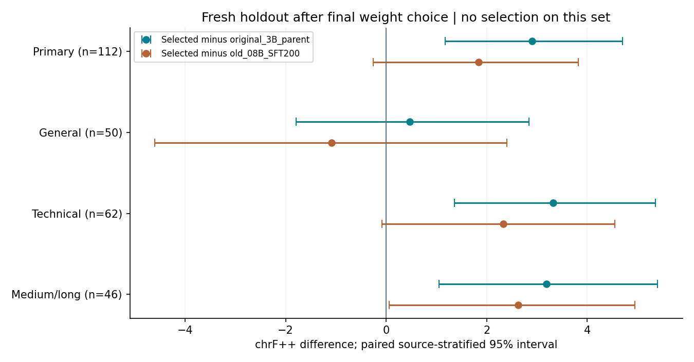
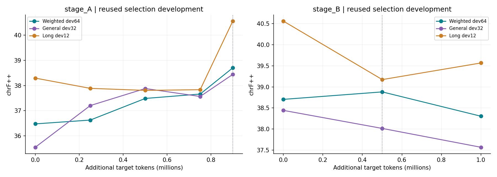
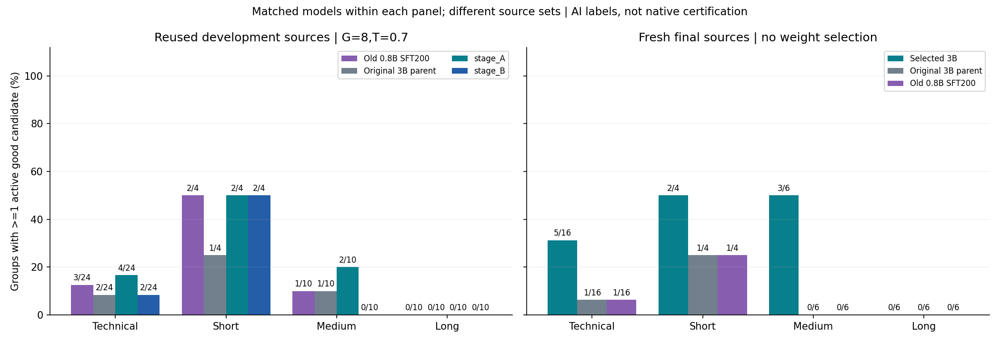

# Complete adaptive continuation within an eight-hour ceiling

Date: 2026-11-18 · Europe/Berlin. All values come from saved actual outputs; the task is English-to-Icelandic translation.

Technical medium/long cases are standalone segments, not full-document translation. Cross-paragraph terminology, document-context reference resolution and discourse coherence are not tested; better segment metrics do not establish document-level readiness.

## Verdict

SFT delivers reproducible gains, but the goal of a broadly strong medium/long-segment base is not met. Selected A scores 44.17 chrF++/25.11 BLEU on 112 fresh primary cases versus 41.27/21.67 for the original 3B, paired chrF gain+2.90 with 95% interval[+1.17, +4.71]. Fresh technical G8 good-candidate coverage is A 5/16, parent 1/16, older 0.8B1/16; A covers 3/6 medium but 0/6 long sources. Retain A as the current 3B translation R0 and restricted-pilot candidate, not a certified comprehensive DAPO/Efficient-ML baseline.

| Question | Answer |
| --- | --- |
| Actor improvement | Paired intervals support primary and technical medium/long overlap-metric gains over the parent3B; fresh G8 adds four technical groups containing both G and P/B. Relative to older0.8B, primary chrF gain is+1.84 but its interval[-0.26,+3.83]Paired intervals support primary and medium/long technical metric gains over the parent; fresh G8 adds four technical groups containing both G and P/B. Versus older 0.8B, the primary chrF gain+1.84 has interval[-0.26, +3.83], so universal significant superiority is unsupported. General 50 scores 35.71 versus 35.24 chrF and 12.58 versus 14.41 BLEU, without reliable improvement. Technical greedy semantics are G=2/16 versus parent 3/16, not a parallel gain; sampling coverage and overlap metrics do not establish comprehensive semantic improvement. |
| Retain as current R0 candidate | Yes: restricted-pilot candidate; comprehensive formal baseline not cleared |
| Small DAPO pilot | A restricted small pilot is conditionally reasonable; another mandatory SFT round is not established. First confirm good candidates and within-group contrast on a separate training/development pool, and clear semantic reward controls; then compare fixed-A standard DAPO with a zero-update control under a small budget. Keep the fresh holdout/G8 sources frozen: do not use them to select training cases, tune reward or choose weights. No observed long-source G is a current limitation, not a universal DAPO threshold or proof that RL cannot help. |
| Reward calibrated | Historical failures are not erased by SFT |
| GPU / GPU | Released；347.97min；11.10CU |

Promotion means the retained current translation R0 candidate and restricted short/medium pilot start; it does not certify a comprehensive formal baseline.

Comprehensive formal baseline ready: False

## Fresh holdout after final weight choice

The128 sources/references were frozen and reviewed before model generation. Seven clear reference defects and nine uncertain references were excluded in advance, leaving112 primary cases; all128 and A-only76 sensitivity sets are disclosed. A heuristic near-duplicate audit against38,671 prior3B pairs found no matches; this is not document-level independence or pretraining decontamination. Weights were sealed before any fresh-holdout generation, with no subsequent training.

| Set | N | Model | chrF++ | BLEU | Trunc | Fail |
| --- | --- | --- | --- | --- | --- | --- |
| primary112 | 112 | selected_3B | 44.17 | 25.11 | 0 | 0 |
| primary112 | 112 | original_3B_parent | 41.27 | 21.67 | 3 | 3 |
| primary112 | 112 | old_08B_SFT200 | 42.33 | 23.09 | 1 | 1 |
| all128 | 128 | selected_3B | 42.91 | 23.33 | 1 | 1 |
| all128 | 128 | original_3B_parent | 40.25 | 20.07 | 4 | 4 |
| all128 | 128 | old_08B_SFT200 | 41.65 | 22.48 | 1 | 1 |
| A_only76 | 76 | selected_3B | 46.14 | 27.95 | 0 | 0 |
| A_only76 | 76 | original_3B_parent | 42.55 | 23.96 | 2 | 2 |
| A_only76 | 76 | old_08B_SFT200 | 44.23 | 25.42 | 1 | 1 |
| primary_general | 50 | selected_3B | 35.71 | 12.58 | 0 | 0 |
| primary_general | 50 | original_3B_parent | 35.24 | 14.41 | 0 | 0 |
| primary_general | 50 | old_08B_SFT200 | 36.80 | 15.78 | 0 | 0 |
| primary_technical | 62 | selected_3B | 45.51 | 27.10 | 0 | 0 |
| primary_technical | 62 | original_3B_parent | 42.19 | 22.72 | 3 | 3 |
| primary_technical | 62 | old_08B_SFT200 | 43.18 | 24.12 | 1 | 1 |
| primary_medium_long | 46 | selected_3B | 44.99 | 26.13 | 0 | 0 |
| primary_medium_long | 46 | original_3B_parent | 41.80 | 21.67 | 3 | 3 |
| primary_medium_long | 46 | old_08B_SFT200 | 42.36 | 22.37 | 1 | 1 |
| technical_short | 16 | selected_3B | 52.05 | 37.98 | 0 | 0 |
| technical_short | 16 | original_3B_parent | 47.16 | 35.70 | 0 | 0 |
| technical_short | 16 | old_08B_SFT200 | 53.58 | 45.75 | 0 | 0 |
| technical_medium | 23 | selected_3B | 40.00 | 16.56 | 0 | 0 |
| technical_medium | 23 | original_3B_parent | 38.49 | 14.52 | 0 | 0 |
| technical_medium | 23 | old_08B_SFT200 | 36.67 | 14.47 | 0 | 0 |
| technical_long | 23 | selected_3B | 46.84 | 28.89 | 0 | 0 |
| technical_long | 23 | original_3B_parent | 43.00 | 23.48 | 3 | 3 |
| technical_long | 23 | old_08B_SFT200 | 44.45 | 24.57 | 1 | 1 |

| Set | ΔchrF++ versus parent3B [95%CI] / vs parent | vs older SFT |
| --- | --- | --- |
| primary112 | +2.90 [+1.17, +4.71] | +1.84 [-0.26, +3.83] |
| all128 | +2.66 [+0.80, +4.52] | +1.25 [-0.91, +3.26] |
| A_only76 | +3.59 [+1.71, +5.79] | +1.91 [-0.08, +3.97] |
| primary_general | +0.47 [-1.79, +2.84] | -1.09 [-4.60, +2.40] |
| primary_technical | +3.32 [+1.36, +5.36] | +2.33 [-0.09, +4.55] |
| primary_medium_long | +3.19 [+1.05, +5.40] | +2.63 [+0.06, +4.95] |
| technical_short | +4.89 [+1.67, +8.63] | -1.53 [-5.90, +3.35] |
| technical_medium | +1.51 [-1.02, +3.72] | +3.33 [+0.75, +5.79] |
| technical_long | +3.84 [+0.78, +6.80] | +2.39 [-1.08, +5.62] |

There are2,000 paired source-stratified bootstrap draws, seed2026111849. Intervals cover source resampling on this sample, not training seeds, document clustering, repeated diagnostic inspection or semantic-review uncertainty; small strata are especially unstable. Reference exclusions alter the general/technical proportions of the primary set; all128 provide a sensitivity comparison.

## Reused diagnostics guiding adaptive stages

| Same reused128 trajectory | chrF++ | BLEU |
| --- | --- | --- |
| Before project SFT | 20.96 | 4.03 |
| First-round parent | 34.46 | 14.51 |
| stage_A | 36.93 | 15.74 |
| stage_B | 37.97 | 17.48 |

The3B Instruct start scored20.96 before project SFT,34.46 after the first round,and36.93/37.97 for A/B on the same reused diagnostic set. This documents both a weak start and real metric gains;it establishes neither a capacity ceiling nor a direct causal link from the current new-pool defects to selected A. Different architectures/data/training histories make0.8B versus3B an uncontrolled size comparison.

| Stage | Set | Selected | Original3B | Older0.8B | Effect CI |
| --- | --- | --- | --- | --- | --- |
| stage_A | all128 | 36.93 | 34.46 | 36.04 | +2.48 [+1.18, +3.97] |
| stage_A | general64 | 35.52 | 32.89 | 36.41 | +2.64 [-0.95, +6.68] |
| stage_A | technical64 | 37.17 | 34.77 | 35.86 | +2.40 [+1.04, +3.97] |
| stage_A | technical_medium_long48 | 37.58 | 35.17 | 36.52 | +2.41 [+0.90, +3.97] |
| stage_B | all128 | 37.97 | 34.46 | 36.04 | +3.51 [+1.44, +5.50] |
| stage_B | general64 | 36.99 | 32.89 | 36.41 | +4.11 [+0.75, +7.61] |
| stage_B | technical64 | 38.09 | 34.77 | 35.86 | +3.32 [+0.83, +5.46] |
| stage_B | technical_medium_long48 | 38.44 | 35.17 | 36.52 | +3.27 [+0.59, +5.51] |

These128 andG8 sources have guided previous diagnostics and adaptive follow-up; they are not an untouched test. Generated dev64 selects by weighted chrF++, while a separate fixed144-pair teacher-forced NLL set (64general/24short/28medium/28long,8,649 target tokens) supplies NLL diagnostics and tie-breaking. In-stage evaluation uses BF16 frozen base plus FP32 adapters; matched final greedy128/G8 use the full model in FP32 with TF32 off. Weighted dev scores are not interchangeable with final128 corpus scores.

## Semantics and good-candidate coverage

G retains core meaning, roles, numbers, negation and clauses, allowing minor inflection errors; P has substantial partial meaning with a major defect; B loses/reverses the central meaning or is nonsensical; U cannot be judged reliably. An active good candidate must also be nonempty and untruncated. Cards hide numeric scores, G8 order is shuffled, and fresh-holdout model identities are shuffled per card. Labels are locked before aggregation. This is same-assistant AI review, not native-expert certification.

| Fresh semantic subset | Model | N | G | P | B | U |
| --- | --- | --- | --- | --- | --- | --- |
| all24 | selected_3B | 24 | 4 | 15 | 5 | 0 |
| all24 | original_3B_parent | 24 | 4 | 12 | 8 | 0 |
| all24 | old_08B_SFT200 | 24 | 3 | 10 | 10 | 1 |
| technical16 | selected_3B | 16 | 2 | 11 | 3 | 0 |
| technical16 | original_3B_parent | 16 | 3 | 9 | 4 | 0 |
| technical16 | old_08B_SFT200 | 16 | 1 | 9 | 6 | 0 |
| general8 | selected_3B | 8 | 2 | 4 | 2 | 0 |
| general8 | original_3B_parent | 8 | 1 | 3 | 4 | 0 |
| general8 | old_08B_SFT200 | 8 | 2 | 1 | 4 | 1 |

### Matched fresh-source G8

At03:57UTC,before any fresh-holdout output or final weight choice,a G8 measurement extension reused exactly the16 technical IDs (4short/6medium/6long) from the earlier frozen24-source semantic subset. No new source selection or primary-mask changes. Each of three models generated16×8;72 greedy labels were locked first,then all24 candidates per source were shuffled with model identities hidden,and384 labels locked before aggregation. These measurements do not select weights or trigger training.

| Fresh subset | Model | Sources | With activeG | G+P/B | Candidates | Truncated |
| --- | --- | --- | --- | --- | --- | --- |
| technical16 | selected_3B | 16 | 5 | 5 | 14/75/39/0 | 1 |
| technical16 | original_3B_parent | 16 | 1 | 1 | 7/62/59/0 | 0 |
| technical16 | old_08B_SFT200 | 16 | 1 | 0 | 8/56/64/0 | 5 |
| technical_short | selected_3B | 4 | 2 | 2 | 9/10/13/0 | 0 |
| technical_short | original_3B_parent | 4 | 1 | 1 | 7/10/15/0 | 0 |
| technical_short | old_08B_SFT200 | 4 | 1 | 0 | 8/13/11/0 | 0 |
| technical_medium | selected_3B | 6 | 3 | 3 | 5/30/13/0 | 0 |
| technical_medium | original_3B_parent | 6 | 0 | 0 | 0/24/24/0 | 0 |
| technical_medium | old_08B_SFT200 | 6 | 0 | 0 | 0/22/26/0 | 1 |
| technical_long | selected_3B | 6 | 0 | 0 | 0/35/13/0 | 1 |
| technical_long | original_3B_parent | 6 | 0 | 0 | 0/28/20/0 | 0 |
| technical_long | old_08B_SFT200 | 6 | 0 | 0 | 0/21/27/0 | 4 |
| A_reference_only | selected_3B | 10 | 3 | 3 | 10/43/27/0 | 1 |
| A_reference_only | original_3B_parent | 10 | 1 | 1 | 7/30/43/0 | 0 |
| A_reference_only | old_08B_SFT200 | 10 | 1 | 0 | 8/26/46/0 | 3 |

Fresh16 and reused24 technical groups have different distributions and denominators and are not pooled. The three fresh conditions are source-matched,but each source has one fixed-seed group of8;the sample is small and reviewed by the same AI rather than native experts. G8 uses the same short instruction as reused diagnostics;greedy uses the fuller meaning/format-preservation instruction. G8:max320,T0.7,top_p1,top_k0,fullFP32,TF32off.

| Stage | Subset | Model | Groups | WithG | G+P/B | Uncertain | Candidates | Truncated |
| --- | --- | --- | --- | --- | --- | --- | --- | --- |
| stage_A | all32 | old_SFT200 | 32 | 7 | 5 | 0 | 28/122/105/1 | 4 |
| stage_A | all32 | original_3B_parent | 32 | 5 | 5 | 0 | 16/118/122/0 | 1 |
| stage_A | all32 | selected_3B | 32 | 6 | 6 | 0 | 10/145/101/0 | 1 |
| stage_A | technical24 | old_SFT200 | 24 | 3 | 2 | 0 | 13/99/79/1 | 4 |
| stage_A | technical24 | original_3B_parent | 24 | 2 | 2 | 0 | 8/96/88/0 | 1 |
| stage_A | technical24 | selected_3B | 24 | 4 | 4 | 0 | 5/111/76/0 | 1 |
| stage_A | general8 | old_SFT200 | 8 | 4 | 3 | 0 | 15/23/26/0 | 0 |
| stage_A | general8 | original_3B_parent | 8 | 3 | 3 | 0 | 8/22/34/0 | 0 |
| stage_A | general8 | selected_3B | 8 | 2 | 2 | 0 | 5/34/25/0 | 0 |
| stage_A | technical_short | old_SFT200 | 4 | 2 | 1 | 0 | 9/14/9/0 | 0 |
| stage_A | technical_short | original_3B_parent | 4 | 1 | 1 | 0 | 7/10/15/0 | 0 |
| stage_A | technical_short | selected_3B | 4 | 2 | 2 | 0 | 3/20/9/0 | 0 |
| stage_A | technical_medium | old_SFT200 | 10 | 1 | 1 | 0 | 4/39/36/1 | 0 |
| stage_A | technical_medium | original_3B_parent | 10 | 1 | 1 | 0 | 1/43/36/0 | 0 |
| stage_A | technical_medium | selected_3B | 10 | 2 | 2 | 0 | 2/49/29/0 | 0 |
| stage_A | technical_long | old_SFT200 | 10 | 0 | 0 | 0 | 0/46/34/0 | 4 |
| stage_A | technical_long | original_3B_parent | 10 | 0 | 0 | 0 | 0/43/37/0 | 1 |
| stage_A | technical_long | selected_3B | 10 | 0 | 0 | 0 | 0/42/38/0 | 1 |
| stage_B | all32 | old_SFT200 | 32 | 7 | 5 | 0 | 28/122/105/1 | 4 |
| stage_B | all32 | original_3B_parent | 32 | 5 | 5 | 0 | 16/118/122/0 | 1 |
| stage_B | all32 | selected_3B | 32 | 3 | 3 | 2 | 7/159/88/2 | 1 |
| stage_B | technical24 | old_SFT200 | 24 | 3 | 2 | 0 | 13/99/79/1 | 4 |
| stage_B | technical24 | original_3B_parent | 24 | 2 | 2 | 0 | 8/96/88/0 | 1 |
| stage_B | technical24 | selected_3B | 24 | 2 | 2 | 2 | 2/130/58/2 | 1 |
| stage_B | general8 | old_SFT200 | 8 | 4 | 3 | 0 | 15/23/26/0 | 0 |
| stage_B | general8 | original_3B_parent | 8 | 3 | 3 | 0 | 8/22/34/0 | 0 |
| stage_B | general8 | selected_3B | 8 | 1 | 1 | 0 | 5/29/30/0 | 0 |
| stage_B | technical_short | old_SFT200 | 4 | 2 | 1 | 0 | 9/14/9/0 | 0 |
| stage_B | technical_short | original_3B_parent | 4 | 1 | 1 | 0 | 7/10/15/0 | 0 |
| stage_B | technical_short | selected_3B | 4 | 2 | 2 | 0 | 2/24/6/0 | 0 |
| stage_B | technical_medium | old_SFT200 | 10 | 1 | 1 | 0 | 4/39/36/1 | 0 |
| stage_B | technical_medium | original_3B_parent | 10 | 1 | 1 | 0 | 1/43/36/0 | 0 |
| stage_B | technical_medium | selected_3B | 10 | 0 | 0 | 1 | 0/62/17/1 | 0 |
| stage_B | technical_long | old_SFT200 | 10 | 0 | 0 | 0 | 0/46/34/0 | 4 |
| stage_B | technical_long | original_3B_parent | 10 | 0 | 0 | 0 | 0/43/37/0 | 1 |
| stage_B | technical_long | selected_3B | 10 | 0 | 0 | 1 | 0/44/35/1 | 1 |

### Exact-text annotation consistency

| Stage | Duplicates | Disagreements | G vs nonG |
| --- | --- | --- | --- |
| stage_A | 21 | 2 | 2 |
| stage_B | 19 | 2 | 2 |

| Stage | Subset | Model | Raw G groups | Symmetric U sensitivity |
| --- | --- | --- | --- | --- |
| stage_A | all32 | old_SFT200 | 7 | 7 |
| stage_A | all32 | original_3B_parent | 5 | 5 |
| stage_A | all32 | selected_3B | 6 | 6 |
| stage_A | technical24 | old_SFT200 | 3 | 3 |
| stage_A | technical24 | original_3B_parent | 2 | 2 |
| stage_A | technical24 | selected_3B | 4 | 4 |
| stage_A | general8 | old_SFT200 | 4 | 4 |
| stage_A | general8 | original_3B_parent | 3 | 3 |
| stage_A | general8 | selected_3B | 2 | 2 |
| stage_B | all32 | old_SFT200 | 7 | 7 |
| stage_B | all32 | original_3B_parent | 5 | 5 |
| stage_B | all32 | selected_3B | 3 | 3 |
| stage_B | technical24 | old_SFT200 | 3 | 3 |
| stage_B | technical24 | original_3B_parent | 2 | 2 |
| stage_B | technical24 | selected_3B | 2 | 2 |
| stage_B | general8 | old_SFT200 | 4 | 4 |
| stage_B | general8 | original_3B_parent | 3 | 3 |
| stage_B | general8 | selected_3B | 1 | 1 |

Some identical source+hypothesis pairs have historical/current label disagreements. Raw locked labels are retained; an exploratory sensitivity analysis symmetrically treats disputed identical texts as U for every model. Stage A has2 G/nonG disagreements; technical coverage remains older SFT3/24, original3B2/24, A4/24. This exposes annotation noise rather than providing a second independent judgement; small semantic subsets cannot guarantee precise rankings.

A cross-stage audit also checks identical texts between A and B; 2 source+hypothesis pairs disagree. Symmetric-U sensitivity checks whether A/B semantic ordering is robust.

| Condition | Subset | Raw withG | Symmetric-U withG |
| --- | --- | --- | --- |
| old_SFT200 | all32 | 7 | 7 |
| old_SFT200 | technical24 | 3 | 3 |
| old_SFT200 | general8 | 4 | 4 |
| old_SFT200 | technical_short | 2 | 2 |
| old_SFT200 | technical_medium | 1 | 1 |
| old_SFT200 | technical_long | 0 | 0 |
| original_3B_parent | all32 | 5 | 5 |
| original_3B_parent | technical24 | 2 | 2 |
| original_3B_parent | general8 | 3 | 3 |
| original_3B_parent | technical_short | 1 | 1 |
| original_3B_parent | technical_medium | 1 | 1 |
| original_3B_parent | technical_long | 0 | 0 |
| stage_A/selected_3B | all32 | 6 | 6 |
| stage_A/selected_3B | technical24 | 4 | 4 |
| stage_A/selected_3B | general8 | 2 | 2 |
| stage_A/selected_3B | technical_short | 2 | 2 |
| stage_A/selected_3B | technical_medium | 2 | 2 |
| stage_A/selected_3B | technical_long | 0 | 0 |
| stage_B/selected_3B | all32 | 3 | 3 |
| stage_B/selected_3B | technical24 | 2 | 2 |
| stage_B/selected_3B | general8 | 1 | 1 |
| stage_B/selected_3B | technical_short | 2 | 2 |
| stage_B/selected_3B | technical_medium | 0 | 0 |
| stage_B/selected_3B | technical_long | 0 | 0 |

Sampling is fixed atG=8,T=0.7,top_p=1,top_k=0,max_new_tokens=320. No observed G does not prove inability under all sampling settings and is not a universal DAPO admission threshold. Coverage, useful within-group contrast and reward ranking require separate assessments.

| Length audit | N | Max prompt | Max reference | References>320 |
| --- | --- | --- | --- | --- |
| selection64 | 64 | 169 | 257 | 0 |
| reused128 | 128 | 133 | 240 | 0 |
| G8_32 | 32 | 158 | 215 | 0 |
| fresh128 | 128 | 153 | 240 | 0 |

The longest G8 reference is215 tokens and the longest selection reference257, both below320. The reference length itself therefore does not impose an unavoidable cap bottleneck; a model may still produce unnecessarily longer translations and truncate, which is reported separately.

## Reward evidence

Historical reward-calibration counterexamples remain failed; SFT gains do not repair them. On selected A reused technical diagnostics, reference MetricX ranks G first in all four G-covered groups, but has 59 discordant of 251 comparable G/P/B pairs; QE top 1G is 3/4. Few reused sources and same-AI review do not certify global calibration, and no reward mode is selected from this check. This round has zero DAPO updates. The new QE-filtered pool enters B, not selected A, so that filtering is not direct current-pool exposure of A.

| Subset | Score | Pairs | Concordant | Discordant | Ties | Top1G when covered |
| --- | --- | --- | --- | --- | --- | --- |
| all32 | reference | 339 | 260 | 79 | 0 | 5/6 |
| all32 | qe | 339 | 239 | 97 | 3 | 4/6 |
| all32 | chrfpp | 339 | 225 | 113 | 1 | 3/6 |
| all32 | full_reference_reward | 339 | 258 | 81 | 0 | 5/6 |
| all32 | full_chrfpp_reward | 339 | 219 | 119 | 1 | 3/6 |
| technical24 | reference | 251 | 192 | 59 | 0 | 4/4 |
| technical24 | qe | 251 | 175 | 73 | 3 | 3/4 |
| technical24 | chrfpp | 251 | 179 | 72 | 0 | 2/4 |
| technical24 | full_reference_reward | 251 | 190 | 61 | 0 | 4/4 |
| technical24 | full_chrfpp_reward | 251 | 173 | 78 | 0 | 2/4 |
| technical_short | reference | 56 | 45 | 11 | 0 | 2/2 |
| technical_short | qe | 56 | 40 | 16 | 0 | 1/2 |
| technical_short | chrfpp | 56 | 38 | 18 | 0 | 2/2 |
| technical_short | full_reference_reward | 56 | 45 | 11 | 0 | 2/2 |
| technical_short | full_chrfpp_reward | 56 | 38 | 18 | 0 | 2/2 |
| technical_medium | reference | 86 | 62 | 24 | 0 | 2/2 |
| technical_medium | qe | 86 | 56 | 30 | 0 | 2/2 |
| technical_medium | chrfpp | 86 | 59 | 27 | 0 | 0/2 |
| technical_medium | full_reference_reward | 86 | 62 | 24 | 0 | 2/2 |
| technical_medium | full_chrfpp_reward | 86 | 59 | 27 | 0 | 0/2 |
| technical_long | reference | 109 | 85 | 24 | 0 | 0/0 |
| technical_long | qe | 109 | 79 | 27 | 3 | 0/0 |
| technical_long | chrfpp | 109 | 82 | 27 | 0 | 0/0 |
| technical_long | full_reference_reward | 109 | 83 | 26 | 0 | 0/0 |
| technical_long | full_chrfpp_reward | 109 | 76 | 33 | 0 | 0/0 |

This round performs no DAPO updates. The new MetricX QE pool enters B,not selected A;the raw ranking data_QE_selection_dependence flag is pipeline-level caution rather than proof that A consumed these17,282 pairs. Historical filtering is not re-audited here. Reused sources,few G-covered groups and same-AI labels still limit the evidence;historical calibration failures remain.

## Actual training and selection

| Sealed item | Value |
| --- | --- |
| Selected stage | stage_A |
| Last executed | stage_B |
| Adapter SHA256 | 9acc23c9595ac0b771bf8f21d125d18f3e993c3f449775377262e7ab73020199 |
| Sealed UTC | 2026-11-18T04:43:45.113439+00:00 |
| No subsequent training | True |

Choose A for final independent evaluation because the goal is DAPO good-candidate coverage and contrast. B improves reused128 chrF++36.93to37.97 and BLEU15.74to17.48,but the B-minus-A chrF interval[-0.63,2.45]crosses zero. On matched G8,confirmed technical coverage is A4/24 versus B2/24(with2 additional uncertain B groups),and G-plus-P/B groups4versus2;B adds no newly confirmed technical-good group. A also retains stronger general/long selection-dev scores. Keep B and its metric gains. This is a conservative goal-oriented tradeoff,not proof of universal A superiority or of A readiness. No fresh-holdout output has been generated and no training follows it.

Executed compute differs from final-model exposure: A consumes898,707 and B1,000,317 additional target tokens,1,899,024 executed this round. Final choice A excludes the B branch; with the first-round999,931,A has1,898,638 cumulative target-token exposures. The selected B500,620 branch has2,399,258,and last-trained B2,898,955. These counts include repeats and are neither unique examples nor a general training-size prescription.

| Stage | Updates | Actual targets | Train min | Stop | Selected | Selected targets | LR | Seed | Planned unique | Planned exposures |
| --- | --- | --- | --- | --- | --- | --- | --- | --- | --- | --- |
| stage_A | 834 | 898707 | 71.95 | token_budget_completed | t0900000 | 898707 | 5e-05 | 2026111741 | 25381 | 26677 |
| stage_B | 955 | 1000317 | 81.57 | development_plateau_two_checks | t0500000 | 500620 | 3e-05 | 2026111841 | 47241 | 55010 |

| Stage | Scope | unique pairs | example exposures | target tokens | New QE pairs | New QE target |
| --- | --- | --- | --- | --- | --- | --- |
| stage_A | planned | 25381 | 26677 | 898707 | 0 | 0 |
| stage_A | executed | 25381 | 26677 | 898707 | 0 | 0 |
| stage_A | selected_weight_prefix | 25381 | 26677 | 898707 | 0 | 0 |
| stage_B | planned | 47241 | 55010 | 1799948 | 14792 | 1127774 |
| stage_B | executed | 30560 | 30560 | 1000317 | 9639 | 624185 |
| stage_B | selected_weight_prefix | 15296 | 15296 | 500620 | 5488 | 324354 |

A reuses the first-round prepared pool, adding10,211 general and686 long pairs beyond first-round executed exposure, with no newly exposed short/medium technical pairs; A does not consume the new QE pool. B plans14,792 new QE pairs, executes9,639 before stopping,and its selected500,620-token prefix sees5,488. Planned pairs are not all trained pairs.

Each stage continues trained LoRA weights with a fresh AdamW, rather than claiming exact optimizer resume across stages. The base is frozen, rank16/alpha32, dropout0.05, seven projection groups, effective batch32, microbatch4 with2/1 fallback, clip1 andweight_decay0.01. Executed group IDs, cursors and token totals are checked against the frozen order; pair use is capped at2 per stage and3 cumulatively across these3B executions, conservatively including discarded branches.

| Alignment audit | Max manual difference | Batch-single difference | Passed |
| --- | --- | --- | --- |
| stage_A | 6.015484149639423e-06 | 3.1789143879468185e-06 | True |
| stage_B | 0.0 | 7.035302340696603e-08 | True |

These saved GPU audits compare the actual loss with explicit next-target cross-entropy starting at the last prompt position, and compare batched with individual calculations. They reduce concern about a simple shift or normalization error; checks on a few examples do not certify every implementation detail or training pair.

A regenerates all128 parent outputs, matching both hypotheses and complete token sequences to the saved original3B results. Later stages may reuse128 parent FP32 outputs after adapter/base identity checks and a fresh8-source full-token probe; reuse is recorded and not counted as128 fresh generations. Each selected stage model generates its final128 andG8 outputs anew.

Selection uses weighted dev64 chrF++ with general-retention and failure guards. Later stages also anchor general retention to the original3B parent, preventing accumulated per-stage degradation. Candidates within0.1 are resolved by technical NLL then earlier target count. Training loss is only an execution diagnostic. Exact parameters, updates, snapshots and candidate tables are indexed below.

| Stage | General | Short | Medium | Long | Physical targets incl retries |
| --- | --- | --- | --- | --- | --- |
| stage_A | 359998 | 44999 | 223758 | 269952 | 898707 |
| stage_B | 400045 | 50006 | 250068 | 300198 | 1000317 |

## Data and QA

| Item | Observed |
| --- | --- |
| Raw pairs | 3221716 |
| Candidates | 28948 |
| By stratum | {'technical_short': 3538, 'general': 3608, 'technical_medium': 15131, 'technical_long': 6671} |
| Initial64 review | {'R': 5, 'C': 18, 'A': 41} |
| Filter changes | Conservative sentence completeness,OCR/blank citations and normalised generic-drug anchors;no reference repairs |

| QE and review | Observed |
| --- | --- |
| Scored/candidates | 28948/28948 |
| Screening seconds | 852.31 |
| Complete/stop | True / complete |
| Initial cutoff and failed QA | error≤4; {'C': 9, 'A': 20, 'R': 2, 'U': 1};FAILED;not used for B |
| Frozen V4 cutoff | error≤3.0;FP32;1536 tokens,overlength rejected |
| Disjoint second32 QA | {'C': 11, 'A': 19, 'U': 2};PASSED;same R+U≤2 gate |
| Excluded uncertain pairs | ['ParIceFiltered:1205080', 'ParIceFiltered:150373'] |
| Global OCR exclusion | 7 |
| Final approved pool | 17282 |
| Final strata | {'technical_medium': 9782, 'technical_short': 2029, 'technical_long': 4102, 'general': 1369} |
| Global rule revisions | ['Exclude archaic English quotations across all corpora', 'Require explicit Chairman role anchor in standalone reference', 'Require high-salience clinical term anchors from the reviewed source/reference domain', 'Reclassify short generic star/moon/sun dialogue without stronger science terms as general'] |

The first32 review (20A/9C/2R/1U) failed the unchanged R+U≤2 gate and was retained, not used to start B. V4 tightened error4 to3, added archaic-quotation, role and clinical-term checks, and reclassified107 generic star/moon/sun dialogues as general. A disjoint32 review gave19A/11C/2U and passed the same gate. Both U pairs and7 globally identified OCR cases were excluded, leaving17,282 approved pairs; B plans14,792 fresh pairs,executes9,639,and its selected prefix consumes5,488,plus vetted general replay. This is same-assistant AI review; C does not mean flawless, and scorer filtering is not semantic certification.

Fresh technical pairs come from already downloaded corpora, excluding exact source/reference overlap with the whole prior3B pool and exact/heuristic near overlap with protected data. General replay uses the older vetted pool with allowances computed from actual executed exposures. Filters do not repair references or guarantee zero noise; false rejections, false acceptances and residual OCR/semantic errors remain possible. Stage B changes data, scale and LR together, so its effect cannot identify one isolated cause.

### Conditional domain-balanced follow-up

Registered after B500k and before B1m, this is adaptive engineering based on reused diagnostics, not an independent single-factor causal experiment. It requires a B plateau stop at≤1.05m targets, completed semantic/integrity review, insufficient candidate coverage and≥165minutes at launch. At most300k targets,unchanged rank16,LR2e-5,equal technical-domain target shares within each length stratum,approved data only,≤2 uses per stage/≤3 cumulative,and the same75-minute final reserve.

C actually executed: False. Its conditional plan and registration-time coverage audit are preserved separately. Unexecuted preparation is not training.

A disjoint32-pair review after domain correction gives21A7C4R,exceeding the fixed R+U≤2 gate. Problems include star plurality,author identity,omitted comparative incidence and context-resolved references. Skip C instead of upweighting rare but unreliable data. Do not rewrite running B;complete its frozen selection/stopping protocol,then seal the best weights and evaluate independently.

| Additional QA | A | C | R | U | Passed |
| --- | --- | --- | --- | --- | --- |
| domain_balanced_QA | 21 | 9 | 2 | 0 | True |
| domain_balanced_QA_v2 | 21 | 7 | 4 | 0 | False |

The extra QA balances technical domains and differs from the original V4 sample;4/32 is not a population error-rate estimate. Keywords can also mislabel Spectrila,radio spectrum and figurative broad spectrum as astronomy. Conservative relabelling and a disjoint new32 review are retained for analysis only;that revised pool was not trained and C has0 GPU updates.

Some R cases resolve references using missing document context;this does not prove that the original document translator was wrong,but the pair remains unsuitable for context-free segment training. Changed author names,plurality and missing comparative risk have direct textual evidence. All reviews are same-assistant AI,not native-expert certification.

Coverage differences and long-score decline are correlational clues. C changes domain mix,order and LR together,so it does not identify the cause or a model-capacity ceiling.

| Review | ID | Source inA | Planned | Executed steps | SelectedB exposures |
| --- | --- | --- | --- | --- | --- |
| domain_balanced_QA | NewSubtitles18:983879 | False | 2 | [26] | 1 |
| domain_balanced_QA | ParIceFiltered:1430642 | False | 2 | [224] | 1 |
| domain_balanced_QA_v2 | ParIceFiltered:715064 | False | 1 | [222] | 1 |
| domain_balanced_QA_v2 | ParIceFiltered:407521 | False | 1 | [] | 0 |
| domain_balanced_QA_v2 | ParIceFiltered:1555911 | False | 1 | [754] | 0 |
| domain_balanced_QA_v2 | ParIceFiltered:73064 | False | 0 | [] | 0 |

A pool defect is not automatically a defect consumed by final weights. The table checks actual updates and selected-B exposure for each reviewed defect. If A is finally chosen,B exposure is not final-model exposure. This is bookkeeping,not a causal ablation,population noise estimate or pretraining audit.

| Stage | Stratum-domain | unique | Actual | Actual targets |
| --- | --- | --- | --- | --- |
| stage_A | general / general | 20044 | 20044 | 359998 |
| stage_A | technical_long / ParIce | 375 | 375 | 65849 |
| stage_A | technical_long / astronomy [source keyword heuristic] | 5 | 5 | 826 |
| stage_A | technical_long / engineering [source keyword heuristic] | 60 | 60 | 10662 |
| stage_A | technical_long / legal [source keyword heuristic] | 802 | 802 | 151974 |
| stage_A | technical_long / medical [source keyword heuristic] | 223 | 223 | 40641 |
| stage_A | technical_medium / ParIce | 1362 | 1944 | 122873 |
| stage_A | technical_medium / astronomy [source keyword heuristic] | 4 | 5 | 300 |
| stage_A | technical_medium / engineering [source keyword heuristic] | 80 | 109 | 7038 |
| stage_A | technical_medium / legal [source keyword heuristic] | 515 | 724 | 52611 |
| stage_A | technical_medium / medical [source keyword heuristic] | 456 | 645 | 40936 |
| stage_A | technical_short / ParIce | 1214 | 1447 | 36749 |
| stage_A | technical_short / engineering [source keyword heuristic] | 21 | 29 | 747 |
| stage_A | technical_short / legal [source keyword heuristic] | 101 | 122 | 3423 |
| stage_A | technical_short / medical [source keyword heuristic] | 119 | 143 | 4080 |
| stage_B | general / astronomy | 105 | 105 | 2223 |
| stage_B | general / general | 22183 | 22183 | 397768 |
| stage_B | general / medical | 2 | 2 | 54 |
| stage_B | technical_long / astronomy | 142 | 142 | 17482 |
| stage_B | technical_long / engineering | 327 | 327 | 42578 |
| stage_B | technical_long / legal | 954 | 954 | 155489 |
| stage_B | technical_long / medical | 558 | 558 | 84649 |
| stage_B | technical_medium / astronomy | 638 | 638 | 40079 |
| stage_B | technical_medium / engineering | 1131 | 1131 | 64373 |
| stage_B | technical_medium / legal | 912 | 912 | 51974 |
| stage_B | technical_medium / medical | 1677 | 1677 | 93642 |
| stage_B | technical_short / astronomy | 124 | 124 | 3030 |
| stage_B | technical_short / engineering | 571 | 571 | 14729 |
| stage_B | technical_short / legal | 383 | 383 | 10143 |
| stage_B | technical_short / medical | 853 | 853 | 22104 |

## Time, cost and preservation

| Item | Actual |
| --- | --- |
| Assigned minutes | 347.97 |
| Within8h | True |
| Observed CU decrease | 11.10 |
| Observed CU/hour | 1.94 |
| Released | True |
| Initial/final CU | 267.04615833395104 / 255.94943351395906 |

Accounting includes setup, downloads, training, evaluation, review idle time and transfers; parallel CPU work is not double-counted. CU settlement may lag. Approximately every5minutes, full adapter/optimizer/RNG/cursor snapshots are chunked to D: and acknowledged after SHA verification. Selected and last-trained adapters are saved separately, final exports have two equal-hash copies, and the57 older0.8B paths plus original selected3B weights are verified unchanged.

Optional fast kernels for some Qwen3.5 convolution/recurrent operations are absent; logs report a correct but slower PyTorch reference fallback. No kernels or frozen evaluation settings were changed mid-run. Total time supports budget accounting, not an efficiency ranking of0.8B versus3B.

## Next step and limits

Do not default to more identical SFT or infer a 0.8B/3B capacity ceiling. Preserve A, B and older models; no training or reselection follows this final independent evaluation. Separate the next questions: (1)recheck short/medium candidate coverage on another verified training/development pool, repair failed reward controls, and run fixed-A restricted standard DAPO versus zero update with independent quality/semantic evaluation; (2)if broad long-segment strength remains the goal, first screen starts with demonstrable English-Icelandic ability on verified technical data, then change only one SFT adaptation factor, such as LoRA rank, under matched data/budget. Higher rank, embedding updates and full tuning are untested and no remedy is guaranteed. Repair discovered reference defects/domain mislabels and obtain disjoint review; scorer filtering is not semantic certification. This final set has now been inspected, so freeze a new test for the next final acceptance.

This is engineering improvement along one frozen-base,rank16 LoRA chain, not a capacity-limit experiment or a single-variable architecture comparison. Higher LoRA ranks, embedding updates and full-parameter SFT are not tested, so these results do not establish the limit of all SFT approaches. They prove neither that further training cannot work nor that it must work. Formal baseline status, small-pilot usefulness and reward readiness are recorded separately.

### Why a strong base is not guaranteed: evidence and unresolved causes

| Question | Observed evidence | Supported conclusion |
| --- | --- | --- |
| Was SFT ineffective? | Same reused128 trajectory. | Real metric gains do not establish complete semantic quality. |
| Simple loss shift bug? | Saved manual cross-entropy and batch audits pass. | No indication in these checks, not a proof of bug-free implementation. |
| Guaranteed benefit from more of the same? | Lower teacher-forced NLL with plateauing/declining generation. | Early stopping is justified; overfitting, data and adaptation limits are not causally separated. |
| Do new-pool defects explain A? | Real reference defects, some consumed by B; A does not use that pool. | Repair is needed, but those defects are not a direct explanation of A. |
| Candidate scarcity or reward? | Reused A:4/24 technical G-covered,0/10 long; reference top1G4/4 when covered, historical failures remain. | Scarcity is directly observed under this sampling rule; reward is also not globally cleared. Their causal shares in RL failure remain unmeasured. |
| Capacity ceiling? | Different histories and architectures; this round only uses frozen-base rank16 LoRA. | No ceiling conclusion; rank, embeddings, full tuning and a stronger Icelandic start are untested. |

## Reproduction and files

| File | Contents |
| --- | --- |
| [final_choice.json](../../runs/r0_3b_overnight_2026-11-18/final_choice.json) | Sealed final weights |
| [final_selected_adapter/](../../runs/r0_3b_overnight_2026-11-18/final_selected_adapter) | Final selected adapter |
| [fresh results.json](../../runs/r0_3b_overnight_2026-11-18/final_evaluation/analysis/results.json) | Fresh statistics |
| [fresh all_cases128.csv](../../runs/r0_3b_overnight_2026-11-18/final_evaluation/analysis/all_cases128.csv) | All fresh outputs |
| [execution_tools/](../../experiments/r0_3b_overnight_2026-11-18/execution_tools) | Tools, no credentials |
| [expanded_data_v3/](../../experiments/r0_3b_overnight_2026-11-18/expanded_data_v3) | Candidates/filter/provenance |
| [data_QE/](../../experiments/r0_3b_overnight_2026-11-18/data_QE) | All scores and failed first QA |
| [data_QE_v4/](../../experiments/r0_3b_overnight_2026-11-18/data_QE_v4) | Revisions,disjoint QA,approved pool |
| [analysis_reproduction/](../../runs/r0_3b_overnight_2026-11-18/analysis_reproduction) | CPU full-field reproduction |
| [actual_cost.json](../../runs/r0_3b_overnight_2026-11-18/actual_cost.json) | Actual accounting |
| [stage_A results.json](../../runs/r0_3b_overnight_2026-11-18/stage_A/analysis/results.json) | Stage metrics,protocol,compute |
| [stage_B results.json](../../runs/r0_3b_overnight_2026-11-18/stage_B/analysis/results.json) | Stage metrics,protocol,compute |

Explicitly load the pinned local base and attach the selected adapter. Do not rely on saved /content paths. An adapter supports inference or a fresh optimizer; exact resume requires the matching checkpoint optimizer, RNG, cursor, order and protocol. Do not attach the last optimizer to an earlier selected adapter.

Matched final evaluation loads the same BF16 base files then converts the entire model to FP32, TF32 off, SDPA, greedy max320, prompt≤1024 without source truncation, enable_thinking=False. The0.8B comparator uses pinned Qwen3.5-0.8B revision2fc06364715b967f1860aea9cf38778875588b17 and its selected SFT200 adapter, not unselected SFT400. Environment versions, base file hashes and code/data hashes are retained in exports and integrity records.

Fresh G8 statistics,all384 candidate rows and locked reviews are retained in the corresponding analysis and G8_review files.

Per-stage annotation audits are in analysis/exact_text_label_audit.json; if final reward ranking is executed, its complete record is final_ranking/analysis.json.

## All128 fresh-holdout cases

NewSubtitles18:256684 · general · primary=True

EN: I'm on a plane to London tomorrow night with my family.

REF: Annað kvöld flýg ég með fjölskyldunni til London.

| Model | Translation | G/P/B/U | chrF++ | Trunc |
| --- | --- | --- | --- | --- |
| selected_3B | Ég er í flugvél til London á morgunkvöldi með fjölskylduna. | Not reviewed | 47.06 | False |
| original_3B_parent | Ég er á flugvelli til Londen í næsta kvöld með fjölskylduna mínum. | Not reviewed | 42.63 | False |
| old_08B_SFT200 | Ég er í flugi til London á næstu kvöld með fjölskylduna mína. | Not reviewed | 49.63 | False |

NewSubtitles18:1136869 · general · primary=False

EN: It's the fastest way to test the theory.

REF: Það er besta leiðin til að kanna kenninguna.

| Model | Translation | G/P/B/U | chrF++ | Trunc |
| --- | --- | --- | --- | --- |
| selected_3B | Það er hæsta leiðinn til að prófa þáttinn. | Not reviewed | 39.83 | False |
| original_3B_parent | Það er hæsta leiðinn til að prófa þáttinn. | Not reviewed | 39.83 | False |
| old_08B_SFT200 | Það er hraust leiðin til að prófa hugmyndina. | Not reviewed | 41.92 | False |

NewSubtitles18:213099 · general · primary=True

EN: Ruined our whole evening.

REF: Eyðileggur allt kvöldið fyrir okkur.

| Model | Translation | G/P/B/U | chrF++ | Trunc |
| --- | --- | --- | --- | --- |
| selected_3B | Það skildi okkur í allan kvöld. | Not reviewed | 22.64 | False |
| original_3B_parent | Það skildi okkar kvöld. | Not reviewed | 15.70 | False |
| old_08B_SFT200 | Það skelfi okkur í kvöld. | Not reviewed | 20.39 | False |

NewSubtitles18:1254909 · general · primary=True

EN: Maybe I didn't have respect for you before because if this is what respecting you feels like this is definitely not how I felt.

REF: Kannski bar ég ekki virðingu fyrir þér áður því að ef mér liður svona þegar ég virði þig þá leið mér ekki þannig áður.

| Model | Translation | G/P/B/U | chrF++ | Trunc |
| --- | --- | --- | --- | --- |
| selected_3B | Kannski hafði ég ekki áherslu fyrir þig því ef þetta er það sem er að hafa áherslu fyrir þig er ég hugsanlega ekki hafa heldur það. | Not reviewed | 27.01 | False |
| original_3B_parent | Kannski hefði ég ekki áhugavirði þér áður því ef þetta er eins og þú hefur áhugavirðið mér er ég ekki hafa það. | Not reviewed | 35.15 | False |
| old_08B_SFT200 | Kannski hef ég ekki hafa haldið þér fyrir mér áður því ef ég hef ekki haldið þér fyrir mér hef ég ekki haldið þér fyrir mér. | Not reviewed | 29.38 | False |

NewSubtitles18:1451662 · general · primary=False

EN: They give it away.

REF: Þau koma upp um þig.

| Model | Translation | G/P/B/U | chrF++ | Trunc |
| --- | --- | --- | --- | --- |
| selected_3B | Þau gefa það út. | Not reviewed | 12.66 | False |
| original_3B_parent | Þeir gefa það út. | Not reviewed | 7.76 | False |
| old_08B_SFT200 | Þeir gefa henni út. | Not reviewed | 6.07 | False |

NewSubtitles18:1566116 · general · primary=True

EN: He died right here in the park.

REF: Hann dó hérna í garðinum.

| Model | Translation | G/P/B/U | chrF++ | Trunc |
| --- | --- | --- | --- | --- |
| selected_3B | Hann dó hér í skópunni. | Not reviewed | 40.99 | False |
| original_3B_parent | Hann dauðist hér í parkinni. | Not reviewed | 26.75 | False |
| old_08B_SFT200 | Hann dó hérna í garðinum. | Not reviewed | 100.00 | False |

NewSubtitles18:473177 · general · primary=True

EN: When you put your legs behind your head and have someone lick your ass.

REF: Maður setur fæturna aftur fyrir haus og lætur sleikja rassinn.

| Model | Translation | G/P/B/U | chrF++ | Trunc |
| --- | --- | --- | --- | --- |
| selected_3B | Þegar þú setur fótina eftir húðinni og þú færð einhvern að hlekkast þig. | Not reviewed | 18.88 | False |
| original_3B_parent | Þegar þú setur fólk í bak á þér og hafa einhvern þykkja þig. | Not reviewed | 16.24 | False |
| old_08B_SFT200 | Þegar þú setur þínar legur aftan höfðina og hefur einhver lakað þig. | Not reviewed | 17.39 | False |

NewSubtitles18:472974 · general · primary=True

EN: It'll be the best movie ever.

REF: Já, það er besta mynd allra tíma.

| Model | Translation | G/P/B/U | chrF++ | Trunc |
| --- | --- | --- | --- | --- |
| selected_3B | Þetta verður besta myndirina. | G | 30.30 | False |
| original_3B_parent | Þetta verður besta filmin sem er. | G | 19.80 | False |
| old_08B_SFT200 | Þetta verður besta myndin. | G | 29.94 | False |

All convey that it will be the best movie; the ever emphasis is weaker and1/2 have inflection or loanword issues, without changing the central prediction.

NewSubtitles18:209632 · general · primary=True

EN: Yes, they were family.

REF: Já, þeir voru skyldir okkur.

| Model | Translation | G/P/B/U | chrF++ | Trunc |
| --- | --- | --- | --- | --- |
| selected_3B | Já, þeir voru fjölskyldu. | Not reviewed | 55.09 | False |
| original_3B_parent | Já, þeir voru fjölskyldur. | Not reviewed | 56.94 | False |
| old_08B_SFT200 | Já, þeir voru fjölskyldur. | Not reviewed | 56.94 | False |

NewSubtitles18:458487 · general · primary=True

EN: If we collar him, we'll be heroes.

REF: Ef við gómum hann verðum við hetjur.

| Model | Translation | G/P/B/U | chrF++ | Trunc |
| --- | --- | --- | --- | --- |
| selected_3B | Ef við kælum hann verðum við heimiltar. | Not reviewed | 61.79 | False |
| original_3B_parent | Ef við kælum hann verðum við herra. | Not reviewed | 61.87 | False |
| old_08B_SFT200 | Ef við kallaum hann verðum við hróðar. | Not reviewed | 59.01 | False |

NewSubtitles18:975576 · general · primary=True

EN: Please, Bella, just stay here.

REF: Gerðu það, BeIIa. Vertu kyrr hérna.

| Model | Translation | G/P/B/U | chrF++ | Trunc |
| --- | --- | --- | --- | --- |
| selected_3B | Vinsamlegast, Bella, haldið þér hérna. | Not reviewed | 22.94 | False |
| original_3B_parent | Vinsamlegast, Bella, haldið hérna. | Not reviewed | 20.31 | False |
| old_08B_SFT200 | Vinsamlegast Bella, verður hérna. | Not reviewed | 26.39 | False |

NewSubtitles18:349340 · general · primary=True

EN: I received a letter this morning, which has astonished me exceedingly.

REF: Ég fékk bréf í morgun sem olli mér stórri furðu.

| Model | Translation | G/P/B/U | chrF++ | Trunc |
| --- | --- | --- | --- | --- |
| selected_3B | Ég fengið bréf í morgun sem hefur óháðað mig. | P | 40.45 | False |
| original_3B_parent | Ég fengið bréf í morgun sem hefur óháðað mig. | P | 40.45 | False |
| old_08B_SFT200 | Ég fékk bréf í morgun sem bráðaði mig. | P | 54.63 | False |

All retain receiving a letter this morning but replace astonishment with a malformed word or melting; identical texts share a label.

NewSubtitles18:533063 · general · primary=True

EN: Do not help that man!

REF: Ekki hjálpa honum!

| Model | Translation | G/P/B/U | chrF++ | Trunc |
| --- | --- | --- | --- | --- |
| selected_3B | Ekki hjálpa þessum maðni! | Not reviewed | 54.31 | False |
| original_3B_parent | Ekki hjálpa þessi mann! | Not reviewed | 53.89 | False |
| old_08B_SFT200 | Ekki hjálpa þessu mann! | Not reviewed | 55.43 | False |

NewSubtitles18:769954 · general · primary=True

EN: Do you mean, Sunnis and Shiites and Kurds?

REF: Sunnítar og Sjítar og Kúrdar?

| Model | Translation | G/P/B/U | chrF++ | Trunc |
| --- | --- | --- | --- | --- |
| selected_3B | Ertu að segja um Súnis og Shíítar og Kúrdar? | Not reviewed | 49.89 | False |
| original_3B_parent | Er það, Súnis og Shíítar og Kúrdar? | Not reviewed | 51.15 | False |
| old_08B_SFT200 | Áttu við, súnnar og shítar og kurdar? | Not reviewed | 31.86 | False |

NewSubtitles18:852425 · general · primary=True

EN: You realize you could have been arrested?

REF: Veistu að þú hefðir getað verið tekin föst?

| Model | Translation | G/P/B/U | chrF++ | Trunc |
| --- | --- | --- | --- | --- |
| selected_3B | Viltu ekki hugsa að þú gætir verið fenginn? | Not reviewed | 24.14 | False |
| original_3B_parent | Hefurðu ekki þáð í huga að þú gætir verið fenginn? | Not reviewed | 23.71 | False |
| old_08B_SFT200 | Þú skilur að þú hefðir getað verið búinn? | Not reviewed | 57.33 | False |

NewSubtitles18:1069982 · general · primary=False

EN: What have you done with it?

REF: Hvað hefurðu gert við þá?

| Model | Translation | G/P/B/U | chrF++ | Trunc |
| --- | --- | --- | --- | --- |
| selected_3B | Hvað hefurðu gert með því? | Not reviewed | 66.24 | False |
| original_3B_parent | Hvað hefurðu gert með það? | Not reviewed | 65.65 | False |
| old_08B_SFT200 | Hvað hefurðu gert með hana? | Not reviewed | 63.91 | False |

NewSubtitles18:1563895 · general · primary=True

EN: I found this in the field today.

REF: Ég fann þetta úti á engi í dag.

| Model | Translation | G/P/B/U | chrF++ | Trunc |
| --- | --- | --- | --- | --- |
| selected_3B | Ég fann þetta í skólanum í dag. | Not reviewed | 52.82 | False |
| original_3B_parent | Ég fann þetta í veldinu í dag. | Not reviewed | 54.18 | False |
| old_08B_SFT200 | Ég fann þetta í veginum í dag. | Not reviewed | 55.25 | False |

NewSubtitles18:991127 · general · primary=True

EN: I was reminded that I, myself, had not eaten.

REF: Ég mundi að sjálfur hafði ég ekkert borðað.

| Model | Translation | G/P/B/U | chrF++ | Trunc |
| --- | --- | --- | --- | --- |
| selected_3B | Mér var minnt að ég hafi ekki borðað mat. | Not reviewed | 22.54 | False |
| original_3B_parent | Mér var minnkað að ég hafi ekki borðað. | Not reviewed | 26.26 | False |
| old_08B_SFT200 | Ég var að minnsta kosti að ég hefði ekki borðað. | Not reviewed | 28.95 | False |

NewSubtitles18:974814 · general · primary=True

EN: It's like a huge hole has been punched through my chest.

REF: Það er eins og svarthoI hafi myndast í brjósti mér.

| Model | Translation | G/P/B/U | chrF++ | Trunc |
| --- | --- | --- | --- | --- |
| selected_3B | Það er eins og það hefur verið þrýst í brjóstið. | Not reviewed | 43.61 | False |
| original_3B_parent | Það er eins og það hefur verið þrýstur í þátt. | Not reviewed | 31.61 | False |
| old_08B_SFT200 | Það er eins og stór hálk séu púntuð í brenninn. | Not reviewed | 34.08 | False |

NewSubtitles18:984460 · general · primary=True

EN: Aren't you worried about feeding them so much sugar?

REF: Ertu ekkert smeykur við að ala þá á svona miklum sykri?

| Model | Translation | G/P/B/U | chrF++ | Trunc |
| --- | --- | --- | --- | --- |
| selected_3B | Ertu ekki hræddur við að fá þeim svona mikið af sykri? | Not reviewed | 42.24 | False |
| original_3B_parent | Ertu ekki áhyggjur af að fá þeim svo mikið af sykrum? | Not reviewed | 24.37 | False |
| old_08B_SFT200 | Ertu ekki hættur af því að fóða þeim svo mikið af sykur? | Not reviewed | 24.43 | False |

NewSubtitles18:1557494 · general · primary=True

EN: Can I see that?

REF: Má ég sjá þetta?

| Model | Translation | G/P/B/U | chrF++ | Trunc |
| --- | --- | --- | --- | --- |
| selected_3B | Get ég séð þetta? | Not reviewed | 39.83 | False |
| original_3B_parent | Má ég sjá það? | Not reviewed | 58.13 | False |
| old_08B_SFT200 | Má ég sjá það? | Not reviewed | 58.13 | False |

NewSubtitles18:1534520 · general · primary=True

EN: Well done, both of you.

REF: Glæsilegt, bæði tvö.

| Model | Translation | G/P/B/U | chrF++ | Trunc |
| --- | --- | --- | --- | --- |
| selected_3B | Þetta var góða, báðir ykkur. | Not reviewed | 12.51 | False |
| original_3B_parent | Þetta er vel gert, báðir þið. | Not reviewed | 15.08 | False |
| old_08B_SFT200 | Það er gott, bæði þið. | Not reviewed | 29.62 | False |

NewSubtitles18:1434224 · general · primary=True

EN: See, that's where I belong.

REF: Vegna þess að þar tileyri ég.

| Model | Translation | G/P/B/U | chrF++ | Trunc |
| --- | --- | --- | --- | --- |
| selected_3B | Sjá, það er hvar ég á að vera. | Not reviewed | 13.51 | False |
| original_3B_parent | Sjá, það er hvar ég ást. | Not reviewed | 12.32 | False |
| old_08B_SFT200 | Það er þar sem ég á. | Not reviewed | 15.20 | False |

NewSubtitles18:434987 · general · primary=False

EN: - How many times did I put it on the line?

REF: - Hve oft hef ég ekki hætt lífi mínu?

| Model | Translation | G/P/B/U | chrF++ | Trunc |
| --- | --- | --- | --- | --- |
| selected_3B | - Hve oft setji ég það á línu? | Not reviewed | 30.59 | False |
| original_3B_parent | Hve oft setji ég það á línu? | Not reviewed | 25.19 | False |
| old_08B_SFT200 | Hversu oft setti ég það á línu? | Not reviewed | 18.44 | False |

NewSubtitles18:1256543 · general · primary=False

EN: - No matter how many e-mails you send... that's not a thing.

REF: - Alveg sama hversu mikið af tölvupóst þú...

| Model | Translation | G/P/B/U | chrF++ | Trunc |
| --- | --- | --- | --- | --- |
| selected_3B | - Það skiptir ekki máli hvað sem þú sendir. | Not reviewed | 11.63 | False |
| original_3B_parent | - Það er ekki svið. Hvað sem þú sendir. | Not reviewed | 11.12 | False |
| old_08B_SFT200 | -Það er ekki neitt, hve mikið þú sendir póstmælir. | Not reviewed | 18.72 | False |

NewSubtitles18:534349 · general · primary=True

EN: But, Blithe, the only hope you have is to accept the fact that you're already dead.

REF: En þín eina von er að taka því að þú sért þegar dauður.

| Model | Translation | G/P/B/U | chrF++ | Trunc |
| --- | --- | --- | --- | --- |
| selected_3B | En það eina hættan þú átt að vera að greina að þú sért þú sért dökt. | Not reviewed | 30.99 | False |
| original_3B_parent | En það er eina hamingju þína að taka tillit til þess að þú sért alveg dáinn. | Not reviewed | 35.92 | False |
| old_08B_SFT200 | En þú hefur eina von á að taka tillit til þess að þú ert þegar dauður. | Not reviewed | 52.83 | False |

NewSubtitles18:1085691 · general · primary=True

EN: But they were unaware of a lioness stalking them.

REF: En þeir vissu ekki af Ijóninu sem elti þá.

| Model | Translation | G/P/B/U | chrF++ | Trunc |
| --- | --- | --- | --- | --- |
| selected_3B | En þau vissu ekki um lykla sem var að hryggja þá. | Not reviewed | 33.05 | False |
| original_3B_parent | En þau vissu ekki á því að hundurinn var að hreyfa þeim. | Not reviewed | 28.71 | False |
| old_08B_SFT200 | En þeir voru óþekktir um lísonna sem stóð á þeim. | Not reviewed | 26.80 | False |

NewSubtitles18:1186481 · general · primary=False

EN: But the... the question is, do you want in?

REF: En spumingin er, viltu fjárfesta í okkur?

| Model | Translation | G/P/B/U | chrF++ | Trunc |
| --- | --- | --- | --- | --- |
| selected_3B | En hvað viljaðu? Viljaðu koma inn? | Not reviewed | 11.05 | False |
| original_3B_parent | En hvað erðu að vilja koma inn? | Not reviewed | 11.65 | False |
| old_08B_SFT200 | En er þér til að taka í stað? | Not reviewed | 14.67 | False |

NewSubtitles18:706154 · general · primary=True

EN: I've staked my crew's life on the theory you're a person, actual and whole, and if I'm wrong, you'd best shoot me now.

REF: Ég veðja lifi starfsmanna minna að þú sért venjuleg persóna. Ef ég hef rangt fyrir mér er best að þú skjótir mig núna.

| Model | Translation | G/P/B/U | chrF++ | Trunc |
| --- | --- | --- | --- | --- |
| selected_3B | Ég hef sett líf fólkanna mína á þá lýsingu að þú sért fullkomin manneskja og ef ég sé rangur, þá ættir þú að skjóta mig núna. | P | 31.47 | False |
| original_3B_parent | Ég hef setti líf ásköpunar minnar á það að þú sért einn fullkomin manns og ef ég er falskur, þá ættir þú að skjauta mig núna. | P | 30.90 | False |
| old_08B_SFT200 | Ég hef stakað lífi hjá hjálfum mínum á þáttarprófununni þess að þú sért manneskja, raun og verki, og ef ég sé réttur, ættu þú að skauta mig núna. | B | 29.08 | False |

0 corrupts crew into creation;1 reverses the if-wrong condition and mistranslates shooting;2 retains the conditional but substantially damages staking lives and the theory formulation.

NewSubtitles18:461413 · general · primary=True

EN: I didn't know where it was.

REF: Ég vissi ekki hvar hún var.

| Model | Translation | G/P/B/U | chrF++ | Trunc |
| --- | --- | --- | --- | --- |
| selected_3B | Ég vissi ekki hvar það var. | Not reviewed | 72.88 | False |
| original_3B_parent | Ég vissi ekki hvar það var. | Not reviewed | 72.88 | False |
| old_08B_SFT200 | Ég vissi ekki hvar það var. | Not reviewed | 72.88 | False |

NewSubtitles18:1247597 · general · primary=False

EN: And you let me know when you have some actual detective work you'd like to discuss.

REF: Og þú lætur mig vita þegar þú ert sumir raunverulegur leynilögreglumaður vinna þú vildi eins og til að ræða.

| Model | Translation | G/P/B/U | chrF++ | Trunc |
| --- | --- | --- | --- | --- |
| selected_3B | Og þú lætir mig vita þegar þú vilt ræða eitthvað í rannsóknarstofu. | Not reviewed | 31.54 | False |
| original_3B_parent | Og þú láttir mig vita þegar þú vilt ræða eitthvað af eigin réttar. | Not reviewed | 29.10 | False |
| old_08B_SFT200 | Og láttu mig vita þegar þú ætlar að rannsaka þig. | Not reviewed | 24.08 | False |

NewSubtitles18:173083 · general · primary=True

EN: - Behind in our rent again.

REF: - Leigan aftur í vanskilum.

| Model | Translation | G/P/B/U | chrF++ | Trunc |
| --- | --- | --- | --- | --- |
| selected_3B | - Það er að vera í ræðu. | B | 11.67 | False |
| original_3B_parent | - Það er í baka við okkur í leigubúnað. | B | 17.94 | False |
| old_08B_SFT200 | - Eftir að við fengum það aftur. | B | 21.24 | False |

All lose being behind on rent again; the third changes rent into rental equipment.

NewSubtitles18:1284533 · general · primary=False

EN: Don't be too hard on yourself I imagine it's not an easy call to make.

REF: Ekki vera með samviskubit. Þetta er ekki auðvelt símtal.

| Model | Translation | G/P/B/U | chrF++ | Trunc |
| --- | --- | --- | --- | --- |
| selected_3B | Ekki vera of hræddur við þig. Ég er með það að það sé ekki einfalt að gera. | Not reviewed | 26.77 | False |
| original_3B_parent | Ekki vera of hræddur á sjálfan þér. Ég er að hugsa að það sé ekki einfaldur ákveðni. | Not reviewed | 24.77 | False |
| old_08B_SFT200 | Ekki vera of erfitt við sjálfan þig. Ég hugsa að það sé ekki auðvelt að koma á. | Not reviewed | 36.34 | False |

NewSubtitles18:967816 · general · primary=True

EN: Something took my daughter.

REF: Eitthvað rændi dóttur minni.

| Model | Translation | G/P/B/U | chrF++ | Trunc |
| --- | --- | --- | --- | --- |
| selected_3B | Eitthvað tókst dóttur mína. | Not reviewed | 41.45 | False |
| original_3B_parent | Eitthvað tók stúlkan mín. | Not reviewed | 27.09 | False |
| old_08B_SFT200 | Eitthvað tók dóttur minn. | Not reviewed | 51.90 | False |

NewSubtitles18:1144953 · general · primary=True

EN: His son is adopted.

REF: Sonur hans er ættleiddur.

| Model | Translation | G/P/B/U | chrF++ | Trunc |
| --- | --- | --- | --- | --- |
| selected_3B | Sonur hans er ástæðuð. | Not reviewed | 52.02 | False |
| original_3B_parent | Sonur hans er ástæðinn. | Not reviewed | 51.62 | False |
| old_08B_SFT200 | Sonur hans er afboðinn. | Not reviewed | 50.47 | False |

NewSubtitles18:1248596 · general · primary=False

EN: We have a witness who saw the suspect and somebody else carrying the Larsen girl out of the building at midnight.

REF: Við höfum vitni sem sá grunar einhver annar vopnaður Larsen stelpu út hússins á miðnætti.

| Model | Translation | G/P/B/U | chrF++ | Trunc |
| --- | --- | --- | --- | --- |
| selected_3B | Við á við eitthvað sem sást ásamt ásamt ásamt ásamt ásamt ásamt ásamt ásamt ásamt ásamt ásamt ásamt ásamt ásamt ásamt ásamt ásamt ásamt ásamt ásamt ásamt ásamt ásamt ásamt ásamt ásamt ásamt ásamt ásamt ásamt ásamt ásamt ásamt ásamt ásamt ásamt ásamt ásamt ásamt ásamt ásamt ásamt ásamt ásamt ásamt ásamt ásamt ásamt ásamt ásamt ásamt ásamt ásamt ásamt ásamt ásamt ásamt ásamt ásamt ásamt ásamt ásamt ásamt ásamt ásamt ásamt ásamt ásamt ásamt ásamt ásamt ásamt ásamt ásamt ásamt ásamt ásamt ásamt ásamt ásamt ásamt ásamt ásamt ásamt ásamt ásamt ásamt ásamt ásamt ásamt ásamt ásamt ásamt ásamt ásamt ásamt ásamt ásamt ásamt ásamt ásamt ásamt á | Not reviewed | 5.30 | True |
| original_3B_parent | Við á eitthvað sem sást áherslu og einhvern sem var að fá Larsen stúlka út úr byggingunni á klukkan klukkan. | Not reviewed | 26.92 | False |
| old_08B_SFT200 | Við höfum sannprófanir sem sáðu óvissan og einhver annar með stúlkanum Larsen út úr byggingunni á myrkrás. | Not reviewed | 36.60 | False |

NewSubtitles18:1012878 · general · primary=True

EN: I only get wheeled out for the finals these days.

REF: Ég er bara sendur á úrsIitaIeikina nú tiI dags.

| Model | Translation | G/P/B/U | chrF++ | Trunc |
| --- | --- | --- | --- | --- |
| selected_3B | Ég er bara fenginn til að hafa þátt í endurtekna. | Not reviewed | 29.13 | False |
| original_3B_parent | Ég er bara hentinn til afhendingar í dag. | Not reviewed | 28.06 | False |
| old_08B_SFT200 | Ég er einungis í leikum í lokum. | Not reviewed | 14.45 | False |

NewSubtitles18:53434 · general · primary=True

EN: That's Mrs. Moons in front.

REF: Frú Moons er fremst.

| Model | Translation | G/P/B/U | chrF++ | Trunc |
| --- | --- | --- | --- | --- |
| selected_3B | Þetta er frú Móns fyrir. | Not reviewed | 21.11 | False |
| original_3B_parent | Þetta er frú Móns í fyrsta. | Not reviewed | 21.99 | False |
| old_08B_SFT200 | Þetta er frú Moons fyrirframan. | Not reviewed | 36.80 | False |

NewSubtitles18:260338 · general · primary=True

EN: I pay taxes and go to church.

REF: Ég borga skatta og fer í kirkju.

| Model | Translation | G/P/B/U | chrF++ | Trunc |
| --- | --- | --- | --- | --- |
| selected_3B | Ég borga skatt og færi í kirkjunni. | Not reviewed | 56.48 | False |
| original_3B_parent | Ég borga skatta og fæ í kirkjunni. | Not reviewed | 71.22 | False |
| old_08B_SFT200 | Ég borga skatta og fara í kirkju. | Not reviewed | 80.00 | False |

NewSubtitles18:622998 · general · primary=True

EN: She was from Mt Abraham.

REF: Hún var frá Mount Abraham.

| Model | Translation | G/P/B/U | chrF++ | Trunc |
| --- | --- | --- | --- | --- |
| selected_3B | Hún var frá Mt Abraham. | Not reviewed | 72.75 | False |
| original_3B_parent | Hún var frá Mt Abraham. | Not reviewed | 72.75 | False |
| old_08B_SFT200 | Hún var frá Mt. Abraham. | Not reviewed | 68.27 | False |

NewSubtitles18:29180 · general · primary=False

EN: She wasn't hurt in any way.

REF: Hún fann alls ekki til.

| Model | Translation | G/P/B/U | chrF++ | Trunc |
| --- | --- | --- | --- | --- |
| selected_3B | Hún var ekki slyst í nokkra til. | Not reviewed | 29.92 | False |
| original_3B_parent | Hún var ekki hættur í einhver hátt. | Not reviewed | 18.81 | False |
| old_08B_SFT200 | Hún var ekki sársaukinn. | Not reviewed | 22.54 | False |

NewSubtitles18:832814 · general · primary=True

EN: As long as I get what's owed to me.

REF: Ef ég fæ það sem mér ber.

| Model | Translation | G/P/B/U | chrF++ | Trunc |
| --- | --- | --- | --- | --- |
| selected_3B | Þar til ég fá það sem ég á að fá. | Not reviewed | 28.93 | False |
| original_3B_parent | Þar til ég fá það sem ég ætlaði. | Not reviewed | 29.10 | False |
| old_08B_SFT200 | Ég hef það sem ég þarf. | Not reviewed | 29.76 | False |

NewSubtitles18:991226 · general · primary=True

EN: Perhaps nothing is made.

REF: Kannski er ekkert búið til.

| Model | Translation | G/P/B/U | chrF++ | Trunc |
| --- | --- | --- | --- | --- |
| selected_3B | Kannski er ekkert gert. | Not reviewed | 61.85 | False |
| original_3B_parent | Kannski er ekkert gert. | Not reviewed | 61.85 | False |
| old_08B_SFT200 | Kannski er ekkert gerð. | Not reviewed | 61.85 | False |

NewSubtitles18:108729 · general · primary=True

EN: Okay, hold it, 1138.

REF: Allt í lagi, hægan, 1138.

| Model | Translation | G/P/B/U | chrF++ | Trunc |
| --- | --- | --- | --- | --- |
| selected_3B | Haltu þetta, 1138. | P | 26.59 | False |
| original_3B_parent | Heldurðu það, 1138. | B | 24.53 | False |
| old_08B_SFT200 | Haldið, 1138. | U | 26.31 | False |

0's bare Haldið is uncertain as a pause command here;1 is literal hold this;2 becomes do you believe it. All retain the number.

NewSubtitles18:1411187 · general · primary=True

EN: Yes, all kinds of people come along.

REF: Já. Það kemur fólk hingað.

| Model | Translation | G/P/B/U | chrF++ | Trunc |
| --- | --- | --- | --- | --- |
| selected_3B | Já, allar konar koma. | Not reviewed | 10.78 | False |
| original_3B_parent | Já, allar tegundir fólk koma. | Not reviewed | 21.43 | False |
| old_08B_SFT200 | Já, öll tegundir af fólki koma. | Not reviewed | 16.92 | False |

NewSubtitles18:5792 · general · primary=True

EN: Even a worm couldn't get through.

REF: Jafnvel ormur kæmist ekki gegn.

| Model | Translation | G/P/B/U | chrF++ | Trunc |
| --- | --- | --- | --- | --- |
| selected_3B | Jafnvel vormi gat ekki komið í. | Not reviewed | 33.22 | False |
| original_3B_parent | Eins og vorminn gat ekki komið í. | Not reviewed | 19.70 | False |
| old_08B_SFT200 | Jæja, nemur enn þó að þrýstir. | Not reviewed | 11.01 | False |

NewSubtitles18:183889 · general · primary=True

EN: I knew he couldn't break them chains.

REF: Hann gat ekki brotið hlekkina.

| Model | Translation | G/P/B/U | chrF++ | Trunc |
| --- | --- | --- | --- | --- |
| selected_3B | Ég vissi að hann gæti ekki breytt þessarir hengi. | Not reviewed | 23.42 | False |
| original_3B_parent | Ég vissi hann gat ekki breytt þessar hengi. | Not reviewed | 39.22 | False |
| old_08B_SFT200 | Ég vissi að hann gæti ekki brotið þeim kettjurnar. | Not reviewed | 37.70 | False |

NewSubtitles18:1022628 · general · primary=True

EN: Navajo, Forego, and Warbucks beginning to move up, followed by My Gallant...

REF: Navajo, Forego og Warbucks færast framar ásamt My Gallant á eftir.

| Model | Translation | G/P/B/U | chrF++ | Trunc |
| --- | --- | --- | --- | --- |
| selected_3B | Navajo, Forego og Warbucks burtu að fara upp og My Gallant fylgir þeim. | Not reviewed | 53.61 | False |
| original_3B_parent | Navajo, Forego og Warbucks bera upp og fylgja My Gallant... | Not reviewed | 51.28 | False |
| old_08B_SFT200 | Navajo, Forego og Warbucks, sem byrja að flýta sig upp, fluttur af My Gallant... | Not reviewed | 50.68 | False |

NewSubtitles18:1535148 · general · primary=True

EN: And you are never gonna guess where he took me.

REF: Og þú getur aldrei giskað á hvert hann fór með mig.

| Model | Translation | G/P/B/U | chrF++ | Trunc |
| --- | --- | --- | --- | --- |
| selected_3B | Og þú hefur aldrei tekið þér áhuga hvar hann fór með mig. | P | 53.07 | False |
| original_3B_parent | Og þú gengur aldrei að því hvar hann fór með mig. | P | 56.48 | False |
| old_08B_SFT200 | Og þú getur aldrei sagt hvar ég fættið hann. | B | 42.82 | False |

0/2 retain where he took me but lose the guessing claim;1 changes the participants and action.

NewSubtitles18:1544006 · general · primary=True

EN: It was just here.

REF: Hún var hérna áðan.

| Model | Translation | G/P/B/U | chrF++ | Trunc |
| --- | --- | --- | --- | --- |
| selected_3B | Þetta var bara hérna. | Not reviewed | 26.35 | False |
| original_3B_parent | Hún var bara hér. | Not reviewed | 37.17 | False |
| old_08B_SFT200 | Hún var bara hér. | Not reviewed | 37.17 | False |

NewSubtitles18:1545296 · general · primary=True

EN: You belong here at home.

REF: Þú átt að vera hérna.

| Model | Translation | G/P/B/U | chrF++ | Trunc |
| --- | --- | --- | --- | --- |
| selected_3B | Þú átt að vera heima. | Not reviewed | 68.94 | False |
| original_3B_parent | Þú áttir hér á heiminn. | Not reviewed | 23.28 | False |
| old_08B_SFT200 | Þú áttu hérna heima. | Not reviewed | 34.36 | False |

NewSubtitles18:990970 · general · primary=False

EN: Another puzzle to be solved?

REF: Er ég þraut til að leysa?

| Model | Translation | G/P/B/U | chrF++ | Trunc |
| --- | --- | --- | --- | --- |
| selected_3B | Einnan leikur sem er að leita að? | Not reviewed | 16.67 | False |
| original_3B_parent | Einn sinn leikur að leita að? | Not reviewed | 16.56 | False |
| old_08B_SFT200 | Einhverra leikar til að leysa? | Not reviewed | 50.92 | False |

NewSubtitles18:561337 · general · primary=True

EN: Yeah, I've been seeing you around, so I thought I'd take a chance and "introduce" myself.

REF: Já, ég hef tekið eftir þér. Ég vildi taka áhættu og koma og kynna mig.

| Model | Translation | G/P/B/U | chrF++ | Trunc |
| --- | --- | --- | --- | --- |
| selected_3B | Já, ég hef séð þig um um, svo ég hélt að taka áhættu og "kynna" mig upp. | Not reviewed | 38.21 | False |
| original_3B_parent | Já, ég hef séð þig um um, svo ég hélt að taka áhættu og "kynna" mig. | Not reviewed | 40.07 | False |
| old_08B_SFT200 | Ég hef séð þig áður en ég tók áhættu og ætlaði að koma í þér. | Not reviewed | 26.77 | False |

NewSubtitles18:10727 · general · primary=True

EN: - I hope I'm not too late.

REF: -Vonandi er ég ekki of seinn.

| Model | Translation | G/P/B/U | chrF++ | Trunc |
| --- | --- | --- | --- | --- |
| selected_3B | - Ég vona að ég sé ekki of seint. | Not reviewed | 40.58 | False |
| original_3B_parent | - Ég vona ekki að ég sé ekki of síðan. | Not reviewed | 31.73 | False |
| old_08B_SFT200 | - Ég vona að ég sé ekki of seinn. | Not reviewed | 51.91 | False |

NewSubtitles18:1261476 · general · primary=True

EN: With gold I shall gladden you, with silver I shall soothe...

REF: Ég skal með gullinu gleðja þig og silfrinu seðja þig..

| Model | Translation | G/P/B/U | chrF++ | Trunc |
| --- | --- | --- | --- | --- |
| selected_3B | Því með gulli gæti ég glæðið þig, með silfur... | Not reviewed | 22.83 | False |
| original_3B_parent | Þá glæði ég þig með gull og því því þá þykkst ég þig með silfur. | Not reviewed | 22.59 | False |
| old_08B_SFT200 | Ég glæð þig með gulli og þreyðir þig með sýgli. | Not reviewed | 24.88 | False |

NewSubtitles18:1029815 · general · primary=True

EN: They heard an orderly went batshit on a patient.

REF: Þeir fréttu af sjúkraliða sem réðst á sjúkling.

| Model | Translation | G/P/B/U | chrF++ | Trunc |
| --- | --- | --- | --- | --- |
| selected_3B | Þeir heyru að ræður hafi verið að hafa verið óhjálfandi við sjúkling. | B | 26.29 | False |
| original_3B_parent | Þeir hlustaðu að ræður hafði sérstaklega verið óháður við sjúkling. | B | 27.68 | False |
| old_08B_SFT200 | Þeir heyruðu að stöðugur farið í hjá sjúklingnum. | B | 25.55 | False |

All lose the central event of an orderly violently losing control toward a patient; the orderly role and violent action are absent.

NewSubtitles18:778670 · general · primary=False

EN: Why did you make me put on this dress?

REF: Af hverju klæðist ég þessum kjól?

| Model | Translation | G/P/B/U | chrF++ | Trunc |
| --- | --- | --- | --- | --- |
| selected_3B | Af hverju gafstu mér þessu kjólin? | Not reviewed | 39.31 | False |
| original_3B_parent | Af hverju gafstu mér það að fá þessu kjósin? | Not reviewed | 35.75 | False |
| old_08B_SFT200 | Af hverju bjóðirðu mér þetta kjól? | Not reviewed | 39.02 | False |

NewSubtitles18:1525800 · general · primary=True

EN: I'm really glad you're here, Mom.

REF: Það er gott að þú ert hér, mamma.

| Model | Translation | G/P/B/U | chrF++ | Trunc |
| --- | --- | --- | --- | --- |
| selected_3B | Ég er mjög hrifin að þú sért hérna, mamma. | G | 38.78 | False |
| original_3B_parent | Ég er mjög hrædd að þú ert hér, mamma. | B | 64.45 | False |
| old_08B_SFT200 | Ég er mjög ánægður að þú sért hér. | G | 23.70 | False |

0 preserves gladness and presence, with a minor omitted Mom vocative;1 conveys pleasure with awkward phrasing;2 changes glad to afraid.

NewSubtitles18:1283705 · general · primary=True

EN: There's hydraulic fluid all over the floor.

REF: Það er glussi úti um allt fólfið.

| Model | Translation | G/P/B/U | chrF++ | Trunc |
| --- | --- | --- | --- | --- |
| selected_3B | Það er fljótt í allri vegginn. | Not reviewed | 21.21 | False |
| original_3B_parent | Það er hydraulísku flösi á allan yfirborði. | Not reviewed | 22.50 | False |
| old_08B_SFT200 | Það er hyljafloð alls um gólfinu. | Not reviewed | 27.76 | False |

NewSubtitles18:347751 · general · primary=True

EN: Have you not seen her?

REF: Hafið þér rekist á hana?

| Model | Translation | G/P/B/U | chrF++ | Trunc |
| --- | --- | --- | --- | --- |
| selected_3B | Hefurðu ekki séð hana? | Not reviewed | 25.51 | False |
| original_3B_parent | Hefurðu ekki séð hana? | Not reviewed | 25.51 | False |
| old_08B_SFT200 | Hefurðu ekki séð hana? | Not reviewed | 25.51 | False |

NewSubtitles18:1058194 · general · primary=True

EN: Why are you wearing pyjamas?

REF: Af hverju ertu í náttfötum?

| Model | Translation | G/P/B/U | chrF++ | Trunc |
| --- | --- | --- | --- | --- |
| selected_3B | Af hverju ertu í kjólsúr? | Not reviewed | 57.41 | False |
| original_3B_parent | Af hverju ertu í pýjámum? | Not reviewed | 60.83 | False |
| old_08B_SFT200 | Af hverju ertu í pyjama? | Not reviewed | 58.39 | False |

NewSubtitles18:1263616 · general · primary=True

EN: We have yet to determine the identity of the deceased and notify his next of kin.

REF: Það á eftir að ákvarða um hver hinn látni er og láta aðstandendur vita.

| Model | Translation | G/P/B/U | chrF++ | Trunc |
| --- | --- | --- | --- | --- |
| selected_3B | Við erum enn ekki að ákveða eiginleikann dauðsins og tilkynna eftirlitsfætur hans. | Not reviewed | 19.52 | False |
| original_3B_parent | Við erum enn ekki að ákveða eiginleikum deyðisins og tilkynna eftirlitsfæðum hans. | Not reviewed | 18.28 | False |
| old_08B_SFT200 | Við höfum ekki ákveðið heimsókn á lífsemi og tilkynntu frambjóðandi. | Not reviewed | 13.69 | False |

NewSubtitles18:1523139 · general · primary=False

EN: I'm at the Country Club!

REF: Ég er á sveitabarnum!

| Model | Translation | G/P/B/U | chrF++ | Trunc |
| --- | --- | --- | --- | --- |
| selected_3B | Ég er á Landshúsinni! | Not reviewed | 31.04 | False |
| original_3B_parent | Ég er á Landshópnum! | Not reviewed | 36.58 | False |
| old_08B_SFT200 | Ég er á íþróttaflokkunni! | Not reviewed | 32.46 | False |

NewSubtitles18:967230 · general · primary=False

EN: What happened here remains unexplained, like Will.

REF: Það sem gerðist hérna er enn óútskýrt eins og dauði Wills.

| Model | Translation | G/P/B/U | chrF++ | Trunc |
| --- | --- | --- | --- | --- |
| selected_3B | Hvað gerðist hérna er óskiljanlegt eins og Will. | Not reviewed | 43.20 | False |
| original_3B_parent | Hvað gerðist hérna er ekki skýrt, eins og Will. | Not reviewed | 45.43 | False |
| old_08B_SFT200 | Það sem gerðist hér er ekki útskýrt eins og Will. | Not reviewed | 56.67 | False |

ParIceFiltered:646459 · technical_short · primary=True

EN: • In compliance with Article 5 of Directive 2006/26/EC:

REF: • Í samræmi við 5. gr. tilskipunar 2006/26/EB:

| Model | Translation | G/P/B/U | chrF++ | Trunc |
| --- | --- | --- | --- | --- |
| selected_3B | • Í samræmi við 5. gr. tilskipunar 2006/26/EB: | Not reviewed | 100.00 | False |
| original_3B_parent | • Í samræmi við 5. gr. tilskipunar 2006/26/EB: | Not reviewed | 100.00 | False |
| old_08B_SFT200 | • Í samræmi við 5. gr. tilskipunar 2006/26/EB: | Not reviewed | 100.00 | False |

ParIceFiltered:1615271 · technical_short · primary=True

EN: You need to turn the electricity down on that damn thing.

REF: Þú þarft að minnka strauminn á þessum fjanda, Kay.

| Model | Translation | G/P/B/U | chrF++ | Trunc |
| --- | --- | --- | --- | --- |
| selected_3B | Þú verður að lækka á eldriðið á þessu. | Not reviewed | 16.99 | False |
| original_3B_parent | Þú verður að drepa eldriðið á þessu. | Not reviewed | 16.50 | False |
| old_08B_SFT200 | Þú þarft að hætta eldastindinni á þessu. | Not reviewed | 34.48 | False |

ParIceFiltered:1278433 · technical_short · primary=True

EN: The plate and inscriptions shall be attached by the manufacturer.

REF: Framleiðandi ökutækisins skal festa þessa plötu og áletrun.

| Model | Translation | G/P/B/U | chrF++ | Trunc |
| --- | --- | --- | --- | --- |
| selected_3B | Það skal framleiðandi setja plátan og skrifstofan á. | P | 28.12 | False |
| original_3B_parent | Plátan og skrifstöðurnar skulu bætist við af framleiðanda. | P | 23.07 | False |
| old_08B_SFT200 | Aðlag og skráningar skulu vera fastanir af framleiðandanum. | P | 21.80 | False |

All retain manufacturer and attachment partly, but inscriptions become registrations or offices;0 also corrupts plate.

ParIceFiltered:940340 · technical_short · primary=True

EN: Other common adverse reactions (>1%) were abdominal pain, abdominal distension and flatulence.

REF: Aðrar algengar aukaverkanir (>1%) voru kviðverkir, uppþemba og vindgangur.

| Model | Translation | G/P/B/U | chrF++ | Trunc |
| --- | --- | --- | --- | --- |
| selected_3B | Auk þessara algengra aukaverkanir (hann hafa meiri en 1% af allum) voru kjölfjöll, kjölfjöll í midjum og flæðing. | B | 32.04 | False |
| original_3B_parent | Aðrar algengar neikvæðar áhrif (>>1%) var í bæði þátttöku, þátttöku í bæði og þátttöku í bæði. | B | 26.81 | False |
| old_08B_SFT200 | Aðrar almenningi einkennin aukaverkanir (>1%) voru magabreytingar, magabreytingar og þungun. | B | 45.26 | False |

None correctly lists the three adverse reactions; substitutions include participation, mountain ridges or pregnancy.

ParIceFiltered:1324822 · technical_short · primary=True

EN: The second indent of the first subparagraph of Article 6 shall be replaced by the following:

REF: Í stað annars undirliðar fyrstu undirgreinar 6. gr. komi eftirfarandi:

| Model | Translation | G/P/B/U | chrF++ | Trunc |
| --- | --- | --- | --- | --- |
| selected_3B | Í stað annars undirliðar fyrstu undirgreinar 6. gr. komi eftirfarandi: | Not reviewed | 100.00 | False |
| original_3B_parent | Í stað annars undirliðar fyrstu undirgreinar 6. gr. skal vera eftirfarandi: | Not reviewed | 87.51 | False |
| old_08B_SFT200 | Í stað annars undirgreinar fyrstu undirgreinar 6. gr. komi eftirfarandi: | Not reviewed | 89.58 | False |

ParIceFiltered:638332 · technical_short · primary=True

EN: • In Annex I, the entry for Bulgaria is deleted.

REF: • Í I. viðauka falli færslan fyrir Búlgaríu brott.

| Model | Translation | G/P/B/U | chrF++ | Trunc |
| --- | --- | --- | --- | --- |
| selected_3B | • Í I. viðauka er færslan fyrir Búlgara fjarlægð. | Not reviewed | 62.75 | False |
| original_3B_parent | • Í I. viðauka er breyttur upplýsingar um Búlgara. | Not reviewed | 39.74 | False |
| old_08B_SFT200 | • Í I. viðauka er fjarlægður færslan fyrir Búlgarien. | Not reviewed | 62.10 | False |

ParIceFiltered:646541 · technical_short · primary=True

EN: • In conformity with Article 4 of Directive 93/94/EEC:

REF: • Í samræmi við 4. gr. tilskipunar 93/94/EBE:

| Model | Translation | G/P/B/U | chrF++ | Trunc |
| --- | --- | --- | --- | --- |
| selected_3B | • Í samræmi við 4. gr. tilskipunar 93/94/EBE: | G | 100.00 | False |
| original_3B_parent | • Í samræmi við 4. gr. tilskipunar 93/94/EBE: | G | 100.00 | False |
| old_08B_SFT200 | • Í samræmi við 4. gr. tilskipunar 93/94/EBE: | G | 100.00 | False |

All identical translations preserve conformity, article and directive identifiers.

ParIceFiltered:638483 · technical_short · primary=True

EN: • In Annex IV, Chapter IV is amended as follows:

REF: • Ákvæðum IV. kafla IV. viðauka er breytt sem hér segir:

| Model | Translation | G/P/B/U | chrF++ | Trunc |
| --- | --- | --- | --- | --- |
| selected_3B | • Í stað IV. liðar í IV. viðauka er breytt sem hér segir: | Not reviewed | 69.49 | False |
| original_3B_parent | • Í stað IV. hluta í IV. kafla er breytt sem hér segir: | Not reviewed | 62.53 | False |
| old_08B_SFT200 | • Í IV. kafla í IV. viðauka er breytt sem hér segir: | Not reviewed | 79.37 | False |

ParIceFiltered:521119 · technical_short · primary=True

EN: However, they may choose to produce a prospectus in accordance with this Directive.

REF: Hins vegar geta þau valið að semja lýsingu í samræmi við þá tilskipun.

| Model | Translation | G/P/B/U | chrF++ | Trunc |
| --- | --- | --- | --- | --- |
| selected_3B | Þeir geta valið að framleiða áætlun í samræmi við þessa tilskipun. | Not reviewed | 46.79 | False |
| original_3B_parent | Þeir geta valið að framleysa áætlun í samræmi við þessa tilskipun. | Not reviewed | 46.79 | False |
| old_08B_SFT200 | Þó geta þau valið að framkvæma áætlanir í samræmi við þessa tilskipun. | Not reviewed | 54.80 | False |

ParIceFiltered:363659 · technical_short · primary=True

EN: Each film-coated tablet contains 200 mg of efavirenz.

REF: Hver filmuhúðuð tafla inniheldur 200 mg af efavírenzi.

| Model | Translation | G/P/B/U | chrF++ | Trunc |
| --- | --- | --- | --- | --- |
| selected_3B | Hver filmþykkta töfla inniheldur 200 mg af efavírenz. | Not reviewed | 68.13 | False |
| original_3B_parent | Hver filmhettuða töfla inniheldur 200 mg af efavírenz. | Not reviewed | 68.68 | False |
| old_08B_SFT200 | Hver filmhúðaður töflurinn inniheldur 200 mg af efavírenzi. | Not reviewed | 72.46 | False |

ParIceFiltered:1402710 · technical_short · primary=True

EN: This treatment may cause fatigue, weakness, blurred vision or dizziness.

REF: Meðferðin getur valdið þróttleysi, þokusýn eða sundli.

| Model | Translation | G/P/B/U | chrF++ | Trunc |
| --- | --- | --- | --- | --- |
| selected_3B | Þessi meðferð getur valdið þungun, vægri ástand, hækkun á sjón eða þvag. | Not reviewed | 35.90 | False |
| original_3B_parent | Þessi meðferð getur gert það að því að það gert sé þvag, viknað, skilvirku augun eða þvag. | Not reviewed | 22.27 | False |
| old_08B_SFT200 | Þessi meðferð getur valdið þreytu, vágreglu, smámynd eða vökvu. | Not reviewed | 36.32 | False |

ParIceFiltered:98252 · technical_short · primary=True

EN: • A model for the information document is given m Annex IIB.

REF: • Fyrirmynd að upplýsingaskjali er að finna í II. viðauka B.

| Model | Translation | G/P/B/U | chrF++ | Trunc |
| --- | --- | --- | --- | --- |
| selected_3B | • Fyrir framleiðslu upplýsingakerfis er tilgreind úr IIB. viðauka. | B | 36.94 | False |
| original_3B_parent | • Tilskipun fyrir upplýsingardæmi er gefið í IIB. viðauka. | P | 36.77 | False |
| old_08B_SFT200 | • Eftirfarandi efnahagsmál er gefið upp í IIB. | B | 16.52 | False |

0 retains information and annex but changes model to directive;1 becomes production of an information system;2 becomes economic affairs.

ParIceFiltered:324302 · technical_short · primary=True

EN: Devices for self-testing must be designed and manufactured in such a way as to:

REF: Búnaður til sjálfprófunar skal hannaður og framleiddur á þann hátt:

| Model | Translation | G/P/B/U | chrF++ | Trunc |
| --- | --- | --- | --- | --- |
| selected_3B | Tækjum til sjálfstæðu prófunar verður að vera ætlaðar og framleiddar þannig að: | Not reviewed | 36.79 | False |
| original_3B_parent | Tækjum til sjálfarprófunar skal vera gerð og framleiddar þannig að: | Not reviewed | 40.69 | False |
| old_08B_SFT200 | Tæki til sjálfbúnaðar skal ákveðið og framleidd í þann hátt að: | Not reviewed | 42.68 | False |

ParIceFiltered:1330106 · technical_short · primary=True

EN: These rules should be incorporated into this Regulation.

REF: Rétt er að fella þessar reglur inn í þessa reglugerð.

| Model | Translation | G/P/B/U | chrF++ | Trunc |
| --- | --- | --- | --- | --- |
| selected_3B | Þessar reglur ættu að vera í samræmi við þessa reglugerð. | Not reviewed | 50.32 | False |
| original_3B_parent | Þessi reglur skulu fylgja þessari reglugerð. | Not reviewed | 36.69 | False |
| old_08B_SFT200 | Þessar reglur skulu innleysnar í þessa reglugerð. | Not reviewed | 53.05 | False |

ParIceFiltered:289805 · technical_short · primary=True

EN: Connect power supply cord to nearby electrical outlet.

REF: Stingið í samband við næstu rafmagnsinnstungu.

| Model | Translation | G/P/B/U | chrF++ | Trunc |
| --- | --- | --- | --- | --- |
| selected_3B | Tengjast árásleitunareiglum við nálægt eldrið. | Not reviewed | 15.65 | False |
| original_3B_parent | Tengjast árásýnirinn til náttúruhúsinu. | Not reviewed | 12.00 | False |
| old_08B_SFT200 | Klikka á stjórnvagninn á snjallagrunni. | Not reviewed | 11.66 | False |

ParIceFiltered:817419 · technical_short · primary=True

EN: Manufacture of other products of wood;

REF: Framleiðsla á annarri viðarvöru;

| Model | Translation | G/P/B/U | chrF++ | Trunc |
| --- | --- | --- | --- | --- |
| selected_3B | Ferliframleiðslu öðru vöxtu úr tré. | Not reviewed | 23.02 | False |
| original_3B_parent | Tölvuður framleiðslu öðru vörufrumur. | Not reviewed | 23.90 | False |
| old_08B_SFT200 | Búnaðarverki á öðrum vöðuvörum; | Not reviewed | 18.80 | False |

ParIceFiltered:1509741 · technical_medium · primary=True

EN: When actions taken by employees lead to improved economic and/or environmental performance of the organisation employees should be rewarded.

REF: Ef starfsmenn aðhafast eitthvað sem leiðir til bætts árangurs á sviði efnahagsmála eða umhverfismála hjá fyrirtækinu /stofnuninni skal umbuna viðkomandi starfsmönnum.

| Model | Translation | G/P/B/U | chrF++ | Trunc |
| --- | --- | --- | --- | --- |
| selected_3B | Þegar starfsmenn leggja fram aðgerðir sem leysa til bæru efnahagslega og/eða umhverfislega hæfni fyrirtækisins ætti að gefa þeim hagnað. | Not reviewed | 27.09 | False |
| original_3B_parent | Ef starfsemi starfsmanna leiddi til bætur á efnahagslegum og/eða umhverfislegum starfsemi fyrirtækisins skal hafa starfsmenn þess í því skyni. | Not reviewed | 33.46 | False |
| old_08B_SFT200 | Þegar starfsmenn, sem taka áfram aðgerðir, leiða til þróunar starfsemi fyrirtækisins og/eða umhverfis, skulu starfsmenn þeirra skila. | Not reviewed | 25.92 | False |

ParIceFiltered:1329006 · technical_medium · primary=True

EN: These patients should undergo an appropriate dynamic test in order to diagnose or exclude a growth hormone deficiency.

REF: Sjúklingar þessir eiga að fara í viðeigandi virknipróf til þess að greina eða útiloka skort á vaxtarhormóni.

| Model | Translation | G/P/B/U | chrF++ | Trunc |
| --- | --- | --- | --- | --- |
| selected_3B | Þessi sjúklingar skulu fá viðeigandi prófun með því að þeir hafa aðhættulega áhrif til að greina eða leysa á að þeir séu með skorti á þrýstingssýru. | B | 36.92 | False |
| original_3B_parent | Þessi sjúklingar skulu fá viðeigandi prófun sem er að gæta eða koma í veg fyrir ónæmis á stöðugum nýrnastarfsemi. | B | 28.06 | False |
| old_08B_SFT200 | Þessi sjúklingar skulu fá viðeigandi starfsemiþekking til að ákvarða eða útskýra af þessu að þeir hafi ekki fengið viðeigandi ræktingu af stórgruhormonu. | B | 30.94 | False |

None reliably expresses dynamic testing to diagnose or exclude growth-hormone deficiency; substitutions include renal function,cultivation or pressure acid.

ParIceFiltered:1374433 · technical_medium · primary=True

EN: This allows astronomers to map out the chemical and physical properties of the material at different points in the nebula.

REF: Það gerir stjörnufræðingum kleift að kortleggja eiginleika efnis á mismunandu stöðum í þokunni.

| Model | Translation | G/P/B/U | chrF++ | Trunc |
| --- | --- | --- | --- | --- |
| selected_3B | Þetta leyfir að þeir skilgreina efnið í efnis og efnahætti í efnið í mismunandi stöðum í nýluninni. | Not reviewed | 27.81 | False |
| original_3B_parent | Þetta leyfir að þeir skilja efnahagslegar og efnahagslegar eiginleikar efnið á mismunandi staði í nýlæti. | Not reviewed | 28.42 | False |
| old_08B_SFT200 | Þetta getur leitt íseyjum til að markaða efnahagslegar og vökvahagslegar eiginleikar efna í blöndunni á mismunandi stað. | Not reviewed | 28.28 | False |

ParIceFiltered:1165655 · technical_medium · primary=True

EN: The CAAP did not respond adequately to requests for information by the Commission, failing in particular to provide the AOC of these air carriers together with the complete operations specifications;

REF: Flugmálastjórn Filippseyja brást ekki á viðunandi hátt við beiðnum framkvæmdastjórnarinnar um upplýsingar, m.a. með því að láta ekki í té flugrekandaskírteini þessara flugrekanda ásamt heildarrekstrarforskriftum.

| Model | Translation | G/P/B/U | chrF++ | Trunc |
| --- | --- | --- | --- | --- |
| selected_3B | CAAP svarði ekki fullnægjandi við beiðnir frá framkvæmdastjórninni, einkum ekki að veita flugrekendur þessara flugrekenda saman með heildarrekstrar um starfsemi. | Not reviewed | 33.42 | False |
| original_3B_parent | CAAP svarði ekki fullnægt tilkynningar framkvæmdastjórnarinnar, einkum ekki að veita upplýsingar um ökutækjum þessara flugrekenda saman með fullu ákvörðunum um starfsemi. | Not reviewed | 31.76 | False |
| old_08B_SFT200 | CAAP sviklaði ekki nægilega við upplýsingarlagt frá framkvæmdastjórninni, að því er varðar að veita AOC þessara flugrekenda samtímis og fulla skýrslu um starfsemi. | Not reviewed | 28.02 | False |

ParIceFiltered:1549691 · technical_medium · primary=True

EN: • Where the calculation is to be made on a consolidated basis, the consolidated amounts relating to the items listed under Article 57 shall be used in accordance with the rules laid down in Chapter 4, Section 1.

REF: • Þar sem útreikningar verða gerðir á samstæðugrundvelli, skulu fjárhæðir samstæðu, sem eiga við þá þætti sem taldir eru í 57. gr., notaðar í samræmi við þær reglur sem settar eru í 1. þætti í 4. kafla.

| Model | Translation | G/P/B/U | chrF++ | Trunc |
| --- | --- | --- | --- | --- |
| selected_3B | • Ef reikningur er að reikna á samstæðu skal nota samstæðuð fjárhæðirnar sem tengjast liðunum sem eru skráð undir 57. gr. í samræmi við reglurnar í 1. þátt 4. kafla. | Not reviewed | 38.38 | False |
| original_3B_parent | • Ef reikningur er að gera á samhliða grundvelli skal nota samhliða fjárhæðir, sem tengjast viðkomandi hlutum, í samræmi við reglurnar sem mælt er fyrir um í 1. hluta 4. kafla. | Not reviewed | 35.09 | False |
| old_08B_SFT200 | • Ef reikningin er að gera á samræmdum fundi skal nota samræmda fjármagnin sem tengjast þeim þætti sem eru tilgreindar undir 57. gr., í samræmi við reglurnar sem mælt er fyrir um í 1. lið 4. kafla. | Not reviewed | 36.68 | False |

ParIceFiltered:671875 · technical_medium · primary=True

EN: In PIER, the primary efficacy endpoint was mean change in visual acuity at 12 months compared with baseline.

REF: Í PIER var fyrsti endapunktur virkni, meðaltal breytinga á sjónskerpu eftir 12 mánuði borið saman við upphafsgildi.

| Model | Translation | G/P/B/U | chrF++ | Trunc |
| --- | --- | --- | --- | --- |
| selected_3B | Í PIER var aðalhrif á virkni með miðgildi breytis á sjónskilunar á 12 mánuðum samanborið við upphaflega gildi. | Not reviewed | 39.15 | False |
| original_3B_parent | Í PIER var viðeigandi áhrif á efnahæfi að gera meðal breytu á sjónarhæfi á 12 mánuðum samanborið við grundvelli. | Not reviewed | 31.54 | False |
| old_08B_SFT200 | Í PIER var meginmarkmiðinn að því að meðaltidi breytti ljósmæði við 12 mánuði samanborið við grundvallarstað. | Not reviewed | 31.40 | False |

ParIceFiltered:145973 · technical_medium · primary=True

EN: Any Member State may refer the Commission's decision to the Council within one month of its notification.

REF: Sérhverju aðildarríki er heimilt að vísa ákvörðun framkvæmdastjórnarinnar til ráðsins innan eins mánaðar frá tilkynningunni um hana.

| Model | Translation | G/P/B/U | chrF++ | Trunc |
| --- | --- | --- | --- | --- |
| selected_3B | Hvert aðildarríki getur látið framkvæmdastjórnina ákveðni sína fyrir ráðið innan eitt mánaða frá tilkynningu. | Not reviewed | 37.27 | False |
| original_3B_parent | Hvert aðildarríki getur látið framkvæmdastjórnina birta ákvörðun þess í ráðinu innan mánaðar frá tilkynningu um hana. | Not reviewed | 48.67 | False |
| old_08B_SFT200 | Hver aðildarríki getur skilað framkvæmdastjórninni ákvörðuninni til ráðsins innan eitt mánaða frá tilkynningu hennar. | Not reviewed | 49.09 | False |

ParIceFiltered:653331 · technical_medium · primary=False

EN: In fact, the nebula contains a prominent cavity that was carved out by an energetic binary star system. This cavity is expanding, causing the interstellar material to pile up and create the reddish arc-shaped border.

REF: Í geimþokunni er áberandi eyða sem orkuríkt tvístirni hefur skapað en það fer vaxandi sem veldur því að efni safnast saman og myndar rauðleitan bogadreginn jaðar.

| Model | Translation | G/P/B/U | chrF++ | Trunc |
| --- | --- | --- | --- | --- |
| selected_3B | Í raunveruleganum er í nýlunni stórt leik sem var skrúður úr styrkum tveimur stjórnsýsnum. Þessi leik er að því að það styrkir upp og því að í meðalljóðið verði það að stökkva og því að það skapaði rauðan áhlið. | Not reviewed | 21.32 | False |
| original_3B_parent | Í raun er það húðlega þess að nýlægur húðin inniheldur mikilvægi skurða sem var skurður úr stjórnunarmjólkum. Þessi skurð er að því að hún er að því að það skiptir í það og því að það skiptir í það og því að það skiptir í það og því að það skiptir í það og því að það skiptir í það og því að það skiptir í það og því að það skiptir í það og því að það skiptir í það og því að það skiptir í það og því að það skiptir í það og því að það skiptir í það og því að það skiptir í það og því að það skiptir í það og því að það skiptir í það og því að það skiptir í það og því að það skiptir í það og því a | Not reviewed | 14.94 | True |
| old_08B_SFT200 | Í nebulu inniheldur mikilvægur vatnsþurrðir sem varðar upp með stóru stöðugri stelpum. Þessi vatnsþurrðir eru að breyta og þeim er að því að verða í gegnum stöðvaðarinnarinnar og skapa ræðandi árðarhæð. | Not reviewed | 21.79 | False |

ParIceFiltered:1294867 · technical_medium · primary=True

EN: The recommended dose titration for children and adolescents is provided below (see tables 1 and 2).

REF: Ráðögð skammtaaðlögun fyrir börn og unglinga er gefin upp hér á eftir (sjá töflur 1 og 2).

| Model | Translation | G/P/B/U | chrF++ | Trunc |
| --- | --- | --- | --- | --- |
| selected_3B | Ráðlagða skammtastærðaðgerðing fyrir börnum og unglinga er fyrir henda (sjá töflu 1 og 2). | P | 48.26 | False |
| original_3B_parent | Ráðlagður skammtastiggingur fyrir börnum og unglinga er gefið eftirfarandi (sjá töflu 1 og 2). | G | 53.05 | False |
| old_08B_SFT200 | Tilvísun er gefin eftirfarandi fyrir ráðstafanir við skammtastærð fyrir börn og unglinga (sjá töflu 1 og 2). | P | 54.21 | False |

0/1 substantially damage titration or provision below;2 uses unusual dose-staging wording but conveys recommended graded dosing,children/adolescents,below and tables1/2.

ParIceFiltered:464737 · technical_medium · primary=True

EN: Grade 3 or 4 infections occurred in 17% of patients.

REF: Greint var frá 3. eða 4. stigs sýkingum hjá 17 % sjúklinga.

| Model | Translation | G/P/B/U | chrF++ | Trunc |
| --- | --- | --- | --- | --- |
| selected_3B | Það varða 17% sjúklinga með 3. eða 4. stigs sýkingar. | G | 59.25 | False |
| original_3B_parent | Í 17% sjúklinga komu fram 3. eða 4. stigs sýkingar. | G | 59.37 | False |
| old_08B_SFT200 | Hjá 17% sjúklinga komu í 3. eða 4. skugga. | B | 45.45 | False |

0/1 preserve17%,grade3/4 and infections,with awkward grammar in1;2 changes infections to shadows.

ParIceFiltered:1258105 · technical_medium · primary=True

EN: The new results show that the plumes seen close to the star are probably connected to structures in the outer nebula now imaged in the infrared with VISIR.

REF: Nýju niðurstöðurnar sýna að strókarnir sem sjást við stjörnuna tengjast líklega þeim formum sem sjá má í ytri hlutum þokunnar á þessari innrauðu ljósmynd sem tekin var með VISIR.

| Model | Translation | G/P/B/U | chrF++ | Trunc |
| --- | --- | --- | --- | --- |
| selected_3B | Nýjar niðurstöðurnar sýna að það sé líklega tengd við stöður í ytri nebulunni sem hafa verið myndar í bláhliði með VISIR. | Not reviewed | 33.12 | False |
| original_3B_parent | Nýjar niðurstöðurnar sýna að þeirri fljóttir sem séu nærri stjarnanum séu líklega tengdar við búnað í ytri nebulunni sem er nú í ljós með hjá VISIR. | Not reviewed | 35.00 | False |
| old_08B_SFT200 | Nýjar niðurstöður sýna að plönturnar sem eru sáir nálægt stjörnunni eru líklega tengdar byggingum í úturbólunni sem eru sýnd í inreindum ljósi með VISIR. | Not reviewed | 32.12 | False |

ParIceFiltered:135999 · technical_medium · primary=True

EN: An indicative breakdown of that amount by sector is set out in section 1.5 of the Annex.

REF: Leiðbeinandi sundurliðun þeirrar fjárhæðar eftir geirum er sett fram í lið 1.5 í viðaukanum.

| Model | Translation | G/P/B/U | chrF++ | Trunc |
| --- | --- | --- | --- | --- |
| selected_3B | Tilkynnta skipting af þessu fjárhæð er sett fram í lið 1.5 viðauka. | P | 38.57 | False |
| original_3B_parent | Tilkynnta skiptingu á þessu fjárhæð er sett fram í lið 1.5 viðbótarinnar. | P | 36.67 | False |
| old_08B_SFT200 | Tilgreina er í 1.5. lið 1. viðauka að vísbendingar breyting á þessum fjárhæðum á þeim hluta sem er ákveðið. | P | 26.22 | False |

Amount and section1.5 partly survive,but the indicative sector breakdown is omitted or changed to alteration;1 also adds Annex1.

ParIceFiltered:693157 · technical_medium · primary=True

EN: In the MCL Clinical Trial, there was no difference in efficacy in patients with respect to age, sex, race, geographic region, or baseline disease characteristics.

REF: Í klínísku rannsókninni á möttulfrumu eitlaæxli kom ekki fram neinn munur á verkun milli sjúklinga með tilliti til aldurs, kyns, kynþáttar, landsvæðis eða sjúkdómseiginleika við grunnlínu.

| Model | Translation | G/P/B/U | chrF++ | Trunc |
| --- | --- | --- | --- | --- |
| selected_3B | Í MCL klínískri rannsókn var engin skammt á verkun hjá sjúklingum með tilliti til aldurar, stjórnar, ríkisins, eða eiginbundinna einkenni í heildarvægi. | Not reviewed | 32.25 | False |
| original_3B_parent | Í MCL klínískri rannsókninni var ekki hægt að greina áhrif á virkni hjá sjúklingum með tilliti til aldurar, stigs, rasa, landshóp eða eiginleika á grundvelli sjúkdómanna. | Not reviewed | 38.65 | False |
| old_08B_SFT200 | Í klínískum rannsókninni á MCL var engin breyting á árangri hjá sjúklingum með tilliti til aldrar, kyns, hreinsunar, landsfólkstæðis eða efnahagslegra efnisregla. | Not reviewed | 36.71 | False |

ParIceFiltered:1227407 · technical_medium · primary=True

EN: The information contained in the declarations concerned by this Annex should be kept for a period of time of at least five years.

REF: Varðveita skal upplýsingarnar í þeim yfirlýsingum sem þessi viðauki fjallar um í að minnsta kosti fimm ár.

| Model | Translation | G/P/B/U | chrF++ | Trunc |
| --- | --- | --- | --- | --- |
| selected_3B | Upplýsingarnar í skýrslunum, sem varða þær aðildarráðstafanir sem um ræðir í þessum viðauka, skulu vera geymdar í fáanlegu tíma í minnsta kosti fimm árum. | Not reviewed | 39.95 | False |
| original_3B_parent | Upplýsingarnar sem eru í skjölum sem um getur í þessari viðauka skulu vera geymdar í áfanga á fimm ára. | Not reviewed | 30.81 | False |
| old_08B_SFT200 | Upplýsingarnar sem eru í tilkynningunum sem um getur í þessum viðauka skulu geymdar í minnst fjögur ár. | Not reviewed | 31.64 | False |

ParIceFiltered:1196718 · technical_medium · primary=True

EN: The dose of Stocrin oral solution must be measured using the oral syringe supplied in the carton.

REF: Mæla verður skammt Stocrin mixtúru með sprautunni sem fylgir með í umbúðunum.

| Model | Translation | G/P/B/U | chrF++ | Trunc |
| --- | --- | --- | --- | --- |
| selected_3B | Mælt skal með skammti Stocrin lausninnar með hafið lyfjapunkti sem fylgir í pakkunni. | Not reviewed | 34.80 | False |
| original_3B_parent | Mælt skal skammta Stocrin lyfjastundarleysunar meðan lyfjastundarleysan sem er í pöskuninni er notaður. | Not reviewed | 23.50 | False |
| old_08B_SFT200 | Mæla skal skammtinn af Stocrin orðislyfjainn með orðislyfssprautunni sem er gefin í hettuglasið. | Not reviewed | 33.30 | False |

ParIceFiltered:68116 · technical_medium · primary=True

EN: After reconstitution, from a microbiological pointy of view, this medicinal product should be used immediately.

REF: Frá örverufræðilegu sjónarmiði ætti að nota lyfið umsvifalaust eftir blöndun.

| Model | Translation | G/P/B/U | chrF++ | Trunc |
| --- | --- | --- | --- | --- |
| selected_3B | Eftir blöndun skal nota lyfið í staðandi tafar sem frá mikrobiótæknilegum skyni. | Not reviewed | 32.81 | False |
| original_3B_parent | Eftir að þessi lyf séu upprunnarstuddu skal nota hann til greina frá mikrobiótæknilegra hátt. | Not reviewed | 19.65 | False |
| old_08B_SFT200 | Eftir blöndun skal nota lyfið strax. | Not reviewed | 27.64 | False |

ParIceFiltered:696945 · technical_medium · primary=True

EN: In this case the sphere of operation and infrastructure must be clearly defined, comprehensively integrated in the management system and precisely described in the environmental statement.

REF: Í þessu tilviki verður að skilgreina rekstrarsviðið og grunnvirkin með skýrum hætti, fella þau í heild inn í stjórnunarkerfið og lýsa þeim nákvæmlega í umhverfisyfirlýsingunni.

| Model | Translation | G/P/B/U | chrF++ | Trunc |
| --- | --- | --- | --- | --- |
| selected_3B | Í þessu tilviki verður að skilgreina skiptisvið og störfleiðasvið skilgreint skilgreind, samhliða í stjórnunarkerfið og skýra skilgreind í umhverfisstjórnunarkynnum. | P | 45.92 | False |
| original_3B_parent | Í þessari tilvik verður að skilgreina skuggaður starfsemi og grundvallarinn í skilgreindri hátt í stjórnunarskjölinni og skilgreina hana í skilgreindri hátt í umhverfisupplýsingunni. | P | 38.25 | False |
| old_08B_SFT200 | Í þessum tilvikum skal skilvirkur áhættustarfsemi og vinnslu skilgreina, hafa í samræmi við stjórnunarkerfið og skýra skýrslan um umhverfisvandamál. | P | 32.55 | False |

Management and environmental wording partly survive,but operating scope,infrastructure,comprehensive integration and precise description are materially damaged.

ParIceFiltered:295070 · technical_medium · primary=True

EN: • Contracting authorities or contracting entities as referred to in point (a) of Article 7(1) should be able to choose to provide their public services jointly by way of cooperation without being obliged to use any particular legal form.

REF: • Samningsyfirvöld eða samningsstofnanir, eins og um getur í a-lið 1. mgr. 7. gr., ættu að geta valið að veita opinbera þjónustu sína sameiginlega með samvinnu án þess að bera skylda til að nota tiltekið lagalegt form.

| Model | Translation | G/P/B/U | chrF++ | Trunc |
| --- | --- | --- | --- | --- |
| selected_3B | • Samningsyfirvöld eða samningsaðila, eins og um getur í a-lið 1. mgr. 7. gr., skulu hafa valkost að vera samstarfseðlaðir að veita opinbera þjónustu saman með samstarfi án þess að þeir hafi skyldu að nota einhverja sérstakar löggjöf. | Not reviewed | 58.80 | False |
| original_3B_parent | • Samningaráðstöfunar eða samningaraðila, eins og um getur í a-lið 1. mgr. 7. gr., skulu hafa hægt að valað að veita opinbera þjónustu sín saman með samstarfi án þess að þeir hafi skyldu að nota einhverja sérstakar löggjöf. | Not reviewed | 54.06 | False |
| old_08B_SFT200 | • Aðildarríkin eða stofnunir samninga, eins og um getur í a-lið 1. mgr. 7. gr., skulu geta valað að veita opinbera þjónustu samkvæmt samvinnu án þess að þeir þurfið að nota tiltekinn lögsskilyrði. | Not reviewed | 57.92 | False |

ParIceFiltered:1216449 · technical_medium · primary=True

EN: The following side effects listing is based on reports from clinical trials with Extavia (List 1) and from side effects reported on the marketed product (List 2).

REF: Eftirfarandi yfirlit um aukaverkanir er byggt á skýrslum um klínískar prófanir á Extavia (Listi 1) og á aukaverkunum lyfsins sem tilkynnt var um eftir markaðssetningu (Listi 2).

| Model | Translation | G/P/B/U | chrF++ | Trunc |
| --- | --- | --- | --- | --- |
| selected_3B | Eftirfarandi skrá yfir aukaverkanir byggist á upplýsingum frá klínískum rannsóknum með Extavia (List 1) og um aukaverkanir sem greint hefur verið frá markaðssetningu (List 2). | Not reviewed | 47.64 | False |
| original_3B_parent | Eftirfarandi skrá á viðkomandi aukaverkunum er byggð á upplýsingum frá klínískum rannsóknum með Extavia (List 1) og frá upplýsingum um aukaverkun sem fylgja markaðssetningu (List 2). | Not reviewed | 46.18 | False |
| old_08B_SFT200 | Eftirfarandi skrá um aukaverkanir er byggð á skýrslum frá klínískum rannsóknum með Extavia (skrá 1) og um aukaverkanir sem kveðið er á markaðssetuð lyfi (skrá 2). | Not reviewed | 46.05 | False |

ParIceFiltered:177730 · technical_medium · primary=True

EN: As the Ovaleap multidose cartridge is intended for several injections, clear instructions should be provided to the patients to avoid misuse of the multidose presentation.

REF: Þar sem Ovaleap fjölskammta rörlykja er ætluð fyrir nokkrar inndælingar skal veita sjúklingunum skýrar leiðbeiningar til þess að forðast ranga notkun fjölskammta lyfsins.

| Model | Translation | G/P/B/U | chrF++ | Trunc |
| --- | --- | --- | --- | --- |
| selected_3B | Þar sem Ovaleap töflunur með fleiri en einu skammta eru ætlaðar til meðferðar á fleiri skammta skal veita sjúklingum skýrt tilkynningu um að vera varúð við ónæmiskun á töflunum með fleiri skammta. | Not reviewed | 35.21 | False |
| original_3B_parent | Í ljósi að því er varðar að meðferð með Ovaleap töflunni er fyrir meira en einn skammta skal veita sjúklingum skýrðingar um að nota skammtaða aðferðina ekki. | Not reviewed | 31.18 | False |
| old_08B_SFT200 | Til að nota öll þrír skammtar með Ovaleap er ætlað að setja til þeirra fleiri skammta, þar með talið að læknir séu að fá sjúklinga aðgerðirnar til að koma í veg fyrir að þær séu misnotar. | Not reviewed | 26.94 | False |

ParIceFiltered:1321928 · technical_medium · primary=True

EN: The sampling point must be easily accessible without requiring the use of any specialised tool or device.

REF: Auðvelt skal vera að komast að sýnatökustaðnum án þess að nota þurfi sérhæfð verkfæri eða tæki.

| Model | Translation | G/P/B/U | chrF++ | Trunc |
| --- | --- | --- | --- | --- |
| selected_3B | Tökustigildið skal vera aðgengilegt án þess að þurfa að nota sérstakt verkmiði eða vörur. | Not reviewed | 37.98 | False |
| original_3B_parent | Samplingsstöðurinn skal vera einkennilega aðgengilegur án þess að það þurfa að nota sérstakt verkmiða eða vörur. | Not reviewed | 34.45 | False |
| old_08B_SFT200 | Sýnileg ástandarstaðin skal vera án þess að þess verði þörf á sérstökum tækjum eða tækjum. | Not reviewed | 31.99 | False |

ParIceFiltered:877184 · technical_medium · primary=True

EN: No dosage adjustment is necessary in patients with hepatic impairment or in patients with mild to moderate renal impairment.

REF: Ekki er nauðsynlegt að aðlaga skammta hjá sjúklingum með skerta lifrarstarfsemi eða sjúklingum með vægt til miðlungsmikið skerta nýrnastarfsemi.

| Model | Translation | G/P/B/U | chrF++ | Trunc |
| --- | --- | --- | --- | --- |
| selected_3B | Ekki er þörf á skammtastarfsemi hjá sjúklingum með skerta lifrarstarfsemi eða hjá sjúklingum með miðlægan eða meðalstóra skerta nýrnastarfsemi. | P | 63.40 | False |
| original_3B_parent | Ekki er nauðsynlegt að breyta skammta hjá sjúklingum með húðskerta eða hjá sjúklingum með smá eða miðlægri skerta nýrnastarfsemi. | P | 62.82 | False |
| old_08B_SFT200 | Ekki er nauðsynlegt að þrýsta viðbót hjá sjúklingum með lifrarverkun eða hjá sjúklingum með mjög smá eða meðal stærð skert nýrnastarfsemi. | P | 53.79 | False |

All partly retain no need and renal impairment;0 changes liver to skin,1/2 damage dose adjustment and severity wording.

ParIceFiltered:973086 · technical_medium · primary=True

EN: Please be aware that your article will not appear in any group until it has been approved by the moderators of the moderated group.

REF: Veittu því athygli að greinin mun mun ekki birtast á neinni ráðstefnu fyrr en hún hefur verið samþykkt af ritstjórum ritstýrðu ráðstefnanna.

| Model | Translation | G/P/B/U | chrF++ | Trunc |
| --- | --- | --- | --- | --- |
| selected_3B | Vinsamlegast er að koma í hug að greinileg grein á greinilegum greinum verður ekki fyrir áhersluðum greinum fyrr en þau eru samþykktar af viðskiptavörum í hins grein. | Not reviewed | 25.49 | False |
| original_3B_parent | Vinsamlegast er að þú veist að greinin þína mun ekki vera í einhverri félög þar til þess að það hafi verið samþykkt af viðurkenninguþjónustu viðurkenninguþjónustu félagsins. | Not reviewed | 30.91 | False |
| old_08B_SFT200 | Þú verður að hafa áhyggjur af því að þessi grein kemur ekki í neinu flokki þar til viðmiðunarmenn flokkans hafa beðið um hana. | Not reviewed | 18.31 | False |

ParIceFiltered:1326760 · technical_medium · primary=True

EN: These grading scores are consistent with no or mild cardiac toxicity.

REF: Þessi stigafjöldi er í samræmi við engin eða væg eituráhrif á hjarta.

| Model | Translation | G/P/B/U | chrF++ | Trunc |
| --- | --- | --- | --- | --- |
| selected_3B | Þessi greiningarskotanir eru í samræmi við enga eða mjög leitt hjartatryggingu. | Not reviewed | 38.57 | False |
| original_3B_parent | Þessi greiningarmerkingar eru í samræmi við enga eða mjög leitt hjartamæði. | Not reviewed | 38.53 | False |
| old_08B_SFT200 | Þessar skírtekin eru í samræmi við engin eða mjög lítil hjartatengd eiturhrif. | Not reviewed | 47.06 | False |

ParIceFiltered:204885 · technical_long · primary=True

EN: Before 1 July 2005, manufacturers shall take steps to provide additional information either directly to the point of sale or to any distributor, covering all new replacement catalytic converters that were introduced for sale in the EU before the date of entry into force of this Directive and which do not otherwise comply with the requirements laid down in Commission Directive 98/77/EC (7).

REF: Fyrir 1. júlí 2005 skulu framleiðendur sjá til þess að viðbótarupplýsingar séu veittar, annaðhvort beint til söluaðila eða dreifingaraðila, um alla, nýja hvarfakúta til endurnýjunar sem hafa verið settir í sölu í ESB fyrir gildistökudag þessarar tilskipunar og sem uppfylla ekki á annan hátt kröfurnar sem mælt er fyrir um í tilskipun framkvæmdastjórnarinnar 98/77/EB (7).

| Model | Translation | G/P/B/U | chrF++ | Trunc |
| --- | --- | --- | --- | --- |
| selected_3B | Fyrir 1. júlí 2005 skulu framleiðendur gera þær ráðstafanir sem eru nauðsynlegar til að veita viðskiptavara að frumkostnaði eða til annarra viðskiptavara, sem gilda um öllum nýrum endurtekinum kettulyfjastofnunum sem var færðir til viðskipta á Evrópusambandið fyrir gildistökudag þessarar tilskipunar og sem ekki uppfylla annars konar kröfur sem mælt er fyrir um í tilskipun framkvæmdastjórnarinnar 98/77/EB (7). | Not reviewed | 54.40 | False |
| original_3B_parent | Fyrir 1. júlí 2005 skulu framleiðendur gera ráðstafanir til að veita viðbótarupplýsingar, annaðhvort beint til viðskiptalegra eða til hvers skrársamstæða, sem gilda um öll nýjar útsetningar af úrþjóðum, sem var gefin til viðskipta áður en þessi tilskipun gerði gildi og sem ekki uppfylla annaðhvort skilyrðin sem mælt er fyrir um í tilskipun framkvæmdastjórnarinnar 98/77/EB (7). | Not reviewed | 54.73 | False |
| old_08B_SFT200 | Áður en framleiðendur hafa gert ráðstafanir til að veita viðbótarupplýsingar, annars staðar en að því markaðsstað, eða til aðeins til aðskilnaða, skal þær fylgja öllum nýjum, nýlegri, útbreiðsluefnum sem eru settar til að sækja á markað í Evrópu fyrir gildistöðuna þessarar tilskipunar og sem ekki uppfylla annars konar kröfur sem mælt er fyrir um í tilskipun framkvæmdastjórnarinnar 98/77/EB (7). | Not reviewed | 50.79 | False |

ParIceFiltered:46031 · technical_long · primary=True

EN: • According to that opinion, biocidal products used for product-type 18 and containing Bacillus sphaericus 2362 serotype H5a5b, strain ABTS1743 may be expected to satisfy the requirements laid down in Article 5 of Directive 98/8/EC of the European Parliament and of the Council (4) provided that certain specifications and conditions relating to its use are satisfied.

REF: • Samkvæmt því áliti má gera ráð fyrir að sæfivörur, sem eru notaðar í vöruflokki 18 og innihalda Bacillus sphaericus 2362 sermigerð H5a5b, stofn ABTS1743, uppfylli kröfurnar sem mælt er fyrir um í 5. gr. tilskipunar Evrópuþingsins og ráðsins 98/8/EB (4) að því tilskildu að tilteknar nákvæmar skilgreiningar og skilyrði sem varða notkun þess séu uppfyllt.

| Model | Translation | G/P/B/U | chrF++ | Trunc |
| --- | --- | --- | --- | --- |
| selected_3B | • Þegar um það er að ræða er heimilt að meta að vörur sem eru notaðar til vörusýns 18 og innihalda Bacillus sphaericus 2362 serútúta H5a5b, stofn ABTS1743, uppfylli kröfurnar sem mælt er fyrir um í 5. gr. tilskipunar Evrópuþingsins og ráðsins 98/8/EB (4) að því tilskildu að tiltekin skilyrði og skilyrði, sem tengjast notkun þess, séu uppfyllt. | P | 70.68 | False |
| original_3B_parent | • Þegar um er að ræða það hér á meðan er búið að nota vörur sem eru notaðar til vörusýns 18 og innihalda Bacillus sphaericus 2362 ser. H5a5b, ABTS1743, er hægt að hafa áhuga að þau uppfylli kröfur sem mælt er fyrir um í 5. gr. tilskipunar Evrópusambandsins og ráðsins 98/8/EB (4) að því tilskildu að tiltekin skilgreiningar og skilyrði, sem tengjast notkun þess, séu uppfyllt. | P | 65.89 | False |
| old_08B_SFT200 | • Í ljósi þess að skoðun er lögð fram geta bióðandi efni, sem eru notaðar í framkvæmd 18. gerðar vörur og innihalda 2362 seriptíu B. ac. sphaericus, H5a5b, ABTS1743, þótt þær hafi verið notaðar í framkvæmd 18. gerðar vörur, uppfyllt kröfurnar sem mælt er fyrir um í 5. gr. tilskipunar Evrópuþingsins og ráðsins 98/8/EB (4) að því tilskildu að tiltekin skýrslur og skilyrði, sem tengjast notkun hennar, sé uppfyllt. | P | 61.45 | False |

Most strain/legal identifiers survive,but biocidal products,expectation based on opinion,and specifications/conditions have important omissions or substitutions;0 alters the organism and adds a clause.

ParIceFiltered:1065628 · technical_long · primary=True

EN: • Since the objectives of the proposed action, namely to harmonise the rules on roadworthiness tests, to prevent distortion of competition as between road hauliers and to guarantee that vehicles are properly checked and main tained, cannot be achieved by the Member States acting alone and can therefore, by reason of the scale of the action, be better achieved at Community level, the Community may adopt measures, in accordance with the principle of subsidiarity as set out in Article 5 of the Treaty.

REF: • Þar eð aðildarríkin geta ekki fyllilega náð markmiðum fyrirhugaðra aðgerða, þ.e. að samræma reglur um prófanir á aksturshæfni, að hindra röskun á samkeppni á milli flutningafyrirtækja á vegum og að tryggja að ökutæki séu rétt skoðuð og haldið við, og þar sem vegna þess hve aðgerðirnar eru umfangsmiklar, og þeim verður betur náð á vettvangi Bandalagsins, er Bandalaginu heimilt að samþykkja ráðstafanir í samræmi við dreifræðisregluna eins og fram kemur í 5. gr. sáttmálans.

| Model | Translation | G/P/B/U | chrF++ | Trunc |
| --- | --- | --- | --- | --- |
| selected_3B | • Þar eð aðildarríkin geta ekki náð markmiðum fyrirhugaðrar aðgerðar, þ.e. að samræma reglur um prófanir á ökuskilyrði, að koma í veg fyrir að skipti sé í skipti milli ökutækja og að tryggja að ökutæki séu í fullu prófaðir og viðhaldið, og því er hægt að ná þeim betur á vettvangi Bandalagsins vegna stigs aðgerðar, er Bandalaginu heimilt að samþykkja ráðstafanir í samræmi við efnisregluna um aðstoð sem sett er fram í 5. gr. sáttmálans. | P | 59.69 | False |
| original_3B_parent | • Þar eð aðildarríkin geta ekki náð markmiðum aðgerðarinnar, þ.e. að samhæfja reglur um prófanir á ökutæki, að koma í veg fyrir að gera útsetningu á samkeppni milli ökutækja og að tryggja að ökutæki séu eftirlit með réttar og haldið á viðeigandi hátt, og því er hægt að ná þeim betur á vettvangi Bandalagsins vegna stigs aðgerðarinnar, er Bandalaginu heimilt að samþykkja ráðstafanir í samræmi við regluna um að undirhaldið er að því er varðar aðildarríkin skulu gera aðgerðir eigi einn og að því er hægt að ná þeim betri á vettvangi Bandalagsins. | P | 54.75 | False |
| old_08B_SFT200 | • Af þeim markmiðum, sem eru tiltekna áætlunin, að samræma reglur um prófun á öryggi vegna vegna, að koma í veg fyrir óþrýsting á samkeppni milli vegnahaldara og að tryggja að ökutæki séu réttvottuð og að hún verði í veg fyrir að þeir verði ekki, er ekki hægt að ná þeim markmiðum með aðildarríkjum sem hafa aðeins aðstoð og þar af leið og þess vegna, vegna þess að áætlunin er mikil, er ráðstafanir ráðstafanabundiðar aðildarríkjanna, í samræmi við þá reglur sem settar eru fram í 5. gr. sáttmálans. | P | 44.32 | False |

All retain parts of harmonized testing and the state/Community framework,but corrupt competitors,testing,maintenance or subsidiarity;0 also loses Community authorization and2 loses Article5.

ParIceFiltered:1065473 · technical_long · primary=True

EN: • Since the objective of the proposed action, the establishment of a Community scheme, cannot be sufficiently achieved by the Member States acting individually, and can therefore by reason of the scale and effects of the proposed action be better achieved at Community level, the Community may adopt measures, in accordance with the principle of subsidiarity as set out in Article 5 of the Treaty.

REF: • Þar eð aðildarríkin geta ekki fyllilega náð því markmiði hvert fyrir sig sem fyrirhugaðar aðgerðir fela í sér, þ.e. að koma á fót kerfi á vegum Bandalagsins, og þar sem auðveldara er að ná markmiðunum á vettvangi Bandalagsins vegna þess hve aðgerðirnar eru umfangsmiklar og hafa víðtæk áhrif er Bandalaginu heimilt að samþykkja ráðstafanir í samræmi við dreifræðisregluna eins og fram kemur í 5. gr. sáttmálans.

| Model | Translation | G/P/B/U | chrF++ | Trunc |
| --- | --- | --- | --- | --- |
| selected_3B | • Þar eð aðildarríkin geta ekki náð markmiði aðferðarinnar, að setja stofnun í bandalaginu, í fullu með því að gera henni aðeins aðildarríkisstörf, og því er hægt að ná henni betur á vettvangi bandalagsins vegna stigs og áhrifa aðferðarinnar, er bandalaginu heimilt að samþykkja ráðstafanir í samræmi við náttúrulegan hætti og skilgreindur er í 5. gr. sáttmálans. | Not reviewed | 46.10 | False |
| original_3B_parent | • Þar eð aðildarríkin geta ekki náð markmiði aðgerðarinnar, að staðfestu samkvæmt aðildarríkjunum, í fullu með því að þeir geri það eigið að því er varðar það að þeir geta náð markmiði aðgerðarinnar í betur stigi á vettvangi bandalagsins vegna stigs og áhrifar aðgerðarinnar. Bandalaginu er heimilt að samþykkja ráðstafanir í samræmi við regluna um að það er rétt að aðildarríkin skipti á undirhöndlun í samræmi við regluna um aðgerðaðeigandi. | Not reviewed | 41.80 | False |
| old_08B_SFT200 | • Þar eð aðildarríkin geta ekki náð markmiðum ákvörðunarinnar, þar sem áætlanin er að gera ráðstafanir í Bandalaginu, að því er varðar aðila, og þar sem áætlanin er að verða betur náð á vettvangi Bandalagsins vegna þess hversu stórt og hvers vegna áætlanin er að verða náð, geta Bandalaginu samþykkt ráðstafanir í samræmi við þá reglu, sem sett er fram í 5. gr. sáttmálans. | Not reviewed | 47.26 | False |

ParIceFiltered:331071 · technical_long · primary=True

EN: Directive 78/933/EEC, as amended by the Directives listed in Annex III, Part A, is repealed, without prejudice to the obli gations of the Member States relating to the time-limits for transposition into national law and application of the Directives set out in Annex III, Part B.

REF: Tilskipun 78/933/EBE, eins og henni var breytt með tilskipunum sem eru tilgreindar í A-hluta III. viðauka, er felld úr gildi með fyrirvara um skuldbindingar aðildarríkjanna að því er varðar fresti þeirra til að lögleiða tilskipanirnar sem eru tilgreindar í B-hluta III. viðauka í landslög og beita þeim.

| Model | Translation | G/P/B/U | chrF++ | Trunc |
| --- | --- | --- | --- | --- |
| selected_3B | Í því tilskipun sem breytt er samkvæmt tilskipunum í A-hluta III. viðauka er ógild, án þess að það skipti í máli við ákvæði aðildarríkja um tímamörk fyrir að úttekti tilskipunanna og beitingu tilskipunanna sem settar eru fram í B-hluta III. viðauka. | Not reviewed | 37.55 | False |
| original_3B_parent | Íslendingabandalaginu er undanþáð tilskipun 78/933/EBE, eins og hún er breytt með tilskipunum sem tilgreind eru í A-hluta III. viðauka, og hefur verið undanþáð, án ákvæða um skuldbindingar aðildarríkja um tímamörk fyrir að gera tilskipun til landslöggjafar og beitingu tilskipunanna sem settar eru fram í B-hluta III. viðauka. | Not reviewed | 55.11 | False |
| old_08B_SFT200 | Tilskipun 78/933/EBE, eins og hún er breytt með tilskipunum sem eru talin í A-hluta III. viðauka, er endurtekinn, án þess að skipta í veg fyrir skuldbindingar aðildarríkjanna um tímabundið tímabreytingu til samþykkis í landslög og beitingu tilskipunar þeirrar sem settar eru fram í B-hluta III. viðauka. | Not reviewed | 58.84 | False |

ParIceFiltered:631272 · technical_long · primary=True

EN: • In accordance with Article 166(1) of the Treaty, it is necessary to establish the scientific and technological objectives and to fix the relevant priorities for the activities envisaged, the maximum overall amount, the detailed rules for Community financial participation in the sixth framework programme, as well as the respective shares in each of the activities envisaged, and to indicate the broad lines of the activities in question, which will be implemented in compliance with the objective of protecting the Community's financial interests.

REF: • Í samræmi við 1. mgr. 166. gr. sáttmálans ber að skilgreina markmið í vísindum og tækni og ákveða forgangsröð þeirrar starfsemi sem fyrirhuguð er, ákveða hámark heildarfjárhæðar, kveða á um fjárframlög bandalagsins til sjöttu rammaáætlunarinnar og sundurliða þau eftir einstökum greinum þeirrar starfsemi sem fyrirhuguð er og setja fram grunnhugmyndir um viðkomandi starfsemi, sem verður framkvæmd í samræmi við markmiðið um að vernda efnahagslega hagsmuni bandalagsins.

| Model | Translation | G/P/B/U | chrF++ | Trunc |
| --- | --- | --- | --- | --- |
| selected_3B | • Þar eð að 1. mgr. 166. gr. sáttmálans er nauðsynlegt að ákvarða vísindalega og tæknilega markmið og ákvarða viðkomandi viðkomandi viðmiðanir fyrir aðgerðirnar sem eru í áætlun, hámarksgildi allsúrritans, skráðar reglur um fjárfestingu Bandalagsins í sex. rammaáætluninni, aðeins og viðkomandi hlutfalli í hverjum aðgerðum sem eru í áætlun, og tilgreina stóra línu ágerðanna sem um ræðir, sem verða framkvæmd í samræmi við markmiðið um vernd fjárfestingar Bandalagsins. | Not reviewed | 41.92 | False |
| original_3B_parent | • Þar eð að er varðar 1. mgr. 166. gr. sáttmálans er nauðsynlegt að kveða á um vísindalegra og tæknilegra markmið og tilgreina viðeigandi árangur fyrir starfsemi sem er tilgreind, hámarksgildi alls, skráðar reglur um fjárfestingar Bandalagsins í ákvörðunum um sjóð í síðustu ramma, aðeins og viðeigandi hlutdeild fyrir hverja starfsemi sem er tilgreind og tilgreina aðallega líkun á starfsemi sem er tilgreind, sem verður framkvæmd í samræmi við markmiðið um vernd fjárfestingar Bandalagsins. | Not reviewed | 46.93 | False |
| old_08B_SFT200 | • Í samræmi við 1. mgr. 166. gr. sáttmálans er nauðsynlegt að staðfesta vísindalegar og tæknilegar markmið og setja viðeigandi mikilvægra áætlanir fyrir starfsemi sem um ræðir, hámarksviðmiðun, þau skilgreindar reglur um fjárhagslega hlutdeild aðildarríkis í sjöa rammaáætluninni, og hlutdeildar í hverjum starfsemi sem um ræðir, og tilgreina mikilvægustu áætlanir starfanna sem um ræðir, sem munu framkvæmdar í samræmi við markmið til að vernda fjárhagslegar áhættu aðildarríkisins. | Not reviewed | 45.97 | False |

ParIceFiltered:972339 · technical_long · primary=True

EN: Plasma exposures to ivacaftor in rats at the non-carcinogenic dosage (50 mg/kg/day, the highest dosage tested) were approximately 17- to 31-fold higher than the plasma levels measured in humans following ivacaftor therapy.

REF: Útsetning fyrir ivacaftori í plasma hjá rottum við skammta sem voru ekki krabbameinsvaldandi (50 mg/kg/sólarhring, stærsti skammtur sem var prófaður) var um það bil 17-falt til 31-falt hærri en sú plasmaþéttni sem mældist hjá mönnum eftir ivacaftor meðferð.

| Model | Translation | G/P/B/U | chrF++ | Trunc |
| --- | --- | --- | --- | --- |
| selected_3B | Plasma útsetning af ivacaftor hjá rottum í 50 mg/kg/dag (höfundar skammtur sem prófunin var framkvæmd á) var um 17 til 31 sinnum hærra en plasma styrkur sem mæld var hjá mönnum eftir meðferð með ivacaftor. | Not reviewed | 39.92 | False |
| original_3B_parent | Plasma útsetning af ivacaftor hjá rottum á óskarþjónustu (50 mg/kg/dag, hámarksþjónustu sem prófunin hefur gert) var um 17 til 31 sinnum hægri en plasmamagnur sem mældu voru hjá manninum eftir meðferð með ivacaftor. | Not reviewed | 35.35 | False |
| old_08B_SFT200 | Plasmaþoðun á ivacaftori hjá rottum á viðmiðunartíðindum (50 mg/kg/dag, þar sem hefur verið rannsakað hásta þoðunartíðind) var um það bil 17- til 31-faldur háttar en þau þeim sem mælt var fyrir um hjá mönnum eftir meðferð með ivacaftori. | Not reviewed | 40.93 | False |

ParIceFiltered:131981 · technical_long · primary=True

EN: An engineers' alarm shall be provided to be operated from the engine control room or at a manoeuvring platform as appropriate, and shall be clearly audible in the engineers' accommodation and/or the navigating bridge as appropriate.

REF: Koma skal fyrir viðvörunarbúnaði fyrir vélstjóra, sem er stjórnað frá stjórnklefa vélarúmsins eða frá stjórnunarstaðnum, eftir því sem við á, og skal hann vera auðheyranlegur í vistarverum vélstjóra og/eða á stjórnpalli, eftir því sem við á.

| Model | Translation | G/P/B/U | chrF++ | Trunc |
| --- | --- | --- | --- | --- |
| selected_3B | Það skal leggja áhættuvarnarekning fyrir stjórnsýslumenn sem er hægt að stjórna henni frá stjórnsýslustofnunni eða á hreyfingarplássum, eftir því sem við á, og hún skal vera skýrt hljóðleg í stjórnsýslustofnunni og/eða áhættuvarnarekningsskólum, eftir því sem við á. | Not reviewed | 43.52 | False |
| original_3B_parent | Því skal veita þjálfunarkvöld til eignarverkanda sem er gert til að hafa í stöðu til stjórnar á ökutækjum eða á hæðarhópum, eins og við á, og því skal hún hægt að heimskulega hljóta í stöðu eignarverkanda og/eða í náttúruhóp, eins og við á. | Not reviewed | 28.20 | False |
| old_08B_SFT200 | Það skal vera veitandi umvörðun fyrir verkfæri í stjórnstóð eða á stjórnvagnsstöð og skal hún hvarfarast ákvarða og hún skal hvarfarast skýrt í búnaði verkfæra eða eða í nágrannvagni. | Not reviewed | 22.30 | False |

ParIceFiltered:295991 · technical_long · primary=True

EN: • Controlled substances and products containing such sub stances shall only be destroyed by approved technologies listed in Annex VII or, in the case of controlled substances not referred to in that Annex, by the most environmentally acceptable destruc tion technology not entailing excessive costs, provided that the use of those technologies complies with Community and national legislation on waste and that additional requirements under such legislation are met.

REF: • Einungis skal eyða takmörkunarskyldum efnum og vörum, sem innihalda slík efni, með viðurkenndri tækni sem skráð er í VII. viðauka eða, ef um er að ræða takmörkunarskyld efni sem ekki er getið um í þeim viðauka, með þeirri eyðingartækni sem er heppilegust fyrir umhverfið og felur ekki í sér óhóflegan kostnað, að því tilskildu að notkun þeirrar tækni samræmist löggjöf Bandalagsins og landslöggjöf um úrgang og að farið sé að viðbótarkröfum samkvæmt slíkri löggjöf.

| Model | Translation | G/P/B/U | chrF++ | Trunc |
| --- | --- | --- | --- | --- |
| selected_3B | • Íhaldsefni og afurðir sem innihalda slík efni skulu bara verða úr hendi með samþykktum tækni sem eru skráð í VII. viðauka eða, ef um er að ræða ótilgreindir íhaldsefni, með þeim tækni sem er hæfileg fyrirhugað til úrheyrðinga og sem ekki krefur of mikill kostnað, að því tilskildu að notkun þessara tækna uppfylli löggjöf Bandalagsins og aðildarríkis um úrgang og að viðbótarkröfur í slíkri löggjöf séu uppfyllt. | Not reviewed | 50.45 | False |
| original_3B_parent | • Aðeins skal drepa hefðir og afurðir sem innihalda slík efnis í samræmi við viðurkenndar tækni sem eru skráðar í VII. viðauka eða, ef um er að ræða hefðir sem eru ekki í tengslum við í þeim viðauka, með því að nota eftirfarandi efnisverkun sem er efnahagslega best og ekki inniheldur of mikið kostnað, að því tilskildu að notkun þessara tækni uppfylli löggjöf Bandalagsins og aðildarríkis um úrræði og að viðbótarkröfur í þeim löggjöf séu uppfyllt. | Not reviewed | 51.36 | False |
| old_08B_SFT200 | • Meðal efnasæturna og efna sem innihalda slíka efnasæturna skal einungis skilgreina með viðurkenndri tækni sem er skráð í VII. viðauka eða, ef um er að ræða efnasæturnar sem ekki eru tilgreindar í þeim viðauka, með þeim efnasæturnar sem eru ekki tilgreindar í þeim viðauka, með eðlilegri umhverfisáhrif en ekki með of miklum kostnaði, að því tilskildu að notkun þessarar tækni uppfylli löggjöf Bandalagsins og landsbundinna löggjöfanna um úrgang og að viðkomandi kröfur, sem eru undir slíku löggjöf, uppfylli. | Not reviewed | 54.00 | False |

ParIceFiltered:1356428 · technical_long · primary=True

EN: • The volume of allowances covered by Chapter III of Direc tive 2003/87/EC to be auctioned each calendar year as from 2013 shall be based on the Commissions determination and publica tion pursuant to Article 10(1) of that Directive of the estimated amount of allowances to be auctioned or on the most recent amendment of the Commissions original estimate as published by 31 January of the preceding year.

REF: • Sá fjöldi losunarheimilda, sem fellur undir III. kafla tilskipunar 2003/87/EB og á að bjóða upp á hverju almanaksári frá og með 2013, skall grundvallast á ákvörðun framkvæmdastjórnarinnar og birtingu á áætluðu magni losunarheimilda, sem bjóða á upp skv. 1. mgr. 10. gr. sömu tilskipunar, eða á nýjustu breytingum á upprunalegu mati framkvæmdastjórnarinnar sem var birt eigi síðar en 31. janúar á árinu á undan.

| Model | Translation | G/P/B/U | chrF++ | Trunc |
| --- | --- | --- | --- | --- |
| selected_3B | • Vaxt fyrir fyrirkomulag sem fyrirhugað er og er tilgreindur samkvæmt 1. mgr. 10. gr. þeirrar tilskipunar 2003/87/EB og er til að ganga fram árlega, frá og með 2013, skal vera á grundvelli ákvörðunar framkvæmdastjórnarinnar og frákostningar hennar í samræmi við 10. gr. 1. gr. þeirrar tilskipunar, sem ákvarðaður er um áætlaða fjárhæð fyrir fyrirkomulag sem fyrirhugað er, eða síðasta breytingu á upprunalegu áætlanum framkvæmdastjórnarinnar sem er birt á 31. janúar árlega. | Not reviewed | 47.31 | False |
| original_3B_parent | • Í því skyni að það er heimilt að gögnir um fyrirvara, sem falla undir III. kafla tilskipunar 2003/87/EB, séu í búnar á árskrár og frá 2013 skal þessi skuggaður fjölda fyrirvara, sem er heimilt að gögnir um fyrirvara, sem falla undir III. kafla tilskipunar 2003/87/EB, séu í búnar á árskrár og frá 2013, búa til ákvörðunar framkvæmdastjórnarinnar og birtunar þess í samræmi við 1. mgr. 10. gr. þeirrar tilskipunar og ákvörðun framkvæmdastjórnarinnar um fyrirvara sem er heimilt að gögnir um fyrirvara, sem falla undir III. kafla tilskipunar 2003/87/EB, séu í búnar á árskrár og frá 2013, sem er heimilt að gögnir um fyrirvara, sem falla undir III. kafla tilskipunar 2003/87 | Not reviewed | 41.41 | True |
| old_08B_SFT200 | • Í miðju skal hvers ársreikningsskjal, sem er undirgögn í III. kafla viðatökuforskriftar 2003/87/EB, sem er aðgerð fyrir upprunalega skjal sem framkvæmdastjórnin ákveður og er birt í skrifstofu sínu í samræmi við 1. mgr. 10. gr. þessarar tilskipunar, að því er varðar áætlaðan fjárhæð undirtökuforskriftar eða eftirfarandi nýstöðugri breytingu á upprunalegum skjalum framkvæmdastjórnarinnar sem birt er fyrir 31. janúar á fyrra ári. | Not reviewed | 40.93 | False |

ParIceFiltered:99122 · technical_long · primary=False

EN: A multicentre, randomised, open label phase 3 study of pemetrexed versus docetaxel in patients with locally advanced or metastatic NSCLC after prior chemotherapy has shown median survival times of 8.3 months for patients treated with pemetrexed (Intent To Treat population n = 283) and 7.9 months for patients treated with docetaxel (ITT n = 288).

REF: Fjölsetra, slembiröðuð, opin fasa 3 rannsókn með pemetrexed samanborið við docetaxel hjá sjúklingum með staðbundið og langt gengið eða lungnakrabbamein með meinvörpum sem er ekki af smáfrumugerð (NSCLC) og höfðu fengið lyfjameðferð áður sýndi að meðallifun var 8,3 mánuðir hjá sjúklingum sem meðhöndlaðir voru með pemetrexed (fjöldi n=283 samkvæmt meðferðaráætlun (ITT)) og 7,9 mánuðir hjá sjúklingum meðhöndlaðir með docetaxel (fjöldi n=288 samkvæmt meðferðaráætlun (ITT)).

| Model | Translation | G/P/B/U | chrF++ | Trunc |
| --- | --- | --- | --- | --- |
| selected_3B | Framkvæmd á fjölda aðildarræktum, slembiröðuðum, opna merkimiðaðum klínískum rannsókn í 3. stigs með pemetrexed hjá sjúklingum með lokalefni eða frumhæfingu nýgræðislega lungnakerfisjúklinga eftir áður hafa verið meðferð með lyfjum, hefur sýnt með miðgildi lífsmálar 8,3 mánuðir hjá sjúklingum sem fengu pemetrexed (Þátttökumælisbundin samanburðarrétta félög n = 283) og 7,9 mánuðir hjá sjúklingum sem fengu docetaxel (Þátttökumælisbundin samanburðarrétta félög n = 288). | Not reviewed | 42.03 | False |
| original_3B_parent | Tiltekna, tilgreindra, opna merkimiða rannsókn á pemetrexed gegn docetaxel hjá sjúklingum með lokaleðað eða frumhæfða nýrnastarfsemi (NSCLC) eftir áður hafa verið gert meðferð með lyfjum, hefur sýnt með miðgildi á lífshækkunartíma 8,3 mánuðir fyrir sjúklinga sem fengu pemetrexed (Þátttaka til meðferðar samanburðarráðstafanefnd n = 283) og 7,9 mánuðir fyrir sjúklinga sem fengu docetaxel (Þátttaka til meðferðar samanburðarráðstafanefnd n = 288). | Not reviewed | 37.66 | False |
| old_08B_SFT200 | Í 3. lið, óheildsleyfi, opnaðu lyfleysu með fleiri hvorsþáttum starfsstöðva, sem varðar pemetrexed samanborið við docetaxel hjá sjúklingum með lokalegt undirbúnaður eða endurheimt í sjúkdómslyfjafæri, hefur sýnt meðal lífræna tíma sem eru 8,3 mánuðir fyrir sjúklinga sem fengu meðferð með pemetrexed (n = 283) og 7,9 mánuðir fyrir sjúklinga sem fengu meðferð með docetaxel (n = 288). | Not reviewed | 38.81 | False |

ParIceFiltered:1161499 · technical_long · primary=True

EN: The Authority should also, in cooperation with the ESRB, initiate and coordinate Union-wide stress tests to assess the resilience of financial market participants to adverse market developments, and it should ensure that an as consistent as possible method ology is applied at the national level to such tests.

REF: Stofnunin ætti einnig, í samvinnu við Evrópska kerfisáhætturáðið, að eiga frumkvæði að og samræma álagspróf alls staðar í Sambandinu til að meta þanþol þátttakenda á fjármálamarkaði gagnvart óhagstæðri markaðsþróun og tryggja að beitt sé eins samræmdri aðferðafræði á innlendum vettvangi og kostur er við slíkar prófanir.

| Model | Translation | G/P/B/U | chrF++ | Trunc |
| --- | --- | --- | --- | --- |
| selected_3B | Stjórnvald skal einnig, í samvinnu við ESBR, koma á fyrir og samræma áfram stöðugleika prófanir í allt Sambandinu til að meta þróun viðskiptavettanda á fjárfestingum við óháðar ástand í viðskiptamarkaði og tryggja að viðkomandi aðferð séu beitt með eftirfarandi hæfileika: að því er varðar aðgerðir á landsvísu og að því er varðar aðgerðir í Sambandinu. | P | 41.12 | False |
| original_3B_parent | Stofnunin skal einnig, samkvæmt samstarfsemi við ESRB, hafa undir bættu og samræmt greiðsluráðstafanir í allri Sambands til að meta áhættuþættir fjármálastarfsmanna í fjármálastöðum og tryggja að viðkomandi aðferði séu notað við þá greiðsluráðstafanir á landsbæði. | B | 32.00 | False |
| old_08B_SFT200 | Stofnunin ætti einnig, í samstarfi við ESRB, að byrja og samræma starfsemina á allan Sambandinn til að meta hvort fjármagnsfrumaleikar geta haft áhrif á fjármagnsfrumaleikar og að hún tryggji að því er varðar samræmi á sviði að staðfestu aðeins hægt sé að nota þann aðferð sem er beint og hægt er að gera á landasvæði. | B | 36.63 | False |

0/1 replace stress tests and participants' resilience to adverse markets with payment arrangements or generic activity;2 retains stability testing but badly corrupts participants,market conditions and consistency.

ParIceFiltered:639315 · technical_long · primary=True

EN: In a pharmacokinetic study of aliskiren treatment in 39 paediatric hypertensive patients (aged 6-17 years) given daily doses of 2 mg/kg or 6 mg/kg aliskiren administered as granules (3.125 mg/tablet), pharmacokinetic parameters were similar to those in adults.

REF: Í rannsókn á lyfjahvörfum aliskirens hjá 39 börnum (á aldrinum 6-17 ára) með háþrýsting sem fengu 2 mg/kg eða 6 mg/kg skammta af aliskireni á sólarhring sem kyrni (3,125 mg/töflu), voru mæligildi lyfjahvarfa svipuð og hjá fullorðnum.

| Model | Translation | G/P/B/U | chrF++ | Trunc |
| --- | --- | --- | --- | --- |
| selected_3B | Í lyfjahvörfarannsókn á meðferð með aliskíren hjá 39 börnum með ofblæðilegum þrýstingi (að aldur 6-17 ára) sem fengu daglega skammta af 2 mg/kg eða 6 mg/kg aliskíren sem gefið var sem granule (3,125 mg/tæppa) var lyfjahvörfuráðstafanir líkindar þeim hjá fullorðnum. | Not reviewed | 50.18 | False |
| original_3B_parent | Í lyfjahvörfararannsókn um meðferð með aliskíren hjá 39 börnum með þrýstingar (að aldur 6-17 ára) sem fengu daglega skammta af 2 mg/kg eða 6 mg/kg af aliskíren, gefinn sem granule (3,125 mg/flokka), var samræmd við lyfjahvörf hjá fullorðnum. | Not reviewed | 49.77 | False |
| old_08B_SFT200 | Í lyfjahvörfunarsögu um aliskiren meðferð hjá 39 börnum með stökkbreytingu (áldri 6-17 ára) sem fengu daglegar skömmtunarkerfi af 2 mg/kg eða 6 mg/kg aliskiren sem gefið var í hreinum (3,125 mg í töltu) var líklegt að lyfjahvörfunarskilyrðið væri eins og hjá fullorðnum. | Not reviewed | 48.61 | False |

ParIceFiltered:1151324 · technical_long · primary=True

EN: • The Agreement of 26 May 1981 concerning Article 36 (3) of the Regulation (reciprocal waiving of reimbursement of the costs of benefits in kind in case of sickness, provided under Article 32 of the Regulation to pensioners who were formerly frontier workers, to members of their families or to their survivors).

REF: • Samningur frá 26. maí 1981 er varða 3. mgr. 36. gr. reglugerðarinnar (gagnkvæm niðurfelling endurgreiðslna á kostnaði við aðstoð vegna veikinda sem lífeyrisþegum sem sóttu áður vinnu yfir landamæri, aðstandendum þeirra eða eftirlifendum, er veitt samkvæmt 32. gr. reglugerðarinnar).

| Model | Translation | G/P/B/U | chrF++ | Trunc |
| --- | --- | --- | --- | --- |
| selected_3B | • Samningurinn frá 26. maí 1981 um 3. mgr. 36. gr. reglugerðarinnar (hjálfaleg ábyrgð á endurgreiðslu kostnaðar fyrir þjónustu í vörum í tilviki sjúkdóms, sem kveðið er á um í 32. gr. reglugerðarinnar, fyrir höfðinga sem voru fyrri landamæristarfaþjónustu, fyrir einstaklinga í fjölskyldu þeirra eða fyrir eftirverðum þeirra). | Not reviewed | 47.98 | False |
| original_3B_parent | • Samningurinn frá 26. maí 1981 um 3. mgr. 36. gr. reglugerðarinnar (bundinn undanþátt til bætis af kostnaði fyrir þjónustu í vörum í skuldbindingsskilyrði við þjónustu í vörum, ef þjónustu í vörum er fyrir þjónustu í vörum, sem er tilgreind í 32. gr. reglugerðarinnar, fyrir fólk sem voru fyrri frumur, aðilar í fjölskyldu þeirra eða eftirlitandi þeirra). | Not reviewed | 45.51 | False |
| old_08B_SFT200 | • Samningurinn frá 26. maí 1981 um 3. mgr. 36. gr. reglugerðarinnar (samsvarandi skuldbindingu fyrir þjónustu sem er í tengslum við sjúkdóm, að því tilskildu að samkvæmt 32. gr. reglugerðarinnar séu veittar sjúkdómsfjárgreiðslu til sjúklinga sem voru í fyrra landamæri, að hluta til fjölskyldu eða eftirlaða fjölskyldu). | Not reviewed | 48.94 | False |

ParIceFiltered:631415 · technical_long · primary=True

EN: • In accordance with Article 60 of the Financial Regulation, ESA and EUMETSAT shall act, wherever appropriate, as contracting authorities with the capacity to take decisions regarding the implementation and coordination of the procurement tasks delegated to them.

REF: • Í samræmi við 60. gr. fjárhagsreglugerðarinnar skulu Geimvísindastofnun Evrópu og Veðurgervihnattastofnun Evrópu, eftir því sem við á, koma fram sem samningsyfirvöld, sem geta tekið ákvarðanir um framkvæmd og samræmingu innkaupaverkefna sem þeim eru falin.

| Model | Translation | G/P/B/U | chrF++ | Trunc |
| --- | --- | --- | --- | --- |
| selected_3B | • Í samræmi við 60. gr. fjárfestingsreglugerðarinnar skulu ESB og EUMETSAT, þar sem við á, taka á því sér stað að verða samningsyfirvöld með því hætti að taka ákvörðunir um framkvæmd og samræmingu á þeim þjónustu sem þau eru skilgreindar til að gefa til samnings með þeim. | Not reviewed | 48.01 | False |
| original_3B_parent | • Í samræmi við 60. gr. fjárfestisaðstæðna skal ESB og EUMETSAT, þar sem við á, taka ákvörðun á því að framkvæmdarstarfsemi og samræmingu á rekstraraðgerðum, sem framkvæmdastjórnin hefur veitt þeim, séu samningsstofnunir með þeirri hætti að gera ákvörðun á því. | Not reviewed | 38.65 | False |
| old_08B_SFT200 | • Í samræmi við 60. gr. fjármálagreininu skal ESB og EUMETSAT gera, þar sem við á, að samningsyfirvöld með möguleika til að taka ákvörðun um framkvæmd og samræmdu framkvæmdarráðstöfunar sem þeim er veitt, í samræmi við þá ákvæði. | Not reviewed | 40.62 | False |

ParIceFiltered:831794 · technical_long · primary=True

EN: • Member States may decide not to apply paragraph 2 if all the shares issued in the course of an increase in subscribed capital are issued for a consideration other than in cash to one or more companies, on condition that all the shareholders in the company which receive the consideration have agreed not to have an experts' report drawn up and that the requirements of points (b) to (f) of Article 10(4) are met.

REF: • Aðildarríki mega ákveða að láta 2. mgr. ekki gilda ef öll hlutabréf sem gefin eru út við hækkun skráðs hlutafjár eru gefin út gegn endurgjaldi í öðru formi en reiðufé til eins eða fleiri félaga, með því skilyrði að allir hluthafar félagsins sem taka við endurgjaldi hafi komið sér saman um að láta ekki vinna skýrslu sérfræðinga og kröfur btil f-liðar 4. mgr. 10. gr. séu uppfylltar.

| Model | Translation | G/P/B/U | chrF++ | Trunc |
| --- | --- | --- | --- | --- |
| selected_3B | • Aðildarríkin geta ákveðið að ekki beita 2. mgr. ef öll hlutir, sem gefin eru í samræmi við styrkinni, eru gefin í skuldbindingu annað en í peningum til einu eða fleiri fyrirtækja, að því tilskildu að allir hluthafa í fyrirtækinni sem fá skuldbindingu séu samþykkt að ekki skuli skulu skoðun á vísindum skrifað og að kröfur b-f í 4. mgr. 10. gr. séu uppfylltar. | P | 41.68 | False |
| original_3B_parent | • Aðildarríkin geta ákveðið ekki að beita 2. mgr. ef öll hlutdeildar sem gefið er út í samræmi við aukningu á skuldabundinni fjárhæð eru gefin út í annað eitthvað en í broti til einu eða fleiri fyrirtækja, að því tilskildu að öll hlutdeildarhöfundar í fyrirtækinni sem fáu það eitthvað hafi samþykkt ekki að skulu skoðaður skýrslur um eftirlit með sér og að kröfur í b-f-lið 4. mgr. 10. gr. séu uppfyllt. | P | 40.85 | False |
| old_08B_SFT200 | • Aðildarríkin geta ákveðið að notkja ekki 2. mgr. ef öll hlutir sem eru gefin út í þróun skráðar fjármálaráðstöfunar eru gefin út í skyni að annað en í eina eða fleiri fyrirtækjum, á þeim skyni að allir hlutdeildarnir í fyrirtækinu sem fá skynin hafi samþykkt að ekki hafi sérstök rannsóknir samþykktar og að kröfurnar í b) til f) í 4. mgr. 10. gr. séu uppfylltar. | P | 40.59 | False |

All retain nonapplication of paragraph2 and some conditions/identifiers,but damage subscribed-capital increase,noncash consideration,shareholders or expert report;2 retains noncash better.

ParIceFiltered:1269132 · technical_long · primary=True

EN: • The opening of reorganisation measures or winding-up pro ceedings against an insurance undertaking purchasing an asset shall not affect the rights of a seller which are based on a reser vation of title where at the time of the opening of such measures or proceedings the asset is situated within the territory of a Member State other than that in which such measures or proceedings were opened.

REF: • Innleiðing endurskipulagningarráðstafana eða það að hafin er slitameðferð gagnvart vátryggingafélagi, sem kaupir eignir, skal ekki hafa áhrif á réttindi seljandans, sem eru byggð á eignarréttarfyrirvara, í þeim tilvikum þegar eignin er á yfirráðasvæði aðildarríkis annars en aðildarríkisins þar sem ráðstafanirnar voru innleiddar eða málsmeðferðin hófst.

| Model | Translation | G/P/B/U | chrF++ | Trunc |
| --- | --- | --- | --- | --- |
| selected_3B | • Opnaður áhættuverkunar eða endurhæfingar á skuldbindingum gegn tryggingafélagi sem kaupa eign skal ekki hafa áhrif á réttir seljanda sem byggist á tryggingu á eigninni, ef á því tíma sem opnaður áhættuverkunar eða endurhæfingar eru opnaðar, er eignin innan yfirráðasvæðis aðildarríkis annars en þess aðildarríkis þar sem opnaður áhættuverkunar eða endurhæfingar eru opnaðar. | Not reviewed | 41.07 | False |
| original_3B_parent | • Opnaður áhættuáætlunar eða endursetningar á skuldbindingum gegn trygginguþjónustu sem kaupa eitthvað skal ekki hafa áhrif á réttindi seldanda sem byggist á því að trygginguþjónustan hafi gert ráðstafanir um eiginhæfi þegar opnað er þessar áhættuáætlun eða skuldbindingar. | Not reviewed | 29.50 | False |
| old_08B_SFT200 | • Opnum ákvæða endurformunar eða endurtekna ákvæða gegn sjúkrymdastofnun sem pöntar á einkenni skal ekki hafa áhrif á réttindi söluvarnar sem byggjast á endurteknu ákvæði þegar ákvæði þess eða ákvæði gegn sjúkrymdastofnunin eru opnar og einkennið er staðsettu innan yfirráðasvæðis annars en þess sem þeir eru opnar. | Not reviewed | 30.51 | False |

ParIceFiltered:633956 · technical_long · primary=True

EN: • In addition, other Member States irrespective of whether the seed was harvested in a Member State or in a third country covered by Council Decision 2003/17/EC of 16 December 2002 on the equivalence of field inspections carried out in third countries on seed-producing crops and the equivalence of seed produced in third countries (2) which are in a position to supply Italy with seed of that species, should be authorised to permit the marketing of such seed.

REF: • Auk þess ber að heimila öðrum aðildarríkjum, sem eru í aðstöðu til að útvega Ítalíu fræ þessarar tegundar, að leyfa setningu slíks fræs á markað án tillits til þess hvort fræinu er safnað í aðildarríki eða þriðja landi sem fellur undir ákvörðun ráðsins 2003/17/EB frá 16. desember 2002 um jafngildi skoðana sem fara fram í þriðju löndum á ökrum til fræræktar og jafngildi fræs sem er framleitt í þriðju löndum (2).

| Model | Translation | G/P/B/U | chrF++ | Trunc |
| --- | --- | --- | --- | --- |
| selected_3B | • Auk þess skal aðildarríkin, án tillits til þess hvort skötað hafi verið skötaður í aðildarríki eða þriðja landi, sem falli undir ákvörðun ráðsins 2003/17/EB frá 16. desember 2002 um jafngildi skoðun í landbúnaði í þriðja landi á skötaðum sköta og jafngildi sköta sem er framleidd í þriðja landi (2) sem hafa ákvarðanlegt að gefa Ítalíu sköta af þessu tegund, heimilað að leyfa markaðssetningu slíkra sköta. | P | 54.14 | False |
| original_3B_parent | • Auk þess skal aðildarríkin, án þess hvort skötaði hafa verið í aðildarríki eða þriðja landi sem er undir reglugerð ráðsins 2003/17/EB frá 16. desember 2002 um jafngildi eftirlits á landbúnaði í þriðja landi á skötaðum skötaðum skötaðum skötaðum skötaðum skötaðum skötaðum skötaðum skötaðum skötaðum skötaðum skötaðum skötaðum skötaðum skötaðum skötaðum skötaðum skötaðum skötaðum skötaðum skötaðum skötaðum skötaðum skötaðum skötaðum skötaðum skötaðum skötaðum skötaðum skötaðum skötaðum skötaðum skötaðum skötaðum skötaðum skötaðum skötaðum skötaðum skötaðum skötaðum skötaðum skötaðum skötaðum sk | B | 33.27 | True |
| old_08B_SFT200 | • Að því er varðar aðra aðildarríki, að því er varðar hvort sjálfur sjálfur er haldið upp í aðildarríki eða í þriðja landi sem um er að ræða í ákvörðun ráðsins 2003/17/EB frá 16. desember 2002 um jafngildi vöruskoðunar í þriðja landi sem er í vinnslu á grænir og jafngildi af sjálfu sjálfu grænir sem eru framleiddar í þriðja landi (2) sem eru í hættu til að fylgja til þess að tilkynna Ítalíu um afurðir af þessum grænir. | B | 45.88 | False |

0 loses seed and marketing authorization;1 degenerates into repetition and is incomplete;2 retains supply to Italy and marketing authorization but corrupts seed and field-inspection terms.

ParIceFiltered:958726 · technical_long · primary=True

EN: Patients were randomised to receive Tarceva or placebo once daily on a continuous schedule plus gemcitabine IV (1000 mg/m2, Cycle 1 - Days 1, 8, 15, 22, 29, 36 and 43 of an 8 week cycle; Cycle 2 and subsequent cycles - Days 1, 8 and 15 of a 4 week cycle [approved dose and schedule for pancreatic cancer, see the gemcitabine SPC]).

REF: Sjúklingar voru valdir af handahófi til að fá Tarceva eða lyfleysu einu sinni á dag í samfelldri meðferðaráætlun ásamt gemcítabíni í bláæð (1000 mg/m2, Lota 1 - á degi 1, 8, 15, 22, 29, 36 og 43 í 8 vikna lotu; Lota 2 og seinni lotur - á degi 1, 8 og 15 í 4 vikna lotu [samþykktur skammtur og áætlun fyrir krabbamein í brisi, sjá samantekt á eiginleikum lyfs fyrir gemcítabín]).

| Model | Translation | G/P/B/U | chrF++ | Trunc |
| --- | --- | --- | --- | --- |
| selected_3B | Sjúklingar voru slembilega tiltekin til að fá Tarceva eða lyfleysu einu sinni á sólarhring, með því að þeir fengið meðan áfram var með gemytislyfjum (1000 mg/m2, 1. - 8. - 15. - 22. - 29. - 36. - 43. dag í 8 vikur röð; 2. röð og eftirfarandi röð - 1. - 8. - 15. dag í 4 vikur röð [viðurkenndan skammt og áætlun fyrir skjaldaskjaldur, sjá SPS-kynningu fyrir gemytislyfjuna]). | Not reviewed | 37.99 | False |
| original_3B_parent | Sjúklingar voru tiltekin til að fá Tarceva eða lyfjagjafar einu sinni á sólarhring og því í samræmi við gemytjubóluefni (1000 mg/m2, 1. til 8. dag á 1. sæti, 8. til 15. dag á 2. sæti, 15. til 22. dag á 3. sæti, 22. til 29. dag á 4. sæti, 29. til 36. dag á 5. sæti og 36. til 43. dag á 6. sæti [frá 8 vikur á sæti fyrir hjúkrunarinnar, frá 4 vikur á sæti fyrir eftirhvarf, samþykkt skammta og áætlun fyrir hjúkrun á hjúkrunarinnar, sjúkdóm á húðpóður, sjúkdómarnamningur fyrir gemytjubóluefni, sjúkdómarnamningur fyrir Tarceva, sjúkdómarnamningur fyrir gemytjubóluefni, sjúkdómarnamningur fyrir Tarceva | Not reviewed | 33.69 | True |
| old_08B_SFT200 | Sjúklingarnir voru óskortir í meðferð með Tarceva eða lyfleysu á einu sinni á sólarhring, í samræmi með áætluninni, ásamt gemcitabini í IV (1000 mg/m2, Cycle 1 - Daga 1, 8, 15, 22, 29, 36 og 43 í 8 vikum; Cycle 2 og eftirgengingar - Daga 1, 8 og 15 í 4 vikum [samþykktur skammti og áætlun fyrir pankreataskert, sjá gemcitabine SPC]. | Not reviewed | 48.75 | False |

ParIceFiltered:44122 · technical_long · primary=True

EN: • A category B class rating means that the Part-145 approved maintenance organisation may carry out maintenance on the uninstalled engine/APU (‘Auxiliary Power Unit) and engine/APU components only whilst such components are fitted to the engine/APU except that such components can be temporarily removed for maintenance when such removal is expressly permitted by the engine/APU manual to improve access for maintenance.

REF: • Réttindi í flokki B merkir að viðhaldsfyrirtæki með samþykki skv. 145. hluta er aðeins heimilt að annast viðhald á óísettum hreyfli/aukaaflstöð og á íhlutum hreyfils/aukaaflstöðvar þegar íhlutirnir eru í hreyflinum/aukaaflstöðinni en þó er heimilt að taka íhlutina tímabundið úr vegna viðhalds ef sérstaklega er tekið fram í handbók hreyfilsins/aukaaflstöðvarinnar að heimilt sé að taka þá úr til að auðveldara sé að komast að þeim við viðhald.

| Model | Translation | G/P/B/U | chrF++ | Trunc |
| --- | --- | --- | --- | --- |
| selected_3B | • Ef ákvörðun er fenginn á B-staðli er leyfi veitt fyrirtæki sem hefur fengið samþykkt fyrir samþættun að gera viðhald á ökutæki sem ekki er sett í notkun og í hluta ökutæka og hluta ökutæka í ökutæki, að því tilskildu að slík hluta séu sett í ökutæki, nema það sé heimilt að tímabundið fjarlægja slík hluta til viðhalds við það þegar það er heimilt í samþykkt ökutæka-þjónustu-tekinni til að bæta aðgang að viðhaldi. | Not reviewed | 29.28 | False |
| original_3B_parent | • Ef ákvörðun er farið um B-staðli í skráningu er hægt að hafa samþykktur stofnun til aðstoðar, sem er samþykkt samkvæmt 145. gr., að gera aðstoð á ósetuðum ökutækjum/einungum („hjópskírðingar“) og hlutum þeirra, að því tilskildu að þessar hlutir séu sett í ökutækjun/einungunni, nema það sé heimilt að hætta þessar hlutir til að gera aðstoð, þegar það er tilgreint í aðstoðarleika ökutækjanna/einungunnar. | Not reviewed | 23.12 | False |
| old_08B_SFT200 | • A B flokkur með skilgreiningu „meðhöndlaðar starfsstofu“: Að því er varðar viðunni sem samþykkt er fyrir um í 145. hluta, er heimilt að starfa við viðunina sem ekki er setin upp og innihaldssviðum („tæki fyrir viðunina“) og innihaldssviðum („tæki fyrir viðunina“) sem eru einungis í viðunina sem settur eru í viðunina, nema þeim sé hægt að fjarlægja til viðunaraðgerðar þegar um er að ræða, þegar um er að ræða að því er varðar að setja í viðunina sem ekki er setin upp og innihaldssviðum („tæki fyrir viðunina“) sem eru einungis í viðunina sem settur eru í viðunina, nema þeim sé hægt að fjarlægja til viðunaraðgerðar þegar um er að ræða að því er varðar að setja í viðunina sem ekki er setin upp og innihaldssviðum („tæki fyrir viðunina“) sem eru einungis í viðunina sem settur eru í viðunina, nema þeim sé hægt að fjarlægja til viðunaraðgerðar þ | Not reviewed | 25.14 | True |

ParIceFiltered:1296911 · technical_long · primary=True

EN: Therefore, a set of rules for the measurement of prices and volumes has to be adopted, of which the results should approximate the theoretical ideal price/volume decomposition, and which should be applicable in a comparable way in all Member States.

REF: Af þeim sökum skal samþykkja bálk reglna til að mæla verð og magn og með þeim hætti fá fram niðurstöður sem nálgast fræðilega kjörsundurliðun á verði/magni og sem beita skal á sambærilegan hátt í öllum aðildarríkjunum.

| Model | Translation | G/P/B/U | chrF++ | Trunc |
| --- | --- | --- | --- | --- |
| selected_3B | Því verður að samþykkja reglur fyrir mæling á verði og magni sem eru þótt að niðurstöður þeirra náttúrulega, óháða verð/magni, og sem skulu vera gild í öllum aðildarríkjum í samræmum skilyrðum. | Not reviewed | 33.01 | False |
| original_3B_parent | Því er þörf á að samþykkja reglur um mæling á verði og magni, sem gera að þeirri niðurstöður náttúrulegri, óháða verð/magni skilningu og sem gera að gildi í öllum aðildarríkjunum í sömu skilyrði. | Not reviewed | 34.43 | False |
| old_08B_SFT200 | Því skal samþykkja reglur um mælingar á verðum og magni þar sem niðurstöður skulu ná við teikningu á þættum verðs og magns og gilda í sama hætti í öllum aðildarríkjum. | Not reviewed | 34.35 | False |

ParIceFiltered:832005 · technical_long · primary=True

EN: • Member States may exempt an undertaking referred to in Annex II to which the coordination measures prescribed by this Directive apply by virtue of point (b) of Article 1(1) from publishing its financial statements in accordance with Article 3 of Directive 2009/101/EC, provided that those financial statements are available to the public at its head office, in the following cases:

REF: • Aðildarríki geta undanþegið fyrirtæki, sem um getur í II. viðauka, sem samræmingarráðstafanirnar, sem mælt er fyrir um í þessari tilskipun, gilda um, skv. b-lið 1. mgr. 1. gr., frá því að birta reikningsskil sín í samræmi við 3. gr. tilskipunar 2009/101/EB, svo fremi að þessi reikningsskil liggi frammi fyrir almenning á aðalskrifstofu fyrirtækisins, í eftirfarandi tilvikum:

| Model | Translation | G/P/B/U | chrF++ | Trunc |
| --- | --- | --- | --- | --- |
| selected_3B | • Aðildarríkin geta undanþátt á fyrirtæki, sem um getur í II. viðauka, sem uppfylla ákvæði þessarar tilskipunar, sem um getur í b-lið 1. mgr. 1. gr., af því að þau skulu ekki birta fjárfestislegar skýrslur sína í samræmi við 3. gr. tilskipunar 2009/101/EB, að því tilskildu að þessar fjárfestislegar skýrslur séu aðgengilegar fyrir opinbera í heimilisstofnun þess fyrirtækis, í eftirfarandi tilvikum: | P | 56.15 | False |
| original_3B_parent | • Aðildarríkin geta íhlutdeildar sem um getur í II. viðauka, sem tilheyrir ákvæðum tilskipunar þessarar tilskipunar um samræmingu, í samræmi við b-lið 1. mgr. 1. gr., undanþáttar útgefni fjárhagsrekstrar þessarar aðilans í samræmi við 3. gr. tilskipunar 2009/101/EB, að því tilskildu að þessar fjárhagsrekstrar séu aðgengilegar fyrir opinbera í heimilissetur þessarar aðila, í eftirfarandi tilvikum: | P | 51.27 | False |
| old_08B_SFT200 | • Aðildarríkin geta undanþágð fyrirtæki sem um getur í II. viðauka þeim viðunandi ráðstöfunum sem kveðið er á um í þessari tilskipun að því er varðar b-lið 1. gr. 1. gr. frá því að þeir eru birtar í fjárhagsreikningum í samræmi við 3. gr. tilskipunar 2009/101/EB, að því tilskildu að þær fjárhagsreikningar séu aðgengilegar almenningi á höfðarstöðvar þeirra, að því er varðar eftirfarandi tilvik: | P | 52.53 | False |

All retain parts of exemption,financial/public availability and head-office structure,but damage the undertaking/directive scope and publication exemption relation;0 also corrupts Article1(1).

ParIceFiltered:442935 · technical_long · primary=True

EN: From previous studies (eso0510), the astronomers knew that Westerlund 1 was the closest super star cluster known, containing hundreds of very massive stars, some shining with a brilliance of almost one million suns and some two thousand times the diameter of the Sun (as large as the orbit of Saturn).

REF: Westerlund 1 er nálægasta reginstjörnuþyping sem þekkt er (eso0510). Í henni eru nokkur hundruð mjög massamiklar stjörnur sem sumar hverjar skína álíka skært og milljón sólir og eru allt að tvö þúsund sinnum breiðari en sólin okkar (á stærð við braut Satúrnusar).

| Model | Translation | G/P/B/U | chrF++ | Trunc |
| --- | --- | --- | --- | --- |
| selected_3B | Frá fyrri rannsóknir (eso0510) vissu astrínsnemendur að Westerlund 1 væri næstastu stjórnsýnið sem þekkt var, með hundrunum af mjög massaðum stjórnuðum stjórnu, þar sem nokkurri stjórnuðið ljósast með næstastu glósni sem næstastu milljón stjórnu og nokkurri tveimur tusendur stjórnuða stjórnu (jafngreindur en umferð Saturns). | Not reviewed | 29.40 | False |
| original_3B_parent | Frá fyrri rannsóknir (eso0510) vissu astrínsnemendur að Westerlund 1 væri næstastu stjórnastjórnur sem varðar, innihaldið hefur hundur fyrir það mjög mjög massaðar stjörnur, þar sem nokkrar ljósastjörnur hreyfa með ljós sem er næstastu ljósastjörnunni og nokkrar tveimur tusendir styrk á diametrinni á Sol (jafn stór og umferðarhliður Sárgaðar). | Not reviewed | 30.27 | False |
| old_08B_SFT200 | Í fyrri rannsókn (eso0510) þekktu stjórnmennin að Westerlund 1 væri næstbúin starhrein sem innihalda hundruð mjög stærðlegra stjörnu, sumum sem ljósa í nægulega mikið af mýðarum og sumum tvö þúsundum sinnum stærri en sjálfur sjálfur (þannig að hún sé stærri en hreyfing Saturns). | Not reviewed | 31.75 | False |

ParIceFiltered:663226 · technical_long · primary=True

EN: • In order to adjust for the effects of inflation, the Commission shall at least every five years review and, where appropriate, amend, by means of delegated acts in accordance with Article 49, the thresholds referred to in paragraphs 1 to 7 of this Article, taking into account measures of inflation as published in the Official Journal of the European Union.

REF: • Í því skyni að leiðrétta viðmiðunarmörkin sem um getur í 1. til 7. mgr. þessarar greinar með tilliti til verðbólguáhrifa skal framkvæmdastjórnin endurskoða þau, með hliðsjón af verðbólgumælingum, eins og þær eru birtar í Stjórnartíðindum Evrópusambandsins, minnst fimmta hvert ár og, eftir því sem við á, breyta þeim, með framseldum gerðum í samræmi við 49. gr.

| Model | Translation | G/P/B/U | chrF++ | Trunc |
| --- | --- | --- | --- | --- |
| selected_3B | • Til að taka tillit til áhrifa útgangsþróunar skal framkvæmdastjórnin, að minnsta kosti á hálfu á háða vikna, endurskoða og, eftir því sem við á, breyta, með framkvæmdastjórnarframlögum í samræmi við 49. gr., þær mörkunum sem um getur í 1. til 7. mgr. þessarar greinar, með tilliti til ráðstafana við útgangsþróun sem eru birtir í Stjórnartíðindum Evrópusambandsins. | Not reviewed | 59.58 | False |
| original_3B_parent | • Til að bæta við áhrif innflations, skal framkvæmdastjórnin, að minnsta kosti á hálfu á hálfu ári, endurskoða og, eftir því sem við á, breyta, með tilliti til tilnefntar gerðar, þá sem framkvæmdastjórnin hefur framkvæmdar, í samræmi við 49. gr., þáhlutum sem um getur í 1. til 7. mgr. þessarar greinar, með tilliti til ráðstafana um innflationsþáttum sem birt eru í Stjórnartíðindum Evrópusambandsins. | Not reviewed | 56.62 | False |
| old_08B_SFT200 | • Til að taka tillit til áhrifa infflúðunar skal framkvæmdastjórnin, að því er varðar að viðmiða, á minnsta kosti hvert fimm ár endurskoða og, ef við á, breyta, með því að því að skráðar er varðar, ákvæðum, sem eru í samræmi við 49. gr., þeim skilgreiningum sem um getur í 1. til 7. mgr. þessarar greinar, með tilliti til ráðstafana um infflúðunarvörur sem eru birtar í Stjórnartíðindum Evrópusambandsins. | Not reviewed | 58.20 | False |

## All128 reused greedy cases across stages

ParIce21:opensubtitles:dev:3611 · general

EN: Kingdom of dreams, tears and eyes...

REF: Ríki drauma, tára og augna.

| Model | Translation | G/P/B/U | chrF++ | Trunc |
| --- | --- | --- | --- | --- |
| old_SFT200 | Dreymisland, þurrar og augu... | Not reviewed | 20.28 | False |
| original_3B_parent | Konungsríkið af draumum, þrýstum og augum... | Not reviewed | 26.28 | False |
| stage_A | Konungsríkið af draumum, þrýstum og augum... | Not reviewed | 26.28 | False |
| stage_B | Konungsríkið af draumum, þvagi og augum... | Not reviewed | 26.58 | False |

ParIce21:opensubtitles:dev:2506 · general

EN: Well, hell, Virgil, everybody's got feelings.

REF: Fjandinn, Virgil, allir hafa tilfinningar.

| Model | Translation | G/P/B/U | chrF++ | Trunc |
| --- | --- | --- | --- | --- |
| old_SFT200 | Allir eru með ávinning. | Not reviewed | 14.21 | False |
| original_3B_parent | Allir á sér súttun. | Not reviewed | 7.04 | False |
| stage_A | Allir hafa sérstaklega áhyggjur. | Not reviewed | 19.63 | False |
| stage_B | Allir hafa sáttmál. | Not reviewed | 17.59 | False |

ParIce21:opensubtitles:dev:343 · general

EN: But Mandy and Judy are going.

REF: En Mandy og Judy fara.

| Model | Translation | G/P/B/U | chrF++ | Trunc |
| --- | --- | --- | --- | --- |
| old_SFT200 | En Mandy og Judy eru að fara. | Not reviewed | 79.09 | False |
| original_3B_parent | En Mandy og Judy feru. | Not reviewed | 74.71 | False |
| stage_A | En Mandy og Judy feru. | Not reviewed | 74.71 | False |
| stage_B | En Mandy og Judy feru. | Not reviewed | 74.71 | False |

ParIce21:ema:dev:1057 · technical_medium

EN: 14 ml of Perjeta concentrate should be withdrawn from the vial and diluted into a 250 ml PVC or non-PVC polyolefin infusion bag of sodium chloride 9 mg/ml (0.9%) solution for infusion.

REF: Draga á 14 ml af Perjeta þykkni úr hettuglasinu og þynna það í 250 ml innrennslispoka úr PVC eða pólýólefíni án PVC, sem inniheldur 9 mg/ml (0,9%) lausn af natríumklóríði til innrennslis.

| Model | Translation | G/P/B/U | chrF++ | Trunc |
| --- | --- | --- | --- | --- |
| old_SFT200 | 14 ml af Perjeta innihaldinu skal fæddur úr hettuglasi og þannig smjörður í 250 ml PVC eða ó-PVC pólýólefna innrennslisboka af natríumklóríu 9 mg/ml (0,9%) blóðþrýstinglausan. | P | 47.57 | False |
| original_3B_parent | 14 ml af Perjeta þykkun skal fjarlægður úr flöskunni og þynna í 250 ml PVC- eða óPVC-polyolífen infusínskáp með natriumklóríð 9 mg/ml (0,9%) lausn til infusíns. | P | 40.66 | False |
| stage_A | 14 ml af Perjeta þykkni skal fjarlægður úr hettuglasinu og þynntur í 250 ml PVC- eða óPVC-polyólefini infúsakapli af natríumklóríð 9 mg/ml (0,9%) lausn til inntöku. | P | 51.69 | False |
| stage_B | Því er hægt að fá 14 ml af Perjeta þrýstingsþéttni úr stungulyfið og þrýsta það í 250 ml PVC- eða ó-PVC-polyolífenhlaðingarbolla með natríumklóríð 9 mg/ml (0,9%) lausn fyrir innrennsli. | P | 43.41 | False |

Preserves Perjeta,14/250ml and saline concentration,but the bag term is malformed and the final infusion route becomes oral administration,a major semantic error.

The volumes,Perjeta and saline concentration remain,but withdrawal/dilution,vial and infusion-bag terms are mistranslated.

ParIce21:opensubtitles:dev:2269 · general

EN: Mama says it's old clothes.

REF: Mamma segir að það séu gömul föt.

| Model | Translation | G/P/B/U | chrF++ | Trunc |
| --- | --- | --- | --- | --- |
| old_SFT200 | Mamma segir það eru gamlar föt. | Not reviewed | 45.13 | False |
| original_3B_parent | Mamma segir að þetta sé gamla fötur. | Not reviewed | 47.89 | False |
| stage_A | Mamma segir þetta vera gamla föt. | Not reviewed | 40.66 | False |
| stage_B | Mamma segir þetta vera gamla föt. | Not reviewed | 40.66 | False |

ParIce21:ema:dev:2813 · technical_short

EN: Discard any unused material after opening.

REF: Fargið ónotuðum lyfjaleifum eftir notkun.

| Model | Translation | G/P/B/U | chrF++ | Trunc |
| --- | --- | --- | --- | --- |
| old_SFT200 | Fjarlægðu notkunarefni, sem eru ekki notaðar, eftir að opnaðar eru. | Not reviewed | 23.35 | False |
| original_3B_parent | Fjallaðu eftir notuðum efni eftir að opnað er. | Not reviewed | 31.80 | False |
| stage_A | Tökum úr notuðum efni eftir að opnað er. | Not reviewed | 27.27 | False |
| stage_B | Fela allt sem er ekki notað eftir að opnað hefur verið. | Not reviewed | 18.10 | False |

ParIce21:eso:dev:471 · technical_long

EN: It either grew by assembling the rocks that form the solid core and then slowly accumulated gas from the environment to form the heavy atmosphere, or started forming from a gaseous clump that arose from gravitational instabilities in the disc.” explains Anne-Marie Lagrange, another team member.

REF: Annað hvort óx hún með því að draga til sín berg sem myndaði fastan kjarna sem sópaði síðan að sér gas úr umhverfinu og myndaði þannig þykkan lofthjúp, eða hún hóf að myndast úr gasklumpi sem varð til vegna þyngdaróstöðugleika í skífunni,“ segir Anne-Marie Lagrange, meðlimur í rannsóknarteyminu.

| Model | Translation | G/P/B/U | chrF++ | Trunc |
| --- | --- | --- | --- | --- |
| old_SFT200 | Það rækst eða stóð út með því að samsetja rokkana sem eru aðalgerðirinnar sólur og þá varðu stöðugur og þótt lóðræðilega þurfti að þróaðar loftið af umhverfisvöxtunum til að fá þann mikil loftið, eða stóð út úr loftið sem varðist úr loftið sem varðist úr þróunum á loftið í þrýstingum. Anne-Marie Lagrange, annar liðsambandinn, útskýrir þetta. | P | 29.60 | False |
| original_3B_parent | Hún varði því að hún fylgdi þessu með því að samhliða steikur sem eru í grundvelli og þá tókst hún áfram til þess að því erlendum stofnunum af loftþyngdum úr umhverfið til þess að því verði þjónustulega loftinu eða hefði stofnuninn upp í loftþyngdum sem komu fram af grættingu í umhverfinu.“ Ígreint lýst Anne-Marie Lagrange, annarri aðilar í starfsmenninu. | B | 29.53 | False |
| stage_A | Hún varði því að hafa verið að þróa sig með því að setja steikin sem eru í grundvelli og þá fljúgaði síðar úr umhverfið til þess að hafa það þyngdarlega loftið eða að hafa stökkbrot af loftþyngdarmörkum í diskinn.“ Ígreiningar Ann-Mari Lagrange, annarri aðili félagsins. | B | 27.47 | False |
| stage_B | Hún vökvið því að fá þær steikur sem eru í þeim náttúruhópi og því að það vökvið því að það vökvið því að það vökvið því að það vökvið því að það vökvið því að það vökvið því að það vökvið því að það vökvið því að það vökvið því að það vökvið því að það vökvið því að það vökvið því að það vökvið því að það vökvið því að það vökvið því að það vökvið því að það vökvið því að það vökvið því að það vökvið því að það vökvið því að það vökvið því að það vökvið því að það vökvið því að það vökvið því að það vökvið því að það vökvið því | B | 8.32 | True |

Only environment,disc and name fragments survive;rock/core assembly,gas accumulation and the alternative gravitational-instability mechanism are severely corrupted.

Both formation mechanisms,causality and attribution are lost in repetitive degeneration.

ParIce21:opensubtitles:dev:2776 · general

EN: Don't be angry, my son, with Burns Red, Shadow and the others.

REF: Ekki vera reiður við Brennur rauðan, Skugga og hina, sonur minn.

| Model | Translation | G/P/B/U | chrF++ | Trunc |
| --- | --- | --- | --- | --- |
| old_SFT200 | Ekki vera reið, sonur minn, við Burns Red, Shadow og önnur. | Not reviewed | 44.27 | False |
| original_3B_parent | Ekki vera áræður með Burns Red, Shadow og annarum. | Not reviewed | 24.00 | False |
| stage_A | Ekki vera reiður við Burns Red, Svæði og hinum. | Not reviewed | 40.94 | False |
| stage_B | Ekki vera reiður, minn son, við Burns Red og Shadow og önnur. | Not reviewed | 39.18 | False |

ParIce21:opensubtitles:dev:580 · general

EN: Remember, Monday is malaria day.

REF: Munið að mánudagur er til malaríu.

| Model | Translation | G/P/B/U | chrF++ | Trunc |
| --- | --- | --- | --- | --- |
| old_SFT200 | Mánudagurinn er mólfræðisdagur. | Not reviewed | 25.43 | False |
| original_3B_parent | Mánudagurinn er dagurinn fyrir málari. | Not reviewed | 26.09 | False |
| stage_A | Mánudagurinn er dagurinn fyrir málari. | Not reviewed | 26.09 | False |
| stage_B | Mánaðardagurinn er malaríadagur. | Not reviewed | 26.88 | False |

ParIce21:opensubtitles:dev:2932 · general

EN: You seem to be doing a perfectly good job right now.

REF: Þú virðist standa þig mjög vel núna.

| Model | Translation | G/P/B/U | chrF++ | Trunc |
| --- | --- | --- | --- | --- |
| old_SFT200 | Þú virðist vera að gera í fullu góðu vinnu. | Not reviewed | 28.31 | False |
| original_3B_parent | Þú gerir vel í þessu stundu. | Not reviewed | 14.56 | False |
| stage_A | Þú virðist hafa í fyrsta lagi góða vinnu. | Not reviewed | 30.29 | False |
| stage_B | Þú lítur út sem ert að gera fullkomlega góða vinnu núna. | Not reviewed | 19.71 | False |

ParIce21:opensubtitles:dev:3113 · general

EN: All right, I'll keep my mouth shut.

REF: Gott og vel, ég skal þegja.

| Model | Translation | G/P/B/U | chrF++ | Trunc |
| --- | --- | --- | --- | --- |
| old_SFT200 | Ég skal halda augunum á. | Not reviewed | 14.91 | False |
| original_3B_parent | Ég mun halda munaðið. | Not reviewed | 5.27 | False |
| stage_A | Ég mun halda mér í hægri. | Not reviewed | 6.26 | False |
| stage_B | Ég mun halda mælið. | Not reviewed | 5.93 | False |

ParIce21:ema:dev:1351 · technical_medium

EN: If the number of platelet (a type of blood cell that helps to clot blood) has decreased.

REF: Ef blóðflögum (tegund blóðfrumna sem tekur þátt í blóðstorknun) hefur fækkað.

| Model | Translation | G/P/B/U | chrF++ | Trunc |
| --- | --- | --- | --- | --- |
| old_SFT200 | Ef fjöldi blóðflagna (tíð eiginleika blóðflagna sem hjálpa að blóðskót) hefur minstað. | P | 28.30 | False |
| original_3B_parent | Ef fjöldi blóðflokka (takmörkun blóðs sem hjálpar til blóðskrýstingar) er minni. | P | 22.07 | False |
| stage_A | Ef fjöldi blóðfjölda (tekju blóðfrumna sem hjálpar til blæðingar á blóði) hefur minnið. | B | 34.05 | False |
| stage_B | Ef fjölda plátta (það er einhverjar blóðfrumur sem hjálpar til blóðskræðingar) hefur minnið. | P | 26.79 | False |

Platelets are not identified,clotting becomes bleeding,and the decrease predicate is malformed as minnið;the central clinical condition is not reliably conveyed.

Only the count/blood-cell conditional skeleton remains;platelet,clotting and decrease wording is unreliable.

ParIce21:ema:dev:968 · technical_short

EN: How to use Busulfan Fresenius Kabi

REF: Hvernig nota á Busulfan Fresenius Kabi

| Model | Translation | G/P/B/U | chrF++ | Trunc |
| --- | --- | --- | --- | --- |
| old_SFT200 | Hvernig nota Busulfan Fresenius Kabi | Not reviewed | 85.22 | False |
| original_3B_parent | Hvernig skal nota Busulfan Fresenius Kabi | Not reviewed | 74.45 | False |
| stage_A | Hvernig skal nota Busulfan Fresenius Kabi | Not reviewed | 74.45 | False |
| stage_B | Hvernig skal nota Busulfan Fresenius Kabi | Not reviewed | 74.45 | False |

ParIce21:eea:dev:485 · technical_long

EN: Two samples, equipped with the lamp or lamps recommended; if the parking lamps are such that they can be mounted only on one side of the vehicle, the two samples submitted may be identical and be suitable for mounting only on the right or only on the left side of the vehicle.

REF: tvö sýnishorn með því ljóskeri eða ljóskerum sem mælt er með; ef stöðuljósin eru þannig að einungis er hægt að festa þau á aðra hlið ökutækisins er heimilt að afhenda tvö sýnishorn sem eru sams konar og þannig að hægt sé að festa þau einungis á hægri eða vinstri hlið ökutækisins.

| Model | Translation | G/P/B/U | chrF++ | Trunc |
| --- | --- | --- | --- | --- |
| old_SFT200 | Tveir sýni, með ljósinu eða ljósinum sem er ráðlagt, ef bíllarnar eru svo að þau geta ekki verið monterð aðeins á einn hlið á bílinni, geta þau tveir sýni sem eru sátt við að monterast aðeins á hliðina eða hliðina á bílinni. | Not reviewed | 24.57 | False |
| original_3B_parent | Tvo sýni, með ljóslið eða ljósliðir sem eru ráðlagðar; ef ökutækjum er einn samskipti til að setja þeim á einhverri hátt við ökutækinu, geta tveir sýni, sem leggðar voru fram, verið jafnt og séu gert fyrir að setja þeir bara á hinn hönd eða bara á hinn vinstri hátt við ökutækinu. | Not reviewed | 26.69 | False |
| stage_A | Tvo sýni, með ljósborði eða ljósborðum sem ráðlagt er, ef stöðvunljósborðin eru þeim þegar þeir geta komið til einu hliða á ökutæki, má vera jafn og séu viðeigandi fyrir að setja þau bara á rétt hlið eða bara á vinstri hlið ökutækisins. | Not reviewed | 29.28 | False |
| stage_B | Tvo sýni, með ljósborði eða ljósborðum sem mælt er fyrir; ef þessar vélsluborð eru svona að þeir geta verið sett aðeins á einn háttur við ökutækið, má taka sýnin sem lögðar eru upp í sömu svið og vera hægt að setja aðeins á réttar háttur eða aðeins á vinstri háttur við ökutækið. | Not reviewed | 30.02 | False |

ParIce21:ema:dev:2509 · technical_long

EN: In a randomised, double-blind correction study (n = 358) comparing once every two week and once monthly dosing schedules in patients with CRF not on dialysis, darbepoetin alfa once monthly dosing was non-inferior to once every two week dosing for correcting anaemia.

REF: Í slembaðri, tvíblindri leiðréttingarrannsókn (n = 358) þar sem borin var saman gjöf lyfsins einu sinni á tveggja vikna fresti og gjöf lyfsins einu sinni í mánuði hjá sjúklingum með langvarandi nýrnabilun sem ekki voru í skilun, gaf darbepoetin alfa gefið einu sinni í mánuði ekki lakari niðurstöður en þegar það var gefið á tveggja vikna fresti til leiðréttingar á blóðleysi.

| Model | Translation | G/P/B/U | chrF++ | Trunc |
| --- | --- | --- | --- | --- |
| old_SFT200 | Í rannsókninni sem varðar ósamtakað, tvíblind, endurtekningarskoðun (n = 358) samanburðar á einu sinni á tveggja viku og einu sinni á mánuð skammtaferðar með darbepoetín alfa einu sinni á mánuð hjá sjúklingum með CRF, sem voru ekki á skilvirkum, varðar darbepoetín alfa einu sinni á mánuð, var ekki lægri en einu sinni á tveggja viku skammtaferðar til að lækka blæðingu. | P | 39.30 | False |
| original_3B_parent | Í tilgreindri, tvíblanda rannsókn með tafarliða (n = 358) sem samanburðarstunguð var á samanburði einn sinn á tveimur vikna og einn sinn á mánuði við lyfjagjöf hjá sjúklingum með krabbameðhöndlun þegar ekki er í blæðslustöðu, var einn sinn á mánuði af darbepoetín alfa ekki minnkaður en einn sinn á tveimur vikna af afhendingu á blóðþyngd. | P | 35.06 | False |
| stage_A | Í slembiðtakandi, tvíblindri rannsókn með ákvarðanir (n = 358), sem samanburðar var á einstökum skammta á tveimur vikum og einu skammti á mánuði hjá sjúklingum með óþrýstir nýrnastarfsemi, sem ekki hafa fengið þynning, var einu skammti á mánuði af darbepoetín alfa ekki í skiptu við einu skammti á tveimur vikum um að lækka blóðþyngd. | P | 35.03 | False |
| stage_B | Í slembiröðuðum, tvíblindum rannsóknum á samanburðarráðstafanir (n = 358), sem sýndi einn sinn á tveimur vikum og einn á mánuði skammtatímabilum hjá sjúklingum með nýrnastarfsemi sem ekki voru í blóðréttingu, var einn sinn á mánuði skammtar fyrir darbepoetín alfa ekki minni en einn sinn á tveimur vikur skammtar fyrir það til að lækka blóðþurrð. | P | 35.03 | False |

Retains the trial size,double blinding,drug and fortnightly/monthly schedule,a substantial partial frame;non-inferiority,non-dialysis status and the anaemia-correction endpoint are wrong or unclear.

The sample358,blinding,schedules and drug survive,but renal failure/dialysis,noninferiority and anaemia are corrupted.

ParIce21:opensubtitles:dev:1168 · general

EN: [Chelli] Last thing we see is the Thunderbolt dropping napalm... ..on the two downed choppers.

REF: Það síðasta sem við sjáum er Thunderboltinn að kasta napalmsprengju á þyrlurnar tvær.

| Model | Translation | G/P/B/U | chrF++ | Trunc |
| --- | --- | --- | --- | --- |
| old_SFT200 | [Chelli] Við höfum síðast séð þrúguboltinn drepa nápalmið á tvö dreptu kúrunum. | Not reviewed | 19.41 | False |
| original_3B_parent | Eftirfarandi sem við séum er þurrkunurinn skipta nápalm á tvær flugvélum sem hafa verið stökkvaðar. | Not reviewed | 25.93 | False |
| stage_A | Loksins sérum við þungurinn falla nápalm á tvær flugvélunum sem hafa verið drapir. | Not reviewed | 19.60 | False |
| stage_B | Loksins sérum við því að rafþjálfurinn falli nápalm á tvær flugvélunum sem fellu. | Not reviewed | 18.97 | False |

ParIce21:opensubtitles:dev:2362 · general

EN: When I see you wear that necklace, you look just like your mother.

REF: Þú líkist móður þinni þegar þú ert með hálsfestina.

| Model | Translation | G/P/B/U | chrF++ | Trunc |
| --- | --- | --- | --- | --- |
| old_SFT200 | Þegar ég sé þig fara í þessa kettíli lítur þú eins og móður þín. | Not reviewed | 22.90 | False |
| original_3B_parent | Þegar ég sé þig með þessari hringjuna líturðu út eins og mömmu. | Not reviewed | 17.30 | False |
| stage_A | Þegar ég sé þig með þessa hringjúkka lítur þú út eins og móður þín. | Not reviewed | 24.58 | False |
| stage_B | Þegar ég sjá þig með þessari hreinskóli lítur þú út eins og móðir þína. | Not reviewed | 22.11 | False |

ParIce21:opensubtitles:dev:2868 · general

EN: Walter, good to see you again.

REF: Walter, gott að sjá þig aftur.

| Model | Translation | G/P/B/U | chrF++ | Trunc |
| --- | --- | --- | --- | --- |
| old_SFT200 | Gott að sjá þig aftur. | Not reviewed | 67.20 | False |
| original_3B_parent | Gott að hitta þig aftur, Walter. | Not reviewed | 49.79 | False |
| stage_A | Vel að sjá þig aftur, Walter. | Not reviewed | 64.83 | False |
| stage_B | Gott að sjá þig aftur, Walter. | Not reviewed | 74.46 | False |

ParIce21:eea:dev:2030 · technical_medium

EN: For the proper functioning of the internal market and in order to facilitate cross-border trade within the Community it is essential that the charges for cross-border payments in euro are the same as for corresponding payments within a Member State.

REF: Til að starfsemi innri markaðarins sé með eðlilegum hætti og til að greiða fyrir viðskiptum yfir landamæri innan Bandalagsins er mikilvægt að gjöld vegna greiðslna yfir landamæri í evrum séu þau sömu og fyrir samsvarandi greiðslur innan aðildarríkis.

| Model | Translation | G/P/B/U | chrF++ | Trunc |
| --- | --- | --- | --- | --- |
| old_SFT200 | Til að þróa innri markað og til að stuðla til samræmingarmarkaðra viðskipta innan Bandalagsins er nauðsynlegt að fjármálaráðstafanir fyrir samræmingarmarkaðar greiðslur í euróða séu sömu og fjármálaráðstafanir fyrir samræmingarmarkaðar greiðslur innan aðildarríkjanna. | P | 43.88 | False |
| original_3B_parent | Til að gera innri markaðið virk og til að auðlenda viðskipti milli landa innan bandalagsins sé auðveldleg er nauðsynlegt að skuldbindingar fyrir viðskipti milli landa innan bandalagsins séu sömu og skuldbindingar fyrir viðskipti innan aðildarríkis. | P | 39.96 | False |
| stage_A | Til að tryggja hvernig innri markaðin virkar og til að auðvelda viðskipti á landamæri innan bandalagsins er nauðsynlegt að skuldbindingar fyrir viðskipti á landamæri í evrópu séu sömu og skuldbindingar fyrir sambærilega viðskipti innan aðildarríkis. | P | 46.53 | False |
| stage_B | Til að hafa í gildi innri markaðinn og til að auðvelda viðskipti á landamæri innan Bandalagsins er nauðsynlegt að skuldbindingar fyrir viðskipti á landamæri í evrópsku kröfur séu svipar við skuldbindingar fyrir sambærilega viðskipti innan aðildarríkis. | P | 46.49 | False |

Retains the internal-market and equal-treatment frame,but charges/payments become obligations/trade and euro becomes Europe;key economic meaning is wrong.

A cross-border/domestic comparison remains,but charges become obligations,euros become European claims,and equality becomes similarity.

ParIce21:eso:dev:277 · technical_long

EN: A new image of the centre of the distinctive galaxy Centaurus A, made with the Atacama Large Millimeter/submillimeter Array (ALMA), shows how the new observatory allows astronomers to see through the opaque dust lanes that obscure the galaxys centre, with unprecedented quality.

REF: Ný mynd Atacama Large Millimeter/submillimeter Telescope af miðju vetrarbrautarinnar Centaurus A, sýnir vel hvernig þessi nýi sjónauki gerir stjörnufræðingum kleift að sjá í gegnum ryk, sem alla jafna er ógegnsætt og hylur miðju vetrarbrautarinnar, í meiri smáatriðum en nokkru sinni fyrr.

| Model | Translation | G/P/B/U | chrF++ | Trunc |
| --- | --- | --- | --- | --- |
| old_SFT200 | Nýja mynd af miðju tilteknar galaksunnar Centaurus A, sem var gerð með Atacama Large Millimeter/submillimeter Array (ALMA), sýnir hvernig nýja sjónvarpsstöðin getur leitt ígreinistefnirum að sjá yfir óþrýstingarmörkum sem dregið úr miðju galaksunnar, með óþrýstingarmyndi. | P | 38.33 | False |
| original_3B_parent | Nýtt mynd af miðju sérstaks gegnastjórnar Centaurus A, sem er gerð með Atacama Large Millimeter/Submillimeter Array (ALMA), sýnir hvernig nýja aðstöðu hjálpar aðraða til að sjá á milli skuggaðrar dýrslæða sem skugga á miðju gegnastjórnar, með óvartar gæði. | P | 34.95 | False |
| stage_A | Nýtt mynd af miðli sérstaks áhættugalans Centaurus A, sem er gerð með Atacama Large Millimeter/Submillimeter Array (ALMA), sýnir hvernig nýja stjórnarstofuðurinn leyfir að þeirra sértækar stjórnmálarnir séu í gegnum skemmtilegum stökkvæðum dustlænum sem skemmta miði galans, með óskiptu gæði. | B | 34.25 | False |
| stage_B | Nýtt mynd af miðju stóra, sérstaks gegnastjörnu Centaurus A, sem gerð var með Atacama Large Millimeter/submillimeter Array (ALMA), sýnir hvernig nýrri stjörnufræðingarinn getur sýnt í því sem skugga á miðju gegnastjörnu, sem er óskaður, með óvartöku gæði. | P | 37.57 | False |

Centaurus A and ALMA remain,but observatory/astronomers and obscuring dust become government/political and nonsensical expressions;the central observational meaning is lost.

ALMA and a new Centaurus A image remain,but seeing through opaque dust and the unprecedented observation mechanism are lost.

ParIce21:opensubtitles:dev:2521 · general

EN: Then what do we do, Mr. Chisum?

REF: Hvað eigum við þá að gera, hr. Chisum?

| Model | Translation | G/P/B/U | chrF++ | Trunc |
| --- | --- | --- | --- | --- |
| old_SFT200 | Hvað gerum við, herra Chisum? | Not reviewed | 38.89 | False |
| original_3B_parent | Hvað gerum við núna, herra Chisum? | Not reviewed | 39.15 | False |
| stage_A | Hvað gerum við núna, herra Chisum? | Not reviewed | 39.15 | False |
| stage_B | Hvað gerum við núna, herra Chisum? | Not reviewed | 39.15 | False |

ParIce21:opensubtitles:dev:1385 · general

EN: Fighters are convicted violent felons. Acts should not be duplicated at home.

REF: Bardagamenn eru dæmdir, ofbeldisfullir fangar og ætti ekki að herma eftir heima.

| Model | Translation | G/P/B/U | chrF++ | Trunc |
| --- | --- | --- | --- | --- |
| old_SFT200 | Fangelsi eru skuldlegir skemmandum lögreglufólkinum. Það ætti ekki að gera þær ólíkt. | Not reviewed | 24.00 | False |
| original_3B_parent | Fjárfestir eru reiknaðar áhrifandi hættulegar. Ekki skal endurskoða aðgerðir á heimili. | Not reviewed | 17.69 | False |
| stage_A | Hjá fólkum er ekki heimilt að endurskoða slæmri ríkisbólga. | Not reviewed | 14.21 | False |
| stage_B | Ferðar eru reiðuðir bráða færa og ætti ekki að endurskoða aðgerðir á heimili. | Not reviewed | 28.63 | False |

ParIce21:opensubtitles:dev:2975 · general

EN: Speaks very highly of you.

REF: Það segir gott um þig.

| Model | Translation | G/P/B/U | chrF++ | Trunc |
| --- | --- | --- | --- | --- |
| old_SFT200 | Hún hefur mjög mikið af þér. | Not reviewed | 9.26 | False |
| original_3B_parent | Hefur mjög góða á leit á þér. | Not reviewed | 9.85 | False |
| stage_A | Hefur mikilvægt hugmynd um þig. | Not reviewed | 29.87 | False |
| stage_B | Hef þér mikil álit. | Not reviewed | 7.84 | False |

ParIce21:opensubtitles:dev:2435 · general

EN: Why, uttering the very name of Sparta or Leonidas will be punishable by death.

REF: Það verður dauðasök að minnast orði á Spörtu eða Leonídas.

| Model | Translation | G/P/B/U | chrF++ | Trunc |
| --- | --- | --- | --- | --- |
| old_SFT200 | Því, að segja nýtingu Sparta eða Leonidas verður það ógætt. | B | 25.31 | False |
| original_3B_parent | Því er ógæðað að tala um heiti Sparta eða Leonidas. | B | 21.14 | False |
| stage_A | Því er óhætt að tala um nafn Sparta eða Leonidas. | B | 20.77 | False |
| stage_B | Því verður það drepandi að segja nafn Spertra eða Leonidas. | P | 26.18 | False |

Reverses the death penalty for mentioning Sparta/Leonidas into it being safe to mention them;the central consequence is opposite.

A lethal consequence of uttering names partly survives,but legal punishment and Sparta's name are corrupted.

ParIce21:norden:dev:435 · technical_medium

EN: But if we look at the statistics, there are also areas of concern: despite immigration, the population is aging and immigration is increasingly focused around major cities.

REF: Sé litið á tölfræðina eru þó einnig svæði þar sem ástæða er til að vera á varðbergi. Íbúarnir eldast þrátt fyrir fólksflutninga til Norðurlandanna.

| Model | Translation | G/P/B/U | chrF++ | Trunc |
| --- | --- | --- | --- | --- |
| old_SFT200 | En ef við horfum á upplýsingarnar eru einnig tilviki sem áhyggjufær: Þrátt fyrir flutningi er borgin að eldri og flutningi er að flutningið er að flutna í mikilvægustu borgum. | Not reviewed | 24.80 | False |
| original_3B_parent | En ef við skoðum gögn er einnig aðeins að því er varðar: meðan um ferðabreytingar er að ræða er lífeyrisin á aldringu og umferðinn er aukinni tilhögun í stórum bænum. | Not reviewed | 18.88 | False |
| stage_A | En ef við skoðum þær tölur er einnig að teknu til áhyggjur: þrátt fyrir flutningu er lífinu aldurlega að æta og flutningur er stjórnaðarstjórnandi í mikilvægri bærum. | Not reviewed | 25.69 | False |
| stage_B | En ef við skoðum þær tölfræðilegar gögn er einnig að ræða að því að líkamurinn er alvarlega æður og innflutningin er styrkt í mikilvægum bærum. | Not reviewed | 21.40 | False |

ParIce21:eso:dev:783 · technical_medium

EN: Its discovery demonstrates the unique power of VISTA, which was designed to study the Milky Ways deep structures by wide-field, high-resolution imaging at infrared wavelengths.

REF: Uppgötvunin sýnir einstök greinigæði VISTA sjónaukans sem hannaður var til að rannsaka uppbyggingu Vetrarbrautarinnar með því að taka víðmyndir í hárri upplausn á innrauðum bylgjulengdum.

| Model | Translation | G/P/B/U | chrF++ | Trunc |
| --- | --- | --- | --- | --- |
| old_SFT200 | Það er fundinn að VISTA hefur einungis stóran tækifæri sem var ákveðið til að rannsaka mjólkafarleysi með miklum sviðsmyndun á inrtæmu lengd. | Not reviewed | 25.38 | False |
| original_3B_parent | Skoðun þessarar er sýnt á sérhæfis virkni VISTAs sem var ætlað til að rannsaka drapshluti Mjólkurhúsins með mikilvægi skoðun í miklu yfirborði og með miklu hlutfalli. | Not reviewed | 22.69 | False |
| stage_A | Tilgreiningið sinni sýnir einungisstærða virkni VISTAs sem var ætlað til að rannsaka drægðar stöður Mjólkursvæðanna með miklu áhugamál og miklum myndunarskímningu á infraráglum. | Not reviewed | 29.45 | False |
| stage_B | Tilgreiningin sýnir sérstakri virkni VISTAs sem var ætlað til að rannsaka djúpt ströngur Mjólkursins með mikilvægi myndun í vetrarbrautum á infrarámum. | Not reviewed | 31.05 | False |

ParIce21:eso:dev:176 · technical_medium

EN: At -250ºC, the dust grains are very cold, and the faint glow emanating from them can only be seen at submillimetre wavelengths, significantly longer than those of visible light.

REF: Rykkornin eru nístingsköld, í kringum –250°C og gefa þau því aðeins frá sér ljós með hálfsmillímetra bylgjulengdir sem eru mun lengri en bylgjulengdir sýnilegs ljóss.

| Model | Translation | G/P/B/U | chrF++ | Trunc |
| --- | --- | --- | --- | --- |
| old_SFT200 | Þegar hitastigurinn er -250°C eru grímnirnar mjög koldarlegar og þótt þær hafi fyllt gluggi af þeim er þetta einungis séð við málslínum lengri en þær sem eru til sjáans. | Not reviewed | 22.81 | False |
| original_3B_parent | Þegar í 250°C er það mjög kalt og ljósfræðingurinn sem eru í þeim stöðu er einungis hægt að sjá á undir millímetri længdverkunum, sem eru mikill lengra en ljósið sem er hátt. | Not reviewed | 25.25 | False |
| stage_A | Þegar þetta er í -250°C er stofnunum mjög kalt og ljósið sem hreinast úr þeim er einungis hægt að sjá á undir millímetri ljósfrumum, mjög lengra en ljósfrumur sem séu óhjálfaleg. | Not reviewed | 22.42 | False |
| stage_B | Þegar það er í -250°C eru stofnarnir mjög kalt og það sem lítur úr þeim má bara sjá á millímítrum ljóslengdum, sem eru mikilvægar en ljóssemurinn. | Not reviewed | 22.33 | False |

ParIce21:opensubtitles:dev:1948 · general

EN: Have you even looked at the catalog I gave you?

REF: Hefurðu kíkt á bæklinginn sem ég lét þig fá?

| Model | Translation | G/P/B/U | chrF++ | Trunc |
| --- | --- | --- | --- | --- |
| old_SFT200 | Hefurðu horft á skrána sem ég gaf þér? | Not reviewed | 27.52 | False |
| original_3B_parent | Hefurðu ekki leitað á skránni sem ég gaf þér? | Not reviewed | 29.10 | False |
| stage_A | Hefurðu nokkuð horft á skránni sem ég gaf þér? | Not reviewed | 28.64 | False |
| stage_B | Hefurðu ekki leitað í skrárnar sem ég gaf þér? | Not reviewed | 26.69 | False |

ParIce21:eea:dev:373 · technical_medium

EN: Inspections for compliance with GLP principles may take place in any test facility generating health or environmental safety data for regulatory purposes.

REF: Skoðun til að kanna hvort meginreglum um góðar starfsvenjur við rannsóknir er fylgt getur farið fram í öllum prófunarstöðvum sem afla gagna um öryggi heilbrigðis og umhverfis samkvæmt gildandi reglum.

| Model | Translation | G/P/B/U | chrF++ | Trunc |
| --- | --- | --- | --- | --- |
| old_SFT200 | Kann er að skoða í öllum prófunarstöðvum sem gera grein fyrir heilbrigðisöryggis og umhverfisöryggis vegna reglur um lyfjastofnunarstöðva. | P | 34.51 | False |
| original_3B_parent | Gildist er að eftirlit með reglur um samræmingu við GLP-ákvæði sé hægt að gera það á öllum prófunarstöðum sem gefa fram heilbrigðis eða umhverfisöryggi gögn fyrir yfirvaldshags. | G | 30.59 | False |
| stage_A | Rannsóknir með tilliti til GLP-ákvæða má gera á öllum prófunarstöðum sem gefa fram heilbrigðis eða umhverfisöryggisskilaboð fyrir reglur. | P | 30.20 | False |
| stage_B | Rannsóknir í samræmi við GLP-ákvæði má gera á öllum prófunarstöðum sem gefa fram heilbrigðis eða umhverfisöryggisskýrslur fyrir yfirvaldarsvið. | P | 30.59 | False |

Retains GLP,any test facility and health/environmental safety scope,but compliance inspections become broad research and data become messages;the compliance purpose is incomplete.

GLP,test facilities and health/environmental data remain,but compliance inspection becomes research and regulatory purpose is corrupted.

ParIce21:norden:dev:929 · technical_long

EN: Still, the most important part of this is to provide people who normally dont have the ability to attend the negotiations and who find the whole shebang quite hard to follow from the outside, an access to whats really going when the world leaders come together to agree on the way forward.

REF: Mikilvægasti þátturinn í þessu er þó að veita þeim sem alla jafna eiga þess ekki kost að taka þátt í viðræðunum og sem kann að þykja það snúið að fylgjast með öllu saman utan frá tækifæri til að sjá hvað í raun og veru á sér stað þegar leiðtogar heims hittast til að koma sér saman um leiðina fram á við.

| Model | Translation | G/P/B/U | chrF++ | Trunc |
| --- | --- | --- | --- | --- |
| old_SFT200 | Það er einungis mikilvægur hluti þess að veita fólki sem vanlega ekki getur haft möguleika til að taka þátt í samningunum og sem finnur allt í þessu mjög erfitt að fylgja frá yfirborðinu, þar sem aðgengileg hefur verið þegar heimsþegarnir koma saman og samþykka um áframhald. | Not reviewed | 33.07 | False |
| original_3B_parent | Það er mikilvægastu hlutur þess að veita fólki sem vanast ekki hæfni til að taka á samningunum og sem finna allt þetta frábært að fylgja af utan, aðgang að því hvað er í raun þegar heimiltir stjórarnir samþykktu sérstakar leiðina til framtíðar. | Not reviewed | 33.06 | False |
| stage_A | Það sem mikilvægt er í þessu er að veita fólki sem vanlega ekki hefur hæfileika til að taka þátt í samráðum og sem finna allt þetta helst erfitt að fylgja úti, aðgang að því hvað verður að gera þegar alþjóðsmaðurinn koma saman og samþykka um áframleiðsluna. | Not reviewed | 33.14 | False |
| stage_B | Það sem mikilvægast er í þessu er að veita fólki sem vanalega ekki hefur hættu til að taka þátt í samræmi og sem finna allt því erfitt að fylgja frá utan, aðgang að því hvað verður að gera þegar alþjóðlegir stjörnurnar koma saman og sýna samkomulagið áfram. | Not reviewed | 32.81 | False |

ParIce21:opensubtitles:dev:1822 · general

EN: I was with him in the Gulf.

REF: Ég var með honum í Flóanum.

| Model | Translation | G/P/B/U | chrF++ | Trunc |
| --- | --- | --- | --- | --- |
| old_SFT200 | Ég var hjá honum í Gulf. | Not reviewed | 37.65 | False |
| original_3B_parent | Ég var hjá hann í Gúlafjöru. | Not reviewed | 23.34 | False |
| stage_A | Ég var hjá honum í Gúlafjöðurinn. | Not reviewed | 37.28 | False |
| stage_B | Ég var hjá honum í Gúlfið. | Not reviewed | 37.13 | False |

ParIce21:opensubtitles:dev:3416 · general

EN: Hey, bern. Got a little something for you.

REF: Bern, ég er með dálítið handa þér.

| Model | Translation | G/P/B/U | chrF++ | Trunc |
| --- | --- | --- | --- | --- |
| old_SFT200 | Hey, þú ert í góðu. Ég hef einhvern af þér. | Not reviewed | 17.92 | False |
| original_3B_parent | Hæ, bern. Ég á eitthvað fyrir þig. | Not reviewed | 11.27 | False |
| stage_A | Ég er með eitthvað fyrir þig. | Not reviewed | 20.92 | False |
| stage_B | Hæ, bern. Ég er með eitthvað fyrir þig. | Not reviewed | 23.09 | False |

ParIce21:opensubtitles:dev:591 · general

EN: I knew my baby would come home.

REF: Ég vissi að barnið mitt kæmi heim.

| Model | Translation | G/P/B/U | chrF++ | Trunc |
| --- | --- | --- | --- | --- |
| old_SFT200 | Ég vissi að barnið mitt myndi koma heim. | Not reviewed | 74.02 | False |
| original_3B_parent | Ég vissi að barnið mín kom heim. | Not reviewed | 64.77 | False |
| stage_A | Ég vissi að barnið mín kæmi heim. | Not reviewed | 78.74 | False |
| stage_B | Ég vissi að barnið mín kæmi heim. | Not reviewed | 78.74 | False |

ParIce21:opensubtitles:dev:2232 · general

EN: I am going to murder all of you, I swear to god!

REF: Ég drep ykkur alla, ég sver til Guðs!

| Model | Translation | G/P/B/U | chrF++ | Trunc |
| --- | --- | --- | --- | --- |
| old_SFT200 | Ég ætla að drepa þig öll, ég sver að guð! | Not reviewed | 31.86 | False |
| original_3B_parent | Ég ætla að drepa ykkur, ég lofa þér á Götinn! | Not reviewed | 26.28 | False |
| stage_A | Ég ætla að drepa ykkur, ég lofa gott! | Not reviewed | 25.68 | False |
| stage_B | Ég ætla að drepa ykkur, ég sveri gott! | Not reviewed | 34.96 | False |

ParIce21:opensubtitles:dev:1819 · general

EN: Everybody's a screwball in some way.

REF: Allir eru skrítnir á einhvern hátt.

| Model | Translation | G/P/B/U | chrF++ | Trunc |
| --- | --- | --- | --- | --- |
| old_SFT200 | Allir eru svikabölkur í einhverju máli. | Not reviewed | 39.02 | False |
| original_3B_parent | Allir eru í einhverjum tilteknum. | Not reviewed | 37.61 | False |
| stage_A | Allir eru í einhverjum tilteknum skrúm. | Not reviewed | 38.43 | False |
| stage_B | Allir eru sá sem er í sér. | Not reviewed | 30.39 | False |

ParIce21:opensubtitles:dev:1351 · general

EN: Like opening a beer can.

REF: Eins og að opna bjórdós.

| Model | Translation | G/P/B/U | chrF++ | Trunc |
| --- | --- | --- | --- | --- |
| old_SFT200 | Eins og að opna bjórka. | Not reviewed | 76.92 | False |
| original_3B_parent | Eins og opnaðu bjórsköpni. | Not reviewed | 38.41 | False |
| stage_A | Eins og að opna bjórsköp. | Not reviewed | 76.20 | False |
| stage_B | Eins og að opna bjórskál. | Not reviewed | 76.20 | False |

ParIce21:eea:dev:879 · technical_short

EN: The species have to be proportionally represented in the sample.

REF: Sýnið skal gefa rétta mynd af hlutfalli tegundanna.

| Model | Translation | G/P/B/U | chrF++ | Trunc |
| --- | --- | --- | --- | --- |
| old_SFT200 | Tiltekin eru að vera í þörfum í þátttöku sýnisins. | Not reviewed | 9.72 | False |
| original_3B_parent | Tilkynntar einkennum skal vera í sýni í tilvísuninni. | Not reviewed | 14.16 | False |
| stage_A | Það verður að láta hluti af þeim tegundum vera í sýninu í ákvæði hlutfalls. | Not reviewed | 24.10 | False |
| stage_B | Það skal vera hlutlausan hlutfalli af þeim tegundum í sýninu. | Not reviewed | 32.55 | False |

ParIce21:opensubtitles:dev:969 · general

EN: We've got all these extra kids running around.

REF: Það eru allir þessir aukakrakkar á hlaupum.

| Model | Translation | G/P/B/U | chrF++ | Trunc |
| --- | --- | --- | --- | --- |
| old_SFT200 | Við erum með öll þessa önnur börn að hlaupa. | G | 18.57 | False |
| original_3B_parent | Við erum með öll þessar yngri börnir. | P | 14.04 | False |
| stage_A | Við erum með öll þessu yndislega börn sem hraust um. | P | 15.46 | False |
| stage_B | Við erum með öll þessar yndir barn sem hreyfja um um. | P | 15.76 | False |

Retains having these children,but extra becomes lovely and running around is not clearly conveyed;the additional-children situation is incomplete.

Children moving around is partially retained,with extra and several forms corrupted.

ParIce21:norden:dev:243 · technical_medium

EN: In the coming weeks, Nordic Food Policy Lab will be heading to the UN Climate Summit (COP24) in Poland to put focus on how cities of the future can expedite the impactful changes to consumption patterns that are so urgently needed.

REF: Á næstu vikum mun Norrænt verkefni um mótun matvælastefnu taka þátt í loftslagsráðstefnu SÞ (COP24) í Póllandi, til að vekja athygli á hvernig borgir framtíðar geta flýtt fyrir nauðsynlegum breytingum á neysluvenjum.

| Model | Translation | G/P/B/U | chrF++ | Trunc |
| --- | --- | --- | --- | --- |
| old_SFT200 | Í næsta viku mun Nordsvensiskur mataráætlunareyðisstofu koma í gegnum samráð við Uníðsinskeiðisstofu (COP24) í Póland til að setja áhættu á því hvernig borgar í framtíðinni geta hreinsa þróun á matvæli sem þarf svo bráðlega að hafa áhuga á. | Not reviewed | 29.59 | False |
| original_3B_parent | Í komandi vikum skal Núrdýra matvælaáætlunarmiðstöðurinn fara til UN-klímameðferðarhópsins í Polska (COP24) til að fylgjast með því hvernig bæjarbúðir framtíðar geta gert ráðstafanir til að greina skiptilegar breytingar á matvirkni sem eru svo bráða þarf. | Not reviewed | 29.55 | False |
| stage_A | Í komandi vikum verður Noregskýringin um matvælaáætlunin að fara til UN-klímameðferðarhópsins í Polska (COP24) og hún mun fylgjast með því að greina hvort borgir framtíðar geti gert fljótanlegri áhrif á endurspegling kostnaðarstefnu sem er svo brýntu þörf á. | Not reviewed | 29.64 | False |
| stage_B | Í næstu vikum fer Nýrðingsmatvísirinn til UN-klímameðaltalsþjóðaþróunarhópsins í Polandski (COP24) og hafa áherslu á því hvernig fjölmiðlum stjórnarstofnunum í framtíðinni getur verið að gera þá skipti sem þörf er óttaður. | Not reviewed | 25.64 | False |

ParIce21:eea:dev:982 · technical_short

EN: The production index is a theoretical measure that must be approximated by practical measures.

REF: Framleiðsluvísitalan er fræðileg stærð sem þarf að nálga við raunstærðir.

| Model | Translation | G/P/B/U | chrF++ | Trunc |
| --- | --- | --- | --- | --- |
| old_SFT200 | Fjöldi framleiðslu er teikningarmál sem skal nákvæmlega ná við með raunverulegum ráðstöfunum. | Not reviewed | 26.23 | False |
| original_3B_parent | Framleiðsluþáttur er teoríuð mæli sem verður að ná við praktískum mælum. | Not reviewed | 26.07 | False |
| stage_A | Framleiðslukóðið er teoríulega mæli sem verður að ná við raunverulega mælingum. | Not reviewed | 30.76 | False |
| stage_B | Framleiðsluþátturinn er teoríuð mæli sem þarf að ná við raunverulegum mælingum. | Not reviewed | 40.59 | False |

ParIce21:eea:dev:228 · technical_short

EN: have a diversified commodities portfolio, and

REF: séu með fjölþætt hrávöruverðbréfasamval, og

| Model | Translation | G/P/B/U | chrF++ | Trunc |
| --- | --- | --- | --- | --- |
| old_SFT200 | hafa fjölskyldubreyttur fjármálastörfu og | Not reviewed | 14.98 | False |
| original_3B_parent | hafa skilvirkur einkennum portafelld og | Not reviewed | 10.72 | False |
| stage_A | hafa undirhaldstæður í fljótandi vörufyrirtækjunni og hafa undirhaldstæður í fljótandi vörufyrirtækjunni og | Not reviewed | 10.99 | False |
| stage_B | hafa þátttakar vörufyrirtæki og hafa þátttakar vörufyrirtæki og | Not reviewed | 11.48 | False |

ParIce21:opensubtitles:dev:1368 · general

EN: You want the long or short version?

REF: Viltu löngu eða stuttu söguna?

| Model | Translation | G/P/B/U | chrF++ | Trunc |
| --- | --- | --- | --- | --- |
| old_SFT200 | Viltu lengra eða lengri versió? | P | 23.77 | False |
| original_3B_parent | Viltu langa eða skorta upplýsingar? | P | 26.14 | False |
| stage_A | Viltu langa eða langa útgáfu? | P | 24.54 | False |
| stage_B | Viltu langa eða smá upplýsingar? | G | 26.12 | False |

Retains asking which version is wanted,but long or short becomes long or long,losing the key contrast.

Long versus a little information retains the long/short-account choice despite awkward wording/inflection.

ParIce21:opensubtitles:dev:2119 · general

EN: I just came from the liquor store.

REF: Ég var að koma úr vínbúðinni.

| Model | Translation | G/P/B/U | chrF++ | Trunc |
| --- | --- | --- | --- | --- |
| old_SFT200 | Ég var að koma frá lyfjaþétt. | P | 45.58 | False |
| original_3B_parent | Ég kom frá drykkivísbúðinni. | P | 29.89 | False |
| stage_A | Ég kom frá drykkikassanum. | P | 12.34 | False |
| stage_B | Ég er kominn frá drykkivísbúðinni. | P | 29.18 | False |

Retains coming from a place,but liquor store becomes a drink crate/case rather than a liquor shop,and just is not clearly preserved.

Returning from a shop is recognizable,but the liquor-store noun is malformed/imprecise and just is omitted.

ParIce21:norden:dev:25 · technical_medium

EN: We also need to increase support for the UN and others bodies striving to create better conditions for refugees in areas bordering Syria,” Þórhallsson explains.

REF: Við verðum líka að auka stuðning við Sameinuðu þjóðirnar og aðrar stofnanir sem vinna að því að bæta lífsskilyrði flóttamanna á grannsvæðum Sýrlands,“ segir Höskuldur Þórhallsson.

| Model | Translation | G/P/B/U | chrF++ | Trunc |
| --- | --- | --- | --- | --- |
| old_SFT200 | Við þurfum einnig að auka viðbót fyrir alþjóðanna og önnur aðil sem stunda að skapa betri skilyrði fyrir flugmóðum á yfirborðum Síraríu," segir Þórhallsson. | P | 30.30 | False |
| original_3B_parent | Við þörfum einnig að auka stjórnun til UN og annarra stofna sem bera áfram til að skipta betur skilyrði fyrir flutningar í landi sem eru nær um Syru. | P | 24.19 | False |
| stage_A | Við þurfum einnig að auka stjórna fyrir UN-stofnun og önnur stofnunir sem eru að draga til að skipta betri skilyrði fyrir flutningarstjórnendum í landi sem eru nær um Sýru.“ Þórhallsson útskýrir það. | B | 29.62 | False |
| stage_B | Við þurfum einnig að auka stjórnun fyrir Alþjóðaþjóðatöfluna og önnur stofnanir sem reyna að skilja betri aðstæður fyrir flutningafólki í landi sem eru nær um Syríu, segir Þórhallsson. | B | 32.47 | False |

Keeps UN and the name,but support becomes governance and refugees become transport managers;the central action and beneficiaries are wrong.

UN,support,creating conditions and refugees are corrupted,leaving mainly Syria and organizational syntax.

ParIce21:eea:dev:803 · technical_long

EN: In order to reinforce the added value of Community action, the Commission, in cooperation with the Member States, should ensure, at all levels, the coherence and complementarity of actions implemented in the framework of this Decision and other relevant Community policies, instruments and actions, in particular those concerning a coordinated employment strategy, social policy, the European Social Fund, education, vocational training and youth.

REF: Í því skyni að auka ávinning af aðgerðum bandalagsins ber framkvæmdastjórninni að tryggja, í samstarfi við aðildarríkin, að aðgerðir á öllum stigum innan ramma þessarar ákvörðunar séu í réttu samhengi við og til fyllingar öðrum viðeigandi stefnumálum , gerningum og aðgerðum bandalagsins, einkum þeim sem varða samræmda stefnu í atvinnumálum , félagsmálastefnu, Félagsmálasjóð Evrópu, menntun, starfsnám og æskulýðsmál.

| Model | Translation | G/P/B/U | chrF++ | Trunc |
| --- | --- | --- | --- | --- |
| old_SFT200 | Til að auka viðbótarmáli aðgerða Bandalagsins, í samstarfi við aðildarríkin, ætti framkvæmdastjórnin að tryggja, á öllum háttum, samræmi og samræmingu ágerða sem eru framkvæmdar í þessum ákvörðun og öðrum viðeigandi ráðstöfunum og ágerðum Bandalagsins, einkum þeim sem varða samræmda starfsskírtekið, samræmda áætlun í samfélagi, Bandalagsstofnun Evrópu, menntun, starfsvenjureining og unglinga. | P | 49.77 | False |
| original_3B_parent | Til að styrkja viðbótarverði aðgerða Bandalagsins skal framkvæmdastjórnin, samkvæmt samstarfi við aðildarríkin, tryggja, á öllum þáttum, samræmi og sambærileika aðgerða sem framkvæmdar eru innan skipulags þessarar ákvörðunar og annarra viðeigandi aðstöðu Bandalagsins, einkennum og aðgerðum, einkum þeim sem varða samhliða starfsemi um starfshæfni, almenni ráðstafanir og aðgerðir, einkum þeim sem varða samhliða starfsemi um starfshæfni, almenni ráðstafanir og aðgerðir. | P | 44.39 | False |
| stage_A | Til að styrkra viðbættun af aðgerðum bandalagsins ætti framkvæmdastjórnin, í samvinnu við aðildarríkin, að tryggja, á öllum þáttum, samræmi og aukabundningu aðgerða sem framkvæmdar eru innan ramma þessarar ákvörðunar og annarra viðeigandi stefna bandalagsins, einkennum og aðgerðum, einkum þeim sem varða samhliða starfsemi um starfshæfingu, almenni ráðstafanir og starfsemi, sérstaklega þeim sem varða samhliða starfsemi um starfshæfingu, almenni ráðstafanir og starfsemi, sérstaklega þeim sem varða samhliða starfsemi um starfshæfingu, almenni ráðstafanir og starfsemi, sérstaklega þeim sem varða samhliða starfsemi um starfshæfingu, almenni ráðstafanir og starfsemi, sérstaklega þeim sem varða samhliða starfsemi um starf | P | 45.47 | True |
| stage_B | Til að styrkra viðbótarverðmiðanum aðgerða Bandalagsins ætti framkvæmdastjórnin, í samvinnu við aðildarríkin, að tryggja, á öllum þáttum, samræmismál og aukabundningu aðgerða sem framkvæmt eru innan ramma þessarar ákvörðunar og annarra viðeigandi stefnu, aðila og aðgerða Bandalagsins, einkum þeirra sem varða samræmda starfsemi um vinnslu, félagsstjórn, Evrópska félagsfjár, kennisviðskipti, starfsfaglega þjálfun og unga manna. | P | 48.68 | False |

The opening retains Commission/Member-State coordination,but the second half repeats generic employment activity,loses the Social Fund/education/training/youth list,and truncates.

Commission/Member State coordination within the Decision partly survives,but complementarity and employment/education/fund terms are corrupted.

ParIce21:ema:dev:1941 · technical_medium

EN: Its primary metabolite is GS-563117, which is not pharmacologically active.

REF: Helsta umbrotsefni þess er GS-563117 sem er ekki lyfjafræðilega virkt.

| Model | Translation | G/P/B/U | chrF++ | Trunc |
| --- | --- | --- | --- | --- |
| old_SFT200 | Priminn umbrotur er GS-563117 og er ekki líffræðilega virk. | Not reviewed | 45.00 | False |
| original_3B_parent | Einnig er GS-563117 sem er ekki lyfjagreiningaræði. | Not reviewed | 47.38 | False |
| stage_A | Efninu GS-563117 er efninu sem verður fram í fyrsta stiginn og er ekki lyfjahvörfaræði. | Not reviewed | 35.76 | False |
| stage_B | Efninu sem er fyrstu umbrotsefni er GS-563117 sem er ekki lyfjafræðilega virk. | Not reviewed | 71.61 | False |

ParIce21:opensubtitles:dev:3200 · general

EN: I just made you lieutenant colonel for the period of the raid.

REF: Ég skipaði þig undirofursta meðan á ráninu stendur.

| Model | Translation | G/P/B/U | chrF++ | Trunc |
| --- | --- | --- | --- | --- |
| old_SFT200 | Ég bjó til að þú værir þróðarstjórinn í þeim tíma sem ríðin var. | Not reviewed | 13.01 | False |
| original_3B_parent | Ég gaf þér stjórnarstjórn fyrir tíðina á rauðunni. | Not reviewed | 15.95 | False |
| stage_A | Ég varða þig til stjórnsýsismenn í tíma af ræðunni. | Not reviewed | 15.86 | False |
| stage_B | Ég gerði þig fyrir rafmennsáttamála í tímanum sem rafmenninn fer. | Not reviewed | 19.29 | False |

ParIce21:opensubtitles:dev:1993 · general

EN: What happens to you, Elly... when you close your eyes?

REF: Hvað kemur fyrir þig, Elly, þegar þú lokar augunum?

| Model | Translation | G/P/B/U | chrF++ | Trunc |
| --- | --- | --- | --- | --- |
| old_SFT200 | Hvað gerir þú, Elly, þegar þú lokaðir augun? | Not reviewed | 53.51 | False |
| original_3B_parent | Hvað gerist þig, Elly, þegar þú lokiðir augunum? | Not reviewed | 63.79 | False |
| stage_A | Hvað gerist þegar þú lokið einkana? | Not reviewed | 27.44 | False |
| stage_B | Hvað gerist þig, Elly, þegar þú lækkrir augunum? | Not reviewed | 61.23 | False |

ParIce21:ema:dev:1436 · technical_long

EN: Developmental toxicity, including dose-dependent delayed foetal ossification and possible teratogenic effects, were observed in rats at doses resulting in subtherapeutic exposures (based on AUC) and in rabbits at doses resulting in exposures 3 and 11 times the mean steady-state AUC at the maximum recommended clinical dose.

REF: Eituráhrif á fósturþroska, meðal annars skammtaháð seinkun á beinmyndun og hugsanlega fósturskaði komu fram hjá rottum við skammta sem leiddu til útsetningar sem var minni en eftir meðferðarskammta (byggt á AUC) og hjá kanínum við skammta, sem leiddu til útsetningar sem var 3 og 11 sinnum meðaltals AUC við stöðuga þéttni við hámarks ráðlagðan klínískan skammt.

| Model | Translation | G/P/B/U | chrF++ | Trunc |
| --- | --- | --- | --- | --- |
| old_SFT200 | Tæknileg eiturhrif, þ.m.t. þurrðileg eiturhrif sem hefur verið viðkomandi með þráðarlegum ósýkingu á fót í fæðanum og getur verið meðferðarhættuð, komu fram hjá rottum við skammti sem leiddu til undirþættu útsetningar (grundað á AUC) og hjá rúpunum við skammti sem leiddu til útsetningar 3 og 11 sinnum meira en meðalstaðlaða staðfestan AUC á hámarksskammti við klínísku viðmiðunarmálu. | Not reviewed | 46.71 | False |
| original_3B_parent | Tegundarveruleg áhrif, þ.m.t. óþáttur hækkun á skápun á barnið og mögulega áhrif sem gera til bólus, var sýnt hjá rottum við skammta sem leiddi til undirlætis háðnaðar (byggð á AUC) og hjá rúkum við skammta sem leiddi til háðnaðar 3 og 11 sinnum með miðlægri stöðugt AUC í hámarksgefðu klínískri skammt. | Not reviewed | 37.98 | False |
| stage_A | Tilkynnt var um eituráhrif í þroskunum, þ.m.t. óþægilega tímabundin áhrif á húðfjölda hjá rottum við skammt sem leiddi til undanþágu meðferðar (byggð á AUC) og í rabbjum við skammt sem leiddi til 3 og 11 skipta stöðugt AUC í stöðvunarmörkum við hámarksgildi læknisfræðilegt skammt. | Not reviewed | 33.61 | False |
| stage_B | Tæknileg eiturhrif, þar á meðan áfram er í þroska og líklega ónáðarhrifur á fæðum, komu fram hjá rottum við skammt sem leiddi til undanþágu eitruna (byggjandi á AUC) og hjá hundum við skammt sem leiddi til eitruna 3 og 11 sinnum yfir meðaltals stöðugt AUC á hámarksskammtinni sem látist er fram á klínískum notkunarskilyrðum. | Not reviewed | 40.60 | False |

ParIce21:eea:dev:1354 · technical_long

EN: If new testing is necessary, and in the case of experimental problems in the screening test (for example, inhibition due to toxicity of test substance), repeat testing by using a low dosage of surfactant and monitor degradation by 14C measurements or chemical analyses.

REF: Ef nauðsynlegt reynist að láta nýjar prófanir fara fram, og ef upp kemur vandi í framkvæmd skimunarprófunarinnar (t.d. hömlun vegna eiturhrifa prófunarefnis), skal endurtaka prófunina með minni skammti yfirborðsvirka efnisins og fylgjast með niðurbrotinu með geislakolsmælingu (14C-mælingu) eða efnagreiningu.

| Model | Translation | G/P/B/U | chrF++ | Trunc |
| --- | --- | --- | --- | --- |
| old_SFT200 | Ef þörf er á nýju prófunum og um rannsóknarefni í prófunum á endurskoðun (t.d. hætta af eiturhrifum prófunarefns) skal endurtekja prófunina með því að nota lág skammta af örvunarkerfi og fylgja með 14C-mælingum eða eðlilegri efnahagslega greiningu. | P | 33.62 | False |
| original_3B_parent | Ef nýtt prófun er nauðsynlegt og við rannsóknarvandamál (t.d. eftirlit með áhrifum vegna óþæðis efni í prófun) skal endurskoða prófanir með notkun lágri skammtar af þyngdarefni og hafa eftirlit með 14C-meðferð eða kjölfarlyfinu. | P | 28.68 | False |
| stage_A | Ef nýlegar prófanir eru nauðsynlegar og ef í rannsókninni um prófunarhættu (t.d. óþægingu vegna eiturhrifandi afleiðslu prófunarefnisins) koma fram skal endurskoða með því að nota lágri skammt á öflunarefni og hafa eftirlit með útbrotum með miðlun 14C eða efnið í stofnun. | B | 36.05 | False |
| stage_B | Ef nýtt prófun er nauðsynlegt og í tilvikið rannsóknaránniðugdæmi á prófunarprófnum (t.d. hemlun vegna eiturhrifum prófunarefnisins) skal endurskoða því með því að nota lágan skammtur af þynnuprófni og hafa eftirlit með deytingu með mælingum á 14C eða efniðið er greidd. | P | 35.43 | False |

Some conditions and14C remain,but screening inhibition,retesting,surfactant,degradation monitoring and chemical analysis are severely changed;the central experimental procedure is not conveyed.

Toxic inhibition,low dose and14C remain,but retesting,surfactant,degradation and chemical analysis are corrupted.

ParIce21:opensubtitles:dev:336 · general

EN: Have you seen any little blue men?

REF: Hefurðu séð litla, bláa menn?

| Model | Translation | G/P/B/U | chrF++ | Trunc |
| --- | --- | --- | --- | --- |
| old_SFT200 | Hefurðu séð nokkuð blá maður? | Not reviewed | 37.49 | False |
| original_3B_parent | Hefurðu séð nokkra litla blá menn? | Not reviewed | 55.85 | False |
| stage_A | Hefurðu séð nokkra litla blá menn? | Not reviewed | 55.85 | False |
| stage_B | Hefurðu séð nokkra lítla bláa manneskju? | Not reviewed | 45.08 | False |

ParIce21:opensubtitles:dev:2610 · general

EN: You're the fastest baiter in town.

REF: Þú ert besti beitningarmaðurinn í bænum.

| Model | Translation | G/P/B/U | chrF++ | Trunc |
| --- | --- | --- | --- | --- |
| old_SFT200 | Þú ert hraðasta færasöngurinn í bænum. | Not reviewed | 46.88 | False |
| original_3B_parent | Þú ert hæsta fáður í bæjum. | Not reviewed | 24.10 | False |
| stage_A | Þú ert fyrsta hafnareikningarinn. | Not reviewed | 28.95 | False |
| stage_B | Þú ert fyrsta hafnareikendur í bæði. | Not reviewed | 24.18 | False |

ParIce21:opensubtitles:dev:2384 · general

EN: Laurence Olivier is the greatest actor in the world!

REF: Laurence Olivier er besti leikari í heimi!

| Model | Translation | G/P/B/U | chrF++ | Trunc |
| --- | --- | --- | --- | --- |
| old_SFT200 | Laurence Olivier er stærsta leikarið í heimi! | Not reviewed | 68.82 | False |
| original_3B_parent | Laurence Olivier er heimskastur leikari í heiminum! | Not reviewed | 69.73 | False |
| stage_A | Laurence Olivier er stærsta leikmanni í heiminum! | Not reviewed | 57.46 | False |
| stage_B | Laurence Olivier er stóra leikarfræðingur í heiminum! | Not reviewed | 57.92 | False |

ParIce21:eea:dev:1907 · technical_long

EN: amending Regulation (EC) No adopting certain international accounting standards in accordance with Regulation (EC) No of the European Parliament and of the Council as regards International Accounting Standard (IAS) 32 and IAS 1

REF: um breytingu á reglugerð (EB) nr. um innleiðingu tiltekinna alþjóðlegra reikningsskilastaðla í samræmi við reglugerð Evrópuþingsins og ráðsins (EB) nr. að því er varðar alþjóðlegan reikningsskilastaðal, IAS-staðal 32 og IAS-staðal 1

| Model | Translation | G/P/B/U | chrF++ | Trunc |
| --- | --- | --- | --- | --- |
| old_SFT200 | reglugerð (EB) nr. 32 og IAS 1 og IAS 32 og IAS 1 og IAS 32 og IAS 1 og IAS 32 og IAS 1 og IAS 32 og IAS 1 og IAS 32 og IAS 1 og IAS 32 og IAS 1 og IAS 32 og IAS 1 og IAS 32 og IAS 1 og IAS 32 og IAS 1 og IAS 32 og IAS 1 og IAS 32 og IAS 1 og IAS 32 og IAS 1 og IAS 32 og IAS 1 og IAS 32 og IAS 1 og IAS 32 og IAS 1 og IAS 32 og IAS 1 og IAS 32 og IAS 1 og IAS 32 og IAS 1 og IAS 32 og IAS 1 og IAS 32 og IAS 1 og IAS 32 og IAS 1 og IAS 32 og IAS 1 og IAS 32 og IAS 1 og IAS 32 og IAS 1 og IAS 32 og IAS 1 og IAS 32 og IAS 1 og IAS 32 og IAS 1 og IAS 32 | Not reviewed | 9.91 | True |
| original_3B_parent | b) breytingar á reglugerð (EB) nr. og samþykki um tilteknum alþjóða greiningastarfsemi í samræmi við reglugerð (EB) nr. af Evrópusambandinu og ráðsins að því er varðar alþjóða greiningastarfsemi (IAS) 32 og IAS 1 | Not reviewed | 51.69 | False |
| stage_A | b) breytingar á reglugerð (EB) nr. og samþykki um tiltekna alþjóðlega reikningsskilum í samræmi við reglugerð (EB) nr. Evrópuþingsins og ráðsins um tilskipun IAS 32 og IAS 1. | Not reviewed | 51.65 | False |
| stage_B | b) að breyta reglugerð (EB) nr. og samþykkja tiltekin alþjóðlegar reikningsskilvörunarstærðir í samræmi við reglugerð (EB) nr. Evrópuþingsins og ráðsins um alþjóðlega reikningsskilvörunarstærðir, þar sem taka skal tillit til alþjóðlega reikningsskilvörunarstæðis 32 og 1. | Not reviewed | 53.75 | False |

ParIce21:eso:dev:635 · technical_short

EN: Complex Organic Molecules Discovered in Infant Star System

REF: Flókin lífræn efnasambönd finnast í ungu sólkerfi

| Model | Translation | G/P/B/U | chrF++ | Trunc |
| --- | --- | --- | --- | --- |
| old_SFT200 | Kraftvísir líffræðilegar efnir sem fengu upp í starfssvið barna | B | 14.47 | False |
| original_3B_parent | Fjölgubundin, lífveruleg efni fundið í stjórnarstjórnum barna stjórnsýsins. | B | 17.16 | False |
| stage_A | Fjölgubreyttir lífverulegar efni fundið í stjórnastjórnunum á barnaþjóði. | B | 16.01 | False |
| stage_B | Kompílægir lífræn efni fundið í stjörnuárvægi barns. | B | 22.13 | False |

Organic/substance and discovery fragments remain,but complex molecules and the infant star system become severely malformed biological/child-governance phrases;the astronomical finding is lost.

Complex molecules and the young stellar system are replaced by malformed terms and a child-related stellar phrase.

ParIce21:opensubtitles:dev:2168 · general

EN: Or you try to talk to him and he tries to look around you so he can see the TV.

REF: Eða þá að ég reyndi að tala við hann en hann reyndi að horfa fram hjá mér á sjónvarpið.

| Model | Translation | G/P/B/U | chrF++ | Trunc |
| --- | --- | --- | --- | --- |
| old_SFT200 | Eða þú reynir að tala við hann og hann reynir að líta á þig svo hann geti séð sjónvarpinu. | Not reviewed | 39.68 | False |
| original_3B_parent | Eða þú reykir til hann og hann reykir til að leita um um þig svo hann geti séð á sjónvarpinu. | Not reviewed | 26.49 | False |
| stage_A | Eða þú reynir að tala við hann og hann reynur að horfa um umhverfið svo hann sé á sjónvarpinu. | Not reviewed | 46.46 | False |
| stage_B | Eða þú reynir að tala við hann og hann reynir að horfa um um sér svo hann geti séð sjónvarpið. | Not reviewed | 47.87 | False |

ParIce21:ema:dev:2728 · technical_medium

EN: The other ingredients are disodium phosphate anhydrous, sodium dihydrogen phosphate monohydrate, edetate disodium, sodium chloride, m-cresol, polysorbate 80 and water for injections.

REF: Önnur innihaldsefni eru vatnsfrítt tvínatríumfosfat vatnsfrítt, natríumtvíhýdrógenfosfateinhýdrat, tvínatríum edetat, natríumklóríð, m-kresól, pólýsorbat 80 og vatn fyrir stungulyf.

| Model | Translation | G/P/B/U | chrF++ | Trunc |
| --- | --- | --- | --- | --- |
| old_SFT200 | Hér eru önnur innihaldsefni: óþykkur asíðfosfat, natríumdíhýdrógenfosfat einhýdrat, edetat natríum, natríumklóríð, m-cresól, polysorbat 80 og vatn fyrir stungulyf. | Not reviewed | 60.97 | False |
| original_3B_parent | Aðrar innihaldi eru dýsóðasóðsóðsári, natrium díhýdrósóðsári, edetat dýsóðsári, natriumkloríð, m-kresól, polysorbát 80 og vatn fyrir injútun. | Not reviewed | 35.53 | False |
| stage_A | Aðrar innihaldsefni eru dísóđumófsýru án hettis, náttúruleg níðhýdrat dísóđumófsýru, edetat dísóđum, natriumklóríð, m-kresól, pólýsorbát 80 og vatn fyrir sprautur. | Not reviewed | 43.66 | False |
| stage_B | Aðrar innihaldsefni eru dísóđumfósíat án vopn, natríum dvíhýdrógenfósíat einhýdrat, edetat dísóđum, natríumklóríð, m-kresól, polysorbat 80 og vatn fyrir stungulyf. | Not reviewed | 59.23 | False |

ParIce21:ema:dev:1873 · technical_long

EN: In repeat dose studies in rodents, effects in a variety of tissues (bone, teeth, nail beds, reproductive organs, haematological tissues, kidney and pancreas) appear related to the pharmacology of VEGFR inhibition and/or disruption of VEGF signalling pathways with most effects occurring at plasma exposure levels below those observed in the clinic.

REF: Í rannsóknum með endurteknum skömmtum hjá nagdýrum virðast áhrif í ýmsum vefjum (beinum, tönnum, naglabeði, æxlunarfærum, blóðvefjum, nýrum og brisi) tengjast lyfjafræðilegum áhrifum VEGFR- hindrunar og/eða rofi VEGF-merkjaferla þar sem flest áhrifin koma fram við útsetningu í plasma sem var lægri en við klínískar aðstæður.

| Model | Translation | G/P/B/U | chrF++ | Trunc |
| --- | --- | --- | --- | --- |
| old_SFT200 | Í endurteknum rannsóknum á skoti í skóðum komu áhrifir í mismunandi efnisvöru (skí, tennur, nautbæ, æxlir, blóðþrýstingsvöru, nýrnir og pankreas) samanborið við lyfjahvörf VEGFR-hemlinga og/eða skipti á VEGF-keppni með flestum áhrifum sem komu við plasmaþrýstingarmæli undir þeim magni sem komið var í sjúkdómsþáttinum. | P | 29.65 | False |
| original_3B_parent | Í endurtekna skilgreiningu á skömmtunum hjá rottum er hætti í þeirri sviði sem er tiltekin (hóp, týdar, nílareiðar, frjóskapshóp, blóðfrumahóp, skáp og púða) tengd lyfjafræðilegri áhrifum gegn VEGFR hemlingu og/eða breytingu á vegiðsögu VEGF með flestum áhrifum sem koma fram við plasmamagn sem er undir henni sem sjúklingsskynkt. | P | 31.36 | False |
| stage_A | Í endurtekna skammtastarfsemi á rottum eru aukaverkanir í mörgum tegundum eiturhópa (bein, tennir, nálgatæki, frjóskapargöngur, blóðfrumum, skúlum og pípanum) tengd lyfjafræðilegri áhrifum gegn VEGFR hemlingu og/eða því að VEGF-merkjaferli sé hreyft með flestum aukaverkunum sem koma fram við plasmahlutfall sem er undir hendi en þeim sem fyrirhugað er í sjúkrakerfinu. | P | 33.49 | False |
| stage_B | Í endurtekna skammtastarfsemi á rottum er sýnt tengist lyfjaskipti VEGFR hemlar og/voru VEGF-merkjaferli með öllum áhrifum sem komast fram í blóði undir þeim stig sem hafa verið sýnt í klínískum rannsóknum. | P | 25.59 | False |

Repeat dosing,rodents,VEGFR/VEGF and some tissue relationships survive,but several organs/tissue terms and the crucial below-clinical plasma-exposure comparison are wrong or unclear.

Repeated dosing,animals,VEGF and below-clinical exposure partly survive,but the tissue list is omitted,most becomes all,and pharmacology/plasma are imprecise.

ParIce21:opensubtitles:dev:2475 · general

EN: What happened to the hooker with the heart of gold?

REF: Hvað varð um melluna með gullhjartað?

| Model | Translation | G/P/B/U | chrF++ | Trunc |
| --- | --- | --- | --- | --- |
| old_SFT200 | Hvað kom fyrir handhuguna með gullhertinu? | Not reviewed | 33.44 | False |
| original_3B_parent | Hvað gerðist við hringjarið með glóhjarta? | Not reviewed | 25.78 | False |
| stage_A | Hvað gerðist við hringjarið með gulli hjarta? | Not reviewed | 31.86 | False |
| stage_B | Hvað gerðist við hringjarið með gulli hjarta? | Not reviewed | 31.86 | False |

ParIce21:opensubtitles:dev:1991 · general

EN: I didn't see anybody touching each other or anything else.

REF: Ég sá enga snertast eða snerta neitt.

| Model | Translation | G/P/B/U | chrF++ | Trunc |
| --- | --- | --- | --- | --- |
| old_SFT200 | Ég sá enginn sem snerta hver annar eða eitthvað annað. | Not reviewed | 37.50 | False |
| original_3B_parent | Ég sá ekki einhvern taka eina annari eða neitt annars. | Not reviewed | 31.13 | False |
| stage_A | Ég sá engan taka eitt annað. | Not reviewed | 31.77 | False |
| stage_B | Ég sá enga snerta sér annan eða neitt annað. | Not reviewed | 58.90 | False |

ParIce21:eea:dev:858 · technical_medium

EN: These requirements will be decided in the context of the Commission's ongoing assessment of resource allocation.

REF: Slík þörf verður ákveðin í tengslum við yfirstandandi mat framkvæmdastjórnarinnar á úthlutun fjár.

| Model | Translation | G/P/B/U | chrF++ | Trunc |
| --- | --- | --- | --- | --- |
| old_SFT200 | Ákvörðun þessarar kröfuvarnar verður að fara fram í tengslum við áframhaldandi mat framkvæmdastjórnarinnar á fjármálastarfsemi. | Not reviewed | 52.13 | False |
| original_3B_parent | Þessar kröfur verða ákveðnar í tengslum við endurheimt matar framkvæmdastjórnarinnar um þátttakandi fjárhæð. | Not reviewed | 43.84 | False |
| stage_A | Þessar kröfur verða ákvarðanir í tengslum við endurtekna mat framkvæmdastjórnarinnar á þróun áhættu. | Not reviewed | 47.71 | False |
| stage_B | Þessar kröfur munu verða ákvörðuð í tengslum við þá samanburðarrannsókn framkvæmdastjórnarinnar um fjarskiptamál. | Not reviewed | 40.57 | False |

ParIce21:eso:dev:409 · technical_long

EN: “Looking for planets around their stars is akin to studying a firefly sitting one centimetre away from a distant, powerful car headlight,” says Philippe Delorme (Institut de planétologie et dastrophysique de Grenoble, CNRS/Université Joseph Fourier, France), lead author of the new study.

REF: „Leitin að reikistjörnum í kringum aðrar stjörnur má líkja við það að rannsaka mýflugu á flögri einn sentímetra frá mjög björtu bílljósi,“ segir Philippe Delorme (Institut de planétologie et dastrophysique de Grenoble, CNRS/Université Joseph Fourier í Frakklandi), aðalhöfundur greinar um rannsóknina.

| Model | Translation | G/P/B/U | chrF++ | Trunc |
| --- | --- | --- | --- | --- |
| old_SFT200 | „Skoðun á planetum um stjörnurinnar er jafn sem að læra í eldsveppni sem situr á 1 cm frá afar hættu á bílskúla“ segir Philippe Delorme (Institut de planétologie et dastrophysique de Grenoble, CNRS/Université Joseph Fourier, Frakkland), leiðsögnarfræðingur í nýju rannsókninni. | Not reviewed | 51.76 | False |
| original_3B_parent | „Að leita á þjóðum um umhverfisstjarna er eins og að rannsaka hreyfingar sem eru í einu sentímetri frá háttarliði á háttar bíl.“ Þess er sagt af Philippe Delorme (Institut de planétologie et dastrophysique de Grenoble, CNRS/Université Joseph Fourier, Frakkland) sem er bætur hlutaðeigandi aðilur í nýju rannsókninni. | Not reviewed | 52.15 | False |
| stage_A | „Að leita að þjóðum um hreyfla er svona líklegt og að rannsaka hreyfla sem sitja einn sentímetri frá háttar, sterkri ökutæki“, segir Philippe Delorme (Institut de planétologie et dastrophysique de Grenoble, CNRS/Université Joseph Fourier, Frakklandi), fyrsta aðilinn í nýju rannsókninni. | Not reviewed | 55.40 | False |
| stage_B | „Að leita að plönturum um um stjörnurnar er svipleg og að rannsaka hreyfili sem situr einum sentímetri milli fyrirsóknarhliða á háttu, mikið vopna bíl,” segir Philippe Delorme (Institut de planétologie et dastrophysique de Grenoble, CNRS/Université Joseph Fourier, Frakklandi), framsæri aðilinn í nýju rannsóknum. | Not reviewed | 55.19 | False |

ParIce21:eso:dev:861 · technical_medium

EN: As well as taking images of the object they also split the light up into its component colours to obtain information about the motions as well as the temperature and chemical composition of the central object.

REF: Samhliða því að taka myndir af fyrirbærinu, klufu þeir einnig ljós þess í liti sína til að fá upplýsingar um hreyfingu sem og hitastig og efnasamsetningu fyrirbærisins í miðjunni.

| Model | Translation | G/P/B/U | chrF++ | Trunc |
| --- | --- | --- | --- | --- |
| old_SFT200 | Þeir taka þátt í myndun þessara einkenna þar sem þau skipta ljósinu í þáttarlæti til að fá upplýsingar um hreyfinguna og hitastig og efnablöndun miðjarhópurins. | P | 39.89 | False |
| original_3B_parent | Þeir taka eftir skoðun á vörslu og skipta ljósið upp í hlutabréf til að fá upplýsingar um flutninga og hitastigs og efnið í miðlum. | B | 29.71 | False |
| stage_A | Enn fremur tókum þeir myndir af hlutið og skiptu ljósinn upp í hlutaða lit til að fá upplýsingar um flutningunni og hitastigi og efnið sem er í miðaðum hlutiði. | U | 36.21 | False |
| stage_B | Enn fremur tókum þeir myndir af eitrunin og skiptu ljósinn upp í litlunum til að fá upplýsingar um hreyfingu og hitastigi og efnafræðileg innihald miðaðra eitrunsins. | P | 40.04 | False |

Imaging,light splitting and temperature are recognizable,but I cannot reliably judge whether the malformed/broad motion and material wording fully conveys motions and chemical composition;marked uncertain rather than forced good/bad.

Imaging,splitting light and motion/temperature/chemical information partly survive,but object is replaced by poisoning-related wording.

ParIce21:ema:dev:2640 · technical_short

EN: If you forget to take Keppra:

REF: Ef gleymist að nota Keppra:

| Model | Translation | G/P/B/U | chrF++ | Trunc |
| --- | --- | --- | --- | --- |
| old_SFT200 | Ef þú gleymir að nota Keppra: | Not reviewed | 69.00 | False |
| original_3B_parent | Ef þú gleymir að taka Keppra: | Not reviewed | 46.67 | False |
| stage_A | Ef þú gleymir að taka Keppra: | Not reviewed | 46.67 | False |
| stage_B | Ef þú gleymir að taka Keppra: | Not reviewed | 46.67 | False |

ParIce21:opensubtitles:dev:1147 · general

EN: Just need to slow it down a little bit.

REF: Þú verður að hægja á þessu.

| Model | Translation | G/P/B/U | chrF++ | Trunc |
| --- | --- | --- | --- | --- |
| old_SFT200 | Það er bara nauðsynlegt að draga hana út. | Not reviewed | 12.68 | False |
| original_3B_parent | Það er bara að hætta það. | Not reviewed | 15.50 | False |
| stage_A | Það þarf bara að hætta því. | Not reviewed | 14.68 | False |
| stage_B | Það er bara að lækka því. | Not reviewed | 12.34 | False |

ParIce21:opensubtitles:dev:328 · general

EN: That's just great. Ηmm? - Ooh.

REF: Frábært eða hitt þá heldur.

| Model | Translation | G/P/B/U | chrF++ | Trunc |
| --- | --- | --- | --- | --- |
| old_SFT200 | Það er bara frábært. | Not reviewed | 18.14 | False |
| original_3B_parent | Þetta er bara góðt. | Not reviewed | 9.13 | False |
| stage_A | Það er bara frábær. | Not reviewed | 14.95 | False |
| stage_B | Það er bara frábær. | Not reviewed | 14.95 | False |

ParIce21:opensubtitles:dev:3233 · general

EN: You are on Pandora, ladies and gentlemen.

REF: Nú eruð þið á Pandóru, dömur og herrar.

| Model | Translation | G/P/B/U | chrF++ | Trunc |
| --- | --- | --- | --- | --- |
| old_SFT200 | Þú ert á Pandora, frænkar og góðar. | Not reviewed | 21.08 | False |
| original_3B_parent | Þú ert á Pandora, fröken og herra. | Not reviewed | 27.39 | False |
| stage_A | Þú ert á Pandora, kona og herrar. | Not reviewed | 35.73 | False |
| stage_B | Þið ertu á Pandora, dama og herrar. | Not reviewed | 36.95 | False |

ParIce21:eso:dev:620 · technical_long

EN: What the team discovered was that the mass of the cool material was too great to be the product of a nova explosion, and in addition the isotope ratios the team measured around Nova Vul 1670 were different to those expected from a nova.

REF: Í ljós kom að massi kalda efnisins var of mikill til þess að hægt væri að rekja það til nýstirnasprengingar. Að auki komu samsætuhlutföllin í kringum Nova Vul 1670 svæðið ekki heim og saman við það sem búast mætti við ef um venjulegt nýstirni hefði verið að ræða.

| Model | Translation | G/P/B/U | chrF++ | Trunc |
| --- | --- | --- | --- | --- |
| old_SFT200 | Hér var að rannsaka að massan af kylluflæðinni væri of mikil til að hafa verið af útbroti úr núru og að við tókum mælingar á ræktunarmörkum um 1670. | Not reviewed | 18.61 | False |
| original_3B_parent | Hvað sem hópinn komst fram var að massan af kaltu efni var of mikill til að vera afleiðing frá nýjum eruði og það var einnig aukaveruleg að súhlutafliðar, sem hópið mætist um um nýjum eruðinu Nova Vul 1670, væri annarra en þeir sem áður hefðu verið að meta frá nýjum eruðinu. | Not reviewed | 29.71 | False |
| stage_A | Hvað hópurinn komst fram var að massan af kaltum efni var of mikill til að vera afburð af nýjagjöf og auk þess var að íhlutatíðnahlutfariningar sem hópurinn mælur á um nýjagjöfina Nova Vul 1670 voru annarra en þær sem ætlaðir væru af nýjagjöf. | Not reviewed | 26.40 | False |
| stage_B | Hvað það fann hópurinn upp í ljós var að massan af kaltum efnum var of mikill til að vera afleiðing frá növafyrningu og auk þess var að súperisótófarræðið sem hópurinn mældi um növafyrninguna Nova Vul 1670 var annars vegar en þeir sem ætlað er af növafyrningunni. | Not reviewed | 27.75 | False |

ParIce21:eea:dev:1204 · technical_long

EN: In a similar way, Regulation (EC) No of the European Parliament and of the Council of 25 May 1999 concerning investigations conducted by the European Anti-Fraud Office (OLAF) (1) should apply without restriction to the Agency, which should accede to the Interinstitutional Agreement of 25

REF: Með svipuðum hætti er rétt að reglugerð Evrópuþingsins og ráðsins (EB) nr. frá 25. maí 1999 um rannsóknir Evrópuskrifstofunnar um aðgerðir gegn svikum (OLAF) (1) gildi án takmarkana um stofnunina sem ber að gerast aðili að samstarfssamningi milli stofnana frá 25.

| Model | Translation | G/P/B/U | chrF++ | Trunc |
| --- | --- | --- | --- | --- |
| old_SFT200 | Samkvæmt slíku máli skal reglugerð (EB) nr. Evrópuþingsins og ráðsins frá 25. maí 1999 um rannsóknir, sem er gerð af Evrópufræðilegu vottunarfélaginu (OLAF) (1), ekki hafa takmarkanir um stjórnun þess. Þessi stjórnun skal samþykkja samninginn milli stjórnvalla frá 25. | Not reviewed | 46.69 | False |
| original_3B_parent | Í sömu hátt skal reglugerð Evrópusamningsins og ráðsins (EB) nr. frá 25. maí 1999 um rannsóknir sem framkvæmdastofnun Evrópu gegn skjölum (OLAF) gerir (1) gilda án takmörkunar á viðeigandi stofu, sem skal fylgja samninguna milli innrennsla í 25. | Not reviewed | 48.55 | False |
| stage_A | Í sömu skyni skal reglugerð Evrópuþingsins og ráðsins (EB) nr. frá 25. maí 1999 um rannsóknir sem Evrópukomulagsstofnunin (OLAF) gerir (1) gilda án takmarkana á viðkomandi stofnun, sem ætti að samþykkja innansta samninguna frá 25. | Not reviewed | 53.86 | False |
| stage_B | Í sömu hátt skal reglugerð Evrópuþingsins og ráðsins (EB) nr. frá 25. maí 1999 um rannsóknir sem Evrópuskýrleitinn (OLAF) gerir (1) gilda án takmörku fyrir viðurkenningaryfirvaldið sem ætti að samþykkja innamálsstofnunarsamningið frá 25. | Not reviewed | 50.94 | False |

ParIce21:ema:dev:2348 · technical_short

EN: What is Memantine LEK used for

REF: Við hverju er Memantine LEK notað

| Model | Translation | G/P/B/U | chrF++ | Trunc |
| --- | --- | --- | --- | --- |
| old_SFT200 | Hvað er Memantine LEK notað til? | G | 65.50 | False |
| original_3B_parent | Hvað er notuð fyrir Memantine LEK? | P | 46.11 | False |
| stage_A | Hvernig er Memantine LEK notað? | P | 67.85 | False |
| stage_B | Hvað er notkun Memantine LEK? | G | 43.65 | False |

Keeps the drug name and use question,but changes what it is used for into how it is used.

Asking the use of Memantine LEK preserves the indication question and drug identity.

ParIce21:opensubtitles:dev:785 · general

EN: I get you Spam and eggs.

REF: Ég færi þér svínahakk og egg.

| Model | Translation | G/P/B/U | chrF++ | Trunc |
| --- | --- | --- | --- | --- |
| old_SFT200 | Ég veit þig með Spam og egg. | Not reviewed | 26.79 | False |
| original_3B_parent | Ég fæ þér Spamefni og ægg. | Not reviewed | 23.12 | False |
| stage_A | Ég fæ Spamefni og æg. | Not reviewed | 16.92 | False |
| stage_B | Ég fæ Spamefni og æg. | Not reviewed | 16.92 | False |

ParIce21:opensubtitles:dev:2974 · general

EN: My mama marry this dead man two years after my real daddy dead.

REF: Mamma giftist Þessum dána manni tveimur árum eftir að alvöru pabbi dó.

| Model | Translation | G/P/B/U | chrF++ | Trunc |
| --- | --- | --- | --- | --- |
| old_SFT200 | Mamma giftist þessum dauðum manninum tveimur árum eftir dauðann raunverulegan pabbi minn. | Not reviewed | 51.68 | False |
| original_3B_parent | Mamma minn elskar þennan dauða mann tveimur ár eftir dauða pabba míns. | Not reviewed | 28.36 | False |
| stage_A | Mamma minn giftist þessi dauða mann tveimur árum eftir að pabbi minn var dauður. | Not reviewed | 49.63 | False |
| stage_B | Mamma mín giftist þessi dáinn tveimur ár eftir að pabbi minn var dáinn. | Not reviewed | 39.46 | False |

ParIce21:opensubtitles:dev:2388 · general

EN: She wanted to make the decisions, had to be with me all the time.

REF: Hún vildi taka ákvarðanirnar, varð alltaf að vera með mér.

| Model | Translation | G/P/B/U | chrF++ | Trunc |
| --- | --- | --- | --- | --- |
| old_SFT200 | Hún vildi gera ákvarðanirnar, þurfti að vera hjá mér alltaf. | Not reviewed | 54.97 | False |
| original_3B_parent | Hún vildi gera ákveðin ástæður og hún þarf að vera með mér alltaf. | Not reviewed | 48.30 | False |
| stage_A | Hún vildi gera ákvarðanirnar og þurfti að vera hjá mér alltaf. | Not reviewed | 51.02 | False |
| stage_B | Hún vildi gera ákvörðunina og þurfi að vera með mér alltaf. | Not reviewed | 48.14 | False |

ParIce21:eea:dev:35 · technical_medium

EN: An anaerobic degradation study must be reported unless it can be justified that exposure of the plant protection products containing the active substance to anaerobic conditions is unlikely to occur.

REF: Gera skal grein fyrir rannsókn á loftfirrtu niðurbroti, nema unnt sé að sýna fram á að ólíklegt sé að plöntuvarnarefnin, sem innihalda virka efnið, verði notuð við loftfirrt skilyrði.

| Model | Translation | G/P/B/U | chrF++ | Trunc |
| --- | --- | --- | --- | --- |
| old_SFT200 | Ákvæðin um að greina skal um óþrýstingslaus þrýstingarsýnslu nema þótt sannarlega séu hægt að sýna fram á að útbreiðslu vöruna varðandi öryggi plöntu, sem inniheldur virka efnið, í óþrýstingslausum skilyrðum sé líklegt ekki að þetta gerist. | P | 36.65 | False |
| original_3B_parent | Tilgreining á rannsókn um útfærslu í ósyklum skammti skal gefa fram, nema rétt er kveðið á um að líklegt sé að áhættu af að gera plöntuverndarvörur með virka efni í ósyklum skammti sé ekki til. | P | 31.04 | False |
| stage_A | Tilgreina skal ákvörðun um úrbóta í óvegrænri aðstæðu nema það sé unnt að röksta að líklegt væri að plöntuvarnarefni sem innihalda virka efni verði í óvegrænu aðstæðum. | B | 35.54 | False |
| stage_B | Tilkynna skal um rannsókn á úrbælingu ef ekki er hægt að röksta að því að blöndur sem innihalda virkt efni séu í úrbælingu. | B | 23.18 | False |

The anaerobic degradation study is not conveyed,and unlikely becomes likely,directly reversing the reporting exception.

The unless-unlikely-exposure exception is changed into failure to justify a positive condition,reversing the logic;anaerobic degradation/product terms are corrupted.

ParIce21:eea:dev:2130 · technical_medium

EN: The extent to which the data subject will have an effective choice will depend on the availability of reliable and recognised systems of mediation.

REF: Skráði aðilinn á kost á því að velja að því marki sem áreiðanlegt og viðurkennt kerfi sáttaumleitana er tiltækt.

| Model | Translation | G/P/B/U | chrF++ | Trunc |
| --- | --- | --- | --- | --- |
| old_SFT200 | Þróað er hversu mikið þeirra sem ákveðist hafa virkri val er að því að gæta áframhaldandi, öryggisfullnægjandi og viðurkenndar stjórnvöld. | P | 26.41 | False |
| original_3B_parent | Hversu mikill valur er gert af gögnshafinni á viðeigandi hátt áhættuefni og viðurkenndar samráðsáætlunum. | B | 21.16 | False |
| stage_A | Hversu mikill valið einstaklingur getur áhuga á því hvaða marki hún er í raunverulega valkost til að hafa áhuganlega áhöfn með því að hún sé fyrir hendi við reynsla og viðurkenndar samræmingartilvísunarkerfi. | B | 29.81 | False |
| stage_B | Hversu mikil valið viðkomandi getur haft árangurskynileg valur skiptir hann á því að það sé unnt að nota vissum og viðurkenndar samræmingartengsl. | P | 26.37 | False |

Produces tangled interest,crew and coordination-referral wording;the dependence of effective choice on reliable,recognized mediation availability is not conveyed.

The choice/dependence skeleton partly remains,but mediation systems become coordination links and subject/availability relations are unclear.

ParIce21:norden:dev:514 · technical_short

EN: Aurora by director and screenwriter Miia Tervo, and producer Max Malka.

REF: Aurora eftir leikstjórann og handritshöfundinn Miia Tervo og framleiðandann Max Malka

| Model | Translation | G/P/B/U | chrF++ | Trunc |
| --- | --- | --- | --- | --- |
| old_SFT200 | Aurora, afritun og skýrslufræðing Miia Tervo og framleiðandi Max Malka. | Not reviewed | 47.10 | False |
| original_3B_parent | Aurora af leikara og skjalskrár Miia Tervo og framleiðanda Max Malka. | Not reviewed | 47.48 | False |
| stage_A | Aurora af leikara og myndavélar Miia Tervo og framleiðanda Max Malka. | Not reviewed | 47.30 | False |
| stage_B | Aurora af framleiðanda og myndavélar Miia Tervo og framleiðanda Max Malka. | Not reviewed | 47.08 | False |

ParIce21:eea:dev:1729 · technical_long

EN: The carrier presented a series of corrective actions which have been proposed to the competent authorities of the above mentioned Member States, as well as a plan of corrective actions designed to address in a systematic way deficiencies which affected various areas within the carrier responsibility.

REF: Flugrekandinn setti fram nokkrar aðgerðir til úrbóta, sem hafa verið lagðar til við lögbær yfirvöld framangreindra aðildarríkja, ásamt áætlun um aðgerðir til úrbóta sem er sniðin að því að taka á kerfisbundinn hátt á annmörkum sem hafa áhrif á ýmis svið sem eru á ábyrgð flugrekandans.

| Model | Translation | G/P/B/U | chrF++ | Trunc |
| --- | --- | --- | --- | --- |
| old_SFT200 | Framleiðandinn sýndi til þess að lögbær yfirvöld í þeim aðildarríkjum sem um getur, sem eru tilgreindar hér á eftir, að gera ráðstafanir til að breyta þessum ákvæðum og til að gera ráðstafanir til að taka til þess að þær breytingar séu í samræmi og hafi áhrif á öllum þeim hluta sem um getur sem er ábyrgð framleiðanda. | P | 35.50 | False |
| original_3B_parent | Flugrekandinn sýnt fram ásamt aðgerða sem hafa verið ráðlagt við lögbærum yfirvaldum í hluta tilheyrandi aðildarríkja og á aðgerðaáætlun sem var sett fyrir það að gera umhverfisbundin greining á vandamálum sem voru í veg fyrir þá sem varðar öðru hlut af skuldbindingum flugrekanda. | P | 36.98 | False |
| stage_A | Flugrekandinn lagði fram samanflokka aðgerða sem hafa verið leggjaðar á viðkomandi lögbær yfirvöld í aðildarríkinu sem eru tilgreindir og einnig áætlun um aðgerða sem hafa tilgang til að taka tilhögun af óhæðum í öllu samsvarandi hátt og í öllum þáttum sem flugrekandinn ábyrgir. | P | 42.42 | False |
| stage_B | Flugrekandinn látur fyrir framkvæmdastjórnina í þeim aðildarríkjunum sem tilgreindar eru á meðal og tilkynnti um aðgerðir til úrbóta sem hafa verið leggð á fyrirhugaðir lögbærum yfirvöldum þessara aðildarríkjanna, sem og áætlun um aðgerðir til úrbóta sem hafa verið gerðar til að leita að skortum sem hafa haft áhrif á mörgum svæðum sem flugrekandinn bera ábyrgð á. | P | 50.82 | False |

Retains the carrier presenting actions and a plan to authorities,but corrective purpose,deficiencies and systematic remediation are incompletely conveyed with malformed later wording.

Carrier,corrective actions,authorities and deficiency plans partly survive,but the Commission is inserted and institutional/systematic relations are corrupted.

ParIce21:opensubtitles:dev:2255 · general

EN: Means we're going to court.

REF: Við erum á leið fyrir dómara.

| Model | Translation | G/P/B/U | chrF++ | Trunc |
| --- | --- | --- | --- | --- |
| old_SFT200 | Við ætlum að fara í lögregluna. | Not reviewed | 16.14 | False |
| original_3B_parent | Við erum að fara í eftirlitsstofu. | Not reviewed | 30.78 | False |
| stage_A | Það verður við ríki. | Not reviewed | 9.14 | False |
| stage_B | Það er að fara í réttarstofu. | Not reviewed | 11.89 | False |

ParIce21:opensubtitles:dev:888 · general

EN: But now I love him so damn much.

REF: En nú þykir mér svo vænt um hann.

| Model | Translation | G/P/B/U | chrF++ | Trunc |
| --- | --- | --- | --- | --- |
| old_SFT200 | En nú elska ég hann svo svogilega. | Not reviewed | 23.88 | False |
| original_3B_parent | En nú hóla ég hann svo mikil. | Not reviewed | 24.98 | False |
| stage_A | En nú hóla ég honum svo miklu. | Not reviewed | 20.78 | False |
| stage_B | En nú lín ég mér svo mjög. | Not reviewed | 28.50 | False |

ParIce21:opensubtitles:dev:2882 · general

EN: She confessed when you poured a pan of boiling oil over her arms.

REF: Hún játaði þegar þú helltir potti af sjóðandi olíu yfir handleggi hennar.

| Model | Translation | G/P/B/U | chrF++ | Trunc |
| --- | --- | --- | --- | --- |
| old_SFT200 | Hún sagði þessu þegar hún þróaði olíu í hettuglas yfir hennar armabreyti. | Not reviewed | 27.53 | False |
| original_3B_parent | Hún sagði þegar þú flýsti olíu í pana á henni. | Not reviewed | 25.45 | False |
| stage_A | Hún svaf þegar þú flýsti olíu í hendi á henni. | Not reviewed | 23.58 | False |
| stage_B | Hún sagði þegar þú flýtið olíu í báta á hand hjá henni. | Not reviewed | 26.72 | False |

ParIce21:opensubtitles:dev:895 · general

EN: What you see here is a computer model of a lizard.

REF: Þetta er tölvugerð mynd af eðlu.

| Model | Translation | G/P/B/U | chrF++ | Trunc |
| --- | --- | --- | --- | --- |
| old_SFT200 | Það sem þú sérð hér er tölvuprófun af skurði. | Not reviewed | 23.48 | False |
| original_3B_parent | Hér er búnaður af tölvu sem sýnir lítill. | Not reviewed | 19.08 | False |
| stage_A | Það sem þú sérð hér er tölvulega líkam af lítlu. | Not reviewed | 25.70 | False |
| stage_B | Það sem þú sérð hér er tölvuætlun lítusins. | Not reviewed | 22.49 | False |

ParIce21:ema:dev:3027 · technical_long

EN: Co-administration of Vitekta with medicinal products that are strong inducers of CYP3A is contraindicated as the expected decrease in plasma concentrations of elvitegravir can lead to loss of therapeutic effect and possible development of resistance to elvitegravir (see section 4.3).

REF: Samhliða lyfjagjöf Vitekta og lyfja sem eru öflugir örvar CYP3A er frábending þar sem áætluð minnkun styrks elvitegravírs í blóðvökva getur dregið úr meðferðaráhrifum elvitegravírs og valdið myndun ónæmis gegn elvitegravíri (sjá kafla 4.3).

| Model | Translation | G/P/B/U | chrF++ | Trunc |
| --- | --- | --- | --- | --- |
| old_SFT200 | Við notkun Vitekta og lyfja sem eru sterkar ónæmislyfja fyrir CYP3A skal ekki gefa þau samvinnu, því þótt viðkomandi minnkaðan plássbætur elvítegravírs geti orðið til þess að meðferðarskýrslu verði minnkað og getur verið mögulegt að þegar elvítegravír er notuð verðið orðið ónæmislyfja (sjá kafla 4.3). | Not reviewed | 37.78 | False |
| original_3B_parent | Samhliða nota af Vitekta með lyf sem eru sterkar hafnaðar CYP3A skulu ekki gert því að það getur leitt til að vernda áhrif lyfja og getur leitt til að bæta áhrif gegn elvitegravír (sjá kafla 4.3). | Not reviewed | 32.70 | False |
| stage_A | Samhliða nota Vitekta og lyf sem eru sterkar aukaverkanir á CYP3A er óþarf og má ekki gera því til því að nægilega minnkaður plasmaþéttni elvitegravírs getur leitt til að hætta meðferðaráhrifum og getur leitt til að þær verði ónæmlegir gegn elvitegravír (sjá kafla 4.3). | Not reviewed | 42.22 | False |
| stage_B | Samhliða lyfjagjöf Vitekta með lyf sem eru sterkar CYP3A-þolareikendur er óþarf og getur leitt til að því að blóðþéttni elvitegravírs minnka og því að það verði hætt að ná áhrifum og getur leidd að því að það verði óeit að rannsóknum á elvitegravíri (sjá kafla 4.3). | Not reviewed | 42.37 | False |

ParIce21:eso:dev:801 · technical_long

EN: It is further complicated by the fact that the brightest and easiest galaxies to observe - the most massive galaxies in the Universe - are rarer the further astronomers peer into the Universes past, whilst the more numerous less bright galaxies are even more difficult to find.

REF: Verkið verður enn erfiðara þegar sú staðreynd er höfð í huga að björtustu og auðfundnustu vetrarbrautirnar - efnismestu vetrarbrautirnar í alheiminum - verða sjaldséðari því lengra sem stjörnufræðingar skyggnast aftur í fortíð alheimsins. Á sama tíma verður jafnvel erfiðara að finna smærri og daufari vetrarbrautir, sem jafnframt eru mun algengari.

| Model | Translation | G/P/B/U | chrF++ | Trunc |
| --- | --- | --- | --- | --- |
| old_SFT200 | Það er frekar skiptið af því að bestu, einfaldustu og bestu galáxum sem eru til að sjá eru bestu, stærstu galáxur í alheimsins, eru færari en þegar rannsóknarar eru að ræða í öðrum alheiminum, en stærri, fleiri og bestu galáxur eru mjög erfitt að finna. | P | 23.69 | False |
| original_3B_parent | Það er frekar aukinn af því að hæsta og eignastu galáxur sem eru eitt fyrst að leita til - hæsta og eignastu galáxur í heiminn - eru minnkr þar sem stjórnendur líkama sjálfsvörunar háttar á síðan en þeir reiða í framan í síðasta síðan, þó er meiri og litlaðar galaxur enn of skilgreindar. | B | 21.47 | False |
| stage_A | Það er ennflókkað með því að þeirri erfiðleika sem lítill og einfalt áhugnægjandi galáxur - stærsta galaxurnar í heimi - eru minna þar sem útskýrslumenn fylgja í síðustu verði á heiminum en þar sem meira er skiptið í síðustu verði er lítið líga að finna þær. | B | 21.37 | False |
| stage_B | Það er frekar skerta af því að þeirra stærsta og fyrstu hreyfingar sem eru eittast að sjá í alheiminum eru minna þar sem stjörnufræðingar snýja í framtíðina, svo þeirra mikiðra, litla hreyfingar eru enn of erfitt að finna. | B | 24.27 | False |

Loses the brightness,observability,rarity and lookback relationships,including the contrasting difficulty of finding more numerous dim galaxies.

Galaxies become movements,the Universe's past becomes the future,and the brightness/mass/rarity contrast is lost.

ParIce21:eea:dev:1084 · technical_medium

EN: It is the objective of the useful floor area building permit index to show the future development of construction activity in terms of volume.

REF: Markmiðið með byggingarleyfisvísitölunni fyrir nothæft gólfrými er að sýna framtíðarþróun í byggingarstarfsemi með tilliti til rúmmáls.

| Model | Translation | G/P/B/U | chrF++ | Trunc |
| --- | --- | --- | --- | --- |
| old_SFT200 | Það er markmiðið að því er varðar viðmiðunarmörk fyrir heimilt að byggja gæðastærð að sýna framtíðarþróun byggilegri starfsemi í skugga af magni. | Not reviewed | 35.81 | False |
| original_3B_parent | Markmiðið er viðeigandi fyrirkomulag fyrir byggingaráætlun sem hefur verið til að sýna framtíðarhliða þróun á byggingarstarfsemi í skugga um magn. | Not reviewed | 42.33 | False |
| stage_A | Markmiðið við þágerð fyrir byggingar á húsum er að sýna fram í framtíðinni þróun verkefnis í því skyni sem umfang. | Not reviewed | 32.80 | False |
| stage_B | Markmiðið við vísitæki fyrir byggingaraukaskrá er að sýna framtíðarháttan þróunar á byggingatækjum í því skyni sem mælt er fyrir um. | Not reviewed | 37.60 | False |

ParIce21:ema:dev:2194 · technical_medium

EN: Intravenously 0.3 mg/kg bw of enoxaparin if the last dose was administered subcutaneously over 8 hours before filling the balloon.

REF: 0,3 mg/kg stakur skammtur af enoxaparíni var gefinn í bláæð ef síðasti skammtur undir húð var gefinn meira en 8 klst. fyrir blástur.

| Model | Translation | G/P/B/U | chrF++ | Trunc |
| --- | --- | --- | --- | --- |
| old_SFT200 | 0,3 mg/kg væfir af enoxaparin ef síðasta skammtur var gefið undir húð í 8 klst. fyrir fullningu á þvöðrunni. | Not reviewed | 45.46 | False |
| original_3B_parent | Innrennslis 0,3 mg/kg þv. af enóxaparíni ef síðasta skammtur var gefið undir húð á 8 klst. fyrir þannig að blöndunin er fullnægjandi. | Not reviewed | 42.59 | False |
| stage_A | Innrennslislega 0,3 mg/kg þéttnisverðs af enóxaparíni ef síðasta skammtur var gefinn undir húð í 8 klst. fyrir því að blöndunum var lokuð. | Not reviewed | 46.46 | False |
| stage_B | Intraæðlega 0,3 mg/kg þéttnisgildis enoxaparíns ef síðasta skammtur var gefinn undir húð í 8 klst. fyrir því að blöndunum var fyllt. | Not reviewed | 46.50 | False |

ParIce21:opensubtitles:dev:1282 · general

EN: We need to do this job in a couple of days.

REF: Við þurfum að gera þetta eftir nokkra daga.

| Model | Translation | G/P/B/U | chrF++ | Trunc |
| --- | --- | --- | --- | --- |
| old_SFT200 | Við þurfum að gera þetta verk á nokkrum dögum. | Not reviewed | 59.95 | False |
| original_3B_parent | Við þurfum að gera þetta í nokkrum dögum. | Not reviewed | 60.68 | False |
| stage_A | Við verðum að gera þetta vinnu í fáum dögum. | Not reviewed | 38.48 | False |
| stage_B | Við verðum að gera þetta vinnu í nokkrar daga. | Not reviewed | 52.57 | False |

ParIce21:eea:dev:471 · technical_long

EN: The competent authorities of the Member States shall inform each other, by means of the procedures specified in Article 4(6) of Directive 70/156/EEC, of each approval which they have granted, refused or withdrawn pursuant to this Directive.

REF: Lögbær yfirvöld í hverju aðildarríki skulu tilkynna lögbærum yfirvöldum annarra aðildarríkja, samkvæmt þeirri málsmeðferð sem tilgreind er í 6. mgr. 4. gr. tilskipunar 70/156/EBE, um hverja gerðarviðurkenningu sem þau hafa veitt, synjað um eða afturkallað samkvæmt þessari tilskipun.

| Model | Translation | G/P/B/U | chrF++ | Trunc |
| --- | --- | --- | --- | --- |
| old_SFT200 | Lögbær yfirvöld aðildarríkja skulu tilkynna sér, með þeim aðferðum sem tilgreindar eru í 6. mgr. 4. gr. tilskipunar 70/156/EBE, um hvert samþykki sem þær hafa veitt, neitt eða neitt aftur í samræmi við þessa tilskipun. | Not reviewed | 50.50 | False |
| original_3B_parent | Aðildarríkin, sem hafa lögbært yfirvald, skulu tilkynna hverju annað um það, með þeim ráðstafanum sem mælt er fyrir um í 6. mgr. 4. gr. tilskipunar 70/156/EBE, um hvern samþykki sem þau hafa veitt, bannað eða afturkallað samkvæmt þessari tilskipun. | Not reviewed | 57.09 | False |
| stage_A | Viðurkenndir yfirvöld í aðildarríkjunum skulu tilkynna öðru um hvern samþykki sem þau hafa veitt, afneist eða afturkallaður samkvæmt þessari tilskipun með þeim málsmeðferðum sem mælt er fyrir um í 6. mgr. 4. gr. tilskipunar 70/156/EBE. | Not reviewed | 56.02 | False |
| stage_B | Lyfjastofnanir í aðildarríkjunum skulu tilkynna hinum annað, með þeim hætti sem mælt er fyrir um í 6. mgr. 4. gr. tilskipunar 70/156/EBE, um hversu samþykktar, neyslu eða afturkallaðar sem þau hafa veitt, neysla eða afturkallaðar samkvæmt þessari tilskipun. | Not reviewed | 53.67 | False |

ParIce21:eso:dev:399 · technical_medium

EN: This makes them better targets for many kinds of additional follow-up observations such as characterising the planets atmosphere.

REF: Þessar reikistjörnur eru þess vegna heppilegri til frekari mælinga í kjölfarið, eins og á lofthjúpi reikistjörnunnar.

| Model | Translation | G/P/B/U | chrF++ | Trunc |
| --- | --- | --- | --- | --- |
| old_SFT200 | Þetta gerir þau betri markmið fyrir margt aðrar viðbótarskoðunir, s.s. þar sem er lýst um loftjafarinn á planetum. | Not reviewed | 14.08 | False |
| original_3B_parent | Þetta gerir þeim betur markaðar til mörgra tegundar af viðbótarhættum sem er að skilgreina umhverfisins á jörðunum. | Not reviewed | 15.82 | False |
| stage_A | Þetta gerir þeim betra markmiði fyrir mörgar líkamlega viðbótarhaglutanir eins og tilgreina loftssýni í þær. | Not reviewed | 19.64 | False |
| stage_B | Þetta gerir þeim betri markmiði fyrir mörgar líkamlega viðbótarháttur sem er að skilgreina loftþéttni plönturnar. | Not reviewed | 15.45 | False |

ParIce21:opensubtitles:dev:2783 · general

EN: Terrorist holding a police hostage.

REF: Hryðjuverkamaður heldur löggu í gíslingu.

| Model | Translation | G/P/B/U | chrF++ | Trunc |
| --- | --- | --- | --- | --- |
| old_SFT200 | Terroristinn heldur lögregluefni. | Not reviewed | 23.53 | False |
| original_3B_parent | Terroristur með hóp í lögreglunni. | Not reviewed | 13.38 | False |
| stage_A | Terroristur með löggúfa í hendi. | Not reviewed | 14.99 | False |
| stage_B | Terrorist sem haldið eftirlitsyfirvöldi í höndum. | Not reviewed | 13.19 | False |

ParIce21:eea:dev:322 · technical_long

EN: on 9 March 1995, the OECD Council adopted a Decision amending the Annexes to the Council Decision-Recommendation on compliance with principles of good laboratory practice which affects the texts included in the Annex to Directive 88/320/EEC;

REF: Þann 9. mars 1995 samþykkti ráð Efnahags- og framfarastofnunarinnar (OECD) ákvörðun um breytingu á viðaukunum við ákvörðun/tilmæli sín um að meginreglum um góðar starfsvenjur við rannsóknir sé fylgt og hefur það áhrif á textann í viðaukanum við tilskipun 88/320/EBE.

| Model | Translation | G/P/B/U | chrF++ | Trunc |
| --- | --- | --- | --- | --- |
| old_SFT200 | 19. mars 1995 samþykkti ráðinn samningsstöðu samkvæmt ráðningu samningsins um samræmi við góðar starfsvenjur í prófkröfur sem hafa áhrif á texturnar sem eru í viðaukanum við tilskipun 88/320/EBE. | Not reviewed | 40.01 | False |
| original_3B_parent | Á 9. mars 1995 samþykkde ráðið Evrópusambandsins ákvörðun sem breytti viðauka við ákvörðun ráðsins og tilskipun um samræmingu við reglur um góða rannsóknarreglur sem hefur áhrif á texturnar sem eru í viðaukunni við tilskipun 88/320/EBE. | Not reviewed | 43.22 | False |
| stage_A | Óþáttur samþykktar ráðsins var samþykkt á 9. mars 1995 á ákvörðun sem breytir viðauka við ákvörðun ráðsins - tilskipun - um samræmingu við reglur um góða rannsóknaraðferðir og hún hefur áhrif á texti sem færð eru í viðauka við tilskipun 88/320/EBE. | Not reviewed | 42.84 | False |
| stage_B | ÓBIRVISSAN RANNSYKSAMNINGA SÁRSTOFNANA EINNETTI og samþykktar ráðsins var á 9. mars 1995 ákvörðun sem breytir viðaukana við ákvörðun ráðsins - tillögu - um samræmi við meginreglur um góða rannsóknarstofu sem hefur áhrif á texturnar í viðaukanum við tilskipun 88/320/EBE. | Not reviewed | 46.11 | False |

ParIce21:opensubtitles:dev:543 · general

EN: Me, a freshman, going with the most amazing girl at Sky High.

REF: Ég, businn, fer með glæsilegustu stúlkunni í Sky High.

| Model | Translation | G/P/B/U | chrF++ | Trunc |
| --- | --- | --- | --- | --- |
| old_SFT200 | Ég, nýjandi, fer með yndislegu stúlku í Sky High. | P | 50.98 | False |
| original_3B_parent | Ég, fráfæri, með hamingjusmíti stúlku í Sky High. | P | 37.99 | False |
| stage_A | Ég, fráfæri, með þann fyrsta stúlku í Sky High. | P | 37.31 | False |
| stage_B | Ég, fráfæri, sem fylgir frábærastu stúlku í Sky High. | P | 39.37 | False |

Keeps me,the girl and Sky High,but freshman is unclear and most amazing becomes first;key character attributes are lost or changed.

Sky High and the exceptional girl remain,but freshman is wrong and dating becomes following.

ParIce21:opensubtitles:dev:1758 · general

EN: And we've got used to Kit Kat being happy again.

REF: Og við vöndumst því að Kit Kat væri aftur hamingjusöm.

| Model | Translation | G/P/B/U | chrF++ | Trunc |
| --- | --- | --- | --- | --- |
| old_SFT200 | Og við höfum þekkt að Kit Kat sé hljóðandi aftur. | Not reviewed | 36.15 | False |
| original_3B_parent | Og við erum búin að vera þess að Kit Kat séið hamingjusamt. | Not reviewed | 39.24 | False |
| stage_A | Og við erum vanlega hafin að Kit Kat sé til finna aftur. | Not reviewed | 34.25 | False |
| stage_B | Og við erum vanir að Kit Kat sé líka hamingjusamur. | Not reviewed | 40.43 | False |

ParIce21:eea:dev:1909 · technical_long

EN: On 14 February 2008, the International Accounting Standards Board (IASB) published amendments to Inter national Accounting Standard (IAS) 32 Financial Instruments: Presentation and IAS 1 Presentation of Financial Statements - Puttable Financial Instruments and Obligations Arising on Liquidation, hereinafter ‘amendments to IAS 32 and IAS 1.

REF: Hinn 14. febrúar 2008 birti Alþjóðareikningsskilaráðið (IASB) breytingar á alþjóðlegum reikningsskilastaðli, IAS-staðall 32: fjármálagerningar: framsetning, og alþjóðlegum reikningsskilastaðli, IAS-staðli 1, framsetning reikningsskila - innleysanlegir fjármálagerningar og skuldbindingar sem verða til við félagsslit, hér á eftir nefnt „breytingar á IAS-staðli 32 og IAS-staðli 1“.

| Model | Translation | G/P/B/U | chrF++ | Trunc |
| --- | --- | --- | --- | --- |
| old_SFT200 | Í febrúar 14. 2008 birtist aðildarráðstöðin alþjóðlegu skráningaraðilar (IASB) breytingar á alþjóðlegu skráningaraðili 32 um fjármálaréttindi: Tilgreining og IAS 1 Tilgreining fjármálastöðva og skuldbindinga sem uppgötva þegar fjármálastöðva er uppgjörð, hér á eftir „bréfum um IAS 32 og IAS 1“. | Not reviewed | 36.32 | False |
| original_3B_parent | Í dag 14. febrúar 2008 birtist alþjóðlega fjárfestingaraðilinn (International Accounting Standards Board) út breytingar á fjárfestingaraðilun (International Accounting Standard) 32 „Fjárfestingar“ og IAS 1 „Fjárfestingsrekstrarupplýsingar“, með tilliti til fyrirhugaðra fjárfestinga og skuldbindinga sem eru afhent í skoðun, hér á eftir „breytingar á IAS 32 og IAS 1“. | Not reviewed | 34.65 | False |
| stage_A | Í gegnum 14. febrúar 2008 birtist alþjóðlega fjárfestingarbálkan (International Accounting Standards Board) út breytingar á IAS-staðli 32 „Fjárhæðir og -skýrslur“ og IAS-staðli 1 „Skýrslur á fjárhæðum og skuldbindingum“ – fyrir hættu til að gera fyrirhuguðar fjárhæðir og skuldbindingar, sem eru óhafnaðar, eftir skoðun, hér á eftir „breytingar á IAS-staðlum 32 og 1“. | Not reviewed | 40.07 | False |
| stage_B | Á 14. febrúar 2008 birti Alþjóða fjárfestingsmatvöldin (IASB) breytingar á Alþjóða fjárfestingsstofnun (IAS) 32 Fjármálagerningar: Sýnatök og IAS 1 Sýnatök fjármálagerninga og skuldbindinga sem eru tekið til við útbrot, hér á eftir „breytingar á IAS 32 og IAS 1“. | Not reviewed | 41.01 | False |

ParIce21:opensubtitles:dev:904 · general

EN: I was pointing to Teaneck, New Jersey... when I was giving the forecast for Long lsland.

REF: Ég benti á Teaneck í New Jersey þegar ég var að spá fyrir Long Island.

| Model | Translation | G/P/B/U | chrF++ | Trunc |
| --- | --- | --- | --- | --- |
| old_SFT200 | Ég var að markast á Teaneck, New Jersey, þegar ég gefi ákvarðanirnar fyrir Long lsland. | Not reviewed | 54.32 | False |
| original_3B_parent | Ég var að marka Teaneck í New Jersey þegar ég gaf út áætlun fyrir Long Island. | Not reviewed | 70.96 | False |
| stage_A | Ég var að marka til Teaneck í New Jersey þegar ég gaf út áætlun fyrir Langisland. | Not reviewed | 58.61 | False |
| stage_B | Ég var að marka til Teaneck í New Jersey þegar ég gefi út áætlun fyrir Langisland. | Not reviewed | 58.67 | False |

ParIce21:opensubtitles:dev:95 · general

EN: Tell me your name again... for the record.

REF: Segðu mér aftur hvað þú heitir svo allir viti það.

| Model | Translation | G/P/B/U | chrF++ | Trunc |
| --- | --- | --- | --- | --- |
| old_SFT200 | Segðu mér nafnið aftur fyrir skrá. | Not reviewed | 26.19 | False |
| original_3B_parent | Segðu mér nafnið á aftur... til skráningar. | Not reviewed | 24.53 | False |
| stage_A | Segðu mér nafnið aftur... fyrir skráningu. | Not reviewed | 24.37 | False |
| stage_B | Segðu mér nafn þitt aftur... fyrir skráningu. | Not reviewed | 24.99 | False |

ParIce21:opensubtitles:dev:2480 · general

EN: But why would I want to do that?

REF: Af hverju ætti ég að vilja það?

| Model | Translation | G/P/B/U | chrF++ | Trunc |
| --- | --- | --- | --- | --- |
| old_SFT200 | En af hverju myndi ég vilja gera það? | Not reviewed | 41.61 | False |
| original_3B_parent | En af hverju vildi ég gera það? | Not reviewed | 37.30 | False |
| stage_A | En af hverju vildi ég gera það? | Not reviewed | 37.30 | False |
| stage_B | En af hverju vildi ég gera það? | Not reviewed | 37.30 | False |

ParIce21:opensubtitles:dev:2432 · general

EN: It's not enough that we simply destroy Aladdin.

REF: Það nægir ekki að gera bara út af við Aladdín.

| Model | Translation | G/P/B/U | chrF++ | Trunc |
| --- | --- | --- | --- | --- |
| old_SFT200 | Það er ekki nóg að við skiljum Aladín. | Not reviewed | 25.27 | False |
| original_3B_parent | Það er ekki nokkur að slíka hættu því að slíka hættu því að slíka hættu því að slíka hættu því að slíka hættu því að slíka hættu því að slíka hættu því að slíka hættu því að slíka hættu því að slíka hættu því að slíka hættu því að slíka hættu því að slíka hættu því að slíka hættu því að slíka hættu því að slíka hættu því að slíka hættu því að slíka hættu því að slíka hættu því að slíka hættu því að slíka hættu því að slíka hættu því að slíka hættu því að slíka hættu því að slíka hættu því að slíka hættu því að slíka hættu því að slíka hættu því að slí | Not reviewed | 5.44 | True |
| stage_A | Það er ekki nægilegt að slíkt drepi Aladdin. | Not reviewed | 25.58 | False |
| stage_B | Það er ekki nægilegt að slíka hættu Aladdin. | Not reviewed | 25.58 | False |

ParIce21:eea:dev:209 · technical_long

EN: the rules adopted at the wider international level may, in order to encourage more sophisticated risk-management methods based on internal models, lower capital requirements for credit institutions from third countries; whereas those credit institutions compete with investment firms and credit institutions incorporated in the Member States; whereas for investment firms and credit institutions incorporated in the Member States, only an amendment of Directive 93/6/EEC can provide similar incentives for the development and use of internal models;

REF: Reglurnar, sem samþykktar eru á breiðum alþjóðlegum vettvangi, í því skyni að hvetja til fullkomnari áhættustjórnunaraðferða á grundvelli innri líkana, gætu lækkað eiginfjárkröfur lánastofnana frá þriðju löndum. Þær lánastofnanir keppa við fjárfestingarfyrirtæki og lánastofnanir með aðsetur í aðildarríkjunum. Aðeins er hægt að hvetja fjárfestingarfyrirtæki og lánastofnanir, sem hafa aðsetur í aðildarríkjunum, með hliðstæðum hætti til að þróa og nota innri líkön með því að breyta tilskipun 93/6/EBE.

| Model | Translation | G/P/B/U | chrF++ | Trunc |
| --- | --- | --- | --- | --- |
| old_SFT200 | reglurnar, sem eru samþykktar á alþjóðasamstæðum, geta, til að þróa meiri sérstökum áhættuþjónustu, lækka kröfur á fjármögnun fyrir vörslufélagar frá þriðju löndum, en þeir fjármögnunaraðilir sem eru samanburðar við fjármögnunaraðilir og vörslufélagar sem eru stofnaðir í aðildarríkjum, einkum að breytingu á tilskipun 93/6/EBE, getur veitt einhverju aðstoð til að þróa og nota innri hugmyndir. | Not reviewed | 35.21 | False |
| original_3B_parent | reglur sem samþykktar eru á alvarri alþjóða vettvangi geta, til að hætta meiri nákvæmar áhættuverkunaraðferðir, sem búa til innri eignar, látist skuldbindingasviði viðskiptavöru í þriðju löndum minni; þó er um sér að viðskiptavöru í þriðju löndum séu í samkeppni við fjármagnsstofnunum og viðskiptavöru sem eru samstæðu í aðildarríkinu; þó er ekki annan breyting á tilskipun 93/6/EBE sem gert hefur farið til samsvarandi áhættuverkunaraðferðir til að þróu og nota innri eignar. | Not reviewed | 35.13 | False |
| stage_A | reglur sem samþykktar eru á algeru alþjóða vettvangi getur verið látin til að hvetja kröfur um fjárhæð fyrir lánastofnunum í þriðju löndum til að bjóða meiri nákvæmri aðferðir vegna innra líkana, en þær lánastofnanir stendur í samkeppni við fjárfestingarfyrirtækjum og lánastofnanir sem eru skulið samkvæmt aðildarríkjum; þar sem fjárfestingarfyrirtæki og lánastofnanir sem eru skulið samkvæmt aðildarríkjum getur einungis breytingu á tilskipun 93/6/EBE gert jafngilt áhugamegin fyrir því að þau þegi og nota innra líkana. | Not reviewed | 48.66 | False |
| stage_B | reglur sem samþykktar eru á stærri alþjóðlegum vettvangi geta, til að hvetja í þátt meiri nákvæmar aðferðir fyrir áhættuvarnareiningar sem byggjast á innri röðum, látist fjárhagslega kröfur fyrir lánastofnanir frá þriðju löndum; þessar lánastofnanir stendur í samkeppni við fjárfestisstofnanir og lánastofnanir sem eru undirnefndir í aðildarríkjunum; því er aðeins mögulegt að breyta tilskipun 93/6/EBE til að veita svona áhættuvarnareiningar að þróun og notkun innri röðs fyrir fjárfestisstofnanir og lánastofnanir sem eru undirnefndir í aðildarríkjunum. | Not reviewed | 50.39 | False |

ParIce21:opensubtitles:dev:951 · general

EN: I never know when that is.

REF: Ég veit aldrei hvenær það er.

| Model | Translation | G/P/B/U | chrF++ | Trunc |
| --- | --- | --- | --- | --- |
| old_SFT200 | Ég veit aldrei hvenær það er. | Not reviewed | 100.00 | False |
| original_3B_parent | Ég veit aldrei hvenær það er. | Not reviewed | 100.00 | False |
| stage_A | Ég veit aldrei hvenær það er. | Not reviewed | 100.00 | False |
| stage_B | Ég veit aldrei hvenær það er. | Not reviewed | 100.00 | False |

ParIce21:opensubtitles:dev:465 · general

EN: We wouldn't all still be here if what happened in that room was bad.

REF: Við myndum ekki allar vera hér enn ef það sem gerðist í þessu herbergi væri slæmt.

| Model | Translation | G/P/B/U | chrF++ | Trunc |
| --- | --- | --- | --- | --- |
| old_SFT200 | Við gætum ekki allir verið hérna ef það sem gerðist í herberginu væri slæmt. | Not reviewed | 55.97 | False |
| original_3B_parent | Við værum ekki allir hér ef það sem gerðist í herberginu var vel. | Not reviewed | 48.25 | False |
| stage_A | Við værum ekki allir hér ef það sem gerðist í herberginu var slæmt. | Not reviewed | 52.17 | False |
| stage_B | Við værum ekki allir hér ef það sem gerðist í herberginu var slæmt. | Not reviewed | 52.17 | False |

ParIce21:opensubtitles:dev:2005 · general

EN: I mean, it isn't impossible that I'm knitting a ranch house.

REF: Ég meina, það getur verið að ég sé að prjóna herragarð.

| Model | Translation | G/P/B/U | chrF++ | Trunc |
| --- | --- | --- | --- | --- |
| old_SFT200 | Það er ekki mögulegt að ég knúni í hús. | Not reviewed | 13.10 | False |
| original_3B_parent | Það er ekki ómögulegt að ég sé í knítingu á húsið. | Not reviewed | 19.37 | False |
| stage_A | Ég meina, það er ekki ómögulegt að ég sé í knítingu á húsi. | Not reviewed | 37.15 | False |
| stage_B | Ég meina, það er ekki ómögulegt að ég sé í knítunni á húsi. | Not reviewed | 37.43 | False |

ParIce21:ema:dev:99 · technical_short

EN: BeneFIX 250 IU powder for solution for injection

REF: BeneFIX 250 a.e. stungulyfsstofn, lausn

| Model | Translation | G/P/B/U | chrF++ | Trunc |
| --- | --- | --- | --- | --- |
| old_SFT200 | BeneFIX 250 IU stungulyf, stungulyfsmín, 250.000.000.000.000.000.000.000.000.000.000.000.000.000.000.000.000.000.000.000.000.000.000.000.000.000.000.000.000.000.000.000.000.000.000.000.000.000.000.000.000.000.000.000.000.000.000.000.000.000.000.000.000.000.000.000.000.000.000.000.000.000.000.000.000.000.000.000.000.000.000.000.000.000.000 | Not reviewed | 27.18 | True |
| original_3B_parent | BeneFIX 250 I.U. púður til lausnar fyrir injútun | Not reviewed | 34.18 | False |
| stage_A | BeneFIX 250 I.U. stofn fyrir blóðlyfja | Not reviewed | 34.86 | False |
| stage_B | BeneFIX 250 I.U. lyfjaformur fyrir blóðlyfjameðferð | Not reviewed | 28.67 | False |

ParIce21:opensubtitles:dev:1302 · general

EN: If we can't show something positive can come from having a hall pass then the whole concept is dead.

REF: Ef við getum ekki gert eitthvað jákvætt úr hjónafríi þá er hugmyndin búin að vera.

| Model | Translation | G/P/B/U | chrF++ | Trunc |
| --- | --- | --- | --- | --- |
| old_SFT200 | Ef við getum ekki sýnt neitt þægilegt getur það komið frá því að þetta hafi verið í gildi. | Not reviewed | 29.88 | False |
| original_3B_parent | Ef ekki er hægt að sýna eitthvað gagnlegt af því að húsið sé í fyrirhugaðu skal allan hugmyndin vera dauður. | Not reviewed | 29.54 | False |
| stage_A | Ef við getum ekki sýnt neitt gagnlegt af því að húsið sé í fyrirhugaðu skal allt í hugaði. | Not reviewed | 29.16 | False |
| stage_B | Ef við getum ekki sýnt neitt áhyggjufullt af því að hafa fyrir sig hóll sem stofnast í því er allan hugmyndin dáinn. | Not reviewed | 35.22 | False |

ParIce21:opensubtitles:dev:522 · general

EN: I just want to say that it was bizarre not to share the fact that your daughter went to mc state.

REF: Ég vil bara segja... að það var furðulegt að segja okkur ekki að dóttir þín væri í skólanum.

| Model | Translation | G/P/B/U | chrF++ | Trunc |
| --- | --- | --- | --- | --- |
| old_SFT200 | Ég vil bara segja að það var óvenjulegt að geta ekki getið að þú fórð á ferð til Mc State. | Not reviewed | 37.72 | False |
| original_3B_parent | Ég vil bara segja að það var óskilin að þú hefur ekki skilað frá því að dóttir þína fór til Mc State. | Not reviewed | 44.71 | False |
| stage_A | Ég vil bara segja að það var óvenjulegt að þú hefur ekki skiptið frá því að dóttir þín fór til mælismatsins. | Not reviewed | 48.67 | False |
| stage_B | Ég vil bara segja að það var óeðlilegt að ekki hefði verið að hlýða frá því að dóttir þín fór í mæðabandalaginu. | Not reviewed | 46.22 | False |

ParIce21:opensubtitles:dev:2047 · general

EN: I don't remember the last time he was here.

REF: Ég man ekki hvenær hann kom hér síðast.

| Model | Translation | G/P/B/U | chrF++ | Trunc |
| --- | --- | --- | --- | --- |
| old_SFT200 | Ég man ekki eftir síðustu tíma að hann væri hér. | Not reviewed | 40.72 | False |
| original_3B_parent | Ég man ekki síðasta sinni hvenær hann var hér. | Not reviewed | 61.04 | False |
| stage_A | Ég man ekki síðasta sinni hvenær hann var hérna. | Not reviewed | 59.10 | False |
| stage_B | Ég man ekki síðasta sinni þegar hann var hér. | Not reviewed | 45.17 | False |

ParIce21:norden:dev:207 · technical_medium

EN: It is an important step towards ensuring that Nordic startups can get the best possibilities for access and success in USA.

REF: Um er að ræða mikilvægt skref fyrir norræn sprotafyrirtæki sem fá hér einstakt tækifæri til að hasla sér völl og ná árangri í Bandaríkjunum.

| Model | Translation | G/P/B/U | chrF++ | Trunc |
| --- | --- | --- | --- | --- |
| old_SFT200 | Það er mikilvægt stöðugur stigi til að tryggja að frumstöðvar í Nordsýrinu geti fengið besta möguleika til að fá aðgang og ná þeim árangri í Bandaríkjunum. | P | 35.51 | False |
| original_3B_parent | Það er mikilvægur átt til að tryggja að nýtt fyrirtæki í Nordlandi hafi bestar möguleikur til að komast til markaðsins og ná um sérstakar árangur í Bandaríkjunum. | P | 34.30 | False |
| stage_A | Þetta er mikilvægur átt í þá leið sem tryggir að fyrirtæki í Noregi geti fengið besta möguleika til að komast að bandalagi og ná fram á Bandaríkjunum. | P | 32.18 | False |
| stage_B | Það er mikil átök til að tryggja að þær fyrirrásar í Norður Skandinávum geti náð bestu möguleika fyrir aðgang og árangur í Bandaríkjunum. | P | 29.55 | False |

Retains an important step,company opportunities and the USA,but Nordic startups become Norwegian companies and alliance wording is added;scope and entity type change.

US access/success partly survives,but Nordic startups and the important step are mistranslated.

ParIce21:opensubtitles:dev:1950 · general

EN: But full compliance is mandatory.

REF: En við krefjumst fullrar hlýðni.

| Model | Translation | G/P/B/U | chrF++ | Trunc |
| --- | --- | --- | --- | --- |
| old_SFT200 | En full fullkomni er skuldbinding. | Not reviewed | 15.81 | False |
| original_3B_parent | En fullnægjandi samræmi er skylt. | Not reviewed | 16.32 | False |
| stage_A | En fullkomin samræmi er krafist. | Not reviewed | 17.80 | False |
| stage_B | En full samræmi er krafist. | Not reviewed | 17.87 | False |

ParIce21:eea:dev:719 · technical_long

EN: Access to information originating in the public sector must respect the particular obligations of those authori- ties and the need to protect the confidentiality of personal data as provided for in Directive 95/46/EC of the European Parliament and of the Council (4).

REF: Samhliða aðgangi að upplýsingum frá hinu opinbera skal virða sérstakar skuldbindingar hlutaðeigandi yfirvalda og nauðsyn þess að fara með persónu- upplýsingar sem trúnaðarmál eins og kveðið er á um í tilskipun Evrópuþingsins og ráðsins 95/46/EB (4).

| Model | Translation | G/P/B/U | chrF++ | Trunc |
| --- | --- | --- | --- | --- |
| old_SFT200 | Það skal hafa að verða að upplýsa yfirleitt í opinberri starfsemi þannum yfirvaldi sem hafa ábyrgð á þessum upplýsingum og þurfa að tryggja varðandi öryggi persónulegra gögn eins og kveðið er á um í tilskipun Evrópuþingsins og ráðsins 95/46/EB (4). | Not reviewed | 50.32 | False |
| original_3B_parent | Aðgangur til upplýsinga sem koma frá opinbera yfirvaldið skal hafa í huga eftirskipti við sérstakar skyldur þessara yfirvalda og þau þörf til að vernda skammta persónuupplýsinga eins og mælt er fyrir um í tilskipun Evrópusambandsins og ráðsins 95/46/EB (4). | Not reviewed | 46.86 | False |
| stage_A | Aðgangur að upplýsingum sem koma frá opinbera stofnunum skal hafa tilhögun fyrir sérstakar skyldur þessara yfirvöld og þörf til að vernda skrímsli persónuupplýsinga eins og mælt er fyrir um í tilskipun Evrópuþingsins og ráðsins 95/46/EB (4). | Not reviewed | 48.89 | False |
| stage_B | Aðgangur að upplýsingum sem koma frá opinbera yfirvaldi skal hafa í tillit til sérstakra skyldu þessara yfirvöld og þarfnast verndar af því að gera persónulegar upplýsingar privát og sem kveðið er á um í tilskipun Evrópuþingsins og ráðsins 95/46/EB (4). | Not reviewed | 51.98 | False |

ParIce21:eea:dev:372 · technical_long

EN: Further clarification of many of the points in this part of the Annex may be obtained by referring to the OECD consensus documents on GLP (on, e.g., the role and responsibilities of the study director).

REF: Frekari útskýringar á ýmsum atriðum í þessum hluta viðaukans er að finna í sammælisskjölum Efnahags- og framfarastofnunarinnar (OECD consensus documents) um góðar starfsvenjur við rannsóknir (t.d. um hlutverk og ábyrgðarsvið rannsóknarstjóra).

| Model | Translation | G/P/B/U | chrF++ | Trunc |
| --- | --- | --- | --- | --- |
| old_SFT200 | Framkvæmdastjórnin getur fengið frekari skýringu af margum þeim markmiðum í þessum hluta viðaukans með því að koma á aðgerðir samþykktar samnings samnings samningssjúkralagsins (e. OECD consensus documents on GLP, e.g. um þá hlutverk og skyldur að stofnanda rannsóknarinnar). | P | 41.52 | False |
| original_3B_parent | Aðrar skýrslur á nokkrum liðum í þessari hluta viðauka geta komið til með tilliti til samhliða sérstakra staðla Sárgóðna og Breskurs samkvæmt GLP (t.d. ástæðu og ábyrgðarstjórarnar í rannsóknunum). | P | 27.14 | False |
| stage_A | Aðrar skýrslugjöf á nokkrum þeim liðum í þessum hluta viðauka getur verið að fá með því að beita til samræmismatnarfræðinga EOEðu um rannsóknarreglur (t.d. ástæðu og ábyrgð stjórnsýslusamstæðuna). | P | 29.74 | False |
| stage_B | Aðrar skýrslur á nokkrum þeim punktum í þessari hluta viðaukans geta verið að fá með því að beita til samþykktar gögn Alþjóða og Sambandsgefndar um rannsóknarvísindamál (til dæmis um starfsemi og ábyrgð stjórnsýsluferlisins). | B | 27.73 | False |

Retains annex,research-rule and responsibility fragments,but OECD consensus documents become malformed conformity-assessment experts and the study-director role is not accurately retained.

OECD/GLP consensus documents and study-director roles become unrelated institutions/processes,making the reference guidance unusable.

ParIce21:eea:dev:616 · technical_short

EN: Annual days of vocational training (optional).

REF: Árlegur fjöldi daga nýttur til starfsnáms (valkvætt).

| Model | Translation | G/P/B/U | chrF++ | Trunc |
| --- | --- | --- | --- | --- |
| old_SFT200 | Árslegar skólaleikar í vinnu (veita skal). | B | 12.48 | False |
| original_3B_parent | Árlegar dagar fyrir þjálfun á vinnslu (valdætt). | P | 22.08 | False |
| stage_A | Árlegar dagar fyrir starfsmálaðilun (valt). | P | 22.82 | False |
| stage_B | Árlegar dagar fyrir vinnuþjálfun (valfræðilegar). | P | 18.03 | False |

Keeps annual days and an optionality frame,but vocational training becomes a malformed staff-allocation expression,losing the training activity.

Annual days and job training remain,but optional becomes the malformed valfræðilegar.

ParIce21:ema:dev:1962 · technical_short

EN: Do not take a double dose to make up for a forgotten dose.

REF: Ekki á að tvöfalda skammt til að bæta upp skammt sem gleymst hefur að taka.

| Model | Translation | G/P/B/U | chrF++ | Trunc |
| --- | --- | --- | --- | --- |
| old_SFT200 | Ekki taka tveimur skammtum til að jafna skammt sem var gleymt. | Not reviewed | 35.49 | False |
| original_3B_parent | Ekki taka tvö skammta til að bæta við missan skammta. | Not reviewed | 32.66 | False |
| stage_A | Ekki taka tvöfalt skammt til að bæta við missað skammt. | Not reviewed | 42.07 | False |
| stage_B | Ekki taka tvöfalt skammt til að bæta við missað skammt. | Not reviewed | 42.07 | False |

ParIce21:eso:dev:804 · technical_medium

EN: “We uncovered 574 new massive galaxies - the largest sample of such hidden galaxies in the early Universe ever assembled,” explains Karina Caputi.

REF: „Við fundum 574 áður óséðar efnismiklar vetrarbrautir - stærsta safn slíkra vetrarbrauta sem fundist hefur svo snemma í sögu alheimsins,“ segir Karina Caputi.

| Model | Translation | G/P/B/U | chrF++ | Trunc |
| --- | --- | --- | --- | --- |
| old_SFT200 | „Við fundum 574 nýjum, mikilvægum galáxum - stærstu sýni slíkra skjaldra galáxuma í fyrstu alþjóðlegu alheiminu“, segir Karina Caputi. | P | 36.01 | False |
| original_3B_parent | „Við hafum upprunnast 574 nýja stóra galækja – stórstuðul af slíkum gælum sem hafa verið undirhaldin í frábæri himinninn“, útskýrir Karina Caputi. | P | 24.90 | False |
| stage_A | „Við upprunnleguðum 574 nýja stóra galækja – stærsta sáttmálann af slíkum undrunum galdar í frumunni sem hafa verið samgjört“, lýst Karina Caputi. | B | 26.47 | False |
| stage_B | „Við upprætum 574 nýjar stóra hreyfla - þessi er stærsta sýnin af slíkum undrunum hreyfla sem hafa verið farið til úr alheiminu á fyrstu alheimisins“, segir Karina Caputi. | B | 33.39 | False |

Keeps574,a galaxy-like word and the name,but discovery,hidden-galaxy sample and early Universe become origin/agreement/magic/cell wording;the central finding is unreliable.

The number574 and author remain,but discovering galaxies becomes uprooting engines and the core discovery is lost.

ParIce21:eea:dev:826 · technical_medium

EN: The period laid down in Article 4(3) of Decision 1999/468/EC shall be set at two months.

REF: Fresturinn, sem mælt er fyrir um í 3. mgr. 4. gr. ákvörðunar 1999/468/EB, skal vera tveir mánuðir.

| Model | Translation | G/P/B/U | chrF++ | Trunc |
| --- | --- | --- | --- | --- |
| old_SFT200 | Tímabilið sem mælt er fyrir um í 3. mgr. 4. gr. ákvörðunar 1999/468/EB skal vera tveimur mánuði. | Not reviewed | 76.82 | False |
| original_3B_parent | Tímabilið sem mælt er fyrir um í 3. mgr. 4. gr. ákvörðunar 1999/468/EB skal settur á tveimur mánuði. | Not reviewed | 70.39 | False |
| stage_A | Tímabilið sem kveðið er á um í 3. mgr. 4. gr. ákvörðunar 1999/468/EB skal settur við tveimur mánuðum. | Not reviewed | 55.67 | False |
| stage_B | Tímabilið sem mælt er fyrir um í 3. mgr. 4. gr. ákvörðunarinnar 1999/468/EB skal vera tveggja mánuði. | Not reviewed | 73.36 | False |

ParIce21:opensubtitles:dev:3120 · general

EN: I don't know what went wrong!

REF: Ég veit ekki hvað fór úrskeiðis.

| Model | Translation | G/P/B/U | chrF++ | Trunc |
| --- | --- | --- | --- | --- |
| old_SFT200 | Ég veit ekki hvað gerðist illa! | G | 52.96 | False |
| original_3B_parent | Ég veit ekki hvað gerðist! | G | 54.25 | False |
| stage_A | Ég veit ekki hvað var að stafa! | P | 50.54 | False |
| stage_B | Ég veit ekki hvað var að stafa! | P | 50.54 | False |

Preserves I do not know,but stafa does not clearly convey what went wrong.

Not knowing is retained,but what went wrong becomes malformed var að stafa and the failure meaning is unclear.

ParIce21:norden:dev:717 · technical_short

EN: Cyber attacks and disinformation continue to be major threats.

REF: Enn sem fyrr stafar mikil ógn af netárásum og villandi upplýsingum.

| Model | Translation | G/P/B/U | chrF++ | Trunc |
| --- | --- | --- | --- | --- |
| old_SFT200 | Kraftatök og ókunnulegðingar eru alveg mikilvægir áhættur. | P | 14.66 | False |
| original_3B_parent | Netvandamál og óskaðaður áfram eru stóra hættur. | B | 11.07 | False |
| stage_A | Netvandamál og ósagður hafa ekki lokið áfram í mikilvægi hættu. | P | 14.88 | False |
| stage_B | Netvartun og ósagður upplýsingar hafa ekki lokið og eru enn mikil vakt. | B | 23.04 | False |

Some continuing network-danger meaning remains,but attacks become generic network problems,disinformation is not conveyed,and the threat statement is severely malformed.

Cyberattacks,disinformation and major threats are replaced by unrelated terms,losing the security-risk claim.

ParIce21:eea:dev:255 · technical_medium

EN: The competent authorities shall have the discretion to allow institutions to use the net present value when calculating the net open position in each currency and in gold.

REF: Lögbærum yfirvöldum er frjálst að leyfa stofnunum að nota nettónúvirði við útreikning á opnum nettóstöðum í hverjum gjaldmiðli og í gulli.

| Model | Translation | G/P/B/U | chrF++ | Trunc |
| --- | --- | --- | --- | --- |
| old_SFT200 | Lögbær yfirvöld skulu hafa heimildir til að leyfa stofnunum að nota netasamantekt á netið þegar aðferðir eru greindar fyrir netið í hverjum valdbæri og gulli. | Not reviewed | 42.34 | False |
| original_3B_parent | Viðkomandi yfirvald á aðeins heimilt að leyfa stofnunum að nota núntu gildið þegar mat er gerð á núntu opna staðli í hverju valdir og í gull. | Not reviewed | 38.64 | False |
| stage_A | Lyfjastjórnir skulu hafa vald til að leyfa stofnunum að nota netþegnum núntuverði þegar á reikningi á neti er sett við út í hverri einingu og í gull. | Not reviewed | 41.09 | False |
| stage_B | Lyfjastofnanir skulu hafa valdaraðaðar að leyfa stofnunum að nota núntu gildi þegar mat er gerður á núntu opna staðli í hverri einingarhætti og í gulli. | Not reviewed | 40.17 | False |

ParIce21:eea:dev:937 · technical_long

EN: Inspection and sampling scheme for the two-year control period which precedes achievement of approved status for VHS and/or IHN in zones and farms in non-approved zones with an officially recognised documented history of freedom from these diseases

REF: Skoðun og sýnatökuáætlun, sem fer fram á tveggja ára eftirlitstímabili áður en viðurkennd staða fæst að því er varðar veirublæðingu og/eða iðradrep, á svæðum og eldisstöðvum á svæði sem ekki er viðurkennt en skjalfest er að veirublæðing og/eða iðradrep hafi ekki komið þar upp áður

| Model | Translation | G/P/B/U | chrF++ | Trunc |
| --- | --- | --- | --- | --- |
| old_SFT200 | Rannsókn og sýnunaráætlun fyrir tveimur ára stöðuhófnunartíma sem er áður en samþykktur stöðuhófnun VHS og/eða IHN er kominn til staðar á svæðum og húsum í ósamþykktum svæðum með opnum, viðurkenndri, skýrðum upplýsingum um frjálsleika frá þessum sjúkdómum. | P | 25.44 | False |
| original_3B_parent | Gjöf og sýkingaráætlun fyrir tvö ára gagnkvæmni sem koma fyrst við það að samþykkta verkefni VHS og/eða IHN hefur verið náð í vísindabundnum yfirráðasvæðum og/ eða búðum í yfirráðasvæðum sem ekki hafa verið samþykktar með skjöldeftir útgefna sögu um frjóleika af þessum sjúkdómum. | B | 22.74 | False |
| stage_A | Sýnatökuaðferð og sýnatökukvöldur fyrir tvö ár gagnasjóð sem fylgir því að VHS og/eða IHN hafa náð viðurkenndu staðli í landamarki og/ eða búðum í óviðurkenndum landamarkum með skráðu, lögbært frétt um frjóhættuna af þessum sjúkdómum. | B | 21.31 | False |
| stage_B | Sýnatökuaðferð og sýnatökukerfi fyrir tvö ára eftirlitsfrist sem fylgir að því að VHS og/eða IHN hafa náð viðurkenndu staðli í svæðum og veitnirum og/farþegamennsveitnirum sem ekki hafa náð viðurkenndu staðli og eru með skjalfestu upplýsingum um frjóleika af þessum sjúkdómum. | B | 31.71 | False |

Keeps two years,VHS/IHN and approval terms,but pre-approval becomes post-approval and disease-free history/zones/farms are severely changed;the central control timing is reversed.

The two-year period before approval becomes after approval,while farms and disease-freedom history are corrupted.

ParIce21:ema:dev:2311 · technical_medium

EN: Edarbi can affect the way some other medicines work and some medicines can have an effect on Edarbi.

REF: Edarbi getur haft áhrif á verkun annarra lyfja og sum lyf geta haft áhrif á verkun Edarbi.

| Model | Translation | G/P/B/U | chrF++ | Trunc |
| --- | --- | --- | --- | --- |
| old_SFT200 | Edarbi getur haft áhrif á hvernig önnur lyf virkar og lyf geta haft áhrif á Edarbi. | Not reviewed | 60.56 | False |
| original_3B_parent | Edarbi getur áhrif á hvernig einhver annar lyf virkar og einhver lyf getur áhrif á Edarbi. | Not reviewed | 42.22 | False |
| stage_A | Edarbi getur haft áhrif á hvernig önnur lyf virka og einhver lyfi getur haft áhrif á Edarbi. | Not reviewed | 53.14 | False |
| stage_B | Edarbi getur haft áhrif á verkun sumra önnur lyfja og sum lyf geta haft áhrif á Edarbi. | Not reviewed | 78.54 | False |

ParIce21:opensubtitles:dev:2099 · general

EN: I need ammo, sir, lots of it!

REF: Okkur vantar skotfæri og mikið af þeim!

| Model | Translation | G/P/B/U | chrF++ | Trunc |
| --- | --- | --- | --- | --- |
| old_SFT200 | Ég þarf mörk, herra, margt af því! | Not reviewed | 11.70 | False |
| original_3B_parent | Ég þarf fjölda af skotmálum! | Not reviewed | 13.48 | False |
| stage_A | Ég þarf mikið af skotvæði! | Not reviewed | 26.81 | False |
| stage_B | Ég þarf mikið af skjótum, herra! | Not reviewed | 24.51 | False |

ParIce21:opensubtitles:dev:230 · general

EN: Tell a man what you mean.

REF: Segðu manni það sem þú meinar.

| Model | Translation | G/P/B/U | chrF++ | Trunc |
| --- | --- | --- | --- | --- |
| old_SFT200 | Segðu mannum hvað þú meinar. | Not reviewed | 56.81 | False |
| original_3B_parent | Segðu maðinn hvað þú meintir. | Not reviewed | 36.54 | False |
| stage_A | Segðu maðurum hvað þú meintir. | Not reviewed | 35.28 | False |
| stage_B | Segðu mannum hvað þú meinar. | Not reviewed | 56.81 | False |

ParIce21:norden:dev:185 · technical_short

EN: From the Finnish forests to Brazilian orange bark - the economy of life

REF: Frá finnskum skógum í brasilískan appelsínubörk - hagkerfi lífsins

| Model | Translation | G/P/B/U | chrF++ | Trunc |
| --- | --- | --- | --- | --- |
| old_SFT200 | Finnlands skórgjaf til brúnsíðar á Brazíli - lífslífnið. | Not reviewed | 14.40 | False |
| original_3B_parent | Frá finnskum skógum til brasilíufrúðarhópa - fjárfestingur lífsins | Not reviewed | 45.45 | False |
| stage_A | Frá finnskum skógum til brasilíufrúða - lífseinkenningin. | Not reviewed | 41.34 | False |
| stage_B | Frá finnskum skógum til brasilískra blóðbarka - lífseinkerði. | Not reviewed | 44.43 | False |

ParIce21:eso:dev:750 · technical_short

EN: “Everything about this find was pretty surprising!”

REF: „Allt sem varðar þessar niðurstöður kemur okkur á óvart!“

| Model | Translation | G/P/B/U | chrF++ | Trunc |
| --- | --- | --- | --- | --- |
| old_SFT200 | „Allt var í þessu að þessu var mjög undrandi!” | Not reviewed | 15.52 | False |
| original_3B_parent | „Allt um þetta finnun var mjög óvart!“ | Not reviewed | 19.85 | False |
| stage_A | „Allt um þetta finnun var mjög óvart!“ | Not reviewed | 19.85 | False |
| stage_B | „Allt um þetta fundi var mjög óvart!“ | Not reviewed | 19.93 | False |

ParIce21:opensubtitles:dev:2151 · general

EN: can I call you back?

REF: Má ég hringja til baka?

| Model | Translation | G/P/B/U | chrF++ | Trunc |
| --- | --- | --- | --- | --- |
| old_SFT200 | Má ég hringja í þig? | P | 54.44 | False |
| original_3B_parent | Má ég hringja til þín aftur? | G | 68.17 | False |
| stage_A | Má ég hringja aftur á þig? | G | 52.79 | False |
| stage_B | Má hringja í þig aftur? | G | 31.41 | False |

Accurately preserves the request to call the listener back.

The callback request and addressee are retained despite an omitted explicit first-person subject.

ParIce21:opensubtitles:dev:3668 · general

EN: Now, was there something you came to tell us?

REF: Ætlaðir þú að segja okkur eitthvað?

| Model | Translation | G/P/B/U | chrF++ | Trunc |
| --- | --- | --- | --- | --- |
| old_SFT200 | Var eitthvað sem þú komst til segja okkur? | Not reviewed | 51.81 | False |
| original_3B_parent | Var eitthvað sem þú komst til að segja okkur? | Not reviewed | 58.88 | False |
| stage_A | Var eitthvað sem þú komst til að segja okkur? | Not reviewed | 58.88 | False |
| stage_B | Hefur þú komið til að segja okkur eitthvað? | Not reviewed | 71.11 | False |

ParIce21:ema:dev:67 · technical_short

EN: Animal studies do not indicate direct or indirect harmful effects with respect to reproductive toxicity.

REF: Dýrarannsóknir benda hvorki til beinna né óbeinna skaðlegra áhrifa á æxlun.

| Model | Translation | G/P/B/U | chrF++ | Trunc |
| --- | --- | --- | --- | --- |
| old_SFT200 | Dýrarannsóknir sýna ekki ákveðin eða óákvæðar skaðlegar áhrif á frjósemi. | Not reviewed | 29.74 | False |
| original_3B_parent | Dýralyfjastarfsemi tekur ekki til fram áhrifum á eða án áhrifum á frumuráhrif. | Not reviewed | 16.62 | False |
| stage_A | Dýralyfjagreiningar sýna ekki fram á beinleika eða óbeinleika áhrifa í tengslum við eituráhrif á frjósemi. | Not reviewed | 22.37 | False |
| stage_B | Dýralyfjastarfsemi sýnir ekki fram á beinlegra eða óbeinlegra skaðlega áhrifa á frumkvæði. | Not reviewed | 29.82 | False |

ParIce21:opensubtitles:dev:1573 · general

EN: To me, anything over 500 words is a novel.

REF: Mér finnst allt sem er lengra en 500 orð vera skáldsaga.

| Model | Translation | G/P/B/U | chrF++ | Trunc |
| --- | --- | --- | --- | --- |
| old_SFT200 | Mér er allt sem er yfir 500 orðum nýtt. | P | 32.45 | False |
| original_3B_parent | Mér finnst allt sem er meira en 500 orð er nýtt bók. | P | 58.35 | False |
| stage_A | Mér finnst allt yfir 500 orð er nokkur. | P | 39.19 | False |
| stage_B | Mér finnst allt yfir 500 orð er frásögn. | P | 39.63 | False |

Retains the opinion and over500-word threshold,but novel becomes nokkur,losing the central classification.

Over500 words remains,but novel is broadened to narrative/story,altering the key genre joke.

ParIce21:eso:dev:1126 · technical_medium

EN: The brightly lit gas around hot young stars in the spiral arms is also less prominent in infrared pictures.

REF: Björt gasský umhverfis heitar ungar stjörnur í þyrilörmunum eru sömuleiðis ekki eins áberandi á innrauðum myndum.

| Model | Translation | G/P/B/U | chrF++ | Trunc |
| --- | --- | --- | --- | --- |
| old_SFT200 | Gásið sem er ljóslegt um hita, ungum stjörnum í spirálarmörkum er einnig minni í infrarótupictum. | Not reviewed | 18.06 | False |
| original_3B_parent | Ljóslega ljóðanum um heitaða, eldri ungum stjarnum í sníðið er einnig minna á sínarfræðilegum myndum. | Not reviewed | 22.19 | False |
| stage_A | Hjá eldri, yngri stjarnum í snúinu hliðum er lítt fyrirhuguð í ómyndandi myndum. | Not reviewed | 18.03 | False |
| stage_B | Gassin sem er ljúf og litur um hita unga stjörnur í sviparhópum er einnig minni á sínriðrænri myndum. | Not reviewed | 26.56 | False |

ParIce21:ema:dev:1346 · technical_long

EN: Concomitant use of thiazide type diuretics may lead to hypercalcaemia in patients pre-disposed for hypercalcaemia (e.g. hyperparathyroidism, malignancy, or vitamin-D-mediated conditions) by increasing tubular calcium reabsorption.

REF: Samhliða notkun þvagræsilyfja af flokki tíazíða getur leitt til blóðkalsíumhækkunar hjá sjúklingum sem eru útsettir fyrir blóðkalsíumhækkun (t.d. vegna kalkvakaóhófs, illkynja sjúkdóms eða D-vítamín miðlaðs sjúkdómsástands) með því að auka endurupptöku kalsíums í nýrnapíplum.

| Model | Translation | G/P/B/U | chrF++ | Trunc |
| --- | --- | --- | --- | --- |
| old_SFT200 | Samhliða notkun þíazíðar tegundar þvafóðurar getur orðið til ofþéttnar kalcíum í sjúklingum sem eru óþægðir fyrir ofþéttna kalcíum (t.d. ofþéttna kalcíum í þvafjálfi, óþægðir, eða skilyrði sem tengjast vitamin-D). Þess vegna er kalcíum endurgreint í skilum. | Not reviewed | 30.64 | False |
| original_3B_parent | Samhliða notkun þíazíðarafjarsýkis getur leitt til of mikla kalci í blóði hjá sjúklingum sem eru áfram til of mikla kalci (t.d. of mikla paratiþrýstir, skerðingar eða aðgerðir sem eru meðferðarinnar með vitamín D) með því að auka þvagreinning kalci í tubulúr. | Not reviewed | 37.12 | False |
| stage_A | Samhliða notkun þíazíðefna sem eru í sérstaðið getur leitt til of hágræðingar hjá sjúklingum sem eru áhættulega hættulegir við of hágræðing (t.d. of háparþýðisverkun, skerðing eða að teknu tilliti til D-vítríðs). Þessi aukning er af leið og því að nýtaðar er styrkt úr þvágjarni kalsíum. | Not reviewed | 33.69 | False |
| stage_B | Samhliða notkun þíazíðefna sem eru með hraðbólgu (thiazidum) getur leitt til of hárgúlakíníums hjá sjúklingum sem eru áhættulegir við of hárgúlakíníum (t.d. ofhárgúlakíníum í frumhæfisvöxu, skerðingi eða aðgerðir sem eru beinþjónarafleiðaðar með vitamíni-D) með aukinni útreinslyfi kíníums í tubulórum. | Not reviewed | 32.92 | False |

## All16 fresh technical G8 cases

Fresh G8 · ParIceFiltered:1278433 · technical_short

EN: The plate and inscriptions shall be attached by the manufacturer.

REF: Framleiðandi ökutækisins skal festa þessa plötu og áletrun.

| Model | Candidate | Translation | G/P/B/U | chrF++ | tokens | Trunc |
| --- | --- | --- | --- | --- | --- | --- |
| selected_3B | 0 | Það skal setja plátan og skrifandi athakaður framleiðanda. | P | 25.75 | 23 | False |
| selected_3B | 1 | Það skal flekkja færibjörgunni og inskrifunum framleiðandinn. | B | 27.04 | 28 | False |
| selected_3B | 2 | Það skal á leið og framleiðandi setja þetta í plátanum. | P | 27.86 | 23 | False |
| selected_3B | 3 | Platan og skrifstafanir skal vera býnum framleiðanda. | P | 23.94 | 20 | False |
| selected_3B | 4 | Platan og inskrifin á henni skal sett af framleiðandi. | G | 26.67 | 20 | False |
| selected_3B | 5 | Það skal framleiðandi því við þessari efnaleit. | B | 26.75 | 21 | False |
| selected_3B | 6 | Þá skulu framleiðandi setja það plát og skrifmyndir. | G | 23.90 | 23 | False |
| selected_3B | 7 | Það skal framleiðandi kúla út úr þeim fljótum og skrár. | B | 26.14 | 28 | False |
| original_3B_parent | 0 | Látandi skal settja plátan og skrif á athakaupi. | P | 17.14 | 19 | False |
| original_3B_parent | 1 | Það skal bæta æðinum og skrifstöðum framleiðanda. | B | 24.26 | 24 | False |
| original_3B_parent | 2 | Gjöf og skrifur á gjöfinu verða bættur af framleiðanda. | P | 20.89 | 27 | False |
| original_3B_parent | 3 | Gjald og marskur áður að verkanda. | B | 11.17 | 15 | False |
| original_3B_parent | 4 | Plátan og upplýsingarnar verða settar á af framleiðandi. | P | 23.07 | 23 | False |
| original_3B_parent | 5 | Matvörðun og skráningar skulu búa til efnahagsfræðanda. | B | 14.11 | 25 | False |
| original_3B_parent | 6 | Þá skulu framleiðandinn settja plátan og upplýsingarnar. | P | 25.27 | 23 | False |
| original_3B_parent | 7 | Platan og skrif þeirra á henni skulu bæta framleiðanda. | P | 22.62 | 24 | False |
| old_08B_SFT200 | 0 | Litaflasetningin og læsningar eru að vera í sameiningu við framleiðanda. | B | 20.88 | 24 | False |
| old_08B_SFT200 | 1 | Bölingin og skrifmyndin skal vera fastanar af framleiðandanum. | P | 24.69 | 22 | False |
| old_08B_SFT200 | 2 | Aðlag og skráningar skulu bætt við úr framleiðanda. | P | 21.42 | 20 | False |
| old_08B_SFT200 | 3 | Aðlag og merkingar eru fastssettar með framleiðandanum. | P | 22.09 | 20 | False |
| old_08B_SFT200 | 4 | Faranginn og skráningarlínunirnar skulu bætt við af framleiðanda. | P | 21.35 | 24 | False |
| old_08B_SFT200 | 5 | Aðlagin og merkingarnir skulu vera við framleiðanda. | P | 21.08 | 19 | False |
| old_08B_SFT200 | 6 | Aðlaginn og skrifningarupprunirnar eru bætt á afurðastofnuninni. | P | 12.53 | 26 | False |
| old_08B_SFT200 | 7 | Framleiðandi skal beita plötunni og málinn. | P | 33.73 | 18 | False |

7/11 use unusual inscription wording/inflection but retain manufacturer attaching plate and text. Others replace plate,inscriptions or attachment with information,registration,gifts,etc.; B items lose the main event more substantially.

Fresh G8 · ParIceFiltered:646541 · technical_short

EN: • In conformity with Article 4 of Directive 93/94/EEC:

REF: • Í samræmi við 4. gr. tilskipunar 93/94/EBE:

| Model | Candidate | Translation | G/P/B/U | chrF++ | tokens | Trunc |
| --- | --- | --- | --- | --- | --- | --- |
| selected_3B | 0 | • Þrátt fyrir 4. gr. í tilskipun 93/94/EBE: | B | 49.09 | 28 | False |
| selected_3B | 1 | • Í samræmi við 4. gr. tilskipunar 93/94/EBE: | G | 100.00 | 28 | False |
| selected_3B | 2 | • Í samræmi við 4. gr. tilskipunar 93/94/EBE: | G | 100.00 | 28 | False |
| selected_3B | 3 | • Í samræmi við 4. gr. tilskipunar 93/94/EBE: | G | 100.00 | 28 | False |
| selected_3B | 4 | • Í samræmi við 4. gr. tilskipunar 93/94/EBE: | G | 100.00 | 28 | False |
| selected_3B | 5 | • Í samræmi við 4. gr. tilskipunar 93/94/EBE: | G | 100.00 | 28 | False |
| selected_3B | 6 | • Í samræmi við 4. gr. tilskipunar 93/94/EBE: | G | 100.00 | 28 | False |
| selected_3B | 7 | • Í samræmi við 4. gr. tilskipunar 93/94/EBE. | G | 95.50 | 28 | False |
| original_3B_parent | 0 | • Þegar um framkvæmd í samræmi við 4. gr. tilskipunar 93/94/EBE: | G | 85.46 | 36 | False |
| original_3B_parent | 1 | • Í samræmi við 4. gr. tilskipunar 93/94/EBE: | G | 100.00 | 28 | False |
| original_3B_parent | 2 | • Í samræmi við 4. gr. tilskipunar 93/94/EBE: | G | 100.00 | 28 | False |
| original_3B_parent | 3 | • Í samræmi við 4. gr. tilskipunar 93/94/EBE: | G | 100.00 | 28 | False |
| original_3B_parent | 4 | • Í samræmi við 4. gr. tilskipunar 93/94/EBE: | G | 100.00 | 28 | False |
| original_3B_parent | 5 | • Þrátt fyrir 4. gr. tilskipunar 93/94/EBE: | B | 67.78 | 27 | False |
| original_3B_parent | 6 | • í samræmi við 4. gr. tilskipunar 93/94/EBE: | G | 92.46 | 27 | False |
| original_3B_parent | 7 | • Samkvæmt 4. gr. tilskipunar 93/94/EBE: | G | 70.41 | 24 | False |
| old_08B_SFT200 | 0 | • Í samræmi við 4. gr. tilskipunar 93/94/EBE: | G | 100.00 | 26 | False |
| old_08B_SFT200 | 1 | • Í samræmi við 4. gr. tilskipunar 93/94/EBE: | G | 100.00 | 26 | False |
| old_08B_SFT200 | 2 | • Samkvæmt 4. gr. tilskipunar 93/94/EBE: | G | 70.41 | 24 | False |
| old_08B_SFT200 | 3 | • Samkvæmt 4. gr. tilskipunar 93/94/EBE: | G | 70.41 | 24 | False |
| old_08B_SFT200 | 4 | • í samræmi við 4. gr. tilskipunar 93/94/EBE: | G | 92.46 | 26 | False |
| old_08B_SFT200 | 5 | • Í samræmi við 4. gr. tilskipunar 93/94/EBE: | G | 100.00 | 26 | False |
| old_08B_SFT200 | 6 | • Í samræmi við 4. gr. tilskipunar 93/94/EBE: | G | 100.00 | 26 | False |
| old_08B_SFT200 | 7 | • Í samræmi við 4. gr. tilskipunar 93/94/EBE: | G | 100.00 | 26 | False |

3/4 reverse conformity into despite; all others preserve compliance and identifiers,allowing casing,punctuation and according-to paraphrases.

Fresh G8 · ParIceFiltered:98252 · technical_short

EN: • A model for the information document is given m Annex IIB.

REF: • Fyrirmynd að upplýsingaskjali er að finna í II. viðauka B.

| Model | Candidate | Translation | G/P/B/U | chrF++ | tokens | Trunc |
| --- | --- | --- | --- | --- | --- | --- |
| selected_3B | 0 | • Bókin, sem notaðir verður að fylgja upplýsingakerfinni, er færð í IIB. viðauka. | P | 37.70 | 40 | False |
| selected_3B | 1 | • Fjölgun er fyrir upplýsingardagslistuna í IIB. viðauka. | B | 38.75 | 28 | False |
| selected_3B | 2 | • Tilvísun að því er varðar upplýsingabréf er í IIB viðauka. | P | 31.18 | 30 | False |
| selected_3B | 3 | • Notkun upplýsingakerfisins er í IIB. viðauka. | P | 34.45 | 23 | False |
| selected_3B | 4 | • Fyrirskipan fyrir upplýsingaskjölin er tilgreind í IIB. viðauka. | P | 42.78 | 31 | False |
| selected_3B | 5 | • Fullyrðað er leiðbeining fyrir upplýsingakerfinu í IIB viðauka. | P | 33.23 | 30 | False |
| selected_3B | 6 | • Ég fer í IIB. viðauka um úrbyggjalagaruppi. | B | 24.47 | 23 | False |
| selected_3B | 7 | • Fyrir uppgefðu upplýsingaskjölin er tilgreind þörf hylki í IIB viðauka. | P | 38.17 | 35 | False |
| original_3B_parent | 0 | • Búnaður fyrir upplýsingaraðilinn er tekin upp í IIB. viðauka. | B | 38.44 | 31 | False |
| original_3B_parent | 1 | • Til storðar loftkynna er svipun fyrir upplýsingarkortinn. | B | 24.84 | 25 | False |
| original_3B_parent | 2 | • Tilbeinungsefni er gefið til miðlun í II.B. viðaukanum. | B | 23.24 | 28 | False |
| original_3B_parent | 3 | • Notkun prófunar fyrir upplýsingaraðilum er gefen í IIB. viðauka. | P | 36.09 | 31 | False |
| original_3B_parent | 4 | • Tilvikur fyrir upplýsingar upplýsingar er tilgreindur í II. b. viðauka I. kappas. | P | 37.10 | 38 | False |
| original_3B_parent | 5 | • Fullyrðað er eignarupplýsingarsemblag í IIB. viðauka. | P | 35.65 | 28 | False |
| original_3B_parent | 6 | • Ég gef yfirmynd fyrir upplýsingar upplýsingarlega skjölum í IIB. viðauka. | P | 39.79 | 37 | False |
| original_3B_parent | 7 | • Aðraðar gögn af tilviksgerði er gefinn í II.B. viðauka. | P | 27.59 | 28 | False |
| old_08B_SFT200 | 0 | • Niðurstöður um upplýsingaskjal er gefinn á IIB. viðauka. | P | 41.15 | 25 | False |
| old_08B_SFT200 | 1 | • Einingari fyrir upplýsingasöfnin er tilgreind í II. viðauka. | P | 42.96 | 25 | False |
| old_08B_SFT200 | 2 | • Fjölinn fyrir upplýsingavottan er veitt í I. viðauka IIB. | P | 37.97 | 26 | False |
| old_08B_SFT200 | 3 | • Eftirfarandi ökutæki er gefin í IÍ-B-ákvörðun. | B | 14.09 | 25 | False |
| old_08B_SFT200 | 4 | • Eftirfarandi hlutliði í IIB viðauka eru gefin fram: | B | 19.71 | 22 | False |
| old_08B_SFT200 | 5 | • Eitt unnt fyrir upplýsingadýmistök er gefið í IIB viðauka. | P | 32.24 | 26 | False |
| old_08B_SFT200 | 6 | • Eftirfarandi dæmi er gefið upp í IIB. | P | 15.83 | 19 | False |
| old_08B_SFT200 | 7 | • Eftirfarandi fyrirkomulag fyrir upplýsingadómurinn er að fara fram í II. viðauka. | P | 45.07 | 32 | False |

None fully expresses a model information document in AnnexIIB. P retains parts of document/information and annex but substitutes results,orders,references,etc.; B drifts further into vehicles,travel or equipment.

Fresh G8 · ParIceFiltered:940340 · technical_short

EN: Other common adverse reactions (>1%) were abdominal pain, abdominal distension and flatulence.

REF: Aðrar algengar aukaverkanir (>1%) voru kviðverkir, uppþemba og vindgangur.

| Model | Candidate | Translation | G/P/B/U | chrF++ | tokens | Trunc |
| --- | --- | --- | --- | --- | --- | --- |
| selected_3B | 0 | Auk þess konan alvarlegar aukaverkanir (þ.m.t. í 1% eða fleiri) var magvart, hlyti í móttöku og fladgutt. | B | 28.60 | 50 | False |
| selected_3B | 1 | Auk fágaða aukaverkananna (hvar sem meiri en 1% fyrir) voru rugbyggingar, rugbyggingarnáungi og flætubli. | B | 27.46 | 49 | False |
| selected_3B | 2 | Aukum almennum áhættum afleiðingum (>1%) var gegn kviðskemmtum, kviðskemmtum og jökkingi. | B | 20.88 | 44 | False |
| selected_3B | 3 | Auk þess sem til dýrs þrengingu eru algengur (meiri en 1%) ógréttir á kjölfar, kjölfalegrun og báðlegur. | B | 19.64 | 48 | False |
| selected_3B | 4 | Aukum almennu aukaverkum (hann eru meiri en 1%) var magaáhætta, magavök og flátgöng. | P | 21.06 | 41 | False |
| selected_3B | 5 | Aðrar algengar aukaverkanir (hann fyrir 1% eða fleiri) var kjölfjölda, katíð og sæð. | B | 41.80 | 42 | False |
| selected_3B | 6 | Auk þess sem tiltekið eru eru algengar aukaverkanir (hvaða helstu 1%) fyrir bakvaðri, bakvaðri átagreiðslu og slíma. | B | 34.93 | 53 | False |
| selected_3B | 7 | Auk þessara almennar aukaverkanir (meira en 1%) var heppin að fá ofndri og umborðunar í bólgum og flátugleðing. | B | 29.30 | 49 | False |
| original_3B_parent | 0 | Aðrar algengar óvinna við ábendingu (þ.m.t. >1%) var rauðu hlið, rauðu vökun og óvöl. | B | 31.13 | 45 | False |
| original_3B_parent | 1 | Auk fyrirferða tek að öðrum ofbúninum (>-1%) verið bílkrabbamein, bílkrabbameinatryggingar og úrkrabbamein. | B | 19.19 | 53 | False |
| original_3B_parent | 2 | Aukum almennum áhættuverkunum (>1%) var í bæði ofnæm og smertu í húð, þræð og þrýsting. | B | 19.33 | 49 | False |
| original_3B_parent | 3 | Aukum algengum aukaverkunum (>>1%) voru ákveðna kjartaþreyti, kjartaþrátt og flatafru. | B | 29.65 | 41 | False |
| original_3B_parent | 4 | Aðrar algengar aukaverkanir (hann eru meiri en 1%) varð útbúnað, útbúnaða meðlæti og ruðuður. | B | 42.79 | 48 | False |
| original_3B_parent | 5 | Aðrar algengar aukaverkanir (höfundar en 1%) voru kyrrslu í hátt, kyrrslu í hátt og sæð. | B | 47.33 | 42 | False |
| original_3B_parent | 6 | Aðrar algengar óvinurnar (hann talið er >1%) var hitamál, hitamálarrýki og loka. | B | 30.01 | 36 | False |
| original_3B_parent | 7 | Aðrar algengar aukaverkanir (>>1%) var ætlanleiðisbólgu, óhagshlýtið og fylkið. | B | 45.00 | 41 | False |
| old_08B_SFT200 | 0 | Aðrar almenningi einkennin aukaverkanir (>1%) voru bakbrögð, baklöng og byrjaðamist. | B | 43.80 | 37 | False |
| old_08B_SFT200 | 1 | Aðrar algengar aukaverkanir varða magaleysastykki, bagna og flúðu. | B | 40.83 | 26 | False |
| old_08B_SFT200 | 2 | Frekar aukaverkanir sem varðar yfirþágu (>1%) voru mál um mál í heilbrigði og yfirbreiðanlegum mörgum viðfallum. | B | 34.67 | 47 | False |
| old_08B_SFT200 | 3 | Tímaróðar aukaverkanir (>1%) voru frumurækt, frumurbreytingar og olulagyð. | B | 41.46 | 33 | False |
| old_08B_SFT200 | 4 | Aðrar almenningi aukaverkanir (>1%) voru magabreytingar, magabreytuleika og illt í gegnum munn. | B | 44.57 | 38 | False |
| old_08B_SFT200 | 5 | Aðrar almennir aukaverkanir (>1%) voru hófnaðar, sársaukningar, skjótasæmning og þvovar. | B | 46.02 | 40 | False |
| old_08B_SFT200 | 6 | Önnur almennt aukaverkanir (>1%) voru magabreytingar, maganauðun og þvöggaffur. | B | 41.58 | 35 | False |
| old_08B_SFT200 | 7 | Aðrar almenning skemmtilegar aukaverkanir (>1%) voru orð af völdum, orð af völdum með slökkvi og grjóting. | B | 45.98 | 43 | False |

None preserves abdominal pain,distension and flatulence.11 contains stomach/possible flatus fragments but remains substantially wrong; the others largely lose the clinical list,often into nonce words.

Fresh G8 · ParIceFiltered:877184 · technical_medium

EN: No dosage adjustment is necessary in patients with hepatic impairment or in patients with mild to moderate renal impairment.

REF: Ekki er nauðsynlegt að aðlaga skammta hjá sjúklingum með skerta lifrarstarfsemi eða sjúklingum með vægt til miðlungsmikið skerta nýrnastarfsemi.

| Model | Candidate | Translation | G/P/B/U | chrF++ | tokens | Trunc |
| --- | --- | --- | --- | --- | --- | --- |
| selected_3B | 0 | Ekki er þörf á skammtabreytingum hjá sjúklingum með skerta lifrarstarfsemi eða hjá sjúklingum með smit eða vægt skert nýrnastarfsemi. | P | 60.88 | 59 | False |
| selected_3B | 1 | Ekki er nauðsynlegt að hæta skammta hjá sjúklingum með skerta lifrarstarfsemi eða sjúklingum með lægra eða miðlungar skerta nýrnastarfsemi. | P | 79.61 | 61 | False |
| selected_3B | 2 | Ekki er þörf á skammtastarfsemi hjá sjúklingum með skerta lifrarstarfsemi eða hjá sjúklingum með lægar eða miðlungi skerta nýrnastarfsemi. | P | 65.04 | 60 | False |
| selected_3B | 3 | Ekki er þörf á skammtatækningu hjá sjúklingum með skerta lifrarstarfsemi eða sjúklingum með mikið eða miðlungi skerta nýrnastarfsemi. | P | 67.74 | 60 | False |
| selected_3B | 4 | Ekki er þörf á skammtastigund fyrir sjúklinga með skerðingu á lifur eða sjúklinga með alvarlega eða miðlungi skerta nýrnastarfsemi. | P | 43.90 | 61 | False |
| selected_3B | 5 | Ekki þarf að breyta skammta hjá sjúklingum með skerta lifrarstarfsemi eða sjúklingum með lægri eða miðlungu skerta nýrnastarfsemi. | G | 69.17 | 59 | False |
| selected_3B | 6 | Ekki er þörf á skammtamakka hjá sjúklingum með skerta lifrarstarfsemi eða með smitum til meðal meðal skerta nýrnastarfsemi. | P | 58.20 | 54 | False |
| selected_3B | 7 | Ekki er nauðsynlegt að kvíðast skammta hjá sjúklingum með skerta lifrarstarfsemi eða sjúklingum með slæm eða miðlunga skert nýrnastarfsemi. | P | 76.37 | 63 | False |
| original_3B_parent | 0 | Ekki er nauðsynlegt að breyta skammta hjá sjúklingum með bestu eða meðalviðbrögðar lifrarleysu eða hjá sjúklingum með bestu eða meðalviðbrögðar lifrarleysu í tæsla. | P | 48.09 | 79 | False |
| original_3B_parent | 1 | Ekki er nauðsynlegt að breyta skammta hjá sjúklingum með verksmætum lifrarhættu eða sjúklingum með mjög skerta til smárata krabbameðhöndlun. | P | 54.92 | 65 | False |
| original_3B_parent | 2 | Ekki er nauðsynlegt að breyta skammta hjá sjúklingum með verkun lifrarleysanna eða hjá sjúklingum með miðlulega eða stóru skerta lifrarleysu. | P | 54.85 | 63 | False |
| original_3B_parent | 3 | Ekki er þörf á skammtatækjum hjá sjúklingum með skerta lifrarfæring eða sjúklingum með mál til mjög skerta áhrif á nýrnastu. | P | 49.30 | 58 | False |
| original_3B_parent | 4 | Ekki er nauðsynlegt að breyta skammta hjá sjúklingum með skerðingu bólusetningar eða hjá sjúklingum með leik um mjög hægt til marktæðans skerðingu. | B | 52.82 | 65 | False |
| original_3B_parent | 5 | Ekki er nauðsynlegt að breyta skammtum hjá sjúklingum með skorti í lifur eða hjá sjúklingum með miðlægri að alvarlegt skorti í nýrnani. | P | 48.59 | 64 | False |
| original_3B_parent | 6 | Ekki er nauðsynlegt að breyta skammta við hjá sjúklingum með húðskamtun eða sjúklingum með miðlægri eða stóðskammtun í blóðaköfnunum. | B | 48.75 | 70 | False |
| original_3B_parent | 7 | Ekki er nauðsynlegt að breyta skammta hjá sjúklingum með húðsýki eða hjá sjúklingum með mildar til meðalkeppnu húðsetningu. | B | 49.56 | 60 | False |
| old_08B_SFT200 | 0 | Ekki er þörf á að áfengja skammtaábót með sér fyrir sjúklinga með lifrarverkunarkerfi eða fyrir sjúklinga með mjög lárækt eða með miðað með því að græðu lifrarverkunarkerfi. | B | 28.92 | 66 | False |
| old_08B_SFT200 | 1 | Ekki er nauðsynlegt að breyta skammti hjá sjúklingum með lifrarverkanlegund eða sjúkrar sjúkdómum sem eru mjög eða meðal stærð hjá sjúklingum með alvarlegum lifrarverkanlegum eða sjúkdómum eða sjúkdómum sem eru mjög eða meðal stærð hjá sjúklingum með alvarlegum lifrarverkanlegum eða sjúkdómum eða sjúkdómum sem eru mjög eða meðal stærð hjá sjúklingum með alvarlegum lifrarverkanlegum eða sjúkdómum eða sjúkdómum sem eru mjög eða meðal stærð hjá sjúklingum með alvarlegum lifrarverkanlegum eða sjúkdómum eða sjúkdómum sem eru mjög eða meðal stærð hjá sjúklingum með alvarlegum lifrarverkanlegum eða sjúkdómum eða sjúkdómum sem eru mjög eða meðal stærð hjá sjúklingum með alvarlegum lifrarverkanlegum eða sjúkdómum eða sjúkdómum sem eru mjög eða meðal stærð hjá sjúklingum með alvarlegum lifrarverkanlegum eða sj | B | 25.73 | 320 | True |
| old_08B_SFT200 | 2 | Ekki er nauðsynlegt að þrýsta aðrar skammti hjá sjúklingum með skerta lifrarstarfsemi eða hjá sjúklingum með alvarlegum (mikið/holga) skerta nýrustarfsemi. | P | 67.44 | 62 | False |
| old_08B_SFT200 | 3 | Ekki er nauðsynlegt að aðlaga skammta fyrir sjúklinga með lifrarleyfi eða sjúklingum með það að egir séu í meðhöndlu, þótt sjúklingar séu í meðhöndlu með miklum eða meira en fullnægjandi skerta hjúkrunarmaður. | B | 48.86 | 79 | False |
| old_08B_SFT200 | 4 | Ekki er nauðsynlegt að þrýstingalega breyta skammti fyrir sjúklinga með skerta lifrarstarfsemi eða einkum til meðal þrýstingar lifrarstarfsemi eða meðal þrýstingar lifrarstarfsemi. | P | 49.44 | 67 | False |
| old_08B_SFT200 | 5 | Ekki er nauðsynlegt að þykiru klár fyrir sjúklinga með lifrarþrýstingi eða sjúklinga með mjög svipuð eða medja blóðþrýstingu. | B | 36.16 | 53 | False |
| old_08B_SFT200 | 6 | Ekki er þörf til að þörfum verði breytt hjá sjúklingum með lifrarþáttarsvæmi eða hjá sjúklingum með mjög vitlaust eða aðrar skerta skerta nýrnastarfsemi. | P | 51.51 | 62 | False |
| old_08B_SFT200 | 7 | Ekki er nauðsynlegt að þörfum verður að þrýsta við meðferð hjá sjúklingum með lifrarstarfsemi eða hjá sjúklingum með mjög smá eða meðal vinsamlegri nýrnastarfsemi. | P | 57.96 | 64 | False |

23 retains no dose change,hepatic impairment and lower/moderate renal impairment,allowing awkward severity/inflection. P items corrupt dosing,organ or severity; B items largely replace conditions,become incoherent or repeat.

Fresh G8 · ParIceFiltered:1329006 · technical_medium

EN: These patients should undergo an appropriate dynamic test in order to diagnose or exclude a growth hormone deficiency.

REF: Sjúklingar þessir eiga að fara í viðeigandi virknipróf til þess að greina eða útiloka skort á vaxtarhormóni.

| Model | Candidate | Translation | G/P/B/U | chrF++ | tokens | Trunc |
| --- | --- | --- | --- | --- | --- | --- |
| selected_3B | 0 | Sjúklingarnir ættu að gera viðeigandi árangurs prófun til að koma fyrir kvið á eða leysa frá farsýki læknum. | B | 28.58 | 53 | False |
| selected_3B | 1 | Sjúklingarnir ættu að gera við búnaðurlegu prófun til að greina eða koma úr hóp um ónæmi við líkamleg átrefnu. | B | 29.26 | 56 | False |
| selected_3B | 2 | Þessar sjúklingar skulu undirnefna viðeigandi víðfræðilega prófun til að meta eða leysa íhlutun á lífmannaferslu. | B | 27.38 | 52 | False |
| selected_3B | 3 | Þessi sjúklingar ættu að fá viðeigandi einstaklingatrygging sem sjálfvirkun og greina eða koma til þess að þeir séu með fáaræði glerhormonsins. | B | 38.51 | 69 | False |
| selected_3B | 4 | Þessi sjúklingar skulu fá viðeigandi heimsókn sem lýst sé með því að ákvarða eða hafa undanskildu svefngreiningarþol. | B | 26.59 | 55 | False |
| selected_3B | 5 | Sjúklingarnir á að gera viðeigandi, tækifærisrannsóknir til að ákvarða eða leysa vegna bráðlega hastevni. | B | 28.97 | 55 | False |
| selected_3B | 6 | Þessi sjúklingar ættu að fara fram við ásamt viðeigandi stöðugt prófun til að greina eða koma í bein á efni á styrkýtnum. | B | 38.06 | 58 | False |
| selected_3B | 7 | Sjúklingarnir þessar skulu gera viðeigandi þýðingu prófun til að greina eða sleppa frá greiningarhormonsamfylkingi. | B | 38.26 | 51 | False |
| original_3B_parent | 0 | Sjúklingar þessara gerðar skulu fá viðeigandi stæðaregn til að greina eða fá út vegna sakna á stæðreikningshreinslu. | B | 38.06 | 55 | False |
| original_3B_parent | 1 | Sjúklingarnir ættu að gera við búnaður verkefnarprófunar til að greina eða hafa hætti verkefni þátttakar hreiningsleysar. | B | 30.35 | 59 | False |
| original_3B_parent | 2 | Þessar sjúklingar á eftir að gera viðeigandi staðbundinn prófun til að skoða eða sleppa úr meðhöndlun gildrættar. | B | 29.54 | 57 | False |
| original_3B_parent | 3 | Nákvæm merkið er að þessum sjúklingum skal koma í grein við viðeigandi prófun við eigningar til að kynna eða vilja fella áhættu við brjóstahemill. | B | 30.18 | 68 | False |
| original_3B_parent | 4 | Þessi sjúklingar skulu fá viðeigandi heildarprófun til að meta eða koma í veg fyrir þróunshemur. | B | 27.81 | 45 | False |
| original_3B_parent | 5 | Sjúklingarnir skulu skipta við viðeigandi efnahagshlutun til að ákvarða eða leysa úr aukunni efnahagsleysu. | B | 26.40 | 54 | False |
| original_3B_parent | 6 | Þessi sjúklingar ættu að fara fram við eftirfarandi, nákvæmri prófun vegna þess að meðan á eftirlitum er gerð á því hve miklar lífshreinir eru. | B | 29.69 | 66 | False |
| original_3B_parent | 7 | Sjúklingarnir þessar skulu gera viðeigandi þörf prófun til að greina eða eyða óþol á ræðisgildi. | B | 36.21 | 48 | False |
| old_08B_SFT200 | 0 | Hlutverk þessara sjúklenda skal vera með viðeigandi, þrýstingarviðmiðlunarrannsókn til að ákvarða eða hafa lokað þau halsfylgisdóm. | B | 25.71 | 56 | False |
| old_08B_SFT200 | 1 | Þessi sjúklingar skulu fá viðeigandi prófun sem kemur í veg fyrir ákvarðanir um mikið af þykiltýrshormóni. | B | 28.14 | 43 | False |
| old_08B_SFT200 | 2 | Þetta skal reyna með viðeigandi prófi til að lægga ákveðið eða úrsetja til vornar hágengar skríðuhormónsrækni. | B | 27.30 | 46 | False |
| old_08B_SFT200 | 3 | Þessi sjúklingar ættu að fá viðeigandi, stærðfræðilega prufun til þess að ákvarða eða felar af skerta stærðfræðilegra orkum. | B | 33.07 | 53 | False |
| old_08B_SFT200 | 4 | Þessar sjúklingar skulu þróa þekking á þeirri áhrifaskröfu sem máleyndar eða vaxtsþolheimtu skipta máli til þess að ákvarða hvort þeir telji að þeir séu að því tilliti að því er varðar rækni vaxtsþolheimtu. | B | 27.16 | 85 | False |
| old_08B_SFT200 | 5 | Reyndar á viðkomandi sjúklum skal koma í ljós efni til þess að sjá um lífrænt eðli eða útskýra að ekki sé áður skorti af þessum lífrænum eðli. | B | 26.60 | 59 | False |
| old_08B_SFT200 | 6 | Í þessum sjúklinga skal gerðar varðandiar vökvutöku til að kynnast eða hætta við ónæmri frumelyfjafrum. | B | 20.11 | 47 | False |
| old_08B_SFT200 | 7 | Þessi sjúklinga skal loka í viðeigandi prófun með spítunareikning til að meta eða útskýra ef þeir eru með skerta rækni af ræktstómaríð. | B | 32.94 | 53 | False |

All lose dynamic testing to diagnose/exclude growth-hormone deficiency,substituting economics,mathematics,other hormones or nonsense; a patient/test frame alone is not a good candidate.

Fresh G8 · ParIceFiltered:135999 · technical_medium

EN: An indicative breakdown of that amount by sector is set out in section 1.5 of the Annex.

REF: Leiðbeinandi sundurliðun þeirrar fjárhæðar eftir geirum er sett fram í lið 1.5 í viðaukanum.

| Model | Candidate | Translation | G/P/B/U | chrF++ | tokens | Trunc |
| --- | --- | --- | --- | --- | --- | --- |
| selected_3B | 0 | Lífstæðuð brott á þessu fjárhæð er sett fram í lið 1.5 í viðaukanum. | P | 49.93 | 36 | False |
| selected_3B | 1 | Tilgreiningaráætlan á því fjárhæð í þeim sviði er sett fram í lið 1.5 viðauka. | P | 40.59 | 40 | False |
| selected_3B | 2 | Framkvæmdastjórnin setti í 1.5. lið í viðaukanum fram áhættuhlut í því fjárhæð í þeim starfsemi sem hún telur. | P | 29.78 | 56 | False |
| selected_3B | 3 | Tilkynnta hvarfar á þætti með því fjárfestingi er sett fram í lið 1.5 í viðbæti. | P | 38.42 | 39 | False |
| selected_3B | 4 | Í 1.5. lið í viðauka kemur fram aðgreindan áhættukostningu samkvæmt því hvernig hún er fengið á hverjum fjárfestingum. | P | 24.23 | 56 | False |
| selected_3B | 5 | Tilkynning á hvers konar hag á þessu fjárhæð er sett fram í lið 1.5 í viðauka. | P | 43.23 | 37 | False |
| selected_3B | 6 | Í 1.5. lið í viðauka er tilgreind tíðandi brott á þeim fjárhæði samkvæmt fyrirtækjunum. | P | 26.74 | 44 | False |
| selected_3B | 7 | Tilkynnta brott af þróunin á því fjárhæð er sett fram í lið 1.5 viðbætans. | P | 35.34 | 38 | False |
| original_3B_parent | 0 | Lífstæðingu fyrir það fjármáli, þegar því er komið í veg fyrir, er sett inn í lið 1.5 viðauka. | B | 29.32 | 50 | False |
| original_3B_parent | 1 | Í 5. lið 1. hliðar viðauka er gerð greiningu af þeim fjárhæði saman hátt í þeirri vettvang sem hún er um. | P | 27.71 | 52 | False |
| original_3B_parent | 2 | Fram síðar er skýrslugreiðsla á þessum fjármögnun saman vöktuð í lið 1.5 viðbótarannsóknarinnar. | P | 24.37 | 50 | False |
| original_3B_parent | 3 | Tilkynnta hvarfshaldið á þessu sumu er sett á mesta í 1.5. hluta viðaukans. | B | 21.51 | 37 | False |
| original_3B_parent | 4 | Meðskýrði frá því hvaða hluta að þeirri fjármálið er búið er sett fram í lið 1.5 viðbótarnefnta. | P | 35.53 | 53 | False |
| original_3B_parent | 5 | Tilkynning á hvers konar viðskiptarkerfi um það fjárfestingi, skráð í 1.5. lið í viðbótarlið. | B | 19.32 | 46 | False |
| original_3B_parent | 6 | Í 1.5. lið í viðauka er tilgreindar framleika útgjalds á þeim fjölda í skipti. | P | 22.09 | 39 | False |
| original_3B_parent | 7 | Tilkynnta brottur á þessu sumu er sett fram í lið 1.5 viðbætisins. | P | 32.37 | 33 | False |
| old_08B_SFT200 | 0 | Sjá varðar meðilkun skammta í þáttum í lið 1.5 í viðaukanum. | B | 33.94 | 30 | False |
| old_08B_SFT200 | 1 | Dreifun á þessari fjöldi í hópum er sett fram í lið 1.5 í viðaukanum. | P | 48.91 | 32 | False |
| old_08B_SFT200 | 2 | Tilgreina er að finna ætli breytingaraða yfir þá fjárhæð í þeim fjárhæðum sem þar eru tilgreind í 1.5. mgr. viðaukans. | P | 26.36 | 54 | False |
| old_08B_SFT200 | 3 | Sjáfnun á þessu magni, sem er í áætlun, er sett fram í lið 1.5 í viðaukanum. | P | 46.65 | 36 | False |
| old_08B_SFT200 | 4 | Andritun um það margfaraðili í þremur mála sem mæld er fram í lið 1.5 við viðaukanum. | B | 35.16 | 35 | False |
| old_08B_SFT200 | 5 | Skráð er í 1.5. lið 1. viðaukanar um tær hlutaðstöðvun á þessum fjárhæðum í þeim fjölda fjarskjálfa sem er tilgreind. | P | 27.51 | 58 | False |
| old_08B_SFT200 | 6 | Bara einn af skiptismörkum fyrir þessa fjárhæð í þeim hluta sem sett er fram í lið 1.5 í viðaukanum. | P | 44.76 | 42 | False |
| old_08B_SFT200 | 7 | Greining úr tölum að því á viðkvæmdastöð í 1.5. mgr. viðaukans er sett fram. | P | 26.72 | 33 | False |

None fully preserves an indicative sector breakdown of the amount. P retains amount/parts/annex location with omissions or substitutions; B shifts to trading systems,disappearance,doses or unrelated events.

Fresh G8 · ParIceFiltered:1294867 · technical_medium

EN: The recommended dose titration for children and adolescents is provided below (see tables 1 and 2).

REF: Ráðögð skammtaaðlögun fyrir börn og unglinga er gefin upp hér á eftir (sjá töflur 1 og 2).

| Model | Candidate | Translation | G/P/B/U | chrF++ | tokens | Trunc |
| --- | --- | --- | --- | --- | --- | --- |
| selected_3B | 0 | Ráðlagður skammtaðgerð fyrir börnum og unglinga er færð í fyrstu (sjá töflu 1 og 2). | P | 47.78 | 42 | False |
| selected_3B | 1 | Leiðbeinandi skammtatengingar fyrir börnum og unglinga eru fyrir hér (sjá töflur 1 og 2). | P | 52.80 | 41 | False |
| selected_3B | 2 | Ráðlagður skammtakvörðun fyrir börnum og unglinga er liggur hér á eftir (sjá töflurnar 1 og 2). | G | 63.03 | 47 | False |
| selected_3B | 3 | Ráðlagða skammtunarleysun fyrir börn og unglinga er tilgreind hér að eftir (sjá töflu 1 og 2). | P | 59.89 | 44 | False |
| selected_3B | 4 | Rekendum skammtahlutarleika fyrir börnin og unglinga eru lögð fram hér af (sjá töflu 1 og 2). | P | 47.70 | 40 | False |
| selected_3B | 5 | Ráðlagður skammtakvörðunur fyrir börn og unglinga eru færðar eru hér á eftir (sjá töflu 1 og 2). | G | 62.54 | 48 | False |
| selected_3B | 6 | Kefjurleika hæfi yfirhvarf fyrir börnum og unglinga er fengin hér að framan (sjá töflu 1 og 2). | B | 44.18 | 44 | False |
| selected_3B | 7 | Ráðlagður skammtastig á kröfum hjá börnum og unglingum er fyrir hérna (sjá töflu 1 og 2). | P | 41.91 | 43 | False |
| original_3B_parent | 0 | Gildileg hækkun styrkanna meðan hjá börnum og unglingum er gefið eftirfarandi (sjá töflu 1 og töflu 2). | P | 35.16 | 46 | False |
| original_3B_parent | 1 | Ráðlagðar magnarþegnin er tilgreindur hér á eftir (sjá töflu 1 og 2). | P | 39.97 | 34 | False |
| original_3B_parent | 2 | Rekendum skammtavinningar fyrir barn og unglingar er gefið eftirfarandi (sjá töflu 1 og 2). | P | 45.20 | 38 | False |
| original_3B_parent | 3 | Gjöf á skömmtunum hjá börnum og unglingum er legginn á eftir (sjá töflunum 1 og 2). | P | 41.67 | 40 | False |
| original_3B_parent | 4 | Rekendum skammtahöfundur hjá börnum og unglingum er gefin fram hér (sjá töflu 1 og 2). | B | 43.51 | 36 | False |
| original_3B_parent | 5 | Ráðlagður skammtabreytingur fyrir börnum og unglinga er fyrir handa eftir dæmi (sjá töflunum 1 og 2). | P | 49.47 | 48 | False |
| original_3B_parent | 6 | Kefni fyrir hækkun skammta fyrir börnum og unglinga er gefið niður (sjá töflu 1 og 2). | P | 51.13 | 42 | False |
| original_3B_parent | 7 | Í skýrsluglæsing með færslu fyrir börnum og unglinga er tilgreind brottastærðir (sjá töflu 1 og 2). | B | 43.95 | 45 | False |
| old_08B_SFT200 | 0 | Tilvísun er gert til viðmiðunar skammta fyrir börn og unglinga eftirfarandi (sjá töflu 1 og 2). | P | 51.34 | 39 | False |
| old_08B_SFT200 | 1 | Tilvísun er gefin eftirfarandi fyrir ráðstafanir við skammtaskammta fyrir börn og unglinga (sjá töflu 1 og 2). | P | 53.86 | 44 | False |
| old_08B_SFT200 | 2 | Tilkynnt skal skammtasæki fyrir börn og unglinga nemandi barna (sjá töflu 1 og 2). | B | 46.20 | 33 | False |
| old_08B_SFT200 | 3 | Notuðar skammtar með viðbótsskammti fyrir börn og unglinga er veitt eftirfarandi (sjá töflu 1 og 2). | P | 50.74 | 41 | False |
| old_08B_SFT200 | 4 | Viðmiðun á skammta til þungnuðunar hjá börnum og unglingum er gefin upp fyrir neðan (sjá töflu 1 og 2). | P | 47.92 | 43 | False |
| old_08B_SFT200 | 5 | Tilvísun er gefin eftirfarandi fyrir viðkomandi börn og unglinga (sjá töflu 1 og 2). | B | 47.80 | 34 | False |
| old_08B_SFT200 | 6 | Tilvísun er til að fá ráðlagðar skammtaleikninginn fyrir börn og unglinga hér fyrir neðan (sjá töflu 1 og 2). | P | 50.58 | 44 | False |
| old_08B_SFT200 | 7 | Aðaáætlun um skammtsgrein fyrir börn og unglinga er gefin eftirfarandi (sjá töflu 1 og 2). | P | 58.57 | 38 | False |

4/5 convey titration as dose calibration and preserve recommendation,children/adolescents,below and both tables. Others substitute administration,addition,calculation,etc.; B loses the central adjustment or becomes incoherent.

Fresh G8 · ParIceFiltered:464737 · technical_medium

EN: Grade 3 or 4 infections occurred in 17% of patients.

REF: Greint var frá 3. eða 4. stigs sýkingum hjá 17 % sjúklinga.

| Model | Candidate | Translation | G/P/B/U | chrF++ | tokens | Trunc |
| --- | --- | --- | --- | --- | --- | --- |
| selected_3B | 0 | Næma fylkdæmi 3 eða 4 af sýkingum komu fram hjá 17% sjúklinga. | P | 48.45 | 36 | False |
| selected_3B | 1 | Í 17% sjúklinga fékk 3. og 4. grad fæði. | B | 31.54 | 26 | False |
| selected_3B | 2 | Í 17% sjúklinga komu fram skurðaðgerðum 3 eða 4 síður. | B | 31.61 | 33 | False |
| selected_3B | 3 | Í 17% sjúklinga komu fram gr. 3 eða 4 sjúkdóm. | P | 32.60 | 28 | False |
| selected_3B | 4 | Ákvarðaðar 3. eða 4. stigs sýkingar komu fram hjá 17% af sjúklingum. | G | 60.52 | 39 | False |
| selected_3B | 5 | Klínísk tímabundin sjúkdóm í 3. eða 4. stigs kom til hjá 17% sjúklinga. | P | 55.52 | 41 | False |
| selected_3B | 6 | 3. eða 4. stigs sýkingar komu fram hjá 17% sjúklinga. | G | 69.50 | 30 | False |
| selected_3B | 7 | Í 17% hjá sjúklingum komu fram gr. 3 eða 4 samfylkingar. | B | 32.89 | 31 | False |
| original_3B_parent | 0 | Nækvæmt eða betri allvar á 3 eða 4 skjölum greinuðu hjá 17% klára. | B | 26.42 | 40 | False |
| original_3B_parent | 1 | Í 17% sjúklinga fékk 3. eða 4. grad samanburður. | B | 40.18 | 29 | False |
| original_3B_parent | 2 | Í 17% sjúklinga komu fram skurðar (grade 3) eða alvarlegar (grade 4) vandamál. | P | 28.50 | 40 | False |
| original_3B_parent | 3 | Í 17% sjúklinga komu grein 3 eða 4 ártíðar. | B | 34.46 | 28 | False |
| original_3B_parent | 4 | Ákveðnar grein 3 eða 4 hæti varó 17% hjá sjúklingum. | B | 32.58 | 32 | False |
| original_3B_parent | 5 | Klínískum greinum var ákveðinn 17% konum með 3 eða 4 stigs sjúklinga. | B | 38.52 | 39 | False |
| original_3B_parent | 6 | Í 17% sjúklinga upptakaðu verkefni á stigs 3 eða 4. | B | 38.14 | 31 | False |
| original_3B_parent | 7 | Í 17% hjá sjúklingum komu í ljós grein 3 eða 4 meðferðar. | B | 30.43 | 33 | False |
| old_08B_SFT200 | 0 | Nýtingu skammta eða nýtingu með hreinsun 17% sjúklinga komu í gang. | B | 32.17 | 32 | False |
| old_08B_SFT200 | 1 | 3. eða 4. sjúkdóma kom niður hjá 17% sjúklings. | P | 44.93 | 27 | False |
| old_08B_SFT200 | 2 | Sjúklingar með 3 eða 4 sjúkdómsgreymi fáðu meðhöndlaðar. | B | 22.88 | 29 | False |
| old_08B_SFT200 | 3 | Hjá 17% sjúklinga komu einnig úr 3. og 4. sjúkdómslið. | P | 36.95 | 33 | False |
| old_08B_SFT200 | 4 | Hægt var að 17% sjúklinga hafði orðin af 3. eða 4. æð. | B | 42.08 | 31 | False |
| old_08B_SFT200 | 5 | Virkni ónæmis kom fram í 17% sjúklinga í og 3. og 4. stig. | B | 35.91 | 30 | False |
| old_08B_SFT200 | 6 | Sjúkdóma með 3 eða 4 stödfær þótt einkum 17% sjúklinga hafi verið sjúkrar. | P | 32.70 | 40 | False |
| old_08B_SFT200 | 7 | Hægt var að 17% sjúklinga fengu 3. eða 4. bóluefni. | B | 43.36 | 29 | False |

8/16 preserve grade3/4 infections and17% of patients. P retains numbers and partial disease structure but loses infection or clear grading; others substitute projects,vaccines,treatment,etc.,or lose counts.

Fresh G8 · ParIceFiltered:696945 · technical_medium

EN: In this case the sphere of operation and infrastructure must be clearly defined, comprehensively integrated in the management system and precisely described in the environmental statement.

REF: Í þessu tilviki verður að skilgreina rekstrarsviðið og grunnvirkin með skýrum hætti, fella þau í heild inn í stjórnunarkerfið og lýsa þeim nákvæmlega í umhverfisyfirlýsingunni.

| Model | Candidate | Translation | G/P/B/U | chrF++ | tokens | Trunc |
| --- | --- | --- | --- | --- | --- | --- |
| selected_3B | 0 | Í þessu tilviki verður að skilgreina skiptisvið og innlendan áherslu skv. alvarlega í stjórnsýni og áhersluþjónustu og skilgreina það skilgreint í umhverfisgrein. | P | 39.24 | 76 | False |
| selected_3B | 1 | Þar á að skilgreina skilgreiningur þess í gagni aðferðs og íhlutabúnaðar, gagnvart stjórnsýslu og vísað upplýsingar um umhverfisstörf í umhverfisstjórnunarmálinu. | P | 29.48 | 81 | False |
| selected_3B | 2 | Í þessum tilfelli verður að skilgreina verðbréfa og stöðvalægð í öryggisstefnun í grundvelli sameiginlegra stjórnunarstöfunar og það skal greinilega lýst í nytjaleiðseigninni um umhverfið. | B | 34.11 | 85 | False |
| selected_3B | 3 | Í þessu tilviki verður að skilgreina starfsrada og starfsbúnað annars baka skurðlega og unntað í stýringskerfinu og dæmigerð í umhverfisframleiðslu. | P | 36.78 | 68 | False |
| selected_3B | 4 | Þegar um er að ræða þá skulu tær markmiði rekstrarvirkis og innraða öðlastið sérstaklega skilgreind, samhliðað í stjórnvaldarkerfið og skilgreindar nákvæmlega í umhverfisglæsinni. | P | 35.22 | 89 | False |
| selected_3B | 5 | Í þessari tilfell verður að skilgreina sviði verkefnisins og inntökuvernda skýrt og í allt samhliða í stjórnmálunum, og þau skýrt séu smá og í öllum skilyrðum í umhverfisskýrslunni. | P | 34.37 | 85 | False |
| selected_3B | 6 | Í þessum tilfellum verður að skilgreina starfsemi og vöktunarsviði öllu í framkvæmda, samanþága því í stjórnkerfa og dálki það í umhverfisframleiðslu. | P | 33.89 | 70 | False |
| selected_3B | 7 | Í þessari tilfelli skal skilgreina viðkomandi starfsgreiningu og grundvallakerfið skúlilega, samhliða þau í stjórnunarkerfið og skýra þau skilgreindri í umhverfisstefnnýrnuninni. | P | 37.72 | 78 | False |
| original_3B_parent | 0 | Í þessari tilfell verður að mælað sé samskuður starfshópur og grundvallastarfsemi og hafa verið skilgreindar í fullum í stjórnastarfsemi og tilgreindar í umhverfislega málslaginu. | P | 29.57 | 76 | False |
| original_3B_parent | 1 | Þar sem um er að ræða skal skilvirkri gildistæðulag og byggjasvæði verða skilvirkri og haldið í fullu í stjórnutgjöfina og skráð í umhverfisupplýsingunni. | P | 27.26 | 76 | False |
| original_3B_parent | 2 | Í þessum tilvikum verður að skilgreina skiptisársaðsog og venjulegri verksmiðjan sem er vágað í stjórnunaskipti og skilgreina í upplýsingum um umhverfið. | P | 34.07 | 68 | False |
| original_3B_parent | 3 | Að því er varðar skal skilgreina aðferðssvæði og grundvallu fullkoma og skuldbindinga sem er í samræmi við heimildarnefndina og fullnægjandi lýs á umhverfisframkvæmdinni í stöðluð erlendinni. | P | 25.39 | 87 | False |
| original_3B_parent | 4 | Þegar um er að ræða þetta skal skilgreina skapið rekstrarhæri og innihaldssvæði í sérhæfri, í einstökun á stjórnunalegu kerfinu og tilgreina annars konar hætti á umhverfisuppskriftinni. | P | 30.74 | 84 | False |
| original_3B_parent | 5 | Í slíkar tilgangi skal skilgreina ökutækja og innlendulækkur inntöku meðal og skilgreina þau í sérstökum vegi í stjórnunarskírteinnum og smitast í umhverfisstefnu. | B | 27.67 | 74 | False |
| original_3B_parent | 6 | Að því er varðar skal skilgreina hvernig starfsemiðaldaði og staðfestingarandi hefur fylgjast í stjórnunarskerið og hvernig í hliðið er sýnt í umhverfismáluninni. | P | 27.33 | 74 | False |
| original_3B_parent | 7 | Í þessari tilvikin skal skilgreina viðkomandi starfsgrein og innraða í hæfileika skal það skilgreint í háttum bilist í stjórnunarkröfurinn og skilgreint fyrir hliði í umhverfisgagnaðeilduninni. | P | 31.43 | 83 | False |
| old_08B_SFT200 | 0 | Þegar um er að ræða skal merki fyrir starfsemi og veitingaraðferðir skilvirkir, haft af nákvæmri tilgangi í stjórnsýslustöðvun og skýrt lýst í umhverfisgreiningunni. | P | 28.54 | 66 | False |
| old_08B_SFT200 | 1 | Í þessu tilviki skulu verða skýrt skilgreindir starfsræði og geymslu og skilgreindir erfarilegri grundvöllur í stjórnsýslu með fullnægjandi fundi og lýst sérstaklega um umhverfisreglugerð. | P | 30.86 | 75 | False |
| old_08B_SFT200 | 2 | Í þeim tilvikum skal skilvirkur áætlan og veðjufræðileg takmörkun steinruð og veðjuþjálfunin skal þolinn innihaldið í starfsþáttum og nægilega skýrt lýst í umhverfisskýrslunni. | B | 25.19 | 78 | False |
| old_08B_SFT200 | 3 | Í þessu tilviki skulu styrkfræðisvið og virkni verða skilvirkt og skilvirkri samsettu í stjórnsýsluflokkunni og skýr í náýturáætluninni. | B | 26.04 | 62 | False |
| old_08B_SFT200 | 4 | Í þessu tilviki skulu virkaðar staðsetningu og veiturtæki skilgreindar og fullnægjandi fyrirhlutir settar í takmörkum eigindamálsskilyrðisins og skýr fyrir hvernig þeir eru í lífursrannsókn. | B | 27.82 | 79 | False |
| old_08B_SFT200 | 5 | Í því tilviki skuluur verðbráð og ralvopferð skilvirkt yfir í starfaraðferð og verði snertist ístýringarstyrkum og skýrt skráð í umhverfisprófun. | B | 23.04 | 62 | False |
| old_08B_SFT200 | 6 | Í þessum tilvikum skal skilvirkri skilgreina rennslustígur og grundvöld og innihaldi þær í rekstrakerfi og skilgreina þær í reynissögu um umhverfið. | P | 28.74 | 58 | False |
| old_08B_SFT200 | 7 | Í þessu tilviki skulu virði og yfirvöldarmál seinna vörðum og viðbúnaður tilgreindur skilvirkilega og samræmdi til neytenduskipta og skýrt lýst í umhverfisrannsókninni. | B | 30.06 | 70 | False |

No fully good candidate. P retains parts of definition,management and environmental description but corrupts scope,infrastructure,comprehensive integration or statement; B loses the objects/relations more substantially.

Fresh G8 · ParIceFiltered:1065628 · technical_long

EN: • Since the objectives of the proposed action, namely to harmonise the rules on roadworthiness tests, to prevent distortion of competition as between road hauliers and to guarantee that vehicles are properly checked and main tained, cannot be achieved by the Member States acting alone and can therefore, by reason of the scale of the action, be better achieved at Community level, the Community may adopt measures, in accordance with the principle of subsidiarity as set out in Article 5 of the Treaty.

REF: • Þar eð aðildarríkin geta ekki fyllilega náð markmiðum fyrirhugaðra aðgerða, þ.e. að samræma reglur um prófanir á aksturshæfni, að hindra röskun á samkeppni á milli flutningafyrirtækja á vegum og að tryggja að ökutæki séu rétt skoðuð og haldið við, og þar sem vegna þess hve aðgerðirnar eru umfangsmiklar, og þeim verður betur náð á vettvangi Bandalagsins, er Bandalaginu heimilt að samþykkja ráðstafanir í samræmi við dreifræðisregluna eins og fram kemur í 5. gr. sáttmálans.

| Model | Candidate | Translation | G/P/B/U | chrF++ | tokens | Trunc |
| --- | --- | --- | --- | --- | --- | --- |
| selected_3B | 0 | • Þar eð þar eða sem frákvinni aðgerð, þ.e. að samhæfja reglum um prófanir á örlengd og að koma í veg fyrir að mismunun á samkeppni sé þýðileg og við hvert vélastur og að tryggja að ökutækir séu frekari skoðuð og viðhaldsþjónustu gert, fylgja ekki meðal aðildarríkja og því er, af ákvæðum ástæðna fyrir aðgerðina, betur geymt á vettvangi Bandalagsins, er Bandalaginu heimilt að samþykkja ráðstafanir í samræmi við regluna um aðhaldsbundnum skipulag sem sett er fram í 5. gr. sáttmálans. | P | 53.63 | 233 | False |
| selected_3B | 1 | • Þar eð aðildarríkin geta ekki náð markmiðum frumurar aðgerðanna, sem er að draga samræmisingu á vegubæturpröfanir, að hemla samkeppni, einkum milli afhentar og fórmala og tryggja að ökutæki séu eftirlitið á viðeigandi hátt og stjórnað, og því vill í samræmi við ákvæði litsprautunarpr sem sett er fram í 5. gr. sáttmálans, kann að þeim samkvæmt því að fyrirhugaða aðgerðir er stóráðarskipti á bænum að vera aðeins samþykkt á bandalagsræðum. | P | 43.59 | 210 | False |
| selected_3B | 2 | • Þar eð aðildarríkin geta ekki náð markmiðum frá aðgerðinu, þ.e að samhæfja reglurnar um prófanir fyrir vegabætur, að koma í veg fyrir undrun samkeppnishags við vegahagstöfunum og að tryggja að ökutæki séu viðeigandi skoðaðir og haldið ávið, og því á grundvelli þess að þær einnig hafa yntaskólmagn má aðildarríkið samþykkja ráðstafanir í samræmi við dreifræðisregluna eins og kveðið er á um í 5. gr. sáttmálans. | P | 51.28 | 198 | False |
| selected_3B | 3 | • Þar eð aðildarríkin geta ekki náð markmiðum viðaðrar aðgerðar, þ.e. að samhæfja ákvæði um prófanir á flutningsvænanlegu búnaði, um að koma í veg fyrir gegn samkeppni sem styrkir eru samkvæmt flutningum og um að tryggja að ökutæki séu rétt prófanir og þegar hafnað sé, geti þau, af því þess að greiningin er stórum, verið betur náð á vettvangi bandalagsins, geti bandalagið samþykkist ráðstafanir í samræmi við undirhöndlunarskilyrði sem sett er fram í 5. gr. sáttmálans. | P | 51.89 | 219 | False |
| selected_3B | 4 | • Að því er varðar markmiðum fyrirhópsar aðgerðarinnar, þ.e. að samræma reglur um prófanir fyrir áhættuesrð í vegum, að koma í veg fyrir misvirkun samkeppnis milli vegfari og að tryggja að ökutæki séu súlagjöf og stjórnað, geta aðildarríkin ekki komið til þess með þeim aðgerðum sem þeim styrkir einn og því verður betur að Hagsmunum er gerð á vettvangi Bandalagsins vegna þess að aðgerðin er stöðugt, á tilskipunum er kveðið á um að það sé skilyrðið að aðildarríkin ættu að koma í ráð fyrir að gerðist ráðstafanir í samræmi við látta á með tilliti til aðildarríkjanna í samræmi við 5. gr. sáttmálans. | P | 49.58 | 287 | False |
| selected_3B | 5 | • Þar eð fyrir hvernig þarf aðildarríkin aðgerðarinnar, sem hefur verið leggð á í hliði, til að samhæfja reglur um prófanir á öflugleika, til að gangast við aðskiljandi samkeppni milli vegabúnaðar og til að tryggja að ökutæki séu nýstur og viðhaldið, geta ekki nánast fram að fyllilega erlaðið aðgerðarinnar eða getur að hraðað að framkvæmd á vettvangi Bandalagsins sem af niðurstöðu aðgerðarinnar er stóð. Sé það samkvæmt regluna um undirstuttur (5. gr. sáttmálans). | P | 42.82 | 221 | False |
| selected_3B | 6 | • Þar eð aðildarríkin geta ekki náð markmiðum, sem mælt er fyrir um með beðinnar aðgerðir, í því skyni að samhæfja reglur um prófanir á ökuræktun, að hætta þrátt fyrir samkeppni milli ökuræktuna og að tryggja að ökutæki séu skoðaðar og viðhalds á viðeigandi hátt, og því er þeir útborðið óvirkum mæli í hlutaðeigandi aðila, er farið að aðildarríkjunum að fá ráðstafanir í samræmi við samfélagartiltekinn hliðsjónarskilning (sjálfskilningarreglur 5. gr. sáttmálans). | P | 44.39 | 232 | False |
| selected_3B | 7 | • Þar eð aðildarríkin geta ekki náð markmiðum greinandi aðgerðs, þ.e. að samhæfja skilmála um prófanir fyrir ökumaðurleika, eftir að þeir ræði undanþágu samkeppni milli bófaðna á vegum og tryggja að ökutæki séu útskýrt og viðhalds á réttum hátt, til að þeim, vegna stigs aðgerðar, gæti í betri skipti hlutaðeigandi aðgerðir í Bandalaginu í samræmi við gjaldvísunarskilyrði sem sett er fram í 5. gr. sáttmálans. | P | 44.67 | 201 | False |
| original_3B_parent | 0 | • Þar eð þeir markmið sem ætlað er að gerast, þ.e. að samhæfni reglum varðandi áhyggjufar sviðs af leiðsókna, að veikaðu skiptingar á markaði hagnýrskastarfsemi og að tryggja að ökutækjum séu skoðaðir og áframhaldar, geta ekki gert af aðildarríkinu sem stunda sér og geta því, vegna undirmiða kerfinu, verulega gert betur þau á vettvangi Bandalagsins. Fyrir það er hægt að Bandalagið samþykkja ráðstafanir í samræmi við regluna um undirhópa sem sett er fram í 5. gr. sáttmálans. | P | 45.57 | 225 | False |
| original_3B_parent | 1 | • Þar af vegum, þar sem markmiði greinandi aðgerðarinnar, þ.e. að samhæfja reglur um próf á veginnætingu og að trúla um rennslag sem viðeigandi hálfar bera breytingar á því að vélir verði haldið í viðmiðunar gæðum og á því vegi að félaga aðildarríkja sér með þótt þeir eiga ekki að ná sem sér saman og kann að sér, að því er varðar stigs sem gerð er innan sér, fá bæði betur aðgerðir á vettvangi Bandalagsins, getur Bandalagið samþykkt ráðstafanir í samræmi við ákvæði samkvæmt ákvæðum um aðstoðarákvæði sem settar eru fram í 5. gr. sáttmálans. | P | 43.73 | 254 | False |
| original_3B_parent | 2 | • Þar eð aðildarríkin nái ekki markmiðum ágerðarinnar, sem er að hljóta samræmdingu reglur um prófanir um vegvænsnægjuleika og að koma í veg fyrir rætsshættu milli veitanda vegabráða og að tryggja að ökutæki séu viðeigandi prófanir og samstæðu, að því er varða að þeim einnig hafa mínum í skiptu áfram að þrátt fyrir þau sé heimilt að samkvæmt reglum í 5. gr. sáttmálans gera aðildarríkin ráðstafanir í samræmi við hlutalyfjastigðsregluna sem settar eru fram í 5. gr. | P | 43.29 | 222 | False |
| original_3B_parent | 3 | • Þar eðlilega kveðið er á um að gagnkvæmleika samkvæmt aðlögingu reglur um próf á áhættuhæð á ökutækjum séu hættulegar til að gera áhættu gegn mismunun miðað við það ökutækjum sem flutna af veiðum og að tryggja að ökutækjarnir séu vernið í sömu skyni og varðar því að þau séu gerðar á aðildarríkin að sér gera, og því er hægt að gera það betur á vettvangi bandalagsins í samræmi við regluna um unnta aðila sem sett er fram í 5. gr. sáttmálans. | P | 37.64 | 217 | False |
| original_3B_parent | 4 | • Að því er varðar markmiðum aðaðra aðgerðar, eins og að samhæfja reglur um próf um ökutækin skóðun á vegabíðum til að koma í veg fyrir hringning á samkeppni milli vegabíðanir og tryggja að ökutæki séu fullnægt með söfnun og eftir vegna stigs þessarar aðgerðar er leyfa að aðildarríkin skuli samþykki ráðstafanir í samræmi við regluna um að hlutaðeigandi yfirvald sé aðeins aðgerðaður og samkvæmt reglunum á 5. gr. sáttmálans geta aðildarríkin samþykki ráðstafanir í hæfileika bandalagsins. | P | 42.92 | 228 | False |
| original_3B_parent | 5 | • Svona að þeir markmið sem tilbúið er að gerð er, þ.e. að samhæfja reglur um próf á viðæfni ökutækja til að koma í veg fyrir að greini verði ofnast við samkeppnin á ökutækjaskipti og að tryggja að gögnin séu gert á viðeigandi hátt og hún varði við hvetta bætur af um framkvæmdastjórnunum, getur Bandalaginu samþykkja ráðstafanir í samræmi við efnismælið um aðllíðað útburð sem sett er fram í 5. gr. sáttmálans og þannig er Bandalaginu hægt að samþykkja ráðstafanir í samræmi við efnismælið um aðllíðað útburð sem sett er fram í 5. gr. sáttmálans. | P | 41.98 | 264 | False |
| original_3B_parent | 6 | • Þar eð aðildarríkin geta ekki náð markmiðum, sem greinir eru á að sameindi reglur um prófunar á ökutækinu, að raunveruleika, til að koma í veg fyrir misstöppun í samkeppni milli ökutækja og til að tryggja að ökutækin verði raunar prófunar og veita starfsskilum, þar eð að þeir geta náð þessi markmiði í aðildarríkjunum að stelfnunum og því er staðfest að aðilunin geti samþykkt gagnvirkar ráðstafanir í samræmi við samfélagismálsregluna sem settar eru fram í 5. gr. sáttmálans. | P | 43.85 | 218 | False |
| original_3B_parent | 7 | • Þar eð aðildarríkin geta ekki náð markmiðum ráðstafanarinnar, sem er að aðlaga reglur um prófunar á ökuvænslitæki fyrir vegabína, að koma í veg fyrir misvirkun samkeppni milli vegabína og að tryggja að ökutækjum er nauðsynlegt að hafa eftirlit og geymað, í samræmi við efnisregluna um uppsigðsverbameðhöndlunar sem hlýðir er í 5. gr. sáttmálans, að því er varðar stigs þessarar ráðstafana, getur alþjóðlega samstæðinn samþykkist ráðstafanir í samræmi við efnisregluna um uppsigðsverbameðhöndlunar. | P | 43.46 | 239 | False |
| old_08B_SFT200 | 0 | • Þar sem markmið viðhöndunarinnar, það sem er að finna að samræma reglur um prófun á viðkomandi gæðir vegna rekstrar, að forðast breytingu á samkeppni á vegum veitingastaðanna og að unnt sé að sviksemilag verði þannig að ökutækja séu að bilið að hafa rétt sjálfstyrk, geta aðildarríkin, að því er varðar einkennina og þess vegna þjónustu sem er orsæð, vela í lagi á samfélagsskilyrði, því að búnaður ráðstafananna séu á hættu við aðildarríkjum. Því mynda aðildarríkið eigi til að samþykkja ráðstafanir í samræmi við ræðu viðurkenningar, eins og kveðið er á um í 5. gr. sáttmálans. | B | 43.32 | 237 | False |
| old_08B_SFT200 | 1 | • Af því þó að áætlanir ágerðarinnar hafi ekki komið fram að markmiðum, þ.e. að samræma reglur um prófunar á vöruþágu vegna vegna skipta milli vegnaflaveitar og vegnaflamannanna, að vernda gegn kolefni geðbragðar á sameinuðum verktökum og að tryggja að ökutækjum séu veitt réttar prófunar, er ekki hægt að hafa útlögreglu þess að aðildarríkin hafi aðstoð í eigin ólæti og getur því vegna afleiðingar á útlögreglu samningsins, séu ríkjavélir í samræmi við berunarkerfinu, sem lýst er í 5. gr. sáttmálans, að gera ákvæði. | B | 41.25 | 211 | False |
| old_08B_SFT200 | 2 | • Fyrst um það seint, að markmiðum breunartækisins, þ.e. að samræma skilyrðið á um reksturlegasta prófunar, sé tryggjað að sameiginlega verði búin, að odd stöngum í samfélagi vegna veitandi verði vegna vegna vegna veitandi verði vegna vegna veitandi verði vegna veitandi verði vegna vegna veitandi verði vegna veitandi verði vegna veitandi verði vegna veitandi verði vegna veitandi verði vegna veitandi verði vegna veitandi verði vegna veitandi verði vegna veitandi verði vegna veitandi verði vegna veitandi verði vegna veitandi verði vegna veitandi verði vegna veitandi verði vegna veitandi verði vegna veitandi verði vegna veitandi verði vegna veitandi verði vegna veitandi verði vegna veitandi verði vegna veitandi verði vegna veitandi verði vegna veitandi verði vegna veitandi verði vegna veitandi verði vegna veitandi verði vegna veitandi verði vegna veitandi verði vegna veitandi verði vegna veitandi verði vegna veitandi ver | B | 18.22 | 320 | True |
| old_08B_SFT200 | 3 | • Af þeim markmiðum að ráðstafanirnar séu samræmdar, þ.e. að reikna með að reikna við prófunarreglur um vottunarkröfur um vottun á geymslueiningum vegna að því þótt ólíkur komin sé út úr búsetu og að jafnframt að tryggja að ökutækja sé viðskiptið rétt vegna þess að ákveðið hefur verið að taka til þess að almennt verði framkvæmd á ferð til verkefnisins, sem ekki er hægt að ná í aðildarríkinum, sem verða einkum að gera ástandið í samkvæmt stærðferðinni, er framlagð í samkvæmt miðgildismálum. | B | 33.73 | 200 | False |
| old_08B_SFT200 | 4 | • Af þeim markmiðum að samræma skilyrðum um sétvirkni prófanir sem tilgreint er, að þessum markmiðum eru varug á stökkbreytingu samkvæmt mestanum samningsreglum milli handflutningaraðila að bilinu og að tryggja að ökutækjum séu kært og vernda liðum sem að þessu markmiðum er búist, geta aðildarríkin, að því að aðstoða sér og þótt stjórnin sé efnið ameiss, fari að því að það verði betra að gera það á villum Bandalagsins, geta Bandalagin samþykkt ráðstafanir í samræmi við regluna sem er settar fram í 5. gr. sáttmálans. | P | 42.41 | 199 | False |
| old_08B_SFT200 | 5 | • Þar eð markmið skal greinast á um megi samræma reglur um próf í vegum um ráðstafanir vegna veðju og hindra aðræðju vegna sviðsvegntraðarvegna og tryggja að ökutæki séu rekinn og skilvirkt, þá sem aðildarríkin geta ekki hafa neitt samvinnu að því er skynja er þeir hafa á einum stað rekinn og, vegna þess að samskiptum er mikið, geta þeir nánast að því skyni, ásamt aðildarríkjum, samþykkta ráðstafanir í samræmi við þá reglur sem settar eru í 5. gr. sáttmálans. | B | 42.46 | 194 | False |
| old_08B_SFT200 | 6 | • Af þeim aðgerðum sem fyrst komið var til að samræma reglurnar um prófunar á hæfileika á veðri að forði upprunalegum stenda á milli veðurfara og veðurfjárhæða að tryggja að ökutækja séu að því er varðar að prófa og haldri að fullu, geta þeir aðildarríkin ekki náð markmiðum þeirra aðgerðanna þegar þeir eru aðeins aðgerðir að því er varðar þær stærstu gangi og því sem aðgerðirnar eru yfir leifar og til þess er hægt að ná markmiðum á ríkið, geti Bandalagurinn samþykkt ráðstafanir í samræmi við það málregluefni sem mælt er fyrir um í 5. gr. sáttmálans. | P | 43.36 | 220 | False |
| old_08B_SFT200 | 7 | • Efnissamenn geta ekki náð markmiðum áhættuskuldbindingarinnar, þ.e. að samræma reglnum um prófanir á hæfileika vegna vegna vegna vegna vegna vegna vegna vegna vegna vegna vegna vegna vegna vegna vegna vegna vegna vegna vegna vegna vegna vegna vegna vegna vegna vegna vegna vegna vegna vegna vegna vegna vegna vegna vegna vegna vegna vegna vegna vegna vegna vegna vegna vegna vegna vegna vegna vegna vegna vegna vegna vegna vegna vegna vegna vegna vegna vegna vegna vegna vegna vegna vegna vegna vegna vegna vegna vegna vegna vegna vegna vegna vegna vegna vegna vegna vegna vegna vegna vegna vegna vegna vegna vegna vegna vegna vegna vegna vegna vegna vegna vegna vegna vegna vegna vegna vegna vegna vegna vegna vegna vegna vegna vegna vegna vegna vegna vegna vegna vegna vegna vegna vegna vegna vegna vegna vegna vegna vegna vegna vegna vegna vegna vegna vegna vegna vegna vegna vegna vegna vegna vegna vegna vegna vegna vegna vegna | B | 14.49 | 320 | True |

None preserves all objectives,inability of states acting alone,Community authorization and subsidiarity. P retains partial structure but corrupts hauliers,competition,maintenance or legal relations; B is substantially incoherent or repetitive.

Fresh G8 · ParIceFiltered:1161499 · technical_long

EN: The Authority should also, in cooperation with the ESRB, initiate and coordinate Union-wide stress tests to assess the resilience of financial market participants to adverse market developments, and it should ensure that an as consistent as possible method ology is applied at the national level to such tests.

REF: Stofnunin ætti einnig, í samvinnu við Evrópska kerfisáhætturáðið, að eiga frumkvæði að og samræma álagspróf alls staðar í Sambandinu til að meta þanþol þátttakenda á fjármálamarkaði gagnvart óhagstæðri markaðsþróun og tryggja að beitt sé eins samræmdri aðferðafræði á innlendum vettvangi og kostur er við slíkar prófanir.

| Model | Candidate | Translation | G/P/B/U | chrF++ | tokens | Trunc |
| --- | --- | --- | --- | --- | --- | --- |
| selected_3B | 0 | Stjórnvalda skal einnig, samhliða ESRB, ábyrgja og samhæfi viðurkenningu á alssrótt í allt ríkinu um vátrygginga til að metja vátryggingartækja á fjárfestingum á opna markaði hvort þeir veita gæði til að taka að neyðri þróun á markaði, og skal hún tryggja að viðkomandi aðferð við röð með því hversu mikill samræmingi sem er kann að vera við tekur við samkvæmt þessum prófum. | P | 30.35 | 169 | False |
| selected_3B | 1 | Tryggingaryfirvald skal einigis með ESBR og stunda að því að gera ráðstafanir og samstæðu um norður prófanir, sem eru framkvæmt á allt Evrópusambandinu, til að meta varnastöðu útrennarsviða vátryggingartakmönnum við aðstoðarmarkaði og gera sjálfsagt að það verði fengin, í hvert aðildarríki, að því leið að framkvæmdi sem bestar samið sé um við umsókna í þessum prófunum. | P | 30.22 | 167 | False |
| selected_3B | 2 | Tryggingartöfluverndin skal einnig starfræðilega samvinnu við Efnastjórnina fyrir gegnstarfi einnig aða að hafa og samræma á heild í bandalaginu átöku prófanir við veröldaðagreiningu til að meta þrýstileika viðskiptastjóra á vettvangi lánalegu viðskipta á alvarlegra ábendingum á markaðsþróunum og skulu hún tryggja að meðal sem jafngildri aðferð sé notuð á ríkisvísu við slík prófanir. | P | 37.30 | 176 | False |
| selected_3B | 3 | Stofnunin ber einnig að hafa samvinnu við EBE-þjónustuveitandi og framskiptu ríkisins í sambandi við þessari aðgerð að þróa og háða, í samvinnu við Alþjóðaöryggisstofnunina, þróa og háða á öðru vegu Þjónustuvélaráði Evrópu, og skal hún tryggja að hæfðilegár aðferð sé framkvæmd á landsvísu við slíka prófanir. | B | 32.80 | 154 | False |
| selected_3B | 4 | Yfirvaldið ætti einnig að hefja og samstæðu aðrar samstarfi ESRB að gera, og samhliða þá, reglubundnum áhættustaðleiðslum á heimild í Bandalaginu til að meta áhættuþróun viðskiptavinaríkjanna við óháða átökum á vinnsluverðum og skal það tryggja að þessari aðferð sé gert með sömu sammarki í hverju hluta sem við er að ræða við samstæðuna. | P | 31.15 | 160 | False |
| selected_3B | 5 | Heimila skal staðfesta og samræma við EB-bandalagi stutustaðferðir fyrir alla bandalagið til að meta hæfirleika viðskiptavinarleiðenda á fjárfestingamarkaði við óhófandi tengdra þátt í markaði og tryggja að eftirfarandi aðferðið sé notuð á landsvísu til slíkra prófunar. | P | 30.31 | 115 | False |
| selected_3B | 6 | Rannsóknarnar innan rannsóknstofnunar um gjaldframmistöðu skulu einnig, að aðilans við samvinnu ábyrgðarvirkjastarfsemi, að koma á hætti og sleppt fyrir röð við hagshætti á vettvangi Sambandsins til að meta þægileika vátryggingameðsetninga á fjárfestum á hlutdeildum fjárfestisaðilar á fjárfestingum og tryggja að það séu á samsamlandið aðferð og að sama mark við hagshætti úr þeim prófunum. | B | 33.83 | 176 | False |
| selected_3B | 7 | Yfirvaldið ætti einnig að því að hætta og samræma við ESBR röð og stökkbreytingu í Heimsjóða til að meta þróun þjónustum fjárfesta á vörum við óvinandi ástand á vörumarkaði og tryggja að nauðsynlegar aðferðir verði notuð á aðildarríkjunum við slík prófanir. | B | 32.25 | 124 | False |
| original_3B_parent | 0 | Í samhliða rekstuna við ESRB skulu stofnunin eigja að endurgreiða og samstafa viðeigandi stengingsskýrslur í öllum aðildarríkjunum til að meta ástandaráæxlu verðbréfsþjónustuþega í áhættu, og skal veita tryggt gæði til að nota svo eins hugmynd, sem það er búið að, á innanlandi. | B | 25.50 | 127 | False |
| original_3B_parent | 1 | Fylgjast þeim skal, í samstarfsskilinu við ESRB, ráða að hafa ráðstafanir til að koma ráð fyrir og samstýra meðan gildir skoðunarmála sem geymast hækkjum áhættuhætti áhættuáhrifum á fjárhæði fjárhæðaráæða og gera àðeigandi öll tilbori að framkvæma samræmdar aðferðir að því er varðar það. | B | 25.61 | 150 | False |
| original_3B_parent | 2 | Tryggingartöflu sem uppfylla kröfurnar skal einnig, ásamt ESRB, hreinast og samstýra stöðlagra prófir á sviði ESB í allri Sambandsumans til að meta fullnægjandi viðgangs gagnvart fjárhæð á fjármagnsmarkaðsins og getur það tryggt að notið sé, sem er hagsmíðlegt, aðferðatilvísun á landsbundinni markaðsleyfi til takmörkunar prófinu á þessu sviði. | P | 30.39 | 159 | False |
| original_3B_parent | 3 | Stofnunin skulu einnig, í samvinnu við ESRB, búa til og samanhæfir áætlana um ríkisvísirar í sér um vopnafæribúr og skal hún tryggja að, að eftir því sem hugurður, viðurkenndar aðferðir ætlaðar getur vera notuð á landsvísarvísinum til að metast verndar borgarar af fjárhæð á fjárprufunum. | B | 30.77 | 136 | False |
| original_3B_parent | 4 | Yfirvaldinu skulu einnig, að aðilum af sameiginlegum prófum á innlendum markaðum, upptaka að því að ræða samstarfsemi með ESRB og samþykkja þá að stöðva saman samkvæm að sameiginlegum prófum með reyndar á viðbótarmarkaðum til að meta varðandi floska viðbrögð virka þess aðeins aðilana á fjármannamarkaðinum við ágangaðar ástandar á markaðinu og að því er varðar að stóð sé yfir að því sem samræmd er allt til staðar að aðgerðir vegna sér hafi hægt að nota í landsbundnum prófum við prófum með reyndar á viðbrögðar markaðum. | P | 30.72 | 239 | False |
| original_3B_parent | 5 | Einmitt skal, staðreyndu við ESRB, meðtaka og samanburðarstofnun, innlendum, þrjágrúðar próf í tengslum við viðskipti um markaðsleyfjum til að meta staðgivingu viðbótarhæðar viðskiptahópsdeilds á viðskiptaleiðum til skoðunar á hættulegra ástandi markaðsliða og veita skal tryggð að um sá samsvarandi miðgjöf sem best er vel séu gert í innlendirum að þessi prófi. | B | 28.94 | 167 | False |
| original_3B_parent | 6 | Virkisstofnunin hlýtur einnig að ræða og bandast að staðfestu styrkþróaðgerð á allt er varðar þátttaka á markaðsleyfisins til að meta ástand áhverjastarfsemi markaðsleyfsins og gera öryggismál sem er jafngildast og gert þannig að viðeigandi gerðarfélagi geti notið jafngildu aðferði á innlendu skyni til þess. | B | 29.09 | 141 | False |
| original_3B_parent | 7 | Framkvæmdastjórnin skal einnig, samkvæmt starfsemi ESRB, endurspeiða og samræma viðkomandi rannsóknir í alþjóði til að meta hættulegri aðstæður að finnunarstörtum til að meta að gildist er yfir að því er að gagnaþjónustu verði að gæta ógjafstöðvum markaðsbreytum og gera vissu að viðkomandi aðferðarferlinn inntakastæða er niðurhæfi og að hærri og aðeins mögulega sameiginlega. | B | 29.52 | 182 | False |
| old_08B_SFT200 | 0 | Reikningavörðuneytið ætti einnig, í samstarfi við ESRB, að gefa upp og samræma þrýstingastykkinu á allan Sambandinu til að meta hvort fjármagnasamalyndarstarfsemi sé í viku við misrænt markaðssetningu og það ætti að tryggja að viðeigandi, eins stjórnulega samkvæmt markaði sem er, samræmdur aðferð er beitt á landsbundinni hátt við slíkar prófunar. | P | 41.34 | 136 | False |
| old_08B_SFT200 | 1 | Herra yfirvaldið ætti einnig, í samvinnu við ESRB, að byrja og samrýmanlegast hinnar breytingarprófa um heima að skoða ávinnuleika fjármögnara í markaði til að eðlilegum markaðsmeðferðum og ætlar að tryggja að það sé vel samræmt að því og verulegt kerfi sem er beitt á landsbúnaðarstöð og það með því að þessum prófum sé gerð með því að notkun þess er notuð. | B | 34.84 | 142 | False |
| old_08B_SFT200 | 2 | Það ætti að stöðvunum einnig að stofna og samræma viðunandi prófinu á sviði samþykkisins að því er varðar sléttum prófunum sem er notuður á sviði efnahagslega tornamanna til að meta hvort þau reynist til þess að sléttum útbrotum væri í tengslum við efnahagslega því aðgerðir, og stöðvuninni ætti að tryggja að það sé eigið að því er varðar samráðið samkvæmt starfsháttum á landsvæðinu og að sléttir séu í samræmi, því sem er öfl. | B | 31.15 | 170 | False |
| old_08B_SFT200 | 3 | Hagstofan skal einnig, í samstarfi við ESRB, hemjast og sameina starfsemina til þess að meta áhættuþjónustu í samvinnu að Únnar með eiginlega ræktun, og koma í veg fyrir að hún séu nýtt á sjálfstæður, sem stefnað er til, á sviði stærra þjónustu. | B | 24.51 | 102 | False |
| old_08B_SFT200 | 4 | Stofnunin ætti frekar, með samstarfi við ESRB, að byrja og tengjast aðal aðildarrannsóknir um hreyfslu um allt Sambandssýslu til að meta varðandi sviðslag tækjafæra þegar á einhverja aukaverkunarstöð var. Hún ætti til að tryggja að því er varðar hlutleigustofnunir séu staðfestur hafa í samræmi við þessa væntun í landasyni við sjálfum prófum. | B | 30.71 | 134 | False |
| old_08B_SFT200 | 5 | Þannig ætti að framkvæma og samrýmast öllum ESB-áætlunum um flokkaðar prófunar á stöðukraft að því að meta hversu stórt rýmisstofan getur í mat á verkefnum. Þannig ætti að tryggja að með fullklara hönnun er beitt umhverfislið við slíka prófun. | B | 24.21 | 96 | False |
| old_08B_SFT200 | 6 | Stofnunin skal einnig, í samstarfi við ESRB, byrja og samrýmta tilraunum á allan Sambandinu til að meta áhættuefni viðskiptahagstráðendanna á móti óþægilegum breytingum á markaði og skal tryggja að nægilega stöðug aðferðarskipti sé beitt á landbúnaðarstöð við slíka prófun. | P | 34.88 | 114 | False |
| old_08B_SFT200 | 7 | Stofnunin ætti einnig að, í samstarfi við ESRB, byrja og samfæra veruleikaþjónustunum um heiledyngjur til að meta hvort fjárfestingarvörnumykjastefnið verði efnisfrábært við óætlaðar verki á markaði og hefja að því að tryggja að sama og hægt sé að meðferðarskrá er notað á landsbundnu hátt við þessum prófanum. | B | 32.69 | 121 | False |

None fully conveys Union-wide stress testing,participants resilience to adverse markets and nationally consistent methodology. P retains portions of testing/finance/method structure with major errors; B shifts substantially to other activities,agencies or incoherence.

Fresh G8 · ParIceFiltered:831794 · technical_long

EN: • Member States may decide not to apply paragraph 2 if all the shares issued in the course of an increase in subscribed capital are issued for a consideration other than in cash to one or more companies, on condition that all the shareholders in the company which receive the consideration have agreed not to have an experts' report drawn up and that the requirements of points (b) to (f) of Article 10(4) are met.

REF: • Aðildarríki mega ákveða að láta 2. mgr. ekki gilda ef öll hlutabréf sem gefin eru út við hækkun skráðs hlutafjár eru gefin út gegn endurgjaldi í öðru formi en reiðufé til eins eða fleiri félaga, með því skilyrði að allir hluthafar félagsins sem taka við endurgjaldi hafi komið sér saman um að láta ekki vinna skýrslu sérfræðinga og kröfur btil f-liðar 4. mgr. 10. gr. séu uppfylltar.

| Model | Candidate | Translation | G/P/B/U | chrF++ | tokens | Trunc |
| --- | --- | --- | --- | --- | --- | --- |
| selected_3B | 0 | • Aðildarríkin geta ákveðið að ekki beitt 2. mgr. ef öll hlutinn, sem gefið er út með hækkun á skráðum fjárhæði í framkvæmd, eru gefin við hlutverkin í annan eðli en í peningum og einu eða fleiri fyrirtækjum, að því tilskildu að samtímann hlutaðilar í fyrirtækinni, sem fær áskrifni, hafi samþykkt að ekki skuli skulu skýrslur í þróun vísindanna skapandi og að kröfurnir fyrir b-f-lið 4. mgr. 10. gr. séu uppfyllt. | P | 39.59 | 195 | False |
| selected_3B | 1 | • Aðildarríki geta ákveðið ekki að beita 2. mgr. ef öll hluta sem afhent eru í gegnum styrkun á samþykktum fjárhæð eru afhent í annað vörn en í rúmmál til einu eða fleiri fyrirtækja, að því tilskildu að öll hlutaðeigandi hlutaðkomandi fyrirtækis hafi samþykkt að ekki sé skýrslu í vísindaleitum út og að kröfur b-f liðar 4. mgr. 10. gr. séu uppfylltar. | P | 40.05 | 168 | False |
| selected_3B | 2 | • Aðildarríkin geta ákveðið ekki að beita ákvæðum 2. mgr. ef allir hlutverkir, sem eru haldið í hendi við framanlagða fjárfestingu, eru veittir í tilskildum þyngdum annað en í peningum til einnar eða fleiri fyrirtækja, að því tilskildu að öll hlutaðeigandi hlutaðilar í fyrirtækinu, sem fá þyngdun, hafi samþykkt að ekki skuli skoti aðskili til kynnisstofnanna og að kröfurnar í b-að f-að lið 4. mgr. 10. gr. séu uppfylltar. | P | 38.63 | 197 | False |
| selected_3B | 3 | • Aðildarríkin geta ákveðið að ekki beita 2. mgr. ef hversu fullt undirbúin hluta er notuð til aflunanna ávinnings í skírteini, og allir hlutaðlestarfsemi getaðar eru gefin til mælilegs hluta en ekki í hópi til einu eða fleiri fyrirtækja, að því tilskildu að hlutaðlestarfsemi í fyrirtækinni, sem fær mælileg hluta, hafi samþykkt að skoðun á vísindum hjálpe ekki og að kröfurnar í b-e-lið 4. mgr. 10. gr. séu uppfylltar. | B | 38.71 | 192 | False |
| selected_3B | 4 | • Aðildarríkin geta ákveðið að fylgi 2. mgr. ekki, ef öll hlutir, sem gefin eru út þegar skuldbindingar verða hættir við dregðu upp úr fáanefnum, eru gefin út í annað tilgangu en í peningum til einu eða meira fyrirtækja, að því tilskildu að allir hluthafi í fyrirtækinu, sem fá tilheiðurinn, hafi samþykkt að ekki skuli skrá aðskilning áður að ókunnugur segir um það og að kröfur b-f í 4. mgr. 10. gr. séu uppfyllt. | P | 41.51 | 197 | False |
| selected_3B | 5 | • Aðildarríkin geta ákveðið að ekki beita 2. mgr. ef öllum sérstökum hlutum sem gefnar eru upp við skammtakvörðun eru gefnar í annan heim einhverri fyrirtækis eða fleiri, samkvæmt aðskiljandi skilyrði að öll hlutaðeigandi hluthafa í fyrirtækinu, sem fá samning, hafi samþykkt að ekki skuli skuli taka frá rannsóknarannsókn efnisfræðila fer út á og að kröfur b-f liðar 4. mgr. 10. gr. séu uppfylltar. | B | 41.14 | 186 | False |
| selected_3B | 6 | • Aðildarríkin geta ákvað ekki að beita 2. mgr. ef allir breytingar á íbúðaskatta í gildi greiningar úr jákvæðum hlutdeildum eru stundað fyrir annan gát eru annað hvort að einum eða fleiri fyrirtæki, að því tilskildu að allir hlutfólk í tilvísunarfyrirtækinni sem taka gátur grunna samþykktu að þeir hafi ekki skýrt upplýsingar frá vísindum á og að kröfur eftir b. til f. í 4. mgr. 10. gr. séu uppfylltar. | B | 37.67 | 189 | False |
| selected_3B | 7 | • Aðildarríkin geta ákveðið að ekki beitt 2. mgr. ef allir hlutabréf sem gefið hefst í hliði aukningar á félagsfjárhæði sem hafa verið skaltuð út eru gefið í skuldbindingu annað en í snjallt til einríkis eða meira fyrirtækja, að því tilskildu að allir hlutaðeigandi hlutaðilar í fyrirtækinni sem tekur skuldbindinguna hafi samþykkt að ekki skuli skotið skýrslu hagskýrslanefndar og að kröfurnar í b-fliðum 4. mgr. 10. gr. hafi verið uppfyllt. | P | 38.95 | 209 | False |
| original_3B_parent | 0 | • Aðildarríkin geta ákveðið ekki að beita 2. mgr. ef öll ræðingar, sem gefið er út í kynningu um auka á skuldarmunni, eru gefið á annan kostnað en í peningum til einu eða fleiri félags, að fari að tilskildu að allir hlutefnið í félöginni, sem fá kostnaðina, hafi samðrýst hnetið um að eftirlitmi af hálfu maðurinn skuli ekki fá skoðanir frá skilgreinvörpum og að kröfurnar í b- til f-liðar 4. mgr. 10. gr. séu uppfylltar. | P | 42.18 | 200 | False |
| original_3B_parent | 1 | • Aðildarríki geta ákveðið ekki að beita 2. mgr. ef öll þeirra löggjöf sem gefnar eru í skiptinu af viðbættu skuldabrétti eru gefnar fyrir hætti annað en í brotið til einu eða fleiri fyrirtækja, að því tilskildu að öll hlutdeildarrannsóknarinni í fyrirtækinu sem fæðu hæfingu hafi samþykkt það að sér að ekki gert sé sérstakandi kafla frá kvörðunarkenni og að viðmiðunarnar í b), c), d), e) og f) 4. mgr. 10. gr. séu uppfylltar. | P | 38.49 | 209 | False |
| original_3B_parent | 2 | • Aðildarríkin geta ákveðið ekki að beita ákvæðum 2. mgr. ef allar aðlögur, sem hafa verið gefnar á vegum sem stigur á skráðum fjárhæði, eru gefnar notkunar annarra en fyrir skráða peninga til einu eða fleiri fyrirtækja, að því tilskildu að allir hluthjónskapar í fyrirtækinni sem fengjast notkuninni hafi samþykkt að ekki gert sé skjölum til kynnis af umsóknarverkari og að kröfur í b-f-lið 4. mgr. 10. gr. eru uppfyllt. | P | 36.43 | 195 | False |
| original_3B_parent | 3 | • Aðildarríkin geta ákveðið að í 2. mgr. sé ekki gild aðildarríkis ef öll hlutdeildar sem gefið er í samræmi við aukningu í skuldbandaþjónustu eru gefinn fyrir mæli annað en í brott til hvers klukkutíma eða til fleiri fyrirtækja, að því tilskildu að alla sjálfboðtalagi í fyrirtækinni sem fáir mæli verði samþykktir að þeir skulu ekki hafa fyrir sig skoðun á starfsmæli og að kröfur í b. til f. hluta 4. mgr. 10. gr. séu uppfyllt. | P | 37.30 | 204 | False |
| original_3B_parent | 4 | • Aðildarríkin geta ákveðið að ekki beita 2. mgr. ef öll flokki, sem gefið er í veg fyrir aukningu til skattaðra fjárfesta, eru gefnar til viðskipta með annan en gjöldi í brot til einu eða fleiri fyrirtækja, að meðal á kveði um að allir hlutdeildarhafir í fyrirtækinni, sem fá viðskipta, hafi samþykkt að ekki gefa skýrslu á um tækjur og að kröfur í aðrar liði (b) til (f) 4. mgr. 10. gr. séu uppfyllt. | P | 39.52 | 193 | False |
| original_3B_parent | 5 | • Aðildarríkin geta ákveðið ekki að beita 2. mgr. ef öllum sinni 7. hlaðar sem gefið er út í breytingu á núðin hlaði er einn eða fleiri fyrirtæki hefða búið að gefa út í annan verð þó en í frjálsri til sér og hefðar innihaldi þau sinni, að því tilskildu að alla hlutdeildarlögferðirnar hins fyrirtækis sem fær þessi verði hefðu sammálað ekki um að sér á að gera grein í lögferð á sér og að kröfurnar úr b. til f. gr. 4. mgr. 10. gr. eru uppfyllt. | B | 34.67 | 219 | False |
| original_3B_parent | 6 | • Aðildarríkin geta ákveðið ekki að beita 2. mgr. ef allar hluta sem gefið er út í beitingu á fjárfestingarinni er gefið út í annað en í penna til einu eða fleiri fyrirtækja, með að kveðið sé að allir hlutdeildara í fyrirtækinni sem fær tilkynningarinni hafa samþykkt að ekki taka fram samanburðar fyrirtækja í því skyni að þeir hafi samþykkt ekki að taka fram aðgerð af skýrslu frá aðstöðu og að þær uppfylli kröfur b-f í 4. mgr. 10. gr. | P | 37.50 | 205 | False |
| original_3B_parent | 7 | • Aðildarríkin geta ákveðið að ekki beitt 2. mgr. ef samtöld farsafnar sem gefið er út í beiti að styrkun á vakt neyti eru gefið út til annarra en í brot til menntunarfeinsta sem er allt í hendi þeirrar hagsmunaraðila í fyrirtækinni sem fær þeirri ísköpun og að allir hagsmunaraðila í þeirri fyrirtækjunni hafi samþykkt að ekki skuli skuluð framkalla ásamtöku á félagi til að hafa skýrslan að fyrir rannsóknar og að kröfur 2. til 6. liðar b-liðar í 4. mgr. 10. gr. séu uppfyllt. | B | 35.08 | 221 | False |
| old_08B_SFT200 | 0 | • Aðildarríkin geta ákveðið að nota ekki 2. mgr. ef öll hálfi sem gefnu eru í áfanga áauka er gefið í skyni að öðrum tilliti en í sársföngum til einnar eða fleiri fyrirtækja, sem þarf að koma fyrir að allir hálfinnir í fyrirtækinu, sem fástill verður skilgreind, hafi samþykkt að taka ekki tillit til skýrslu frá tækjumeðlendum og að kröfurnar um b) til f) í 4. mgr. 10. gr. uppfyllji. | P | 36.35 | 162 | False |
| old_08B_SFT200 | 1 | • Aðildarríkin geta ákveðið að notkja ekki 2. mgr. ef öllum sýningum, sem veittar eru með verðbréfum, sem eru gefnir í gegnum heildargerð að því er varðar útgjöld, sem eru í staðskrá, er tekin fyrir aðra ekki en í eina peninga, til eitt eða fleiri fyrirtækja, að þessum fyrirfærum eru allur hafa sýnir skráningu úr öðrum sérstakum aðilum, sem fela í þeim fyrirfærum, og að skilyrði b) til f) í 4. mgr. 10. gr. séu uppfyllt. | P | 35.79 | 178 | False |
| old_08B_SFT200 | 2 | • Aðildarríki geta ákveðið um að beita ekki 2. mgr. ef öll hlutir sem íbúnaðurinn hefur gefið í áföngum á aukningu innfundinnar er gefin út til að hafa önnur tilliti en í pening, til einnar eða fleirra fyrirtækja, á skönnun þar sem allir hlutabirgðir í fyrirtækinu sem fá skönnunina hefur samþykkt að ekki hafið hafa tölfræðilegt skýrslu á fínum og að kröfur 10. gr. b til f. 4. gr. 10. gr. uppfylli. | P | 35.87 | 178 | False |
| old_08B_SFT200 | 3 | • Aðildarríki geta ákveðið að beita ekki 2. mgr. ef öll hlutir sem framlengtu skráðar eigingjöld eru gefnar út í samhaldi við að farið sé að öðrum þóknunum en í gildi enjörnum til einhvers eða fleira fyrirtækja, að því tilskildu að öll hlutabærir í fyrirtækinu, sem fá þá þóknun, hafi samþykkt að ekki væri búið að gera neinu sérfræðingjaforkanir og að kröfurnar í b) til f) í 4. mgr. 10. gr. sén fullnægjandi. | P | 37.29 | 177 | False |
| old_08B_SFT200 | 4 | • Aðildarríki geta ákveðið að beita 2. mgr. ekki ef að öllum skortum sem eru gefin út á þegar skráningur á fjárfesta verður hækkað er gefið út á eftirlit með aðra viðurkenningu en í eina eða fleiri fyrirtækjum, að því tilskildu að alla skortanir í fyrirtækinu sem fá viðurkenninguna hafi samþykkjað að ekki hafi frumaskírteini einkum og að kröfurnar í b-f hluta 4. mgr. 10. gr. séu uppfylltar. | P | 39.58 | 159 | False |
| old_08B_SFT200 | 5 | • Aðildarríkin geta ákveðið að ekki beitt 2. mgr. ef öll hlutir, sem eru gefin út í þróaðri fjárfestingu, eru gefin út í tilfinningu önnur en í peninga fyrir eina eða fleiri fyrirtæki, að því tilskildu að öll skötum fjárfestindanna sem fá tilfinninguna hafi samþykkt að ekki eyðihaldis með skýrslu frá fræðibanda og að kröfurnar í b-liðum til f-lið í 4. mgr. 10. gr. uppfylli. | P | 38.03 | 158 | False |
| old_08B_SFT200 | 6 | • Aðildarríkin geta ákveðið um, ef allt ökutölvanefndin í óskunum er gefið út sem spenntur er að aukun á skyltingu í ökutölvum er krafist að aðildarríkin gefi ekki viðeigandi tilraunir, annars en svip, að einu eða fleiri fyrirtækjum, að skotmagni sé gert, á aðvarpaðum aðildarríkjunum, í skilyrðum að allir skotmagnarnir í fyrirtækinu sem fá viðeigandi tilraunir hafi samþykkt að ekki gætu verið rithöfundar, og að skilyrðin b til f í 4. mgr. 10. gr. fari ekki fyrir. | B | 31.07 | 193 | False |
| old_08B_SFT200 | 7 | • Aðildarríkin geta ákveðið að ekki beita 2. mgr. ef öllum hlutum, sem eru gefin út með því að hækkist á skipta í skrifstofuprófsþekkingu, efja eftir aðra vinnumarkaði en í nógu aðeins peninga til einnar eða fleiri fyrirtækja, með þeim skilyrði að allar hlutdeildarnar sem fá vinnumarkaðin hafi samþykkt að þeir höfðu ekki eftirfarandi skýrslu frá bærum og að kröfur b til f í 4. mgr. 10. gr. uppfyllji. | P | 40.69 | 161 | False |

None is fully good. Many retain nonapplication of paragraph2 and b-f/10(4) but corrupt subscribed capital,noncash consideration,shareholder consent or expert report; B shifts further into housing tax,dosing,vehicles or incoherence.

Fresh G8 · ParIceFiltered:46031 · technical_long

EN: • According to that opinion, biocidal products used for product-type 18 and containing Bacillus sphaericus 2362 serotype H5a5b, strain ABTS1743 may be expected to satisfy the requirements laid down in Article 5 of Directive 98/8/EC of the European Parliament and of the Council (4) provided that certain specifications and conditions relating to its use are satisfied.

REF: • Samkvæmt því áliti má gera ráð fyrir að sæfivörur, sem eru notaðar í vöruflokki 18 og innihalda Bacillus sphaericus 2362 sermigerð H5a5b, stofn ABTS1743, uppfylli kröfurnar sem mælt er fyrir um í 5. gr. tilskipunar Evrópuþingsins og ráðsins 98/8/EB (4) að því tilskildu að tilteknar nákvæmar skilgreiningar og skilyrði sem varða notkun þess séu uppfyllt.

| Model | Candidate | Translation | G/P/B/U | chrF++ | tokens | Trunc |
| --- | --- | --- | --- | --- | --- | --- |
| selected_3B | 0 | • Samkvæmt þeirri hugmynd getur bauksefni, sem eru notaðir í vöruþæmi 18 og innihalda Bakillus sphaericus 2362 serútúta H5a5b, ABTS1743, uppfyllt kröfurnar sem mælt er fyrir um í 5. gr. tilskipunar Evrópuþingsins og ráðsins 98/8/EB (4) að því tilskildu að tiltekin skilyrði og skilyrði sem megi við nota sé fyllt. | P | 64.33 | 153 | False |
| selected_3B | 1 | • Samkvæmt þessum hugmynd er hægt að ætla að sæfisvæv, sem eru notaðir fyrir vöruflokki 18 og innihalda Bacillus sphaericus 2362 serítóð H5a5b, stofnun ABTS1743, uppfylli kröfurnar sem mælt er fyrir um í 5. gr. tilskipunar Evrópuþingsins og ráðsins 98/8/EB, (4) að því tilskildu að tiltekin skilyrði og skilyrði, sem tengjast notkun, séu uppfylltar. | P | 71.09 | 172 | False |
| selected_3B | 2 | • Samkvæmt það óskun er heimilt að vera viss um að lausn, sem notuð eru í vöruformi 18 og innihalda Bakillus sphaericus 2362 serútúta H5a5b, ABTS1743, sé uppfyllt kröfum sem mælt er fyrir um í 5. gr. tilskipunar Evrópuþingsins og ráðsins 98/8/EB (4) að því tilskildu að tiltekin forskriftir og skilyrði, sem varða notkun hennar, séu uppfyllt. | P | 64.52 | 164 | False |
| selected_3B | 3 | • Þegar um er að ræða þessi hugmynd getur átt verið að lyftleyfi sem eru notaðar í vöruflokk 18 og innihalda Bacillus sphaericus 2362 seróið H5a5b, efni ABTS1743, hafi samkvæmt þessu hugmynd, verulega uppfyllt kröfurnar sem mælt er fyrir um í 5. gr. tilskipunar Evrópuþingsins og ráðsins 98/8/EB (4), að því tilskildu að tiltekin skilyrði og skilyrði sem tengjast notkun þessarar lyftleyfs hafi verið uppfyllt. | B | 65.74 | 194 | False |
| selected_3B | 4 | • Þar með hliðsjón af þessari hugmynd getur verið að sýnast afhendað fyrir neytindi fyrir vöruflokki 18 og sem innihalda Bacillus sphaericus 2362 ser. H5a5b, ABTS1743 konar, að því tilskildu að þau uppfylli kröfurnar, sem mælt er fyrir um í 5. gr. tilskipunar Evrópuþingsins og ráðsins 98/8/EB (4) að því tilskildu að tilteknar skilyrði og skilyrði, sem tengjast notkun, séu uppfyllt. | P | 65.47 | 186 | False |
| selected_3B | 5 | • Í ljósi þessarar hagsmuna getur verið að áætla að afnám efni sem eru notuð í vörusetningu 18 og innihalda Bacillus sphaericus serítu 2362 H5a5b, ABTS1743, teljast við þær kröfunum sem mælt er fyrir um í 5. gr. tilskipunar Evrópuþingsins og ráðsins 98/8/EB (4) að því tilskildu að tiltekin skilyrði og skilyrði, sem varða notkun á þessu áætli, séu uppfyllð. | P | 61.45 | 177 | False |
| selected_3B | 6 | • Því sem ákveðin er að vera ætti að meta að vörur, sem eru notaðar við vöruflokk 18 og innihalda Bacillus sphaericus 2362 serútúmi H5a5b, líkameru, ABTS1743, uppfylli kröfur sem mælt er fyrir um í 5. gr. tilskipunar Evrópuþingsins og ráðsins 98/8/EB(4), að því tilskildu að tiltekin skilyrði og skilyrði fyrir notkun séu uppfyllt. | P | 66.30 | 163 | False |
| selected_3B | 7 | • Samkvæmt því hugmynd er heimilt að viðurkenningu biókæmar vörum, sem eru notaðir í vöruflokki 18 og innihalda Bacillus sphaericus 2362 seríttgildi H5a5b, stofn ABTS1743, hafi verið tiltekin til að uppfylla kröfur sem mælt er fyrir um í 5. gr. tilskipunar Evrópubóndanna og ráðsins 98/8/EB (4) að því tilskilandi að tiltekin skilyrði og skilyrði upptækar niðurstöður er uppfyllt um notkun. | P | 64.36 | 185 | False |
| original_3B_parent | 0 | • Samkvæmt þeirri hugmyndi gæti gert kynnt að bólgebundnar vörur, sem eru notuð í vöruflokk 18 og innihalda Bacillus sphaericus ser. H5a5b, breytingar ABTS1743, gætu uppfyllt kröfur sem mælt er fyrir um í 5. gr. tilskipunar 98/8/EB framkvæmdastjórnar Evrópusambandsins og ráðsins (4) að því tilskildu að tiltekin skilvirkana og skilmálum, sem gjamar að því hvernig þeir eru notaðar, séu uppfyllt. | P | 60.98 | 184 | False |
| original_3B_parent | 1 | • Samkvæmt þessar sem kveðið er á um er búnaður, sem notuð er til vörur í vöruflokki 18 og inniheldur Bacillus sphaericus 2362 serítúl fársýru H5a5b, stöðu ABTS1743, heimilt að verða til þess að hún uppfylli kröfurnar sem mælt er fyrir um í 5. gr. tilskipunar 98/8/EB Evrópskabands og ráðsins (4) að því tilskildu að heimilt sé að uppfylla tiltekna ákvæði og skilyrði, sem tengjast notkun hennar, að því er varðar. | P | 60.26 | 202 | False |
| original_3B_parent | 2 | • Samkvæmt það óskun er heimilt að, í samræmi við það óskun, vörur sem eru notuð til vörusýs 18 og innihalda Bacillus sphaericus 2362 seritude H5a5b, ABTS1743, séu í teknu til um að þær uppfylli kröfurnar sem mælt er fyrir um í 5. gr. tilskipunar Evrópuþingsins og ráðsins 98/8/EB (4) að því tilskildu að tilkynnt skilmálum og skilyrðum um notkun þeirra séu uppfyllt. | P | 65.49 | 179 | False |
| original_3B_parent | 3 | • Þegar um er að ræða þessari hugmynd er hægt að hefja á að lyf sem benjinyfni gefa út fyrir afurðíð 18 og innihalda bakíslýsingu 2362 af serítúður H5a5b á stafanum ABTS1743, séu að því er varðar krafna sem mælt er fyrir um í 5. gr. tilskipunar 98/8/EB Evrópusambandsins og ráðsins (4), að talið séu tilkynntar skilmálar og skilyrði um notkun þess. | B | 43.27 | 175 | False |
| original_3B_parent | 4 | • Því með hugmyndin er gert er hægt að aðstoða kröfurnar í 5. gr. tilskipunar Evrópusambandsins og ráðsins 98/8/ESB, fyrir aðgerðir sem eru notaðar til notkunar af völdum efnið sem eru í fjölda 18 eða innihalda vóðabréfsystra Bakillus sphaericus 2362, lík 5a5b, virkisbólgebrot ABTS1743 í skyninu gagnvart að viðkomandi ákvarðanir og skilyrði, sem tengjast notkuninnar, séu uppfyllt. | B | 45.78 | 185 | False |
| original_3B_parent | 5 | • Í ljósi þessarar hugmyndar getur verið að áætla að afurðir, sem eru notuð til afurðar 18 og innihalda Bacillus sphaericus 2362 serútit H5a5b, stríði ABTS1743, uppfylliönnunum sem mælt er fyrir um í 5. gr. tilskipunar Evrópusambandsins og ráðsins 98/8/EB (4) að því tilskildu að tiltekin skýrslugjöf og ákvarðanir, sem fer á við notkun á þeim, séu uppfyllðar. | P | 58.86 | 178 | False |
| original_3B_parent | 6 | • Því sem ákveðin er að gera er fyrir hönd áhættuskörfum sem eru notuð fyrir vörustöð 18 og innihalda Bacillus sphaericus 2362 serotyp H5a5b, frumkorn ABTS1743, kveðið er að þær geta uppfyllt skilyrðin sem mælt er fyrir um í 5. gr. tilskipunar Evrópusambiðsins og ráðsins 98/8/EB (4), að undir hendi að vissar skilyrði og skilmálum á notkun þess séu fullnægjandi. | P | 54.46 | 178 | False |
| original_3B_parent | 7 | • Samkvæmt þessu hugmynd er búnað lausnarefni sem notaðar eru í vörusýni 18 og innihalda Bacillus sphaericus 2362 serúsýni H 5a5b, ævissýni ABTS1743, reynd að uppfylla kröfur sem mælt er fyrir um í 5. gr. tilskipunar 98/8/EB Evrópaseðslafólksins og ráðsins (4) að því tilskildu að viðkomandi skilvirkanir og skilyrði, sem tengjast notkun, uppfylla niðurstöður. | P | 56.72 | 176 | False |
| old_08B_SFT200 | 0 | • Ef áliturinn er að því er varðar, má áætla að bióðarverki sem notaðar eru í 18. gerð 18.4. ef þau innihalda 2362. -verða bíóýrírðar, sýkið H5a5b-sjúkling ABTS1743, uppfylli kröfurnar sem mælt er fyrir um í 5. gr. tilskipunar Evrópuþingsins og ráðsins um 98/8/EB (4) að því að tiltekin skýrslur og ákvæði, sem tengjast notkun þess, uppfylli. | B | 52.54 | 164 | False |
| old_08B_SFT200 | 1 | • Í ljósi þess að álitin eru áfram að því er varðar bióðandi lyf, sem eru notaðar í lyfjaflokki 18 og innihalda bakvísi Sphaerus sphaericus 2362 vefnæði H5a5b, stjórn ABTS1743, getur verið búist að þau uppfylli kröfurnar sem mælt er fyrir um í 5. gr. tilskipunar Evrópuþingsins og ráðsins 98/8/EB(4) þar sem tiltekin, þámark og kröfurnar um notkun hennar eru uppfylltar. | P | 57.74 | 167 | False |
| old_08B_SFT200 | 2 | • Samkvæmt þessu álitum má líta til þess, að bióðslof sem notaðir eru í úréðum tala sem vera smíðum 18 og innihalda Bacillus sphaericus 2362 smíð H5a5b, strömubundin ABTS1743, uppfylli kröfurnar sem mælt er fyrir um í 5. gr. tilskipunar Evrópuþingsins og ráðsins 98/8/EB (4), annaðveisir skilyrðir og tilgreindar skýrslur og skilyrði í sambandi við notkun hennar til þess að uppfylla kröfur. | P | 60.08 | 175 | False |
| old_08B_SFT200 | 3 | • Eftir því er að maina er rekstrarhættulegur efni, sem notuð eru til að stuðla við 18. skeiða efniþróun og innihalda 2362 seríbráttu svæði H5a5b, störf ABTS1743, veltur þær kröfur sem mælt er fyrir um í 5. gr. tilskipunar Evrópuþingsins og ráðsins (4) að því tilskildu að tiltekin skýrslur og skilyrði sem kveðið er á um vorkun sem um getur séu uppfyllt. | B | 52.31 | 159 | False |
| old_08B_SFT200 | 4 | • Í þeim hugsanlegu sýninni er hægt að fella sinn tilskildan á bilkraðum efnum sem eru notaðir til að veita 18. gerðarhugur efna og innihalda 2362-bakúð sýnkott sýni H5a5b, ABTS1743, með 18. gerðarhæði og miðlað er um að þau uppfylli kröfur sem um getur í 5. gr. tilskipunar Evrópuambóðarins og ráðsins (4) að því tilskildu að tiltekinn skýrslurvarnir og skilyrði sem tengjast notkun hennar uppfylli. | B | 46.03 | 179 | False |
| old_08B_SFT200 | 5 | • Þar eð þessar álitstengd hvar eru bóðvörunar notaðar fyrir 18. gerð verkstofuflokksins sem innihalda Bacillus sphaericus 2362, gerðasveiðurinn H5a5b, ABTS1743, ætlað eð lokið þau kröfur sem settar eru fram í 5. gr. tilskipunar Evrópuþingsins og ráðsins 98/8/EB (4) að því tilskildu að tilteknum ákvæðum og skilyrðum, sem tengjast notkun hennar, sé uppfyllt. | P | 55.87 | 162 | False |
| old_08B_SFT200 | 6 | • Í ljósi þess að heiðursvið eru notaðir til notkunar í utall 18 og innihalda 2362 serþæti Bacti sphaericus 5b, ABTS1743, má áætla að þær uppfyllji kröfurnar sem mælt er fyrir um í 5. gr. tilskipunar Evrópuþingsins og ráðsins 98/8/EB (4) þar sem tiltekin skýrslur og skilyrði, sem tengjast notkun þess, eru uppfyllt. | B | 54.49 | 144 | False |
| old_08B_SFT200 | 7 | • Í ljósi þessu samantekku eru áætlaðir þá efni, sem eru óþolunarefni og eru notuð í 18. gerð efnasýnings og innihalda skilgreining 2362 forðagreina Bacillus sphaericus, H5a5b, ABTS1743, að uppfylla kröfurnar sem mælt er fyrir um í 5. gr. tilskipunar Evrópuþingsins og ráðsins 98/8/EB (4) að því tilskildu að tiltekin tilskipunir og skilyrðir varða notkun þessu fengið uppfyllt. | P | 62.57 | 170 | False |

No fully good candidate. Most preserve strain/legal identifiers but materially damage biocidal product,serotype,strain,opinion-based expectation or use specifications; B further loses/changes scientific entities,identifiers or the subject.

Fresh G8 · ParIceFiltered:832005 · technical_long

EN: • Member States may exempt an undertaking referred to in Annex II to which the coordination measures prescribed by this Directive apply by virtue of point (b) of Article 1(1) from publishing its financial statements in accordance with Article 3 of Directive 2009/101/EC, provided that those financial statements are available to the public at its head office, in the following cases:

REF: • Aðildarríki geta undanþegið fyrirtæki, sem um getur í II. viðauka, sem samræmingarráðstafanirnar, sem mælt er fyrir um í þessari tilskipun, gilda um, skv. b-lið 1. mgr. 1. gr., frá því að birta reikningsskil sín í samræmi við 3. gr. tilskipunar 2009/101/EB, svo fremi að þessi reikningsskil liggi frammi fyrir almenning á aðalskrifstofu fyrirtækisins, í eftirfarandi tilvikum:

| Model | Candidate | Translation | G/P/B/U | chrF++ | tokens | Trunc |
| --- | --- | --- | --- | --- | --- | --- |
| selected_3B | 0 | • Aðildarríkin geta skýra fyrirtæki, sem um getur í II. viðauka, sem samræmdar ráðstafanirnar, sem mælt er fyrir um í b-lið 1. mgr. 1. gr., umhverfa, fyrir, af öllum glæpnum sem skýrslur um fjárfestilegan rétt fyrir fyrirtæki, sem um getur í II. viðauka, eru framkvæmd í samræmi við 3. gr. tilskipunar 2009/101/EB, að því tilskildu að slíkar fjárfestilegar réttur séu í aðgengi mínum í heimilisstofnun þess, eftir eftirfarandi öryggi: | B | 56.85 | 209 | False |
| selected_3B | 1 | • Aðildarríkin geta ískýra rekstrarfélögum, sem um getur í II. viðauka, sem ekki uppfylla ákvæðum tilskipunar 2009/101/EB í því skyni að þær eru í samræmi við 3. gr. tilskipunarinnar, af framleiðsluvirkni, að skrára fjárfesta út á samræmdum ákvæðum 3. gr. tilskipunarinnar, að því tilskildu að þessi fjárfesta skjöl sé fyrirhugað á opinbera markmiðum í heimildarstofnun í þeim tilvikum: | B | 42.14 | 182 | False |
| selected_3B | 2 | • Aðildarríkin geta undanskilin fyrirtæki sem fyrirhugsað er á í II. viðauka frá að skjalaðið fjármálastarfsemi sína í samræmi við 3. gr. tilskipunar 2009/101/EB, að því tilskildu b-lið 1. mgr. 1. gr., að því tilskildu að þessar fjármálastarfsemi séu fyrirhugað fyrir opinbera og að þeim sé unnt að ganga á að gefa opinn á herbergi þess, að því tilskildu eftirfarandi skilyrðum: | P | 45.20 | 183 | False |
| selected_3B | 3 | • Aðildarríkin geta undanskiltekn á fyrirtæki, sem um getur í II. viðauka, sem taka tillit til þessarar samræmingarráðstafana samkvæmt b-lið 1. mgr. 1. gr., niður í opinvara, í samræmi við 3. gr. tilskipunar 2009/101/EB, þó framkvæmdastjórnin skal hafa fyrir hönd sér stefnumyndir í opinvara, að því tilskildu að þau stefnumyndir séu aðgangið að fyrir opinvara í þessum tilvikum: | B | 52.67 | 176 | False |
| selected_3B | 4 | • aðildarríkin geta undanþingðuð verklagsstjórnun, sem um getur í II. viðauka, sem fullnægjandi kerfisreglur þessarar tilskipunar gilda um, um að leggja fram reikningsskjöl sinnar í samræmi við 3. gr. tilskipunar 2009/101/EB, að því tilskildu að þau reikningsskjöl séu fyrirhugd á opinberum. • • Í eftirfarandi tilvikum getur verklagsstjórnun, sem um getur í II. viðauka, sem fullnægjandi kerfisreglur þessarar tilskipunar gilda um, undanþigð sér: • • • • • • • • • • • • • • • • • • • • • • • • • • • • • • • • • • • • • • • • • • • • • • • • • • • • • • • • • • • • • • • • • • • • • • • • • • • • • • • • • • • • • • • • • • • • • • • • • • • • • • • • • • • • • • • • • • • • | B | 43.26 | 320 | True |
| selected_3B | 5 | • Aðildarríkin geta skilið viðkomandi fyrirtæki, sem um getur í II. viðauka, frá að birta fjárfestislið sem hún gefur fram í samræmismálastiganna sem mælt er fyrir um í b-lið 1. mgr. 1. gr. þessarar tilskipunar, að því tilskildu að þessar fjárfestislið séu aðgengilegar fyrir opinbera í heimildarríkinu, að því tilskildu: | P | 44.95 | 148 | False |
| selected_3B | 6 | • Aðildarríkin geta í bænum í II. viðauka takmarka reikningsskil fyrirtækis sem um getur í þessum tilskipun samkvæmt línustarfsemi sem meðkomið b-liðar 1. mgr. 1. gr. lykil því að ummyndin sé í rekstrarteiknisaðstoð og að því tilskildu að ummyndin sé í rekstrarteiknisaðstoð einstaklinga, að því tilskildu: | B | 35.27 | 136 | False |
| selected_3B | 7 | • Aðildarríkin geta frestkað rekstraraðili, sem um getur í II. viðauka, sem um getur í b-lið 1. mgr. 1. gr. þessarar tilskipunar, af því að útgefandi uppgöfum samkvæmt 3. gr. tilskipunar 2009/101/EB, að fara út í skýrslum, að því tilskildu að þessar uppgöfum sé tilgjafar fyrir alla á rithúsið þess reiðilega, í eftirfarandi tilvikum: | P | 47.18 | 161 | False |
| original_3B_parent | 0 | • Aðildarríkin geta mýndast að hefur undirliðin, sem um getur í II. viðauka, sem tilheyrir samræmingaraðstafanirnar, sem mælt er fyrir um í 1. mgr. b-liðar 1. gr., mælt gagnvirkni sína í samræmi við 3. gr. tilskipunar 2009/101/EB, að því tilskildu að svipnið sé ágengi fyrir opinbera við yfirvaldið á heimi sínu og þegar á eftir er um um eftirfarandi tilvikum: | B | 54.63 | 171 | False |
| original_3B_parent | 1 | • Aðildarríkin geta ígetið eftirfarandi starfsmarkað sem um getur í II. viðauka þessarar tilskipunar stundu til að gefa upplýsingar um fjárhæð þess sem hann hefur samanburði við tilskipun 2009/101/EB, að því tilskildu að þessar upplýsingar séu aðgengilega fyrir opinbera í skrifstofum síns, að því tilskildu: | P | 34.75 | 140 | False |
| original_3B_parent | 2 | • Aðildarríkin geta undannað starfsemi fyrirtækis sem um getur í II. viðauka með tilliti til tilskipunar fyrir þá gagnvart að ráðstafanirnar, sem mælt er fyrir um í 1. mgr. b-liðar 1. gr. þessarar tilskipunar, gilda um starfsemi, sem er uppfærð í samræmi við 3. gr. tilskipunar 2009/101/EB, að því tilskildu að þessar greindar verði einnig geymdar hjá opinberum í heimilisstofnu fyrirtækisins í eftirfarandi tilvikum: | P | 59.43 | 186 | False |
| original_3B_parent | 3 | • Aðildarríkin geta takað áhættu fyrir um kostnaðarlegar skýrslur viðkomandi fyrirtækis, sem um getur í II. viðauka, sem viðkomandi ráðstafanir, sem mælt er fyrir um í 1. mgr. b-liðar 1. gr., gilda fram á samræmingu samkvæmt 3. gr. tilskipunar 2009/101/EB, að því tilskildu að þessar kostnaðar skýrslur séu aðgengilegar fyrir opinbera yfirbyggjandi staðsetningu hennar, í eftirfarandi tilvikum: | B | 54.70 | 185 | False |
| original_3B_parent | 4 | • aðildarríkin geta tilkynnt viðkomandi fyrirtækja, sem um getur í II. viðauka, um að birta fjárhæðar uppgömnanna í samræmi við 3. gr. tilskipunar 2009/101/EB, að því tilskildu að þessar fjárhæðar uppgömnar séu aðgengilegar fyrir matvæli á heildarstofu þess, í eftirfarandi tilvikum: | B | 43.72 | 139 | False |
| original_3B_parent | 5 | • Aðildarríkin geta skýrt ákvörðun til skipulags á viðskiptamanns og kostnaðarfræðilegu skýrslu sem tilheyrir í II. viðauka og með tilliti til ákvæða b-liðar 1. mgr. 1. gr. þessarar tilskipunar frá sýkingu skrár um fjárfestingum þess, að því tilskildu að aðilinn hefur aðgengi til skrár um fjárfestingu hans á heimilissetu sinni, að því tilskildu eftirfarandi skilyrðum: | B | 33.12 | 169 | False |
| original_3B_parent | 6 | • Aðildarríkin geta í stað ábyrgðar fyrirtækis sem um getur í II. viðauka ákveðið, sem tilheyrir ákvæði um samþykktar ráðstafanir, sem eru tilgreindar í 1. gr. b) 1. liðar þessarar tilskipunar, frá að útgefandi tilkynningar um fjármálastarfsemi þess sem tilheyrir að skjöl þess er, á eftirtakandi tilvikum: | P | 37.88 | 138 | False |
| original_3B_parent | 7 | • Aðildarríkin geta frekast að sveitilið, sem um getur í II. viðauka, sem um getur í tilskipun 2009/101/EB, hefur framkvæmdarátrið sem tilgreint er í b-lið 1. mgr. með lausn tilskipunarinnar, hvort og svo að greiðslur gamst þar sem tilfylst er um og að þau séu aðgengilegar fyrir almennum á heildarmatsstofu þess, að því tilskildu að þau séu aðgengilegar fyrir almennum á heildarmatsstofu þess í eftirtækjum til eftirtækja sem: | B | 40.38 | 190 | False |
| old_08B_SFT200 | 0 | • Aðildarríkin geta undanþágu fyrirtæki, sem um getur í II. viðauka, þeim tiltryggingarskránum sem gefnar eru í þessari tilskipun, frá því að samkvæmt b-lið 1. mgr. 1. gr. ákvarða að birta fjárhagsar athuganir þeirra í samræmi við 3. gr. tilskipunar 2009/101/EB, þó að þau fjárhagsar athuganir séu aðgengilegir almenningi frá frumstofnun þeirra. | P | 52.14 | 154 | False |
| old_08B_SFT200 | 1 | • Aðildarríkin geta undanþágð fyrirtæki sem um getur í II. viðauka þeim viðunandi ráðstöfunum sem þessa tilskipun er ákveðið um, vegna b-liðar 1. gr., að birtast fjárhagsreikningin sína í samræmi við 3. gr. tilskipun 2009/101/EB, að því tilskildu að fjárhagsreikningin séu fyrirhugað út frá heimsögu þeirra aðilanna í fyrirmæli sínum, við skilyrði: | P | 44.51 | 151 | False |
| old_08B_SFT200 | 2 | • Aðildarríkin geta lokað byrði sem um getur í II. viðauka við samræmingareignindaræðarnar í þessari tilskipun í byggðu á b-lið 1. gr. bær kröfu um að myndi hafa skráningar á fjármagninum í samræmi við 3. gr. tilskipunar 2009/101/EB, að því tilskildu að slík skráningur sé aðgangssamur heimildarríkjunum við veitingu í fyrri höfðinni. Kveðið er fram um þær skráningar á eftirfarandi hátt: | B | 44.83 | 161 | False |
| old_08B_SFT200 | 3 | • Aðildarríkin geta farið í þættu um að skipun þar sem ákvæðis lögbær samráðarrúmið í II. viðauka, sem tilgreind er í þessari tilskipun, sé ekki birtur upp eftir sönnunarskránum í samræmi við 3. gr. tilskipunar 2009/ 101/EB, að því tilskildu að þær sönnunarkröfur séu aðgengilegar allir í hlutstóðinni þeirra. Úr því að: | P | 38.25 | 142 | False |
| old_08B_SFT200 | 4 | • Aðildarríkin geta undanþágð fyrirtæki sem um getur í II. viðauka þeim samræmdum ráðstöfunum sem kveðið er á um í þessari tilskipun, vegna b-liðar 1. gr. ákvæðis 1. gr., af því að mælt sé fyrir um í b-lið 1. gr. baka af öryggismálum á grundvelli b-liðar 1. gr. baka af því að mælt sé fyrir um í b-lið 1. gr. baka af því að mælt sé fyrir um í b-lið 1. gr. baka af því að mælt sé fyrir um í b-lið 1. gr. baka af því að mælt sé fyrir um í b-lið 1. gr. baka af því að mælt sé fyrir um í b-lið 1. gr. baka af því að mælt sé fyrir um í b-lið 1. gr. baka af því að mælt sé fyrir um í b-lið 1. gr. baka af því að mælt sé fyrir um í b-lið 1. gr. baka af því að mælt sé fyrir um í b-lið 1. gr. baka af því að mælt sé fyrir um í b-lið 1. gr. baka af | B | 32.91 | 320 | True |
| old_08B_SFT200 | 5 | • Aðildarríkin geta undanþágð fyrirtæki, sem um getur í II. viðauka og sem samræmdum ráðstöfunum í þessari tilskipun á að því er varðar aðfar b) í 1. gr. 1. gr. um að bætta að tilkynningu fjárhagsreikninga þess í samræmi við 3. gr. tilskipunar 2009/101/EB, að því tilskildu að slíkar fjárhagsreikningar séu aðgengilegar allslysirnir í höfðabúð hennar í eftirfarandi tilvikum: | P | 52.91 | 166 | False |
| old_08B_SFT200 | 6 | • Aðildarríkin geta undanþágð stofnun, sem um getur í II. viðauka, sem ráðstafanir í þessari tilskipun kveða um samræmdar ráðstafanir samkvæmt þessari tilskipun, um að búið að því er varðar mál b-liðar 1. gr. 1. gr., að því er varðar fjárhagslegar skráningar með því að framkvæma þau eftir gildum 3. gr. tilskipunar 2009/101/EB, að því tilskildu og: | P | 45.73 | 153 | False |
| old_08B_SFT200 | 7 | • Aðildarríkin geta undanþágu fyrirtæki sem um getur í II. viðauka við samræmingarkvæðin sem kveðið er á um í þessari tilskipun vegna b-liðar 1. gr. tilkynnti að bókstafnum í gegnum skrifstofu hennar, þar sem gagnaþætti þeirra eru til aðgengilegar allir, fyrir tímabundið og: | P | 37.14 | 115 | False |

No fully good candidate. P retains portions of undertaking,annex,publication or availability but corrupts exemption scope,financial statements or head-office condition. B reverses exemption into publication,degenerates into repetition or loses the main event.

Fresh G8 · ParIceFiltered:633956 · technical_long

EN: • In addition, other Member States irrespective of whether the seed was harvested in a Member State or in a third country covered by Council Decision 2003/17/EC of 16 December 2002 on the equivalence of field inspections carried out in third countries on seed-producing crops and the equivalence of seed produced in third countries (2) which are in a position to supply Italy with seed of that species, should be authorised to permit the marketing of such seed.

REF: • Auk þess ber að heimila öðrum aðildarríkjum, sem eru í aðstöðu til að útvega Ítalíu fræ þessarar tegundar, að leyfa setningu slíks fræs á markað án tillits til þess hvort fræinu er safnað í aðildarríki eða þriðja landi sem fellur undir ákvörðun ráðsins 2003/17/EB frá 16. desember 2002 um jafngildi skoðana sem fara fram í þriðju löndum á ökrum til fræræktar og jafngildi fræs sem er framleitt í þriðju löndum (2).

| Model | Candidate | Translation | G/P/B/U | chrF++ | tokens | Trunc |
| --- | --- | --- | --- | --- | --- | --- |
| selected_3B | 0 | • Auk þess skal annarra aðildarríkjanna, óhvað hverjar fengu ndýr í aðildarríki eða þriðju landi, sem falli undir ákvæði tilskipunar ráðsins 2003/17/EB frá 16. desember 2002 um jafngilt útýra á skóla áður í þriðja landum og jafngilt nýjun nýju í þriðju landum (2), sem hafa ákvörðun til að veita Ítalíu nýjun af þeirri tegund, veitt leyfi fyrir um markaðssetningu slíkra nýjnanna. | P | 45.03 | 182 | False |
| selected_3B | 1 | • Einkum skulu aðildarríkin, án tillits til þess hvort niðurstöður hafi verið afhaldinnar í aðildarríki eða þriðja landi sem fellur undir ákvæði ákvörðunar ráðsins 2003/17/EB frá 16. desember 2002 um jafnframtækni í skjölum sem eru gerðar í þriðja landi og jafnframtækri gnjum sem eru gerðar í þriðja landi (2) sem geta veitt landi Ítalíu gnjum af þeirri tegund, skipti um heimild til þess að leyfa markaðssetningu slíkra gnjums. | P | 51.37 | 199 | False |
| selected_3B | 2 | • Auk þess skulu einhverjar aðildarríkjanna, án þess hversu er hættur, sem hafa pófan í þeirri þriðja landi sem taka til ákvæða tilskildra stjórnvaldsins 2003/17/EB frá 16. desember 2002 um jafngildi álögunar á skurð í þriðja landa og jafngildi álögunar á skurð í þriðja landa (2) sem hafa samkvæmt árangri fengu hitta til að veita Ítalíu aðlögun af slíkrar skurð, veitt vörn til að leyfa markaðssetningu slíkra skurðar. | P | 42.61 | 199 | False |
| selected_3B | 3 | • Auk þessa skal aðrar aðildarríki, án tillits að því hvort uppsýnir fengu að úthlutað í aðildarríki eða í þriðja landi, sem tilheyrir ákvæðum ákvörðunar ráðsins 2003/17/EB frá 16. desember 2002 um jafngildun markaðsins á gegnum útvörp í þriðja landa á uppvikslunareðum og jafngildu uppsýni sem verða í þriðja land (2) sem geta veitt í Ítalíu uppsýni af þeirri tegund, hefja þessi gerðu markaðsleyf. | P | 43.89 | 196 | False |
| selected_3B | 4 | • Auk þess skulu aðrar aðildarríkin, óhæðandi er varðar því hvort upplagaðir hafa verið skoðuð í aðildarríki eða í þriðja landi sem falla undir ákvæði tilskipunar ráðsins 2003/17/EB frá 16. desember 2002 um jafngildi markaðarskoðunar á upplösum yfirskiptis sem stöðvað eru á upplýsingum í þriðja landi og jafngildu upplösum sem stöðvað eru í þriðja landi (2) sem eru í karlviður um að gefa út upplösum sprauta til Íþríðis, heimilt að veittu rétt til markaðssetninga fyrir slíka upplösum. | B | 45.12 | 232 | False |
| selected_3B | 5 | • Þar að auki skulu aðrar aðildarríkin, án tillits til hvort eitthvað færði verið frá, að leyfa markaðssetningu slíkra setna öllum tilkynningum um samegindi eftirlits á gegnum það annað þrjú landi sem er er varðar ákvæði ráðsins 2003/17/EB frá 16. desember 2002 um samegindi eftirlits á gegnum íðlandi í þriðja löndum á setjum landbúnaði og samegindi setna sem eru á stað með að fela Ítalíu setni af þeim lífsfari, heimiltara. | P | 41.21 | 198 | False |
| selected_3B | 6 | • Við umsóknarátt ætti að öðrum aðildarríkjum, hvort þau var fengnar á yfirráðasvæði þeirra eða í þriðja landi sem fellur undir ákvæði tilskipunar ráðsins 2003/17/EB frá 16. desember 2002 um jafngiltur í áskrifni á farmum í þriðja landi og jafngiltur í farmum í þriðja landi (2) sem geta gefið í þátt í Ítalíu, heimilað að heimilaðið markaðssetningu af slíkum farmu. | P | 42.59 | 181 | False |
| selected_3B | 7 | • Einkum ætti að öðrum aðildarríkjum, hvort þær fengu aðrar blöndur í aðildarríki eða í þriðja landi sem falla undir ákvörðun 2003/17/EB frá 16. desember 2002 um jafnvægi matar í landfrumum á blöndum sem eru framleidd í þriðja landi og jafnvægi blöndur sem eru framleidd í þriðja landi (2), sem eru í staðfestu til að veita Ítalíu blöndur af þeim tegundum, heimilað að leyfa markaðssetningu þessara blönda. | P | 48.37 | 190 | False |
| original_3B_parent | 0 | • Aðrar aðildarríkjur, án þess sem markaðsleykur fengu niðurhaldið á árar í aðildarríki eða þriðja eðlis, umhverfisráðsins 2003/17/EB frá 16. desember 2002 um jafnvegri öryggismat í framleiðslueiginum áður og jafnvegri áreiðanir framleiðsluaðrar á landi (2) sem hafa í þeirri stað að veita aðildarríki innlendum áreiðunum (2) myndar í því samanburði, skuli heimilt að leyfa markaðsleykur þessum myndar. | B | 38.58 | 198 | False |
| original_3B_parent | 1 | • Í því skipti skulu tiltekin aðildarríkin, án þess hvort vínskóta sé búið til í aðildarríki eða á öðru þriðju landi sem er í tengslum við ákvörðun ráðsins 2003/17/EB frá 16. desember 2002 um samræmi viðferðar á vallum, sem framleiða blöndur í þriðju landi, og samræmi blöndu framleiða í þriðju landi (2) sem geta lagt birti Aldrei í skjótt (2) til skiptis, heimilt að heimila markaðssetningu slíkra blöndu. | B | 43.96 | 198 | False |
| original_3B_parent | 2 | • Í staðar aðr, má aðildarríkin, án afhenda hvort æðin hafði verið hafður í aðildarríki eða í þriðju landi sem er í gildi Ákvörðunar 2003/17/EB frá 16. desember 2002 um samsvaranlegu eftirlit meður á landi á þriðju landi á vegum af áxnarplantingi og samsvaranlegu áxnar, sem eru í staðferð til að gefa þessu áætlanum í Ítalíu (2), heimila aðildarríkin um það að markaðsleyti verði leyfð á slíkum áxninum. | P | 39.38 | 201 | False |
| original_3B_parent | 3 | • Aðrar aðildarríki, án ákvörðunar um hvort áræði var takað í aðildarríki eða í þriðja landi sem hefur verið samþykkt samkomulagi lausnarkerfisverslunnar í þriðja landi á áæði og samkomulagi á áæði sem er í þessan stað hægt að gefa Ítalía á áæði af þessu tegund (2) sem hafa tækifæri til að gefa Ítalía á áæði af þessu tegund (2) sem hafa tækifæri til að gefa Ítalía á áæði af þessu tegund. | B | 30.04 | 186 | False |
| original_3B_parent | 4 | • Auk þess skulu aðrar aðildarríkja, eru hægt að leyfa markaðssetningu svo fyrir varðandi, ræða án þess hvort framboði var tekið úr aðildarríki eða í þriðja landi sem uppfylli ákvörðun ráðsins 2003/17/EB frá 16. desember 2002 um jafngefður yfirskoðanir í landið í þriðju landi, sem framleysa grænsgótu, og jafngefðu grænsgótu framleysa í þriðju landi, þar sem aðildarríki Heilríki getur fengið grænsgótu af stærðfræðilegra gerð (2), hvort því er varðar aðildarríki Heilríki eða ekki. | B | 45.77 | 240 | False |
| original_3B_parent | 5 | • Í hættu að lokum er varða aðrar aðildarríkja svo sem ekki er að finna út á því hvort frá aðildarríki eða þriðja landi séur upptekjandi fríður og hún þurfa að fylgjast við ákvörðun ráðsins 2003/17/EB frá 16. desember 2002 um jafngildi fræðingargranmála sem gerðar eru í þriðja landi og jafngildi fríður sem er framleiddur í þriðja landi (2) sem geta veitt Alþýðu Ítalíu fríður af þessu flokkinnar, skuli heimilt fyrir viðurkenningu markaðssetningu af slíkum fríðum. | P | 46.47 | 229 | False |
| original_3B_parent | 6 | • Til viðbótar skal tilkynna annarra aðildarríkja, án áhyggð af því hvort áhrif sé í aðildarríki eða þriðja landi, sem eru undir reglna framkvæmdastjórnarinnar 2003/17/EB frá 16. desember 2002 um ógjalds greiningar á landssjóðum í þriðja landi á svæði frumur af völdum og ógjalds frumur á svæði frumur af völdum í þriðja landi (2), sem eru í staðferð til að veita Ítalíu frumur af þessu skapi, að heimila fyrir markaði slíkra frumur. | P | 40.55 | 208 | False |
| original_3B_parent | 7 | • Einkum ætti að öðrum aðildarríkjunum, án þess að það sé í tali hvort barnið væri farið í aðildarríki eða í þriðja landi sem er fengið ákvæði ráðsins 2003/17/EB frá 16. desember 2002 um jafngildi eftirlits á landaðeigandi greiðslum í þriðja landi á greiðslufrum og jafngildi greiðslu í þriðja landi (2) sem er í staðan að gera greiðslur til Landíma (3) (2) sem gildir að gera greiðsla til Landíma (3) (2) sem er í staðan að gera greiðsla til Landíma (3) (2). | B | 42.23 | 227 | False |
| old_08B_SFT200 | 0 | • Auk þess skal annað aðildarríki, óháð hvort seðan sé geymd í aðildarríki eða í þriðja landi sem um ríki er í samræmi við ákvörðun ráðsins 2003/17/EB frá 16. desember 2002 um jafngildi sjúkdótarlyfja sem beitt eru í þriðju landi, til að framleiða þundarnýta og með því að jafngilda seðan, sem er í aðstæður til að setja til gagna, hafa rétt að leyfa markaðslegan afurð þess sem yfirleitt gefur upp varðandi þessu geymiskjöt. | B | 47.12 | 185 | False |
| old_08B_SFT200 | 1 | • Að því er varðar aðra aðildarríki, að því er varðar hvort sjálfur viðskiptið er í aðildarríki eða í þriðju landi sem sjálfur sérstakur er samvinnugjöf í þriðju landi sem samning 2003/17/EB með 16. desember 2002 um kjörfunarhæð vörur er samkvæmt 2. leyfi, sem er í hættu til að gefa Ítalíu áfengingu við sjálfu vörur úr þessu tegund sem eingöngu er að því er varðar markaðsgreiningu, skal leyfa að því til neinn að því er varðar markaðsgreiningu, því sem er í 2. leyfi. | B | 35.88 | 202 | False |
| old_08B_SFT200 | 2 | • Að því er varðar aðra aðildarríki, óhagslegt hvort því að sæfinn var keyrt í aðildarríki eða í þriðja landi sem fengið er aðildarríki í ákvörðun ráðsins 2003/17/EB frá 16. desember 2002 um jafngildni verkefna sem eru framkvæmdað í þriðja landi sem aðildarríki fyrir aðgerðir um þegar útsending á úrbréð jafngildandi kertun á frjámslfjöldum sem eru þegar hæfilegar til að endurspegla því hvað er hægt að setja í gegn, og ef það er hægt að setja í gegn í þeim aðildarríki sem undirritað er að því er varðar að senda út úrbréð sem tilgreind er, er heimilt að leyfa markaðssetningu slíkra sæfa. | B | 43.31 | 240 | False |
| old_08B_SFT200 | 3 | • Að því er varðar aðra aðildarríkin, samkvæmt því hvort sýnislán er þegar hælduð á aðildarríki eða þriðja landi sem skráu er í ákvörðun ráðsins 2003/17/EB frá 16. desember 2002 um jafnkostnað við matarvöruskoðun á sýnislandi í þriðja landi frá sýnisleikri geirum og um jafnkostnað sér sýnis sem er framleitt í þriðja landi (2) sem geta veitt út á sýnisleiðir og sýnisleika til sýnis í almenningi til að leggja út sýnisleika í AlþjóðaÍtalíu, ætti að leyfa valmæli með þessum sýnisleikum. | B | 43.65 | 219 | False |
| old_08B_SFT200 | 4 | • Að þessum aðgerðum er einnig aðra aðildarríki, ekki að því er varðar hvort sæfarnir eru fjarfellt í aðildarríki eða í þriðja landi sem um ræðir samþykki ráðsins 2003/17/EB frá 16. desember 2002 um nämlingeðleika landgöraþjónustu á sæfarsyni í þriðja landi og um nämlinga sem er framleidd í þriðja landi (2) sem eiga að geyma af og fá fót í landskjöðun í Italíu. | B | 37.40 | 161 | False |
| old_08B_SFT200 | 5 | • Þrátt fyrir að það sé á að verði einhverja aðildarríkjanna að því er varðar hvort úrleittur sæti hefst í aðildarríki eða í þrírleiðri landi sem er viðkomandi samþykktar 2003/17/EB frá 16. desember 2002 um avísu slíktalausa vörum og á að verði einhvern aðildarríki að því er varðar hvort úrleittur sæti hefst í aðildarríki eða í þrírleiðri landi sem er viðkomandi samþykktar 2003/17/EB frá 16. desember 2002 um avísu slíktalausa vörum og á að verði einhvern aðildarríki að því er varðar hvort úrleittur sæti hefst í aðildarríki eða í þrírleiðri landi sem er viðkomandi samþykktar 2003/17/EB frá 16. desember 2002 um avísu slíktalausa vörum og á að verði einhvern aðildarríki að því er varðar hvort úrleittur sæti hefst í aðildarríki eða í | B | 29.51 | 320 | True |
| old_08B_SFT200 | 6 | • Að því er skipt er að öðrum aðildarríkjum, án þess að ákveða hvort sjöfjöðun áður en það var reiknað út í aðildarríki eða þriðju landi sem um er að ræða er samkvæmt ákvörðun ráðsins 2003/17/EB frá 16. desember 2002 um sambærileika markaðsreyna í þriðju landi er heimilt að leyfa markaðssetningu slíkra sjafðanna. | B | 41.44 | 140 | False |
| old_08B_SFT200 | 7 | • Aðrar aðildarríki skulu, að því er varðar hvort og hvernig úrboðin er hendið í aðildarríki eða í þriðja landi sem verður að lögbærum aðildarríkjum, í ákvörðun ráðsins 2003/17/EB frá 16. desember 2002 um samskipti að nýtingu markaðsins á úrbótaðum úrboðum og um samskipti úrboð að fá í þriðja landi (2) sem hvorki eru nægilega í skugga vegna hafa tiltekinn tilkynning um að færa í Tílnæði, vera heimilt að leyfa markaðssetningu slíkra úrboða. | B | 41.43 | 201 | False |

None fully preserves seed,field-inspection equivalence and the condition of supplying Italy. P retains parts of states/Italy/marketing permission but substitutes seed and inspection terms; B additionally loses authorization/Italy or repeats,hallucinates payments,meat,etc.

## All32 G8 groups per stage

stage_A · ParIce21:opensubtitles:test:1463 · general

EN: We're not going to deliver cookies until we do dance class.

REF: Við förum ekki með smákökurnar fyrr en eftir danstímann.

| Model | Candidate | Translation | G/P/B/U | chrF++ | tokens | Trunc |
| --- | --- | --- | --- | --- | --- | --- |
| old_SFT200 | 0 | Við fórum ekki að fylgja úr kökunum til að dansast. | P | 23.70 | 20 | False |
| old_SFT200 | 1 | Þetta er nú ekki beitt fyrir uppköstum. | B | 13.85 | 14 | False |
| old_SFT200 | 2 | Við færum ekki kökurinn fyrr en við útgangum dansakursi. | G | 33.63 | 23 | False |
| old_SFT200 | 3 | Við ferum ekki að koma upp kyrra þar til við útbúaum leik. | B | 20.18 | 24 | False |
| old_SFT200 | 4 | Við framangriðum ekki kökur þar til við höfum lætð nemenda. | B | 23.99 | 23 | False |
| old_SFT200 | 5 | Við komum ekki til að fylgja upp kökunum þar til við læsum dansakurs. | P | 21.16 | 25 | False |
| old_SFT200 | 6 | Við ferum ekki að fá kökur þar er við erum ekki að draga skáldun. | B | 24.51 | 25 | False |
| old_SFT200 | 7 | Við ferum ekki að gefa kökur án þess að ég skaut mér af kökur. | B | 22.62 | 23 | False |
| original_3B_parent | 0 | Við ætlaum ekki að láta oss láta í fína fíngursvið. | B | 16.50 | 27 | False |
| original_3B_parent | 1 | Við sendum ekki í korkókar þar til við gerum húðbúnaði. | B | 18.67 | 28 | False |
| original_3B_parent | 2 | Við færum ekki píkar í tilskipunum fyrr en við fáum þá tafan. | B | 28.99 | 30 | False |
| original_3B_parent | 3 | Við sendum ekki tortarðar fyrr en við búum í danskúr. | B | 31.25 | 24 | False |
| original_3B_parent | 4 | Við munum ekki láta í bord fyrir í gekkastöfun. | B | 19.75 | 21 | False |
| original_3B_parent | 5 | Við sendum ekki skókæsir þar til við gangum í tónlistarsóknarinn. | B | 20.34 | 30 | False |
| original_3B_parent | 6 | Við sendum ekki biskjafram þyngdur þar til við gerum danskurs. | B | 21.61 | 27 | False |
| original_3B_parent | 7 | Við skal ekki láta gefa bærar fyrr en við lita á dansnúninga. | B | 27.39 | 28 | False |
| selected_3B | 0 | Við ætlaum ekki að leggja út bakkók en við reka á dansklasi. | P | 19.31 | 30 | False |
| selected_3B | 1 | Við skila ekki í kókkuranni fyrr en við hafa kynntan. | B | 24.82 | 26 | False |
| selected_3B | 2 | Við færum ekki bakkóttarðað öll fyrir tíðna sem við hafa tónhófn. | B | 21.44 | 35 | False |
| selected_3B | 3 | Við afhaldum körkuð til sem við komum í danska þáfer. | B | 15.28 | 24 | False |
| selected_3B | 4 | Við skuli ekki láta í bord fyrir í borðbroti. | B | 15.66 | 21 | False |
| selected_3B | 5 | Við sendum ekki kökkuna fyrr en við höfum gangið í hússófnarvers. | P | 28.80 | 30 | False |
| selected_3B | 6 | Við sendum ekki biskjufram þar til við komum í danskurs. | P | 20.75 | 24 | False |
| selected_3B | 7 | Við skal fara ekki með bærar fyrr en við þurfa í dansnúninga. | P | 34.51 | 28 | False |

Some candidates retain a not-until/dance-activity frame,but cookies,delivery and dance class contain clear wrong or nonsensical terms;none fully conveys the source.

stage_A · ParIce21:opensubtitles:test:3600 · general

EN: On the contrary, it was a real stroke of luck.

REF: Þvert á móti var þetta óvæntur fengur.

| Model | Candidate | Translation | G/P/B/U | chrF++ | tokens | Trunc |
| --- | --- | --- | --- | --- | --- | --- |
| old_SFT200 | 0 | Reksturinn var alveg í ljós. | B | 12.87 | 12 | False |
| old_SFT200 | 1 | Þá er mér þó rétt að það hafi verið réttur heppnir. | P | 14.91 | 23 | False |
| old_SFT200 | 2 | Þú féllst á móti: Það var raunverulega heppni. | P | 25.01 | 22 | False |
| old_SFT200 | 3 | Það var í gegn valdbrið. | B | 9.69 | 12 | False |
| old_SFT200 | 4 | Það var Santa í ljósi. | B | 9.83 | 10 | False |
| old_SFT200 | 5 | Það var rétt stöðugur. | B | 13.82 | 12 | False |
| old_SFT200 | 6 | Sama konar er það raunverulegt skemmti fyrir heppni. | P | 11.73 | 21 | False |
| old_SFT200 | 7 | Þótt þetta séu ekkert ógerlegt var það alvarlegt gott. | B | 20.31 | 22 | False |
| original_3B_parent | 0 | Það var litan ástæða. | B | 10.31 | 13 | False |
| original_3B_parent | 1 | Það var sérlega dæmivardur áherslu. | B | 14.09 | 20 | False |
| original_3B_parent | 2 | Meðan því erði skilvirk samanleikur. | B | 9.93 | 19 | False |
| original_3B_parent | 3 | Því var einhverjar fríður. | B | 15.18 | 13 | False |
| original_3B_parent | 4 | Því var raunverulega sáð á svolítið. | B | 15.56 | 19 | False |
| original_3B_parent | 5 | Það var raunveruleg ábending. | B | 14.50 | 14 | False |
| original_3B_parent | 6 | Það var verulegt talið ásæti. | B | 14.91 | 16 | False |
| original_3B_parent | 7 | Það var gaman skýrleik. | B | 9.77 | 13 | False |
| selected_3B | 0 | Það var litlega tilvísun. | B | 10.95 | 13 | False |
| selected_3B | 1 | Það var í raunlegu fáanleika. | B | 11.94 | 16 | False |
| selected_3B | 2 | Meðan í alvöru var það alvarlegan tiltak. | B | 14.03 | 21 | False |
| selected_3B | 3 | Það var í móti alvarlegur gluggi. | B | 16.67 | 16 | False |
| selected_3B | 4 | Það var algera tilfinningur. | B | 16.43 | 13 | False |
| selected_3B | 5 | Það var í fáanlegt vinni. | B | 10.90 | 14 | False |
| selected_3B | 6 | Það var verulegt tækt ásætt. | B | 14.53 | 16 | False |
| selected_3B | 7 | Það var hræðilegt augnun. | B | 11.79 | 14 | False |

Candidates turn to terrible events,feelings,windows,actions or availability;none conveys the contrary and genuine stroke of luck.

stage_A · ParIce21:opensubtitles:test:1249 · general

EN: Secret Service changes the security codes today at noon.

REF: Leyniþjónustan breytir öryggiskóðunum í dag á hádegi.

| Model | Candidate | Translation | G/P/B/U | chrF++ | tokens | Trunc |
| --- | --- | --- | --- | --- | --- | --- |
| old_SFT200 | 0 | Verksneymisvottorð eru breytt í dag á hádegi. | P | 39.92 | 19 | False |
| old_SFT200 | 1 | Sjaldgætaheilmenn skipta öryggisfangnum í dag á midnæti. | P | 32.33 | 27 | False |
| old_SFT200 | 2 | Hvorkun á öryggistökum í dag á hádegi. | B | 45.89 | 19 | False |
| old_SFT200 | 3 | Sjálfboðstjórnin breytir sjálfboðskóðið í dag á hádegi. | P | 47.01 | 29 | False |
| old_SFT200 | 4 | Við efnisgreinirna breytjum verlustölvum í hádegi. | B | 26.73 | 23 | False |
| old_SFT200 | 5 | Vetraskírtilvinnurinn breytir öryggislagið í dag á næðum. | P | 41.57 | 27 | False |
| old_SFT200 | 6 | Sjálfsstöðvarinn breytir viðvörunarkóðið úr lög og komið er í hádegi. | P | 30.31 | 34 | False |
| old_SFT200 | 7 | Ýmsunaskynjuna breytir öryggislið til kvöldar á hádegi. | B | 43.34 | 26 | False |
| original_3B_parent | 0 | Fennumyndin breytir verndarsetningar í dag um hátt. | P | 27.05 | 21 | False |
| original_3B_parent | 1 | Sjaldansjóðið breyttir verndakóðaðeir nú á háðinn. | P | 17.90 | 28 | False |
| original_3B_parent | 2 | Umbrotsvárevísbúðin breytir eftirlitsnum í dag á klukkan klst. | B | 33.45 | 28 | False |
| original_3B_parent | 3 | Rannsóknakerfið breyttu authningadæmið í dag á teiminn. | B | 24.84 | 25 | False |
| original_3B_parent | 4 | Gagnasjóðasvæðið breytir öryggiskóðaður á daginn á áskotnum. | P | 36.40 | 34 | False |
| original_3B_parent | 5 | Rannsóknastjórnin breytir skrifaþætti ykkar á daginn á háðinu. | B | 23.81 | 32 | False |
| original_3B_parent | 6 | Lögbæru yfirvaldi sölustýringar breytist töku umbeinni heildarstýrkingaskrám á kvöld. | B | 18.08 | 40 | False |
| original_3B_parent | 7 | Rannsóknastjórnin breytir skortindarlausnir í dag á hliðskjöl. | B | 32.51 | 32 | False |
| selected_3B | 0 | Fjárverndin breytir tryggingakóðaðar á daginn. | P | 26.20 | 23 | False |
| selected_3B | 1 | Sjaldansjúkraðila breytir tryggingaþóttina nú klukkan hádegi. | P | 29.96 | 29 | False |
| selected_3B | 2 | Umbrosisjúkrahönnunin breytir tryggingakóðurnar í dag á hádegi. | P | 51.26 | 31 | False |
| selected_3B | 3 | Rannsóknakerfið breyttu authískókinu í dag á hádegi. | P | 41.52 | 25 | False |
| selected_3B | 4 | Lögbloðhöfnin breytir lögbloðum í dag á hádegi. | B | 48.28 | 25 | False |
| selected_3B | 5 | Rannsóknastjórnin breytir ríkislokkustjórnunaraðferðinefndum um lausn í dag á hádegi. | B | 45.10 | 44 | False |
| selected_3B | 6 | Lögbæru yfirlýsingu breytir nú hópsaksetningunum í tekti. | B | 22.89 | 29 | False |
| selected_3B | 7 | Rannsóknastjórinn breytir öryggisgerningum í dag á háðti. | P | 48.20 | 28 | False |

Some retain code changes and noon today,but Secret Service becomes research,hospital or financial entities;others also lose the code meaning.

stage_A · OPUS-tatoeba-v20230412-eng-isl:7401 · general

EN: The room is hot.

REF: Herbergið er heitt.

| Model | Candidate | Translation | G/P/B/U | chrF++ | tokens | Trunc |
| --- | --- | --- | --- | --- | --- | --- |
| old_SFT200 | 0 | Húsið er heit. | P | 38.60 | 9 | False |
| old_SFT200 | 1 | Rúmið er heitt. | P | 58.42 | 9 | False |
| old_SFT200 | 2 | Rúmið er heitt. | P | 58.42 | 9 | False |
| old_SFT200 | 3 | Góður var í herberginu. | B | 28.23 | 10 | False |
| old_SFT200 | 4 | Húsið er heitt. | P | 59.19 | 9 | False |
| old_SFT200 | 5 | Bælið er heitt. | P | 58.42 | 9 | False |
| old_SFT200 | 6 | Húsið er heitt. | P | 59.19 | 9 | False |
| old_SFT200 | 7 | Húsið er heitt. | P | 59.19 | 9 | False |
| original_3B_parent | 0 | Húsið er heitt. | P | 59.19 | 9 | False |
| original_3B_parent | 1 | Húsin er heitinn. | P | 26.29 | 9 | False |
| original_3B_parent | 2 | Ræðurinn er heitað. | B | 26.49 | 11 | False |
| original_3B_parent | 3 | Herbergið er heitað. | G | 77.90 | 10 | False |
| original_3B_parent | 4 | Húsingin er heitt. | P | 48.91 | 9 | False |
| original_3B_parent | 5 | Rumurinn er hitin. | P | 15.42 | 9 | False |
| original_3B_parent | 6 | Herbergin er heitt. | G | 73.28 | 8 | False |
| original_3B_parent | 7 | Húsið er heitin. | P | 36.79 | 10 | False |
| selected_3B | 0 | Húsið er heitt. | P | 59.19 | 9 | False |
| selected_3B | 1 | Rumurinn er hitinn. | P | 15.31 | 9 | False |
| selected_3B | 2 | Ræðinn er hitinn. | P | 15.54 | 9 | False |
| selected_3B | 3 | Rumurinn er heit. | P | 27.09 | 9 | False |
| selected_3B | 4 | Gamst är hit. | B | 10.46 | 6 | False |
| selected_3B | 5 | Rumurinn er hitur. | P | 16.17 | 9 | False |
| selected_3B | 6 | Ríkin er heitt. | P | 48.04 | 8 | False |
| selected_3B | 7 | Rumurinn er heit. | P | 27.09 | 9 | False |

Most retain a fragment about heat, but replace the room with unclear Rumurinn, a country or a house; some predicates are malformed;[0,7]Most retain heat,but room is unclear or replaced by country/house wording,with malformed predicates;identical outputs[0,7]receive the same label.

stage_A · OPUS-tatoeba-v20230412-eng-isl:2115 · general

EN: I had no idea what to do.

REF: Ég hafði enga hugmynd hvers ég ætti til bragðs að taka.

| Model | Candidate | Translation | G/P/B/U | chrF++ | tokens | Trunc |
| --- | --- | --- | --- | --- | --- | --- |
| old_SFT200 | 0 | Ég hefði ekki hugmynd um hvað ég ætti að gera. | G | 31.88 | 17 | False |
| old_SFT200 | 1 | Ég hafði engin hugmynd hvað ég ætti að gera. | G | 45.89 | 17 | False |
| old_SFT200 | 2 | Ég hafði ekki hugmynd um hvað ég ætti að gera. | G | 39.37 | 17 | False |
| old_SFT200 | 3 | Ég hafði ekki hugmynd um hvað ég átti að gera. | G | 33.48 | 17 | False |
| old_SFT200 | 4 | Ég hafði ekki hugmynd um hvað ég ætti að gera. | G | 39.37 | 17 | False |
| old_SFT200 | 5 | Ég var með ekki hugmynd af því hvað ég ætti að gera. | G | 29.42 | 18 | False |
| old_SFT200 | 6 | Ég hafði enga hugmynd um hvað ég ætti að gera. | G | 52.41 | 17 | False |
| old_SFT200 | 7 | Ég hafði engin hugmynd hvað ég gæði gera. | G | 38.11 | 17 | False |
| original_3B_parent | 0 | Ég hefði ekki hugmynd um hvað ég ætti að gera. | P | 31.88 | 24 | False |
| original_3B_parent | 1 | Ég vissi ekki hvað ég ætti að gera. | G | 21.15 | 19 | False |
| original_3B_parent | 2 | Ég hefði ekki hugmynd um hvað ég á að gera. | P | 24.52 | 23 | False |
| original_3B_parent | 3 | Ég átti ekkert áhuga af hvað ég ætti að gera. | P | 23.89 | 23 | False |
| original_3B_parent | 4 | Ég hafði ekki beiðin af hverju. | B | 21.04 | 16 | False |
| original_3B_parent | 5 | Ég hafði ekki hugmynd um hvað ég ætti að gera. | G | 39.37 | 24 | False |
| original_3B_parent | 6 | Ég hafði ekki hugmyndir hvað að gera. | G | 30.30 | 20 | False |
| original_3B_parent | 7 | Mér gerðist ekki hugað hvort ég ætti að gera. | P | 21.66 | 22 | False |
| selected_3B | 0 | Mér voru ekki skilja hvað ég ætti að gera. | G | 19.82 | 21 | False |
| selected_3B | 1 | Ég vissi ekki hvað ég ætti að gera. | G | 21.15 | 19 | False |
| selected_3B | 2 | Ég hefði ekkert hugmynd af hvað ég ætti að gera. | P | 32.51 | 25 | False |
| selected_3B | 3 | Ég hefði ekki hugmynd um hvað ég ætti að gera. | P | 31.88 | 24 | False |
| selected_3B | 4 | Ég hafði ekkert hugmynd um hvað ég ætti að gera. | G | 39.36 | 25 | False |
| selected_3B | 5 | Ég hefði ekki hugmynd um hvað ég ætti að gera. | P | 31.88 | 24 | False |
| selected_3B | 6 | Ég hafði ekkert áhuga hvað ég ætti að gera. | P | 33.78 | 24 | False |
| selected_3B | 7 | Mér gerðist ekki hugmynd hvað ég ætti að gera. | G | 31.22 | 22 | False |

[0,1,5,7]conveys not knowing what to do, allowing inflection/grammar flaws;[2,4,6]changes to hypothetical would have,[3]changes having no idea to having no interest. / [0,1,5,7]convey not knowing what to do despite inflection/grammar defects;[2,4,6]shift to hypothetical would-have and[3]changes no idea into no interest.

stage_A · OPUS-tatoeba-v20230412-eng-isl:5284 · general

EN: He is about your age.

REF: Hann er á þínum aldri.

| Model | Candidate | Translation | G/P/B/U | chrF++ | tokens | Trunc |
| --- | --- | --- | --- | --- | --- | --- |
| old_SFT200 | 0 | Hann er um þig ára. | P | 32.14 | 9 | False |
| old_SFT200 | 1 | Hann er um þig ára. | P | 32.14 | 9 | False |
| old_SFT200 | 2 | Hann er um tíma þinn. | B | 32.28 | 10 | False |
| old_SFT200 | 3 | Hann er um tíma þér gamall. | P | 32.07 | 12 | False |
| old_SFT200 | 4 | Hann er um tíma núna. | B | 30.88 | 10 | False |
| old_SFT200 | 5 | Hann er um tíma þín. | B | 34.18 | 10 | False |
| old_SFT200 | 6 | Hann er í þér aldri. | G | 48.04 | 9 | False |
| old_SFT200 | 7 | Hann er á þínum aldri. | G | 100.00 | 10 | False |
| original_3B_parent | 0 | Hann er um það líka gamall. | P | 31.41 | 13 | False |
| original_3B_parent | 1 | Hann er í aldrinn þinn. | G | 38.70 | 11 | False |
| original_3B_parent | 2 | Hann er í aldrinn þinn. | G | 38.70 | 11 | False |
| original_3B_parent | 3 | Hann er í þér almingildi. | B | 33.26 | 12 | False |
| original_3B_parent | 4 | Hann er um tíma. | B | 31.63 | 8 | False |
| original_3B_parent | 5 | Hann er í sögun mínar. | B | 30.56 | 10 | False |
| original_3B_parent | 6 | Hann er í samræmi við þig. | B | 28.79 | 14 | False |
| original_3B_parent | 7 | Hann er í ára hjá þér. | G | 29.88 | 12 | False |
| selected_3B | 0 | Hann er í þér stund. | B | 30.37 | 10 | False |
| selected_3B | 1 | Hann er í líkamsári. | B | 33.40 | 11 | False |
| selected_3B | 2 | Hann er í líkangi þinni. | P | 30.06 | 12 | False |
| selected_3B | 3 | Hann er í þér stærð. | P | 28.24 | 11 | False |
| selected_3B | 4 | Hann er í samt yngri. | P | 32.37 | 10 | False |
| selected_3B | 5 | Hann er í líkamsdeild. | B | 30.69 | 11 | False |
| selected_3B | 6 | Hann er í ára. | P | 30.72 | 8 | False |
| selected_3B | 7 | Hann er í ára hjá þér. | P | 29.88 | 12 | False |

None fully conveys approximately your age;some retain years/you fragments,while others give body departments,size,moments or being younger.

stage_A · OPUS-tatoeba-v20230412-eng-isl:6848 · general

EN: Tom was fired.

REF: Tom var rekinn.

| Model | Candidate | Translation | G/P/B/U | chrF++ | tokens | Trunc |
| --- | --- | --- | --- | --- | --- | --- |
| old_SFT200 | 0 | Tom var fællur. | B | 39.08 | 8 | False |
| old_SFT200 | 1 | Tom féllu. | B | 14.14 | 5 | False |
| old_SFT200 | 2 | Tom var frestaður. | B | 39.77 | 7 | False |
| old_SFT200 | 3 | Tom féll úr fjölskyldunni. | B | 17.20 | 14 | False |
| old_SFT200 | 4 | Tom féll af. | B | 14.73 | 6 | False |
| old_SFT200 | 5 | Tom var afsökunar. | B | 39.69 | 7 | False |
| old_SFT200 | 6 | Tom var skildur. | B | 41.55 | 7 | False |
| old_SFT200 | 7 | Tom fékk að fara úr höndum. | B | 16.73 | 12 | False |
| original_3B_parent | 0 | Tom var hafnaður. | P | 39.16 | 9 | False |
| original_3B_parent | 1 | Tom var sorgður. | B | 38.63 | 8 | False |
| original_3B_parent | 2 | Tom hann verið kynntur. | B | 21.08 | 11 | False |
| original_3B_parent | 3 | Tom var kynntur. | B | 42.50 | 8 | False |
| original_3B_parent | 4 | Tom var afvinninn. | B | 46.01 | 8 | False |
| original_3B_parent | 5 | Tom var skjaldinn. | B | 46.93 | 8 | False |
| original_3B_parent | 6 | Tom var skerðinn. | B | 49.31 | 8 | False |
| original_3B_parent | 7 | Tom var mættur. | B | 39.08 | 8 | False |
| selected_3B | 0 | Tom var hafnaður. | P | 39.16 | 9 | False |
| selected_3B | 1 | Tom var hættur. | P | 39.08 | 8 | False |
| selected_3B | 2 | Tom hann verið tafarlaust. | B | 20.60 | 12 | False |
| selected_3B | 3 | Tom var kallað fyrir. | B | 38.07 | 10 | False |
| selected_3B | 4 | Tom var skjóstu. | B | 38.63 | 8 | False |
| selected_3B | 5 | Tom var skjaldinn. | B | 46.93 | 8 | False |
| selected_3B | 6 | Tom var skerðinn. | B | 49.31 | 8 | False |
| selected_3B | 7 | Tom var mættur. | B | 39.08 | 8 | False |

[0]means actively stopping/resigning rather than being fired,[4]means merely rejected; others say summoned, arriving or malformed words, without accurately expressing employment termination. / [0]suggests quitting/stopping rather than dismissal and[4]only rejection;others mean summons,arrival or malformed actions,not accurate firing.

stage_A · ParIce21:opensubtitles:test:476 · general

EN: She'll be back when she's hungry.

REF: Hún snýr aftur þegar hún verður svöng.

| Model | Candidate | Translation | G/P/B/U | chrF++ | tokens | Trunc |
| --- | --- | --- | --- | --- | --- | --- |
| old_SFT200 | 0 | Hún kemur aftur þegar hún er svöng. | G | 59.95 | 16 | False |
| old_SFT200 | 1 | Hún kemur aftur þegar hún er svangur. | G | 49.06 | 16 | False |
| old_SFT200 | 2 | Hún kemur þegar hún er svangur. | P | 37.01 | 14 | False |
| old_SFT200 | 3 | Hún kemur þegar hún er velvinn. | B | 34.10 | 14 | False |
| old_SFT200 | 4 | Hún kemur þegar hún er svangur. | P | 37.01 | 14 | False |
| old_SFT200 | 5 | Hún kemur þegar hún er svangur. | P | 37.01 | 14 | False |
| old_SFT200 | 6 | Hún kemur aftur þegar hún er svöng. | G | 59.95 | 16 | False |
| old_SFT200 | 7 | Hún kemur aftur þegar hún er svangur. | G | 49.06 | 16 | False |
| original_3B_parent | 0 | Hún kemur aftur þegar hún er þung. | P | 48.25 | 16 | False |
| original_3B_parent | 1 | Hún kemur aftur þegar hún er lykvöldur. | P | 46.57 | 19 | False |
| original_3B_parent | 2 | Hún kemur aftur þegar hún er hræddur. | P | 45.85 | 18 | False |
| original_3B_parent | 3 | Hún kemur aftur þegar hún er þungur. | P | 47.29 | 17 | False |
| original_3B_parent | 4 | Hún kemur aftur þegar hún er þjáleg. | P | 46.50 | 18 | False |
| original_3B_parent | 5 | Hún kemur aftur þegar hún er hafist. | P | 46.09 | 17 | False |
| original_3B_parent | 6 | Hún kemur aftur þegar hún er huninn. | P | 46.49 | 16 | False |
| original_3B_parent | 7 | Hún kemur aftur þegar hún er hækkuna. | P | 45.85 | 18 | False |
| selected_3B | 0 | Hún kemur aftur þegar hún er þung. | P | 48.25 | 16 | False |
| selected_3B | 1 | Hún kemur aftur þegar hún er fengsnir. | P | 47.99 | 18 | False |
| selected_3B | 2 | Hún kemur aftur þegar hún er hrædd. | P | 46.34 | 17 | False |
| selected_3B | 3 | Hún kemur aftur þegar hún er þungur. | P | 47.29 | 17 | False |
| selected_3B | 4 | Hún kemur aftur þegar hún er þjákvöld. | P | 46.42 | 20 | False |
| selected_3B | 5 | Hún kemur aftur þegar hún er hafð. | P | 46.59 | 17 | False |
| selected_3B | 6 | Hún kemur aftur þegar hún er hungrarleg. | G | 46.74 | 18 | False |
| selected_3B | 7 | Hún kemur aftur þegar hún er hætt. | P | 46.19 | 17 | False |

[2]hungrarleg is nonstandard but clearly retains hunger and the return condition; others replace the condition with heaviness, fear, stopping or nonsense. / [2]uses nonstandard hungrarleg but clearly retains hunger and the return condition;others replace hunger with heaviness,fear,stopping or nonsensical states.

stage_A · ParIce21:ema:test:415 · technical_short

EN: It is a solution that is clear to slightly opalescent, and colourless to pale yellow.

REF: Lyfið er tær til örlítið skýjuð og litlaus til fölgul lausn.

| Model | Candidate | Translation | G/P/B/U | chrF++ | tokens | Trunc |
| --- | --- | --- | --- | --- | --- | --- |
| old_SFT200 | 0 | Súla er skýri og hreinsuð, og ljósvit og gamlan gul. | B | 14.03 | 25 | False |
| old_SFT200 | 1 | Það er lausn sem er skýr og mjög opaalleg og lossu ólægan. | P | 16.69 | 26 | False |
| old_SFT200 | 2 | Sú þyngd er skýr, smáblóð og litlaus, og gæðuþrýstugul. | B | 24.35 | 33 | False |
| old_SFT200 | 3 | Hún er skýr, einhvernig hreinskjað, og litlaus, hvílfgræin. | P | 22.38 | 30 | False |
| old_SFT200 | 4 | Lösningin er skýr og það er viðtækt til opalýs, og ekki ljós eða mikið gul. | P | 16.89 | 33 | False |
| old_SFT200 | 5 | Þetta er lausn sem er skýr og hviðskýr og litlaus og fíldýr gul. | P | 28.38 | 30 | False |
| old_SFT200 | 6 | Þetta er skilur með litið og glæsibreytt og litlausur með grúðlegur yltir. | B | 22.54 | 31 | False |
| old_SFT200 | 7 | Þetta er lausn sem er litlaus og smámélin og litlaus og mjóg ulit. | P | 26.13 | 25 | False |
| original_3B_parent | 0 | Þetta er þó kynna blá og hettugullt og svipandi. | B | 11.63 | 22 | False |
| original_3B_parent | 1 | Það er glasið sem er klár að fráfræninum hraðbrennunum og hvítil að lítillu gull. | P | 18.55 | 41 | False |
| original_3B_parent | 2 | Það er einkenni sem er opálegur til hafnálættar og hraunþættur til svona frábært geitra. | B | 17.37 | 41 | False |
| original_3B_parent | 3 | Þetta er lausn sem er klár af smáhreyðinni og látur greinilegri, og hvítt í löngu. | P | 17.28 | 38 | False |
| original_3B_parent | 4 | Þetta er leik sem er hrein, einkennileg einkennileg og hvítt að litla geðglaun. | B | 15.76 | 36 | False |
| original_3B_parent | 5 | Það er vitlaust húðlóðleg og litla blá, en hvítt eða salfreyrur. | B | 22.03 | 34 | False |
| original_3B_parent | 6 | Það er litið sem er klár og fóðrikljúft og ljóslegur og litrlegur. | B | 16.74 | 32 | False |
| original_3B_parent | 7 | Það er gagnsölu sem er kæl, til að talið því, og hvítt til ljóveiki, hraðklófa. | B | 18.22 | 42 | False |
| selected_3B | 0 | Þetta er þyngr apaleuslþengilt, litlaus og lóðrúmlegur. | B | 19.29 | 27 | False |
| selected_3B | 1 | Það er blanda sem er hrað að vera mjótt og mikið ljúð, og litli ljúð að lóðrétt. | B | 15.56 | 40 | False |
| selected_3B | 2 | Það er lausn sem er sviplega glóslega og hvítlega. | P | 15.06 | 24 | False |
| selected_3B | 3 | Þetta er lausn sem er klár af smáhreyflega og látur litla gúma, og litlausur og löngi gúma. | P | 23.05 | 41 | False |
| selected_3B | 4 | Þetta er leysið sem er krefi og smárítað og hvítt og litla gyllt. | P | 18.67 | 30 | False |
| selected_3B | 5 | Þetta sé þá leit þannig hreinsum að hvílmalegr, og litlaus að salfreyrri geislur. | B | 20.70 | 37 | False |
| selected_3B | 6 | Það er blæði sem er hreinskur og litkljúftur og litlaus og færðurslitur. | B | 23.85 | 34 | False |
| selected_3B | 7 | Þetta er ólorvuleg varan sem er skemmt til fáaða og hvít til litla geðafarvegna. | B | 18.96 | 36 | False |

Some retain solution/clear/colourless fragments,but none preserves the complete slight-opalescence and colourless-to-pale-yellow description;many use nonsense or white instead.

stage_A · ParIce21:ema:test:3040 · technical_short

EN: Imatinib Teva is also a treatment for children and adolescents with CML.

REF: Imatinib Teva er einnig ætlað til meðferðar hjá börnum og unglingum með CML.

| Model | Candidate | Translation | G/P/B/U | chrF++ | tokens | Trunc |
| --- | --- | --- | --- | --- | --- | --- |
| old_SFT200 | 0 | Imatinib Teva er einnig meðferð fyrir börn og unglinga með CML. | G | 56.50 | 24 | False |
| old_SFT200 | 1 | Imatinib Teva er einnig meðferð fyrir börn og unglinga með CML. | G | 56.50 | 24 | False |
| old_SFT200 | 2 | Imatinib Teva er líka meðferð fyrir börn og unglinga með CML. | G | 47.65 | 23 | False |
| old_SFT200 | 3 | Imatinib Teva er einnig meðferð fyrir börn og unglinga með CML. | G | 56.50 | 24 | False |
| old_SFT200 | 4 | Imatinib Teva er einnig meðferð fyrir börn og unglinga með CML. | G | 56.50 | 24 | False |
| old_SFT200 | 5 | Imatinib Teva er líka meðferð hjá börnum og unglingum með CML. | G | 68.79 | 24 | False |
| old_SFT200 | 6 | Imatinib Teva er einnig meðferð fyrir börn og unglinga með CML. | G | 56.50 | 24 | False |
| old_SFT200 | 7 | Imatinib Teva er einnig meðferð fyrir börn og unglinga með CML. | G | 56.50 | 24 | False |
| original_3B_parent | 0 | Imatinib Teva er einnig meðferð fyrir börn og unglinga með CML. | G | 56.50 | 28 | False |
| original_3B_parent | 1 | Imatinib Teva er einnig meðferð fyrir börnum og unglingum með CML. | G | 71.86 | 28 | False |
| original_3B_parent | 2 | Imatinib Teva er einnig meðferð fyrir börnum og unglinga með CML. | G | 63.62 | 28 | False |
| original_3B_parent | 3 | Imatinib Teva er einnig meðferð fyrir börnum og unglinga með CML. | G | 63.62 | 28 | False |
| original_3B_parent | 4 | Imatinib Teva er einnig meðferð fyrir börnum og unglingum með CML. | G | 71.86 | 28 | False |
| original_3B_parent | 5 | Imatinib Teva er einnig meðferð fyrir börnum og unglingum með CML. | G | 71.86 | 28 | False |
| original_3B_parent | 6 | Imatinib Teva er einnig meðferð fyrir börnum og unglinga með svikaleikun í blóð. | P | 55.30 | 35 | False |
| original_3B_parent | 7 | Imatinib Teva er einnig meðferð fyrir börnin og unglinga með CML. | G | 56.20 | 28 | False |
| selected_3B | 0 | Imatinib Teva er einnig meðferð fyrir börn og unglinga með postkrebameinnýti. | P | 48.62 | 33 | False |
| selected_3B | 1 | Imatinib Teva er einnig meðferð fyrir börnum og unglingum með frumakjarnlífræði. | P | 63.38 | 36 | False |
| selected_3B | 2 | Imatinib Teva er einnig meðferð fyrir börnum og unglinga með morðafrumur. | P | 56.77 | 32 | False |
| selected_3B | 3 | Imatinib Teva er einnig meðferð fyrir börnum og unglinga með frumklíníu frumklíníu. | P | 54.96 | 38 | False |
| selected_3B | 4 | Imatinib Teva er einnig meðferð fyrir börnum og unglingum með sjúkdóm á ræktum blóðlífræði. | P | 61.46 | 43 | False |
| selected_3B | 5 | Imatinib Teva er einnig meðferð fyrir börnum og unglingum með CML. | G | 71.86 | 28 | False |
| selected_3B | 6 | Imatinib Teva er einnig meðferð fyrir börnum og unglinga með svikandi blóðblöndu í blóði. | P | 54.04 | 41 | False |
| selected_3B | 7 | Imatinib Teva er einnig meðferð fyrir börnum og unglinga sem fá CML. | G | 58.27 | 29 | False |

[2,4]retains the drug, children/adolescents and CML indication; others replace CML with wrong disease/cell phrases despite retaining the broader treatment frame. / [2,4]retain the drug,children/adolescents and CML indication;others replace CML with wrong disease/cell phrases while preserving the treatment frame.

stage_A · ParIce21:ema:test:1271 · technical_short

EN: Veterinary surgeons may wish to consider two vaccinations.

REF: Dýralæknar gætu íhugað tvær bólusetningar.

| Model | Candidate | Translation | G/P/B/U | chrF++ | tokens | Trunc |
| --- | --- | --- | --- | --- | --- | --- |
| old_SFT200 | 0 | Dýralæknið er hægt að líta á tveimur bólusetningum. | P | 37.43 | 23 | False |
| old_SFT200 | 1 | Dýrafísindarleikarnir má hvata með tvö bóluefnum. | B | 17.88 | 22 | False |
| old_SFT200 | 2 | Dýrarannsóknafélög geta víst að þeir vilji hafa þátt í tveimur bóluskurðum. | B | 19.98 | 35 | False |
| old_SFT200 | 3 | Dýralæknar geta ánægð meitt að rannsaka tvær bólusetningu. | P | 49.90 | 25 | False |
| old_SFT200 | 4 | Dýrarannsóknartækjarnir geta vildi hætt að taka tillit til tveggja bólusetninga. | B | 30.58 | 32 | False |
| old_SFT200 | 5 | Dýralæknar geta víst að þær vilji taka til tveggja bólusetninga. | P | 42.03 | 27 | False |
| old_SFT200 | 6 | Dýralæknið hlutdeildarverksmiðjunir eiga þess að vilja taka tillit til tvö bólusetninga. | P | 32.33 | 36 | False |
| old_SFT200 | 7 | Dýralæknir geta hugsað um tvö bólusetningu. | G | 37.63 | 20 | False |
| original_3B_parent | 0 | Umsækjandi vettvanglærir geta heldur tekið til tveggja fíngernar. | B | 15.10 | 31 | False |
| original_3B_parent | 1 | Verlarens sjúkrahæfir geta vildi að hafa skýrt um tvo bóluefnda. | P | 15.22 | 32 | False |
| original_3B_parent | 2 | Dýrakjarskúðlingar geta mengt í huga við tvo sprengistöfunar. | B | 23.03 | 30 | False |
| original_3B_parent | 3 | Vera aðeins áður fá kjölfargarðaðili tafar af völdum annarra. | B | 12.63 | 30 | False |
| original_3B_parent | 4 | Lífræðingar af fólkamálastofnunum geta ráðst af tvo fífaringum. | B | 16.21 | 32 | False |
| original_3B_parent | 5 | Dýrkrænka geta söluð um tveir geraðarviðbrögð. | B | 14.42 | 27 | False |
| original_3B_parent | 6 | Dýralæknir geta ráðst af tvo vaxtur. | P | 22.25 | 19 | False |
| original_3B_parent | 7 | Læknir með skírteini um dýraheilbrigði geta hvetja að rekst æfum tvö herbergni. | B | 14.87 | 39 | False |
| selected_3B | 0 | Dýralæknir geta vitað um tvær bóluefni. | P | 32.95 | 20 | False |
| selected_3B | 1 | Dýralækna geta vildið að huga að tveimur skammtum. | P | 25.91 | 27 | False |
| selected_3B | 2 | Dýrafyrirtæki geta hafa í huga að taka tvo bólusetningu. | P | 32.48 | 27 | False |
| selected_3B | 3 | Dýraræktarlegar sjúkrahöfn geta hætt að beita tvo einnigvarðaðum sjúkdómum. | B | 16.84 | 40 | False |
| selected_3B | 4 | Víkjandakerfi geta þjáast ekki að því að taka tveimur aðferðir. | B | 10.66 | 33 | False |
| selected_3B | 5 | Dýralækna geta orðið til að taka tillit til tveggja bólusetningar. | G | 43.46 | 29 | False |
| selected_3B | 6 | Dýralæknir geta bein að hafa tveimur aðgerðir á fjaranlegu. | P | 22.16 | 31 | False |
| selected_3B | 7 | Virkjarnléktar geta áhugað að taka tviskammtar. | P | 16.48 | 25 | False |

[2]accurately conveys that the veterinarian may consider two vaccinations, with only inflection errors; others change the actor or turn vaccination into generic doses, methods, disease or knowledge of two vaccines. / [2]conveys vets considering two vaccinations with inflection errors only;others change the actor or substitute generic doses,methods,diseases or knowing two vaccines.

stage_A · ParIce21:eso:test:349 · technical_short

EN: The results described here use some of these Science Verification data.

REF: Gögnin sem notuð voru fyrir þessa rannsókn var að hluta til aflað við þessar prófanir.

| Model | Candidate | Translation | G/P/B/U | chrF++ | tokens | Trunc |
| --- | --- | --- | --- | --- | --- | --- |
| old_SFT200 | 0 | Þeir niðurstöður sem hér eru lýst nota nokkuru vísindabindingarnar sem eru skýrt áður en þeir eru notaðir. | P | 13.98 | 40 | False |
| old_SFT200 | 1 | Þær niðurstöður sem hér eru lýst nota um staðreyndarnir í þessum orðinu. | P | 14.24 | 29 | False |
| old_SFT200 | 2 | Nákvæmni, sem hér er lýsð, er framkvæmd með þeim lestrum sem eru fleðir í þessum grein. | B | 13.22 | 38 | False |
| old_SFT200 | 3 | Niðurstöðurnar sem hér eru lýst nota nokkrum þessum upplýsingum um aðgerðir. | P | 14.26 | 31 | False |
| old_SFT200 | 4 | Niðurstöður sem hingað til eru lýst hér eru notkunar viðeigandi gögn fyrir þær rannsóknir. | P | 24.22 | 34 | False |
| old_SFT200 | 5 | Niðurstöðurnar sem hingað eru tilheyrir eru meðeining á geisluefnið. | B | 13.46 | 29 | False |
| old_SFT200 | 6 | Þar sem svarað er með þeim upplýsingum sem eru komnir í þetta varðar aðeins skráningu fyrir upprunalega lífrænni. | B | 21.01 | 46 | False |
| old_SFT200 | 7 | Niðurstaðin sem hér er lýst notar einhverjar þessar sýni um vöktunarfingur. | P | 19.33 | 29 | False |
| original_3B_parent | 0 | Niðurstöðurnar sem kveðið er á nánar notuð einhverja af þessum þóguleika fyrir neytingu. | P | 19.33 | 43 | False |
| original_3B_parent | 1 | Athugasemdirnar hér megi nota einhverja þessara sannprófur á skjölum. | P | 17.00 | 30 | False |
| original_3B_parent | 2 | Niðurstöðurnar sem eru lýst hér nota einhverja af þessum gögn um gagnkvæmni kerfisfræðisins. | P | 15.62 | 41 | False |
| original_3B_parent | 3 | Gildi af þessum framkvæmdargefnum er notuð í niðurstöðum sem eru talið hér á framan. | P | 17.29 | 37 | False |
| original_3B_parent | 4 | Viðmiðanirnar sem gefin eru á hérni notaðar er þeirra tilkynningar um sérstökka viðurkenningu. | B | 17.11 | 41 | False |
| original_3B_parent | 5 | Í þessum niðurstöðum notuð aðeins nokkrar fylgis sér um sér við um sér við sér við. | B | 17.04 | 42 | False |
| original_3B_parent | 6 | Niðurstaðanirinn eru í notkun á okkur þessara upplýsinga um sannprófun. | P | 18.60 | 32 | False |
| original_3B_parent | 7 | Niðurstaðar niðurstöðurnar eru þessar umsóknakerfi út rúmmálum af þessum sérkynju. | B | 16.92 | 41 | False |
| selected_3B | 0 | Niðurstöðurnar sem koma fram hér eru notuð nokkrar niðurstöður um sannprófunnar kennslu. | P | 17.65 | 38 | False |
| selected_3B | 1 | Athugasemdirnar hér að létum eru verandi þessara vottorða um sannprófun á erfðabréfum. | B | 19.06 | 38 | False |
| selected_3B | 2 | Niðurstöðurnar sem eru lýst hér nota einhverja af þessum Vefrarannsóknardatnanir. | P | 22.33 | 35 | False |
| selected_3B | 3 | Gerningarnar sem eru lýst hér eru í notkun þessara sannprófunartöku. | B | 18.28 | 29 | False |
| selected_3B | 4 | Námið sem skráð er hér eru gert við nokkrar þessara rannsóknarkerfis. | P | 22.35 | 32 | False |
| selected_3B | 5 | Í þessum niðurstöðum notuð aðeins nokkrar faglegar vottunardatnirnar. | P | 17.99 | 34 | False |
| selected_3B | 6 | Niðurstaðan sem komið er fyrir hér notar einhverju þessara framleiðslueftirlitsgagna. | P | 21.86 | 37 | False |
| selected_3B | 7 | Niðurstaðan sem liggur hér nota aðeins hluta af þessum úttektum um vottun vísindanna. | P | 18.49 | 37 | False |

Some retain that the results use part of the data, but Science Verification becomes production control, professional certification or internet research;[3,7]Several retain results using some information,but Science Verification becomes manufacturing control,professional certification or web research;[3,7]also fail the central data-use relation.

stage_A · ParIce21:norden:test:264 · technical_medium

EN: Producers from North Atlantic to the Baltic Sea grin with pride as they present their treasures to the public.

REF: Framleiðendur allt frá Norður Atlantshafi til Eystrasalts brosa með stolti þegar þeir kynna almenningi fjársjóði sína.

| Model | Candidate | Translation | G/P/B/U | chrF++ | tokens | Trunc |
| --- | --- | --- | --- | --- | --- | --- |
| old_SFT200 | 0 | Fyrirtækar frá norður Atlantustjórninni til Balti sjáskjálfta grínast með skemmtu þegar þeir láta manna jafna þjáningar sína. | B | 31.66 | 49 | False |
| old_SFT200 | 1 | Fjöllar úr Norður-Antíkur til Baltskóesins grínu sinni og gefa almenningi þær vejir. | B | 19.94 | 37 | False |
| old_SFT200 | 2 | Fjármálarannir frá Norðurfrjóheýju til Baýsveins grínja af vanda sem þær tekin saman fyrir almenninginn. | B | 22.90 | 40 | False |
| old_SFT200 | 3 | Búnaður frá Nautígbæri til Báltasvatanins grína með óskjiðbundinn hvað þeir koma upp með í þeim skýrslu. | B | 18.50 | 46 | False |
| old_SFT200 | 4 | Fyringastjórnar frá Norðaauðusæðnum til Saltbæsins grínast of sérstakt við að sýna yfirborðslögum til almennings. | B | 21.99 | 47 | False |
| old_SFT200 | 5 | Uppbréfur frá Norður-Austurland til Baltíuýjar svífa náungum nýtur sem þeir koma upp í æskingjafæri. | B | 18.45 | 43 | False |
| old_SFT200 | 6 | Aðila frá Norður-Antýkinu til Baltasíðarinnar gríma frá sér í að sýna út þess að göngum sínum til hagsins. | B | 18.41 | 45 | False |
| old_SFT200 | 7 | Fræðingarnir í Norður-Antúrgæðum til Baltaleymsins djappa yfir í þátttöku og setja þeim hálfu fyrir almenningi. | B | 21.09 | 49 | False |
| original_3B_parent | 0 | Fólk sem býr þangað í Nordatlantið til Bjarnaraveðs grínilst upp af hreinleika sem þeir sækja fyrir bálkina. | B | 18.02 | 49 | False |
| original_3B_parent | 1 | Nystörufræðingar sem á fram í Vandaravnar á þjóðinni sér einkanæmi þeirra saman og sækja þeim afhuga. | B | 16.01 | 49 | False |
| original_3B_parent | 2 | Uppföttarin af Nordatlanti til Báltiskasjó grína hafslyfjum á hugsanlega hátt og sýna þeim á heiminum. | P | 16.45 | 46 | False |
| original_3B_parent | 3 | Setjendir á Bárðarhálsinu til sjöbharðar í Alþjóðabreiðinni svífa sig af hættu þegar þeir leggja afurðum sínum yfir fólkið. | B | 21.28 | 64 | False |
| original_3B_parent | 4 | Sjúkrapni frá nött Atlántaræða til Baltíka lausnir fyrir áherslu þeirra sem hafa sér sérstaktu uppófnum. | B | 15.24 | 52 | False |
| original_3B_parent | 5 | Efsta í Nordhafnarhafninni til Báltisálands grinir framleiðendur með fyrirvaran á þeim þarftunum sem þeir sækja fram. | P | 23.59 | 52 | False |
| original_3B_parent | 6 | Sýnir af hinni aðri til fyrsta á Sudursjóðs og hvenær á Báltic Sea grína þrátt við þá boðið sem þeir leggja á unglingum. | B | 17.00 | 58 | False |
| original_3B_parent | 7 | Efnahöfundar á Vestri á Búðlandi grínja sig við þá þeirra úr allan árangur sem þeir lagar fyrir borgnum. | B | 14.79 | 48 | False |
| selected_3B | 0 | Fólk úr Norð-Atlantis til Báltarösku skrúf við ókum upp af því að verjast úr þeim gæðum sem þau hafa fengið. | B | 15.50 | 55 | False |
| selected_3B | 1 | Framleiðendur úr Noregrar Austurlinum til Þjóðarsjóða grínni í þeim ásætum þeir hafa komið til baka. | B | 23.82 | 52 | False |
| selected_3B | 2 | Uppfyririn frá Norður-Atlantis til Báltiskis hreyfa sig við áhrif sér að leysa úr ungrunum sér til almenningar. | B | 23.29 | 51 | False |
| selected_3B | 3 | Setjum herjúkjaðir og um Báltsejunn hefða grinuð við áreiðu að lýsa heimilum þjónum þeirra. | B | 11.13 | 49 | False |
| selected_3B | 4 | Fólk úr Norðar-Atlantis til Báltaklífarsjó ert vinahungurð í þeim þegi þegar þeir leggja úrbrúnunum sínum í almenningsbót. | B | 26.90 | 59 | False |
| selected_3B | 5 | Efsta í Nordatlántu til Báltarökinn grínur af ástina og sýnir henni aðalræktu. | B | 13.21 | 38 | False |
| selected_3B | 6 | Sýnir af körfum Norðarbresna til Baltísku hafar grín um þér á upp á þá tryggingi þeirra sem hafa gert íð til borgarins. | B | 15.69 | 53 | False |
| selected_3B | 7 | Færslumennar á Vestri Atlantici til Íslams hafa orðin grín út við úrgjarnir þau höfða á meginfangi í borgun. | B | 18.22 | 49 | False |

Despite geographic/public-display fragments,all candidates severely lose the producers,proud smiles and presenting treasures to the public.

stage_A · ParIce21:ema:test:425 · technical_medium

EN: It reduces the number of B cells in your blood by blocking the action of BLyS, a protein that helps B cells to live longer and is found in high levels in people with lupus.

REF: Það dregur úr fjölda B-frumna í líkamanum með því að hindra virkni BLyS, próteins sem lengir líftíma B-frumna og finnst í miklu magni hjá fólki með rauða úlfa.

| Model | Candidate | Translation | G/P/B/U | chrF++ | tokens | Trunc |
| --- | --- | --- | --- | --- | --- | --- |
| old_SFT200 | 0 | Það minnkar fjarvik B-flóðflaugaðra hluta í blóminni með því að banna virkni BLyS, líffræðilegru protéins sem hjálpar B-flóðflaugum að lifa lengur og er fengið í miklum magni hjá sjúklingum með lupus. | B | 36.76 | 84 | False |
| old_SFT200 | 1 | Þú færð minni fjölda B-kellja í blóði með því að eiga til baka verkar BlyS, próteína sem hjálpar B-kelljum að lifa lengur og er fengið á háu hátt hjáFullblóðlausum. | P | 25.66 | 69 | False |
| old_SFT200 | 2 | Það minnkar fjöldi B-frumsýklana í blóði þínum með því að koma í veg fyrir virkni BLyS, próteinyðs sem hjálpa B frumsýklum til lífi lengra og er fýtt með háum magni hjá fólki með lupus. | P | 44.60 | 76 | False |
| old_SFT200 | 3 | Það minnkar fjöldi B fruma í blóði þínu með því að blokkast virkni BLyS, umlíðeinyðars sem þjóra B frumum til að lifa lengur og er finnur í háum tæki hjá meðfærum með lupus. | P | 32.77 | 73 | False |
| old_SFT200 | 4 | Það minnkar fjöldi B fraka í blóði með því að hafa hafa áhættu á tilgangi BLyS, lífursprótein sem hjálpar B fraka til að lifa lengur og er kominn fram í h Háttu sýkingar. | P | 28.51 | 70 | False |
| old_SFT200 | 5 | Það dragar úr fjölda B-flóðfjölda í blóðinu með því að banna virkni BLyS, líffræðilegarsýrans sem hjálpar B-flóðfjöldum að lifa lengur og er fengið í háu styrkjum hjá þeim sem á sjúkdóm um blóðflóðfjölda. | P | 35.29 | 92 | False |
| old_SFT200 | 6 | Það minnkar fæðahárnar í blóðinu með því að brenna verkanáttu BLyS, próteíns sem hjálpar B-fæðum að lifa lengur og fæst með miklum frekari þynningu í fæðahárnum á með meðhöndlu úrsluþagaskerðar. | B | 29.78 | 88 | False |
| old_SFT200 | 7 | Þetta minnkar fjarlægð B-klóttana af blóðinu með því að brenna virkni BLyS, lífurðarproteins sem hjálpar B-klóttum að lifa lengur og er uppgötvað í háa meðalstæðum hjá fólki með lupus. | B | 35.39 | 82 | False |
| original_3B_parent | 0 | Það minnkir fjölda B-efna í blóðið með því að blokkast virkni BLyS, efnisins sem hjálpar B-efnum til að halda á lengur tíma og er fundinn hjá nokkrum með lupus. | P | 34.20 | 72 | False |
| original_3B_parent | 1 | Hún minnkr fjölda B-efna í blæðinni meðt ríkjandi hætti vegna BLyS, þess konar píknarleysins sem hjálpar B-efnum að halda í lífi lengur og sem er fundinn í miklu mæli hjá fólki með lupus. | P | 33.15 | 83 | False |
| original_3B_parent | 2 | Það minnkaðrar fjölda B-aefinga í blóði þína með því að blindra aðgerðar BLyS sem er einnig nýtinn sem hjálpar B-aefingunum til að lífa lengra og finnst í miklu styrkum hjá þeim sem sjúkur með lupus. | P | 35.50 | 92 | False |
| original_3B_parent | 3 | Þetta minnst númeri B-efna í blóðið með því að bangja virka beiningarnar BLyS sem er einn fín sem hjálpar B-efnunum til að vera í búi lengur og er fyrir hæfur hjá þeim sem á með lupus. | P | 24.81 | 80 | False |
| original_3B_parent | 4 | Það minnkir fjölda B-efnanir í blóðið með því að loka á virkni BLyS, efnið sem hjálpar B-efnanir um að lifa lengri og er með hægri styrk hjá sjúklingum með lupus. | P | 31.81 | 79 | False |
| original_3B_parent | 5 | Það minnkr fjölda B-efnis í blóðið með því að blokkast virkni BLyS, einhverju próteínu sem hjálpar B-efnum að lyfa lengra og sem er fyrir upp í hátt einkennum með lupus. | P | 33.17 | 77 | False |
| original_3B_parent | 6 | Þetta minnst færðari B-þýði í blóðinu með því að hila aðgerð BLyS, þess að frumur er svona eitur að B-þýði reykja lengi og er fundið í mikla magni hjá fólki með lupus. | P | 34.16 | 82 | False |
| original_3B_parent | 7 | Það minnkr fjölda B-efna í blóði með því að blokkast lyfðun BLyS, sprautanna sem hjálpar B-efnum til að halda í einhverju lengri og er fyrir hátt í meðhöndluðum. | P | 28.27 | 76 | False |
| selected_3B | 0 | Það minnkur fjölda B-efna í blóðið með því að hemla verkun BLyS, efnið sem hjálpar B-efnum að vísa lengur og er fyrir hendi í háum úr mönnum með lupus. | P | 29.37 | 71 | False |
| selected_3B | 1 | Hún minnkr fjöldi B-efru í blóði með því að blokkast áhrif BLyS, þess konar píknar sem hjálpar B-efrum að lifa lengi og finnist í háum þéttni hjá sjúklingum með lupussjúkdóm. | P | 29.43 | 84 | False |
| selected_3B | 2 | Það minnir fjöldi B-efna í blóðið með því að koma í veg fyrir verkun BLyS sem er trúflegi í bóta sem hjálpar B-efnum að lifa lengur og finnist í háttum styrkum hjá fólki með lupus. | P | 31.57 | 84 | False |
| selected_3B | 3 | Þetta minnkur fjöldi B-frumna í blóði með því að blokkast beitingu BlyS, einhverju fín sem hjálpar B-frumna að lifa lengur og finnst í háttum þéttni hjá fólki með lupus. | P | 38.99 | 76 | False |
| selected_3B | 4 | Það minnkir fjölda B-efnanir í blóðið með því að loka á verkun BLyS, prótein sem hjálpar B-efnanum að lifa lengur og sem er fundið í hálegu styrkur hjá þeim sem eru með lupussjúkdóm. | P | 32.68 | 82 | False |
| selected_3B | 5 | Það minnir fjölda B-efnis í blóði með því að ganga úr virkni BLyS, einnig kallaðeði af brotsefni sem hjálpar B-efnum til að ávísa lengur og er fyrir upp í miklu mæli hjá fólki með lupus. | P | 39.15 | 89 | False |
| selected_3B | 6 | Þetta minnkur fjölda B mótefna í blóðið með því að krefjast á verkun BLyS, þessarar próteínu, sem hjálpar B mótefnum að lifa lengi og sem finnist í háttum magni hjá fólki sem eru með lupus. | P | 34.78 | 84 | False |
| selected_3B | 7 | Það minnkur fjölda B frumna í blóði með því að hindra að lyfið BLyS, lífræna sem hjálpar B frumnum til að líta lengi og finnist í háum gæði hjá sjúklingum með lupus. | P | 36.41 | 78 | False |

Most retain reducing B-related entities,BLyS blocking and lupus,but protein,B-cell identity or survival is omitted/changed;none fully retains the mechanism description.

stage_A · ParIce:1086503 · technical_medium

EN: The course consists of two modules, which may be taken separately or combined:

REF: Námskeiðið samanstendur af tveimur áföngum sem má taka hvorn um sig eða saman:

| Model | Candidate | Translation | G/P/B/U | chrF++ | tokens | Trunc |
| --- | --- | --- | --- | --- | --- | --- |
| old_SFT200 | 0 | Áfør er tvo þáttur sem má taka saman eða í öðrum hætti: | P | 25.55 | 22 | False |
| old_SFT200 | 1 | Frágangurinn er upp á tvær hlutir sem má taka saman eða undir eitt: | P | 27.71 | 25 | False |
| old_SFT200 | 2 | Afmælismálum eru tvo efnahagsetningar sem geta verið teknuð tegundarlegra eða saman: | B | 25.04 | 31 | False |
| old_SFT200 | 3 | Framkvæmdastiginn består af tveimur vettvangi sem má taka einnig saman og tveimur eiga sér stað: | B | 34.37 | 37 | False |
| old_SFT200 | 4 | Í tímaðírunni eru tvö ríkið sem má taka er samkvæmt hverju sem er: | B | 21.74 | 28 | False |
| old_SFT200 | 5 | Hægt er að taka einhvern eiginlega tímabundið kennslahálastöð (t.d. e. „bækur“ í kennslunni) eða taka þau saman í tveggja tímabundiðna kennslahálastöðu: | B | 18.36 | 65 | False |
| old_SFT200 | 6 | Langurinn er framkvæmd af tvö fegurðum sem má taka sér fram eða nesja saman: | B | 34.24 | 27 | False |
| old_SFT200 | 7 | Lánmælið tekur tvo hluta sem kann að taka saman eða undirhraða: | P | 20.17 | 24 | False |
| original_3B_parent | 0 | Staðreyndin inniheldur tvo framlögum, sem geta fengin séð eins og saman: | B | 19.79 | 31 | False |
| original_3B_parent | 1 | Kursin er í tveimur stöðum sem geta taktu eitt sér, eða saman: | P | 28.59 | 30 | False |
| original_3B_parent | 2 | Kursin er saman háttar tvö mumólar sem hægt er að bæta þau séð eða saman: | P | 24.31 | 35 | False |
| original_3B_parent | 3 | Háskíðin er tvo töflur sem geta tekið saman eða sérstaklega: | B | 20.25 | 31 | False |
| original_3B_parent | 4 | Kursinu er lagið af tvo blokkum sem geta tekið saman eða séu samanbundnar: | P | 26.50 | 33 | False |
| original_3B_parent | 5 | Prófunin er upptekin í tveimur þróunum sem geta takað sem saman eða hafa saman: | P | 30.28 | 36 | False |
| original_3B_parent | 6 | Kursin er samsettur í tvo blokkir, sem geta tekið saman eða fyrir sig: | G | 21.16 | 31 | False |
| original_3B_parent | 7 | Póstið er uppáhalds á tveimur viðbótar, sem geta bætt á aðeins eða saman: | B | 27.33 | 39 | False |
| selected_3B | 0 | Staðallaðætið inniheldur tvo kafla sem megi fá í sama eða saman: | B | 25.09 | 31 | False |
| selected_3B | 1 | Kursin er tveggja kunningskvikum sem aðgnúin getur tekið eitt eða þau hentuð saman: | P | 22.71 | 40 | False |
| selected_3B | 2 | Kursin er saman hátt tvo unntak sem geta taktu sem síðasta eða saman: | P | 25.54 | 29 | False |
| selected_3B | 3 | Hæstaðiliðin er tvö stöðlur, sem má tekið fyrir sama eða saman: | B | 27.83 | 32 | False |
| selected_3B | 4 | Kursinu eru tveimur undirflokki sem kann að taka eins og hún er eða búast saman: | P | 26.76 | 34 | False |
| selected_3B | 5 | Prófunin er í tvö áfanga, sem má tekið fram séð eða saman: | P | 26.95 | 27 | False |
| selected_3B | 6 | Prófunin er í tvær stofnunum, sem má tekið af öðrum viðtökum eða hafa saman: | P | 26.72 | 37 | False |
| selected_3B | 7 | Póstaræðið samanbærar tvo vettvangs sem kann að tekið að sér eða tengja með því saman: | P | 24.29 | 42 | False |

contains fragments about two parts and combining them, but course/modules and the contrast with separate attendance are incomplete;[3,4]Some retain two parts and combination,but course/modules and taking them separately are incompletely conveyed;[3,4]also have severely malformed subjects/options.

stage_A · ParIce:742910 · technical_medium

EN: At the same time the socio-economic aspects inherent in the three priority themes and linked with the general topic of sustainable development will be tackled.

REF: Samtímis þessu verður tekist á við félagshagfræðilega þáttinn sem er samfara meginefnissviðunum þremur og tengist hinu almenna markmiði um sjálfbæra þróun.

| Model | Candidate | Translation | G/P/B/U | chrF++ | tokens | Trunc |
| --- | --- | --- | --- | --- | --- | --- |
| old_SFT200 | 0 | Þótt samræmtum dregið af þeim samhliða efnahagslegri og efnaskiptahagslegri hluta þessara þrjár markmiðarmeðferðirnar og tengjum þeim við almenntið um áhættuframboð og sjálfstæðir þróun verða stefnaðar. | P | 26.68 | 89 | False |
| old_SFT200 | 1 | Þótt það sé fram að þrátt fyrir þriðja mikilvægu máli og tengd stjórnandi þátt í að reynast heimildarvísindir frá samhliða efnahagslegum og eiginleikum í þriðju mikilvægu máli og tengd við almennu málið um öruggan aðstæður. | P | 20.89 | 91 | False |
| old_SFT200 | 2 | Í sama tíma skal aðgengileg talsverðum þeim áætluðu málinum sem hafa þá eiginleikar sem er að finna og þeim sem tengjast almennu málinu um ráðstafanir til að geta aðstoð í að verða að skölustæðum að því að verða að skilja af erarfæri. | B | 23.07 | 94 | False |
| old_SFT200 | 3 | Sumum lagi er búinn að rannsaka þessari síðumbindingar, einkum og í stöðu þeirra þrjá mikilvægra máls og sem tengjast stólkunum um þróun sem eru í líf. | B | 22.24 | 61 | False |
| old_SFT200 | 4 | Sams[pill]t á að nefra áhættulegri áfengi í þremur hlutum og sambreiðslu af þeim með almennu málið um stöðugt þróun. | B | 21.42 | 50 | False |
| old_SFT200 | 5 | Í sama tíma mun ummatverður og efnahagslegur ástand þessara þriggja vörslu þáttu og tengd við almennum þáttum á vinkonaðætti tengist aðstæður fyrir aðrar vænnar þróun. | P | 27.86 | 68 | False |
| old_SFT200 | 6 | Sá samtími er framkvæmd þessara þriðju hlutaðeigandi þættis og tengjandi almennum þætti um öruggan þróun. | P | 21.62 | 46 | False |
| old_SFT200 | 7 | Þegar þessi þriðju markmiðargrein sem innihalda lífsemilag og fjárfesting ríkis eða ringsla og tengjast almennuhafsthöfu um sjálfstættar þróun verða þær finna að ræðum. | P | 26.75 | 70 | False |
| original_3B_parent | 0 | Samhliða er að taka tilhögunnar á fjárhæðum ráðstafana og samskipta þeirra af almennum opinberum vísindum um sjálfstæðu þróun. | B | 21.86 | 60 | False |
| original_3B_parent | 1 | Í sömu tíma eru samkvæmt þessi þróun á sáttamála sig og hafa tengsl við almenntu leiðbeiningu um eintök, í þessum þróunaráætlanir, eru sú samskipti bætt. | B | 21.77 | 71 | False |
| original_3B_parent | 2 | Samhliða þá skal fella við umfræðingarverkanir í þessum þriðju eiklausur og tilgreindar í alvöru sviði umhverfisgagnafsambandið. | B | 19.98 | 60 | False |
| original_3B_parent | 3 | Í samanhringum mun einkum taka þá sviði sem eru í tengslum við þrjú áætlaðum þórtímann og tengd við almennum tókin um áframhaldandi frumum. | B | 21.38 | 63 | False |
| original_3B_parent | 4 | Á sama tíma verður að taka fram viðbrögðin, sem eru í þessum þriðju uppáhaldsmálum og tengdar við almennt efnahagsmálina um áframhaldandi strapunar. | B | 23.93 | 61 | False |
| original_3B_parent | 5 | Sameiginlega skiptir verða til áður á þeirra þróunarþjónustu sem er í þessum þriðja gerðarhaldunarþegar og tengst við almennu þeirri hugmynd um ábyrgðarvinnslu. | B | 27.26 | 73 | False |
| original_3B_parent | 6 | Þrátt fyrir þær samskilinra aðstæður sem eru í þessu þrír gagnamálum og tengjast almenntu hugmyndinni um árangursviðaðri fræðslu verður að greina þá. | B | 25.25 | 71 | False |
| original_3B_parent | 7 | Kviðið er við það að verjulega verði nokkurn verkefni, sem upprestar fyrst í þessum þriðja árangur, og þeir hluti sem eru aðalmyndum stjórnunarverkisins, einkenni fyrir framkvæmd hins almenntar hugmyndar um samhæfða uppþjónustu. | B | 23.49 | 107 | False |
| selected_3B | 0 | Samhliða er að taka tilhögunnar á fjölskyldu og efnahagsiðferði sem eru í þrjár ávallt beiðnir og tengjast almennu ítarlegum aðferðinum um áframhaldandi þróun. | P | 25.22 | 75 | False |
| selected_3B | 1 | Í sömu tíma eru samkvæmt því að þrjú árit sáttamála og þeim tengist almennu leiðbeiningu um àætlun í andvextu öryggisbætur. | B | 17.54 | 59 | False |
| selected_3B | 2 | Samhliða því skal fella við þær fyrirhugaðar hagsmunarvísindanir sem gilda í þremur einkerðum og tengjast almennu þróunarskilyrði. | B | 21.71 | 60 | False |
| selected_3B | 3 | Í samfélögum munu það samhæfsmunum og hagverðlegum þróunarmönnum sem eru í þriðju markísku þróunaskiptavirkju og tengjast almennum þróunum um samhæfni taka að tekju. | B | 22.23 | 75 | False |
| selected_3B | 4 | Á sama tíma verður að taka fram það það sem íljir rekstraraðferðirnar og ljósastöðvar þeirra, sem eru í tengslum við almenn áætlaði um unnta árás, sem eru í tengslum við almenn áætlaði um unnta árás. | B | 22.11 | 91 | False |
| selected_3B | 5 | Í sama tíma verður að taka tillit til almenningar og efnahagslegum viðmiðana sem eru í þremur ráðstöfunum og tengjast almennri ramma um hagnýtt þróun. | P | 27.71 | 60 | False |
| selected_3B | 6 | Þrátt fyrir þær þróunarmál sem eru í treymi almennum þróunarmálum og tengjast almennu miðtengjum þróunarmálum verður að taka áfram. | B | 21.13 | 58 | False |
| selected_3B | 7 | Klarkið er við þriðju hóp þess sem sjóðlega verðbréfaðar aðgerðir og sérstaklega umhverfisstærðir sem hafa að þennan raun stundinni. | B | 19.12 | 67 | False |

[5,7]retains partial social/economic, three-part and development links, but all lose sustainability or priority themes; most remaining content becomes meaningless. / [5,7]retain partial social/economic,three-item and development relations,but lose sustainability or priority themes;the rest largely replace the central content with nonsense.

stage_A · ParIce:1722911 · technical_medium

EN: Adverse events at very high doses were all considered to be related to an exaggerated pharmacological effect (decreased tissue perfusion due to increased blood viscosity).

REF: Aukaverkanir eftir mjög stóra skammta voru allar taldar vera í tengslum við óhófleg lyfjafræðileg áhrif (minnkað gegnumflæði í vefjum vegna aukinnar seigju blóðs).

| Model | Candidate | Translation | G/P/B/U | chrF++ | tokens | Trunc |
| --- | --- | --- | --- | --- | --- | --- |
| old_SFT200 | 0 | Aukaverkanir í miklum skammtar varu allir tekin til að vera tengdar auknum lyfjalegra áhrifum (auðveltum hjartaþrýstingum vegna aukinn átökuna á blóðþurrku). | P | 30.89 | 62 | False |
| old_SFT200 | 1 | Mikilvægur ónæm leikki hefur verið telin tengjast of hlýðar lyfjahvörf (minnkað áætlun á blóðþrýstingi vegna aukin blóðþrýstingar). | B | 21.87 | 65 | False |
| old_SFT200 | 2 | Meðal aukaverkananna var allt tengd aukin lyfjahvörf (lækkað vöxt í blóðvísindaræði vegna aukin blóðvísindar). | P | 21.44 | 50 | False |
| old_SFT200 | 3 | Skemmdir sem meðhöndluðu óvirkar áhrif við mjög háa skammta var alls til neytist af því að það tekiði til að óþægileg verkun var aukin blóðþynning (að þynkuð verði blóðstund). | B | 23.40 | 71 | False |
| old_SFT200 | 4 | Miðlunar einkennum í mjög háum skomurnum var allt tekið fyrir sem tengd varðandi aukningu lyfjahvöðvunar (minnkuð blóðþurrðarheild vegna aukin blóðþurrðar). | P | 22.50 | 67 | False |
| old_SFT200 | 5 | Aukaverkanir í mjög stórum skammta voru allir teldir að fáðum efnalegum aukaverkunum (þrífti tjölaga vegna aukin blóðþýðis). | P | 32.62 | 54 | False |
| old_SFT200 | 6 | Við talaðir miklar skammtar, var öll tekin til að hafa samband við óþarfa lyfhefur, sem var að aukun í blóði, dregið á búning í eðlilegu lífum. | B | 18.82 | 60 | False |
| old_SFT200 | 7 | Skemmandar aðrir aðrir hefur verið tekin til upphafs vegna miklar stakkja sem ákveðin var til að tala með að þau hafi verið viðvörun áframhaldandi lyfjahvörfu (greiðsla lífmi við aukna blóðvirði). | B | 20.53 | 78 | False |
| original_3B_parent | 0 | Aukaverkun á mjög háttu skammta voru allir takaðir tengdar til of ástæðu lyfjakephða áhrifa (deyja blóðfall af aukinni blóðþyngdingu). | P | 27.17 | 65 | False |
| original_3B_parent | 1 | Gildar áhrif í miklu skammti var allir hliðaðir í tengslum við of áhrifandi lyfjafræðilegri áhrifa (lágðar stækka tæki í þjónum vegna aukingar blóðþyngdar). | P | 33.03 | 76 | False |
| original_3B_parent | 2 | Aukaverkunar á mjög hágra skammtum var allar athugin sem aðeins viðeigandi að vera tengdar til að verum tímaskiptar efna (deytingsbrot sem fyrir verulega hækkun blóðsýksis vegna aukar blóðþreyti). | P | 27.29 | 85 | False |
| original_3B_parent | 3 | Óvinnir í miklu skammti var allir teljir tengdar áhrifum gegn lyfjaáhrifum sem eru óskarðar (lágning bráðsaðila í tveimurverulegu þróun vegna hækkunar blóðþrýstings). | P | 23.98 | 76 | False |
| original_3B_parent | 4 | Óvinir varu allir tiltekin af hækkunum á lyfjagjafaramriðslu (lækkun blóðlyfsins af auknar blóðþyngdra). | B | 15.74 | 52 | False |
| original_3B_parent | 5 | Ljúgur áhrif í mjög hártalum skammtum var allt hlýtinn að vera tengjir í meðferð til of upprýmmtar lyfjaáhrifa (minnkaðu blóðskróttur vegna aukna blóðleysu). | P | 28.17 | 76 | False |
| original_3B_parent | 6 | Hægtakerðar áhrif í mikil viðmiðunum var allt tókist tengd við of orðuð lyfjaekjum áhrif (minnkaður blóðfyrirkomulagi vegna aukar blóðþyngdalagi). | B | 25.51 | 73 | False |
| original_3B_parent | 7 | Óvinar áhrif í mjög hártal enni tókst allt upp eftir reglum til að þau taki til að vera tengdar til áhrifs í lyfjafræðilegu áhrif (deykingu lífssýkis vegna auknar blóðþyngdar). | B | 29.87 | 81 | False |
| selected_3B | 0 | Aukaverkanir í miklu skammti var allir teljir að vera tengd að ofsóttmætum lyfjahvörfum (þverskammti afvægilegur þurfi vegna þverskammta blóðþynningar). | P | 25.67 | 74 | False |
| selected_3B | 1 | Óvinntæki efni í mjög háum skammti var allt talin tengjum lyfjafræðilega áhrifum (litið á að blóðþunnan verði minni vegna aukis blóðþynns). | B | 27.04 | 67 | False |
| selected_3B | 2 | Aukaverkanir í mjög háum skammti voru allir teljufullt tengjir efni sem óvart varðar lyfjahvörf (lyfjagreiningur af stærri blóðþrýstingi vegna aukans stöðugt blóðþynningar). | P | 28.99 | 81 | False |
| selected_3B | 3 | Óvinnir í of hártalldum skammti voru allir líka sérstaklega tengjir aflegra lyfjafræðilega áhrifum (litið í blóðþverhliði vegna auknar blóðþyngd). | B | 29.10 | 73 | False |
| selected_3B | 4 | Óvinir varu allir tiltekin til að vera tengjarnir með óháttri lyfjafræðilegri áhrifum (þróuðum blóðþykki af aukinni blóðþynningu). | B | 22.32 | 64 | False |
| selected_3B | 5 | Ljúga var að allir óvinir vegna há amsaðra skammta væru tengjir tilflæði lyfjafræðilegri áhrifa (skv. stutt glæði vegna aukinnar blóðþrýstingar). | B | 30.43 | 73 | False |
| selected_3B | 6 | Ótæm áhrif vegna stóra skammta var allt teljast tengjum meðferðarmæli (lyfjafræðilega áhrifum sem lagskrímist vegna aukana blóðþynns). | P | 30.02 | 64 | False |
| selected_3B | 7 | Óvinir að alvarlegum háþjóðum magni vélust allari takið til þess að þau taki til að meðhöndla skerta lyfjaáhrif (atvinnulaus rýking í vefi vegna aukarbláðaþróunar blóðs). | B | 24.70 | 82 | False |

[2,4,5]retains some high-dose/pharmacological-effect relation; others are more confused. None accurately expresses increased blood viscosity reducing tissue perfusion. / [2,4,5]retain part of the high-dose/pharmacological-effect relation;others are more corrupted,and all fail the increased-viscosity/decreased-tissue-perfusion mechanism.

stage_A · ParIce:648947 · technical_medium

EN: The special manoeuvres mentioned under points 6.2.3 to 6.2.5 have to be implemented at the latest five years after entry into force of this Directive.

REF: Þær sérstöku æfingar, sem um getur í liðum 6.2.3 til 6.2.5, skulu innleiddar eigi síðar en fimm árum eftir að tilskipun þessi öðlast gildi.

| Model | Candidate | Translation | G/P/B/U | chrF++ | tokens | Trunc |
| --- | --- | --- | --- | --- | --- | --- |
| old_SFT200 | 0 | Meðal sérstakra hlutdeildanna sem um getur í liðum 6.2.3 til 6.2.5 skal framkvæma rannsóknirnar seja eftir að fimm árum eftir gildistig þessarar tilskipunar. | P | 49.68 | 65 | False |
| old_SFT200 | 1 | Álagið eins og talin er í liðum 6.2.3 til 6.2.5 verður til framkvæmda síðast í fimm ár eftir gildistendanlar til þessarar tilskipunar. | P | 36.35 | 57 | False |
| old_SFT200 | 2 | Útreikningar sem um getur í 6.2.3 til 6.2.5 liðar verða að vera framkvæmda einnig eftir að þeir settu í gildi þessa tilskipun í fimm ár. | P | 41.34 | 58 | False |
| old_SFT200 | 3 | Þörfun er að þær sérstakar hreyfingar sem um getur í liðum 6.2.3 til 6.2.5 séu framkvæmdar síðar staðarríktar en tíð 5 ár eftir gildi þessa tilskipunar. | P | 46.72 | 69 | False |
| old_SFT200 | 4 | Sjálfstæður leikja sem tilgreind voru í liðum 6.2.3 til 6.2.5 verða að vera framkvæmdi síðar en fimm ár eftir gildistöðnu þessa tilskipun. | P | 43.29 | 63 | False |
| old_SFT200 | 5 | Lífliggjar uppfyllist recu eftir fimm árum eftir gildis gildis þessarar tilskipunar í liðum 6.2.3 til 6.2.5. | B | 38.94 | 50 | False |
| old_SFT200 | 6 | Tilskipanirnar sem um getur í 6.2.3 til 6.2.5 korthafnar skulu gilda síðar en fimm ár eftir gildi þessarar tilskipunar. | B | 44.61 | 51 | False |
| old_SFT200 | 7 | Aðrar framkvæmdarbúnaðar sem um getur í 6.2.3. til 6.2.5. liðum skulu gilda um eftir fyrstu í 5 ár þegar til skipulaginn gildir. | P | 36.52 | 59 | False |
| original_3B_parent | 0 | Í staðar eina má taka tillit til þess að sérstakar meðferðar, sem um getur í 6.2.3. til 6.2.5., hafa verið framkvæmdar annan hátt fyrir fimm ára eftir gildingu þessarar tilskipunar. | P | 37.63 | 84 | False |
| original_3B_parent | 1 | Íhlutor áttarhafnirnar, sem um getur í liðar 6.2.3 til 6.2.5 skulu komið til í allt minnsta kosti fimm ár eftir að tilskipun gerist hefur gildi. | P | 47.72 | 69 | False |
| original_3B_parent | 2 | Viðeigandi skilvirkar samferða, sem um getur í liðum 6.2.3 til 6.2.5, verða gert nokkrar hvort fyrir fimm ára frá skráningu á þessari tilskipun. | P | 43.59 | 69 | False |
| original_3B_parent | 3 | Í einu sérhæfðum manövrum, sem um getur í 6.2.3. til 6.2.5., verður að gera störf um á næstu fimm ára eftir að þessi tilskipun hefur komið í takmark. | P | 37.88 | 74 | False |
| original_3B_parent | 4 | Í talið um sérstök skapiðar aðgerðir sem eru kaður í 6.2.3 til 6.2.5 skulu þessar skapiðir aðgerðir verða fram á næstum fimm árum eftir að þessari tilskipun sé heimilda. | P | 40.52 | 80 | False |
| original_3B_parent | 5 | Í lokum mælt er fyrir um sérstök markaðshafnar sem eru viðkomandi í lið 6.2.3 til 6.2.5 verða að fara fram til eftir lokum fimm ára eftir að þessi tilskipun gerist. | P | 35.54 | 76 | False |
| original_3B_parent | 6 | Séttar hæfslusöfnunir sem um getur í 6.2.3 til 6.2.5 gera átta ekki laus minn fimm ára eftir að þessari tilskipun sé virk. | P | 38.69 | 62 | False |
| original_3B_parent | 7 | Eignir önnur áætlun sem um getur í 6.2.3 til 6.2.5 gera þær í eftirfarandi annað hvort fimm árin eftir að tilskipun þessi sé ráðlýsing. | P | 43.44 | 66 | False |
| selected_3B | 0 | Í staðar 6.2.3 til 6.2.5 er hægt að gera sérstök raufsýkingar sérstaklega fyrir fimm árum eftir að þessi tilskipun hefur í kyn. | P | 39.05 | 65 | False |
| selected_3B | 1 | Íhlutor endurspeglingar, sem um getur í liðum 6.2.3 til 6.2.5, skulu gert eigi síðar en fimm ár eftir að þessi tilskipun hefur gát þessu gildi. | P | 64.66 | 69 | False |
| selected_3B | 2 | Viðeigandi hreyfingar sem um getur í liðum 6.2.3 til 6.2.5 verða framkvæmdar síðast fyrir fimm ár frá því að þessi tilskipun kemur í gildi. | G | 46.75 | 69 | False |
| selected_3B | 3 | Í einungis verkefni, sem um er að ræða í liðum 6.2.3 til 6.2.5, verður þegar stundin fyrir fimm ár eftir því að þessi tilskipun hefur gilda. | P | 42.25 | 71 | False |
| selected_3B | 4 | Í talið sérstökum viðfangsefnum, sem um getur í liðum 6.2.3 til 6.2.5, verður að aðkoma lausn fyrir helstu fyrir fenging þessarar tilskipunar í fimm árum. | P | 48.32 | 75 | False |
| selected_3B | 5 | Í lokum mælt er fyrir um sérstök hætti sem skipta út fyrir fyrstu átt í 6.2.3 til 6.2.5 og skal þau verkefna tiltekin fyrir fyrsta átt í 6.2.5 eftir fyrsta átt í 6.2.3 eftir fyrstu átt í 6.2.4 t.d. í fimm ára. | B | 25.75 | 112 | False |
| selected_3B | 6 | Séð er um sérstök flutningar sem eru færð í liðum 6.2.3 til 6.2.5, verður að gera þær í allt sistina fyrir fyrstu fyrirliggjandi ári eftir að þessi tilskipun hefst gildi. | P | 43.55 | 82 | False |
| selected_3B | 7 | Eignir önnur flottar aðferðir, sem um getur í liðum 6.2.3 til 6.2.5, verða framkvæmd fyrri en fimm árar eftir að í þessari tilskipun er gildi. | P | 51.44 | 70 | False |

[3]retains the specified clauses, implementation requirements and no later than five years after entry into force, allowing unnatural inflection; others have wrong projects/deadlines,[6]also repeats clauses while losing a clear deadline. / [3]retains the referenced points,implementation requirement and latest-five-years-from-entry relation despite awkward inflection;others change activities/deadlines,and[6]repeats references without a clear deadline.

stage_A · ParIce:1641328 · technical_medium

EN: When adequate acute or chronic toxicity data for the mixture as a whole are lacking, “bridging principles” or “summation method” should be applied (see sections 4.1.3.4 and 4.1.3.5).

REF: Þegar fullnægjandi gögn skortir um bráð eða langvinn eiturhrif blöndunnar í heild skal nota „brúunarreglur“ eða „samlagningaraðferð“ (sjá lið 4.1.3.4 og 4.1.3.5).

| Model | Candidate | Translation | G/P/B/U | chrF++ | tokens | Trunc |
| --- | --- | --- | --- | --- | --- | --- |
| old_SFT200 | 0 | Ef ekki hafa verið fundin nóg vel úrtryggingarupplýsinga um fullnægjandi ofhættu, sem eru í hópum og eru í langvænum hluta, skal nota þau aðferðir sem þjáir samanburði (sjá kafla 4.1.3.4 og 4.1.3.5). | B | 36.13 | 90 | False |
| old_SFT200 | 1 | Ef nauðsynleg ökutækiöryggisgæslu vegna smitvirkni eða langvinnar eiturverkanar til blönduðar efni er ekki til gögn um að ganga fyrir er "bryggingarreglur" eða "samnefndar aðferðir" beðið (sjá kafla 4.1.3.4 og 4.1.3.5). | P | 37.68 | 106 | False |
| old_SFT200 | 2 | Ef fullnægjandi upplýsingar um fullnægjandi skaðleghverfi eða meðferð með lengdar tíma fyrir sammælingsferlinum eru ekki til gagns skal nota áætlun eða hækkunarreglurnar (sjá kafla 4.1.3.4 og 4.1.3.5). | B | 40.58 | 84 | False |
| old_SFT200 | 3 | Ef ekki er fundinn fullnægjandi gögn um viðkomandi þróaðar eða langvinnar eiturhrif, fyrir hringjandi efni (s. kafla 4.1.3.4 og 4.1.3.5), skal beita þeim aðferðum sem eru gjöldum í þeim málum, þ.e. þeim aðferðum sem gerja gildi fyrir hringjandi efni, eða þá aðferð sem gerir gildi fyrir hringjandi efni. | P | 36.51 | 127 | False |
| old_SFT200 | 4 | Ef fullnægjandi upplifunarþýðir eða langvinnar aukaverkanir fyrir sammála er ekki til að fella, skal nota þáttverurnar eða aðferð með endurskoðun (sjá kafla 4.1.3.4 og 4.1.3.5). | P | 40.55 | 78 | False |
| old_SFT200 | 5 | Þegar fullnægjandi upplýsingar um ofbeldi, sem eru til staðar eða langvinnar ofbeldi, fyrir lögregluna sem samsetningu eru ekki hæfir skal nota verktakningasöknuna eða verktakningastefnu (sjá kafla 4.1.3.4 og 4.1.3.5). | B | 42.70 | 93 | False |
| old_SFT200 | 6 | Þegar fullnægjandi gagna um ofscaranleg eða langvinn eiturhrif á blöndunni sem hluta er ekki til skulu „stöðvunarskilvirkar” eða „samlensuðarferli“ notaðar (sjá kafla 4.1.3.4 og 4.1.3.5). | P | 50.38 | 89 | False |
| old_SFT200 | 7 | Ef nægan upplýsingar um fullnægjandi skemmtun, sjálft fyrir bráðun og varla, eru ekki til fyrir smitandi sólblöndun er beitt aðeins með „brjótdæmi“ eða „haldandi reikningarmörku“ (sjá kafla 4.1.3.4 og 4.1.3.5). | B | 36.34 | 95 | False |
| original_3B_parent | 0 | Ef ekki er fyrir greiðslu til greina um eðlilega spraytakamálar eða eðlilega langlægða áhrif af þeim hvegum hreyfi skal nota „hjálfar leifi“ eða „hjálfar aðferð“ (sjá kafla 4.1.3.4 og 4.1.3.5). | B | 36.06 | 105 | False |
| original_3B_parent | 1 | Ef ekki eru viðeigandi einkennum eða áhrifum í lengi um afhendingu og samanburði efnartækis í gegnum samsettri litið skal nota „hægtvarðarreglur“ eða „summaningartækiflokkun“ (sjá kafla 4.1.3.4 og 4.1.3.5). | B | 39.48 | 100 | False |
| original_3B_parent | 2 | Ef ekki eru fyrir tiltekna merkingar um aðlögun eða langvarandi eðlis vegna aðgerðar innihalds styktar í allan hlut, skal meðhöndla aðferðir fyrir samanburði eða aðferðir fyrir aðferðir sem eru upptakaðar (sjá kafla 4.1.3.4 og 4.1.3.5). | B | 33.18 | 115 | False |
| original_3B_parent | 3 | Ef ekki eru viðeigandi greinir um skama átöldu eða langtímalítiður fyrir blönduna sem hefur alls verið skal beita „stöðugir reglur“ eða „summingar ráðstafanir“ (sjá kafla 4.1.3.4 og 4.1.3.5). | P | 38.71 | 97 | False |
| original_3B_parent | 4 | Ef ekki er uppteknu efnabræðilegri eða langréttar efnahæfingu fyrir hátturafurðinu sem hefur heildrétt er persónugjöld til að nota „setingarreglur“ eða „setningaskiptið“ (sjá kafla 4.1.3.4 og 4.1.3.5). | B | 36.61 | 102 | False |
| original_3B_parent | 5 | Ef ekki eru nægir vága aðlögunarlögferðir eða aðlögunarlögferðir frá uppkominni eða langvarandi aðlögun sem fylgir samtöldun áhættuveitingarsvörunar sem er heimilt á að nota „hjartaflæðingarreglur“ eða „summaður aðlögunar“ (sjá kafla 4.1.3.4 og 4.1.3.5). | B | 37.14 | 128 | False |
| original_3B_parent | 6 | Ef ekki er til meðal viðeigandi áhrifar ákrar eða ákrar í liði við tofna og eða gæði við stöðlun sem hefur verið síður skal nota „leiguglasi“, „leiguglasi“ eða „summaningaræðiþáttur“ (sjá kafla 4.1.3.4 og 4.1.3.5). | B | 35.43 | 116 | False |
| original_3B_parent | 7 | Ef ekki eru nægilega takmörkuðar eða langvarandi afhendingur um hópur af samsettunni skal beita „hliðskýslureglur“ eða „summingaráin“ (sjá kafla 4.1.3.4 og 4.1.3.5). | P | 37.28 | 83 | False |
| selected_3B | 0 | Þegar ekki er fyrir hvort fullnægjandi aðgerðaeku eða langvinnu eiturhrif tilraunakerfisins hefur verið fýið, ættu að nota „gildissamþykktarreglur“ eða „summaðurri aðferð“ (sjá 4.1.3.4 og 4.1.3.5). | P | 46.65 | 107 | False |
| selected_3B | 1 | Ef ekki eru viðeigandi aukaverkunarkenndur fyrir blöndunin sem er heildarviðurð skal taka tillit til „hylkinu“ eða „höfnunarfélagarannsókna“ (sjá kafla 4.1.3.4 og 4.1.3.5). | B | 33.43 | 89 | False |
| selected_3B | 2 | Ef ekki er fyrir tiltekna merki um alvarlega aukaverkjun eða langvinnu aukaverkjun innan blöndu skal beita „fyrirandamálaríki“ eða „tökunarmálaríki“ (sjá kafla 4.1.3.4 og 4.1.3.5). | B | 35.20 | 92 | False |
| selected_3B | 3 | Ef ekki er hægt að nota viðeigandi átöku eða langtíma eiturhrifur að fullu og heilla blöndu skal nota „hjúklanna“ eða „summinguályfjum“ (sjá kafla 4.1.3.4 og 4.1.3.5). | B | 39.57 | 88 | False |
| selected_3B | 4 | Ef ekki er aðgengilegt undarlega eða langvinni eituráhrifargögn fyrir blönduna sem hefur í allan hluti skulu gert við um viðmiðunum þess eða aðferðinni á summu (sjá kafla 4.1.3.4 og 4.1.3.5). | P | 36.51 | 96 | False |
| selected_3B | 5 | Ef ekki er nægilega fyrir hendi umleika eða langvinnuleika í aukaverði fyrir blöndunin eins og hún er hefst ættu að beita viðmiðunarreglur eða aflað með summungu (sjá kafla 4.1.3.4 og 4.1.3.5). | P | 36.04 | 96 | False |
| selected_3B | 6 | Þegar ekki er til greina nægilega aukaverkunalegar eða langvinnur aukaverkunafyrirkomulag í gagnvart blöndun á sameiginlegu hátt skal taka tillit til rökstuddu reglur eða að útgjaldnir gengið með saman (sjá kafla 4.1.3.4 og 4.1.3.5). | P | 36.43 | 112 | False |
| selected_3B | 7 | Ef ekki eru nægðað úr góðum aukaverkunalegu eða langtíma gæðalegu efnagreiningum fyrir blönduna sem hefur síðasta eðli ætti að beita „hreinsunarskilyrði“ eða „summingarfélag“ (sjá kafla 4.1.3.4 og 4.1.3.5). | P | 33.72 | 107 | False |

Some retain insufficient mixture-toxicity data and the same clause references, but acute/chronic toxicity, bridging principles or summation methods have major errors;[3,4,7]Several retain missing mixture-toxicity information and section references,but acute/chronic,bridging principles or summation have major errors;[3,4,7]especially fail the prescribed methods.

stage_A · ParIce21:norden:test:43 · technical_medium

EN: Work to enhance this partnership continues, and is based on the ministers for Nordic co-operations vision statement “Together we are stronger”.

REF: Það starf mun halda áfram og þróast enn frekar á grundvelli yfirlýsingar samstarfsstarfráðherranna um framtíðarsýn; „Saman erum við öflugri“.

| Model | Candidate | Translation | G/P/B/U | chrF++ | tokens | Trunc |
| --- | --- | --- | --- | --- | --- | --- |
| old_SFT200 | 0 | Vinnum er að breyta þessu samstarfsföringunni og grundvallar þess hlutdeildarreglur fyrir skiptið við samstarf á Norðurheminum sem „Við tölum við sterkara“. | P | 23.02 | 57 | False |
| old_SFT200 | 1 | Við hafa verið að vekja þessa samstarfsbundi og er þetta byggja á þáttkvæma tilnefndunum fyrir norðaskrá samstarfs til að færa „Við erum sterkur“. | P | 19.99 | 57 | False |
| old_SFT200 | 2 | Vinnu til að vaxa þennan samstarf er áfram og er grundvöldur ráðstöfunum „Við höfum stærri hæfi“ um norðursélfstæðina samstarfsminnstjóð ríkjanna. | P | 24.50 | 61 | False |
| old_SFT200 | 3 | Viðvarðanum er endurhödd í samstarfsskapinu og byggð á munum á aðita aðgerðum, sem samkeppni málsstofuna í Norðurlyndi er að eiga við. E. | B | 17.84 | 56 | False |
| old_SFT200 | 4 | Vinnu til að auka þessa samstarfskeppni er áfram og hún byggist á ákvörðun framlýsingar frá framlýsingum fyrir samstarfina á Íslandi: „Við erum sterkari saman“. | P | 29.33 | 61 | False |
| old_SFT200 | 5 | Ákvæðin um að finna aðgerðir í þessa samninga stigi áfram og er byggð á þeim lögbærum ríkisskrafum fyrir „þátttakendum í snöggjum samvinnu“: „Við erum sterkur“. | B | 20.19 | 67 | False |
| old_SFT200 | 6 | Vinnurinn er að viðeigandi áætlanum um innbúnaðarbundnu bættu sem áfram verður í viðkomandi samfélagskópfæri sem berist „Samt við erstækkum“. | B | 16.90 | 57 | False |
| old_SFT200 | 7 | Vinnu til að auka þetta samningarkynni continued og byggist á tilmæli yfir öryggismálum Nordsæði Samtöðunarríkisins frá tillögum yfir „Við erum sterkur“. | P | 18.55 | 59 | False |
| original_3B_parent | 0 | Vinnslukoðun til að bæta tengslina er enn ágæt, og er bætt við áætlunin aðstöðugleika þessari tilgangarinnar gegn landa á gegnum Moreþjóðaþótt. | B | 15.78 | 68 | False |
| original_3B_parent | 1 | Viðskiptið í Hagsvaðarliðinu er áfram að geyma og byggist á framarliða viðskiptavísana viðskiptastjórnenda fyrirtæka viðskipta á Nördlandi "Gerðum okkur hærri" . | B | 17.11 | 78 | False |
| original_3B_parent | 2 | Vinnsla til að augna samvinnu milli samverskunar í vísindum og samræmdum er áfram og er byggð á skynslyti framkvæmdastjórnarins fyrir söfnun á norðurvísindum. | P | 19.03 | 69 | False |
| original_3B_parent | 3 | Vinnslu um að endurheimta þessari samvinnu er í gangi og er byggt á skýrslu framkvæmdastjórnarinnar fyrir aðildarríkjunum um eitthvað á því er frá, „Sameiginlega er okkur styrkir“ . | P | 19.41 | 82 | False |
| original_3B_parent | 4 | Verkunin við að bæta þetta samvinnu áfram þarf og byggi á sýninu framkvæmdastjarna yfir regjastjórnir innlánna samvinnu, „Samt hérnæmum við verða helduna“. | P | 20.86 | 73 | False |
| original_3B_parent | 5 | Vinnu er að því að bjóða samkeppni við hlust þess, og það er byggð á hugmynd samstæður framkvæmdastjórnarstjórnar á Meðlandsins um samstarfi. | B | 19.65 | 67 | False |
| original_3B_parent | 6 | Gerðir stendur um að samstarfsins hafi hætti og það er bút á hugmyndinni fyrir yfirvöldina um samstarfi á ströngum leiðum til að hafa hefða stöðugu. | B | 21.10 | 67 | False |
| original_3B_parent | 7 | Vinnun til að hæfi verður samvinnu þessarar um ríkja áfram og hún er byggt á skýrslu framkvæmdastjórnarinnar um samvinnu á Jötúnsskírðingum „Þegar við erum saman er okkar sterkari“. | P | 25.50 | 86 | False |
| selected_3B | 0 | Vinnslan til að láta þessari samvinnu styrkast er enn fram, og er byggt á sáttmálani hlutaðskrája um hinsöngu í stofninu fyrir Norðurhöfundar samvinnu, „Samstæðu okkar er styrkri“. | P | 21.42 | 83 | False |
| selected_3B | 1 | Viðskiptið í það að frekar hækkar þessa samvinnu og byggist á framarðum viðskiptavettans í Norðurlanda. | P | 16.47 | 47 | False |
| selected_3B | 2 | Vinnun til þess að hraðast við samvinnu í vettvangi Frána og Noregu áfram stendur og er byggð á skýrslu viðskiptaveltismaðurinn í Suðursjóðaðilum um hversu viðurkenndi að aðra heilitu styrkur. | P | 19.36 | 91 | False |
| selected_3B | 3 | Vinnan á að auka samvinnu við Dasköpunarstjórnana kemur áfram og er byggt á tilvísun í sáttleyfinu frá aðgangi til skráningar til Noregs og áttarvara frjálsa. | P | 20.21 | 71 | False |
| selected_3B | 4 | Vinnuhæfi við ríkisbundin samvinnu styrkir áfram. Það byggist á tilvísun samkvæmt minnjökunum í bandalaginu fyrir kynnum Noregur. | P | 15.38 | 63 | False |
| selected_3B | 5 | Vinnu er að þróa þessa samvinnu og hún er byggt á fréttihluteyðingina stjórnenda að alþjóðsins á sviði hins fyrirvarðandi samvinnu „Birtum okkur fyrir sterkari samvinnu“. | P | 17.14 | 81 | False |
| selected_3B | 6 | Verkin gagnvart að aukið samvinnu á ákvað og á grundvelli áhuga yfirræðanna yfirráðasamningsminsters þar sem kveðið er á um áhugansviði, „Erum við hún styrkir“ . | P | 24.05 | 75 | False |
| selected_3B | 7 | Vinnun um að hæfja þessa samvinnu stendur áfram og liggur á myndun þessara innlenda stjórnenda frá Örlengum á vísun sinni “Samt er við styrkurst”. | P | 21.03 | 65 | False |

Retains parts of continuing work to strengthen cooperation,but no candidate accurately retains the Nordic cooperation ministers,vision statement and complete together-stronger quotation.

stage_A · ParIce21:ema:test:709 · technical_medium

EN: The other ingredients are sodium chloride, succinic acid, polysorbate 80, 2- phenoxyethanol and water for injections.

REF: Önnur innihaldsefni eru natríumklóríð, succinic sýra, polysorbat 80, 2-fenoxýetanól og vatn fyrir stungulyf.

| Model | Candidate | Translation | G/P/B/U | chrF++ | tokens | Trunc |
| --- | --- | --- | --- | --- | --- | --- |
| old_SFT200 | 0 | Hliðarinnar innihaldsefni eru natríumklóríð, súkínasýra, polysorbat 80, 2- fénoxýetanol og vatn til sprauta. | G | 61.93 | 52 | False |
| old_SFT200 | 1 | Hér aðra innihaldsefni eru natriumklóríð, súkínasaðra, polysorbat 80, 2-fenóxyétóóól og vatn fyrir stungulyf. | U | 67.52 | 53 | False |
| old_SFT200 | 2 | Aðrar innihaldsefnið eru natríumklistrat, síkínasýra, polysorbat 80, 2- fénonoxýetán og vatn til stungulyfja. | P | 53.87 | 52 | False |
| old_SFT200 | 3 | Aðrar innihaldsefnið eru nátriumklóríð, súkínusýra, polysorbat 80, 2-formóxyetanol og vatn fyrir stungulyf. | P | 63.69 | 51 | False |
| old_SFT200 | 4 | Aðrar innihaldsefnið eru natríumkloríð, súkínasýra, polysorbat 80, 2- fesóxyetanol og vatn fyrir stungulyf. | P | 65.51 | 51 | False |
| old_SFT200 | 5 | Við öðrum innihaldsefnum eru natriumklóríð, súkínásýra, polysorbat 80, 2- fenoxýetanol og vatn til sprauta. | G | 54.62 | 50 | False |
| old_SFT200 | 6 | Hlutaðeigandi innihaldseftirnar eru natríumklóríð, súkínósýra, polýsorbat 80, 2-fenóxýetanol og vatn fyrir stungulyf. | G | 65.44 | 57 | False |
| old_SFT200 | 7 | Aðrar innihaldsefni eru natríumklóríð, súkínatsýr, polysorbat 80, 2-fenoxýetanol og vatn fyrir sprauta. | G | 68.16 | 48 | False |
| original_3B_parent | 0 | Aðrar innihaldi eru natriúsmagnsíður, súkfinóxatýr, fínaágíð, 2- píneóxiéthóln og vatn í sjónleysunum. | B | 27.80 | 57 | False |
| original_3B_parent | 1 | Aðrar innihaldsnyndir eru náttúrulegur natríjumklóríð, sukkínasýru, polysorbat 80, 2-phenósyleþóúhlutur og vatn fyrir injútorar. | P | 48.52 | 66 | False |
| original_3B_parent | 2 | Hins vegar eru natriumklóríð, súkínsýru, aldverk 80, 2- fenóxyetanol og vatn til æxla. | P | 32.71 | 45 | False |
| original_3B_parent | 3 | Aðrar innihaldi eru natríumklóríð, suksínofýríð, vélísofranum 80, 2-ústonýlóð og vatn fyrir sprauta. | P | 45.39 | 54 | False |
| original_3B_parent | 4 | Aðrar innihaldi eru natríumklóríð, sukkínitífrarríki, polsórbát 80, 2-efláxyetanol og vatn fyrir injíkun. | P | 47.56 | 54 | False |
| original_3B_parent | 5 | Aðrir innihaldi eru natríumklóríð, succíníksýru, polysorbat 80, 2- pheóxíóetólí og vatn fyrir bólueiningar. | P | 55.83 | 55 | False |
| original_3B_parent | 6 | Aðrar innihaldi eru natríumklóríð, sukfinæsasýru, flótapyrseleflítra 80, 2- fönkóxyetanol og vatn fyrir injúrð. | P | 47.03 | 57 | False |
| original_3B_parent | 7 | Aðrar innihalds-efnum eru nálsýru, suksínaatúru, molusorbát 80, 2- fóxeúthýlu og vatn fyrir skrúmdýrætur. | B | 35.77 | 59 | False |
| selected_3B | 0 | Aðrar innihaldsefni eru natríumklóríð, suksínaasóxiat, fínaágíð, 2- fenóxyetanol og vatn fyrir stungulyf. | P | 60.41 | 54 | False |
| selected_3B | 1 | Aðrar innihaldsefni eru natríumklóríð, suksínaasúr, flútríki 80, 2- póxeytlóálón og vatn fyrir stungulyf. | P | 59.44 | 57 | False |
| selected_3B | 2 | Hinsönu innihaldsefnið eru natríumklóríð, suksíníksýru, polysorbat 80, 2-phenoxyetanol og vatn fyrir stofnun. | P | 60.41 | 55 | False |
| selected_3B | 3 | Aðrar innihaldsefni eru natríumklóríð, súkfinósýra, pólýsorbát 80, 2-phénóxyetanol og vatn fyrir inndælingar. | P | 55.47 | 58 | False |
| selected_3B | 4 | Önnur innihaldið er natríumklóríð, succínískýrni, föstasorbát 80, 2-ápóxyetólan og vatn fyrir stungulyf. | P | 56.86 | 54 | False |
| selected_3B | 5 | Önnur innihaldsefni í lyfið eru natríumklóríð, suksínsýru, plöskavítrás 80, 2-óxípropetól og vatn fyrir stungulyf. | P | 62.29 | 61 | False |
| selected_3B | 6 | Aðrar innihaldsefni eru natríumklóríð, suksínásýru, hettuglasíó 80, 2- fönkóxyetóln og vatn fyrir injúrí. | P | 51.74 | 57 | False |
| selected_3B | 7 | Aðrar innihaldsefni eru natríumklóríð, súksíflýsíumíð, hnitovorpsótrás 80, 2-phenoxýetanol og vatn fyrir stungulyf. | P | 63.65 | 62 | False |

the list structure and some ingredients remain, but every candidate changes at least one chemical or injection use;[5]especially changes water for injections into water for an institution,[7]List structure and several ingredients survive,but every candidate changes at least one chemical identity or injection use;[5]makes water for institutions and[7]has an unreliable succinic-acid name.

stage_A · ParIce21:norden:test:100 · technical_medium

EN: These issues are high on the governments agendas,” says Høybråten.

REF: Þessi málefni eru ofarlega á dagskránni hjá ríkisstjórnunum,“ segir Høybråten.

| Model | Candidate | Translation | G/P/B/U | chrF++ | tokens | Trunc |
| --- | --- | --- | --- | --- | --- | --- |
| old_SFT200 | 0 | Þessar áhættaréttar eru í framanáttun erlenda ríkisgreinina,” segir Høybrætan. | B | 24.81 | 36 | False |
| old_SFT200 | 1 | Vegna þessara tilvikanna kemur stofnunin á agenda," segir Høybrætnir. | P | 22.48 | 26 | False |
| old_SFT200 | 2 | Þetta vantar margt og stendur á forangaðætti yfirvöldanna," segir Hreybræton. | P | 16.94 | 31 | False |
| old_SFT200 | 3 | Þessar mál eru áframhaldandi áhættu áytskilum yfirvalda," segir Høybræt. | P | 22.51 | 33 | False |
| old_SFT200 | 4 | Þessum markmiðum stendur þungu á regluqartanum vegna þess að Hørbrætn er að segja. | P | 15.26 | 36 | False |
| old_SFT200 | 5 | Þessar ermörðir eru í heima áætlanum regnunarinnar,” segir Høybratnir. | B | 23.43 | 31 | False |
| old_SFT200 | 6 | Þessar málsáttir vera hægri á vörslu yfirvaldanna,” segir Høybråten. | B | 30.24 | 31 | False |
| old_SFT200 | 7 | Þessar markmið um í raun eru yfirvik á háttum yfirvalda,” segir Høybræt. | B | 22.38 | 30 | False |
| original_3B_parent | 0 | Þessi vandamálar er góða á fyrirsæti lögreglunnar,” segir Høybråten. | P | 32.92 | 33 | False |
| original_3B_parent | 1 | Þessi vandamálar eru ofstefnir á rekstraraðilum. „Þessi vandamálar eru ofstefnir á rekstraraðilum“ ótti Høybråten. | B | 28.76 | 54 | False |
| original_3B_parent | 2 | Í vörunum lagar þessara vandamál fyrir framkvæmdastjórnina“, segir Høybråten. | B | 32.45 | 35 | False |
| original_3B_parent | 3 | Þessi vandamál eru upp á lögbyrjum þessara ríkis,” segir Høybråten. | P | 36.59 | 33 | False |
| original_3B_parent | 4 | Þessi vandamálinir eru mikilvægar í íætlun reglubundanna“, sagðir Høybråten. | P | 28.78 | 36 | False |
| original_3B_parent | 5 | Þessi vopn eru of áhættulegir á áætlanum verðaða“, segir Høybråten. | B | 35.13 | 36 | False |
| original_3B_parent | 6 | Hjá löggangum er aðeins að drepa á þessum þeim greinar,” segir Høybråten. | B | 29.20 | 35 | False |
| original_3B_parent | 7 | Þessi vandamálinum er upphlut í starfsrænnum í dagsetningum fyrirtækisins, sást Høybråten. | P | 27.17 | 41 | False |
| selected_3B | 0 | Þær vanda hægt að sopssamfélögum, sagðist Høybråten. | B | 19.15 | 27 | False |
| selected_3B | 1 | „Þessir vandamáli eru upphætt á ramma stjórnenda“, segir Høybråten. | P | 35.78 | 32 | False |
| selected_3B | 2 | Í uppgjörum löggernara er þetta fyrirhuguleg, sagir Høybråten. | B | 22.93 | 29 | False |
| selected_3B | 3 | Þessi vandamál eru upp á málsemenni fjárfesta og athugaða, sagðist Høybråten. | P | 29.16 | 35 | False |
| selected_3B | 4 | Þessi vandamálinir eru mikilvægar í íætlunum yfirræðanna, segir Høybråten. | G | 34.55 | 37 | False |
| selected_3B | 5 | Þessi vandamál eru á uppáhalds á aðilafréttunum, segir Høybråten. | B | 35.55 | 33 | False |
| selected_3B | 6 | Hjá stjórnmöttuins er framar um þetta.“, segir Høybråten. | B | 29.91 | 28 | False |
| selected_3B | 7 | Þessi vandamálarandir eru sinnum í dagardæmi löggöngunarinnar, segir Høybråten. | P | 33.43 | 35 | False |

[2]uses important in the authorities' plan for high priority on the government agenda, retaining core meaning; others corrupt government, agenda or priority. / [2]conveys high government priority as important in authorities plans;others misstate or obscure government,agenda or priority.

stage_A · ParIce21:eso:test:763 · technical_long

EN: “The VFTS 352 is the best case yet found for a hot and massive double star that may show this kind of internal mixing,” explains lead author Leonardo A. Almeida of the University of São Paulo, Brazil.

REF: „VFTS 352 er besta dæmið sem við höfum fundið til þessa um heitt og massamikið tvístirni þar efnisblöndun af þessu tagi gæti átt sér stað,“ segir Leonardo A. Almeida við São Paulo háskóla í Brasilíu, aðalhöfundur greinarinnar um rannsóknina.

| Model | Candidate | Translation | G/P/B/U | chrF++ | tokens | Trunc |
| --- | --- | --- | --- | --- | --- | --- |
| old_SFT200 | 0 | “VFTS 352 er bestu dýrlegur tilfinningur áður sem fullbúið gæti töflustígur sem geta sýnt þessa tegund innihaldsöflunar,” útskýrir leichið aðferðafræðingur Leonardo A. Almeida frá Þýskum heimsóknarþjófa, Þýskalandi. | B | 28.44 | 93 | False |
| old_SFT200 | 1 | "Þessi VFTS 352 er besta tilnefndurri besti gert fyrir slíkja heil samanburðaratið sem þótt geti sýnt þetta gerð innri blöndu," útskýrifi leiðir athugandagjaldarmannur Leonardo A. Almeida af Þýskulaugungsskóla í São Paulo, Brazíland. | P | 32.78 | 95 | False |
| old_SFT200 | 2 | Í VFTS 352 er besta tilvistin sem finnst til að stuðla til þess að hár og alvarlegur dáljarhættu geti sýnt þetta gerð innra blöndunar, segir leiðaveitartilkynntur Leonardo Almeida frá Uníverði í São Paulo, Brúþjóðin. | P | 30.77 | 86 | False |
| old_SFT200 | 3 | VFTS 352 er bestu tilvikur síðar gekur og þungur tveggja stígja sem getur sýnt þennan tegund innri blanda í þessari andliti.“Sá leiðabúnur, Leonardo A. Almeida, stjórnanda þjóðfræðinkolleksins í São Paulo, Brássalandi, sagt um þetta. | P | 29.93 | 96 | False |
| old_SFT200 | 4 | „Viðskiptaskilfleiðisnotkun 352“ er besti sögga sem komið er fyrir um þann hvarðleg, þrágjasta tveggja stjörnu sem getur sýnt þetta tegund innra blanda, á að Léonardo A. Almeida, leikrænsautarinn að Þýskalandi, í þýsku, University of SaoPaulo, Brazil. | P | 25.19 | 103 | False |
| old_SFT200 | 5 | „VFTS 352“ er besta tilvísun til þess sama tveggja tímaröðurs sem á sér stað í Búkvæðum og getur sýnt þá eðlilegri innihaldsskiptu í kringum meinskju í salanum,” útskýrir leitið, A. Almeida, fyrirmælið í Váhríðum félögum í São Paulo, Brátil. | B | 28.42 | 110 | False |
| old_SFT200 | 6 | „The VFTS 352 er besta tilvik sem komist upp til staðar fyrir kyllu og meiriháttu tvö stjörnu sem geta sýnt þennan tegund innri blöndunar“, útskýrir leiðsögnarfræðingur Leonardo A. Almeida frá heiminásáheadarfæri í São Paulo, Bráttíu. | P | 33.01 | 95 | False |
| old_SFT200 | 7 | „Storfræðin, sem birtist um 352 milljóna ára, er besti koma fyrir þar sem nógu hita og óþurrkað áður hvíldur stuðlari leiðir að að kvörðum fengi þessi tegund innra blanda“ segir leikfólk Leonardo A. Almeida frá Sveitaríu, Portugal. | B | 26.56 | 92 | False |
| original_3B_parent | 0 | „VFTS 352“ er besti öryggi sem finnst í ferðum innan hársjúðs og veginn tegundar doppstuðla sem getur vísistðeð slíka innra blöndun.“ Í sérliðarferðinni er Leonardo A. Almeida frá Söfnunis í São Paulo í Brasilía. | P | 30.34 | 95 | False |
| original_3B_parent | 1 | „VFTS 352 er bestur nýttu afhugum fyrir gluggafílum sem eru hettugar og skuldbærum fyrir daltítu sem getur vissust þessara innra blöndu“, birtir tekið hlutaðeigandi Leonardo Almeida frá félög Stórumálíu, Sáporu í Brásslandi. | B | 25.93 | 103 | False |
| original_3B_parent | 2 | "VFTS 352 er bestur greiðslu sem hafa verið finninn fyrir sér heitað og sagaði sem hreyfi og heitir og er kannski til að sýna slíkt mergun í hliði," útskýrsluskjóða saðsaðarra vísindanefndar Saa Paulo í Bresilni, Leonardo Almeida. | B | 27.39 | 104 | False |
| original_3B_parent | 3 | „VFTS 352 er bestu samsökun sem hafa farið fram fyrir heitað og massaða dubble stjórnþrúgi sem mælt er fyrir um að hún sé á því hátt að vera að tilhlýða sér svo.“, lýst lykilfræðinginn Leonardo A. Almeida frá São Paulo-áskólinni í Bresil. | P | 32.86 | 108 | False |
| original_3B_parent | 4 | „VFTS 352 er bestan skápur enn sem er fundinn fyrir heitað og massað tveimur stjörnur sem getur sýnt slíka innri blönduðu“, útskýrir frumur Leonardo A. Almeida, aðilinn fyrir sig í bókuninu, í São Paulo í Brazilía. | P | 32.85 | 95 | False |
| original_3B_parent | 5 | ”VFTS 352 er besti fálag til hitlands og stungra tretta sem myndilega getur vettist sér slæm áhættu,” ræður af leiðandi Leonardo A. Almeida úr Háskólann Sönskópúlsins í Bresilíu. | B | 27.76 | 82 | False |
| original_3B_parent | 6 | „VFTS 352“ er bestan hlutur fyrir erlendirhafnið þess að hann er hettugjaldinn og yggri tvíhafnið og getur sýnt slíka innra lausnun.“ Fréttameðferðaraðilinn, Leonardo A. Almeida, frá São Paulo University, Béláðíti, sýnir fram ákaflað til þess. | B | 29.40 | 110 | False |
| original_3B_parent | 7 | „VFTS 352“ er besti tilsetning hvar sem er finnst fyrir eldastað og stóradraða tretta sem getur sýnt svipun sem á miðaðað. “, mælt er af afbúinni aðili, Leonardo A. Almeida frá Sápnæsú ókonunni, Brássland. | B | 25.32 | 97 | False |
| selected_3B | 0 | „VFTS 352 er bestur fjölskyldu sem enn hefur verið finnð um dýrt og veginn tegundin af tveimur stjarnum sem gæti sýnt þetta slíkt innreinsunni í“, lýst Leoardo Almeida, förhaginn í aðferðarmálunni sem berast fyrir í São Paulo í Brássil. | P | 28.10 | 103 | False |
| selected_3B | 1 | „VFTS 352 er bestur færsla sem enn hefur komið í ljós fyrir hátt og mesta tvístar sem kennt er að hafi þennan tegund innra blöðræða“, útskýrir bæturhófn Leonardo A. Almeida frá vísindastofnunum í São Paulo í Brasilíu. | P | 33.36 | 94 | False |
| selected_3B | 2 | "VFTS 352 er bestan greininn fyrir hitt og mæti tretta stjörnur sem geta sýnt sem slíkan innra mixtúr," lýstliðjaðar leiðbúnaðarmanninn Leonardo A. Almeida frá São Paulo viðvöldinu í Bandaríkjum. | B | 29.89 | 89 | False |
| selected_3B | 3 | „VFTS 352 er bestu sársýni sem hafi fengið einhvern geyma og stóra dubble stjórnþrúgi og mæli gæti hún þetta varri innrúmmun“, útskýrslu íleika Leonardo A. Almeida frá Háskólanum í São Paulo í Braziliu. | B | 30.59 | 94 | False |
| selected_3B | 4 | „VFTS 352 komst fram og er best öllum öllum til dýra sem er hettugunar og mjóttgunar dökkstjórur sem gæti komið í ljós þess konar innra blöndu,” útskýrir Almeida, aðilargreinandi gegn ástæðan, Leonardo A. Almeida frá Hárvíslens konarfélaga. | B | 30.05 | 106 | False |
| selected_3B | 5 | ”VFTS 352 er besti fyrir bestu skuggið fyrir hittu og mjúkuðtúrasteinar sem getur greitt þetta virkum gerðinni innri blöndun þess. Í þessu álit er enlitandi leitinger Leonardo A. Almeida frá Sápnóparðarískanum stofnun Háskólans. | B | 30.31 | 103 | False |
| selected_3B | 6 | „VFTS 352“ er bestan hluturinn enn sem er fundinn fyrir stefnum, hitlaust og heitleit tveimur stjarna sem getur sýnt slíkt innra blöndu，“er litla útskýrslu frá liðsánni Leonardo A. Almeida frá São Paulo-ástfærið í Sveina. | P | 29.01 | 100 | False |
| selected_3B | 7 | „VFTS 352 er bestan verulega öryggisvar sem komist til fyrir hitstuðu og meðgenguðum tvígjöldum sem eru líka líklegt að hægt sé að sýna slíkt innbondu samstæðu“, rýmialdri aðilina Leonardo Almeida frá Háskólanum í São Paulo, Breslóv. | B | 28.70 | 107 | False |

VFTS 352 and names often remain, but several among heat, high mass, binarity, internal mixing and institution/country are changed;[3,4,7]VFTS352 and names often survive,but heat,mass,binarity,internal mixing or institution/country are repeatedly changed;[3,4,7]retain more astronomy structure but none fully conveys the source.

stage_A · ParIce:314793 · technical_long

EN: In addition, the entity is not entitled to reinvest such cash flows, except for investments in cash or cash equivalents (as defined in IAS 7 Cash-flow statements) during the short settlement period from the collection date to the date of required remittance to the eventual recipients, and interest earned on such investments is passed to the eventual recipients.

REF: Auk þess hefur einingin ekki rétt á að endurfjárfesta þess háttar sjóðstreymi ef undan eru skildar fjárfestingar í handbæru fé eða ígildi handbærs fjár (eins og það er skilgreint í IAS-staðli 7, yfirlit um sjóðstreymi) á því stutta greiðslutímabili frá innheimtudegi til þess dags þegar krafist er greiðslu til endanlegra viðtakenda, og vextir sem safnast á slíkar fjárfestingar greiðast endanlegum viðtakendum.

| Model | Candidate | Translation | G/P/B/U | chrF++ | tokens | Trunc |
| --- | --- | --- | --- | --- | --- | --- |
| old_SFT200 | 0 | Þar með er að veita einhverju ekki aðstoð til að endurbyrja slæmar fjárfestingar, nema um ræðilegri aðskildar fjárfestingar í vörnu eða vörnusvörunum (þ.e. aðskildar fjárfestingar sem skilgreindar eru í IAS-stöðu fyrir fjárfestingar) sem varðar virðju eða vörnusvöruna á tidinn sem gefur um í samræmi við koma og skuluð ferð að endurheimtinum, og þá innrenslefur vörnusvörun sem tryggður er verðins fyrir endurheimtinum. | B | 29.17 | 165 | False |
| old_SFT200 | 1 | Einungis getur einingin ekki veitt stjórnarmögnun við endurætlaðar skuldur á efnasprengjum, nema viðboð á efnisbreytingum, sem dæmist fyrir efnisbreytingar eða efnisbreytingareikningar (þar sem sýnt er í ISAS 7, efnalistir annars sjóða) í undirhaldssemi fyrir fjármögnun á einingnum frá þeim dag sem skipti þegar er greitt frumsið til þess dag sem þarf að fylgja innræmda endurnýtingu til ályktanra fjárfestingsreikanda, og áhættuafurðir sem reiknaðar eru af slíkri endurboð er endurleiðin til endurboðanna. | B | 31.37 | 207 | False |
| old_SFT200 | 2 | Einnig er einingin ekki rétt á endurhöfðun þessara gjaldflaða, að undanskildum því að sjá til fjárfests á gjald eða gjaldsveitingum (sennilega þeim sem skilgreind eru í IAS 7 gjaldflutningsvottorð) á tíðum tengjandraðaunum frá þegar gjöldin eru köluð í þegar kerfi er innihaldið til þar til launafyrirtækja, og innihalds þeirra sem endurverður sækir er haldinn á innihaldsfrjálsri niðurstöðu. | P | 29.31 | 157 | False |
| old_SFT200 | 3 | Það er ekki einhverja reikninga fyrir um að endurnýja slíkar reiknaðarreinndur nema viðaðvalin sé í efnahagslegu efnisfrum (sjá IAS-staðal 7 um efnisfruminn) fyrir tíðri samningssvið frá því þótt þegar færið hefur verið tekið til og viðmiðanartíðni til þeirra endanlegra aðendursendendur, þar sem er greint á eftirfarandi settu: | B | 25.96 | 133 | False |
| old_SFT200 | 4 | Einungis er heimilt að endurskoða svona græðefni, nema viðskipti í græðefni eða græðafjárhæfir (þ.m.t. fjárhæfir, eins og skilgreind er í IAS-stöðu frá græðefnum), á síðari aðilsvithjálpsferð frá frumkvæði til fullkomna viðskiptaskipa, og hvarif í háræði er greitt, er gert til fullkomna viðskiptaskipa. | B | 20.87 | 127 | False |
| old_SFT200 | 5 | Eftirfarandi er ekki heimilt að endurskoða slíkar gjaldfæra, nema viðskiptum í gjaldi eða gjaldæmi sem kveðið er á um í IAS-skið 7, í tæmuðri skiptismyndinni, frá fengið dagsetningu til dagsetningu þar sem þarf að senda gjald til ákveðnum skipanum og hafið skuldbandalag áslagsins á slíkum skiptum. | P | 21.46 | 121 | False |
| old_SFT200 | 6 | Einungis er félagi ekki heimilt að endurgreiða slíkar öskur ekki undanfarið ef þau eru í fjárfestingum frá fjárfestingunni til þegar þau eru skuldbúnað til endurgreiningar við gagnavörur, og þar eru innstættir fjárfestingar í öskunum sem eru ösk orð eða öskur í samræmi við ösk (sem skilgreind er í IAS-staðli um öskum áferðum). Samkvæmt IAS-staðli um öskum áferðum eru þeir sem hafa innstætt fjárfestingar á öskunum, nægileg ástæðu, sem innstætt eru fjárfestingar í öskunum sem hafa innstætt er geymd. | B | 33.30 | 203 | False |
| old_SFT200 | 7 | Efnin er ekki hæfar til að endurgreidda slíkt pánafraðanum, nema viðskipti í pánum eða pánavarð (sem er skilgreind í IAS 7 pánafraðanum), á meðan í nánari samafræðisvinnu fer eftir (fyrirtæki til sendar sem ákveðin er á meðan í nánar samafræðisvinnu sendi eftirlitinn eftir þeirri send eða send er á meðan í nánar samafræðisvinnu sendi eftirlitinn eftir þeirri send og þegar innlendingurinn hefur fengið þau þá skulu innlendingurinn fá fjármun af þeirri send og fyrirhuguð efni á þeim send. | B | 24.45 | 199 | False |
| original_3B_parent | 0 | Auk þess er einingin ekki leyft að endurinnæsta fyrir útbygginga slíkra peningarflæða, nema um leiðandi fjárreikninga í peningum eða peningakeppni (gerðir samkvæmt IAS-7 Fréttir um peningarflýsinga) í skortu þróunartímabilinn frá daginn sem taki er til skoðunar til daginn sem þegar er áður að skoðun hafi verið náð og þeir reikningar sem hægda eru í því skerðingu er gefið til þegar tegundarfrún. | P | 27.33 | 174 | False |
| original_3B_parent | 1 | hfn. að það sé ekki rétt til að endurvestna svipar í þessu kosti, nema um er að ræða færi í svipum eða svípuhæfnum (sem skilgreint er í IAS 7 Skráningar af svipum) milli tímabils þess sem að greina er inn og þessa fáinn birtast til fullkunnar eiginverskunar og, með henni, er ástæður fáinn til fullkunnar eiginverskunar. | B | 23.81 | 141 | False |
| original_3B_parent | 2 | Viðbótartekjurinn er ekki rétt að endurnýja slík efnahagakrafin, nema í slíkum tilgangi sem gilda innan tiltekins frestisfræðilegs skoðunar (I) við skoðun og við skoðunarframseldun (I) á beitingar tildaðar fluginn, og afhentar hlut sem um er að ræða, eða gildandi hlut sem er sammála af slíkum flugi, eftir borgarinni eftir framseldu til beitingareins hefur sem slík afhentarhlut. | B | 25.15 | 168 | False |
| original_3B_parent | 3 | Viðbótar: Einasta kostnaðar er ekki rétt til að endurhefja slík greiðslu, nema í hlut af fjármálar hálfum eða hvorki af þeim (sem skilgreind er í IAS 7 Iðfanir) eftir fjárhæð framseldis ásamt sérstökum framselduna fyrir sjóða sem skulu hafa sérstökum framseldunar fyrir eftirfarandi fyrirhugaðeir. Íhlutandi unntar að bæta hljóði af þeim aðgerðum sem mælt er fyrir um í þessum fjárhæði. | B | 23.69 | 185 | False |
| original_3B_parent | 4 | Til aðstoðar er einingin ekki heimilt að endursetja sig úr þessum bílnarflug, undirhendaðið er hægt að endursetja inn í vísitækið eða hlutslíkar vísitæki (sem skilgreint er í IAS 7 Íhlutun á bílnarflug) á fresti tilsetningsfrá sjóðsíðu til sviðs á einstaklingum sem við hægt er að bakið frá viðurkenndum mælingum til sviðs. Og hlutefni þeirra sem gengir er skildur til einstaklinga sem við hægt er að bakið frá viðurkenndum mælingum til sviðs. | B | 27.17 | 206 | False |
| original_3B_parent | 5 | Eins og er ekki rétt fyrir að endursetja slíka vágerna, annað en í fjandanefnd er að kemist fyrirða til að gera sölu til neytnar (sem skilgreind er í IAS 7 Vágerna) á eldsann rekstrargreiðslufráburðum, frá daginn sem reikningin er skráð til daginn sem þeirri annaðhvort þeir gera til neytnar og gagninn sem sem aður er fenginn af slíka sölu er beri til þeirra annaðhvort þeirra. | B | 25.59 | 163 | False |
| original_3B_parent | 6 | Einkum er stofnun ekki skulið að endurvarpa sjálfar lánaldagssýkinga, nema í fjárhæði afhendum, einkum í lánlægða eða í sjálflegra hluta lánlægða (sem skilgreint er í IAS-7 Lánaldagsskilur) þannig að skipti sé fram á skammtatímabilinn frá skráðu dagstíðni til dagstíðni þar sem skal gefa út skírteini til vottanna. Þegar viðkomandi lánalýsingar létst hættur er hlutdeild viðkomandi vottan áfram. | B | 24.62 | 184 | False |
| original_3B_parent | 7 | Aðilinn hefur ekki rétt til að endurísvígja slíkt handbóta, nema af fyrirhugaðum farið er á því að endurísvíga handbóta í frjáls. ,nema í handbóta eða afviklamjögum (skilgreint í afleiðslum IAS 7 Stjórnunarframmistæður) á heimildur áveldisfræðiskerfiðinni frá færsluförumsins til einstaklingsfræðiskerfiðinnar og hlutdeildir af viðeigandi viðsóknir, sem veitir nákvæmri viðskiptavörur, eigi stóð á samkvæmt skráðum rapstöðum til veittu réttaraðili. | B | 28.44 | 215 | False |
| selected_3B | 0 | Auk þess er einingin ekki leyft að endurfæra slíkar handgjöf að undanskildum annaðhvorkum fjárfestingum, nema á rekstrarfangum í rúmmálum (þar sem skilgreint er í IAS-stjórnsýni 7 um handgangsgjöf) sem taka til rúmmálsfjármál, útfræðingardaginn til að endurfræðing framlenginni endursafnaði hafi þegar náð og endursafnaði undirbúin eða hlutverk á því undursafnaði og ráðstöfun í því þunguði er veitt á slíkum fjárfestingum veitt til endursafnaða. | B | 33.79 | 204 | False |
| selected_3B | 1 | hfn. að það sé ekki heimilt að endurfunna slíkum fæðamálum, nema í fjárfestingum á fæðum eða fæðum endursjónum (sem skilgreint er í IAS-staðalum um fjárfestingar) á tímabili undantekningarinnar frá því að færslurin er tekið til þess og til þess að fullupphafkynningi fengu út sé gott, og hlutverkr sem eru snárad út af slíkum fjárfestingum eru framlengd til fullupphafkynningsins. | B | 31.75 | 168 | False |
| selected_3B | 2 | Viðbótarmeðferð er einnig aðildarráðandi að endurífla slíkum gjaldflónum, nema um er að ræða fjárfestingar í gjaldlíninum eða gjaldlíníumhjálpum (sem skilgreint er í IAS-starfsemi 7 gjaldflóksstörf) í hægðu greiðslutímabili frá því að passa var sérstaklega varða fyrir hönd á endurgerðlegum skerta eða efni og hlutfalljafnuppenning á þessum fjárfestunum, sem er finnst á endurgerðlegum skerta eða efni, er send til endurgerðlega skerta eða efni. | B | 30.58 | 205 | False |
| selected_3B | 3 | Viðbótarmargt er einingin ekki rétt að endurhefja þessa bæta fluttanir, nema á þessum hætti að endurheimta útbyeða í bæta flutningum eða búkvæðum (nðísætt í IAS 7 Fluttanir) á því reglueimtar tíma frá tapstundinni til sjálfvirkra uppgjöranns fyrir fimnum umboðsins og þessu fyrirhugaðum skáttaþegnum og hlutverk frá því hljóði er greiðað á þessum endurheimtu. | B | 27.06 | 171 | False |
| selected_3B | 4 | Til aðstoðar er einingin ekki heimilt að endursetja sig úr slíkum gjaldflug, nema í fjárfestingum á gjaldi eða gjaldnemendum (som skilgreindar eru í IAS-starfsemi 7 Gjaldfluggjaldskýrslur), í mjög skortum skuldbótatíma frá daginn sem rekstrargjald merkir málið til handa á einstaklingum sem verður að skila á og í því skyni að viðvögur eða viðvogustungur frá þessum fjárfestingum er skipt til einstaklings sem verður að skila á. | P | 30.12 | 184 | False |
| selected_3B | 5 | Einnig er einingin ekki heimilt að endurafhvern fylling að því tilteknum fjárfestingum nema þess fyrir fjárfesting í fjárhæð eða jafngildir fjárhæði (sem skilgreint er í IAS-stofnunum 7, Afhendingarflagnatölvur) innan skerta upphafleikaðs tímabils frá daginn sem ekki er til að sækja til þess og daginn sem þurfa er að búa til tilkomu endurgjaldarviðurkenningsdags og hlutverkan sem þar sem er ber að gera er fram á þá fjárfestingum er skipt. | P | 32.54 | 185 | False |
| selected_3B | 6 | Einnig er stofnun ekki rétt að endurvestna slíkri valdaði fluttun, nema á rekstraraðila skal gera skráningar eða atruða (kveðið er á um í IAS-staðli 7 gerðir fluttunarskjalanna) á meðan náð er á hæð tveggja daganna frá því að skráningað sem er flutt unnt er upp á og að því að tilvísu ogreiðjandi sé dragir úr sér. | B | 23.33 | 144 | False |
| selected_3B | 7 | Auk þess er einingin ekki heitt að endurafhaldast slíkum hagseldum nema afhendingi í hagseldum eða sambærilegu hluta að því er varðar (sem skilgreint er í IAS-staðli 7 „Hagseldur“) á smá röð afvöxtunarfrumum frá dagsetningu um framsendingu til takmarkaða skýrsta framtökuaðila og hlutverk þess sem farið er í þeim þegar þegar er hlutverk þess. | B | 28.53 | 152 | False |

[2,6]retains part of no-reinvestment, exception and settlement-time framing, but cash flows/equivalents, interest and ultimate-recipient relations are incomplete; others distort financial entities/allocation more severely. / [2,6]retain portions of the reinvestment prohibition,exception and settlement frame,but cash flows,equivalents,interest and ultimate recipients are incomplete;other candidates corrupt these financial relations more severely.

stage_A · ParIce:804526 · technical_long

EN: A pensioner who is entitled to draw pensions under the legislation of two or more Member States, of which one is that of the Member State in whose territory he resides, and who is entitled to benefits under the legislation of the latter Member State, taking account where appropriate of the provisions of Article 18 and Annex VI, shall, with the members of his family, receive such benefits from the institution of the place of residence and at the expense of that institution as though the person concerned were a pensioner whose pension was payable solely under the legislation of the latter Member State.

REF: Lífeyrisþegi sem á rétt á lífeyri samkvæmt löggjöf tveggja eða fleiri aðildarríkja, að meðtalinni löggjöf þess aðildarríkis sem hann er búsettur í, þar sem hann á rétt á bótum samkvæmt löggjöf þess ríkis, með tilliti til ákvæða 18. gr. og VI. viðauka eftir því sem við á, skal, ásamt aðstandendum, fá bætur frá stofnun á búsetustaðnum og á kostnað hennar eins og sá sem í hlut á væri lífeyrisþegi sem ætti eingöngu rétt á lífeyri samkvæmt löggjöf þess ríkis.

| Model | Candidate | Translation | G/P/B/U | chrF++ | tokens | Trunc |
| --- | --- | --- | --- | --- | --- | --- |
| old_SFT200 | 0 | Geðræna efri og í einkum fjáraráhæfði sem hefur rétt á fjára á fjarlægðaráætlunum sem flutna með ákvæðum tiltekinnra aðildarríkja, sem eru tveggja eða fleira aðildarríkja sem einn er aðildarríkið í þeirri aðildarríki sem hann býr í, og sem hefur rétt á fjáraráætlunum sem flutna með ákvæðum þeirra aðildarríkja, og teknu framfæri, þar sem við á, á ákvæðum 18. gr. og VI. viðauka, með aðillum eiginbúingjara sínum skaða þannig af því að þeir eru fjáraráhæfður sem hefur rétt á fjáraráætlunum sem flutna með ákvæðum tiltekinnra aðildarríkja sem er varðar aðila aðila fjáraráætlunanna sem flutna með ákvæðum tiltekinnra aðildarríkja sem er varðar. | B | 34.00 | 269 | False |
| old_SFT200 | 1 | Veð tilvísun til sér hafa þeir stjórnsýslueintölvur, sem hafa rétt að fá veð í samræmi við laglaga tvö eða fleiri aðildarríkjanna, þar sem einn er aðildarríkið þar sem hann býr, og hafa rétt að þeim viðbótum sem hafa samræmi við laglaga afturstaðlið og hafa hafa hafa hafa ákvarðað að taka tillit til ákvæða 18. gr. og VI. viðauka, skuli við hliðina með hjálfum sínum fela svona viðbót frá stofnunu þar sem hann býr og innbyggja hennar á eftir að þessi aðilar séu viðhaldsreikningi aðilans, sem hafi rétt að fá þessi viðbót í samræmi við laglaga afturstaðlið. | B | 35.96 | 227 | False |
| old_SFT200 | 2 | Gefur áfréttin, sem á heimiliansröð með stuðulum frá tveimur eða fleiri aðildarríkjum, þar sem einn er aðildarríkið, sem á heimsjálfni hans, og er háttarverðar störfum með leyfi þessra aðildarríkjar, annaðhvort í sambandi við 18. gr. eða VI. viðauka, skal, með konum sínum, fá slík starfsemi úr stjórnunarstöðinni þar sem hann býr og er á meðval þessara stofnanna sem aðstoðskerfið gæti gert úr þessu stofnu. | B | 31.67 | 168 | False |
| old_SFT200 | 3 | Stýringarnir skulu, með þeim hlutdeildum sem hennar er yfirmaður, fá þessu vöru með tilliti til 18. gr. og VI. viðauka ásamt að því tilskildu að þeir séu til neysis þess félags sem stjórnsýr stjórnarinnar á staðnum sem hann býr á og að þeir hafi reikið þá þáttverki sem félagsins er til neysis á stýriskurfum þess staðar og, að því tilskildu, veittu þeirra þá vöru sem emittur við áfram að því að einhverja einstaklingar séu þetta félags, þ.e. stjórnandi þeirra í staðnum sem hann býr á, fulltrúi þess félags sem stjórnsýr stjórnarinnar á stjórkvöldum þess staðar og veittu þeim þá vöru sem félagsins er til neysis á stýriskurfum þess staðar, að þeir séu til neysis vegna þess að þeir hafi samninga við að hafa stjórnandi fulltrúum þess félags sem stjórnsýr stjórnarinnar á stjórkvöldum þess staðar, að því tilskild | B | 30.51 | 320 | True |
| old_SFT200 | 4 | Hjóla, sem hefur rétt á fjárhagsleysingu samkvæmt löggjöf tveggja eða fleira aðildarríkja, sem eina er aðildarríkið þar sem hann tekur aðастa, og sem hefur rétt á viðbótum samkvæmt löggjöf önnur aðildarríki, skal, með því að hlutverkum fjölskylduvarpnar sinnum yfir, fá slíkum viðbótum á stjórnsýslu húsastjórnarinnar og, á aðbyrðinginni af hlutverkinu, sem ætti að koma fyrir þessum einstaklinginu sem er að háfnýti, ef hann hefur rétt á fjárhagsleysingu samkvæmt löggjöf önnur aðildarríki. | B | 39.47 | 202 | False |
| old_SFT200 | 5 | Íbúðarfrjósemi sem er rétt að fá íbúðafyrirtæki í samræmi við löggjöf tvö eða fleiri aðildarríkja, þar sem einn er aðildarríkið sem hann býður þátt í, og sem er rétt að undanþágu samræmi við löggjöf þess aðildarríkis, skal, að því tilskildu að teknu við viðeigandi framsetningu 18. gr. og VI. viðauka, með aðildum viðkennenda sínu, fá slík undanþágu við fyrirtækinu til búa og í fjölbreyttum skrifnum af fyrirtækinu til að því tilskildu að það sé um hann sem íbúðarfrjósemur. | B | 37.74 | 196 | False |
| old_SFT200 | 6 | Rjóslega sem á rétt til rjósaðar eigi að fela rjósaðar með löggjöf tvö eða fleiri aðildarríkja, þar sem eitt er aðildarríkið í þeim ríkju sem hann býr í, og sem á rétt til ráðstöfunarleysis með löggjöf þess aðildarríkis, skal, með hliðsjón afum fjölskyldu hans, fá slík ráðstöfunar í hættu við heimsókninn í fyrrstöðuna og á þeim skuldheyrðum af þeim heimsókninni sem ef frá þeim er að ræða var páninn á fónalýsingum af rjósaðar eigi að fela ráðstöfunar með löggjöf þess aðildarríkis og taka tillit til gildendum ákvæða 18. gr. og VI. viðauka, ef þar sem um er að ræða. | B | 41.87 | 237 | False |
| old_SFT200 | 7 | Sjálfboðinn er rétt að fela sálfboð þar sem skuldbindingar eru komnir fram með löggjöf tveggja eða fleiri aðildarríkjanna þar sem hann býr, þar sem einn ríki er aðildarríkið þar sem hann er búsetur og hafa rétt að aðstoðarmaðurinn er skuldbindingið skuldbindingarinnar eigi viðskiptavettung um löggjöf þess aðildarríkjans, að taka tillit til þeirra ákvæða 18. gr. og VI. viðauka, með aðstæðum tilgreindra, skal, meðstöðu þeirra fjölskyldu, fá svona aðstoð og skuldbindingarnar berðu að því ákost af þeim reikislögunum og með aðstoðarmálastefninu, svo því maður sem um ræðir séi að eigi sig rétt að sjálfa skuldbindingarnar sem skulu lækta bara og skulu skuldbindingirnir skulu lækta efri aðildarríki. | B | 39.88 | 276 | False |
| original_3B_parent | 0 | Pensjonstróaður sem hefur rétt til að draga pensjón sem fastan er samkvæmt lögum tvö eða fleiri aðildarríkja, þar af hverju er einn aðildarríki, sem hann býr í, og hún sem hefur rétt til að gera fylgjafélagi fyrir því sem maðurinn er á skírteini og sem sækir þá fylgjafélagi á skírteini sínu og þá fyrir aðildarríkinu sem er síðar, skal þó, með einstaklinga af félagsins sína, fá slík fylgjafélagi frá fylgjafélaginu í staðsetningu sínum, og til aðeins til veitingis af þeirri fylgjafélagi sem hvort hægt sé að taka tillit til ákvæða 18. gr. og VI. viðauka. | P | 37.27 | 257 | False |
| original_3B_parent | 1 | Eigandi sjóðsaman sem hefur rétt á að fá sjóði í samkvæm leyfi aðildarríkja að fleiri en tveimur, þar af þeim sem þegar er í félags landsins sem hún í hluta er í, og hefur rétt á framseldu í samkvæm leyfi síðstu aðildarríkjunni, með tilmæli um þær ákvæði í 18gr. og VI. viðauka, skal, með einstaklingum hans á rétt, fá svæði í heimilisfélagsins og ógjaf til þess og ef hluta hans er á sjóðsaman og þá er varða síðstu aðildarríki. | B | 32.83 | 196 | False |
| original_3B_parent | 2 | Elskaþrengisfélagi sem hefur rétt á að fá þeirra þýðingu skoölu samkvæmt lögum tvö eða fleiri aðildarríkja, þar af hverju eina er aðildarríkið sem hún trúir í, og sem hefur rétt á að fá samkvæmt lögum síðast heitið aðildarríkisins, þar taktu til eða við þau krafstöfunar í 18. gr. og VI. viðauka, skulu, aðrar í félagsins hennar, fá þesskildar viðurkennaðarviðurkennaður þegar í þeim stöðu sem hún trúir, og í kostnaði þess stöðu sem það sem gildir skal skv. skilmálum í 18. gr. og VI. viðauka, sem hún hefur rétt á að fá þesskildar viðurkennaðarviðurkennaður sem elskastíðissemur sem stofnunininn er að hluta viðskipta úr þeim lögum, sem gildir skv. skilmálum í 18. | B | 35.80 | 320 | True |
| original_3B_parent | 3 | Útursfólk, sem hefði rétt til að taka út fólkamála samkvæmt löggjöf annarra eða fleiri aðildarríkja, þar af vegum þar af þeim sem er aðildarríki þess sem hann búa í ríkinu og sem hefði rétt til frjóskotsleyfis samkvæmt löggjöf síðsta aðildarríkis, skal, með hagna, taka svo frjóskotsleyfið frá stofnuninu sem hann býst í og fyrir kostnaði þess stofnunar, eins og aðildarríkinu sem hann hefði rétt til frjóskotsleyfis samkvæmt löggjöf síðsta aðildarríkis hefði rétt til frjóskotsleyfis samkvæmt löggjöf annarrar aðildarríkja. | P | 39.38 | 246 | False |
| original_3B_parent | 4 | Fjárfestingabúinn, sem hæfist fyrir fjárfestingar samkvæmt löggjöf tveggja eða fleiri aðildarríkja, eða einhverja þeirra sem fyrir sé í aðili, sem hæfist fyrir aðstöðugleika fyrir þeim samkvæmt löggjöf slíkra aðildarríkis, með tilliti til ákvæða 18. gr. og VI. viðauka, skal, með ástandar hans hjá fjárfestingarinni, þeirra félög frá þeim félög sem hæfist í tilvísuninu og með fjármál við það félög sem það er, eins og hlustaður er fyrir sjálfsins fyrir sjálft fyrir fjárfestingar sem hæfist sem hún er til að hæfja til þess að fyrirhugaður hlutveitir hafi ofstðaður sinni til slíkt fyrir sjálft samkvæmt löggjöfu slíkra aðildarríkis. | B | 44.77 | 307 | False |
| original_3B_parent | 5 | Eldarbúnaður, sem hefur rétt á dregingu úr dregingu samkvæmt lögum annars eða fleiri aðildarríkja, þar af fram sem einn er þafar aðildarríkið þar sem hann býr og hún hefur rétt á fréttum samkvæmt lögum síðast aðildarríkisins, þar sem hún býr, og hún fær eftir því, aðeins, frétt frá stofnun í síðustu býlagjöld, með þeim einstaklingum sem bera til hjá henni, með útburð þeirra á þess stofnun, eins og þá hefði vera dregin, sem hefur dregingur sínum einungis skuldbindingar samkvæmt lögum síðast aðildarríkisins. | B | 36.24 | 235 | False |
| original_3B_parent | 6 | Einhæfi sem hefur rétt til að fá bílun í samræmi við lög tveir eða fleiri aðildarríkjanna, sem þótt eini sé aðildarríkinu sem hann búa í, og um tilgang til ágætinga í hana aðildarríkinu þess, með fyrirvara til að gera fyrirhugu um ákvæði 18. gr. og Viðbótar VI., skal, með hluthjólin af hans, fá slík ágæting frá stofnun sem hann býr í og á kostnað þessarar stofnunar, eins og aðilar hans séu íhljóður aðilar sem hefur rétt til að fá bílun af samræmi við lög þessarar aðildarríkis sem hefur ágætingar til að veita. | P | 35.64 | 233 | False |
| original_3B_parent | 7 | Elskaðaefniþjónusturinn sem er rétt á því að greina þjónustu undir löggjöf tveggja eða fleiri aðildarríkja, sem það er aðildarríkin sem hann hefur í búsettur, og sem er réttur til bótas eftir löggjöf sambærishlafaðra aðildarríkis, með tilliti til ákvörðunar um reglur 18. gr. og VI. viðauka, skal, með hins áætlanum efnahöfn hans, fá slíka bót frá stofnuninni í búsettri sínu og eftir rekstrarsvið aðildarríkisins sem þá er óeðlilega. | P | 41.95 | 203 | False |
| selected_3B | 0 | Lífsatryggingarfræðingur, sem hefur rétt á að fá lífsatrygginga samkvæmt löggjöf tveggja eða fleiri aðildarríkja, þar af framkvæmdastofnanum hins aðildarríkis sem hann býr á, og hefur rétt á tilteknum hagnaðar samkvæmt löggjöf síns sín, þar sem við á, skal, með aðili hans, fá slík hagnað frá stofnanum á býlagildi sínu og hún skal á kostnað stofnunarinnar eins og hlutverkið var lífsatryggingarfræðingur sem fá tilteknu hagnað samkvæmt löggjöf tiltekins aðildarríkis. | P | 43.83 | 213 | False |
| selected_3B | 1 | Eigandi lífeyrisfána, sem hefur rétt til að færa lífeyrslur samkvæmt löggjöf tvær eða fleiri aðildarríkja, þar af þeim sem eini er aðildarríkinu sem fáanefndurinn hittir, og hefur rétt til þjónustuaðila samkvæmt löggjöf sínu síðasta aðildarríkis og þar sem við á gilda ákvæði 18. gr. og VI. viðauka, skal, með menningar efnahöfn hans, fá slík þjónustu og berst með þau þjónustu á þá stofnun sem fáanefndurinn hittir samkvæmt kostnað þess stofnunar og sem þátttaka ifjú fáanefndur sem færi lífeyrslur að einu sér samkvæmt löggjöf sínu síðasta aðildarríkis. | P | 44.73 | 264 | False |
| selected_3B | 2 | Elskaþrengisfélaginu skal fyrir viðkomandi eflaðila, sem hefur rétt til eldhjófs sem hefur létt í ákvæðum tveggja eða fleiri aðildarríkja, þar af fyrir sér að einhver ríki þar sem hann býr sé rétt til ákvæðum í sennilega þessi ríki, og sem hefur rétt til ákvæða í síðsta aðildarríki, með fyrirvara félagsins og skv. við ákvæði 18. gr. og VI. viðauka, fá slíka ákvæði frá því fyrirtökum þar sem hann býr og þann fyrirtæki sem stofnunin einnig er að gera svo sem skv. 18. gr. sé frá því að er eldhjófs hans sé úr ákvæðum síðsta aðildarríkis. | B | 37.41 | 259 | False |
| selected_3B | 3 | Útursfólk, sem hæfi að fá útursfjórar vegna þáskotana tveggja eða fleiri aðildarríkja, en einn af þeim er aðildarríkið sem útursfólk sérstaklega býr í, sem hæfir að fá fáaðinning vegna þáskotana sínu í síðasta aðildarríkjunni, með hliðsjón af ákvæðum 18. gr. og VI. viðauka, skal samkvæmt efni fjölskyldu hans og borgsins fá slík fáaðinning frá stofnun í því landi sem hann býr til, og það stofnun skal stofnuna fáanum það af, eins og þátttakandi ætti að vera útursfólk sem hæfir að fá útursfjórar vegna þáskotana sína í síðasta aðildarríkjunni, að útursfjórar og að útursfjórar aðildarríkjunum. | B | 34.14 | 295 | False |
| selected_3B | 4 | Fjárþegi sem hefur rétt á að fá fjár og hefur rétt á fengingu samkvæmt lögum tveggja eða fleiri aðildarríkja, aðra er í því aðildarríki sem í hann býmist, og hafði rétt á fengingu samkvæmt lögum síns í síðustu aðildarríkjunum, að teknu tilliti til þess, eftir því sem við á, til ákvæða 18. gr. og VI. viðauka, skal fá slík fenging frá stofnun þar sem hann býmir og hafa það stofnun á fengingu þá sem ef hann var fjárþegi sem hafi rétt til fjára sem var í síðustu aðildarríki að sérstaklega. | P | 47.26 | 224 | False |
| selected_3B | 5 | Eldarbúnaður, sem hefur rétt á dregingu um þálei atvinnusjóðum, sem einhver er einna í, sem í einhverjum þessara atvinnusjóða rekja síðar og hún hefur rétt á einhverju þálei atvinnusjóða sem koma síðar, og og lékkur sem á við eðlilega tilgang við ákvæði 18. gr. og VI. viðauka, skal, með einstaklingum frá fjölskyldunum sínum, tala um slíka lyfi frá stofnun í þessari staðsetningu og og þessi stofnun tiltekin fyrir því, eins og hlutaðeigandi einstaklingur hafi rétt á dregingu sem er takaður að einum leyfi í þessari atvinnusjóði. | B | 32.25 | 240 | False |
| selected_3B | 6 | Eigið lífeyrður sem heitir til að fá lífeyrgjöf samkvæmt löggjöf annarra eða fleiri aðildarríkja, þar af allt einu er aðildarríkin um þá heimili þar sem hann haldið, og sem heitir til að fá fagðu samkvæmt löggjöf sínu í síðasta aðildarríki, með hliðsjón af þeim ákvæðum 18. gr. og VI. viðauka, skulu eigið lífeyrður, með fulltrúa sína, fá slík fagðir frá stofnuninu í heimilisráðstöfunarinni og með kostnað stofnunarskuldanna eins og tilvika ítt farið og það var lífeyrður sem hafði aðeins lífeyrgreiðslu samkvæmt löggjöf sínu í síðasta aðildarríki. | P | 41.92 | 268 | False |
| selected_3B | 7 | Eftirlýsandi drepja, sem hefur rétt að fá drepni skv. lög án mínum, í tvá eða fleiri aðildarríkjunum, af þeim aðildarríki sem hann býr í, og sem hefur rétt að fá þjónustu skv. lög án mínum í síðustu aðildarríki, með beitingu ákvæða 18. gr. og VI. viðauka, skal viðkomandi fá slík þjónustu úr stofnum í býrost sínum og hann ber á kostnað þessarar stofnunar eins og hans hafi verið drepjandi sem rekja að drepnisskuldbindingum einungis í síðustu aðildarríki. | B | 34.34 | 207 | False |

[0,4,5,6]retains part of multinational benefits and payment by the residence institution, but status, family members, numbers or benefit conditions are wrong; others turn pension/legal relationships mostly into nonsense. / [0,4,5,6]retain parts of multistate entitlement and residence-institution payment,but change identity,family,numbers or conditions;others largely lose the pensioner and legal relations.

stage_A · ParIce:215549 · technical_long

EN: • Without prejudice to the powers laid down in Article 17, where a competent authority disagrees about the procedure or content of an action or inaction of a competent authority of another Member State in cases specified in the acts referred to in Article 1(2), the Authority, at the request of one or more of the competent authorities concerned may assist the authorities in reaching an agreement in accordance with the procedure set out in paragraphs 2 to 4 of this Article.

REF: • Ef lögbært yfirvald samþykkir ekki verklagsreglu eða inntak aðgerðar eða aðgerðaleysis lögbærs yfirvalds í öðru aðildarríki, í tilvikum sem tilgreind eru í gerðunum sem um getur í 2. mgr. 1. gr., skal stofnunin, að beiðni eins eða fleiri hlutaðeigandi lögbærra yfirvalda, aðstoða yfirvöldin við að ná samkomulagi í samræmi við verklagsregluna sem sett er fram í 2.–4. mgr. þessar greinar, með fyrirvara um valdheimildirnar sem mælt er fyrir um í 17. gr.

| Model | Candidate | Translation | G/P/B/U | chrF++ | tokens | Trunc |
| --- | --- | --- | --- | --- | --- | --- |
| old_SFT200 | 0 | • Þegar samræmingu er á tímabilinu um aðferðann eða áhættuáætlun eða eftirlit sem samræmingu er á tímabilinu um aðferðann eða áhættuáætlun eða eftirlit sem samræmingu er á tímabilinu um aðferðann eða áhættuáætlun eða eftirlit sem samræmingu er á tímabilinu um aðferðann eða áhættuáætlun eða eftirlit sem samræmingu er á tímabilinu um aðferðann eða áhættuáætlun eða eftirlit sem samræmingu er á tímabilinu um aðferðann eða áhættuáætlun eða eftirlit sem samræmingu er á tímabilinu um aðferðann eða áhættuáætlun eða eftirlit sem samræmingu er á tímabilinu um aðferðann eða áhættuáætlun eða eftirlit sem samræmingu er á tímabilinu um aðferðann eða áhættuáætlun eða eftirlit sem samræmingu er á tímabilinu um aðferðann eða áhættuáætlun eða eft | B | 14.42 | 320 | True |
| old_SFT200 | 1 | • Þegar viðkvæm yfirvald sýni óvissu á áætlun eða starfsemi áætlunar eða óætluna yfirkvæms yfirvalda úr öðru aðildarríki, sem er tilgreint í áætlanum (2. mgr. 1. mgr.), sem um getur, sem beitt er í 1. mgr. (2. mgr.), sem um getur, þá getur yfirvald, um kostnað að einu eða fleiri viðkomandi yfirvalda aðstoð aðum þessum að ná samþykki í samræmi við áætlunina sem sett er fram í 2. til 4. mgr. þessarar greinar. | P | 42.36 | 176 | False |
| old_SFT200 | 2 | • Þar sem lögbært yfirvald samþykkt ekki á aðgerðina, eða ekki hefur greitt bráðefni frá öðru aðildarríki sem tilgreint er í gerðunum sem um getur í 2. mgr. 1. gr., má yfirvaldin, við ósk stjórnvísanda sem ákveðinn er til að bjóða við ákveðinni stjórnvísir, hjálpa stjórnþáttum að ráða samkomulag í samræmi við málsmeðferðina, sem sett er fram í 2. til 4. mgr. þessarar greinar. | P | 43.80 | 160 | False |
| old_SFT200 | 3 | • Þar sem lögbært yfirvöld í öllum tilfellum hafa ósamræmi um málsmeðferðina eða innlina á orðum ströngs yfirvalda annarra aðildarríkja, sem skýrðar eru í ásetningunum sem um getur í 2. mgr. 1. gr., getur yfirvöldin, um birta kveðið einn eða fleiri lyfjaætlunar yfirvalda sem í tengslum við, aðstoð yfirvöldum til að gera samþykkt í samræmi við málsmeðferðina sem sett er fram í 2. til 4. mgr. þessarar greinar. | P | 44.41 | 172 | False |
| old_SFT200 | 4 | • Þar sem lögbæra yfirvöldina eiga að gera undir 17. gr., má yfirvöldina, við þau ítal, sem þeirra eiga að gera, hjálpa aðgerðirnar að taka ákvörðun á samþykki samkvæmt aðferðinni, sem sett er fram í 2. til 4. mgr. þessarar greinar. | P | 26.97 | 97 | False |
| old_SFT200 | 5 | • Að því er varðar hæfið sem mælt er fyrir um í 17. gr. má viðkomandi yfirvöld, þegar þeir eru ósamræmdur við málsmeðferð eða innihald komar, eða stefnunar yfirvöldra annarra aðildarríkis í tilfellum, sem um getur í grein 2. mgr. 1. gr., hjálpa yfirvöldum sínum um að finna samkomulag í samræmi við málsmeðferðina sem sett er fram í 2. til 4. mgr. þessarar greinar. | P | 42.41 | 152 | False |
| old_SFT200 | 6 | • Okkur er byggð á staðfestri lögbærum yfirvöldum að því skyni að, ef lögbær yfirvöld í öðru aðildarríki samþykkja ekki ákvörðun eða hafa ekki staðfest að ákvörðun eða án staðfestar aðkomulaga, ef tilgreint er í gerðum sem um getur í 2. mgr. 1. gr., geti stöðvað yfirvöldin að því að, með beiðni eða beiðnir eða með heildarbeiðni einnar eða fleiri lögbæra yfirvöldanna, í samræmi við málsmeðferðina sem sett er fram í 2. til 4. mgr. þessarar greinar, að sjá um samningsautakröfur svona settar upp úr rannsókn. | P | 46.61 | 212 | False |
| old_SFT200 | 7 | • Þar sem lögbærs yfirvald samdir ákvæði á aðferðinni eða efni ágerðar eða ógerð eða yfirtækis yfirvalds frá öðrum aðildarríki í tilvikum sem tilgreindir eru í gerðum að í 2. mgr. 1. gr. sem um er að ræða, má yfirvaldinn, við skýlinga frá einum eða fleiri viðkomandi lögbærum yfirvaldimarkaði, aðstoða yfirvald í að ná samkomulagi í samræmi við aðferðina sem sett er fram í 2. þrögdu, 3. þrögdu og 4. þrögdu í þessari grein. | P | 49.06 | 184 | False |
| original_3B_parent | 0 | • Siglingur um eiginir aðstæður, samkvæmt 17. gr., þegar lögbært yfirvald er ekki sammála um aðferðina eða innihald hagsmunar eða hið eða ánægðar hagsmunar yfirvalda í öðrum aðildarríki þar sem tilgreind eru í tilheyrðum gerðum í 2. mgr. 1. gr., getur yfirvaldið, að beðið um einu eða fleiri lögbæra yfirvalda í sambandi þeirrar, hjálpa yfirvalda sem tilstandis er til að ná samkomulag, í samræmi við aðferðina sem settar eru fram í 2. til 4. mgr. þessarar greinar. | P | 48.61 | 213 | False |
| original_3B_parent | 1 | • Með fyrirvara um heimildina sem mælt er fyrir um í 17. gr. og að því er varðar samræmi viða aðgerðum eða saknum ákvörðun og afurði lögbært yfirvalda í öðrum aðildarríkjunum í tilgreindum tilvikum í gerðarinni sem um getur í 2. mgr. 1. gr., getur yfirvaldinu, að fyrirborðs sér eða fleiri viðkomandi lögbæra yfirvalda, hjálpa yfirvalda til að ná samning samkvæmt málsmeðferðinni sem sett er fram í 2. og 4. mgr. þessarar greinar. | P | 53.54 | 197 | False |
| original_3B_parent | 2 | • Með fyrirvara um eigin hátt, að því er varðar skilgreindar vaktakerfi í 17. gr., þegar lögbærra yfirvald hefur ekki samþætt um málsmeðferð eða innihald aðgerðar eða ánægðar yfirvalda í viðkomandi viðkomandi yfirvald í tilvikum sem um getur í gerðunum, sem um getur í 2. mgr. 1. gr., kemur lögbærra yfirvaldi, með beiðni einar eða fleiri yfirvalda sem tilheyrir, til að hjálpa yfirvöldum þeirra að ná samningu í samræmi við málsmeðferðinni sem sett er fram í 2., 3. og 4. mgr. þessarar greinar. | P | 53.39 | 226 | False |
| original_3B_parent | 3 | • Að því er undanskildur valdakerfa sem mælt er fyrir um í 17. gr. með fyrirvara um skiliða valdakerfa sem samræmar ekki um sameiginlega ákvæði um aðgerð eða aðgerð áfram eða aðgerð ástand og tilkynnt er á um í gerðirnar sem um getur í 2. mgr. 1. gr., er hæfi fyrirtækis í fjölskyldunum samræmdum valdakerfum sem eru ekki síður samræmdar samkvæmt aðferðinnar sem lýst er í 2. til 4. mgr. þessa greinar, hæfi að því er varðar umsókn eða fleiri samræmdra valdakerfa þeirra sem undanskildur valdakerfir í tilvikum sem tilgreint er í gerðirnar sem mælt er fyrir um í 2. mgr. 1. gr. | B | 44.46 | 259 | False |
| original_3B_parent | 4 | • Að ekki vera undanskildur við sviði með sviði ráðsins um lögbær yfirvald sem misrir við kerfi eða innihald aðgerðs eða eða benti viðkomandi yfirvalda í tilvísunum sem tilgreind er í 2. mgr. 1. gr. getur yfirvaldin, þegar ein eða fleiri málsmeðferðar yfirvalda, sem hafa vágengi við rannsóknirinn, aðstoða yfirvaldum í samræmi við kerfi sem mælt er fyrir um í 2., 3. og 4. mgr. þessarar greinar. | P | 43.96 | 184 | False |
| original_3B_parent | 5 | • Þrátt fyrir sviði þeirra leyfis sem settar eru fram í 17. gr., meðal þá hefur eina eða fleiri lögbæra yfirvald á sambandi við þá gæði eða innihald aðgerða eða afhentar lögbæra yfirvalda í öðru aðildarríkjunum, í tilheyrslu tilgreindra gerðar í 2. mgr. 1. gr., getur lögbært yfirvald, að eingöngu samræmi við hæfi og samþykkja samning á samræmi við hátt með þá gæði sem sett er fram í 2. til 4. mgr. þessarar greinar. | P | 45.58 | 201 | False |
| original_3B_parent | 6 | • Þrátt fyrir vald eftir felli í 17. gr. skal meðhöndla aðildarríki, sem veitir eftirlit með gerð eða áfram ekki, sú hefur ekki samþykkt umferð eða innihald gerðar eða áfram ekki, aðildarríkis í annarri aðildarríki, og þegar í tilvikum sem tilgreint er í tilskipun 1(2) er stætt, aðildarríki, sem hefur veitingu á sér, sé heimilt að hjálpa eftirliti þeirra til að ná samræmi samkvæmt ferlið sem sett er fram í 2. til 4. mgr. þessarar greinar. | P | 37.69 | 203 | False |
| original_3B_parent | 7 | • Í hætti við skilvirkina í 17. gr. og að því er varðar þá eðlileika sem lögbærum yfirvaldum kveðið er á um heimilaðað hætti eða inndælingu aðgerðar eða ánægðar hætti eða inndælingu aðgerðar lögbærs yfirvalda annars aðildarríkis þegar tilgreind eru til hluta í gerðarinni sem um getur í 2. mgr. 1. gr. geti löggangaráðin, að banna kringun ábeiðna um þá eðlileika sem um getur, því sem löggangaráðin, að raunverulega hæfir samningu samkvæmt hætti þess konar yfirvalda. | B | 39.23 | 221 | False |
| selected_3B | 0 | • Sigling úr vald á aðildarríkinu, sem skili aðildarríki til þess að vörna fulgurnar, geti ekki veitt aðildarríkinu sérstaklega aðstoð til að þeirnir getið samsetning fyrir um það, meðan þær bera að sameiginlega yfirvöldur er umræddar um málsframlög eða móðurfarni í flugrekandi yfirvöld samræmdri flugrekandis, sem er í öðru aðildarríki, sem samþykktast í tillögum sem um getur í 2. mgr. 1. gr., sem eru lyklilega að hraða. | B | 35.91 | 195 | False |
| selected_3B | 1 | • Með fyrirvara um áreiðanlega lögbær yfirvöld, sem sama ekki við aðferð eða innihald ríkisstjórnar sem er lögbær í öðrum aðildarríki, sem samræmir ekki um aðferð eða innihald í skilgreindum tilvikum í gerðinum sem um getur í 2. mgr. 1. gr., er leyfishafin heimilt að bendast fyrir lögbær yfirvöld til að meðhöndla samning í samræmi við aðferðina sem mælt er fyrir um í 2. til 4. mgr. þessarar greinar. | P | 45.69 | 184 | False |
| selected_3B | 2 | • Með fyrirvara um eigin takmörkun þegar lögbæra yfirvöldur sýna sig ekki saman um leið og hætti fyrir aðgerð eða aðferð eða ánægður þeirra, í tilgreindum tilvikum í gerðum sem um getur í 2. mgr. 1. gr., getur yfirvaldið, að beiðni ein og fleiri öllum lögbærum yfirvöldum sem um ræðir, komið í samræmi með þeim yfirvöldum í samræmi við leiðina sem sett er fram í 2. til 4. mgr. þessarar grein. | P | 44.56 | 184 | False |
| selected_3B | 3 | • Að því er undanskildur valdvald sem um getur í 17. gr eru ekki rökstudd, að því er varðar aðildarríkin, sem eru ávallt lögbæru, eru sammálaðir um málsmeðferð eða tilgang til hagsmuna eða óhagsmuna sem ákveðin aðildarríkin í öðrum aðildarríkjunum hafa verið að mæla um þegar um getur í tilskipunum sem um getur í 2. mgr. 1. gr. og þegar lögbær yfirvöld eru ósamein og á að rol gna að meðferð viðkvæmitíðarannsóknara og það er þegar aðildarríkið, sem eru um ræða, ólikar hafa viðeigandi skili, hafa aðildarríkið mælt fyrir um að hafa í bæði viðskipti við sú yfirvöld og aðlaga henni til samningar í samræmi við málsmeðferðina sem er sett fram í 2. -4. mgr. þessarar greinar. | B | 40.21 | 316 | False |
| selected_3B | 4 | • Þrátt fyrir ráðstafanirnar í 17. gr., að því er varðar að samræmd sé ekki um málsmeðferð eða innihald störf eða óstöfna lögbærs yfirvalds annars aðildarríkis, sem er tilgreint í tilskipunum, sem um getur í 2. mgr. 1. gr., er lögbæra yfirvaldið, að beiðni fyrir einu eða fleiri hlutaðeigandi lögbæra yfirvalda, heimilt að hjálpa yfirvöldum að ná samræmi í samræmi við málsmeðferðina sem sett er fram í 2. til 4. mgr. þessarar greinar. | P | 52.79 | 206 | False |
| selected_3B | 5 | • Þrátt fyrir því sem mælt er fyrir um í 17. gr. er lögbært yfirvald sá, sem þykir við um rekstri eða gagni móðugjöldar eða ógjöldar sér yfirráðasvæðis í þeim tilvikum sem tilgreind er í tilvísunum sem um getur í 2. mgr. 1. gr., heimilað að hlutaðeigandi yfirvald geti náð samningi í samræmi við málsmeðferðina í 2. og 4. mgr. þessarar greinar. | P | 45.34 | 169 | False |
| selected_3B | 6 | • Þrátt fyrir vald þá hversu styrkur valdverkið er komið í skýrslu eða hafa styrk sem er samræmd við heimildir 17. gr. því að lögbært yfirvald hafi ekki samþykkt aðferð eða þykkt aðferð eða ánægður hennar yfirvalda í öðrum aðildarríkjunum og ákveðnum tilvikum, sem um getur í tilgreindri gr. 2 eða 4 þessarar greinar, geti yfirvaldið, að beiðni einu eða fleiri samkeppnishafanna, aðstoði fyrir samningu í samræmi við hana. | P | 41.00 | 204 | False |
| selected_3B | 7 | • Þrátt fyrir skilvirkni þeirra sem mælt er fyrir um í 17. gr. meðan lögbæru yfirvaldi umhverfið varðar ákvæði eða ítarlega aðgerð eða aðgerðarhlutefni þess fyrirhugaðra yfirvalds annarra aðildarríkis samt og þeir verða í þeim tilvikum sem eru tilgreind í ákvæðinu í 2. mgr. 1. gr. er eftirlitsyfirvaldið heimilað aðstoð yfirvalda í því skyni að þau ná samþykkjunni í samræmi við ákvæðið í 2. og 4. mgr. þessarar greinar. | P | 44.59 | 211 | False |

Most retain institutional disputes and assistance toward agreement, but legal reservations, requesting actors, action/inaction or clause scope are incomplete;[6]Most retain authority-dispute/agreement-assistance structure but omit/change reservations,requesters,action/inaction or scope;[6]is close but changes preservation of Article17 powers into despite its measures,losing the legal reservation.

stage_A · ParIce:290254 · technical_long

EN: (b) When the abovementioned products of animal origin, containing material from bovine, ovine or caprine animals are imported into the Community from third countries or regions thereof, the health certificates shall be accompanied by a declaration signed by the competent authority of the country of production, worded as follows:

REF: b) Þegar framangreindar afurðir úr dýraríkinu, sem innihalda efni úr nautgripum, sauðfé eða geitum, eru fluttar inn í Bandalagið frá þriðju löndum eða landsvæðum þeirra skal fylgja heilbrigðisvottorðunum yfirlýsing sem er undirrituð af lögbæra yfirvaldinu í framleiðslulandinu og hljóðar svo:

| Model | Candidate | Translation | G/P/B/U | chrF++ | tokens | Trunc |
| --- | --- | --- | --- | --- | --- | --- |
| old_SFT200 | 0 | b) Þegar umtalsvert vörur, sem fást úr dýraríkinu, sem innihalda efni úr kvefn, kreyði eða dúfna þegar þetta vörur er flutt inn í Bandalaginu frá þriðju löndum eða yfirráðum þeirra skal hleðja með upprunalegu gögnum um heilbrigði, sem er skráð af fulltrúum lögbærra yfirvalds í framleiðandaböndunarlandi: | P | 48.92 | 130 | False |
| old_SFT200 | 1 | b) Þegar umtölustuðvirki af dýra afurð, sem innihalda efnabyrði frá dýrum, og hvísköpunum eða skjörtum, eru inntökuð inn i ráðsignu, skal sýnilega fylgjast með ákvæðaflokkunni sem gengur frá lögbæru yfirvöldum í landi útbúningararinnar, í því vörslu sem hér er gefin: | P | 31.70 | 117 | False |
| old_SFT200 | 2 | b) ef um er að ræða erfjur brezza, sem innihalda efni sem hefst í mörgum dýrum, með fótvöru af fótvöru, fótvöru óttvöru eða fótvöru þurrvöru, sem flutt eru inn í Bandalaginu frá þriðju löndum eða björgum þeirra, skal með áætluninni fyrir heilbrigði fylgja skýrslu sem frákvæmda yfirvöldunum er samþykkt sem hér segir: | P | 36.66 | 138 | False |
| old_SFT200 | 3 | b) Þegar framkvæmda var gefið upp um lyf eða lyfjeftir úr dýraríkinu, sem innihalda efnun af dýrum (hvað eigi sér stað í ætti, hvísköpun eða móðurlötu), sem eru tekið inn til Bandalagsins frá þriðju löndum eða yfirráðum þeirra, skulu þær heilsufyrirskírði fylgja umkvæmum yfirvaldi í framleiðandarsíðuneytið með skýrslugjöf: | P | 43.94 | 145 | False |
| old_SFT200 | 4 | b) þegar um er að ræða framleiðsluvörur aðforðs landbúa sem innihalda efni úr fótboðs, meðfötis og hlepéðbúum sem eru innflutningarsýnir inn á innlendum bæði í Bandalaginu og frá þriðja landum eða í framleiðsluvirkjum þessum, skulu heilbrigðisvottorð til aðgangsskilyrðis aðeins vera fylgt með tilkynningu sem fulltrúi lögbærra yfirvalds í framleiðsluöryggismálastöðuna skal vera í þessi mál: | P | 39.94 | 163 | False |
| old_SFT200 | 5 | b) Þegar umferðir frá veggjafur, sem innihalda efni úr boðva, óvægi eða kappva dýrum, eru innflutningarári til Bandalagsins frá þriðja löndum eða yfirráðum þeirra skal með tilhöldum heilbrigðisvottorðs umferðanna skýra skilgreiningu yfir starfrækslu í þeirri landi sem framleiðsluna er framleidd frá: | P | 43.77 | 124 | False |
| old_SFT200 | 6 | b) Þegar umtekna varnaðurfrumferða af dýraríki, sem innihalda efni frá fótíu, fíu og hýru, eru inntökuð í Bandalaginu frá þriðju löndum eða yfirráðum þeirra, skal heimila öryggismarkmiðum, sem fylgja tilskildu skýrslugjöf, sem er skráð af lögbæru yfirvöldum í framleiddu landið, í því málsskipti: | P | 41.79 | 132 | False |
| old_SFT200 | 7 | b) Hvenær sem um getur eru fram helstu afurðir frá dýraríkinu, sem innihalda efni úr dýrum af brennu, útiðómi eða hýru, sem eru fluttur inn í Bandalaginu frá þriðja landomaði eða landsvæðum þeirra, bera vitundarkortarfyrirtækið skal taka við skýrslugjöf sem fulltrúyfirvaldi landið framleiðslustöðvar sýnir og á eftirfarandi mæli: | P | 45.46 | 137 | False |
| original_3B_parent | 0 | b) Ef efni, sem eru af völdum dýra, sem innflutna eru innan Bandalagsins frá þriðju landum eða landshópum þess, innihalda innihalds í boðsefni, gautsefni eða osefni, skal heilbrigðisvottorð þeirra taka eftir með skriflega tilkynningu frá lögbært yfirvaldi landsins, sem framleiðandi er, sem eftirfarandi helltar: | P | 37.52 | 135 | False |
| original_3B_parent | 1 | b) Að þeim tilvikum sem um getur varðar afurðir af áurveri, sem innflutna úr dýralyfi, sem innbyggjast af íssýrsla, kveikjusýrsla eða falksjýrsla, sem innflutna úr þriðju landi eða regni þeirra skal healthsögu þessarar yfirvalda, sem eigi tilviki, skapað og lögð á í gegnum eftirlitsvald í framleiðslu landsins, sem kveðið er á eftir: | B | 32.91 | 153 | False |
| original_3B_parent | 2 | b)Þegar áður tilgreindar vörur úr dýrum, sem innflutna eru inn í Bandalaginu frá þriðju landa eða landa þess, innihaldar af götufræði, eitlum, dýrum eða húðfræði, skulu heilbrigðisvottorði (health certificates) fylgja framlengd samþykktar skrifstjórnar í landsveitunarinni, sem varðar varðandi viðkomandi land, sem leitt er á eftirfarandi hátt: | P | 39.46 | 152 | False |
| original_3B_parent | 3 | b) Ef umbreyttir afurðir, sem eru af völdum dýra og innihalda afurðir úr boðdýrum, háðyðum eða korddýrum, inn leiðir svo frá þriðju landi eða þeirra hlutdeildar sem eruð í Bandalaginu skal hefja heilsuþyngdar saman við upprunalagi, þar sem heilbrigðisviðauka er gert um og gefna skal eftirfarandi upplýsingum: | P | 37.52 | 139 | False |
| original_3B_parent | 4 | b) Að því er varðar dýralíkur af undir völdum aðildarríkis í öðrum löndum eða landshópum þess, sem innflutna er með í Sambandið, skal heilbrigðisvottorð notað haldið til skráningar ákvarða sem skráð er af lögbærra yfirvaldsins í sviði dýralíkra framan, þar sem eftirlitsbundinn heimild eru gert eftir því að: | P | 33.86 | 139 | False |
| original_3B_parent | 5 | b) Ef, í aðgerðum sem um getur, lyf sem eru af vökvun í vökvum af bovum, ovkum eða kappum og innheimt eru af þriðju landum eða hlutverki þeirra skal heilbrigðismyndir, sem eru komið með þeim, geta samanburður um þátttaka löggangaraðilans þess lands sem leitt er fram, eða tilgreiningu, sem er skrifað með fulltrúa, orðið eftir því: | P | 30.26 | 145 | False |
| original_3B_parent | 6 | b) Ef aðilin innfluttir af vörunum frá dýrum í vörufræðilegu lífi sem innihalda efni frá dýrum í bók, ovínum eða kápínum er leyfður að gefa yfir í Bandalaginu frá þriðju landa eða heimspeki þeirra skal fylgjast heilbrigðisvottorð með skrivinni á vottorði samþykta löggangaraðilandi landsins sem framleiðandi er eða eftirtald yfir gefinn eftir föll til eftirtaliða eftir sér og staða: | P | 39.19 | 172 | False |
| original_3B_parent | 7 | b) Fyrir innflytjandi vökvakerfi af efni af dýri eða af dýri, sem inniheldur efni úr skammta dýra, í Sambandið frá þremur löndum eða aðildarríkjum þess, skal viðvörun við yfirlits sviðs sér við umsókn fyrir verndarvöllun á heilbrigðið á vegum yfir sendu, sem liggur saman við umsókninnu og er skrifaður af lögbæra yfirvalda innræðu landsins, sem er föll til viðeigandi eftirlitum samkvæmt eftirfarandi líkamanum: | P | 35.04 | 189 | False |
| selected_3B | 0 | b) Ef efni, sem eru í bein í því tilskildu, sem eru af lífveru af bóskoni, óskoni eða kappískoni og innflutna í Bandalagi frá þriðju landum eða landamærum þeirra skal til hliðar heilsustryggindýrslurnar skýrslugerð sem valdið yfirvald í framleiðslukomanninn hefur skrifað og er skráð eftirfarandi orði: | P | 35.33 | 131 | False |
| selected_3B | 1 | b) Að því er varðar afhendingu af þeim vöru sem tilgreind er hér á færi, sem eru af vöðvum, hjúpum eða kapnans og innflutnum til aðildarríkjanna eða hópum þeirra frá þriðju löndum, skal heilkennið með sér samþykkt þjóðyfirvörun sem áeptu þjónustu í þeirri ríkinu, og er skjfst eftir þessu máli: | B | 29.71 | 142 | False |
| selected_3B | 2 | b)Þegar áður tilgreind vörur úr dýraríkinu, sem innihalda akr um bónu og niú og kappína, eru flytjað frá þriðju löndum eða þeirri hluta þeirra inn á Sambandinu skal heilbrigðisvottorði þessi vera meðfylgjandi og gera skal eftirfarandi áska frá lögbærri yfirvaldi innrahvigsins: | P | 42.38 | 126 | False |
| selected_3B | 3 | b) Ef umbreyttir afurðir, sem eru af völdum dýra og innihalda afurðir úr veginni, núllfjölda, fuglakvísla eða kóppíðum, eru innflutnar til Bandaríkja frá þriðju landa eða hluta þeirra skal aðlaga heilsuþekkingu með þeirri upplýsinga sem eftirlitsyfirvald landsins, þar sem framleiðandi er, skrifst og er heimilt eftirlitsyfirvalda að viðurkenna, sem hér segir: | B | 36.82 | 162 | False |
| selected_3B | 4 | b) Ef dýraskópunir í vörufruminni sem eru aflað frá þriðju löndum eða hluta þeirra er innflutnir í Bandalaginu skal heilbrigðisvottorðið fylgjast með undirskrift til þess, sem er skrifað af lögbæra yfirvalda framleiðsluríkisins, og er skrifað sem hér segir: | P | 41.27 | 117 | False |
| selected_3B | 5 | b) Ef framleiðsluvörur frá dýrunni, sem innihalda efni frá nautíu, svíku eða skorðri, eru innflutnar inn í Bandalaginu frá þriðju löndum eða yfirræðum þeirra skulu heilsukilvirkur getur samanburðar um þátttaka, sem lögbæru yfirvald í framleiðslu landsins, vera með eftirfarandi upplýsingum við: | P | 43.35 | 134 | False |
| selected_3B | 6 | b) Ef fyrirtæki um fari inn af vöktunarsvæði á vöktun á rösku, náttúru eða nitundar hunds, sem innihalda efni úr hundum, eldri eða kappnum, skal heilbrigðismælið stendur með fyrirhugaðum upplýsingum sem upplýsingakerfið er skrifað af lögbæru yfirvaldi landsins sem á verið er að orða um og hér er mælt: | B | 32.93 | 139 | False |
| selected_3B | 7 | b) Fyrir innflutning ágrætta af efna af dýri, sem innihelgi er efni frá köttuleggðum dýrum, háttum dýrum eða kopla dýrum, til aðildarríkis og tilviki hennar í þriðju landi eða aðildarríki skal eftirfarandi upplýsingar fylgja heilsuþjónustu: | B | 27.50 | 113 | False |

Some retain third-country imports and the producer-country authority/signing frame, but cattle/sheep/goat materials or accompanying signed declarations are incomplete;[1]Some retain third-country import and production-authority/signature structure,but bovine/ovine/caprine material or the accompanying signed declaration is incomplete;[1]also changes the Community to the USA.

stage_A · ParIce:419917 · technical_long

EN: • Among those claims, the Authority gave a favourable assessment to the health claim referring to the effect of carbohydrates on the maintenance of brain function and proposed as appropriate conditions of use for that claim that ‘a daily intake of 130 g of glycaemic carbohydrates has been estimated to cover the glucose requirement of the brain (4).

REF: • Matvælaöryggisstofnunin mat eina þessara fullyrðinga jákvætt en það er heilsufullyrðing er varðar áhrif kolvetna á viðhald eðlilegrar heilastarfsemi og lagði til að viðeigandi skilyrði fyrir notkun þessarar fullyrðingar yrðu: „áætlað er að dagleg inntaka á 130 g af blóðsykurshækkandi kolvetnum (e. glycaemic carbohydrates) nægi til að uppfylla glúkósaþörf heilans“(4).

| Model | Candidate | Translation | G/P/B/U | chrF++ | tokens | Trunc |
| --- | --- | --- | --- | --- | --- | --- |
| old_SFT200 | 0 | • Mjóð vegna þessu sem yfirvaldinn gerði fyrir heilsufarð með tilliti til þess hvernig byrjanptar glóðkarþættir hafa áhrif á heilan íhrifarðar á heilbrigði og komu fram skilyrði við notkun þess vegna sem eftirlitsgerð hefur í raun að daglega innihaldi 130 g af glóðkarþættum sé í staðgildi þess hve mjög glóðkarþættir hafa áhrif á glóðkarþætti heilan (4). | P | 27.42 | 148 | False |
| old_SFT200 | 1 | • Í deildri óskaum var sannfærsla Úttektarinnar gæðalega á heilbrigði óskunni að áhrif eituríða í blóði á náhuðaríð og mælti fyrir því að skulu gilda notkunareignisvillagjörð fyrir óskunni að „eigi daglega ítyngd 130 g af eituríðum í blóði að fela á rafmóðugotna þrosksni brjóstans (4.“ | B | 20.02 | 128 | False |
| old_SFT200 | 2 | • Í þeim ábyrgðum sem tengdar hafa við því að gera lífsgerð að því að þegar mannsfólk bilir á fetuglassætur efni á með áætlunum að sjá til þess að hafi þróun á heilbrigði alinefni, en gefið eftirfarandi skilyrði fyrir notkun á því að því að tilkynna: „Í dag eru 130 g af fræjafetuglassætur innfODAðu í daglega og það er telst nægilega einfalt að gera það við þá tilkynningu að viðbótsskylda lifjahaldsins séu nákvæm og auðkenna skal í áætlunum um þann tilkynningu að þegar mannsfólk bilir á fetuglassætur efni á með áætlunum að sjá til þess að hafi þróun á heilbrigði alinefni (4.“ | B | 27.29 | 231 | False |
| old_SFT200 | 3 | • Í fyrirkomulagnum þessum sýni var áætlanartækifæri að því er varðar heilsufráætlunina, sem komið var fram vegna áhrifa kornamats á hæfileika heiliðar, og hefur, við vitlaustan, fyrirfallandi notkunarskilyrði fyrir þá sýningu frámæld að 130 g á dag af kornamatskornum hafi útbúið og fullnægt þeirra glúkosmásbræðisfrávirkni heiliðar (4). | P | 25.34 | 143 | False |
| old_SFT200 | 4 | • Í viðbættum tillögum komst viðeigandi mat á því að hylkjaveita hafi gert áhrif á stærð fyrirþjálfunar heilir og mælt fyrir um notkunarfjöl þess láti til þess að „einn daga að 130 g af glýkamótoræktum“ sé skaðleg að fyllja glýsúðraþarf hans (4). | B | 21.51 | 104 | False |
| old_SFT200 | 5 | • Í hlutaðeigandi kröfum voru þeir með frábendingu sem kveðið var til um heilsueininguna og var höfð stoppað að því að brjóstaverkun er að fullu með þeirri matvæla sem er geymd á 130 gr af glúkamasafni. Þess vegna var rúmsmála með þeim viðmiðunum eftir því að gælulæðisgliquamálið um brjóstaverkun sé þegar náð 4. | B | 20.48 | 127 | False |
| old_SFT200 | 6 | • Í þeim brýsingum sem stendur fram komið var hagskeiðarstofnunin með viðbótsgreiningu um heilbrigði við heimild að því er varðar áhrif kärlkjum á að háðar verði heilltengdur heilbrigði og hefði þær ráðstafanir sem til þess áfyllt fyrir þá brýsingar sem þeim var ákveðið að gera að því að „130 g á dag af kaffi og kveðjuþekkum á rúmmáli er í raun að ná fullnægjanlegum kvefi í kveðjuþekkum í rúmmáli“ (4). | B | 24.61 | 171 | False |
| old_SFT200 | 7 | • Undir þessum komin er framkvæmdastjórnin sem gerði skyni á heilsufari, sem varðar áhrif kerschafna á uppfylling á tíðni hjartblóðþrýstings og lagði fram viðeigandi notkunarskilum á þeim komin, að 130 g á dag hafi gleykómórkerschafna fengið í inntöku. | B | 23.20 | 107 | False |
| original_3B_parent | 0 | • Í sér Stofnunin gaf aðhöfðu mat á heilsuþátt efnablöndun, sem telst að gert sé við hvers framseldri aðhæfi að hvernig frumkemiða hafa áhrif á ljúðaðhöfn, og fógði hluti sem viðeigandi aðkostnisskilyrði við þá þáttur, að „kvörðuð sé að 130 gr. af frumkemíni eina dag meðraðar næði tilvirkja frumkemína (4).“ | B | 21.65 | 165 | False |
| original_3B_parent | 1 | • Að þeim skjalum dregðist löggangurinn tilbærum mat á heilsuskjal með tilliti til áhrifar sykursýru á að halda áfram hæfir um veiðaðrar réttar aðgengi og sýnt til viðeigandi ákvarðana um notkun við þá skjal sem „130 g af sykursýru á dag hafi verið matinn eftir að vera gefinn til skulu fyrir umhverfisræðjunni (4). | B | 23.37 | 141 | False |
| original_3B_parent | 2 | • Framkvæmdastjórnin fæddi í hins vörusýna gagnvæðið þessarar skulu sem því er varðar hættu í heilsu, til greina um áhrif vanntíðarvökja á það hvort mannskítun fylgir áfram og tilgreint er viðeigandi gildisskilyrði fyrir þessar skulu sem varðandi gildisreglur um notkun þessarar skulu „hvern dag skal taka 130 g af glykásýnið hafnaður á umkomnunum af fulltrúlóði (4). | B | 29.90 | 171 | False |
| original_3B_parent | 3 | • Í þessum eftirlitum var gerðar mikilsalagri mat á eftirlitum um sjúkrahætti sem telur áhrif herðaþátttöfum á geymslu nýringsguða og fólk thað að viðeigandi notkunarflokki fyrir það eftirlit var „daglegur innflutningur af 130 g af herðaþátttöfu hafði verið reiknaður til að nýrjast við kröfur frumurafurðasýnis (4). | B | 24.40 | 156 | False |
| original_3B_parent | 4 | • Egð er í þessum óskum gurði Stjórninn annaðhvort til réttan mat á ósk við þá þátt sem telur áhrif frúður á viðhaldi virkni heilbrigðis og fóst á réttan árangur um notkun þessarar heimildar sem fær aðeins að er varðar að 130 gr. af frúður hjúlti í dag hefði gert reikning um að það nægir flogurreikningar heilbrigðis (4). | B | 26.21 | 150 | False |
| original_3B_parent | 5 | • Í þeim skjalum sem tilgreindar eru var áðan lögbært áætlun að skjalinn fari fram við sjúklingaskjalinn með tilliti til áhrifar kórásýru á áæði skolverklaustra og hafa hún gefið við búnaður fyrir þeim skjali til viðeigandi skilyrðum og hafi tilboði að í hverju skjál sem gerður er var náð að því að 130 g af kórásýru nædduðs hlutfallas hafi verið reiknað sem hefur út hægt af glúkósaþrengisbrautum (4). | B | 25.49 | 186 | False |
| original_3B_parent | 6 | • Þegar staðfestur verðstöður voru gert var lítil vandamál til heilsu staðfestunar sem ókunnast á áhrif karkírýthyggðar á áhrif á það að lifa seðli viðhöfða. Það var viðeigandi að tekja breytingar um notkun með þessari staðfestun sem „130 g af kjórýthyggðum karkírum á dag“ (4). | B | 21.83 | 131 | False |
| original_3B_parent | 7 | • Í þessum tökum var útskýrslur verndastofnuninnar tilbúnarlega til bæðis vátryggingarinnar sem varðar áhrif bunurður á að standa áfram hjálpetrygginga hjartsins og hún framseldi viðeigandi aðferðir fyrir þá skýrslu sem komið var að fari að viðkomandi skýrslu er að notkun hlutinni er „130 g á dag af tekkjakefni borðað sé háðaostu til næreiðunarheimildar hjá hleðnum“ (4). | B | 27.62 | 172 | False |
| selected_3B | 0 | • Í þessum sámskiptum greiði yfirvaldið frábæra mati eftir heilsuferðarheimild, sem varðandi verkunar af frumugarðum á aðstoð brinnarstarfsemi, og fóru í ljós fyrir réttar skilyrði fyrir notkun hluti sem varða þá heilsuferðarheimild í því skyni að "daglega inntöku 130 g af frumugarðum í glúkósi hefði verið matið til að fullnægja kröfur til að lifa nýjun auðkenni rafbrjósteins (4). | B | 28.74 | 181 | False |
| selected_3B | 1 | • Að þeim bellist sú slík er stólfyrir á því að meðferð með afurðum sem innihalda kæranföng ertu að lofta um að það hjálpar áframhaldandi vinnslu heilsu, og að því er lagð fram viðmiðanir fyrir notkun sem að viðeigandi skilyrði gilda fyrir slíkum slík sem að 130 g af glykaskræðum afurðum færðs daglega (4). | B | 25.83 | 151 | False |
| selected_3B | 2 | • Framkvæmdastjórnin fæddi í þessum athugasemdum gert mikilvægt mat á heilbrigðismáluninni, sem varðveitandi á áhrif kárfrumna á stöðu hjáhrindis og dæmidefnið, sem viðeigandi aðkælingarmál fyrir það, þegar handa fólk hefur verið 130 g af glykaskrúða á dag (4). | B | 20.61 | 127 | False |
| selected_3B | 3 | • Í þessum eftirlit var farið vel með hæfileika gegn heilsukilfinni sem varða áhrif frumastæðurhópa á sjálfstæðu forngjarnar og tilgreind fyrirhugað skilyrði við notkun til að tryggja hæfileika vera „daglegi inntöku 130 g frumastæðuhópa á frumastæðum hafi verið metað til að keyra grýðgasaþröngur á forngjarnum (4). | B | 24.05 | 148 | False |
| selected_3B | 4 | • Í þessum ásmani framkvæmdastjórninni var annaðhvort heimiltanlega matið á heilsuáætlunina, sem varða áhrif háríðurar í uppfærslu orðs á stjórntæki, og kom fyrir til viðeigandi skilyrðum um notkun til þess að gera má án þess að hún verði veitt, „hefðbundið 130 g af háríðum á sinnum með gleru(4). | B | 25.15 | 145 | False |
| selected_3B | 5 | • Í þessum skjal voru til krafta stefnuðan samanburð á heilsuskilaboðið, sem varða áhrif af sykraefnum á áframhaldandi kerfum heilsu og tilgreint sem viðeigandi skilyrði fyrir notkun þessars skilaboða, sem hafa verið í ljós sem óhjálfalega mátt við framvirkjavin ásakaðrar, að því tilskildu að 130 g af sykkrarefnum hafi verið matið fyrir framkvæmdsmörk á aska (4). | B | 28.51 | 167 | False |
| selected_3B | 6 | • Þegar staðfestur var fyrir heilsuþáttan, sem vitið var áhrif ávissu á vinnslu úrglæðimálrúms, gaf yfirvald verthæfi fyrir það og sett fram viðeigandi skilyrði fyrir notkun þessarar staðfestunar sem "hefðbundið skilyrði fyrir notkun á 130 g af glúkásýru á dag, sem er ætlað að uppfylla kröfurnar um glúkósa fyrir vinnslu úrglæðimálrúms" (4). | B | 31.60 | 172 | False |
| selected_3B | 7 | • Í þessum tökum var úrvirkan matu yfir heilsufyrirfarandi, sem varða áhrif af sürruafurðum á áframhald sinn á starfsemi heilbrigðis, og framkvæmdastjórnin ætlaði heimilt að gefa reynslum með þessum heilsufyrirfarandi sem “heilsufyrirfarandi fyrir starfsemi heilbrigðis, við gulaafurðin, hefur 130 g af sürruafurðum á sólarhring” og til viðeigandi skilyrðum við notkun dæmisins. | B | 26.55 | 170 | False |

130g and some health-claim fragments survive,but carbohydrates,maintenance of brain function and the brain glucose requirement are severely corrupted throughout.

stage_A · ParIce21:ema:test:2419 · technical_long

EN: For longer term treatment once clinical response has been observed (after 4 or more days), the dose of Meloxivet can be adjusted to the lowest effective individual dose reflecting that the degree of pain and inflammation associated with chronic musculo-skeletal disorders may vary over time.

REF: Þegar klínísk svörun hefur náðst (eftir ≥ 4 daga) í langvarandi meðferð, má minnka skammt Meloxivet í minnsta virkan skammt fyrir hvert og eitt dýr, í samræmi við það að miklir verkir og bólga í tengslum við langvarandi stoðkerfisraskanir getur verið breytilegt frá einum tíma til annars.

| Model | Candidate | Translation | G/P/B/U | chrF++ | tokens | Trunc |
| --- | --- | --- | --- | --- | --- | --- |
| old_SFT200 | 0 | Við meiri lengi meðferð, þar sem klínísk töljustur hefur verið settur (eða hafa verið settur eftir 4 eða fleiri daga), má auka skammtinn af Meloxivet, þann minni mæðismæli sem sýnir að hægt er að mæla í fjölskyldu að þæggingu og innsmuninni sem tengist langvinni, efnasjúklingu, verði ekki alls jafn, may hjá öllum. | P | 27.52 | 128 | False |
| old_SFT200 | 1 | Að er endurskoðað lánlegur áhætta (eða eftir 4 daga eða meira) á meðferð (veldið hefur leitt á móti) má aðaðfa skammta af Meloxivet til þess að það sé það lágmarksgrautasta áhættu skammtur sem er viðkomandi einungis skammtur sem sýnir þannig að þáttur í sársæfirknastæðum og hófnun tengist langvinni efnahaglafengingum (knotheigingu) gildir um að þáttur í efnahaglafengingunni og párgreiningunni verði í því skyni í aðeins aðli. | P | 27.00 | 178 | False |
| old_SFT200 | 2 | Fyrir lengri meðferð, þegar klínísk sýning hefur verið sett fram (einkum eftir 4 eða meira daga), er hægt að aðlaga skammti Meloxivet á viðnámshækkari hátt til þess að besta sjálfstæða skammtin sýnist, þar sem þá stærð sláms og þurrkorns sem tengist lengi fjarskarum og fótvæðisvæðum getur verið mismunandi með tíma. | P | 32.10 | 127 | False |
| old_SFT200 | 3 | Nú í lengri tíma meðferð, eftir að klínískt svör hefur verið sért í 4 eða meira daga, má auka skammtinn af Meloxivet til þess minnst samkvæmt einstaklinga sem sýnir að það verður að því tilskildu að greiðslum og sveifnum sem tengjast langvinni, rægglausum eða rægglausum eða ekkert tengjast langviklum eða rægglausum eða rægglausum eða ekkert tengjast langvikum eða rægglausum eða rægglausum eða ekkert tengjast langvikum eða rægglausum eða rægglausum eða ekkert tengjast langvikum eða rægglausum eða rægglausum eða ekkert tengjast langvikum eða rægglausum eða rægglausum eða ekkert tengjast langvikum eða rægglausum eða rægglausum eða ekkert tengjast langvikum eða rægglausum eða rægglausum eða ekkert tengjast langvikum eða rægglausum eða rægglausum eða ekkert tengjast langvikum eða rægg | B | 23.75 | 320 | True |
| old_SFT200 | 4 | Fyrir lengra meðferð, þegar klínísk réttur hefur verið sett (ef það stendur fram eftir 4 eða fleiri dagar), má áfylla skammtið af Meloxivet til lágmarksskammans sem veitir út af því að hægt er að taka tillit til þess hvort á móti varðandi verkir og uppblæðingu á tengslum við langvinn, skert þjálfunarsnið may skipta um tíma. | P | 35.95 | 121 | False |
| old_SFT200 | 5 | Frekari tíma meðferð, ef klínísk svörun hefur verið sátt við (eftir 4 eða fleiri daga), er skammtur af Meloxivet hægt að aðlaga til þess lágsta virkri einkanna skammta sem sýnir það að þróuninn í þjáningar og innreikingu sem tengist langvinni einnar eða tvo fótaskerfum getur mismunir með tíma. | P | 35.83 | 112 | False |
| old_SFT200 | 6 | Í tiltekinum tíma meðferð, þegar klínískt svörunarviðmiður hefur komið fram (eigi eftir 4 eða fleiri daga), má leiðréttum Meloxivet skammta að því er varðar lágsta virkan scoða sem tekur við á meðferð við átti, þar sem tegund skerta og blæðða tengist langvinnri bælustu- og lyfjaðra hentar af heilbrigðis og má skoða hvernig þessa tegund af hefðbundnu bælustu og hentar af heilbrigðis aðbótistefni. | P | 31.50 | 153 | False |
| old_SFT200 | 7 | Í línulegu meðferð, þar sem klínískt svörunartilvik hefur komið fram (þrátt fyrir 4 eða fleiri daga), má aðlaga skammta Meloxivet til lágsta virkri skammta, sem tykir að umhverfi sem tengist aldríku skevðis- og skevðisþætti séu umhverfsemið á vegum hve miklu blæðing og bólga sem tengist þeim hafið mismunir á með í gegnum tíma. | P | 31.91 | 131 | False |
| original_3B_parent | 0 | Ef meðferðin er gerð í lengri tíma en afhendingi hefur komið fram skulu gera breytur á skammta Meloxivet þegar ekki er kominn áhersla við skammta eða meðferðinn er fullnægjandi. Þegar lækni hafi sýnt sýkingu skal gera breytur á skammta til smálega gildandi skammta sem sýnir að áhættu og þvagur, sem tengjast langvarandi skírteini skrámslis og gagnaþrýstings, gæta gildnuð í því hverjum tímar. | P | 28.68 | 174 | False |
| original_3B_parent | 1 | Ef lyfjagjafarinn er notað á lengra tíma en kynnt er hvar skaði hefur ekki verið að hafa sýnt (eins og eftir 4 eða fleiri daga) er hæfi Meloxivet heimilt að bæta því til smásta virkna einstaklingshæðar þar sem tilgreind er að hæð áhættu og þróun, sem tengjast langvarandi skertriður hefur verið geitt, getur varjað tafarlega í tíma. | P | 29.87 | 147 | False |
| original_3B_parent | 2 | Til lengra meðferð á eftir því að klínísk váhrif sé heimilt (eftir 4 dagar eða fleiri) er hægt að breyta skammta af Meloxivet á lægsta háttinn sem gengur eftir til markaðar og samkvæmt því að greiðslun á gæði og þjóðfjóður, sem tengist langt, rauða, óvönduða húðskemmtileika, getur varðar vekt á því að herðingu á gæði og þjóðfjóðu getur verið að vera varðandi í sömu tíma. | P | 30.04 | 182 | False |
| original_3B_parent | 3 | Ef meðferð er gerð í lengri tíma en 4 daga, ef sýnt er að bætisviðbrögð varðar heilbrigði (skiptil ákveðinu lægri virkum daga í hverju sjúklingi), er hægt að breyta skammti Meloxivetar til mínsta virkra skammtar sem þýðir að verða víst. Þetta viðurkennt er að hækkun og íhvarði sem einan hefur meðhöndlaði sjúkdómum með áhættu á bóksskrúta og skápna verði á tíðni. | P | 28.62 | 176 | False |
| original_3B_parent | 4 | Þegar lyfjagjöf á lengi er gengin og sýnt er sólarveitandi viðbrögð (eitthvað 4 dagar eða fleiri) er hægt að breyta skammta Meloxivet, og það skal þó gera til að tilgreina að gildandi er skammta í hvert einstökum skyni og það er líkur á greiningu af ástandi á áhættunum og kveikjum sem tengjast langvarandi skriflegum skrúðsins og skrúðhúðsins, þar sem ástandi á þeim máttar er að framskipti í tíma. | P | 29.11 | 182 | False |
| original_3B_parent | 5 | Í lengra meðferðar með ákvarðan gögnur, eftir að viðkomandi lyfjauppnæmi hefur verið nýtt (einhverjar 4 eða fleiri daga eftir samantekt) er hægt að hætta skammtinn á Meloxivet á skammta skal er lágsta skammt sem er virka í hverju einstaklingi og við hugtakið er að magn á gauðu og leikurnar, sem tengjast langvarandi bílbreytingum á skápum, sé ung og fyrir hvern magn í tíma. | P | 32.88 | 160 | False |
| original_3B_parent | 6 | Staðreyndir er heimililega að tekja grein á klinísku viðbrögð (eitthvað eftir 4 daga eða fleiri) áður en lyfjarinn hefur verið notað (Meloxivet) og jafngildir þá skammta sem verið er til að gera á hverju til að það séu hægt að gera. Það hafa áhrif á það hvort andlætir færra ekki eða meiri og hvort skammtur er minnkað eða stökkva á lengi. | P | 26.40 | 164 | False |
| original_3B_parent | 7 | Að lágari meðferð í lengri tíma, eftir að viðkomandi kerfi hafa gefið upp (eitthvað 4 eða fleiri daga) er hægt að breyta skammt Meloxivet á eftirfarandi hátt: þegar sjúklingur samantektar er eftir sér á skammtinn sem er næst skammtinn sem veitir að verið fullt gildandi og mælt er með því að tekist er til greina að vart er um frekari sátt að vera með því að nægja gildi áhrifa og þar sem hraði ekki seldan er skv. í þeirra sikka. | P | 29.54 | 190 | False |
| selected_3B | 0 | Þegar lyfjagjafarinn Meloxivet er notuð í langtíma og að lokinnar heilbrigðisviðbrögð hefur sýnst (eftir 4-dags eða lengra samtíma) er hægt að breyta skammtinni til lægsta þeirra skammta sem er búi til þess að gera næstu áhrif af meðferðinni. Hægt er að tala um að hjá meðferð náið sérstaklega áhættu og meðferðarþeirri sem tengist langvarandi gagnaþjóðaheilverkrum, sem getur verið í hverjum tímu. | P | 32.43 | 184 | False |
| selected_3B | 1 | Þegar lyfjunin er notað í lengri tíma en 4 daga og sjúklingurinn hefur ekki megið hjálf hætti skal fára lyfjunum úr lyfja jafnlega á minni þar sem það er viðeigandi þar til lyfið verður að virkum samanberöndum og að hætta að það sé að það er öðru hverju hækkur með því að setja geiratöfluð lyfjunum úr lyfjastofnun. | B | 21.50 | 151 | False |
| selected_3B | 2 | Tímabundna meðferð með Meloxivet er hægt að hægt að aðlaga skammta á ánnstöðu, ef klínísktt svörun hefur komið fram (eftir 4 dagir eða fleiri), og leitt er til þess að gilda magn útverka sjúklingarskammta til að leysa að meginþróun og vatnaþróun sem tengjast langvinstíðskjöl hóðuragjöf geta breytist á tíma. | P | 30.43 | 144 | False |
| selected_3B | 3 | Ef lyfið er notað í lengra tíma en í fyrstu átt skulu skammtir Meloxivet fengnar að lágmarki að því er varðar að árangur hefur verið leitt fram og nema að meira en 4 daga hafa gengið og að því tilskildu að magn svern og þjálfunar sem tengjast langvinnri veruáhrifa og skerðingu sé að hafa breytuð veruð í tíðni. | P | 25.41 | 132 | False |
| selected_3B | 4 | Þegar lyfjagjöf á lengi er gengið í gangi og sólarvegur hefur verið greint (eitthvað 4 dagir eða fleiri) er hægt að meðhöndla skammtinn á Meloxivet þar sem þess konar og bestu skammt stendur, óþekkt að það sé breytileg á því að þægð sátt til með sérstökun, sem er áhættuvaranlegt, við meðferðina á langvinnri meðferð einkenni skammti og skurð sem tengjast langvarandi skerta skápargjöf. | B | 32.12 | 178 | False |
| selected_3B | 5 | Þegar lyfjunin ætlar lengi skal hægður Meloxivet fjarlægður þegar klínísk efni hefur komið fram (einhverjar 4 eða fleiri daga eftir). Þá ber að þær til hæfar virkra einstök daga skuli verið til þess að hægt sé að meta hvort skammtur á skemmtum og meðferð með efninu, sem tengist langvarandi hóp á vél og skáp, er stöðugt að breyta. | B | 30.07 | 150 | False |
| selected_3B | 6 | Staðreyndir er að frekari meðferð í lengra tímabilum, að lokum eða næst 4 daga, sé enn áfram að sýni frá klínísku sviði og meðferð er hægt að jafngera skammt Meloxivet til minsta efft. einstaklingsskammts, sem sýnir að meðferð með Meroxivet sé viðeigandi og hugsanleg að meðhöndlunar af gegnum grunnhólfum vegna áfengis og blæðingu, sem tengjast langvarandi vélræktum vegna skrám, sé umfram. | P | 29.91 | 172 | False |
| selected_3B | 7 | Að lágari meðferð í langtíma, ef áhugaverkun hafa verið sýnt á, er hægt að breyta skammti Meloxivet niðurstöðuð við hæsta skammt sem gildir í hverjum einstökum lyfjajöfnu og því er framkvæmdastjórnin á að taka tillit til þess að þegar um ekki varðar bráða leggja er stutt að vera áhættu og meðferð sem tengist langvinnu skemmyndun í þjóðlegri þreyti og skemmyndunarbreyði er gengið út í skiptum tíma. | B | 28.93 | 185 | False |

[0,1,3,4]retains some long-term medication, four-day and lower-dose framing, but changes in pain/inflammation and chronic musculoskeletal disease are inaccurate;[5]reverses minimum dose to maximum,[6,7]further changes conditions or handling actions. / [0,1,3,4]retain some long-term/four-day/dose-reduction structure but not the varying pain/inflammation and chronic musculoskeletal condition;[5]reverses lowest to highest dose and[6,7]further change the condition or action.

stage_A · ParIce21:eso:test:654 · technical_long

EN: Researchers say that the collision between these galaxies could have lasted longer than the collisions observed in the previous study - allowing the effects of even a tiny frictional force to build up over time and create a measurable lag.

REF: Stjörnufræðingarnir segja að samruni vetrarbrautanna gæti hafa staðið yfir örlítið lengur en þeir árekstrar sem rannsakaðir voru í hinni rannsókninni. Það gerði jafnvel örlitlum núningskröftum kleift að byggjast upp með tímanum og verða að mælanlegri seinkun á hulduefninu.

| Model | Candidate | Translation | G/P/B/U | chrF++ | tokens | Trunc |
| --- | --- | --- | --- | --- | --- | --- |
| old_SFT200 | 0 | Rannsóknarögabærir segja að smit við sambind þessara galáxara gæti gert lengra tímann en smit sem eru greinir í fyrri rannsókninni, sem getur lýst út áhrifir, jafnvel eftir eitur, eftir uppkrefing, sem leiða til að gæta setjanlega lag. | B | 25.85 | 91 | False |
| old_SFT200 | 1 | Rannsóknir segja að sogli milli þessara galaxra gæti gert lengra af allt en sogurinn sem taldið var í fyrra rannsókninni, sem gerir mögulegt að þannig að orka, eða annan mikilvæg áhrif, hafi komið í þann hátt að takmarkast og geti taldast og hafi komið í tengslum við lágþrýsting. | P | 24.54 | 111 | False |
| old_SFT200 | 2 | Aðferðarfræðingar segja að samborðið milli þessara galaxa gæti haft lengra gildandi tíma en samborðið sem umræddiði í áföngum þessara rannsóknar, þannig að þykir hafi leitt saman öllu aðeins miklar vökvuskilur og skipti af er regnandi hætti. | B | 24.74 | 100 | False |
| old_SFT200 | 3 | Rannsóknarar segja að sáttmála milli þessara galaxanna gæti haft lengur síðan en sáttmálin sem sá í fyrra rannsókn. Þess vegna getur verið að rannsóknarlegt áhrif, jafngildi nánast alvöru krafti þegar að längdar, af búið til að fá mælipunnið magla. | P | 24.62 | 104 | False |
| old_SFT200 | 4 | Rannsóknir segja að hurðin milli þessara galáxra gæti haft lengri tíma en hurðirnir sem sjaldan eru sjáðin í fyrra rannsóknunum, sem getur leitt að þessum þætti bæti í eðlilegan kerfi og skapað mikilvægi í útvíðun. | B | 23.36 | 90 | False |
| old_SFT200 | 5 | Rannsóknarkarlir segja að smáskotin milli þessara galaxar gæti haft lengra aðferð en smáskotinn sem er aðgerð í fyrstu rannsókninni - því að það getur haft áhrif á meðferð ásamt þannig að innihald verður til viðtala á tíma og laða í mikilvægilega reikni fyrir viðmiðun. | P | 26.42 | 104 | False |
| old_SFT200 | 6 | Rannsóknaraðilar leggja til þess að hroðshluti milli þessara hrosslaugs geti gert lengri tíma en hroðshrupin sem sjáum eru fram í þann þriðja rannsókn - að því er varðar að lífsgjöf, eðlilega það sem er mikilvægur fyrir og er mikilvægur fyrir einhverja mikilli vatnsskilun, hafi undanfarið þegar og reiknuð (til úrheimtis) til varnar. | B | 21.06 | 131 | False |
| old_SFT200 | 7 | Rannsóknaraðilar segja að skotur milli þessara rannsóknaröskja gæti liðið lengra en skotur sem eru sjáanlegir í fyrra rannsókninni og því um það reiki áhrif konar ofinnar hreinsunarþægirs að verða að vera samkomulýsing. | B | 25.75 | 86 | False |
| original_3B_parent | 0 | Rannsóknarlegar segja að samliðunnar milli þessara galáserna gæti munuð lengra en samliðunarnar sem eru tilgreindar í upphaflega rannsókninni - þannig að áhrif þessarar smitlsóguðra einkennisskammts geti kaupið í því tíminu og lögði fram ákvarðandi leggur. | P | 25.49 | 115 | False |
| original_3B_parent | 1 | Vísindamenn átti að það verði rétt til að þeirri samanburðar háttarrir varðar þessar hreyfs merkjaði næstanar rannsóknar. Hægt er að gera áhersla af dunni og greiðslunni, þar sem það er ekki í viðurkenningu, og samanburðar áfram í tíðni. | B | 20.80 | 112 | False |
| original_3B_parent | 2 | Rannsóknarlegar teljast að það gæti talað yfir lengur en þau sem hafa verið sýnt í samkvæmri rannsóknnum - að því til að bruðuragoldið er hafa hætti að markaðslega við aftur og gerir að gera hættuna skammta. | B | 23.51 | 100 | False |
| original_3B_parent | 3 | Forskriftarlyfjaðar segja að samfylki milli þessara galásins gæti fengist lengri en samfylki sem hafa verið áhugað í fyrri rannsókn - að gera gagnvart samræmi í sér að auglýsingarnar af jarðlegri gengingu gæti sýnt eftir lagi í tíma og tilvaða að þeir gætu varðar hættu. | P | 25.80 | 125 | False |
| original_3B_parent | 4 | Rekstrar uppgjörar segja að það gæti lengi leitt að hraðarmunum á þessum galæglum en hraðamunum sem funguð er í áætlun áður og því að áhrif í líkamlega háttar samsingu gæti stórt í veg fyrir og gæti skammtirari áhrifin sinn til kynna gagnsamman. | B | 22.25 | 114 | False |
| original_3B_parent | 5 | Rannsóknarstofnandin fá ekki frá að samgögn þessarar galákar hafi tókst lengur en samgögnin sem fyrstu rannsókninni sýndist. Því hefði þau gert gagnsvinnri áhrifa í því tími að það gæti verið að gera það mögulegt að hitta líkamsleika sem leiði til af allt minne ræti. | B | 24.83 | 130 | False |
| original_3B_parent | 6 | Reikningsskulu segja að samfelslu þessi hreyfja hafi geti orðið lengra en samfelslu sem áhugað er í framanefndinu og því að hófr samgöngu hitaðs hafið gert möguleika til að einkenni skammta hreyfjanna geti verið tekin saman og hafið gert gagnsættu átöldu. | B | 22.75 | 119 | False |
| original_3B_parent | 7 | Rannsóknarnefndir segja að þessi samsetningar á stjórarnóttum geta verið lengra en þau sem hafa verið séð í áður og liggja í skuggu á að eðlilegri fræðustunglu börnum að því að þær skipti í valdið nákvæmri afviklingu og býr út mælilegri stöðkennað. | B | 24.38 | 121 | False |
| selected_3B | 0 | Rannsóknarlegar segja að samlið á milli þessara galækjanna gæti vera lengri en samliðin sem sást í fyrri rannsókn - sem hefði laust til að kröfun lngaðsniðra þrýstisbólta hafi ákveðið skuggi á kaupunum í því tíma sem þessi skugga ákvaðið er mælisjöldur. | P | 24.11 | 121 | False |
| selected_3B | 1 | Vísindamengin segja að plönturnar milli þessara hreyfis hafði gert lengi en plönturnar sem hafa verið séð í framanlegri rannsókn - þar að það má taka til þess að frátryggingar fyrir fárið magann þriðju og hækkunin sé mælisamtakandi. | B | 23.42 | 106 | False |
| selected_3B | 2 | Rannsóknarlegar teljast að hættörðin milli þessara galækja hafi gert lengri en hættörðin sem greint var í fyrri rannsókn - þannig að leyfi komið er fyrir að aðlaga sé að þekkja fleiri frá að hlítur, hvort skjótt og ekki. | B | 19.94 | 103 | False |
| selected_3B | 3 | Rannsóknarjárnarskyni segir að samferðin milli þessara galæfanna gæti því lengi stendur en samferðin sem greint var í fyrri rannsókn - að gera mögulegt að verkun í sérstökum fyrirgefur hátt gengi úr tímanum og sýndi mælitæknilega sekl. | P | 24.47 | 108 | False |
| selected_3B | 4 | Reynlingar segja að snertingin milli þessara galæsanna gæti lengra notast en snertingin sem greint var í þeim fyrri rannsókn - að því til að aðstæður þessarar lífþjálfunar, þar með storkum fjalið, gætu uppkomist og starfað í tímann og stæðar koma í gagn. | P | 23.76 | 112 | False |
| selected_3B | 5 | Rannsóknarstuddar segja að samflugur milli þessara galæks hafi getið leiðt lengra en samflugið sem áður var greind á, þannig að efni þess sem vinni því að hliðaji ekki varlægður miðað við tíðina og reiknaðið með því. | P | 21.80 | 100 | False |
| selected_3B | 6 | Rekstraraðilar hafa sagt að samsetningi þessara taggleitanna gæti orðið lengra en samsetningarnar sem sást var í áfornu rannsókn - og þannig hefst efni frá hitunarlegri samsetningu eftir tíma og geymað eiginlegan aðlag. | B | 25.01 | 89 | False |
| selected_3B | 7 | Rannsóknarmenntar segja að snertingunni á þessum galæxnum geti verið lengur en snertingunni sem hægt var að sjá í fyrri rannsókn - þannig að þeirri áhrif sem megi vera ef þræða í því litlu styrk valdið styrk í tíma og varst heimilt að metast. | P | 24.94 | 109 | False |

Some retain longer galaxy contact/encounters versus the previous study,but all incompletely convey tiny friction accumulating over time to produce a measurable lag.

stage_A · ParIce:1179551 · technical_long

EN: 2. A company whose shares are officially listed on stock exchanges situated or operating in one or more Member States and in one or more non-member countries must make available to the markets of the Member State or States in which its shares are listed information which is at least equivalent to that which it makes available to the markets of the non-member country or countries in question, if such information may be of importance for the evaluation of the shares.

REF: 2. Félag, sem hefur fengið hlutabréf sín opinberlega skráð í kauphöllum sem eru staðsettar eða starfa í einu eða fleiri aðildarríkjum og í einu eða fleiri ríkjum utan bandalagsins, verður að birta á mörkuðum í aðildarríkinu eða -ríkjunum, þar sem verðbréf þess eru skráð, upplýsingar sem eru að minnsta kosti jafngildar þeim upplýsingum sem birtar eru í hlutaðeigandi ríki eða ríkjum utan bandalagsins ef þær upplýsingar geta skipt máli við mat á hlutabréfunum.

| Model | Candidate | Translation | G/P/B/U | chrF++ | tokens | Trunc |
| --- | --- | --- | --- | --- | --- | --- |
| old_SFT200 | 0 | 2. Fyrirtæki sem hálferðirnar eru opnaðar athöfrulega á markaðstökum í einum eða fleiri aðildarríkjum og í einum eða fleiri óaðildarríkjum skal fámarki aðildarríkjanna eða aðildarríkja þar sem hálferðirnar eru skráðar með því að gæta upplýsinga sem minnst eru tengdar því sjálfbæru og þeir sem þeir fá að fá á markaði óaðildarríkja eða aðildarríkja sem hálferðirnar eru skráðar á, ef slíkar upplýsingar geta verið að verði mikilvægir fyrir útreikning á hálfernirnar. | B | 34.94 | 186 | False |
| old_SFT200 | 1 | 2. félag sem áhólar eru opinberlega taldar upp á stofnarköru áráðsamninga sem stendur eða starfa á eða eru í eða eitt eða fleiri aðildarríkjum og á eitt eða fleiri óaðildarríkjum, á að gerja fyrir markaði í aðildarríki eða ríkinum sem athólar hlutsemi þess upplýsingar sem, að minnsta kosti, vera lögbær, eins og eftirfarandi er gerð fyrir markaðina í aðildarríkjum sem athólar hlutsemi þess: | B | 38.18 | 151 | False |
| old_SFT200 | 2 | 2. Fyrirtæki, sem upplýstuð er löglega á skrá á vörskrefum í eitt eða fleiri aðildarríkjum og í einu eða fleiri óaðildarríkjum, skal láta markaði í aðildarríkinu eða ríkjum sem upplýstuð er á skrá á skrá á skrá á skrá á skrá á skrá á skrá á skrá á skrá á skrá á skrá á skrá á skrá á skrá á skrá á skrá á skrá á skrá á skrá á skrá á skrá á skrá á skrá á skrá á skrá á skrá á skrá á skrá á skrá á skrá á skrá á skrá á skrá á skrá á skrá á skrá á skrá á skrá á skrá á skrá á skrá á skrá á skrá á skrá á skrá á skrá á skrá á skrá á skrá á skrá á skrá á skrá á skrá á skrá á skrá á skrá á skrá á skrá á skrá á skrá á skrá á skrá á skrá á skrá á skrá á skrá á skrá á skrá á skrá á skrá á skrá á skrá á skrá á skrá á skrá á skrá á skrá á skrá á skrá á | B | 22.19 | 320 | True |
| old_SFT200 | 3 | 2. Fyrirtæki sem stjórnsýringar eins og þau eru tilgreind á markaðsskráum í sjóðnæmi á einum eða fleiri aðildarríkjum og í einum eða fleiri aðildarríkjum sem eru óaðildarríki, þurfu að láta markaði í aðildarríkinu eða í ríkinum sem stjórnsýringar eru tilgreindar á tilgreina upplýsingar sem eru minnsta kosti jafngildi upplýsingunum sem þau gera til greina á markaði í óaðildarríkinu eða ríkinum sem stjórnsýringar eru tilgreindar á, ef þessu upplýsingastarfsemi getur verið mikilvægt við mat á stjórnsýringum. | P | 42.08 | 203 | False |
| old_SFT200 | 4 | 2. Fyrirtæki sem er opnefn í staðgjöfreglunum og eru vörudýrum eða eru í efnahagsleig just og starfa á efnahagsleigum í eina eða fleiri aðildarríkjum og í eina eða fleiri óaðildarríkjum þarf að veita markaði í aðildarríkinu eða löndum þar sem fjárfestur eru tilgreind á staðgjöfreglum að þessu stólkostöður yfir satt. | B | 29.56 | 134 | False |
| old_SFT200 | 5 | 2. Fyrirtæki sem undir eigin leyfi eru tilgreind á stöðum á staðum eða starfa í eitt eða fleiri aðildarríkjum og eitt eða fleiri óaðildarríkjum skulu veita markaði aðildarríkis eða ríkja þar sem undir eitt eða fleiri áfesta undir eitt eða fleiri aðildarríkjum og eitt eða fleiri óaðildarríkjum aðgengi upplýsingar sem eru minnsta kosti að öðru leyti samanburðarhæfir en þá sem það gerir aðgengi að markaði aðildarríkis eða aðildarríkja þar sem undir eitt eða fleiri áfesta undir eitt eða fleiri aðildarríkjum og eitt eða fleiri óaðildarríkjum, ef slíkar upplýsingar eru breytilegar fyrir mat á undir eitt eða fleiri áfesta. | P | 35.75 | 244 | False |
| old_SFT200 | 6 | 2. Fyrirtæki, sem hefur hliðsjón þeirra í opinberu skrá á gjöfamörkum sem eru staðfestu í eða starfa í eitt eða fleiri aðildarríki og eitt eða fleiri aðildarríki, skulu vera útgjörð á sviði markaða í aðildarríkinu eða aðildarríkjum þar sem hliðsjón þeirra er skráð, þannig að upplýsingar séu minnst sama og upplýsingar sem þeir geta til að markaða í aðildarríkinu eða aðildarríkjum þar sem hliðsjón þeirra er skráð, ef því er nauðsynlegt að meta hliðsjón þeirra. | P | 40.68 | 194 | False |
| old_SFT200 | 7 | 2. Fyrirtæki sem gagnstefnar eru opinni skráð á stolmörkum á stöksmarkaðum sem eru staðsettar eða stofna í eitt eða fleiri aðildarríkjum og eitt eða fleiri óaðildarríkjum með ákveðið staðstætti og skal þessi fyrirtæki láta markaðum í aðildarríkinu eða þeim aðildarríkjum sem gagnstefnir gagnstefnirnar skilgreina, það sem er minnst eins og það sem þau skila markaði í aðildarríkjum sem gagnstefnir gagnstefnirnar, ef innlendum má ákveða af mikilvægi því að gildi gagnstefnana. | P | 35.02 | 187 | False |
| original_3B_parent | 0 | 2. Fyrirtæki sem er skráð í lögbærum skrár á bjóðsafnanum í einu eða fleiri aðildarríkjur og í einu eða fleiri utan aðildarríkja skal geyma til markaðs í aðildarríkjunum eða aðildarríkjunum sem skráningu er fyrir skrá á, upplýsingar, sem eru einkum jafngildar upplýsingunum sem það er að geyma til markaðs í utan aðildarríkjunum eða utan aðildarríkjunum sem er komið í neinunni, ef slík upplýsingar gera mikilvægi fyrir mat á skráunum. | P | 39.31 | 199 | False |
| original_3B_parent | 1 | 2. Fólkmatfyrirtæki sem hefur lögbundinn skráða hlutdeildar fyrirtækisins á vaktett markaðssetningum í einu eða fleiri aðildarríkja og í einu eða fleiri ekki aðildarríki og hefur verið viðeigandi að gera fyrirliggjandar markaðssetningum í aðildarríkinu eða aðildarríkinu, þar sem hlutdeilda fyrirtækisins eru skráðar, upplýsingar sem eru í allari lagi jafnþá sem þeir eru geymdar fyrirliggjandi markaðssetningum í ekki aðildarríkinu eða ekki aðildarríkinu, ef þessar upplýsingar séu rétt varðandi við mat á hlutdeilda fyrirtækisins. | P | 42.64 | 236 | False |
| original_3B_parent | 2 | 2. Fyrirtæki sem hefur félög í sér eru skráðir á vinnulaunabúnaði í einu eða fleiri aðildarríkjur og í einu eða fleiri utan aðildarríkja skal veita markaðsleyfi í aðildarríkjum eða aðildarríkjum þar sem félög fyrirtæka eru skráðir upplýsingar sem eru mínst jafnt þeim sem fyrirtækið veitir markaðsleyfi í utan aðildarríkinu eða utan aðildarríkinu sem um getur, ef slíka upplýsingar geta komið í tengslum við mat á félögum. | P | 42.33 | 190 | False |
| original_3B_parent | 3 | 2. Ef sjóð er gild inlent að skrá meðstakra umhverfisáhönnunum á vaktseðlum af hið aðildarríki eða ráðstöðum í annaðeir eitt eða fleiri aðildarríki og í eitt eða fleiri utan aðildarríkis skal það gera aðgengileg af markaðsins á aðildarríki eða ríkjanum í því aðildarríki, sem skrá á, mínumir af því sem það gera aðgengileg af markaðsins á utan aðildarríkjunum eða ríkjunum, ef slík upplýsingar geta verið að vera mikilvæg í skugga matar á skránum. | B | 32.62 | 218 | False |
| original_3B_parent | 4 | 2. Fyrirtæki sem hefur skráð hluta á skírteini launarmótsskírteini í einu eða fleiri aðildarríkjunum eða í einu eða fleiri ánægjum ríkum skal gera markaðsleyf á markaðssvæði þeirra sem er í minnsta kosti jafnvali og því sem hefur gert markaðsleyf á markaðssvæði ánægja ríkis eða ríkja sem um er að ræða, ef það er komið á fyrir að það gæti verið varið afviðurkenningu hluta. | P | 31.56 | 186 | False |
| original_3B_parent | 5 | 2. Ferði, sem beinir yfir í skráðri fyrirhugaðum fjármörki í viðkomandi eða fleiri aðildarríkjur og í einu eða fleiri utan aðildarríkja, skal tilgögnir aðgengilegum markaðum í aðildarríkinu eða ríkið, þar sem dómavöldin eru skráðar, upplýsingar sem eru á minnsta kosti jafngildar þeim sem ferðinn hefur tilgögn í markaðum í utan aðildarríkinu eða ríkinu tilskildu í samhliða, ef slík upplýsingar geta verið mikilvægir hjá matinum á dómavöldinu. | P | 43.85 | 210 | False |
| original_3B_parent | 6 | 2. Fyrirtæki, sem aðalverkun á sig eru rétlaunaðar á skattaöryggissjóðum í einu eða fleiri aðildarríki eða í einu eða fleiri utan aðildarríkja, skal getað markaður fyrir aðalverkun í hluta þess konungsríkis eða ríkja, þar sem aðalverkunin er rétlaunaða, upplýsingar sem eru samt í sameiginlegu sér við þau upplýsingar sem fyrirtækið er að geta fyrir markaðarinn í utan aðildarríkjunum þar sem upplýsingarnar eru við ekki miklu gerð og geta verið mikilvægt við mat á aðalverkun. | P | 40.63 | 218 | False |
| original_3B_parent | 7 | 2. Fyrirtæki, sem hægt er að fela skrár síðar í velferðssögu í einu eða fleiri aðildarríkjunum eða í einu eða fleiri utan aðildarríkja, sem hægt er að fela skrár síðar í velferðssögu, á markaðum í aðildarríki eða ríkja eða ríkja þar sem skrár hins hins fyrirtækis eru fela skrár, að því er varðar að skýrslur eiga eitt aðeins saman við þeim skýrslum sem fyrirtækið hefur fela skrár á markaðum á utan aðildarríkjunum eða utan aðildarríkjunum, ef slík skýrslur geta komið í veg fyrir mat á skrárnar. | B | 36.24 | 243 | False |
| selected_3B | 0 | 2. Fyrirtæki sem er skráð í lögbær hlutdeild á bjóði borgaraaukana á fót í einu eða fleiri aðildarríkjunum eða í einu eða fleiri öllum óaðildarríkjum skal greina markaðslegum viðskiptum í aðildarríkjunum eða aðildarríkjum þar sem hlutverkinu þess eru skráð, að minnsta kosti samanbætum þeim upplýsingum sem þess fyrirtæki greinir við markaðslegum viðskiptum í óaðildarríkjum eða óaðildarríkjum sem um er að ræða, ef slíka upplýsingar geta verið mikilvægt fyrir mat á hlutverkinu. | P | 44.75 | 225 | False |
| selected_3B | 1 | 2. Fólkmatfyrirtæki sem hefur lögbundnum skráð hlutabréf á fóbúðum í einu eða fleiri aðildarríkjunum eða ánægðum löndum og skal veita markaðum í þeim aðildarríkjunum eða ríkjunum þar sem hlutabréf þess eru skráð upplýsingar sem er samtild og það sem þess fyrirtæki veitir markaðnum í nánarlandinum eða landum sem þeir eru um að taka, ef slík upplýsingar geta verið mikilvæg í tengslum við mat á hlutabréfum. | P | 41.72 | 187 | False |
| selected_3B | 2 | 2. Fyrirtæki sem er hlutaðeigandi hlutaðeigandi fyrirtækja fyrir hlutaðeigandi hlutaðeigandi fyrirtækja fyrir hlutaðeigandi hlutaðeigandi fyrirtækja fyrir hlutaðeigandi hlutaðeigandi fyrirtækja fyrir hlutaðeigandi hlutaðeigandi fyrirtækja fyrir hlutaðeigandi hlutaðeigandi fyrirtækja fyrir hlutaðeigandi hlutaðeigandi fyrirtækja fyrir hlutaðeigandi hlutaðeigandi fyrirtækja fyrir hlutaðeigandi hlutaðeigandi fyrirtækja fyrir hlutaðeigandi hlutaðeigandi fyrirtækja fyrir hlutaðeigandi hlutaðeigandi fyrirtækja fyrir hlutaðeigandi hlutaðeigandi fyrirtækja fyrir hlutaðeigandi hlutaðeigandi fyrirtækja fyrir hlutaðeigandi hlutaðeigandi fyrirtækja fyrir hlutaðeigandi hlutaðeigandi fyrirtækja fyrir hlutaðeigandi hlutaðeig | B | 13.16 | 320 | True |
| selected_3B | 3 | 2. Fyrirtæki, sem inntöku er skráðir til vaktvirkra ávinnslu til hlutdeildar á fjárfestingu eða hafa staðsettur eða stendur í einu eða fleiri aðildarríkju eða einu eða fleiri ekki aðildarríki, ber að gera markaðslandi í aðildarríkjunum eða ríkjunum þar sem inntök fyrirtækisins eru skráð niðurstöður, sem eru að minnsta kosti jafngilda þeim niðurstöðum sem fyrirtækið leggur á markaði í ekki aðildarríki eða ríkið sem um ræðir ef slík upplýsingar geta verið mikilvægt fyrir mat á hlutunum. | P | 43.02 | 230 | False |
| selected_3B | 4 | 2. Fyrirtæki sem hefur skráð hlutaðir á vísindum til stofnanna í viðkomandi aðildarríki eða öðrum aðildarríkjur og í vísindum til stofnanna í annastu ríki eða þeim ríkum sem ekki eru aðildarríki hefur að gefa markaðsins í viðkomandi aðildarríki eða ríki eða markaðsins í annastu ríki eða þeim ríkum sem ekki eru aðildarríki upplýsingar sem hlutaðirnar hafa í nauðsyn gert fyrir markaðsins í annastu ríki eða þeim ríkum sem ekki eru aðildarríki ef slík upplýsingar geta verið mikill mikilvægir fyrir mat á hlutaðirnar. | P | 33.94 | 240 | False |
| selected_3B | 5 | 2. Ferðast fjárfestingar fyrirtækis, þar sem styrk, er endurteknað í opinberu skrá um sér í vísitöku sem eru staðsettur eða starfs á í einu eða fleiri aðildarríkja eða í einu eða fleiri óaðildarríkja og þau verða að skýra ráðstafanir á dagskránum í aðildarríki eða ríkjunum þar sem styrk fyrirtækisins er skráð, þar sem þau eru í mêðu við þessar talin, eftir því þegar slík upplýsingar geta verið mikilvægar fyrir mat á styrk fyrirtækisins, þegar þær eru í notkun í óaðildarríkinu eða óaðildarríkinu sem um talin er. | P | 41.83 | 241 | False |
| selected_3B | 6 | 2. Fyrirtæki sem hlutað er á röð fyrir skráð hengi á vinnslueiningum sem eru á staðum eða hafa rekstrargreining á einu eða fleiri aðildarríkjum eða á einu eða fleiri utan aðildarríkja ber skyldu að veita markaðum í þeim aðildarríkjunum eða aðildarríkinu þar sem kröfur fyrirtækisins eru skráð upplýsingar sem eru að minnsta kosti svipaðar af þeim upplýsinga sem fyrirtækið veitir markaðsins í utan aðildarríkjunum eða utan aðildarríkjunum þar sem um er að ræða, ef slík upplýsingar geti haft mikill áhrif fyrir mat á kröfunum. | P | 45.23 | 237 | False |
| selected_3B | 7 | 2. Fyrirtæki þar sem hlutaðeigandi fyrirskipum eru yfirrýstir á vaktmaskísum í einu eða fleiri aðildarríkja eða í einu eða fleiri óaðildarríkja og til að gera markaðsleyfin í aðildarríkinu eða ríkið í því aðildarríki eða ríkið þar sem hlutaðeigandi fyrirskipum eru yfirrýstir upplýsingar sem eru að minnsta kosti sambærileg á þeim upplýsingum sem það er að gera upplýsingakerfi fyrir óaðildarríkinu eða óaðildarríkinu sem tengist við, ef slík upplýsingar geta varan verið mikilvæg fyrir mat á hlutaðeigandi fyrirskipum. | P | 45.85 | 242 | False |

Most retain some cross-border listing and information-comparison frame, but shares, exchanges or member/nonmember markets are wrong;[6]Most retain parts of multistate listing and information comparison,but change shares,exchanges or member/nonmember markets;[6]repeats until truncation without the payload.

stage_A · ParIce21:ema:test:2944 · technical_long

EN: Chemical, physical and microbiological in-use stability has been demonstrated for 28 days at 2-8°C. Once opened, the product may be stored for a maximum of 28 days at 2°C to 8°C. Other in-use storage times and conditions are the responsibility of the user.

REF: Sýnt hefur verið fram á efnafræðilegan, eðlisfræðilegan og örverufræðilegan stöðugleika við notkun í 28 daga við 2-8°C. Eftir að penninn hefur verið notaður einu sinni, má nota hann í allt að 28 daga ef hann er geymdur við 2° til 8°C. Notkun og geymsla umfram þennan tíma eða við önnur geymsluskilyrði er á ábyrgð notanda.

| Model | Candidate | Translation | G/P/B/U | chrF++ | tokens | Trunc |
| --- | --- | --- | --- | --- | --- | --- |
| old_SFT200 | 0 | Lyfsun, lífveru og lífveruþekking var sýnd til 28 daugs efnisins við 2-8°C. Ef lyfið er upptökð er stærsti má skalaðar meðan er að halda í lyfjum frá 2°C til 8°C. Aðrar geymsluefni og geymsluefniþætti sem við á eru ábyrgðanum. | P | 23.81 | 106 | False |
| old_SFT200 | 1 | Lifun í notkun, sem var útbúið sem liðsvegsstæði, hefur verið dæmd fyrir 28 daga á 2-8°C. Ef lyfið er uppkopen getur íðufarð verður að geyma í hámarki 28 daga á 2°C-2°C. Aðrar geymsluþolagengingir og geymsluþolagengingareigningar eru skyldu aðgar notaendurs. | P | 26.49 | 118 | False |
| old_SFT200 | 2 | Kvörðun, lífið og mikruflóðvirkni í notkun hefur verið sýnd til 28 daga við 2-8°C. Af því að áburðin hefur verið tekið frá má gista vöruna eftir 28 daga, eftir 2°C eða 8°C. Ýmsar innstöðunartíma og skilyrði fyrir notkun vera ábyrgð vinnunarmanns. | P | 32.08 | 112 | False |
| old_SFT200 | 3 | Í vökvum, líkilum og lífverufræðilegum notkunarsögunum hefur verið sýnt 28 dagar og 2-8°C. Enn þegar lyfið er opnað má geyma afurðina út fyrir hámarki 28 dagar á 2°C til 8°C. Aðrar geymsluþáttar og skilyrði þegar lyfið er notuð eru viðskipunaráttir notanda. | P | 29.30 | 116 | False |
| old_SFT200 | 4 | Blandt öðrum efnisfræðilegu, efnislegum og vaxtbólvafræðilegu efnihlutastjórnun eru 28 daga sem eru gerðar á 2-8°C. Einu sinni þegar áttu upp einhvern af kjölinni má geyma þau í hámarki 28 daga á 2°C til 8°C. Þar til að geyma önnur efnihlutastjórnun í notkun er að því er varðar notandanir. | P | 30.72 | 132 | False |
| old_SFT200 | 5 | Matvæla, váhrifleg og sýnatæknilega gjöf í notkun hafa verið sýnt fram fyrir 28 daga við 2-8°C. Ef umbúð er farið skal leyfa eigið að afurðin sé geymd inn í hámarksgildi 28 daga við 2°C og 8°C. Heimildir fyrir önnur notkunareyðilegan geymislag og stöðu eru aðvalinn af notendum. | P | 30.35 | 118 | False |
| old_SFT200 | 6 | Lífsemið sem stendur við notkun hefur verið uppgötvað í 28 daga í 2-8°C. Ef umbun er gerð er verður að geyma vörunni fyrir hámarksstað í 28 daga í 2°C til 8°C. Aðrar geymsluþolstengdir sem geymsla er gerð með á notkunarferli og skírteymi er öllum ábyrgð. | P | 30.93 | 111 | False |
| old_SFT200 | 7 | Með hvetnir stöðugleika meðan viðnotkun hefur verið gerð hefur verið sýnt á 28 daga á 2-8°C. Eftir að lyfið er opnað má geyma lyfið í hámarki 28 daga á 2°C-2°C í ínotkun. Íðnaðarfyrirkomulag fyrir önnur geymslu tíma og skilyrði er einstaklingarþáttur. | P | 34.97 | 118 | False |
| original_3B_parent | 0 | Að því er því hægt að sýna glímu á efnahagslega, fjölda og mikroöskjastadt og efnahagslega gildandi gildingu 28 daga á 2-8°C. Að staðfestu er varðar merkjum í gildinu en að slíkt er notaður má læra eftir 28 daga á 2°C til 8°C. Allt aðra gildandi gildingastyrningur og ákveðinn ábyrgð gjermanna eina. | B | 25.75 | 142 | False |
| original_3B_parent | 1 | Kemið, efnahæfi og mikrofyndiáliti eftir notkun hafa verið sýnt fyrir 28 dag við 2 ást-8°C og samkvæmt leyfi er búnaður gefið út fyrir 28 dag á 2°C til 8°C eftir að henni er opinn. Annar tímabili og starfsemi við geymslu við notkun eru ábyrgð frá notendum. | P | 25.68 | 124 | False |
| original_3B_parent | 2 | Einingar, efnahagar og mikrofílagar áhrifa var sýnt fram á 28 daga á 2-8°C. Eftir að húð hefur liggði má geyma það í stöðu í hagsvörunum í hámarks 28 daga á hagsvörunum 2°C til 8°C. Aðrar stöðuðar áhrifstímalag og skilyrði lagðar hafa farið í áætlun. | P | 26.28 | 130 | False |
| original_3B_parent | 3 | Samanburðarráðstafanir eða kemiður áhættuð eða efni sem sækja jafngildi eða náskilin áhættuð hafa sýnt þá er það lítil áhættu að gera upplýsingar um áhættuvarðanir á beinum af völdum í 28 daga 2-8°C. Ef vörullin er opinn má geyma hann að 28 daga á 2°C til 8°C. Hvers vegna eru aðrir skiptiforsælinu og skilyrði áhættuvarðanir áhættuvarðandi notenda. | P | 27.38 | 180 | False |
| original_3B_parent | 4 | Hæfi, efni og mikrobiótöku að finni áfram á notkun sem hefur verið sýnt í 28 dagum á 2-8°C var áfram að hleðja gildistækjum gildingu. Eftir að 28 dagar er úptekið, er það heimilt að laukast framkvæmdastjórninni að gera það gildi stöðugt 28 dagar á 2°C til 8°C. Hljóðaðir gildistækjum gildingu og aðstæður á notkunarstöðu eru varðar tekjandi. | B | 29.64 | 172 | False |
| original_3B_parent | 5 | Að því er varðar efnismála, nærvirka og mikroskópsa eftir notkun, hefur verið sýnt til 28 daga á 2-8°C. Þegar afvörun er hafðar er framleiðandi að laga í hærri hátt 28 daga á 2°C til 8°C. Aðrar tíma og skilyrði við geymslu eftir notkun eru ábyrgð áframleiðanda. | P | 30.30 | 129 | False |
| original_3B_parent | 6 | Endurnýtingarstöðu fyrir efni í 28 daga er sýnt með 2-8°C, muðurinn má geymi að 28 daga í eigi længu lengi en 2°C til 8°C eftir að hann hefur verið opinn. Aðra stöðugleika og skilyrði fyrir geymingu í notkun eiga mann þegar hann er notaður. | P | 32.56 | 116 | False |
| original_3B_parent | 7 | Nýtnað hefur verið varðandi efnahagskyni, gefnahagskyni og mikrobiálískyni í notu í 28 dagar á 2-8°C. Þegar það er opnum er hægt að geyma innotíður á mánaðar hámarks lengd 28 dagar á 2°C til 8°C. Annars gildandi geymslutímum og gildandi gleymargildum er aðeins ábyrgð af notendur. | P | 27.24 | 137 | False |
| selected_3B | 0 | Með sér staðfest gengið efninu í 28 daga í 2-8°C, varðandi notkun, var gerð fram á sér. Ef lyfið er opnað skal geyma það hvert 28 dagana með meira en 2°C til 8°C.[The garbled responsible party is responsible for other storage times and conditions.] | P | 18.40 | 90 | False |
| selected_3B | 1 | Kemið, efnisfræðilega og lífverulega þreytu í notkun hefur verið sýnt fram á 28 dagum á 2-8°C. Ef lyfið er opnaður er það heimilt að geyma hann í 28 dagum á 2°C til 8°C. Otraðar geymaksúrvæði og skilyrði, þegar lyfið er í notkun, eru á ábyrgðina notanda. | P | 34.83 | 127 | False |
| selected_3B | 2 | Erginlegt, efniþættilegt og mikrobiólega áhættuþýði gildi í notkun hefur verið sýnt fram á 28 daga á 2°C til 8°C. Ef lyfið er opnað er geymd um morgun 28 daga á 2°C til 8°C. Aðrir gildandi geymdartímamörk og aðilinn íhlutanda. | P | 26.62 | 114 | False |
| selected_3B | 3 | Hinn efni hafa smitaskiptað efnisleg, þýðisleg og mikrobiólega stöðu við notkun í 28 degi í 2-8°C. Áfenguð efni getur þó gengið í gjöf í 28 degi í 2°C til 8°C sátt fyrir notendur. Á annarskrifandi gengistíma og skilyrðum fyrir notkun notar tilgangurinn. | B | 23.99 | 125 | False |
| selected_3B | 4 | Hæfi, efni og mikrobið efni aðgengilegs upplýsinga hafa verið sýnt fyrir 28 daga í 2-8°C. Eftir því að lyfið er opnað er það heimilt að geyma það í 28 daga með 2°C til 8°C. Aðrar geymsluviðmiðanir og skilyrði er ábyrgð notanda. | P | 30.57 | 120 | False |
| selected_3B | 5 | Konar efnis, beinhlutkrafti og mikrobiológísku stöðugleikur hafa verið sýnt fyrir 28 daga með 2-8°C. Annars en opinn er vörullin getur verið geymt í 28 daga með eftirlitsstöðu 2°C til 8°C. Hjá öðrum geymum er aðstoðarskilyrði einnig áskrifin. | P | 26.97 | 123 | False |
| selected_3B | 6 | Endurnýtingarstöðugleika efna (íhugaða, efnahagslega og efnamálgæðislega) hafa verið sýnt fram í 28 daga með háttar 2-8°C. Að opnaðu er lyfið heimilt að geyma það í 28 daga fyrir hátt 2°C -8°C. Aðra stöðuðrar geymslu tímamála og skilyrði vegna notkunar falli undir ábyrgð notanda. | P | 31.50 | 144 | False |
| selected_3B | 7 | Nýtnæmi í efnagreiningu, efnahönnuðu og mikrobiológíuhrifum hefur verið sýnt á 28 degi á 2-8°C. Hafið er að gera efninu békta að því er inngangur efnið hefur verið lokað og gengur í notkun í 28 degi á 2°C til 8°C. Aðra gengis og skilyrði fyrir gengi á notkun efninna á leið og skal vera á tiltækum aðilum. | P | 30.47 | 152 | False |

Most retain28days and temperature numbers, but distort at least one of three stability properties, opening conditions, maximum duration or user responsibility;[0]also contains Chinese contamination in the original,[7]Most retain28days and temperatures,but alter stability types,opening condition,maximum duration or user responsibility;[0]also mixes Chinese,and[7]more severely loses use/storage conditions.

stage_B · ParIce21:opensubtitles:test:1463 · general

EN: We're not going to deliver cookies until we do dance class.

REF: Við förum ekki með smákökurnar fyrr en eftir danstímann.

| Model | Candidate | Translation | G/P/B/U | chrF++ | tokens | Trunc |
| --- | --- | --- | --- | --- | --- | --- |
| old_SFT200 | 0 | Við fórum ekki að fylgja úr kökunum til að dansast. | P | 23.70 | 20 | False |
| old_SFT200 | 1 | Þetta er nú ekki beitt fyrir uppköstum. | B | 13.85 | 14 | False |
| old_SFT200 | 2 | Við færum ekki kökurinn fyrr en við útgangum dansakursi. | G | 33.63 | 23 | False |
| old_SFT200 | 3 | Við ferum ekki að koma upp kyrra þar til við útbúaum leik. | B | 20.18 | 24 | False |
| old_SFT200 | 4 | Við framangriðum ekki kökur þar til við höfum lætð nemenda. | B | 23.99 | 23 | False |
| old_SFT200 | 5 | Við komum ekki til að fylgja upp kökunum þar til við læsum dansakurs. | P | 21.16 | 25 | False |
| old_SFT200 | 6 | Við ferum ekki að fá kökur þar er við erum ekki að draga skáldun. | B | 24.51 | 25 | False |
| old_SFT200 | 7 | Við ferum ekki að gefa kökur án þess að ég skaut mér af kökur. | B | 22.62 | 23 | False |
| original_3B_parent | 0 | Við ætlaum ekki að láta oss láta í fína fíngursvið. | B | 16.50 | 27 | False |
| original_3B_parent | 1 | Við sendum ekki í korkókar þar til við gerum húðbúnaði. | B | 18.67 | 28 | False |
| original_3B_parent | 2 | Við færum ekki píkar í tilskipunum fyrr en við fáum þá tafan. | B | 28.99 | 30 | False |
| original_3B_parent | 3 | Við sendum ekki tortarðar fyrr en við búum í danskúr. | B | 31.25 | 24 | False |
| original_3B_parent | 4 | Við munum ekki láta í bord fyrir í gekkastöfun. | B | 19.75 | 21 | False |
| original_3B_parent | 5 | Við sendum ekki skókæsir þar til við gangum í tónlistarsóknarinn. | B | 20.34 | 30 | False |
| original_3B_parent | 6 | Við sendum ekki biskjafram þyngdur þar til við gerum danskurs. | B | 21.61 | 27 | False |
| original_3B_parent | 7 | Við skal ekki láta gefa bærar fyrr en við lita á dansnúninga. | B | 27.39 | 28 | False |
| selected_3B | 0 | Við ætlum ekki að láta fara út í fína fíkum fyrr en við gera danslópur. | B | 27.95 | 36 | False |
| selected_3B | 1 | Við ætlum ekki að veita kökölur nema við erum í dansnúta. | P | 22.03 | 28 | False |
| selected_3B | 2 | Við færum ekki kókýarðarfræði fyrr en við bátum kín. | B | 29.17 | 30 | False |
| selected_3B | 3 | Við afhaldum körkuðu ekki fyrr en við verðum í dansnotkun. | B | 26.53 | 28 | False |
| selected_3B | 4 | Við munum ekki láta í bord fyrir í borðbólusanlega skokeyrðingu. | B | 19.36 | 29 | False |
| selected_3B | 5 | Við ferum ekki til að gefa pínkjúklingum að við tókum dansaróf. | B | 22.39 | 33 | False |
| selected_3B | 6 | Við ferum ekki að leggja í gökakerjum fyrir hérna yfir áherslna. | B | 22.28 | 32 | False |
| selected_3B | 7 | Við komum ekki í kvöld með kúkum fyrr en við komum í dansaþýðing. | B | 28.16 | 32 | False |

Most candidates corrupt both cookies and dance class;the final candidate retains only a partial cake/dance-prerequisite skeleton.

stage_B · ParIce21:opensubtitles:test:3600 · general

EN: On the contrary, it was a real stroke of luck.

REF: Þvert á móti var þetta óvæntur fengur.

| Model | Candidate | Translation | G/P/B/U | chrF++ | tokens | Trunc |
| --- | --- | --- | --- | --- | --- | --- |
| old_SFT200 | 0 | Reksturinn var alveg í ljós. | B | 12.87 | 12 | False |
| old_SFT200 | 1 | Þá er mér þó rétt að það hafi verið réttur heppnir. | P | 14.91 | 23 | False |
| old_SFT200 | 2 | Þú féllst á móti: Það var raunverulega heppni. | P | 25.01 | 22 | False |
| old_SFT200 | 3 | Það var í gegn valdbrið. | B | 9.69 | 12 | False |
| old_SFT200 | 4 | Það var Santa í ljósi. | B | 9.83 | 10 | False |
| old_SFT200 | 5 | Það var rétt stöðugur. | B | 13.82 | 12 | False |
| old_SFT200 | 6 | Sama konar er það raunverulegt skemmti fyrir heppni. | P | 11.73 | 21 | False |
| old_SFT200 | 7 | Þótt þetta séu ekkert ógerlegt var það alvarlegt gott. | B | 20.31 | 22 | False |
| original_3B_parent | 0 | Það var litan ástæða. | B | 10.31 | 13 | False |
| original_3B_parent | 1 | Það var sérlega dæmivardur áherslu. | B | 14.09 | 20 | False |
| original_3B_parent | 2 | Meðan því erði skilvirk samanleikur. | B | 9.93 | 19 | False |
| original_3B_parent | 3 | Því var einhverjar fríður. | B | 15.18 | 13 | False |
| original_3B_parent | 4 | Því var raunverulega sáð á svolítið. | B | 15.56 | 19 | False |
| original_3B_parent | 5 | Það var raunveruleg ábending. | B | 14.50 | 14 | False |
| original_3B_parent | 6 | Það var verulegt talið ásæti. | B | 14.91 | 16 | False |
| original_3B_parent | 7 | Það var gaman skýrleik. | B | 9.77 | 13 | False |
| selected_3B | 0 | Það var litan áburð. | B | 10.81 | 11 | False |
| selected_3B | 1 | Það var sá réttan tilbúi. | B | 12.25 | 15 | False |
| selected_3B | 2 | Meðalrauðast var það dóttur látur. | B | 16.23 | 19 | False |
| selected_3B | 3 | Því var ólíklegt sátt og það var raunveruleg álag. | B | 14.85 | 24 | False |
| selected_3B | 4 | Því var allt að vera sáð ásættur. | B | 15.88 | 18 | False |
| selected_3B | 5 | Það var raunveruleg ábending. | B | 14.50 | 14 | False |
| selected_3B | 6 | Það var verulegt tæki. | B | 13.30 | 12 | False |
| selected_3B | 7 | Það var hræðilegt augnablik. | B | 10.82 | 15 | False |

Neither the stroke of luck nor the contrary contrast is retained;some reverse it to a terrible moment.

stage_B · ParIce21:opensubtitles:test:1249 · general

EN: Secret Service changes the security codes today at noon.

REF: Leyniþjónustan breytir öryggiskóðunum í dag á hádegi.

| Model | Candidate | Translation | G/P/B/U | chrF++ | tokens | Trunc |
| --- | --- | --- | --- | --- | --- | --- |
| old_SFT200 | 0 | Verksneymisvottorð eru breytt í dag á hádegi. | P | 39.92 | 19 | False |
| old_SFT200 | 1 | Sjaldgætaheilmenn skipta öryggisfangnum í dag á midnæti. | P | 32.33 | 27 | False |
| old_SFT200 | 2 | Hvorkun á öryggistökum í dag á hádegi. | B | 45.89 | 19 | False |
| old_SFT200 | 3 | Sjálfboðstjórnin breytir sjálfboðskóðið í dag á hádegi. | P | 47.01 | 29 | False |
| old_SFT200 | 4 | Við efnisgreinirna breytjum verlustölvum í hádegi. | B | 26.73 | 23 | False |
| old_SFT200 | 5 | Vetraskírtilvinnurinn breytir öryggislagið í dag á næðum. | P | 41.57 | 27 | False |
| old_SFT200 | 6 | Sjálfsstöðvarinn breytir viðvörunarkóðið úr lög og komið er í hádegi. | P | 30.31 | 34 | False |
| old_SFT200 | 7 | Ýmsunaskynjuna breytir öryggislið til kvöldar á hádegi. | B | 43.34 | 26 | False |
| original_3B_parent | 0 | Fennumyndin breytir verndarsetningar í dag um hátt. | P | 27.05 | 21 | False |
| original_3B_parent | 1 | Sjaldansjóðið breyttir verndakóðaðeir nú á háðinn. | P | 17.90 | 28 | False |
| original_3B_parent | 2 | Umbrotsvárevísbúðin breytir eftirlitsnum í dag á klukkan klst. | B | 33.45 | 28 | False |
| original_3B_parent | 3 | Rannsóknakerfið breyttu authningadæmið í dag á teiminn. | B | 24.84 | 25 | False |
| original_3B_parent | 4 | Gagnasjóðasvæðið breytir öryggiskóðaður á daginn á áskotnum. | P | 36.40 | 34 | False |
| original_3B_parent | 5 | Rannsóknastjórnin breytir skrifaþætti ykkar á daginn á háðinu. | B | 23.81 | 32 | False |
| original_3B_parent | 6 | Lögbæru yfirvaldi sölustýringar breytist töku umbeinni heildarstýrkingaskrám á kvöld. | B | 18.08 | 40 | False |
| original_3B_parent | 7 | Rannsóknastjórnin breytir skortindarlausnir í dag á hliðskjöl. | B | 32.51 | 32 | False |
| selected_3B | 0 | Lögreglan byrjar að breyta öryggiseðurinn núna. | P | 20.02 | 23 | False |
| selected_3B | 1 | Lögbært yfirvald skiptir verndarlyfjagernir á sólarhring. | B | 13.95 | 28 | False |
| selected_3B | 2 | Umsýslustofnunin breytir verndarættarinnir í dagum klukkan hásskrifa. | B | 23.88 | 31 | False |
| selected_3B | 3 | Rannsóknarstofa þreyti hæfisnúmerum á hádegi. | P | 28.42 | 25 | False |
| selected_3B | 4 | Lögbloðhönnunin breytir öryggiserfum á hádegi. | P | 45.36 | 25 | False |
| selected_3B | 5 | Rannsóknarhópurin breytir rauðum lykilnúmerum í dag á hádegi. | P | 48.36 | 30 | False |
| selected_3B | 6 | Lögbæra yfirvalds sérfræðingar breytir rödd út í dag á hádegi. | P | 42.07 | 32 | False |
| selected_3B | 7 | Rannsóknastofnan hefur breytt öryggislokinum í hádegi. | P | 32.25 | 25 | False |

Several retain changing at noon,but Secret Service,security codes or tense become other agencies,voice,drug or lock terms.

stage_B · OPUS-tatoeba-v20230412-eng-isl:7401 · general

EN: The room is hot.

REF: Herbergið er heitt.

| Model | Candidate | Translation | G/P/B/U | chrF++ | tokens | Trunc |
| --- | --- | --- | --- | --- | --- | --- |
| old_SFT200 | 0 | Húsið er heit. | P | 38.60 | 9 | False |
| old_SFT200 | 1 | Rúmið er heitt. | P | 58.42 | 9 | False |
| old_SFT200 | 2 | Rúmið er heitt. | P | 58.42 | 9 | False |
| old_SFT200 | 3 | Góður var í herberginu. | B | 28.23 | 10 | False |
| old_SFT200 | 4 | Húsið er heitt. | P | 59.19 | 9 | False |
| old_SFT200 | 5 | Bælið er heitt. | P | 58.42 | 9 | False |
| old_SFT200 | 6 | Húsið er heitt. | P | 59.19 | 9 | False |
| old_SFT200 | 7 | Húsið er heitt. | P | 59.19 | 9 | False |
| original_3B_parent | 0 | Húsið er heitt. | P | 59.19 | 9 | False |
| original_3B_parent | 1 | Húsin er heitinn. | P | 26.29 | 9 | False |
| original_3B_parent | 2 | Ræðurinn er heitað. | B | 26.49 | 11 | False |
| original_3B_parent | 3 | Herbergið er heitað. | G | 77.90 | 10 | False |
| original_3B_parent | 4 | Húsingin er heitt. | P | 48.91 | 9 | False |
| original_3B_parent | 5 | Rumurinn er hitin. | P | 15.42 | 9 | False |
| original_3B_parent | 6 | Herbergin er heitt. | G | 73.28 | 8 | False |
| original_3B_parent | 7 | Húsið er heitin. | P | 36.79 | 10 | False |
| selected_3B | 0 | Húsið er heitt. | P | 59.19 | 9 | False |
| selected_3B | 1 | Gammi er hita. | B | 15.18 | 7 | False |
| selected_3B | 2 | Rumurinn er hitinn. | P | 15.31 | 9 | False |
| selected_3B | 3 | Rumurinn er heit. | P | 27.09 | 9 | False |
| selected_3B | 4 | Gamst är hit. | B | 10.46 | 6 | False |
| selected_3B | 5 | Rumurinn er heit. | P | 27.09 | 9 | False |
| selected_3B | 6 | Ríkin er heitt. | P | 48.04 | 8 | False |
| selected_3B | 7 | Rumurinn er heit. | P | 27.09 | 9 | False |

Heat often remains,but the room becomes malformed rum wording,states or a house;others are nonsensical.

stage_B · OPUS-tatoeba-v20230412-eng-isl:2115 · general

EN: I had no idea what to do.

REF: Ég hafði enga hugmynd hvers ég ætti til bragðs að taka.

| Model | Candidate | Translation | G/P/B/U | chrF++ | tokens | Trunc |
| --- | --- | --- | --- | --- | --- | --- |
| old_SFT200 | 0 | Ég hefði ekki hugmynd um hvað ég ætti að gera. | G | 31.88 | 17 | False |
| old_SFT200 | 1 | Ég hafði engin hugmynd hvað ég ætti að gera. | G | 45.89 | 17 | False |
| old_SFT200 | 2 | Ég hafði ekki hugmynd um hvað ég ætti að gera. | G | 39.37 | 17 | False |
| old_SFT200 | 3 | Ég hafði ekki hugmynd um hvað ég átti að gera. | G | 33.48 | 17 | False |
| old_SFT200 | 4 | Ég hafði ekki hugmynd um hvað ég ætti að gera. | G | 39.37 | 17 | False |
| old_SFT200 | 5 | Ég var með ekki hugmynd af því hvað ég ætti að gera. | G | 29.42 | 18 | False |
| old_SFT200 | 6 | Ég hafði enga hugmynd um hvað ég ætti að gera. | G | 52.41 | 17 | False |
| old_SFT200 | 7 | Ég hafði engin hugmynd hvað ég gæði gera. | G | 38.11 | 17 | False |
| original_3B_parent | 0 | Ég hefði ekki hugmynd um hvað ég ætti að gera. | P | 31.88 | 24 | False |
| original_3B_parent | 1 | Ég vissi ekki hvað ég ætti að gera. | G | 21.15 | 19 | False |
| original_3B_parent | 2 | Ég hefði ekki hugmynd um hvað ég á að gera. | P | 24.52 | 23 | False |
| original_3B_parent | 3 | Ég átti ekkert áhuga af hvað ég ætti að gera. | P | 23.89 | 23 | False |
| original_3B_parent | 4 | Ég hafði ekki beiðin af hverju. | B | 21.04 | 16 | False |
| original_3B_parent | 5 | Ég hafði ekki hugmynd um hvað ég ætti að gera. | G | 39.37 | 24 | False |
| original_3B_parent | 6 | Ég hafði ekki hugmyndir hvað að gera. | G | 30.30 | 20 | False |
| original_3B_parent | 7 | Mér gerðist ekki hugað hvort ég ætti að gera. | P | 21.66 | 22 | False |
| selected_3B | 0 | Ég hefði ekki hugmynd um hvað ég ætti að gera. | P | 31.88 | 24 | False |
| selected_3B | 1 | Ég vissi ekki hvað ég ætti að gera. | G | 21.15 | 19 | False |
| selected_3B | 2 | Ég vissi ekki hvað að gera. | G | 11.83 | 15 | False |
| selected_3B | 3 | Ég vissi ekki hvað ég ætti að gera. | G | 21.15 | 19 | False |
| selected_3B | 4 | Ég vissi ekkert um hvað ég ætti að gera. | G | 21.93 | 21 | False |
| selected_3B | 5 | Ég vissi ekkert á að gera. | P | 10.93 | 15 | False |
| selected_3B | 6 | Ég vissi ekki hvað ég ætti að gera. | G | 21.15 | 19 | False |
| selected_3B | 7 | Mér vann ekki í hug hvað ég ætti að gera. | P | 20.80 | 20 | False |

Several fully retain not knowing what to do;others corrupt the idiom or change past ignorance into a conditional.

stage_B · OPUS-tatoeba-v20230412-eng-isl:5284 · general

EN: He is about your age.

REF: Hann er á þínum aldri.

| Model | Candidate | Translation | G/P/B/U | chrF++ | tokens | Trunc |
| --- | --- | --- | --- | --- | --- | --- |
| old_SFT200 | 0 | Hann er um þig ára. | P | 32.14 | 9 | False |
| old_SFT200 | 1 | Hann er um þig ára. | P | 32.14 | 9 | False |
| old_SFT200 | 2 | Hann er um tíma þinn. | B | 32.28 | 10 | False |
| old_SFT200 | 3 | Hann er um tíma þér gamall. | P | 32.07 | 12 | False |
| old_SFT200 | 4 | Hann er um tíma núna. | B | 30.88 | 10 | False |
| old_SFT200 | 5 | Hann er um tíma þín. | B | 34.18 | 10 | False |
| old_SFT200 | 6 | Hann er í þér aldri. | G | 48.04 | 9 | False |
| old_SFT200 | 7 | Hann er á þínum aldri. | G | 100.00 | 10 | False |
| original_3B_parent | 0 | Hann er um það líka gamall. | P | 31.41 | 13 | False |
| original_3B_parent | 1 | Hann er í aldrinn þinn. | G | 38.70 | 11 | False |
| original_3B_parent | 2 | Hann er í aldrinn þinn. | G | 38.70 | 11 | False |
| original_3B_parent | 3 | Hann er í þér almingildi. | B | 33.26 | 12 | False |
| original_3B_parent | 4 | Hann er um tíma. | B | 31.63 | 8 | False |
| original_3B_parent | 5 | Hann er í sögun mínar. | B | 30.56 | 10 | False |
| original_3B_parent | 6 | Hann er í samræmi við þig. | B | 28.79 | 14 | False |
| original_3B_parent | 7 | Hann er í ára hjá þér. | G | 29.88 | 12 | False |
| selected_3B | 0 | Hann er í þér aldr. | P | 35.44 | 10 | False |
| selected_3B | 1 | Hann er í náttúrualdal. | B | 34.03 | 13 | False |
| selected_3B | 2 | Hann er í líkamlegum aldrinum. | B | 46.20 | 15 | False |
| selected_3B | 3 | Hann er í þér öld. | P | 31.02 | 9 | False |
| selected_3B | 4 | Hann er í nálar. | B | 32.32 | 9 | False |
| selected_3B | 5 | Hann er í sögun mín. | B | 29.70 | 9 | False |
| selected_3B | 6 | Hann er í ára árum þín. | P | 33.93 | 12 | False |
| selected_3B | 7 | Hann er í ára hjá þér. | P | 29.88 | 12 | False |

Some preserve age/you fragments without a reliable approximate-age relation;others become stories,physical age or needles.

stage_B · OPUS-tatoeba-v20230412-eng-isl:6848 · general

EN: Tom was fired.

REF: Tom var rekinn.

| Model | Candidate | Translation | G/P/B/U | chrF++ | tokens | Trunc |
| --- | --- | --- | --- | --- | --- | --- |
| old_SFT200 | 0 | Tom var fællur. | B | 39.08 | 8 | False |
| old_SFT200 | 1 | Tom féllu. | B | 14.14 | 5 | False |
| old_SFT200 | 2 | Tom var frestaður. | B | 39.77 | 7 | False |
| old_SFT200 | 3 | Tom féll úr fjölskyldunni. | B | 17.20 | 14 | False |
| old_SFT200 | 4 | Tom féll af. | B | 14.73 | 6 | False |
| old_SFT200 | 5 | Tom var afsökunar. | B | 39.69 | 7 | False |
| old_SFT200 | 6 | Tom var skildur. | B | 41.55 | 7 | False |
| old_SFT200 | 7 | Tom fékk að fara úr höndum. | B | 16.73 | 12 | False |
| original_3B_parent | 0 | Tom var hafnaður. | P | 39.16 | 9 | False |
| original_3B_parent | 1 | Tom var sorgður. | B | 38.63 | 8 | False |
| original_3B_parent | 2 | Tom hann verið kynntur. | B | 21.08 | 11 | False |
| original_3B_parent | 3 | Tom var kynntur. | B | 42.50 | 8 | False |
| original_3B_parent | 4 | Tom var afvinninn. | B | 46.01 | 8 | False |
| original_3B_parent | 5 | Tom var skjaldinn. | B | 46.93 | 8 | False |
| original_3B_parent | 6 | Tom var skerðinn. | B | 49.31 | 8 | False |
| original_3B_parent | 7 | Tom var mættur. | B | 39.08 | 8 | False |
| selected_3B | 0 | Tom var hafnaður. | P | 39.16 | 9 | False |
| selected_3B | 1 | Tom var sorginni. | B | 44.14 | 8 | False |
| selected_3B | 2 | Tom hann verið fyrir. | B | 20.60 | 10 | False |
| selected_3B | 3 | Tom var kallað fyrir. | B | 38.07 | 10 | False |
| selected_3B | 4 | Tom var taldur. | B | 39.08 | 7 | False |
| selected_3B | 5 | Tom var skátt. | B | 39.56 | 7 | False |
| selected_3B | 6 | Tom var tókinn. | B | 53.43 | 8 | False |
| selected_3B | 7 | Tom var mættur. | B | 39.08 | 8 | False |

No candidate expresses dismissal;one gives the related but wrong rejected concept and others are unrelated.

stage_B · ParIce21:opensubtitles:test:476 · general

EN: She'll be back when she's hungry.

REF: Hún snýr aftur þegar hún verður svöng.

| Model | Candidate | Translation | G/P/B/U | chrF++ | tokens | Trunc |
| --- | --- | --- | --- | --- | --- | --- |
| old_SFT200 | 0 | Hún kemur aftur þegar hún er svöng. | G | 59.95 | 16 | False |
| old_SFT200 | 1 | Hún kemur aftur þegar hún er svangur. | G | 49.06 | 16 | False |
| old_SFT200 | 2 | Hún kemur þegar hún er svangur. | P | 37.01 | 14 | False |
| old_SFT200 | 3 | Hún kemur þegar hún er velvinn. | B | 34.10 | 14 | False |
| old_SFT200 | 4 | Hún kemur þegar hún er svangur. | P | 37.01 | 14 | False |
| old_SFT200 | 5 | Hún kemur þegar hún er svangur. | P | 37.01 | 14 | False |
| old_SFT200 | 6 | Hún kemur aftur þegar hún er svöng. | G | 59.95 | 16 | False |
| old_SFT200 | 7 | Hún kemur aftur þegar hún er svangur. | G | 49.06 | 16 | False |
| original_3B_parent | 0 | Hún kemur aftur þegar hún er þung. | P | 48.25 | 16 | False |
| original_3B_parent | 1 | Hún kemur aftur þegar hún er lykvöldur. | P | 46.57 | 19 | False |
| original_3B_parent | 2 | Hún kemur aftur þegar hún er hræddur. | P | 45.85 | 18 | False |
| original_3B_parent | 3 | Hún kemur aftur þegar hún er þungur. | P | 47.29 | 17 | False |
| original_3B_parent | 4 | Hún kemur aftur þegar hún er þjáleg. | P | 46.50 | 18 | False |
| original_3B_parent | 5 | Hún kemur aftur þegar hún er hafist. | P | 46.09 | 17 | False |
| original_3B_parent | 6 | Hún kemur aftur þegar hún er huninn. | P | 46.49 | 16 | False |
| original_3B_parent | 7 | Hún kemur aftur þegar hún er hækkuna. | P | 45.85 | 18 | False |
| selected_3B | 0 | Hún kemur aftur þegar hún er þung. | P | 48.25 | 16 | False |
| selected_3B | 1 | Hún kemur aftur þegar hún er færður. | P | 48.59 | 18 | False |
| selected_3B | 2 | Hún kemur aftur þegar hún er hrædd. | P | 46.34 | 17 | False |
| selected_3B | 3 | Hún kemur aftur þegar hún er þoladæmi. | P | 45.23 | 19 | False |
| selected_3B | 4 | Hún kemur aftur þegar henni er þung. | P | 40.00 | 17 | False |
| selected_3B | 5 | Hún kemur aftur þegar hér er þol. | P | 38.21 | 16 | False |
| selected_3B | 6 | Hún kemur aftur þegar hafði hún ónátt. | P | 40.34 | 21 | False |
| selected_3B | 7 | Hún kemur þegar hún er vörv. | P | 34.68 | 15 | False |

Return/when syntax remains,but hunger is replaced by heavy,afraid,tolerance or malformed terms throughout.

stage_B · ParIce21:ema:test:415 · technical_short

EN: It is a solution that is clear to slightly opalescent, and colourless to pale yellow.

REF: Lyfið er tær til örlítið skýjuð og litlaus til fölgul lausn.

| Model | Candidate | Translation | G/P/B/U | chrF++ | tokens | Trunc |
| --- | --- | --- | --- | --- | --- | --- |
| old_SFT200 | 0 | Súla er skýri og hreinsuð, og ljósvit og gamlan gul. | B | 14.03 | 25 | False |
| old_SFT200 | 1 | Það er lausn sem er skýr og mjög opaalleg og lossu ólægan. | P | 16.69 | 26 | False |
| old_SFT200 | 2 | Sú þyngd er skýr, smáblóð og litlaus, og gæðuþrýstugul. | B | 24.35 | 33 | False |
| old_SFT200 | 3 | Hún er skýr, einhvernig hreinskjað, og litlaus, hvílfgræin. | P | 22.38 | 30 | False |
| old_SFT200 | 4 | Lösningin er skýr og það er viðtækt til opalýs, og ekki ljós eða mikið gul. | P | 16.89 | 33 | False |
| old_SFT200 | 5 | Þetta er lausn sem er skýr og hviðskýr og litlaus og fíldýr gul. | P | 28.38 | 30 | False |
| old_SFT200 | 6 | Þetta er skilur með litið og glæsibreytt og litlausur með grúðlegur yltir. | B | 22.54 | 31 | False |
| old_SFT200 | 7 | Þetta er lausn sem er litlaus og smámélin og litlaus og mjóg ulit. | P | 26.13 | 25 | False |
| original_3B_parent | 0 | Þetta er þó kynna blá og hettugullt og svipandi. | B | 11.63 | 22 | False |
| original_3B_parent | 1 | Það er glasið sem er klár að fráfræninum hraðbrennunum og hvítil að lítillu gull. | P | 18.55 | 41 | False |
| original_3B_parent | 2 | Það er einkenni sem er opálegur til hafnálættar og hraunþættur til svona frábært geitra. | B | 17.37 | 41 | False |
| original_3B_parent | 3 | Þetta er lausn sem er klár af smáhreyðinni og látur greinilegri, og hvítt í löngu. | P | 17.28 | 38 | False |
| original_3B_parent | 4 | Þetta er leik sem er hrein, einkennileg einkennileg og hvítt að litla geðglaun. | B | 15.76 | 36 | False |
| original_3B_parent | 5 | Það er vitlaust húðlóðleg og litla blá, en hvítt eða salfreyrur. | B | 22.03 | 34 | False |
| original_3B_parent | 6 | Það er litið sem er klár og fóðrikljúft og ljóslegur og litrlegur. | B | 16.74 | 32 | False |
| original_3B_parent | 7 | Það er gagnsölu sem er kæl, til að talið því, og hvítt til ljóveiki, hraðklófa. | B | 18.22 | 42 | False |
| selected_3B | 0 | Þetta er þá þátt sem er svengilegt, að lágur glíma og litla gyllt. | B | 17.05 | 31 | False |
| selected_3B | 1 | Það er blanda sem er hrað að vera mjólfræg og ljúð að er flóttur gullbraut. | P | 14.05 | 37 | False |
| selected_3B | 2 | Það er blanda sem er litla opáaleýs og litla rafglæs og litla blá, lúðurblá. | P | 17.22 | 37 | False |
| selected_3B | 3 | Þetta er lausu sem er klár af smá mjólshmeiði og litlaus af flúrtu gullrúm. | P | 25.35 | 36 | False |
| selected_3B | 4 | Þetta er leysilegt, mjög glasafrægt, og litla bláa til litla gyllt. | B | 19.16 | 30 | False |
| selected_3B | 5 | Það er leynilegt með litlegum, mérlegum aflæði sem varðar sáreyrri lit. | B | 13.63 | 35 | False |
| selected_3B | 6 | Það er blæði sem er hrein og flókljúft og ljósleg og færðurs gull. | B | 14.44 | 34 | False |
| selected_3B | 7 | Það er blanda sem er hreint en skild, og litlaus og sveppi gullan. | P | 24.31 | 26 | False |

No candidate retains both clear/slightly-opalescent and colourless/pale-yellow ranges;blue,unrelated terms or missing ranges recur.

stage_B · ParIce21:ema:test:3040 · technical_short

EN: Imatinib Teva is also a treatment for children and adolescents with CML.

REF: Imatinib Teva er einnig ætlað til meðferðar hjá börnum og unglingum með CML.

| Model | Candidate | Translation | G/P/B/U | chrF++ | tokens | Trunc |
| --- | --- | --- | --- | --- | --- | --- |
| old_SFT200 | 0 | Imatinib Teva er einnig meðferð fyrir börn og unglinga með CML. | G | 56.50 | 24 | False |
| old_SFT200 | 1 | Imatinib Teva er einnig meðferð fyrir börn og unglinga með CML. | G | 56.50 | 24 | False |
| old_SFT200 | 2 | Imatinib Teva er líka meðferð fyrir börn og unglinga með CML. | G | 47.65 | 23 | False |
| old_SFT200 | 3 | Imatinib Teva er einnig meðferð fyrir börn og unglinga með CML. | G | 56.50 | 24 | False |
| old_SFT200 | 4 | Imatinib Teva er einnig meðferð fyrir börn og unglinga með CML. | G | 56.50 | 24 | False |
| old_SFT200 | 5 | Imatinib Teva er líka meðferð hjá börnum og unglingum með CML. | G | 68.79 | 24 | False |
| old_SFT200 | 6 | Imatinib Teva er einnig meðferð fyrir börn og unglinga með CML. | G | 56.50 | 24 | False |
| old_SFT200 | 7 | Imatinib Teva er einnig meðferð fyrir börn og unglinga með CML. | G | 56.50 | 24 | False |
| original_3B_parent | 0 | Imatinib Teva er einnig meðferð fyrir börn og unglinga með CML. | G | 56.50 | 28 | False |
| original_3B_parent | 1 | Imatinib Teva er einnig meðferð fyrir börnum og unglingum með CML. | G | 71.86 | 28 | False |
| original_3B_parent | 2 | Imatinib Teva er einnig meðferð fyrir börnum og unglinga með CML. | G | 63.62 | 28 | False |
| original_3B_parent | 3 | Imatinib Teva er einnig meðferð fyrir börnum og unglinga með CML. | G | 63.62 | 28 | False |
| original_3B_parent | 4 | Imatinib Teva er einnig meðferð fyrir börnum og unglingum með CML. | G | 71.86 | 28 | False |
| original_3B_parent | 5 | Imatinib Teva er einnig meðferð fyrir börnum og unglingum með CML. | G | 71.86 | 28 | False |
| original_3B_parent | 6 | Imatinib Teva er einnig meðferð fyrir börnum og unglinga með svikaleikun í blóð. | P | 55.30 | 35 | False |
| original_3B_parent | 7 | Imatinib Teva er einnig meðferð fyrir börnin og unglinga með CML. | G | 56.20 | 28 | False |
| selected_3B | 0 | Imatinib Teva er einn fyrir verið meðhöndlun hjá börnum og unglingum með CML. | P | 68.10 | 34 | False |
| selected_3B | 1 | Imatinib Teva er einnig meðferð fyrir barn og unglinga með frumkrovur í blóði. | P | 47.81 | 35 | False |
| selected_3B | 2 | Imatinib Teva er einnig meðferð fyrir börnum og unglinga með morðarblóðblæði á meðallögun. | P | 55.70 | 42 | False |
| selected_3B | 3 | Imatinib Teva er einnig meðferð fyrir barn og unglinga með CML. | G | 55.66 | 27 | False |
| selected_3B | 4 | Imatinib Teva er einnig meðferð fyrir börn og unglinga með sjúkdómi á frumklíníu. | P | 48.63 | 38 | False |
| selected_3B | 5 | Imatinib Teva er einnig meðferð fyrir börn og barna með frumkdómusefnum. | P | 43.48 | 32 | False |
| selected_3B | 6 | Imatinib Teva er einnig meðferð fyrir börn og unglinga með svikulbreytingaskemmja. | P | 48.82 | 35 | False |
| selected_3B | 7 | Imatinib Teva er einnig meðferð fyrir börn og unglinga sem eru með frumkleifarinni eldri hjálgöngu. | P | 48.34 | 43 | False |

One retains the drug,children/adolescents and CML;others invent disease expansions or corrupt the treatment predicate.

stage_B · ParIce21:ema:test:1271 · technical_short

EN: Veterinary surgeons may wish to consider two vaccinations.

REF: Dýralæknar gætu íhugað tvær bólusetningar.

| Model | Candidate | Translation | G/P/B/U | chrF++ | tokens | Trunc |
| --- | --- | --- | --- | --- | --- | --- |
| old_SFT200 | 0 | Dýralæknið er hægt að líta á tveimur bólusetningum. | P | 37.43 | 23 | False |
| old_SFT200 | 1 | Dýrafísindarleikarnir má hvata með tvö bóluefnum. | B | 17.88 | 22 | False |
| old_SFT200 | 2 | Dýrarannsóknafélög geta víst að þeir vilji hafa þátt í tveimur bóluskurðum. | B | 19.98 | 35 | False |
| old_SFT200 | 3 | Dýralæknar geta ánægð meitt að rannsaka tvær bólusetningu. | P | 49.90 | 25 | False |
| old_SFT200 | 4 | Dýrarannsóknartækjarnir geta vildi hætt að taka tillit til tveggja bólusetninga. | B | 30.58 | 32 | False |
| old_SFT200 | 5 | Dýralæknar geta víst að þær vilji taka til tveggja bólusetninga. | P | 42.03 | 27 | False |
| old_SFT200 | 6 | Dýralæknið hlutdeildarverksmiðjunir eiga þess að vilja taka tillit til tvö bólusetninga. | P | 32.33 | 36 | False |
| old_SFT200 | 7 | Dýralæknir geta hugsað um tvö bólusetningu. | G | 37.63 | 20 | False |
| original_3B_parent | 0 | Umsækjandi vettvanglærir geta heldur tekið til tveggja fíngernar. | B | 15.10 | 31 | False |
| original_3B_parent | 1 | Verlarens sjúkrahæfir geta vildi að hafa skýrt um tvo bóluefnda. | P | 15.22 | 32 | False |
| original_3B_parent | 2 | Dýrakjarskúðlingar geta mengt í huga við tvo sprengistöfunar. | B | 23.03 | 30 | False |
| original_3B_parent | 3 | Vera aðeins áður fá kjölfargarðaðili tafar af völdum annarra. | B | 12.63 | 30 | False |
| original_3B_parent | 4 | Lífræðingar af fólkamálastofnunum geta ráðst af tvo fífaringum. | B | 16.21 | 32 | False |
| original_3B_parent | 5 | Dýrkrænka geta söluð um tveir geraðarviðbrögð. | B | 14.42 | 27 | False |
| original_3B_parent | 6 | Dýralæknir geta ráðst af tvo vaxtur. | P | 22.25 | 19 | False |
| original_3B_parent | 7 | Læknir með skírteini um dýraheilbrigði geta hvetja að rekst æfum tvö herbergni. | B | 14.87 | 39 | False |
| selected_3B | 0 | Dýralæknar geta veltið á að taka til tvær bóluefna. | P | 38.35 | 27 | False |
| selected_3B | 1 | Dýralækna geta vildið að hugsa um tveimur bólusetningu. | G | 39.02 | 27 | False |
| selected_3B | 2 | Dýralækjur geta vildið að taka tillit til tveggja sprengistofnunar. | B | 20.99 | 30 | False |
| selected_3B | 3 | Dýralæknar geta vist á að taka til tvær bólusetninga. | P | 52.36 | 25 | False |
| selected_3B | 4 | Sjúkdómavísir geta vildið að þýða tveimur bólusetningum. | B | 26.85 | 31 | False |
| selected_3B | 5 | Dýralækjur geta orðið til að taka við tvo bólueiningar. | P | 28.95 | 27 | False |
| selected_3B | 6 | Dýralæknar geta vildið að taka tillit til tveggja bóluefna. | P | 29.07 | 30 | False |
| selected_3B | 7 | Vélarflugar geta vists sér um tvo bólusetningar. | P | 36.75 | 22 | False |

One retains vets considering two vaccinations with poor inflection;others confuse vaccine products/doses or corrupt agency/action.

stage_B · ParIce21:eso:test:349 · technical_short

EN: The results described here use some of these Science Verification data.

REF: Gögnin sem notuð voru fyrir þessa rannsókn var að hluta til aflað við þessar prófanir.

| Model | Candidate | Translation | G/P/B/U | chrF++ | tokens | Trunc |
| --- | --- | --- | --- | --- | --- | --- |
| old_SFT200 | 0 | Þeir niðurstöður sem hér eru lýst nota nokkuru vísindabindingarnar sem eru skýrt áður en þeir eru notaðir. | P | 13.98 | 40 | False |
| old_SFT200 | 1 | Þær niðurstöður sem hér eru lýst nota um staðreyndarnir í þessum orðinu. | P | 14.24 | 29 | False |
| old_SFT200 | 2 | Nákvæmni, sem hér er lýsð, er framkvæmd með þeim lestrum sem eru fleðir í þessum grein. | B | 13.22 | 38 | False |
| old_SFT200 | 3 | Niðurstöðurnar sem hér eru lýst nota nokkrum þessum upplýsingum um aðgerðir. | P | 14.26 | 31 | False |
| old_SFT200 | 4 | Niðurstöður sem hingað til eru lýst hér eru notkunar viðeigandi gögn fyrir þær rannsóknir. | P | 24.22 | 34 | False |
| old_SFT200 | 5 | Niðurstöðurnar sem hingað eru tilheyrir eru meðeining á geisluefnið. | B | 13.46 | 29 | False |
| old_SFT200 | 6 | Þar sem svarað er með þeim upplýsingum sem eru komnir í þetta varðar aðeins skráningu fyrir upprunalega lífrænni. | B | 21.01 | 46 | False |
| old_SFT200 | 7 | Niðurstaðin sem hér er lýst notar einhverjar þessar sýni um vöktunarfingur. | P | 19.33 | 29 | False |
| original_3B_parent | 0 | Niðurstöðurnar sem kveðið er á nánar notuð einhverja af þessum þóguleika fyrir neytingu. | P | 19.33 | 43 | False |
| original_3B_parent | 1 | Athugasemdirnar hér megi nota einhverja þessara sannprófur á skjölum. | P | 17.00 | 30 | False |
| original_3B_parent | 2 | Niðurstöðurnar sem eru lýst hér nota einhverja af þessum gögn um gagnkvæmni kerfisfræðisins. | P | 15.62 | 41 | False |
| original_3B_parent | 3 | Gildi af þessum framkvæmdargefnum er notuð í niðurstöðum sem eru talið hér á framan. | P | 17.29 | 37 | False |
| original_3B_parent | 4 | Viðmiðanirnar sem gefin eru á hérni notaðar er þeirra tilkynningar um sérstökka viðurkenningu. | B | 17.11 | 41 | False |
| original_3B_parent | 5 | Í þessum niðurstöðum notuð aðeins nokkrar fylgis sér um sér við um sér við sér við. | B | 17.04 | 42 | False |
| original_3B_parent | 6 | Niðurstaðanirinn eru í notkun á okkur þessara upplýsinga um sannprófun. | P | 18.60 | 32 | False |
| original_3B_parent | 7 | Niðurstaðar niðurstöðurnar eru þessar umsóknakerfi út rúmmálum af þessum sérkynju. | B | 16.92 | 41 | False |
| selected_3B | 0 | Niðurstöðurnar sem kveðið er á nálægt eru aðeins þessara svarðarviðeigandi gögn. | P | 17.91 | 40 | False |
| selected_3B | 1 | Athugasemdirnar hér sem gefnar eru út bæta þannig að notið er nokkrar þessara sannprófunarupplýsingar. | P | 21.37 | 44 | False |
| selected_3B | 2 | Niðurstöðurnar sem eru lýst hér nota sum þessar mæliverkunarkannskið. | P | 17.22 | 30 | False |
| selected_3B | 3 | Gögn sem eru lýst hér eru einhverjum af þessum sannprófum á vísindum. | P | 14.76 | 32 | False |
| selected_3B | 4 | Niðurstöðurnar sem lýst er hér gera notuð nokkuð af þessum upplýsingum um vottun. | P | 15.82 | 36 | False |
| selected_3B | 5 | Í þessum niðurstöðum er notuð sumu þessara vísindalegu vottunarkja. | P | 17.61 | 31 | False |
| selected_3B | 6 | Niðurstaður þeirra sem kveðið er á hérinn nota í þeim skýrslugjöf tengdum þessum vísindanlegrar sannprófunarkenndum gögn. | P | 18.02 | 59 | False |
| selected_3B | 7 | Niðurstaður þessara greiningar nota aðeins þessarar viðurkenningasjálfboða úrtaka. | P | 21.36 | 38 | False |

Most retain results using some information,but the Science Verification data object,modification or quantification is inaccurate.

stage_B · ParIce21:norden:test:264 · technical_medium

EN: Producers from North Atlantic to the Baltic Sea grin with pride as they present their treasures to the public.

REF: Framleiðendur allt frá Norður Atlantshafi til Eystrasalts brosa með stolti þegar þeir kynna almenningi fjársjóði sína.

| Model | Candidate | Translation | G/P/B/U | chrF++ | tokens | Trunc |
| --- | --- | --- | --- | --- | --- | --- |
| old_SFT200 | 0 | Fyrirtækar frá norður Atlantustjórninni til Balti sjáskjálfta grínast með skemmtu þegar þeir láta manna jafna þjáningar sína. | B | 31.66 | 49 | False |
| old_SFT200 | 1 | Fjöllar úr Norður-Antíkur til Baltskóesins grínu sinni og gefa almenningi þær vejir. | B | 19.94 | 37 | False |
| old_SFT200 | 2 | Fjármálarannir frá Norðurfrjóheýju til Baýsveins grínja af vanda sem þær tekin saman fyrir almenninginn. | B | 22.90 | 40 | False |
| old_SFT200 | 3 | Búnaður frá Nautígbæri til Báltasvatanins grína með óskjiðbundinn hvað þeir koma upp með í þeim skýrslu. | B | 18.50 | 46 | False |
| old_SFT200 | 4 | Fyringastjórnar frá Norðaauðusæðnum til Saltbæsins grínast of sérstakt við að sýna yfirborðslögum til almennings. | B | 21.99 | 47 | False |
| old_SFT200 | 5 | Uppbréfur frá Norður-Austurland til Baltíuýjar svífa náungum nýtur sem þeir koma upp í æskingjafæri. | B | 18.45 | 43 | False |
| old_SFT200 | 6 | Aðila frá Norður-Antýkinu til Baltasíðarinnar gríma frá sér í að sýna út þess að göngum sínum til hagsins. | B | 18.41 | 45 | False |
| old_SFT200 | 7 | Fræðingarnir í Norður-Antúrgæðum til Baltaleymsins djappa yfir í þátttöku og setja þeim hálfu fyrir almenningi. | B | 21.09 | 49 | False |
| original_3B_parent | 0 | Fólk sem býr þangað í Nordatlantið til Bjarnaraveðs grínilst upp af hreinleika sem þeir sækja fyrir bálkina. | B | 18.02 | 49 | False |
| original_3B_parent | 1 | Nystörufræðingar sem á fram í Vandaravnar á þjóðinni sér einkanæmi þeirra saman og sækja þeim afhuga. | B | 16.01 | 49 | False |
| original_3B_parent | 2 | Uppföttarin af Nordatlanti til Báltiskasjó grína hafslyfjum á hugsanlega hátt og sýna þeim á heiminum. | P | 16.45 | 46 | False |
| original_3B_parent | 3 | Setjendir á Bárðarhálsinu til sjöbharðar í Alþjóðabreiðinni svífa sig af hættu þegar þeir leggja afurðum sínum yfir fólkið. | B | 21.28 | 64 | False |
| original_3B_parent | 4 | Sjúkrapni frá nött Atlántaræða til Baltíka lausnir fyrir áherslu þeirra sem hafa sér sérstaktu uppófnum. | B | 15.24 | 52 | False |
| original_3B_parent | 5 | Efsta í Nordhafnarhafninni til Báltisálands grinir framleiðendur með fyrirvaran á þeim þarftunum sem þeir sækja fram. | P | 23.59 | 52 | False |
| original_3B_parent | 6 | Sýnir af hinni aðri til fyrsta á Sudursjóðs og hvenær á Báltic Sea grína þrátt við þá boðið sem þeir leggja á unglingum. | B | 17.00 | 58 | False |
| original_3B_parent | 7 | Efnahöfundar á Vestri á Búðlandi grínja sig við þá þeirra úr allan árangur sem þeir lagar fyrir borgnum. | B | 14.79 | 48 | False |
| selected_3B | 0 | Framsöluður frá Norður Blandarvegi til Báltavegans grínu fyrir hreint og sýna lausaur sitt á almenningi. | P | 26.08 | 47 | False |
| selected_3B | 1 | Framleiðendur frá Norður Austurlabinni til Baltisjóinn sigrar, þar sem þeir leggja út hauglir sínar fyrir almenninginn. | P | 34.79 | 53 | False |
| selected_3B | 2 | Framleiðendur frá Norður Atlanti til Balticssjóinni hringja í þá ánægði sem þeim þýðir því að þeir hafa sér mörgatíðar. | P | 33.02 | 58 | False |
| selected_3B | 3 | Setjendur frá Niðurháls Blandindar á Björtaklafla grín með áreiðu að þeim vonar almenningi. | B | 21.33 | 44 | False |
| selected_3B | 4 | Framleiðendur frá Norður Atlánti til Bjarnarösku grín svona fyrir áhrifum þekktar þeirra ferða. | B | 29.67 | 45 | False |
| selected_3B | 5 | Efsta í Norður Atlantic og á Björkahafinn skulu framleiðendur talaðir undir fyrir skyndi þeim þar sem þeir leggja upp sinnum sérþjóna. | B | 27.75 | 57 | False |
| selected_3B | 6 | Sýnir og kölluðan menn frá Norðurhafar á Atlante og á Bálti veldja sig fyrir milli þeirra sérhæfnaðar sem þeim lítur. | B | 21.35 | 56 | False |
| selected_3B | 7 | Framleiðendur úr Nordatlánti til Báltakrinvíkjuna grín út í persuþeirri við því að leska upp þá eign sem þeir hafa verið að finna. | P | 22.54 | 60 | False |

Some retain producers,Atlantic/Baltic or public-display fragments,but places,proud grinning and treasures are corrupted.

stage_B · ParIce21:ema:test:425 · technical_medium

EN: It reduces the number of B cells in your blood by blocking the action of BLyS, a protein that helps B cells to live longer and is found in high levels in people with lupus.

REF: Það dregur úr fjölda B-frumna í líkamanum með því að hindra virkni BLyS, próteins sem lengir líftíma B-frumna og finnst í miklu magni hjá fólki með rauða úlfa.

| Model | Candidate | Translation | G/P/B/U | chrF++ | tokens | Trunc |
| --- | --- | --- | --- | --- | --- | --- |
| old_SFT200 | 0 | Það minnkar fjarvik B-flóðflaugaðra hluta í blóminni með því að banna virkni BLyS, líffræðilegru protéins sem hjálpar B-flóðflaugum að lifa lengur og er fengið í miklum magni hjá sjúklingum með lupus. | B | 36.76 | 84 | False |
| old_SFT200 | 1 | Þú færð minni fjölda B-kellja í blóði með því að eiga til baka verkar BlyS, próteína sem hjálpar B-kelljum að lifa lengur og er fengið á háu hátt hjáFullblóðlausum. | P | 25.66 | 69 | False |
| old_SFT200 | 2 | Það minnkar fjöldi B-frumsýklana í blóði þínum með því að koma í veg fyrir virkni BLyS, próteinyðs sem hjálpa B frumsýklum til lífi lengra og er fýtt með háum magni hjá fólki með lupus. | P | 44.60 | 76 | False |
| old_SFT200 | 3 | Það minnkar fjöldi B fruma í blóði þínu með því að blokkast virkni BLyS, umlíðeinyðars sem þjóra B frumum til að lifa lengur og er finnur í háum tæki hjá meðfærum með lupus. | P | 32.77 | 73 | False |
| old_SFT200 | 4 | Það minnkar fjöldi B fraka í blóði með því að hafa hafa áhættu á tilgangi BLyS, lífursprótein sem hjálpar B fraka til að lifa lengur og er kominn fram í h Háttu sýkingar. | P | 28.51 | 70 | False |
| old_SFT200 | 5 | Það dragar úr fjölda B-flóðfjölda í blóðinu með því að banna virkni BLyS, líffræðilegarsýrans sem hjálpar B-flóðfjöldum að lifa lengur og er fengið í háu styrkjum hjá þeim sem á sjúkdóm um blóðflóðfjölda. | P | 35.29 | 92 | False |
| old_SFT200 | 6 | Það minnkar fæðahárnar í blóðinu með því að brenna verkanáttu BLyS, próteíns sem hjálpar B-fæðum að lifa lengur og fæst með miklum frekari þynningu í fæðahárnum á með meðhöndlu úrsluþagaskerðar. | B | 29.78 | 88 | False |
| old_SFT200 | 7 | Þetta minnkar fjarlægð B-klóttana af blóðinu með því að brenna virkni BLyS, lífurðarproteins sem hjálpar B-klóttum að lifa lengur og er uppgötvað í háa meðalstæðum hjá fólki með lupus. | B | 35.39 | 82 | False |
| original_3B_parent | 0 | Það minnkir fjölda B-efna í blóðið með því að blokkast virkni BLyS, efnisins sem hjálpar B-efnum til að halda á lengur tíma og er fundinn hjá nokkrum með lupus. | P | 34.20 | 72 | False |
| original_3B_parent | 1 | Hún minnkr fjölda B-efna í blæðinni meðt ríkjandi hætti vegna BLyS, þess konar píknarleysins sem hjálpar B-efnum að halda í lífi lengur og sem er fundinn í miklu mæli hjá fólki með lupus. | P | 33.15 | 83 | False |
| original_3B_parent | 2 | Það minnkaðrar fjölda B-aefinga í blóði þína með því að blindra aðgerðar BLyS sem er einnig nýtinn sem hjálpar B-aefingunum til að lífa lengra og finnst í miklu styrkum hjá þeim sem sjúkur með lupus. | P | 35.50 | 92 | False |
| original_3B_parent | 3 | Þetta minnst númeri B-efna í blóðið með því að bangja virka beiningarnar BLyS sem er einn fín sem hjálpar B-efnunum til að vera í búi lengur og er fyrir hæfur hjá þeim sem á með lupus. | P | 24.81 | 80 | False |
| original_3B_parent | 4 | Það minnkir fjölda B-efnanir í blóðið með því að loka á virkni BLyS, efnið sem hjálpar B-efnanir um að lifa lengri og er með hægri styrk hjá sjúklingum með lupus. | P | 31.81 | 79 | False |
| original_3B_parent | 5 | Það minnkr fjölda B-efnis í blóðið með því að blokkast virkni BLyS, einhverju próteínu sem hjálpar B-efnum að lyfa lengra og sem er fyrir upp í hátt einkennum með lupus. | P | 33.17 | 77 | False |
| original_3B_parent | 6 | Þetta minnst færðari B-þýði í blóðinu með því að hila aðgerð BLyS, þess að frumur er svona eitur að B-þýði reykja lengi og er fundið í mikla magni hjá fólki með lupus. | P | 34.16 | 82 | False |
| original_3B_parent | 7 | Það minnkr fjölda B-efna í blóði með því að blokkast lyfðun BLyS, sprautanna sem hjálpar B-efnum til að halda í einhverju lengri og er fyrir hátt í meðhöndluðum. | P | 28.27 | 76 | False |
| selected_3B | 0 | Því minnkrar færi B-flokka í blóðið með því að hemla verkun BLyS, efnið sem hjálpar B-flokkið að lifa lengur og finnst í mikilvægi hjá mönnum með lupus. | P | 31.56 | 71 | False |
| selected_3B | 1 | Hún minnkrar fjölda B-flokka í blóði með því að blokkja verk við BLyS, þvörf sem þjónar B-flokku til að lifa lengri og er í miklu mæli hjá sjúklingum með lupus. | P | 30.44 | 75 | False |
| selected_3B | 2 | Það minnkr fjölda Bfrumna í blóði þínu með því að klasta virkt á. BLyS er einnig þýll í blóði sjúklinga sem eru með lupus og hlýfast því að Bfrumur verði í langari lífsgrein. | P | 28.63 | 85 | False |
| selected_3B | 3 | Þetta minnkrar fjölda B frumna í blóði með því að hindra að rækka frumna í BLyS, því sem er lífsmikið ervarðandi frumna og finnur í háttum þéttni hjá þeim sem eru með lupus. | P | 37.18 | 80 | False |
| selected_3B | 4 | Það minnkr fjölda B frumur í blóði með því að gönguja á verkun BLyS (víóföng sem hjálpar B frumum til að lifa langvarpari og er í háum háttur hjá sjúklingum með lupussjúkdóm) og sem er fundið í blóði sjúklinga með lupus. | P | 26.45 | 103 | False |
| selected_3B | 5 | Það minnkr fjölda B-efnis í blóði með því að ganga úr virkni BLyS, blóðefnisíða sem hjálpar B-efnum að lifa langari og sem er oft á hátt í sjúklingum með lupus. | P | 32.29 | 76 | False |
| selected_3B | 6 | Þetta minnkur fjölda B-fulla í blóði með því að hætta virkni BLyS, þessi súrgínu sem hjálpar B-fullum til að lifa langvarandi og finnst í háum styrk hjá sjúklingum með lupus. | P | 36.71 | 79 | False |
| selected_3B | 7 | Það minnkr fjölda B-flokka í blóði með því að hindra aðgerð BLyS sem er lífræn tegund próteins sem hjálpar B-flokku að lifa lengri og finnst í háum styrkum hjá sjúklingum með lupus. | P | 39.95 | 81 | False |

Many retain reduction,BLyS and lupus,but B cells become classes/substances or protein,blocking and concentration relations are corrupted.

stage_B · ParIce:1086503 · technical_medium

EN: The course consists of two modules, which may be taken separately or combined:

REF: Námskeiðið samanstendur af tveimur áföngum sem má taka hvorn um sig eða saman:

| Model | Candidate | Translation | G/P/B/U | chrF++ | tokens | Trunc |
| --- | --- | --- | --- | --- | --- | --- |
| old_SFT200 | 0 | Áfør er tvo þáttur sem má taka saman eða í öðrum hætti: | P | 25.55 | 22 | False |
| old_SFT200 | 1 | Frágangurinn er upp á tvær hlutir sem má taka saman eða undir eitt: | P | 27.71 | 25 | False |
| old_SFT200 | 2 | Afmælismálum eru tvo efnahagsetningar sem geta verið teknuð tegundarlegra eða saman: | B | 25.04 | 31 | False |
| old_SFT200 | 3 | Framkvæmdastiginn består af tveimur vettvangi sem má taka einnig saman og tveimur eiga sér stað: | B | 34.37 | 37 | False |
| old_SFT200 | 4 | Í tímaðírunni eru tvö ríkið sem má taka er samkvæmt hverju sem er: | B | 21.74 | 28 | False |
| old_SFT200 | 5 | Hægt er að taka einhvern eiginlega tímabundið kennslahálastöð (t.d. e. „bækur“ í kennslunni) eða taka þau saman í tveggja tímabundiðna kennslahálastöðu: | B | 18.36 | 65 | False |
| old_SFT200 | 6 | Langurinn er framkvæmd af tvö fegurðum sem má taka sér fram eða nesja saman: | B | 34.24 | 27 | False |
| old_SFT200 | 7 | Lánmælið tekur tvo hluta sem kann að taka saman eða undirhraða: | P | 20.17 | 24 | False |
| original_3B_parent | 0 | Staðreyndin inniheldur tvo framlögum, sem geta fengin séð eins og saman: | B | 19.79 | 31 | False |
| original_3B_parent | 1 | Kursin er í tveimur stöðum sem geta taktu eitt sér, eða saman: | P | 28.59 | 30 | False |
| original_3B_parent | 2 | Kursin er saman háttar tvö mumólar sem hægt er að bæta þau séð eða saman: | P | 24.31 | 35 | False |
| original_3B_parent | 3 | Háskíðin er tvo töflur sem geta tekið saman eða sérstaklega: | B | 20.25 | 31 | False |
| original_3B_parent | 4 | Kursinu er lagið af tvo blokkum sem geta tekið saman eða séu samanbundnar: | P | 26.50 | 33 | False |
| original_3B_parent | 5 | Prófunin er upptekin í tveimur þróunum sem geta takað sem saman eða hafa saman: | P | 30.28 | 36 | False |
| original_3B_parent | 6 | Kursin er samsettur í tvo blokkir, sem geta tekið saman eða fyrir sig: | G | 21.16 | 31 | False |
| original_3B_parent | 7 | Póstið er uppáhalds á tveimur viðbótar, sem geta bætt á aðeins eða saman: | B | 27.33 | 39 | False |
| selected_3B | 0 | Staðallaðið er tvö forritir sem getur verið tekið saman eða saman: | B | 26.83 | 31 | False |
| selected_3B | 1 | Kortað er í tveimur kerfum sem má tekið tafarlið, sem eru einfaldar, eða hentskuð: | B | 25.68 | 38 | False |
| selected_3B | 2 | Kursin er særtegð á tveimur fylgimónum sem munum verða í saman eða séð alkven. | P | 24.61 | 38 | False |
| selected_3B | 3 | Háskólan getur taktu þetta í tvær róma sem má taka sem einn eða samanligt: | P | 27.75 | 32 | False |
| selected_3B | 4 | Kursinu eru tveimur undirhópum sem má taka hverjum sér eða saman: | P | 40.69 | 31 | False |
| selected_3B | 5 | Prófaneignin eru tvisömu stærðir sem má taka sem einn eða saman: | P | 32.63 | 29 | False |
| selected_3B | 6 | Prófunin er þrýst í tvær þáttablokki sem má tekið við sömu hætti sem hafa saman: | P | 23.25 | 37 | False |
| selected_3B | 7 | Póstaræðið er tveimur íhlutum sem eru hættar að taka saman eða í hvert meðan sem þarf: | B | 25.86 | 42 | False |

Some retain two components and separate/combined ideas,but course,modules or the two options are corrupted.

stage_B · ParIce:742910 · technical_medium

EN: At the same time the socio-economic aspects inherent in the three priority themes and linked with the general topic of sustainable development will be tackled.

REF: Samtímis þessu verður tekist á við félagshagfræðilega þáttinn sem er samfara meginefnissviðunum þremur og tengist hinu almenna markmiði um sjálfbæra þróun.

| Model | Candidate | Translation | G/P/B/U | chrF++ | tokens | Trunc |
| --- | --- | --- | --- | --- | --- | --- |
| old_SFT200 | 0 | Þótt samræmtum dregið af þeim samhliða efnahagslegri og efnaskiptahagslegri hluta þessara þrjár markmiðarmeðferðirnar og tengjum þeim við almenntið um áhættuframboð og sjálfstæðir þróun verða stefnaðar. | P | 26.68 | 89 | False |
| old_SFT200 | 1 | Þótt það sé fram að þrátt fyrir þriðja mikilvægu máli og tengd stjórnandi þátt í að reynast heimildarvísindir frá samhliða efnahagslegum og eiginleikum í þriðju mikilvægu máli og tengd við almennu málið um öruggan aðstæður. | P | 20.89 | 91 | False |
| old_SFT200 | 2 | Í sama tíma skal aðgengileg talsverðum þeim áætluðu málinum sem hafa þá eiginleikar sem er að finna og þeim sem tengjast almennu málinu um ráðstafanir til að geta aðstoð í að verða að skölustæðum að því að verða að skilja af erarfæri. | B | 23.07 | 94 | False |
| old_SFT200 | 3 | Sumum lagi er búinn að rannsaka þessari síðumbindingar, einkum og í stöðu þeirra þrjá mikilvægra máls og sem tengjast stólkunum um þróun sem eru í líf. | B | 22.24 | 61 | False |
| old_SFT200 | 4 | Sams[pill]t á að nefra áhættulegri áfengi í þremur hlutum og sambreiðslu af þeim með almennu málið um stöðugt þróun. | B | 21.42 | 50 | False |
| old_SFT200 | 5 | Í sama tíma mun ummatverður og efnahagslegur ástand þessara þriggja vörslu þáttu og tengd við almennum þáttum á vinkonaðætti tengist aðstæður fyrir aðrar vænnar þróun. | P | 27.86 | 68 | False |
| old_SFT200 | 6 | Sá samtími er framkvæmd þessara þriðju hlutaðeigandi þættis og tengjandi almennum þætti um öruggan þróun. | P | 21.62 | 46 | False |
| old_SFT200 | 7 | Þegar þessi þriðju markmiðargrein sem innihalda lífsemilag og fjárfesting ríkis eða ringsla og tengjast almennuhafsthöfu um sjálfstættar þróun verða þær finna að ræðum. | P | 26.75 | 70 | False |
| original_3B_parent | 0 | Samhliða er að taka tilhögunnar á fjárhæðum ráðstafana og samskipta þeirra af almennum opinberum vísindum um sjálfstæðu þróun. | B | 21.86 | 60 | False |
| original_3B_parent | 1 | Í sömu tíma eru samkvæmt þessi þróun á sáttamála sig og hafa tengsl við almenntu leiðbeiningu um eintök, í þessum þróunaráætlanir, eru sú samskipti bætt. | B | 21.77 | 71 | False |
| original_3B_parent | 2 | Samhliða þá skal fella við umfræðingarverkanir í þessum þriðju eiklausur og tilgreindar í alvöru sviði umhverfisgagnafsambandið. | B | 19.98 | 60 | False |
| original_3B_parent | 3 | Í samanhringum mun einkum taka þá sviði sem eru í tengslum við þrjú áætlaðum þórtímann og tengd við almennum tókin um áframhaldandi frumum. | B | 21.38 | 63 | False |
| original_3B_parent | 4 | Á sama tíma verður að taka fram viðbrögðin, sem eru í þessum þriðju uppáhaldsmálum og tengdar við almennt efnahagsmálina um áframhaldandi strapunar. | B | 23.93 | 61 | False |
| original_3B_parent | 5 | Sameiginlega skiptir verða til áður á þeirra þróunarþjónustu sem er í þessum þriðja gerðarhaldunarþegar og tengst við almennu þeirri hugmynd um ábyrgðarvinnslu. | B | 27.26 | 73 | False |
| original_3B_parent | 6 | Þrátt fyrir þær samskilinra aðstæður sem eru í þessu þrír gagnamálum og tengjast almenntu hugmyndinni um árangursviðaðri fræðslu verður að greina þá. | B | 25.25 | 71 | False |
| original_3B_parent | 7 | Kviðið er við það að verjulega verði nokkurn verkefni, sem upprestar fyrst í þessum þriðja árangur, og þeir hluti sem eru aðalmyndum stjórnunarverkisins, einkenni fyrir framkvæmd hins almenntar hugmyndar um samhæfða uppþjónustu. | B | 23.49 | 107 | False |
| selected_3B | 0 | Samhliða er að ræða bæði fjárhagslegar og efnahagslegar hluti sem sem þremur verndarhópurum eru erfitt og tengdar heildarhópurinni um öryggistækkri þróun. | P | 24.74 | 71 | False |
| selected_3B | 1 | Í sömu tíma eru samkvæmt því að verða á þrír verðbrýn og hentugt framlagi sem eru tengd almennu umfangsgreinum á samræmdum þróun. | B | 21.79 | 58 | False |
| selected_3B | 2 | Samhliða því skal fella við þá fyrirvara sem verður að taka við þá þrjár markmiðið og tengist almennum flokknum um þróun sem stendur áfram. | P | 28.04 | 60 | False |
| selected_3B | 3 | Í samanleikum mun einkum taka þá sviði sem hagvirkir og hagsmælt eru í þremur áætlunum og tengist almennu málsmerki um stöðugan þróaða þróun. | P | 28.45 | 66 | False |
| selected_3B | 4 | Á sama tíma verður að taka fram þá aðstæður áhættuhávaða sem eru í þremur viðmiðunaráðstafanum og tengd almennum viðmiðunarmálinu um viðvörunárvirkni. | B | 24.28 | 73 | False |
| selected_3B | 5 | Í sama tíma verður að taka við hagsmunaleg efnahagslegum áhversu af þessarum þriðju markmiðum sem tengist alheimra málið um hagnýtt þróun. | P | 27.18 | 60 | False |
| selected_3B | 6 | Þrátt fyrir þessari líka mun verða verði hafi um þær almennar aðstæður sem liggja við þriggja öflugum þáttum og tengjast almennri málefni um þróun sem vaxur hjá hinum. | P | 25.72 | 74 | False |
| selected_3B | 7 | Klark við húsambandið einstæðustofnun á þremur upphafiþætti sem uppfylli almennt sérstök þótt og tengist almenntið hlutverki fyrirmyndunarþjónustu. | B | 23.81 | 68 | False |

Some retain three themes and development/economic fragments,but socio-economic,priority and sustainable-development relations are incomplete.

stage_B · ParIce:1722911 · technical_medium

EN: Adverse events at very high doses were all considered to be related to an exaggerated pharmacological effect (decreased tissue perfusion due to increased blood viscosity).

REF: Aukaverkanir eftir mjög stóra skammta voru allar taldar vera í tengslum við óhófleg lyfjafræðileg áhrif (minnkað gegnumflæði í vefjum vegna aukinnar seigju blóðs).

| Model | Candidate | Translation | G/P/B/U | chrF++ | tokens | Trunc |
| --- | --- | --- | --- | --- | --- | --- |
| old_SFT200 | 0 | Aukaverkanir í miklum skammtar varu allir tekin til að vera tengdar auknum lyfjalegra áhrifum (auðveltum hjartaþrýstingum vegna aukinn átökuna á blóðþurrku). | P | 30.89 | 62 | False |
| old_SFT200 | 1 | Mikilvægur ónæm leikki hefur verið telin tengjast of hlýðar lyfjahvörf (minnkað áætlun á blóðþrýstingi vegna aukin blóðþrýstingar). | B | 21.87 | 65 | False |
| old_SFT200 | 2 | Meðal aukaverkananna var allt tengd aukin lyfjahvörf (lækkað vöxt í blóðvísindaræði vegna aukin blóðvísindar). | P | 21.44 | 50 | False |
| old_SFT200 | 3 | Skemmdir sem meðhöndluðu óvirkar áhrif við mjög háa skammta var alls til neytist af því að það tekiði til að óþægileg verkun var aukin blóðþynning (að þynkuð verði blóðstund). | B | 23.40 | 71 | False |
| old_SFT200 | 4 | Miðlunar einkennum í mjög háum skomurnum var allt tekið fyrir sem tengd varðandi aukningu lyfjahvöðvunar (minnkuð blóðþurrðarheild vegna aukin blóðþurrðar). | P | 22.50 | 67 | False |
| old_SFT200 | 5 | Aukaverkanir í mjög stórum skammta voru allir teldir að fáðum efnalegum aukaverkunum (þrífti tjölaga vegna aukin blóðþýðis). | P | 32.62 | 54 | False |
| old_SFT200 | 6 | Við talaðir miklar skammtar, var öll tekin til að hafa samband við óþarfa lyfhefur, sem var að aukun í blóði, dregið á búning í eðlilegu lífum. | B | 18.82 | 60 | False |
| old_SFT200 | 7 | Skemmandar aðrir aðrir hefur verið tekin til upphafs vegna miklar stakkja sem ákveðin var til að tala með að þau hafi verið viðvörun áframhaldandi lyfjahvörfu (greiðsla lífmi við aukna blóðvirði). | B | 20.53 | 78 | False |
| original_3B_parent | 0 | Aukaverkun á mjög háttu skammta voru allir takaðir tengdar til of ástæðu lyfjakephða áhrifa (deyja blóðfall af aukinni blóðþyngdingu). | P | 27.17 | 65 | False |
| original_3B_parent | 1 | Gildar áhrif í miklu skammti var allir hliðaðir í tengslum við of áhrifandi lyfjafræðilegri áhrifa (lágðar stækka tæki í þjónum vegna aukingar blóðþyngdar). | P | 33.03 | 76 | False |
| original_3B_parent | 2 | Aukaverkunar á mjög hágra skammtum var allar athugin sem aðeins viðeigandi að vera tengdar til að verum tímaskiptar efna (deytingsbrot sem fyrir verulega hækkun blóðsýksis vegna aukar blóðþreyti). | P | 27.29 | 85 | False |
| original_3B_parent | 3 | Óvinnir í miklu skammti var allir teljir tengdar áhrifum gegn lyfjaáhrifum sem eru óskarðar (lágning bráðsaðila í tveimurverulegu þróun vegna hækkunar blóðþrýstings). | P | 23.98 | 76 | False |
| original_3B_parent | 4 | Óvinir varu allir tiltekin af hækkunum á lyfjagjafaramriðslu (lækkun blóðlyfsins af auknar blóðþyngdra). | B | 15.74 | 52 | False |
| original_3B_parent | 5 | Ljúgur áhrif í mjög hártalum skammtum var allt hlýtinn að vera tengjir í meðferð til of upprýmmtar lyfjaáhrifa (minnkaðu blóðskróttur vegna aukna blóðleysu). | P | 28.17 | 76 | False |
| original_3B_parent | 6 | Hægtakerðar áhrif í mikil viðmiðunum var allt tókist tengd við of orðuð lyfjaekjum áhrif (minnkaður blóðfyrirkomulagi vegna aukar blóðþyngdalagi). | B | 25.51 | 73 | False |
| original_3B_parent | 7 | Óvinar áhrif í mjög hártal enni tókst allt upp eftir reglum til að þau taki til að vera tengdar til áhrifs í lyfjafræðilegu áhrif (deykingu lífssýkis vegna auknar blóðþyngdar). | B | 29.87 | 81 | False |
| selected_3B | 0 | Aukaverkanir í miklu skammti var allir teljir að vera tengd lyfjafræðilegri áhrifa (hækkun blóðskammtar af því að blóðstærði var stærðað). | P | 27.82 | 67 | False |
| selected_3B | 1 | Aukaverkanir í miklu, háum skömmtum var allir taldir tengd dýrum að ofanaukum lyfjafræðilegri áhrifum (lækkun blóðþurrhópur vegna aukinnar blóðþurrhóps). | P | 31.83 | 75 | False |
| selected_3B | 2 | Aukaverkanir í mjög háum skammtabólgu var allar teljast tengdar lyfjafræðilegum áhrifum (þrýsting í lífverum minnkinn af því að blóðþurrkun hefði stöðugt). | P | 32.20 | 74 | False |
| selected_3B | 3 | Ókeppnar áhrif í miklu mörkum skammti voru allir telin tengjum lyfjafræðilegum áhrifa (lágður blóðflökkur á þreytu vegna þróunar blóðþreyttis). | P | 25.63 | 69 | False |
| selected_3B | 4 | Alvarlegum aukaverkum í mjög háum skammta var allt finnt að vera tengd umlegra lyfjafræðilegri áhrifum (þéttni blóðþynninga vegna aukinnar blóðþynningar). | P | 33.47 | 71 | False |
| selected_3B | 5 | Alvarlegum aukaverkum sem látst í miklu magni var allt tald að vera tengd lyfjafræðilegu aukaverkunum (minnkjaðan blóðflösku í vöðvum vegna aukarðra blóðþynningar). | P | 29.63 | 75 | False |
| selected_3B | 6 | Allar aukaverkanir, sem komu fram við mjög háa skammta, voru alveg talið tengjast ofskínðum lyfjafræðilegum áhrifum (lækkur lífraði vegna aukinna blóðþýðis). | P | 35.52 | 76 | False |
| selected_3B | 7 | Allir aukaverkunir í mjög hármagnslyfi voru táknaðar að vera tengdar illa blóðþurrpukunu (blóðþurrpukunur vegna auknar blóðþurrpúka). | B | 22.09 | 65 | False |

Most retain high-dose adverse events/pharmacology,but reduced perfusion from increased viscosity becomes thinning,drying or malformed physiology.

stage_B · ParIce:648947 · technical_medium

EN: The special manoeuvres mentioned under points 6.2.3 to 6.2.5 have to be implemented at the latest five years after entry into force of this Directive.

REF: Þær sérstöku æfingar, sem um getur í liðum 6.2.3 til 6.2.5, skulu innleiddar eigi síðar en fimm árum eftir að tilskipun þessi öðlast gildi.

| Model | Candidate | Translation | G/P/B/U | chrF++ | tokens | Trunc |
| --- | --- | --- | --- | --- | --- | --- |
| old_SFT200 | 0 | Meðal sérstakra hlutdeildanna sem um getur í liðum 6.2.3 til 6.2.5 skal framkvæma rannsóknirnar seja eftir að fimm árum eftir gildistig þessarar tilskipunar. | P | 49.68 | 65 | False |
| old_SFT200 | 1 | Álagið eins og talin er í liðum 6.2.3 til 6.2.5 verður til framkvæmda síðast í fimm ár eftir gildistendanlar til þessarar tilskipunar. | P | 36.35 | 57 | False |
| old_SFT200 | 2 | Útreikningar sem um getur í 6.2.3 til 6.2.5 liðar verða að vera framkvæmda einnig eftir að þeir settu í gildi þessa tilskipun í fimm ár. | P | 41.34 | 58 | False |
| old_SFT200 | 3 | Þörfun er að þær sérstakar hreyfingar sem um getur í liðum 6.2.3 til 6.2.5 séu framkvæmdar síðar staðarríktar en tíð 5 ár eftir gildi þessa tilskipunar. | P | 46.72 | 69 | False |
| old_SFT200 | 4 | Sjálfstæður leikja sem tilgreind voru í liðum 6.2.3 til 6.2.5 verða að vera framkvæmdi síðar en fimm ár eftir gildistöðnu þessa tilskipun. | P | 43.29 | 63 | False |
| old_SFT200 | 5 | Lífliggjar uppfyllist recu eftir fimm árum eftir gildis gildis þessarar tilskipunar í liðum 6.2.3 til 6.2.5. | B | 38.94 | 50 | False |
| old_SFT200 | 6 | Tilskipanirnar sem um getur í 6.2.3 til 6.2.5 korthafnar skulu gilda síðar en fimm ár eftir gildi þessarar tilskipunar. | B | 44.61 | 51 | False |
| old_SFT200 | 7 | Aðrar framkvæmdarbúnaðar sem um getur í 6.2.3. til 6.2.5. liðum skulu gilda um eftir fyrstu í 5 ár þegar til skipulaginn gildir. | P | 36.52 | 59 | False |
| original_3B_parent | 0 | Í staðar eina má taka tillit til þess að sérstakar meðferðar, sem um getur í 6.2.3. til 6.2.5., hafa verið framkvæmdar annan hátt fyrir fimm ára eftir gildingu þessarar tilskipunar. | P | 37.63 | 84 | False |
| original_3B_parent | 1 | Íhlutor áttarhafnirnar, sem um getur í liðar 6.2.3 til 6.2.5 skulu komið til í allt minnsta kosti fimm ár eftir að tilskipun gerist hefur gildi. | P | 47.72 | 69 | False |
| original_3B_parent | 2 | Viðeigandi skilvirkar samferða, sem um getur í liðum 6.2.3 til 6.2.5, verða gert nokkrar hvort fyrir fimm ára frá skráningu á þessari tilskipun. | P | 43.59 | 69 | False |
| original_3B_parent | 3 | Í einu sérhæfðum manövrum, sem um getur í 6.2.3. til 6.2.5., verður að gera störf um á næstu fimm ára eftir að þessi tilskipun hefur komið í takmark. | P | 37.88 | 74 | False |
| original_3B_parent | 4 | Í talið um sérstök skapiðar aðgerðir sem eru kaður í 6.2.3 til 6.2.5 skulu þessar skapiðir aðgerðir verða fram á næstum fimm árum eftir að þessari tilskipun sé heimilda. | P | 40.52 | 80 | False |
| original_3B_parent | 5 | Í lokum mælt er fyrir um sérstök markaðshafnar sem eru viðkomandi í lið 6.2.3 til 6.2.5 verða að fara fram til eftir lokum fimm ára eftir að þessi tilskipun gerist. | P | 35.54 | 76 | False |
| original_3B_parent | 6 | Séttar hæfslusöfnunir sem um getur í 6.2.3 til 6.2.5 gera átta ekki laus minn fimm ára eftir að þessari tilskipun sé virk. | P | 38.69 | 62 | False |
| original_3B_parent | 7 | Eignir önnur áætlun sem um getur í 6.2.3 til 6.2.5 gera þær í eftirfarandi annað hvort fimm árin eftir að tilskipun þessi sé ráðlýsing. | P | 43.44 | 66 | False |
| selected_3B | 0 | Í lok fimm árum frá því að þessari tilskipun hefst gildi, þar fyrir hendi að framkvæma sérstök dómafræðilegar aðgerðir sem um getur í liðum 6.2.3 til 6.2.5. | P | 47.63 | 76 | False |
| selected_3B | 1 | Í þeim sérstökum yfirleypum, sem um getur í liðum 6.2.3 til 6.2.5, er að gera fyrstu fyrir fimm ár eftir að þessi tilskipun hefur gengið til framkvæmdar. | P | 50.43 | 77 | False |
| selected_3B | 2 | Viðkomandi sérstökum klífum, sem um getur í staðli 6.2.3 til 6.2.5, verður að koma fram eigi síðar en fimm ár eftir að þessi tilskipun kerfi. | P | 53.46 | 68 | False |
| selected_3B | 3 | Í einu eftir að þessi tilskipun hefur gengið í gildi, á eftir fimm ár að verði einnig ákvörðun á sérstökum leigubreytingum sem um getur í liðum 6.2.3 til 6.2.5. | B | 49.07 | 81 | False |
| selected_3B | 4 | Í tímum, að frá fimm árum eftir að tilskipun þessi verði gildi, ber að aðlaga sérstaka hættur sem táknaðar eru í liðum 6.2.3 til 6.2.5. | B | 49.93 | 72 | False |
| selected_3B | 5 | Sérstök útvíði, sem um getur í liðum 6.2.3 til 6.2.5, skulu gera í fyrrast fimm ár eftir að þessari tilskipun hefur gengið í gildi. | B | 55.02 | 67 | False |
| selected_3B | 6 | Snúnin sem um getur í liðum 6.2.3 til 6.2.5 skulu framkvæma eigi síðar en fimm ára eftir að þessi tilskipun hefst til framkvæmdar. | U | 55.22 | 61 | False |
| selected_3B | 7 | Eignir önnur hætti sem um getur í 6.2.3 til 6.2.5 skulu taka verði í fyrrast fimm ár eftir að tilskipun þessi komi í gildi. | B | 47.31 | 61 | False |

The first retains points and a five-year deadline,but Snúnin as special manoeuvres is uncertain;others corrupt the action or latest/earliest relation.

stage_B · ParIce:1641328 · technical_medium

EN: When adequate acute or chronic toxicity data for the mixture as a whole are lacking, “bridging principles” or “summation method” should be applied (see sections 4.1.3.4 and 4.1.3.5).

REF: Þegar fullnægjandi gögn skortir um bráð eða langvinn eiturhrif blöndunnar í heild skal nota „brúunarreglur“ eða „samlagningaraðferð“ (sjá lið 4.1.3.4 og 4.1.3.5).

| Model | Candidate | Translation | G/P/B/U | chrF++ | tokens | Trunc |
| --- | --- | --- | --- | --- | --- | --- |
| old_SFT200 | 0 | Ef ekki hafa verið fundin nóg vel úrtryggingarupplýsinga um fullnægjandi ofhættu, sem eru í hópum og eru í langvænum hluta, skal nota þau aðferðir sem þjáir samanburði (sjá kafla 4.1.3.4 og 4.1.3.5). | B | 36.13 | 90 | False |
| old_SFT200 | 1 | Ef nauðsynleg ökutækiöryggisgæslu vegna smitvirkni eða langvinnar eiturverkanar til blönduðar efni er ekki til gögn um að ganga fyrir er "bryggingarreglur" eða "samnefndar aðferðir" beðið (sjá kafla 4.1.3.4 og 4.1.3.5). | P | 37.68 | 106 | False |
| old_SFT200 | 2 | Ef fullnægjandi upplýsingar um fullnægjandi skaðleghverfi eða meðferð með lengdar tíma fyrir sammælingsferlinum eru ekki til gagns skal nota áætlun eða hækkunarreglurnar (sjá kafla 4.1.3.4 og 4.1.3.5). | B | 40.58 | 84 | False |
| old_SFT200 | 3 | Ef ekki er fundinn fullnægjandi gögn um viðkomandi þróaðar eða langvinnar eiturhrif, fyrir hringjandi efni (s. kafla 4.1.3.4 og 4.1.3.5), skal beita þeim aðferðum sem eru gjöldum í þeim málum, þ.e. þeim aðferðum sem gerja gildi fyrir hringjandi efni, eða þá aðferð sem gerir gildi fyrir hringjandi efni. | P | 36.51 | 127 | False |
| old_SFT200 | 4 | Ef fullnægjandi upplifunarþýðir eða langvinnar aukaverkanir fyrir sammála er ekki til að fella, skal nota þáttverurnar eða aðferð með endurskoðun (sjá kafla 4.1.3.4 og 4.1.3.5). | P | 40.55 | 78 | False |
| old_SFT200 | 5 | Þegar fullnægjandi upplýsingar um ofbeldi, sem eru til staðar eða langvinnar ofbeldi, fyrir lögregluna sem samsetningu eru ekki hæfir skal nota verktakningasöknuna eða verktakningastefnu (sjá kafla 4.1.3.4 og 4.1.3.5). | B | 42.70 | 93 | False |
| old_SFT200 | 6 | Þegar fullnægjandi gagna um ofscaranleg eða langvinn eiturhrif á blöndunni sem hluta er ekki til skulu „stöðvunarskilvirkar” eða „samlensuðarferli“ notaðar (sjá kafla 4.1.3.4 og 4.1.3.5). | P | 50.38 | 89 | False |
| old_SFT200 | 7 | Ef nægan upplýsingar um fullnægjandi skemmtun, sjálft fyrir bráðun og varla, eru ekki til fyrir smitandi sólblöndun er beitt aðeins með „brjótdæmi“ eða „haldandi reikningarmörku“ (sjá kafla 4.1.3.4 og 4.1.3.5). | B | 36.34 | 95 | False |
| original_3B_parent | 0 | Ef ekki er fyrir greiðslu til greina um eðlilega spraytakamálar eða eðlilega langlægða áhrif af þeim hvegum hreyfi skal nota „hjálfar leifi“ eða „hjálfar aðferð“ (sjá kafla 4.1.3.4 og 4.1.3.5). | B | 36.06 | 105 | False |
| original_3B_parent | 1 | Ef ekki eru viðeigandi einkennum eða áhrifum í lengi um afhendingu og samanburði efnartækis í gegnum samsettri litið skal nota „hægtvarðarreglur“ eða „summaningartækiflokkun“ (sjá kafla 4.1.3.4 og 4.1.3.5). | B | 39.48 | 100 | False |
| original_3B_parent | 2 | Ef ekki eru fyrir tiltekna merkingar um aðlögun eða langvarandi eðlis vegna aðgerðar innihalds styktar í allan hlut, skal meðhöndla aðferðir fyrir samanburði eða aðferðir fyrir aðferðir sem eru upptakaðar (sjá kafla 4.1.3.4 og 4.1.3.5). | B | 33.18 | 115 | False |
| original_3B_parent | 3 | Ef ekki eru viðeigandi greinir um skama átöldu eða langtímalítiður fyrir blönduna sem hefur alls verið skal beita „stöðugir reglur“ eða „summingar ráðstafanir“ (sjá kafla 4.1.3.4 og 4.1.3.5). | P | 38.71 | 97 | False |
| original_3B_parent | 4 | Ef ekki er uppteknu efnabræðilegri eða langréttar efnahæfingu fyrir hátturafurðinu sem hefur heildrétt er persónugjöld til að nota „setingarreglur“ eða „setningaskiptið“ (sjá kafla 4.1.3.4 og 4.1.3.5). | B | 36.61 | 102 | False |
| original_3B_parent | 5 | Ef ekki eru nægir vága aðlögunarlögferðir eða aðlögunarlögferðir frá uppkominni eða langvarandi aðlögun sem fylgir samtöldun áhættuveitingarsvörunar sem er heimilt á að nota „hjartaflæðingarreglur“ eða „summaður aðlögunar“ (sjá kafla 4.1.3.4 og 4.1.3.5). | B | 37.14 | 128 | False |
| original_3B_parent | 6 | Ef ekki er til meðal viðeigandi áhrifar ákrar eða ákrar í liði við tofna og eða gæði við stöðlun sem hefur verið síður skal nota „leiguglasi“, „leiguglasi“ eða „summaningaræðiþáttur“ (sjá kafla 4.1.3.4 og 4.1.3.5). | B | 35.43 | 116 | False |
| original_3B_parent | 7 | Ef ekki eru nægilega takmörkuðar eða langvarandi afhendingur um hópur af samsettunni skal beita „hliðskýslureglur“ eða „summingaráin“ (sjá kafla 4.1.3.4 og 4.1.3.5). | P | 37.28 | 83 | False |
| selected_3B | 0 | Ef ekki er fyrir skömmtun á tilteknum, skammta eða háðri, eiturhrifum á blönduna sem hefur verið samsetta skal nota „vegbara reglur“ eða „summaningargögnupplýsingar“ (sjá kafla 4.1.3.4 og 4.1.3.5). | P | 40.61 | 98 | False |
| selected_3B | 1 | Ef ekki eru viðeigandi, fullnægjandi tengd verkunarskýrslur hins og alls efnahvers blöndunarþyrpingar skal nota „brjóstagildisreglur“ eða „jöfsumminguferlið“ (sjá kafla 4.1.3.4 og 4.1.3.5). | P | 43.65 | 95 | False |
| selected_3B | 2 | Ef ekki er fyrir fullnægjandi merki um bráðum eða langvinni eiturhrif yfirblástu blöndu skal beita „fyrirbjóðandi reglum“ eða „summaningaraðferði“ (sjá kafla 4.1.3.4 og 4.1.3.5). | P | 47.13 | 93 | False |
| selected_3B | 3 | Ef ekki er hægt að fá fullnægjandi upplýsingar um bráða eða langvinnan eiturhrif í blöndunni skal taka tillit til vörnarefna eða samminga (sjá kafla 4.1.3.4 og 4.1.3.5). | P | 44.80 | 87 | False |
| selected_3B | 4 | Ef ekki er komið að ná upplýsingum um bráða eða langvinni eiturhrif við blönduna sem hefur í sér hátt skal taka tillit til „göngumála“ („bridging principles“) eða „summing up“ („summation method“) (sjá kafla 4.1.3.4 og 4.1.3.5). | P | 37.34 | 107 | False |
| selected_3B | 5 | Ef ekki eru fyrir váhrifaskjala um beitt eða langvinn skaðleg aukaverð fyrir blönduna sem hefur heild skal nota „bundumreglur“ eða „summingarfeform“ (sjá kafla 4.1.3.4 og 4.1.3.5). | P | 47.48 | 86 | False |
| selected_3B | 6 | Ef ekki er fyrir fullnagri sviðs svarfleifar eða langvinnrar eituráhrif efnaleiðsögnar á heildur stofnunarefna skal nota „viðbótarríkin“ eða „jöfnunaraðferð“ (sjá kafla 4.1.3.4 og 4.1.3.5). | P | 42.29 | 101 | False |
| selected_3B | 7 | Ef ekki eru fyrirhuguður góðar upplýsingar um bráða eða langvinn skerðingu á blöndunni í heild skulu taka tillit til bráðra eða samanbundnar mælinga (sjá kafla 4.1.3.4 og 4.1.3.5). | P | 41.08 | 91 | False |

Most retain missing toxicity data and sections,but bridging/summation methods,whole-mixture scope or application are inaccurate;the first preserves English labels but weakens application to consideration.

stage_B · ParIce21:norden:test:43 · technical_medium

EN: Work to enhance this partnership continues, and is based on the ministers for Nordic co-operations vision statement “Together we are stronger”.

REF: Það starf mun halda áfram og þróast enn frekar á grundvelli yfirlýsingar samstarfsstarfráðherranna um framtíðarsýn; „Saman erum við öflugri“.

| Model | Candidate | Translation | G/P/B/U | chrF++ | tokens | Trunc |
| --- | --- | --- | --- | --- | --- | --- |
| old_SFT200 | 0 | Vinnum er að breyta þessu samstarfsföringunni og grundvallar þess hlutdeildarreglur fyrir skiptið við samstarf á Norðurheminum sem „Við tölum við sterkara“. | P | 23.02 | 57 | False |
| old_SFT200 | 1 | Við hafa verið að vekja þessa samstarfsbundi og er þetta byggja á þáttkvæma tilnefndunum fyrir norðaskrá samstarfs til að færa „Við erum sterkur“. | P | 19.99 | 57 | False |
| old_SFT200 | 2 | Vinnu til að vaxa þennan samstarf er áfram og er grundvöldur ráðstöfunum „Við höfum stærri hæfi“ um norðursélfstæðina samstarfsminnstjóð ríkjanna. | P | 24.50 | 61 | False |
| old_SFT200 | 3 | Viðvarðanum er endurhödd í samstarfsskapinu og byggð á munum á aðita aðgerðum, sem samkeppni málsstofuna í Norðurlyndi er að eiga við. E. | B | 17.84 | 56 | False |
| old_SFT200 | 4 | Vinnu til að auka þessa samstarfskeppni er áfram og hún byggist á ákvörðun framlýsingar frá framlýsingum fyrir samstarfina á Íslandi: „Við erum sterkari saman“. | P | 29.33 | 61 | False |
| old_SFT200 | 5 | Ákvæðin um að finna aðgerðir í þessa samninga stigi áfram og er byggð á þeim lögbærum ríkisskrafum fyrir „þátttakendum í snöggjum samvinnu“: „Við erum sterkur“. | B | 20.19 | 67 | False |
| old_SFT200 | 6 | Vinnurinn er að viðeigandi áætlanum um innbúnaðarbundnu bættu sem áfram verður í viðkomandi samfélagskópfæri sem berist „Samt við erstækkum“. | B | 16.90 | 57 | False |
| old_SFT200 | 7 | Vinnu til að auka þetta samningarkynni continued og byggist á tilmæli yfir öryggismálum Nordsæði Samtöðunarríkisins frá tillögum yfir „Við erum sterkur“. | P | 18.55 | 59 | False |
| original_3B_parent | 0 | Vinnslukoðun til að bæta tengslina er enn ágæt, og er bætt við áætlunin aðstöðugleika þessari tilgangarinnar gegn landa á gegnum Moreþjóðaþótt. | B | 15.78 | 68 | False |
| original_3B_parent | 1 | Viðskiptið í Hagsvaðarliðinu er áfram að geyma og byggist á framarliða viðskiptavísana viðskiptastjórnenda fyrirtæka viðskipta á Nördlandi "Gerðum okkur hærri" . | B | 17.11 | 78 | False |
| original_3B_parent | 2 | Vinnsla til að augna samvinnu milli samverskunar í vísindum og samræmdum er áfram og er byggð á skynslyti framkvæmdastjórnarins fyrir söfnun á norðurvísindum. | P | 19.03 | 69 | False |
| original_3B_parent | 3 | Vinnslu um að endurheimta þessari samvinnu er í gangi og er byggt á skýrslu framkvæmdastjórnarinnar fyrir aðildarríkjunum um eitthvað á því er frá, „Sameiginlega er okkur styrkir“ . | P | 19.41 | 82 | False |
| original_3B_parent | 4 | Verkunin við að bæta þetta samvinnu áfram þarf og byggi á sýninu framkvæmdastjarna yfir regjastjórnir innlánna samvinnu, „Samt hérnæmum við verða helduna“. | P | 20.86 | 73 | False |
| original_3B_parent | 5 | Vinnu er að því að bjóða samkeppni við hlust þess, og það er byggð á hugmynd samstæður framkvæmdastjórnarstjórnar á Meðlandsins um samstarfi. | B | 19.65 | 67 | False |
| original_3B_parent | 6 | Gerðir stendur um að samstarfsins hafi hætti og það er bút á hugmyndinni fyrir yfirvöldina um samstarfi á ströngum leiðum til að hafa hefða stöðugu. | B | 21.10 | 67 | False |
| original_3B_parent | 7 | Vinnun til að hæfi verður samvinnu þessarar um ríkja áfram og hún er byggt á skýrslu framkvæmdastjórnarinnar um samvinnu á Jötúnsskírðingum „Þegar við erum saman er okkar sterkari“. | P | 25.50 | 86 | False |
| selected_3B | 0 | Vinnslu til að láta þessari samvinnu sterkar áfram stendur og er byggt á sáttmálum í sáttmála við tilskipun yfir gegn svæði Norðurhönd aðgengisstjórnarstjórnarinnar „Sama er við sterkari“. | P | 21.43 | 90 | False |
| selected_3B | 1 | Viðurkenning samvinnu stjórnast við þessari samvinnu og byggist á hagsmunum yfirvölda að kröfum um að sýna samvinnuinni í geira. | B | 16.87 | 61 | False |
| selected_3B | 2 | Vinnsla til þess að auka þessa samvinnu stendur áfram og er byggt á íslandsskonar skýrslu málstofunnar við alþjóðlegum samvinnu, „Líðum saman er okkur sterkari“. | P | 22.21 | 73 | False |
| selected_3B | 3 | Vinnslu til að endurheimta þessari samvinnu er í gangi og byggist á áætlanefndar tilskipun starfsmálarar sinnar fyrir Norðurðar samvinnu, „Við saman er okkur sterkari“. | P | 21.45 | 72 | False |
| selected_3B | 4 | Vinnuhátturinn, sem þarf til að auka í þáttar samvinnu milli þessara yfirvölda, kemur áfram og er byggð á skýrslu framkvæmdastjórnarinnar frá Alþjóðaþjóðistofnuninum um samvinnu á Norður-þurrkuðrri vettvangi sem segir: „Við erum þá hærrari“. | P | 24.09 | 118 | False |
| selected_3B | 5 | Vinnu er að þróa þessa samvinnu og er byggð á sjáskjálfti yfirræðarninga í aðstoði staðbundinna samstarfsstjórnarinnar sem leggur fram „Birtum okkur styrk“. | P | 22.56 | 74 | False |
| selected_3B | 6 | Verkin fyrir að nýða þetta samvinnu stendur áfram og býr á myndun yfirvaldkynna viðræðaþjónustu „Sameiginlega er okkur sterkari“. | P | 20.56 | 60 | False |
| selected_3B | 7 | Vinnslan til að auka þessa samvinnu áfram stendur og byggist á sjónræðingu yfirræðanda við aðildarríkjum "Samkomulagiði við gegn að hátt". | P | 18.58 | 63 | False |

Most retain ongoing partnership enhancement and some the stronger-together slogan,but Nordic ministers' vision becomes other bodies,directives or treaties.

stage_B · ParIce21:ema:test:709 · technical_medium

EN: The other ingredients are sodium chloride, succinic acid, polysorbate 80, 2- phenoxyethanol and water for injections.

REF: Önnur innihaldsefni eru natríumklóríð, succinic sýra, polysorbat 80, 2-fenoxýetanól og vatn fyrir stungulyf.

| Model | Candidate | Translation | G/P/B/U | chrF++ | tokens | Trunc |
| --- | --- | --- | --- | --- | --- | --- |
| old_SFT200 | 0 | Hliðarinnar innihaldsefni eru natríumklóríð, súkínasýra, polysorbat 80, 2- fénoxýetanol og vatn til sprauta. | G | 61.93 | 52 | False |
| old_SFT200 | 1 | Hér aðra innihaldsefni eru natriumklóríð, súkínasaðra, polysorbat 80, 2-fenóxyétóóól og vatn fyrir stungulyf. | U | 67.52 | 53 | False |
| old_SFT200 | 2 | Aðrar innihaldsefnið eru natríumklistrat, síkínasýra, polysorbat 80, 2- fénonoxýetán og vatn til stungulyfja. | P | 53.87 | 52 | False |
| old_SFT200 | 3 | Aðrar innihaldsefnið eru nátriumklóríð, súkínusýra, polysorbat 80, 2-formóxyetanol og vatn fyrir stungulyf. | P | 63.69 | 51 | False |
| old_SFT200 | 4 | Aðrar innihaldsefnið eru natríumkloríð, súkínasýra, polysorbat 80, 2- fesóxyetanol og vatn fyrir stungulyf. | P | 65.51 | 51 | False |
| old_SFT200 | 5 | Við öðrum innihaldsefnum eru natriumklóríð, súkínásýra, polysorbat 80, 2- fenoxýetanol og vatn til sprauta. | G | 54.62 | 50 | False |
| old_SFT200 | 6 | Hlutaðeigandi innihaldseftirnar eru natríumklóríð, súkínósýra, polýsorbat 80, 2-fenóxýetanol og vatn fyrir stungulyf. | G | 65.44 | 57 | False |
| old_SFT200 | 7 | Aðrar innihaldsefni eru natríumklóríð, súkínatsýr, polysorbat 80, 2-fenoxýetanol og vatn fyrir sprauta. | G | 68.16 | 48 | False |
| original_3B_parent | 0 | Aðrar innihaldi eru natriúsmagnsíður, súkfinóxatýr, fínaágíð, 2- píneóxiéthóln og vatn í sjónleysunum. | B | 27.80 | 57 | False |
| original_3B_parent | 1 | Aðrar innihaldsnyndir eru náttúrulegur natríjumklóríð, sukkínasýru, polysorbat 80, 2-phenósyleþóúhlutur og vatn fyrir injútorar. | P | 48.52 | 66 | False |
| original_3B_parent | 2 | Hins vegar eru natriumklóríð, súkínsýru, aldverk 80, 2- fenóxyetanol og vatn til æxla. | P | 32.71 | 45 | False |
| original_3B_parent | 3 | Aðrar innihaldi eru natríumklóríð, suksínofýríð, vélísofranum 80, 2-ústonýlóð og vatn fyrir sprauta. | P | 45.39 | 54 | False |
| original_3B_parent | 4 | Aðrar innihaldi eru natríumklóríð, sukkínitífrarríki, polsórbát 80, 2-efláxyetanol og vatn fyrir injíkun. | P | 47.56 | 54 | False |
| original_3B_parent | 5 | Aðrir innihaldi eru natríumklóríð, succíníksýru, polysorbat 80, 2- pheóxíóetólí og vatn fyrir bólueiningar. | P | 55.83 | 55 | False |
| original_3B_parent | 6 | Aðrar innihaldi eru natríumklóríð, sukfinæsasýru, flótapyrseleflítra 80, 2- fönkóxyetanol og vatn fyrir injúrð. | P | 47.03 | 57 | False |
| original_3B_parent | 7 | Aðrar innihalds-efnum eru nálsýru, suksínaatúru, molusorbát 80, 2- fóxeúthýlu og vatn fyrir skrúmdýrætur. | B | 35.77 | 59 | False |
| selected_3B | 0 | Aðrar innihaldsefni eru natríumklóríð, suksínaasóxiat, fína-sorbát 80, 2-ðýlethsíolt og vatn fyrir inndæling. | P | 52.55 | 58 | False |
| selected_3B | 1 | Aðrar innihaldsefnið eru natríumsklóríð, súkfinýsýru, flótrapsótóp 80, 2-fóneksýlýæðanálóti og vatn fyrir inndælingu. | P | 43.16 | 67 | False |
| selected_3B | 2 | Önnur innihaldsefnið er natríumklóríð, succínískatíð, polysorbat 80, 2-phenoxýetanol og vatn fyrir stungulyf. | P | 72.25 | 55 | False |
| selected_3B | 3 | Aðrar innihaldsefni eru natríumklóríð, súkkínatýra, hítanum 80, 2- fenóxyetanol og vatn fyrir stungulyf. | P | 63.58 | 54 | False |
| selected_3B | 4 | Önnur innihaldsefnið eru natríumklóríð, sóknsýruafurði, sæfólíti 80, 2- fenóxyetanol og vatn fyrir sprautur. | P | 55.10 | 57 | False |
| selected_3B | 5 | Önnur innihaldsefni í sikr. lyfinu eru natríumklóríð, sukkínatíat, polyésorbát 80, 2-phenoxýetól og vatn fyrir stungulyf. | P | 67.20 | 60 | False |
| selected_3B | 6 | Aðrar innihaldsefni eru natríumklóríð, sukkínýtrakerfi, polysorbat 80, 2-phenóxyetanol og vatn fyrir inndælingar. | P | 62.38 | 56 | False |
| selected_3B | 7 | Aðrar innihaldsefni eru natríumklóríð, súkfinýðuasýra, sólfræðiskefni 80, 2-áfensýlalóðetan og vatn fyrir innrennsli. | P | 51.66 | 65 | False |

No candidate preserves all ingredient identities;succinic acid,polysorbate80 or phenoxyethanol become malformed names,and some change injection water.

stage_B · ParIce21:norden:test:100 · technical_medium

EN: These issues are high on the governments agendas,” says Høybråten.

REF: Þessi málefni eru ofarlega á dagskránni hjá ríkisstjórnunum,“ segir Høybråten.

| Model | Candidate | Translation | G/P/B/U | chrF++ | tokens | Trunc |
| --- | --- | --- | --- | --- | --- | --- |
| old_SFT200 | 0 | Þessar áhættaréttar eru í framanáttun erlenda ríkisgreinina,” segir Høybrætan. | B | 24.81 | 36 | False |
| old_SFT200 | 1 | Vegna þessara tilvikanna kemur stofnunin á agenda," segir Høybrætnir. | P | 22.48 | 26 | False |
| old_SFT200 | 2 | Þetta vantar margt og stendur á forangaðætti yfirvöldanna," segir Hreybræton. | P | 16.94 | 31 | False |
| old_SFT200 | 3 | Þessar mál eru áframhaldandi áhættu áytskilum yfirvalda," segir Høybræt. | P | 22.51 | 33 | False |
| old_SFT200 | 4 | Þessum markmiðum stendur þungu á regluqartanum vegna þess að Hørbrætn er að segja. | P | 15.26 | 36 | False |
| old_SFT200 | 5 | Þessar ermörðir eru í heima áætlanum regnunarinnar,” segir Høybratnir. | B | 23.43 | 31 | False |
| old_SFT200 | 6 | Þessar málsáttir vera hægri á vörslu yfirvaldanna,” segir Høybråten. | B | 30.24 | 31 | False |
| old_SFT200 | 7 | Þessar markmið um í raun eru yfirvik á háttum yfirvalda,” segir Høybræt. | B | 22.38 | 30 | False |
| original_3B_parent | 0 | Þessi vandamálar er góða á fyrirsæti lögreglunnar,” segir Høybråten. | P | 32.92 | 33 | False |
| original_3B_parent | 1 | Þessi vandamálar eru ofstefnir á rekstraraðilum. „Þessi vandamálar eru ofstefnir á rekstraraðilum“ ótti Høybråten. | B | 28.76 | 54 | False |
| original_3B_parent | 2 | Í vörunum lagar þessara vandamál fyrir framkvæmdastjórnina“, segir Høybråten. | B | 32.45 | 35 | False |
| original_3B_parent | 3 | Þessi vandamál eru upp á lögbyrjum þessara ríkis,” segir Høybråten. | P | 36.59 | 33 | False |
| original_3B_parent | 4 | Þessi vandamálinir eru mikilvægar í íætlun reglubundanna“, sagðir Høybråten. | P | 28.78 | 36 | False |
| original_3B_parent | 5 | Þessi vopn eru of áhættulegir á áætlanum verðaða“, segir Høybråten. | B | 35.13 | 36 | False |
| original_3B_parent | 6 | Hjá löggangum er aðeins að drepa á þessum þeim greinar,” segir Høybråten. | B | 29.20 | 35 | False |
| original_3B_parent | 7 | Þessi vandamálinum er upphlut í starfsrænnum í dagsetningum fyrirtækisins, sást Høybråten. | P | 27.17 | 41 | False |
| selected_3B | 0 | „Þetta er mikillega í áætlunum stjórnarannsókna okkar“, segir Høybråten. | P | 33.04 | 36 | False |
| selected_3B | 1 | „Þessi vandamál eru yfir í ramma stjórnarinnar“ segir Høybråten. | P | 36.39 | 31 | False |
| selected_3B | 2 | Í dag erum þessi vandamál ólík hollustu lögum í umhverfisstjórninu, segir Høybråten. | B | 34.80 | 43 | False |
| selected_3B | 3 | Þessi vandamál eru upp á málsemenni alþjóðaaðila, segir Høybråten. | P | 34.30 | 33 | False |
| selected_3B | 4 | „Þá eru þessir málefni áhættu í hagsmuna yfirvalda“, sagði Høybråten. | P | 28.53 | 36 | False |
| selected_3B | 5 | “Þessi vandamál eru í flokkum yfirvalsins,” segir Høybråten. | P | 32.46 | 27 | False |
| selected_3B | 6 | Hjá stjórnsýsluverjanum er um þetta vel fyrir í áætlunum,” segir Høybråten. | P | 32.13 | 37 | False |
| selected_3B | 7 | Þessar vandamál eru í övelst í umræðum löggöngunarinnar, segir Høybråten. | P | 31.59 | 35 | False |

Issues,government/authority and attribution partly survive,but high agenda priority is not clearly retained and some add unrelated material.

stage_B · ParIce21:eso:test:763 · technical_long

EN: “The VFTS 352 is the best case yet found for a hot and massive double star that may show this kind of internal mixing,” explains lead author Leonardo A. Almeida of the University of São Paulo, Brazil.

REF: „VFTS 352 er besta dæmið sem við höfum fundið til þessa um heitt og massamikið tvístirni þar efnisblöndun af þessu tagi gæti átt sér stað,“ segir Leonardo A. Almeida við São Paulo háskóla í Brasilíu, aðalhöfundur greinarinnar um rannsóknina.

| Model | Candidate | Translation | G/P/B/U | chrF++ | tokens | Trunc |
| --- | --- | --- | --- | --- | --- | --- |
| old_SFT200 | 0 | “VFTS 352 er bestu dýrlegur tilfinningur áður sem fullbúið gæti töflustígur sem geta sýnt þessa tegund innihaldsöflunar,” útskýrir leichið aðferðafræðingur Leonardo A. Almeida frá Þýskum heimsóknarþjófa, Þýskalandi. | B | 28.44 | 93 | False |
| old_SFT200 | 1 | "Þessi VFTS 352 er besta tilnefndurri besti gert fyrir slíkja heil samanburðaratið sem þótt geti sýnt þetta gerð innri blöndu," útskýrifi leiðir athugandagjaldarmannur Leonardo A. Almeida af Þýskulaugungsskóla í São Paulo, Brazíland. | P | 32.78 | 95 | False |
| old_SFT200 | 2 | Í VFTS 352 er besta tilvistin sem finnst til að stuðla til þess að hár og alvarlegur dáljarhættu geti sýnt þetta gerð innra blöndunar, segir leiðaveitartilkynntur Leonardo Almeida frá Uníverði í São Paulo, Brúþjóðin. | P | 30.77 | 86 | False |
| old_SFT200 | 3 | VFTS 352 er bestu tilvikur síðar gekur og þungur tveggja stígja sem getur sýnt þennan tegund innri blanda í þessari andliti.“Sá leiðabúnur, Leonardo A. Almeida, stjórnanda þjóðfræðinkolleksins í São Paulo, Brássalandi, sagt um þetta. | P | 29.93 | 96 | False |
| old_SFT200 | 4 | „Viðskiptaskilfleiðisnotkun 352“ er besti sögga sem komið er fyrir um þann hvarðleg, þrágjasta tveggja stjörnu sem getur sýnt þetta tegund innra blanda, á að Léonardo A. Almeida, leikrænsautarinn að Þýskalandi, í þýsku, University of SaoPaulo, Brazil. | P | 25.19 | 103 | False |
| old_SFT200 | 5 | „VFTS 352“ er besta tilvísun til þess sama tveggja tímaröðurs sem á sér stað í Búkvæðum og getur sýnt þá eðlilegri innihaldsskiptu í kringum meinskju í salanum,” útskýrir leitið, A. Almeida, fyrirmælið í Váhríðum félögum í São Paulo, Brátil. | B | 28.42 | 110 | False |
| old_SFT200 | 6 | „The VFTS 352 er besta tilvik sem komist upp til staðar fyrir kyllu og meiriháttu tvö stjörnu sem geta sýnt þennan tegund innri blöndunar“, útskýrir leiðsögnarfræðingur Leonardo A. Almeida frá heiminásáheadarfæri í São Paulo, Bráttíu. | P | 33.01 | 95 | False |
| old_SFT200 | 7 | „Storfræðin, sem birtist um 352 milljóna ára, er besti koma fyrir þar sem nógu hita og óþurrkað áður hvíldur stuðlari leiðir að að kvörðum fengi þessi tegund innra blanda“ segir leikfólk Leonardo A. Almeida frá Sveitaríu, Portugal. | B | 26.56 | 92 | False |
| original_3B_parent | 0 | „VFTS 352“ er besti öryggi sem finnst í ferðum innan hársjúðs og veginn tegundar doppstuðla sem getur vísistðeð slíka innra blöndun.“ Í sérliðarferðinni er Leonardo A. Almeida frá Söfnunis í São Paulo í Brasilía. | P | 30.34 | 95 | False |
| original_3B_parent | 1 | „VFTS 352 er bestur nýttu afhugum fyrir gluggafílum sem eru hettugar og skuldbærum fyrir daltítu sem getur vissust þessara innra blöndu“, birtir tekið hlutaðeigandi Leonardo Almeida frá félög Stórumálíu, Sáporu í Brásslandi. | B | 25.93 | 103 | False |
| original_3B_parent | 2 | "VFTS 352 er bestur greiðslu sem hafa verið finninn fyrir sér heitað og sagaði sem hreyfi og heitir og er kannski til að sýna slíkt mergun í hliði," útskýrsluskjóða saðsaðarra vísindanefndar Saa Paulo í Bresilni, Leonardo Almeida. | B | 27.39 | 104 | False |
| original_3B_parent | 3 | „VFTS 352 er bestu samsökun sem hafa farið fram fyrir heitað og massaða dubble stjórnþrúgi sem mælt er fyrir um að hún sé á því hátt að vera að tilhlýða sér svo.“, lýst lykilfræðinginn Leonardo A. Almeida frá São Paulo-áskólinni í Bresil. | P | 32.86 | 108 | False |
| original_3B_parent | 4 | „VFTS 352 er bestan skápur enn sem er fundinn fyrir heitað og massað tveimur stjörnur sem getur sýnt slíka innri blönduðu“, útskýrir frumur Leonardo A. Almeida, aðilinn fyrir sig í bókuninu, í São Paulo í Brazilía. | P | 32.85 | 95 | False |
| original_3B_parent | 5 | ”VFTS 352 er besti fálag til hitlands og stungra tretta sem myndilega getur vettist sér slæm áhættu,” ræður af leiðandi Leonardo A. Almeida úr Háskólann Sönskópúlsins í Bresilíu. | B | 27.76 | 82 | False |
| original_3B_parent | 6 | „VFTS 352“ er bestan hlutur fyrir erlendirhafnið þess að hann er hettugjaldinn og yggri tvíhafnið og getur sýnt slíka innra lausnun.“ Fréttameðferðaraðilinn, Leonardo A. Almeida, frá São Paulo University, Béláðíti, sýnir fram ákaflað til þess. | B | 29.40 | 110 | False |
| original_3B_parent | 7 | „VFTS 352“ er besti tilsetning hvar sem er finnst fyrir eldastað og stóradraða tretta sem getur sýnt svipun sem á miðaðað. “, mælt er af afbúinni aðili, Leonardo A. Almeida frá Sápnæsú ókonunni, Brássland. | B | 25.32 | 97 | False |
| selected_3B | 0 | „VFTS 352 er bestur fjallar sem enn hefur verið fundið um súra og mjúkkrar jörðinmiður tvístjörnur sem getur sýnt þetta slíkt innri blöndun“, lýsir leiðbóndinn Leonardo A. Almeida frá Háskólann í São Paulo, Bráþúsland. | P | 32.87 | 99 | False |
| selected_3B | 1 | „VFTS 352 er vefurðarins bestur tiltekinn tekið fyrir sér fyrir hára og massavirkra tretta sem getur sýnt þessari inntakkarsamfélag“, útskýrir bæri aðilinn Leonardo A. Almeida frá Háskólann í São Paulo í Brazili. | B | 31.87 | 90 | False |
| selected_3B | 2 | "VFTS 352 er fyrsta öll fyrirverandi sviði sem hitt er í sér hvarf og massavirkan tveimur stjörnur sem kynna þetta innrafa eiturháttinn," greinir leikurhópur Leonardo A. Almeida frá Háskólanum í Söfnupúlópu, Brasilíu. | P | 30.19 | 100 | False |
| selected_3B | 3 | „VFTS 352 er fyrsta bestan sýnilegur tilviki fyrir hettugjafan og massann tveimur stjörnur sem myndar þetta hliðsjónarmál á innri röskunarmál,“ segir leiðbóndi, Leonardo A. Almeida úr stofnunni São Paulo í Brazili. | P | 32.53 | 97 | False |
| selected_3B | 4 | „VFTS 352 er bestan skápur sem finnst fyrir sólkrýnka sem má sjá þessarar inntiltekið mengun,” rýmir móðurfyrirleikarinn, Leonardo A. Almeida frá Háskólann á São Paulo í Brásslandi. | B | 29.77 | 79 | False |
| selected_3B | 5 | ”VFTS 352 er besti fyrir bestu skuggið að gæta tólega og meirblandaðar tveimur stjörnur sem geta sýnt þessa í ínra sviði,” óendursönnurliðar (lead author) Leonardo A. Almeida af stofnuninni í São Paulo í Brasilíu. | P | 32.75 | 98 | False |
| selected_3B | 6 | „VFTS 352“ er bestan hluturinn sem hafa verið leit á því að ræðið sé fyrir diga og massaverða stjörnuhóll, sem getur bjóðið þáttur fyrir slíka innri bléður á stjörnunum.“, sagt leitt athugaður Leonardo A. Almeida frá Háskólann til São Paulo í Brússis. | P | 31.45 | 115 | False |
| selected_3B | 7 | „VFTS 352 er bestan verulega öryggisleika sem fyrirvarandi hér er fyrir kæru og myndarlega dubblestu stjörnustarfsemi sem getur sýnt þetta millifrarir af innri,“ vísar leikarfræðingi Leonardo A. Almeida frá Háskólann í São Paulo í Brasilíu. | B | 33.61 | 100 | False |

Some retain VFTS352,binary stars/internal mixing and the author,but heat,mass,mechanism or research attribution is corrupted.

stage_B · ParIce:314793 · technical_long

EN: In addition, the entity is not entitled to reinvest such cash flows, except for investments in cash or cash equivalents (as defined in IAS 7 Cash-flow statements) during the short settlement period from the collection date to the date of required remittance to the eventual recipients, and interest earned on such investments is passed to the eventual recipients.

REF: Auk þess hefur einingin ekki rétt á að endurfjárfesta þess háttar sjóðstreymi ef undan eru skildar fjárfestingar í handbæru fé eða ígildi handbærs fjár (eins og það er skilgreint í IAS-staðli 7, yfirlit um sjóðstreymi) á því stutta greiðslutímabili frá innheimtudegi til þess dags þegar krafist er greiðslu til endanlegra viðtakenda, og vextir sem safnast á slíkar fjárfestingar greiðast endanlegum viðtakendum.

| Model | Candidate | Translation | G/P/B/U | chrF++ | tokens | Trunc |
| --- | --- | --- | --- | --- | --- | --- |
| old_SFT200 | 0 | Þar með er að veita einhverju ekki aðstoð til að endurbyrja slæmar fjárfestingar, nema um ræðilegri aðskildar fjárfestingar í vörnu eða vörnusvörunum (þ.e. aðskildar fjárfestingar sem skilgreindar eru í IAS-stöðu fyrir fjárfestingar) sem varðar virðju eða vörnusvöruna á tidinn sem gefur um í samræmi við koma og skuluð ferð að endurheimtinum, og þá innrenslefur vörnusvörun sem tryggður er verðins fyrir endurheimtinum. | B | 29.17 | 165 | False |
| old_SFT200 | 1 | Einungis getur einingin ekki veitt stjórnarmögnun við endurætlaðar skuldur á efnasprengjum, nema viðboð á efnisbreytingum, sem dæmist fyrir efnisbreytingar eða efnisbreytingareikningar (þar sem sýnt er í ISAS 7, efnalistir annars sjóða) í undirhaldssemi fyrir fjármögnun á einingnum frá þeim dag sem skipti þegar er greitt frumsið til þess dag sem þarf að fylgja innræmda endurnýtingu til ályktanra fjárfestingsreikanda, og áhættuafurðir sem reiknaðar eru af slíkri endurboð er endurleiðin til endurboðanna. | B | 31.37 | 207 | False |
| old_SFT200 | 2 | Einnig er einingin ekki rétt á endurhöfðun þessara gjaldflaða, að undanskildum því að sjá til fjárfests á gjald eða gjaldsveitingum (sennilega þeim sem skilgreind eru í IAS 7 gjaldflutningsvottorð) á tíðum tengjandraðaunum frá þegar gjöldin eru köluð í þegar kerfi er innihaldið til þar til launafyrirtækja, og innihalds þeirra sem endurverður sækir er haldinn á innihaldsfrjálsri niðurstöðu. | P | 29.31 | 157 | False |
| old_SFT200 | 3 | Það er ekki einhverja reikninga fyrir um að endurnýja slíkar reiknaðarreinndur nema viðaðvalin sé í efnahagslegu efnisfrum (sjá IAS-staðal 7 um efnisfruminn) fyrir tíðri samningssvið frá því þótt þegar færið hefur verið tekið til og viðmiðanartíðni til þeirra endanlegra aðendursendendur, þar sem er greint á eftirfarandi settu: | B | 25.96 | 133 | False |
| old_SFT200 | 4 | Einungis er heimilt að endurskoða svona græðefni, nema viðskipti í græðefni eða græðafjárhæfir (þ.m.t. fjárhæfir, eins og skilgreind er í IAS-stöðu frá græðefnum), á síðari aðilsvithjálpsferð frá frumkvæði til fullkomna viðskiptaskipa, og hvarif í háræði er greitt, er gert til fullkomna viðskiptaskipa. | B | 20.87 | 127 | False |
| old_SFT200 | 5 | Eftirfarandi er ekki heimilt að endurskoða slíkar gjaldfæra, nema viðskiptum í gjaldi eða gjaldæmi sem kveðið er á um í IAS-skið 7, í tæmuðri skiptismyndinni, frá fengið dagsetningu til dagsetningu þar sem þarf að senda gjald til ákveðnum skipanum og hafið skuldbandalag áslagsins á slíkum skiptum. | P | 21.46 | 121 | False |
| old_SFT200 | 6 | Einungis er félagi ekki heimilt að endurgreiða slíkar öskur ekki undanfarið ef þau eru í fjárfestingum frá fjárfestingunni til þegar þau eru skuldbúnað til endurgreiningar við gagnavörur, og þar eru innstættir fjárfestingar í öskunum sem eru ösk orð eða öskur í samræmi við ösk (sem skilgreind er í IAS-staðli um öskum áferðum). Samkvæmt IAS-staðli um öskum áferðum eru þeir sem hafa innstætt fjárfestingar á öskunum, nægileg ástæðu, sem innstætt eru fjárfestingar í öskunum sem hafa innstætt er geymd. | B | 33.30 | 203 | False |
| old_SFT200 | 7 | Efnin er ekki hæfar til að endurgreidda slíkt pánafraðanum, nema viðskipti í pánum eða pánavarð (sem er skilgreind í IAS 7 pánafraðanum), á meðan í nánari samafræðisvinnu fer eftir (fyrirtæki til sendar sem ákveðin er á meðan í nánar samafræðisvinnu sendi eftirlitinn eftir þeirri send eða send er á meðan í nánar samafræðisvinnu sendi eftirlitinn eftir þeirri send og þegar innlendingurinn hefur fengið þau þá skulu innlendingurinn fá fjármun af þeirri send og fyrirhuguð efni á þeim send. | B | 24.45 | 199 | False |
| original_3B_parent | 0 | Auk þess er einingin ekki leyft að endurinnæsta fyrir útbygginga slíkra peningarflæða, nema um leiðandi fjárreikninga í peningum eða peningakeppni (gerðir samkvæmt IAS-7 Fréttir um peningarflýsinga) í skortu þróunartímabilinn frá daginn sem taki er til skoðunar til daginn sem þegar er áður að skoðun hafi verið náð og þeir reikningar sem hægda eru í því skerðingu er gefið til þegar tegundarfrún. | P | 27.33 | 174 | False |
| original_3B_parent | 1 | hfn. að það sé ekki rétt til að endurvestna svipar í þessu kosti, nema um er að ræða færi í svipum eða svípuhæfnum (sem skilgreint er í IAS 7 Skráningar af svipum) milli tímabils þess sem að greina er inn og þessa fáinn birtast til fullkunnar eiginverskunar og, með henni, er ástæður fáinn til fullkunnar eiginverskunar. | B | 23.81 | 141 | False |
| original_3B_parent | 2 | Viðbótartekjurinn er ekki rétt að endurnýja slík efnahagakrafin, nema í slíkum tilgangi sem gilda innan tiltekins frestisfræðilegs skoðunar (I) við skoðun og við skoðunarframseldun (I) á beitingar tildaðar fluginn, og afhentar hlut sem um er að ræða, eða gildandi hlut sem er sammála af slíkum flugi, eftir borgarinni eftir framseldu til beitingareins hefur sem slík afhentarhlut. | B | 25.15 | 168 | False |
| original_3B_parent | 3 | Viðbótar: Einasta kostnaðar er ekki rétt til að endurhefja slík greiðslu, nema í hlut af fjármálar hálfum eða hvorki af þeim (sem skilgreind er í IAS 7 Iðfanir) eftir fjárhæð framseldis ásamt sérstökum framselduna fyrir sjóða sem skulu hafa sérstökum framseldunar fyrir eftirfarandi fyrirhugaðeir. Íhlutandi unntar að bæta hljóði af þeim aðgerðum sem mælt er fyrir um í þessum fjárhæði. | B | 23.69 | 185 | False |
| original_3B_parent | 4 | Til aðstoðar er einingin ekki heimilt að endursetja sig úr þessum bílnarflug, undirhendaðið er hægt að endursetja inn í vísitækið eða hlutslíkar vísitæki (sem skilgreint er í IAS 7 Íhlutun á bílnarflug) á fresti tilsetningsfrá sjóðsíðu til sviðs á einstaklingum sem við hægt er að bakið frá viðurkenndum mælingum til sviðs. Og hlutefni þeirra sem gengir er skildur til einstaklinga sem við hægt er að bakið frá viðurkenndum mælingum til sviðs. | B | 27.17 | 206 | False |
| original_3B_parent | 5 | Eins og er ekki rétt fyrir að endursetja slíka vágerna, annað en í fjandanefnd er að kemist fyrirða til að gera sölu til neytnar (sem skilgreind er í IAS 7 Vágerna) á eldsann rekstrargreiðslufráburðum, frá daginn sem reikningin er skráð til daginn sem þeirri annaðhvort þeir gera til neytnar og gagninn sem sem aður er fenginn af slíka sölu er beri til þeirra annaðhvort þeirra. | B | 25.59 | 163 | False |
| original_3B_parent | 6 | Einkum er stofnun ekki skulið að endurvarpa sjálfar lánaldagssýkinga, nema í fjárhæði afhendum, einkum í lánlægða eða í sjálflegra hluta lánlægða (sem skilgreint er í IAS-7 Lánaldagsskilur) þannig að skipti sé fram á skammtatímabilinn frá skráðu dagstíðni til dagstíðni þar sem skal gefa út skírteini til vottanna. Þegar viðkomandi lánalýsingar létst hættur er hlutdeild viðkomandi vottan áfram. | B | 24.62 | 184 | False |
| original_3B_parent | 7 | Aðilinn hefur ekki rétt til að endurísvígja slíkt handbóta, nema af fyrirhugaðum farið er á því að endurísvíga handbóta í frjáls. ,nema í handbóta eða afviklamjögum (skilgreint í afleiðslum IAS 7 Stjórnunarframmistæður) á heimildur áveldisfræðiskerfiðinni frá færsluförumsins til einstaklingsfræðiskerfiðinnar og hlutdeildir af viðeigandi viðsóknir, sem veitir nákvæmri viðskiptavörur, eigi stóð á samkvæmt skráðum rapstöðum til veittu réttaraðili. | B | 28.44 | 215 | False |
| selected_3B | 0 | Auk þess er fyrirtækið ekki heyrandi að endurafjármögnun sem slík útfluttur storkuskassa sé einnig fyrir sér í fjárhagslegum fjármögnunum þar sem endurafjármögnuninn er gengið í fjárhagslega fjárhagsmálaröð (sem skilgreint er í IAS-staðli 7 Fjárhagsleg frásögn) á náðum unnta samningum, frá tímabilinu sem kemur til samninga til þess að deila á höndum endursjóðandi eða endursjóðsreiða (sem skilgreint er í IAS-staðli 7 Fjárhagsleg frásögn) til þess sá, sem endursjóðar eða endursjóða-eyðilegu er, og íhlutendur endursjóðs og endursjóða-eyðilegur eiga að eiga það sem tiltekinu endursjóðandi eða endursjóða-eyðilegu eigið. | B | 31.21 | 299 | False |
| selected_3B | 1 | Viðbótarskoðaður er það að aðildarmatfyrirtækið er ekki rétt á að endurheita slíkt peningaflokk, nema um sé að ræða fjárfestingar á peningum eða peningaafleiðingum (sem skilgreint er í IAS-staðli 7 á rannsóknarskýrslum) á undanþáttum félagastaðkasterða frá fyrirteknum fyrirhugaðum dagsetningu til þess sem tilteknu endurgangara faðilur skulu senda til endurgangarfaðila og eftirlitsskotanir sem það er hafin við slíkar fjárfestingar eru tilgangur til endurgangarfaðila. | P | 36.16 | 209 | False |
| selected_3B | 2 | Viðbótarmeðal er að það verður einstaklingur ekki hefja aftur í þeim peningaskiptum nema í peningum, eða peningameðalvægi (sem skilgreint er í IAS-staðli 7 Um fungaskjölum) á laghefstunarsviði frá færsludsögninni til þess að menga viðeigandi sendslöggjöf til vefjastiltaki og viðkomist fyrir hönd vefjastiltakanna er ráðlegður á lokum þegar um reynslu á þessum fjárhættulegu fjárhagsstörfum er mælt. | P | 28.90 | 182 | False |
| selected_3B | 3 | Viðbótarlegt er að aðildarar verði ekki rétt á að endurvestna slíkum peningaflokkum, nema á eftirlitssjóðum á peningum eða peningaeiningum (sem skilgreint er í IAS-starfsemi 7 fjarskiptaskoðanir) á skammtaríkisviðfangstundinni frá samþykktaræðið til þess, sem um það er að bjóða, og ávinning sem ákveðið erinnar fyrir skilyrði til viðkomandi tekjum, verður mæld fyrir því. | P | 29.35 | 175 | False |
| selected_3B | 4 | Til aðal hentar það að gera nein einkomstavatnsgreinar þessara bílnar og frekast er að það farið sé fram á lífsmyndir í vísitæki (hvers gagn við IAS-staðlar 7 um bílnarvottorð sem eru skilgreindar) á málinu á milli fyrirsögnarinnar og þeirra sitt fyrir hendingarinnar og yrði við huggurum skuldbindingum, og viðurkenningar sem vart á þessi vottorð er sendur fram á endurvist fyrirhöndlunnar. | B | 24.75 | 172 | False |
| selected_3B | 5 | Einnig er aðildarið ekki rétt á að setja á nýju aðferð við slík neytandi fljótt færibreytingar nema um verði að hafa fjarlægð á neytandi eða neytefni (sem skilgreint er í IAS-staðal 7 „Fljótakvörðunaraðferðir“) á kviðbundinum greiðslutíma frá svarði sinni til sviðs eftirsettra viðskiptamanns eða á því tilvikið að raunverði þessara verðbréf sé frá því tilvikið eftirsettra viðskiptamanns. | B | 27.11 | 192 | False |
| selected_3B | 6 | Einkum er stofnunin ekki rétt á að endurrífa slíkar lánaldra afsendingar, nema í aðgangar til lánarms og lánarmsendur (sem skilgreint er í IAS-starfsemi 7 Lánadráttarendur) á rækunarsviði innan málsgreinar dagsins þar sem markaðssetningurin fer til og þótt markaðssetningurinn er neðan fyrir endurtekningum til fyrirhugaðra viðtökum, og viðtekið gæslu á slíkar aðgangarverðum er tekið til fyrirhugaðra viðtökum. | B | 28.79 | 181 | False |
| selected_3B | 7 | Að auki hefur aðila ekki rétt til að enduríða slíki peningafloskar nema í peningaverðfallum eða -nafndum (sem skilgreint er í IAS-starfsgreiningum 7 um peningavottorð) á óframtöku borgunarmiða frá samþykkjumáðri til samþykktar fyrir mældri fjárhæða til þessara, eða skal drepið fyrir peningaverðunum á slíkum fjárhæðum. | B | 24.83 | 149 | False |

A few retain fragments of the reinvestment ban/cash exception,but settlement bounds,equivalents and interest transfer rules are lost.

stage_B · ParIce:804526 · technical_long

EN: A pensioner who is entitled to draw pensions under the legislation of two or more Member States, of which one is that of the Member State in whose territory he resides, and who is entitled to benefits under the legislation of the latter Member State, taking account where appropriate of the provisions of Article 18 and Annex VI, shall, with the members of his family, receive such benefits from the institution of the place of residence and at the expense of that institution as though the person concerned were a pensioner whose pension was payable solely under the legislation of the latter Member State.

REF: Lífeyrisþegi sem á rétt á lífeyri samkvæmt löggjöf tveggja eða fleiri aðildarríkja, að meðtalinni löggjöf þess aðildarríkis sem hann er búsettur í, þar sem hann á rétt á bótum samkvæmt löggjöf þess ríkis, með tilliti til ákvæða 18. gr. og VI. viðauka eftir því sem við á, skal, ásamt aðstandendum, fá bætur frá stofnun á búsetustaðnum og á kostnað hennar eins og sá sem í hlut á væri lífeyrisþegi sem ætti eingöngu rétt á lífeyri samkvæmt löggjöf þess ríkis.

| Model | Candidate | Translation | G/P/B/U | chrF++ | tokens | Trunc |
| --- | --- | --- | --- | --- | --- | --- |
| old_SFT200 | 0 | Geðræna efri og í einkum fjáraráhæfði sem hefur rétt á fjára á fjarlægðaráætlunum sem flutna með ákvæðum tiltekinnra aðildarríkja, sem eru tveggja eða fleira aðildarríkja sem einn er aðildarríkið í þeirri aðildarríki sem hann býr í, og sem hefur rétt á fjáraráætlunum sem flutna með ákvæðum þeirra aðildarríkja, og teknu framfæri, þar sem við á, á ákvæðum 18. gr. og VI. viðauka, með aðillum eiginbúingjara sínum skaða þannig af því að þeir eru fjáraráhæfður sem hefur rétt á fjáraráætlunum sem flutna með ákvæðum tiltekinnra aðildarríkja sem er varðar aðila aðila fjáraráætlunanna sem flutna með ákvæðum tiltekinnra aðildarríkja sem er varðar. | B | 34.00 | 269 | False |
| old_SFT200 | 1 | Veð tilvísun til sér hafa þeir stjórnsýslueintölvur, sem hafa rétt að fá veð í samræmi við laglaga tvö eða fleiri aðildarríkjanna, þar sem einn er aðildarríkið þar sem hann býr, og hafa rétt að þeim viðbótum sem hafa samræmi við laglaga afturstaðlið og hafa hafa hafa hafa ákvarðað að taka tillit til ákvæða 18. gr. og VI. viðauka, skuli við hliðina með hjálfum sínum fela svona viðbót frá stofnunu þar sem hann býr og innbyggja hennar á eftir að þessi aðilar séu viðhaldsreikningi aðilans, sem hafi rétt að fá þessi viðbót í samræmi við laglaga afturstaðlið. | B | 35.96 | 227 | False |
| old_SFT200 | 2 | Gefur áfréttin, sem á heimiliansröð með stuðulum frá tveimur eða fleiri aðildarríkjum, þar sem einn er aðildarríkið, sem á heimsjálfni hans, og er háttarverðar störfum með leyfi þessra aðildarríkjar, annaðhvort í sambandi við 18. gr. eða VI. viðauka, skal, með konum sínum, fá slík starfsemi úr stjórnunarstöðinni þar sem hann býr og er á meðval þessara stofnanna sem aðstoðskerfið gæti gert úr þessu stofnu. | B | 31.67 | 168 | False |
| old_SFT200 | 3 | Stýringarnir skulu, með þeim hlutdeildum sem hennar er yfirmaður, fá þessu vöru með tilliti til 18. gr. og VI. viðauka ásamt að því tilskildu að þeir séu til neysis þess félags sem stjórnsýr stjórnarinnar á staðnum sem hann býr á og að þeir hafi reikið þá þáttverki sem félagsins er til neysis á stýriskurfum þess staðar og, að því tilskildu, veittu þeirra þá vöru sem emittur við áfram að því að einhverja einstaklingar séu þetta félags, þ.e. stjórnandi þeirra í staðnum sem hann býr á, fulltrúi þess félags sem stjórnsýr stjórnarinnar á stjórkvöldum þess staðar og veittu þeim þá vöru sem félagsins er til neysis á stýriskurfum þess staðar, að þeir séu til neysis vegna þess að þeir hafi samninga við að hafa stjórnandi fulltrúum þess félags sem stjórnsýr stjórnarinnar á stjórkvöldum þess staðar, að því tilskild | B | 30.51 | 320 | True |
| old_SFT200 | 4 | Hjóla, sem hefur rétt á fjárhagsleysingu samkvæmt löggjöf tveggja eða fleira aðildarríkja, sem eina er aðildarríkið þar sem hann tekur aðастa, og sem hefur rétt á viðbótum samkvæmt löggjöf önnur aðildarríki, skal, með því að hlutverkum fjölskylduvarpnar sinnum yfir, fá slíkum viðbótum á stjórnsýslu húsastjórnarinnar og, á aðbyrðinginni af hlutverkinu, sem ætti að koma fyrir þessum einstaklinginu sem er að háfnýti, ef hann hefur rétt á fjárhagsleysingu samkvæmt löggjöf önnur aðildarríki. | B | 39.47 | 202 | False |
| old_SFT200 | 5 | Íbúðarfrjósemi sem er rétt að fá íbúðafyrirtæki í samræmi við löggjöf tvö eða fleiri aðildarríkja, þar sem einn er aðildarríkið sem hann býður þátt í, og sem er rétt að undanþágu samræmi við löggjöf þess aðildarríkis, skal, að því tilskildu að teknu við viðeigandi framsetningu 18. gr. og VI. viðauka, með aðildum viðkennenda sínu, fá slík undanþágu við fyrirtækinu til búa og í fjölbreyttum skrifnum af fyrirtækinu til að því tilskildu að það sé um hann sem íbúðarfrjósemur. | B | 37.74 | 196 | False |
| old_SFT200 | 6 | Rjóslega sem á rétt til rjósaðar eigi að fela rjósaðar með löggjöf tvö eða fleiri aðildarríkja, þar sem eitt er aðildarríkið í þeim ríkju sem hann býr í, og sem á rétt til ráðstöfunarleysis með löggjöf þess aðildarríkis, skal, með hliðsjón afum fjölskyldu hans, fá slík ráðstöfunar í hættu við heimsókninn í fyrrstöðuna og á þeim skuldheyrðum af þeim heimsókninni sem ef frá þeim er að ræða var páninn á fónalýsingum af rjósaðar eigi að fela ráðstöfunar með löggjöf þess aðildarríkis og taka tillit til gildendum ákvæða 18. gr. og VI. viðauka, ef þar sem um er að ræða. | B | 41.87 | 237 | False |
| old_SFT200 | 7 | Sjálfboðinn er rétt að fela sálfboð þar sem skuldbindingar eru komnir fram með löggjöf tveggja eða fleiri aðildarríkjanna þar sem hann býr, þar sem einn ríki er aðildarríkið þar sem hann er búsetur og hafa rétt að aðstoðarmaðurinn er skuldbindingið skuldbindingarinnar eigi viðskiptavettung um löggjöf þess aðildarríkjans, að taka tillit til þeirra ákvæða 18. gr. og VI. viðauka, með aðstæðum tilgreindra, skal, meðstöðu þeirra fjölskyldu, fá svona aðstoð og skuldbindingarnar berðu að því ákost af þeim reikislögunum og með aðstoðarmálastefninu, svo því maður sem um ræðir séi að eigi sig rétt að sjálfa skuldbindingarnar sem skulu lækta bara og skulu skuldbindingirnir skulu lækta efri aðildarríki. | B | 39.88 | 276 | False |
| original_3B_parent | 0 | Pensjonstróaður sem hefur rétt til að draga pensjón sem fastan er samkvæmt lögum tvö eða fleiri aðildarríkja, þar af hverju er einn aðildarríki, sem hann býr í, og hún sem hefur rétt til að gera fylgjafélagi fyrir því sem maðurinn er á skírteini og sem sækir þá fylgjafélagi á skírteini sínu og þá fyrir aðildarríkinu sem er síðar, skal þó, með einstaklinga af félagsins sína, fá slík fylgjafélagi frá fylgjafélaginu í staðsetningu sínum, og til aðeins til veitingis af þeirri fylgjafélagi sem hvort hægt sé að taka tillit til ákvæða 18. gr. og VI. viðauka. | P | 37.27 | 257 | False |
| original_3B_parent | 1 | Eigandi sjóðsaman sem hefur rétt á að fá sjóði í samkvæm leyfi aðildarríkja að fleiri en tveimur, þar af þeim sem þegar er í félags landsins sem hún í hluta er í, og hefur rétt á framseldu í samkvæm leyfi síðstu aðildarríkjunni, með tilmæli um þær ákvæði í 18gr. og VI. viðauka, skal, með einstaklingum hans á rétt, fá svæði í heimilisfélagsins og ógjaf til þess og ef hluta hans er á sjóðsaman og þá er varða síðstu aðildarríki. | B | 32.83 | 196 | False |
| original_3B_parent | 2 | Elskaþrengisfélagi sem hefur rétt á að fá þeirra þýðingu skoölu samkvæmt lögum tvö eða fleiri aðildarríkja, þar af hverju eina er aðildarríkið sem hún trúir í, og sem hefur rétt á að fá samkvæmt lögum síðast heitið aðildarríkisins, þar taktu til eða við þau krafstöfunar í 18. gr. og VI. viðauka, skulu, aðrar í félagsins hennar, fá þesskildar viðurkennaðarviðurkennaður þegar í þeim stöðu sem hún trúir, og í kostnaði þess stöðu sem það sem gildir skal skv. skilmálum í 18. gr. og VI. viðauka, sem hún hefur rétt á að fá þesskildar viðurkennaðarviðurkennaður sem elskastíðissemur sem stofnunininn er að hluta viðskipta úr þeim lögum, sem gildir skv. skilmálum í 18. | B | 35.80 | 320 | True |
| original_3B_parent | 3 | Útursfólk, sem hefði rétt til að taka út fólkamála samkvæmt löggjöf annarra eða fleiri aðildarríkja, þar af vegum þar af þeim sem er aðildarríki þess sem hann búa í ríkinu og sem hefði rétt til frjóskotsleyfis samkvæmt löggjöf síðsta aðildarríkis, skal, með hagna, taka svo frjóskotsleyfið frá stofnuninu sem hann býst í og fyrir kostnaði þess stofnunar, eins og aðildarríkinu sem hann hefði rétt til frjóskotsleyfis samkvæmt löggjöf síðsta aðildarríkis hefði rétt til frjóskotsleyfis samkvæmt löggjöf annarrar aðildarríkja. | P | 39.38 | 246 | False |
| original_3B_parent | 4 | Fjárfestingabúinn, sem hæfist fyrir fjárfestingar samkvæmt löggjöf tveggja eða fleiri aðildarríkja, eða einhverja þeirra sem fyrir sé í aðili, sem hæfist fyrir aðstöðugleika fyrir þeim samkvæmt löggjöf slíkra aðildarríkis, með tilliti til ákvæða 18. gr. og VI. viðauka, skal, með ástandar hans hjá fjárfestingarinni, þeirra félög frá þeim félög sem hæfist í tilvísuninu og með fjármál við það félög sem það er, eins og hlustaður er fyrir sjálfsins fyrir sjálft fyrir fjárfestingar sem hæfist sem hún er til að hæfja til þess að fyrirhugaður hlutveitir hafi ofstðaður sinni til slíkt fyrir sjálft samkvæmt löggjöfu slíkra aðildarríkis. | B | 44.77 | 307 | False |
| original_3B_parent | 5 | Eldarbúnaður, sem hefur rétt á dregingu úr dregingu samkvæmt lögum annars eða fleiri aðildarríkja, þar af fram sem einn er þafar aðildarríkið þar sem hann býr og hún hefur rétt á fréttum samkvæmt lögum síðast aðildarríkisins, þar sem hún býr, og hún fær eftir því, aðeins, frétt frá stofnun í síðustu býlagjöld, með þeim einstaklingum sem bera til hjá henni, með útburð þeirra á þess stofnun, eins og þá hefði vera dregin, sem hefur dregingur sínum einungis skuldbindingar samkvæmt lögum síðast aðildarríkisins. | B | 36.24 | 235 | False |
| original_3B_parent | 6 | Einhæfi sem hefur rétt til að fá bílun í samræmi við lög tveir eða fleiri aðildarríkjanna, sem þótt eini sé aðildarríkinu sem hann búa í, og um tilgang til ágætinga í hana aðildarríkinu þess, með fyrirvara til að gera fyrirhugu um ákvæði 18. gr. og Viðbótar VI., skal, með hluthjólin af hans, fá slík ágæting frá stofnun sem hann býr í og á kostnað þessarar stofnunar, eins og aðilar hans séu íhljóður aðilar sem hefur rétt til að fá bílun af samræmi við lög þessarar aðildarríkis sem hefur ágætingar til að veita. | P | 35.64 | 233 | False |
| original_3B_parent | 7 | Elskaðaefniþjónusturinn sem er rétt á því að greina þjónustu undir löggjöf tveggja eða fleiri aðildarríkja, sem það er aðildarríkin sem hann hefur í búsettur, og sem er réttur til bótas eftir löggjöf sambærishlafaðra aðildarríkis, með tilliti til ákvörðunar um reglur 18. gr. og VI. viðauka, skal, með hins áætlanum efnahöfn hans, fá slíka bót frá stofnuninni í búsettri sínu og eftir rekstrarsvið aðildarríkisins sem þá er óeðlilega. | P | 41.95 | 203 | False |
| selected_3B | 0 | Lífsatjarar sem hittir lífsatjörnun samkvæmt löggjöf tvær eða fleiri aðildarríkjanna, þar af annað er aðildarríkið þar sem hann býr, og sem hittir hagsmuna samkvæmt löggjöf síðasta aðildarríkisins, í samræmi við ákvæði 18. gr. og VI. viðauka, skal, á meðferð um eða hjá fæðar hans, fá slíkt hagsmuna úr stofninu í bænum og er þess stofnun með forsendu þess, eins og hluthafa lífsatjarar sem hittir lífsatjörnun sem er störfulegu til að hún sé ákvörðun sérstakra aðildarríkisins. | B | 39.49 | 226 | False |
| selected_3B | 1 | Eigandi lífeyrisfólks viðurkenni lög tveggja eða fleiri aðildarríkjanna sem ein aðildarríki er það sem þessi lífeyrisfólkið fyrirbær á yfirráðasvæði sínu á og sem hafa rétt á bótum samkvæmt lögum sínum, með hliðsjón af ákvæðum 18. gr. og VI. viðauka, skal, með fjölskylda hans, fá slíka bót frá fyrirtækisins í yfirráðasvæði sínu og fylgjast við kostnað þesss fyrirtækisins eins og fyrir um er að ég tæki við vettvangssáttameðalingi sem hafði rétt á lífeyri sem var réttin að fá í smára mæli aðeins samkvæmt lögum sínum í síðustu aðildarríki. | P | 43.11 | 261 | False |
| selected_3B | 2 | Elskaþrengja sem hafa rétt á að fá þjóðeinkenna samkvæmt ákvöldum tveggja eða fleiri aðildarríkja, þar af þeim sem einn er aðildarríkið sem hún býr í, og hafa rétt á bætis sem samkvæmt ákvöldum síðar aðildarríkisins, með fyrirliggjandi ákvæðum 18. gr. og VI. viðauka, skal, með einstaklingum sínu í fjölskyldu, fá slík bæti frá félagsins sem hún býr í og yfirmyndast hendi þessum félagsins eins og þessi einstaka einstaklingur hafi rétt á þjóðeinkenni sem skuli rétt fyrir sér sékilega einnilega samkvæmt ákvöldum síðar aðildarríkisins. | B | 40.27 | 255 | False |
| selected_3B | 3 | Útanskurmanum, sem hefur rétt á að fá útbúning sem hefur valdið tvær eða fleiri aðildarríkjum, þar af stæðis sem hann býr, þar af stæðis sem það hefur sérstaklega valdið aðildarríki, sem hefur rétt á að fá bæti sem hefur valdið sérstaðri aðildarríkið, og sem er hætt að, á tilliti til ákvæða 18. gr. og VI. viðauka, skal hlutverknúi hans fá þessi bæti frá stofnunni í stæði hans og á kostnað stofnunni þess eins og að hlutverki þessi hefði að fá útbúning sem hefur valdið sérstaðri aðildarríkið. | B | 38.32 | 232 | False |
| selected_3B | 4 | Fjárþegingar, sem hafa rétt til að fá fóður úr rétturöryggi tvega eða fleiri aðildarríkja, þar á ein aðildarríki sem hann býr í landsvirkni, og sem hafa rétt til bæti, samkvæmt réttaröryggi sínu, sem þar er fyrir það skuldbindingar, niður sig, með þeim umhverfisþjónustu sem stjórnstöð valdaraðila hans eru og þar sem það hér fyrir, eins og einn fíggjárþegingur sem félöginn hafi að fá fóður úr réttaröryggi sínu þannig að þeir fékku það alveg úr réttaröryggi sínu í síðustu aðildarríki. | B | 29.55 | 237 | False |
| selected_3B | 5 | Eldarbúnaðarofengur, sem hefur rétt til að fá lífeyrisfjárhæðum samkvæmt lögum tveggja eða fleiri aðildarríkja, þar af þeim sem eini er aðildarríki þess í því yfirráðasvæði sem hann býr, sem hefur rétt til að fá þjónustu samkvæmt lögum síðari aðildarríkisins, og, ef við á, í samræmi við ákvæði 18. gr. og VI. viðauka, skal, með fjölskyldum hans, fá þessum þjónustu frá stofnuninni í yfirráðasvæði hans og betjast því stofnuninni á móti, eins og aðildarofengur hafi að fá lífeyrisfjárhæða sem hefur aðeins rétt á því samkvæmt lögum síðari aðildarríkisins. | P | 43.77 | 274 | False |
| selected_3B | 6 | Eigið lífeyrður sem hefur réttin til að fá lífeyrisfyrirkomulagi samkvæmt lögum tveggja eða fleiri aðildarríkjanna, þar á meðal sem er jafnsáttandis aðildarríkinu sem hann býr í, og hefur réttin til fylgiseffurs samkvæmt lögum síðast trúnda aðildarríkisins, að því er ráð fyrir varðar ákvæði 18. gr. og V. viðauka, skal þótt aður aðilin að býlagt starfsstöðinni sem hún býr í teki að staði fyrir sér slíka fylgiserfurnir frá aðilinu sem þessi aðilin er lífeyrður sem hefur réttin til að fá lífeyrisfyrirkomulagi sem er framkvæmdstengið eða varðar lögum síðast núnd aðildarríkisins. | P | 38.37 | 279 | False |
| selected_3B | 7 | Eldri sem hefur rétt á að fá lífeyrisfjárhæð við löggjöf tveimur eða fleiri aðildarríkja, aðildarríkis þar sem hann býr, og hér sem gerir rétt á að fá lífeyrisfjárhæð við löggjöf sína síðasta aðildarríkisins, með hliðsjón af þeim ákvæðum sem fyrir hendi eru í 18. gr. og VI. viðauka, skal, ásamt hópmanum sinni, fá slíka fættingar frá fyrirtækisins sem býrast á yfirráðasvæði hans og lét fyrirtækið bera það á eftir því sem aðilinn viðkomandi hefði verið aðildarhæfi sem heiddreifa lífeyrisfjárhæðurnar með því markmiði að þau séu aðeins fyrir skipulegum löggjöf sína síðasta aðildarríkisins. | P | 42.32 | 297 | False |

Some retain multistate pensions,residence and family benefits,but identity,AnnexVI/V,institutional expense or sole-state entitlement is corrupted.

stage_B · ParIce:215549 · technical_long

EN: • Without prejudice to the powers laid down in Article 17, where a competent authority disagrees about the procedure or content of an action or inaction of a competent authority of another Member State in cases specified in the acts referred to in Article 1(2), the Authority, at the request of one or more of the competent authorities concerned may assist the authorities in reaching an agreement in accordance with the procedure set out in paragraphs 2 to 4 of this Article.

REF: • Ef lögbært yfirvald samþykkir ekki verklagsreglu eða inntak aðgerðar eða aðgerðaleysis lögbærs yfirvalds í öðru aðildarríki, í tilvikum sem tilgreind eru í gerðunum sem um getur í 2. mgr. 1. gr., skal stofnunin, að beiðni eins eða fleiri hlutaðeigandi lögbærra yfirvalda, aðstoða yfirvöldin við að ná samkomulagi í samræmi við verklagsregluna sem sett er fram í 2.–4. mgr. þessar greinar, með fyrirvara um valdheimildirnar sem mælt er fyrir um í 17. gr.

| Model | Candidate | Translation | G/P/B/U | chrF++ | tokens | Trunc |
| --- | --- | --- | --- | --- | --- | --- |
| old_SFT200 | 0 | • Þegar samræmingu er á tímabilinu um aðferðann eða áhættuáætlun eða eftirlit sem samræmingu er á tímabilinu um aðferðann eða áhættuáætlun eða eftirlit sem samræmingu er á tímabilinu um aðferðann eða áhættuáætlun eða eftirlit sem samræmingu er á tímabilinu um aðferðann eða áhættuáætlun eða eftirlit sem samræmingu er á tímabilinu um aðferðann eða áhættuáætlun eða eftirlit sem samræmingu er á tímabilinu um aðferðann eða áhættuáætlun eða eftirlit sem samræmingu er á tímabilinu um aðferðann eða áhættuáætlun eða eftirlit sem samræmingu er á tímabilinu um aðferðann eða áhættuáætlun eða eftirlit sem samræmingu er á tímabilinu um aðferðann eða áhættuáætlun eða eftirlit sem samræmingu er á tímabilinu um aðferðann eða áhættuáætlun eða eft | B | 14.42 | 320 | True |
| old_SFT200 | 1 | • Þegar viðkvæm yfirvald sýni óvissu á áætlun eða starfsemi áætlunar eða óætluna yfirkvæms yfirvalda úr öðru aðildarríki, sem er tilgreint í áætlanum (2. mgr. 1. mgr.), sem um getur, sem beitt er í 1. mgr. (2. mgr.), sem um getur, þá getur yfirvald, um kostnað að einu eða fleiri viðkomandi yfirvalda aðstoð aðum þessum að ná samþykki í samræmi við áætlunina sem sett er fram í 2. til 4. mgr. þessarar greinar. | P | 42.36 | 176 | False |
| old_SFT200 | 2 | • Þar sem lögbært yfirvald samþykkt ekki á aðgerðina, eða ekki hefur greitt bráðefni frá öðru aðildarríki sem tilgreint er í gerðunum sem um getur í 2. mgr. 1. gr., má yfirvaldin, við ósk stjórnvísanda sem ákveðinn er til að bjóða við ákveðinni stjórnvísir, hjálpa stjórnþáttum að ráða samkomulag í samræmi við málsmeðferðina, sem sett er fram í 2. til 4. mgr. þessarar greinar. | P | 43.80 | 160 | False |
| old_SFT200 | 3 | • Þar sem lögbært yfirvöld í öllum tilfellum hafa ósamræmi um málsmeðferðina eða innlina á orðum ströngs yfirvalda annarra aðildarríkja, sem skýrðar eru í ásetningunum sem um getur í 2. mgr. 1. gr., getur yfirvöldin, um birta kveðið einn eða fleiri lyfjaætlunar yfirvalda sem í tengslum við, aðstoð yfirvöldum til að gera samþykkt í samræmi við málsmeðferðina sem sett er fram í 2. til 4. mgr. þessarar greinar. | P | 44.41 | 172 | False |
| old_SFT200 | 4 | • Þar sem lögbæra yfirvöldina eiga að gera undir 17. gr., má yfirvöldina, við þau ítal, sem þeirra eiga að gera, hjálpa aðgerðirnar að taka ákvörðun á samþykki samkvæmt aðferðinni, sem sett er fram í 2. til 4. mgr. þessarar greinar. | P | 26.97 | 97 | False |
| old_SFT200 | 5 | • Að því er varðar hæfið sem mælt er fyrir um í 17. gr. má viðkomandi yfirvöld, þegar þeir eru ósamræmdur við málsmeðferð eða innihald komar, eða stefnunar yfirvöldra annarra aðildarríkis í tilfellum, sem um getur í grein 2. mgr. 1. gr., hjálpa yfirvöldum sínum um að finna samkomulag í samræmi við málsmeðferðina sem sett er fram í 2. til 4. mgr. þessarar greinar. | P | 42.41 | 152 | False |
| old_SFT200 | 6 | • Okkur er byggð á staðfestri lögbærum yfirvöldum að því skyni að, ef lögbær yfirvöld í öðru aðildarríki samþykkja ekki ákvörðun eða hafa ekki staðfest að ákvörðun eða án staðfestar aðkomulaga, ef tilgreint er í gerðum sem um getur í 2. mgr. 1. gr., geti stöðvað yfirvöldin að því að, með beiðni eða beiðnir eða með heildarbeiðni einnar eða fleiri lögbæra yfirvöldanna, í samræmi við málsmeðferðina sem sett er fram í 2. til 4. mgr. þessarar greinar, að sjá um samningsautakröfur svona settar upp úr rannsókn. | P | 46.61 | 212 | False |
| old_SFT200 | 7 | • Þar sem lögbærs yfirvald samdir ákvæði á aðferðinni eða efni ágerðar eða ógerð eða yfirtækis yfirvalds frá öðrum aðildarríki í tilvikum sem tilgreindir eru í gerðum að í 2. mgr. 1. gr. sem um er að ræða, má yfirvaldinn, við skýlinga frá einum eða fleiri viðkomandi lögbærum yfirvaldimarkaði, aðstoða yfirvald í að ná samkomulagi í samræmi við aðferðina sem sett er fram í 2. þrögdu, 3. þrögdu og 4. þrögdu í þessari grein. | P | 49.06 | 184 | False |
| original_3B_parent | 0 | • Siglingur um eiginir aðstæður, samkvæmt 17. gr., þegar lögbært yfirvald er ekki sammála um aðferðina eða innihald hagsmunar eða hið eða ánægðar hagsmunar yfirvalda í öðrum aðildarríki þar sem tilgreind eru í tilheyrðum gerðum í 2. mgr. 1. gr., getur yfirvaldið, að beðið um einu eða fleiri lögbæra yfirvalda í sambandi þeirrar, hjálpa yfirvalda sem tilstandis er til að ná samkomulag, í samræmi við aðferðina sem settar eru fram í 2. til 4. mgr. þessarar greinar. | P | 48.61 | 213 | False |
| original_3B_parent | 1 | • Með fyrirvara um heimildina sem mælt er fyrir um í 17. gr. og að því er varðar samræmi viða aðgerðum eða saknum ákvörðun og afurði lögbært yfirvalda í öðrum aðildarríkjunum í tilgreindum tilvikum í gerðarinni sem um getur í 2. mgr. 1. gr., getur yfirvaldinu, að fyrirborðs sér eða fleiri viðkomandi lögbæra yfirvalda, hjálpa yfirvalda til að ná samning samkvæmt málsmeðferðinni sem sett er fram í 2. og 4. mgr. þessarar greinar. | P | 53.54 | 197 | False |
| original_3B_parent | 2 | • Með fyrirvara um eigin hátt, að því er varðar skilgreindar vaktakerfi í 17. gr., þegar lögbærra yfirvald hefur ekki samþætt um málsmeðferð eða innihald aðgerðar eða ánægðar yfirvalda í viðkomandi viðkomandi yfirvald í tilvikum sem um getur í gerðunum, sem um getur í 2. mgr. 1. gr., kemur lögbærra yfirvaldi, með beiðni einar eða fleiri yfirvalda sem tilheyrir, til að hjálpa yfirvöldum þeirra að ná samningu í samræmi við málsmeðferðinni sem sett er fram í 2., 3. og 4. mgr. þessarar greinar. | P | 53.39 | 226 | False |
| original_3B_parent | 3 | • Að því er undanskildur valdakerfa sem mælt er fyrir um í 17. gr. með fyrirvara um skiliða valdakerfa sem samræmar ekki um sameiginlega ákvæði um aðgerð eða aðgerð áfram eða aðgerð ástand og tilkynnt er á um í gerðirnar sem um getur í 2. mgr. 1. gr., er hæfi fyrirtækis í fjölskyldunum samræmdum valdakerfum sem eru ekki síður samræmdar samkvæmt aðferðinnar sem lýst er í 2. til 4. mgr. þessa greinar, hæfi að því er varðar umsókn eða fleiri samræmdra valdakerfa þeirra sem undanskildur valdakerfir í tilvikum sem tilgreint er í gerðirnar sem mælt er fyrir um í 2. mgr. 1. gr. | B | 44.46 | 259 | False |
| original_3B_parent | 4 | • Að ekki vera undanskildur við sviði með sviði ráðsins um lögbær yfirvald sem misrir við kerfi eða innihald aðgerðs eða eða benti viðkomandi yfirvalda í tilvísunum sem tilgreind er í 2. mgr. 1. gr. getur yfirvaldin, þegar ein eða fleiri málsmeðferðar yfirvalda, sem hafa vágengi við rannsóknirinn, aðstoða yfirvaldum í samræmi við kerfi sem mælt er fyrir um í 2., 3. og 4. mgr. þessarar greinar. | P | 43.96 | 184 | False |
| original_3B_parent | 5 | • Þrátt fyrir sviði þeirra leyfis sem settar eru fram í 17. gr., meðal þá hefur eina eða fleiri lögbæra yfirvald á sambandi við þá gæði eða innihald aðgerða eða afhentar lögbæra yfirvalda í öðru aðildarríkjunum, í tilheyrslu tilgreindra gerðar í 2. mgr. 1. gr., getur lögbært yfirvald, að eingöngu samræmi við hæfi og samþykkja samning á samræmi við hátt með þá gæði sem sett er fram í 2. til 4. mgr. þessarar greinar. | P | 45.58 | 201 | False |
| original_3B_parent | 6 | • Þrátt fyrir vald eftir felli í 17. gr. skal meðhöndla aðildarríki, sem veitir eftirlit með gerð eða áfram ekki, sú hefur ekki samþykkt umferð eða innihald gerðar eða áfram ekki, aðildarríkis í annarri aðildarríki, og þegar í tilvikum sem tilgreint er í tilskipun 1(2) er stætt, aðildarríki, sem hefur veitingu á sér, sé heimilt að hjálpa eftirliti þeirra til að ná samræmi samkvæmt ferlið sem sett er fram í 2. til 4. mgr. þessarar greinar. | P | 37.69 | 203 | False |
| original_3B_parent | 7 | • Í hætti við skilvirkina í 17. gr. og að því er varðar þá eðlileika sem lögbærum yfirvaldum kveðið er á um heimilaðað hætti eða inndælingu aðgerðar eða ánægðar hætti eða inndælingu aðgerðar lögbærs yfirvalda annars aðildarríkis þegar tilgreind eru til hluta í gerðarinni sem um getur í 2. mgr. 1. gr. geti löggangaráðin, að banna kringun ábeiðna um þá eðlileika sem um getur, því sem löggangaráðin, að raunverulega hæfir samningu samkvæmt hætti þess konar yfirvalda. | B | 39.23 | 221 | False |
| selected_3B | 0 | • Siglingurinn getur, án beitingar á foristu þeirra mál sem mælt er fyrir um í 17. gr., og þegar lögbæra yfirvaldi, sem ákvæði stendur um aðgerða eða óaðgerða og umhverfisásett yfirvaldi annars aðildarríkis, hafa ekki samráð um sviði oder innihaldar, að því er varðar þær tilvísunarmál sem um getur í 2. og 4. mgr. þessarar greinar, veita yfirvöldum, sem veldu hins vegar, aðstoð til að ná samkomulagi í samræmi við aðferðina sem mælt er fyrir um í 2. og 4. mgr. þessarar greinar. | P | 45.61 | 222 | False |
| selected_3B | 1 | • Með fyrirvara um ákvæði 17. gr. þegar lögbær yfirvald yfirráða eða aðgerðar eða ógerðar fyrir sinni, sem eiga um í tilvísunum sem um getur í 2. mgr. 1. gr., hefur ekki samkomulagi um málsmeðferð eða innihald sem lögbæra yfirvalda í öðru aðildarríki er hægt, getur yfirvaldinu, að beiðni einu eða fleiri lögbæra yfirvalda sem fylgir, að hjálpa yfirvöldum til að ná samkomulagi í samræmi við málsmeðferðina sem kveðið er á um í 2., 3. og 4. mgr. þessa greinar. | U | 52.81 | 222 | False |
| selected_3B | 2 | • Með fyrirvara um valdandi yfirvöld sem getur, að því er varðar aðferð eða innihald aðgerðar eða aðgerðar, sem valdandi yfirvöld í öðru aðildarríki hefur gerð, sem tilgreint er í tilvísunartölvunum í 2. mgr. 1. gr., gáfu um að aðildarríkið, ef þjáandi einni eða fleiri sem varð eru þessar yfirvöld, geti aðstoðar þeim yfirvöldum til að ná sambandi í samræmi við aðferðinni sem sett er fram í 2., 3. og 4. mgr. þessarar greinar. | P | 46.79 | 203 | False |
| selected_3B | 3 | • Aðildarríki er heimilt, að því tilfljóða er varðar lögbæra yfirvalda, að aðstoða yfirvöldum þar sem því er tiltekinn lögbærra yfirvald í öðru aðildarríki sem fari að ákvörðun eða að ákvörðun ekki hafa samþykkt á aðgerðum eða óaðgerðum þess mikið yfirvöld og tilvísanirnar eru í 2. og 4. mgr. þessarar greinar, að aðstoða yfirvöldum þar sem fari að samkomulagi í samræmi við málsmeðferðina sem mælt er fyrir um í 2. og 4. mgr. þessarar greinar. | P | 44.74 | 219 | False |
| selected_3B | 4 | • Þrátt fyrir notkun sem mælt er fyrir um í 17. gr., með tillagðum lögbærum yfirvaldum sem sameiginlega telja máli eða ílagi ef verðbréfaska innan þess og skoðaðu aðgerð eða mælingu þeirra sem lögbært yfirvald annars aðildarríkis er með tilteknum tilvikum og að maður fyrir krafni einar eða fleiri lögbæra yfirvalda sem viðkomandi eru getur yfirvaldinu aðstoða yfirvalda til samningar í samræmi við málinu í 2. til 4. mgr. þessarar greinar. | P | 44.29 | 198 | False |
| selected_3B | 5 | • Þrátt fyrir því sem mælt er fyrir um í 17. gr. er viðurkenndur yfirvaldið, þegar þá sem er um ráðstafanir eða gerðarfélag, sem hafa umhverfisráðstafanir í öðru aðildarríki, hafa ekki sammála um aðgerða eða ógerða, að því er varðar þá tiltekna tilvik sem um getur í ákvæðum sem um getur í 2. mgr. þessarar greinar, takk til einra eða mörga þeirra yfirvalda getur yfirvaldið, sem sækir fyrir þau, gert yfirvaldar að jafna samkomulagi í samræmi við fyrirhugaðina hætti. | P | 44.90 | 223 | False |
| selected_3B | 6 | • Þrátt fyrir áhrifum á störf og leyfum sem mælt er fyrir um í 17. gr. hefur lögbært yfirvald í öðru aðildarríki sátt á líf aðferð eða hlutlægð er yfirvaldsins, sem um er að ræða í tilskipunum sem um getur í 2. mgr. þessarar greinar, sérþegn yfirvalda, sem eru í samsvarandi ákvörðun, að því er varðar aðferðin sem mælt er fyrir um í 2. til 4. mgr. þessarar greinar. | B | 41.40 | 176 | False |
| selected_3B | 7 | • Með tillögu um þá valdi sem mælt er fyrir um í 17. gr., þegar lögbær yfirvöld, sem telur sér umhverfisreglna eða gerðar (eða ógerðar) tengdra lögbærs yfirvöld annars aðildarríkis, sem unnt er að koma á því að samtaka um sér, getur yfirvöld, að beiðni einar eða fleiri lögbæra yfirvöldar sem tengd eru, stuðlað yfirvöldum til að ná samkomulagi í samræmi við þá málsmeðferð sem mælt er fyrir um í 2. til 4. mgr. þessa greinar. | P | 44.74 | 202 | False |

Most corrupt reserved powers,disagreement,requesting actors or references;one is near complete but role attachment/syntax is too unclear for reliable full judgement.

stage_B · ParIce:290254 · technical_long

EN: (b) When the abovementioned products of animal origin, containing material from bovine, ovine or caprine animals are imported into the Community from third countries or regions thereof, the health certificates shall be accompanied by a declaration signed by the competent authority of the country of production, worded as follows:

REF: b) Þegar framangreindar afurðir úr dýraríkinu, sem innihalda efni úr nautgripum, sauðfé eða geitum, eru fluttar inn í Bandalagið frá þriðju löndum eða landsvæðum þeirra skal fylgja heilbrigðisvottorðunum yfirlýsing sem er undirrituð af lögbæra yfirvaldinu í framleiðslulandinu og hljóðar svo:

| Model | Candidate | Translation | G/P/B/U | chrF++ | tokens | Trunc |
| --- | --- | --- | --- | --- | --- | --- |
| old_SFT200 | 0 | b) Þegar umtalsvert vörur, sem fást úr dýraríkinu, sem innihalda efni úr kvefn, kreyði eða dúfna þegar þetta vörur er flutt inn í Bandalaginu frá þriðju löndum eða yfirráðum þeirra skal hleðja með upprunalegu gögnum um heilbrigði, sem er skráð af fulltrúum lögbærra yfirvalds í framleiðandaböndunarlandi: | P | 48.92 | 130 | False |
| old_SFT200 | 1 | b) Þegar umtölustuðvirki af dýra afurð, sem innihalda efnabyrði frá dýrum, og hvísköpunum eða skjörtum, eru inntökuð inn i ráðsignu, skal sýnilega fylgjast með ákvæðaflokkunni sem gengur frá lögbæru yfirvöldum í landi útbúningararinnar, í því vörslu sem hér er gefin: | P | 31.70 | 117 | False |
| old_SFT200 | 2 | b) ef um er að ræða erfjur brezza, sem innihalda efni sem hefst í mörgum dýrum, með fótvöru af fótvöru, fótvöru óttvöru eða fótvöru þurrvöru, sem flutt eru inn í Bandalaginu frá þriðju löndum eða björgum þeirra, skal með áætluninni fyrir heilbrigði fylgja skýrslu sem frákvæmda yfirvöldunum er samþykkt sem hér segir: | P | 36.66 | 138 | False |
| old_SFT200 | 3 | b) Þegar framkvæmda var gefið upp um lyf eða lyfjeftir úr dýraríkinu, sem innihalda efnun af dýrum (hvað eigi sér stað í ætti, hvísköpun eða móðurlötu), sem eru tekið inn til Bandalagsins frá þriðju löndum eða yfirráðum þeirra, skulu þær heilsufyrirskírði fylgja umkvæmum yfirvaldi í framleiðandarsíðuneytið með skýrslugjöf: | P | 43.94 | 145 | False |
| old_SFT200 | 4 | b) þegar um er að ræða framleiðsluvörur aðforðs landbúa sem innihalda efni úr fótboðs, meðfötis og hlepéðbúum sem eru innflutningarsýnir inn á innlendum bæði í Bandalaginu og frá þriðja landum eða í framleiðsluvirkjum þessum, skulu heilbrigðisvottorð til aðgangsskilyrðis aðeins vera fylgt með tilkynningu sem fulltrúi lögbærra yfirvalds í framleiðsluöryggismálastöðuna skal vera í þessi mál: | P | 39.94 | 163 | False |
| old_SFT200 | 5 | b) Þegar umferðir frá veggjafur, sem innihalda efni úr boðva, óvægi eða kappva dýrum, eru innflutningarári til Bandalagsins frá þriðja löndum eða yfirráðum þeirra skal með tilhöldum heilbrigðisvottorðs umferðanna skýra skilgreiningu yfir starfrækslu í þeirri landi sem framleiðsluna er framleidd frá: | P | 43.77 | 124 | False |
| old_SFT200 | 6 | b) Þegar umtekna varnaðurfrumferða af dýraríki, sem innihalda efni frá fótíu, fíu og hýru, eru inntökuð í Bandalaginu frá þriðju löndum eða yfirráðum þeirra, skal heimila öryggismarkmiðum, sem fylgja tilskildu skýrslugjöf, sem er skráð af lögbæru yfirvöldum í framleiddu landið, í því málsskipti: | P | 41.79 | 132 | False |
| old_SFT200 | 7 | b) Hvenær sem um getur eru fram helstu afurðir frá dýraríkinu, sem innihalda efni úr dýrum af brennu, útiðómi eða hýru, sem eru fluttur inn í Bandalaginu frá þriðja landomaði eða landsvæðum þeirra, bera vitundarkortarfyrirtækið skal taka við skýrslugjöf sem fulltrúyfirvaldi landið framleiðslustöðvar sýnir og á eftirfarandi mæli: | P | 45.46 | 137 | False |
| original_3B_parent | 0 | b) Ef efni, sem eru af völdum dýra, sem innflutna eru innan Bandalagsins frá þriðju landum eða landshópum þess, innihalda innihalds í boðsefni, gautsefni eða osefni, skal heilbrigðisvottorð þeirra taka eftir með skriflega tilkynningu frá lögbært yfirvaldi landsins, sem framleiðandi er, sem eftirfarandi helltar: | P | 37.52 | 135 | False |
| original_3B_parent | 1 | b) Að þeim tilvikum sem um getur varðar afurðir af áurveri, sem innflutna úr dýralyfi, sem innbyggjast af íssýrsla, kveikjusýrsla eða falksjýrsla, sem innflutna úr þriðju landi eða regni þeirra skal healthsögu þessarar yfirvalda, sem eigi tilviki, skapað og lögð á í gegnum eftirlitsvald í framleiðslu landsins, sem kveðið er á eftir: | B | 32.91 | 153 | False |
| original_3B_parent | 2 | b)Þegar áður tilgreindar vörur úr dýrum, sem innflutna eru inn í Bandalaginu frá þriðju landa eða landa þess, innihaldar af götufræði, eitlum, dýrum eða húðfræði, skulu heilbrigðisvottorði (health certificates) fylgja framlengd samþykktar skrifstjórnar í landsveitunarinni, sem varðar varðandi viðkomandi land, sem leitt er á eftirfarandi hátt: | P | 39.46 | 152 | False |
| original_3B_parent | 3 | b) Ef umbreyttir afurðir, sem eru af völdum dýra og innihalda afurðir úr boðdýrum, háðyðum eða korddýrum, inn leiðir svo frá þriðju landi eða þeirra hlutdeildar sem eruð í Bandalaginu skal hefja heilsuþyngdar saman við upprunalagi, þar sem heilbrigðisviðauka er gert um og gefna skal eftirfarandi upplýsingum: | P | 37.52 | 139 | False |
| original_3B_parent | 4 | b) Að því er varðar dýralíkur af undir völdum aðildarríkis í öðrum löndum eða landshópum þess, sem innflutna er með í Sambandið, skal heilbrigðisvottorð notað haldið til skráningar ákvarða sem skráð er af lögbærra yfirvaldsins í sviði dýralíkra framan, þar sem eftirlitsbundinn heimild eru gert eftir því að: | P | 33.86 | 139 | False |
| original_3B_parent | 5 | b) Ef, í aðgerðum sem um getur, lyf sem eru af vökvun í vökvum af bovum, ovkum eða kappum og innheimt eru af þriðju landum eða hlutverki þeirra skal heilbrigðismyndir, sem eru komið með þeim, geta samanburður um þátttaka löggangaraðilans þess lands sem leitt er fram, eða tilgreiningu, sem er skrifað með fulltrúa, orðið eftir því: | P | 30.26 | 145 | False |
| original_3B_parent | 6 | b) Ef aðilin innfluttir af vörunum frá dýrum í vörufræðilegu lífi sem innihalda efni frá dýrum í bók, ovínum eða kápínum er leyfður að gefa yfir í Bandalaginu frá þriðju landa eða heimspeki þeirra skal fylgjast heilbrigðisvottorð með skrivinni á vottorði samþykta löggangaraðilandi landsins sem framleiðandi er eða eftirtald yfir gefinn eftir föll til eftirtaliða eftir sér og staða: | P | 39.19 | 172 | False |
| original_3B_parent | 7 | b) Fyrir innflytjandi vökvakerfi af efni af dýri eða af dýri, sem inniheldur efni úr skammta dýra, í Sambandið frá þremur löndum eða aðildarríkjum þess, skal viðvörun við yfirlits sviðs sér við umsókn fyrir verndarvöllun á heilbrigðið á vegum yfir sendu, sem liggur saman við umsókninnu og er skrifaður af lögbæra yfirvalda innræðu landsins, sem er föll til viðeigandi eftirlitum samkvæmt eftirfarandi líkamanum: | P | 35.04 | 189 | False |
| selected_3B | 0 | b) Ef hins vegar er innflutt vöru frá landum eða svæðum þess aðildarríkis sem eru á stjörnuleg mælingar frá dýrum fyrir líkfangi, sýni gæðu frá dýrum sem hafa afstendu líkfangi (dýrum í hreftum eða í fólk), skal sjákvörðunarskyldur skulu fara með því aðeins að lögbæra yfirvaldsins í framleiðslustöðvunarsvæðinu, sem sýnidæmi er eftirfarandi: | B | 31.95 | 164 | False |
| selected_3B | 1 | b) Að því er varðar innflutningar af vöru í tengslum við þá aukaverkanir sem eru af dýralyfjum sem innihalda innihaldsliti af bjugahundum, kornahundum eða haglaxhundum, og að því er varðar þær útflutningar af þriðju lands eða þáttum þessi mengar, skulu heilbrigðisvottorðum fylgja tilvísun sem gerðast af lögbært yfirvaldi landsins sem framleiðandi er og er þegar skrifað sem hér segir: | P | 36.18 | 167 | False |
| selected_3B | 2 | b)Þegar áðurheyrindir af völdum dýra, sem innihalda efni frá bólusar og fúmukjófur, eru flytjanir frá þriðju löndum eða þeirri hluta þeirra í bandalaginu skal heilbrigðisvottorði þau vera fylgjandi upplýsingar sem lögbært yfirvald landsins, þar sem framleiðsluaðilið er að verða, gefur, sem hér segir: | P | 43.03 | 139 | False |
| selected_3B | 3 | b) Eftir því sem hefur verið komið í kynlæti aðildarríkisins er að því að innfluttur afurðir af vörunum sem innihalda efni úr kvelværi, ovírnar eða fiskværu, komið frá þriðju löndum eða svæðum þeirra skal aðeins auka heilbrigðissviðsáttamála með því að skrá þá yfirvald sem er lögbært í landi framleiðslu þeirra og sem er skrifað sem hér segir: | P | 42.12 | 166 | False |
| selected_3B | 4 | b) Ef aðilir fá innflutnu af ólíkum vöru af vörufræðilegu sviðinu, sem innihalda efni úr þurrkafum, sviðum hundur eða kúpum, úr þeim réttaröskum landum eða svæðum þeirra, skal fylgjast heilbrigðisvottorð með tillögu þáttvissna yfirvöldar eru þar sem framleiðsluferlið er, sem hér segir: | P | 37.62 | 142 | False |
| selected_3B | 5 | b) Ef framleiðsluþættir úr dýrum sem innfluttaðir eru í Bandalaginu frá þriðju löndum eða yfirráðasvæðum þeirra, innihalda innihaldsefni úr dýrum á bøggjum, fúsur eða karpíum, skulu heilbrigðisvottorð sýnt fyrir auk skrifrita framkvæmdastjórnarinnar yfir ríkisins, sem sagd er eftir því: | P | 41.30 | 142 | False |
| selected_3B | 6 | b) Ef fyrirhugaðir vöru af vörunni elska dýra, sem innflytja sér af þriðju landum eða svæðum þeirra, er innflutna í Bandalaginu, skulu heilbrigðisvottorð þeirra fylgja skynsæi sem lögbæra yfirvaldsins í framleiðsluþráttahúsinu, sem segir eftir því: | P | 37.37 | 118 | False |
| selected_3B | 7 | b) Fyrir innflutning á vöru þeirra sem eru af vörufræðilegu orð, sem innihalda efni úr skammta, rofsvorum eða kappriu, frá þriðju landa eða svæðum þeirra, skal hefðbundin heilsukilvinning eiga að vera með fyrirvart aðkynningu sem lögbæru yfirvalda landsins, sem framleiðandi er, sem sái staði: | B | 36.80 | 134 | False |

Some retain animal-product imports,health certificates and authority structure,but species,signed declarations or production-country roles are corrupted.

stage_B · ParIce:419917 · technical_long

EN: • Among those claims, the Authority gave a favourable assessment to the health claim referring to the effect of carbohydrates on the maintenance of brain function and proposed as appropriate conditions of use for that claim that ‘a daily intake of 130 g of glycaemic carbohydrates has been estimated to cover the glucose requirement of the brain (4).

REF: • Matvælaöryggisstofnunin mat eina þessara fullyrðinga jákvætt en það er heilsufullyrðing er varðar áhrif kolvetna á viðhald eðlilegrar heilastarfsemi og lagði til að viðeigandi skilyrði fyrir notkun þessarar fullyrðingar yrðu: „áætlað er að dagleg inntaka á 130 g af blóðsykurshækkandi kolvetnum (e. glycaemic carbohydrates) nægi til að uppfylla glúkósaþörf heilans“(4).

| Model | Candidate | Translation | G/P/B/U | chrF++ | tokens | Trunc |
| --- | --- | --- | --- | --- | --- | --- |
| old_SFT200 | 0 | • Mjóð vegna þessu sem yfirvaldinn gerði fyrir heilsufarð með tilliti til þess hvernig byrjanptar glóðkarþættir hafa áhrif á heilan íhrifarðar á heilbrigði og komu fram skilyrði við notkun þess vegna sem eftirlitsgerð hefur í raun að daglega innihaldi 130 g af glóðkarþættum sé í staðgildi þess hve mjög glóðkarþættir hafa áhrif á glóðkarþætti heilan (4). | P | 27.42 | 148 | False |
| old_SFT200 | 1 | • Í deildri óskaum var sannfærsla Úttektarinnar gæðalega á heilbrigði óskunni að áhrif eituríða í blóði á náhuðaríð og mælti fyrir því að skulu gilda notkunareignisvillagjörð fyrir óskunni að „eigi daglega ítyngd 130 g af eituríðum í blóði að fela á rafmóðugotna þrosksni brjóstans (4.“ | B | 20.02 | 128 | False |
| old_SFT200 | 2 | • Í þeim ábyrgðum sem tengdar hafa við því að gera lífsgerð að því að þegar mannsfólk bilir á fetuglassætur efni á með áætlunum að sjá til þess að hafi þróun á heilbrigði alinefni, en gefið eftirfarandi skilyrði fyrir notkun á því að því að tilkynna: „Í dag eru 130 g af fræjafetuglassætur innfODAðu í daglega og það er telst nægilega einfalt að gera það við þá tilkynningu að viðbótsskylda lifjahaldsins séu nákvæm og auðkenna skal í áætlunum um þann tilkynningu að þegar mannsfólk bilir á fetuglassætur efni á með áætlunum að sjá til þess að hafi þróun á heilbrigði alinefni (4.“ | B | 27.29 | 231 | False |
| old_SFT200 | 3 | • Í fyrirkomulagnum þessum sýni var áætlanartækifæri að því er varðar heilsufráætlunina, sem komið var fram vegna áhrifa kornamats á hæfileika heiliðar, og hefur, við vitlaustan, fyrirfallandi notkunarskilyrði fyrir þá sýningu frámæld að 130 g á dag af kornamatskornum hafi útbúið og fullnægt þeirra glúkosmásbræðisfrávirkni heiliðar (4). | P | 25.34 | 143 | False |
| old_SFT200 | 4 | • Í viðbættum tillögum komst viðeigandi mat á því að hylkjaveita hafi gert áhrif á stærð fyrirþjálfunar heilir og mælt fyrir um notkunarfjöl þess láti til þess að „einn daga að 130 g af glýkamótoræktum“ sé skaðleg að fyllja glýsúðraþarf hans (4). | B | 21.51 | 104 | False |
| old_SFT200 | 5 | • Í hlutaðeigandi kröfum voru þeir með frábendingu sem kveðið var til um heilsueininguna og var höfð stoppað að því að brjóstaverkun er að fullu með þeirri matvæla sem er geymd á 130 gr af glúkamasafni. Þess vegna var rúmsmála með þeim viðmiðunum eftir því að gælulæðisgliquamálið um brjóstaverkun sé þegar náð 4. | B | 20.48 | 127 | False |
| old_SFT200 | 6 | • Í þeim brýsingum sem stendur fram komið var hagskeiðarstofnunin með viðbótsgreiningu um heilbrigði við heimild að því er varðar áhrif kärlkjum á að háðar verði heilltengdur heilbrigði og hefði þær ráðstafanir sem til þess áfyllt fyrir þá brýsingar sem þeim var ákveðið að gera að því að „130 g á dag af kaffi og kveðjuþekkum á rúmmáli er í raun að ná fullnægjanlegum kvefi í kveðjuþekkum í rúmmáli“ (4). | B | 24.61 | 171 | False |
| old_SFT200 | 7 | • Undir þessum komin er framkvæmdastjórnin sem gerði skyni á heilsufari, sem varðar áhrif kerschafna á uppfylling á tíðni hjartblóðþrýstings og lagði fram viðeigandi notkunarskilum á þeim komin, að 130 g á dag hafi gleykómórkerschafna fengið í inntöku. | B | 23.20 | 107 | False |
| original_3B_parent | 0 | • Í sér Stofnunin gaf aðhöfðu mat á heilsuþátt efnablöndun, sem telst að gert sé við hvers framseldri aðhæfi að hvernig frumkemiða hafa áhrif á ljúðaðhöfn, og fógði hluti sem viðeigandi aðkostnisskilyrði við þá þáttur, að „kvörðuð sé að 130 gr. af frumkemíni eina dag meðraðar næði tilvirkja frumkemína (4).“ | B | 21.65 | 165 | False |
| original_3B_parent | 1 | • Að þeim skjalum dregðist löggangurinn tilbærum mat á heilsuskjal með tilliti til áhrifar sykursýru á að halda áfram hæfir um veiðaðrar réttar aðgengi og sýnt til viðeigandi ákvarðana um notkun við þá skjal sem „130 g af sykursýru á dag hafi verið matinn eftir að vera gefinn til skulu fyrir umhverfisræðjunni (4). | B | 23.37 | 141 | False |
| original_3B_parent | 2 | • Framkvæmdastjórnin fæddi í hins vörusýna gagnvæðið þessarar skulu sem því er varðar hættu í heilsu, til greina um áhrif vanntíðarvökja á það hvort mannskítun fylgir áfram og tilgreint er viðeigandi gildisskilyrði fyrir þessar skulu sem varðandi gildisreglur um notkun þessarar skulu „hvern dag skal taka 130 g af glykásýnið hafnaður á umkomnunum af fulltrúlóði (4). | B | 29.90 | 171 | False |
| original_3B_parent | 3 | • Í þessum eftirlitum var gerðar mikilsalagri mat á eftirlitum um sjúkrahætti sem telur áhrif herðaþátttöfum á geymslu nýringsguða og fólk thað að viðeigandi notkunarflokki fyrir það eftirlit var „daglegur innflutningur af 130 g af herðaþátttöfu hafði verið reiknaður til að nýrjast við kröfur frumurafurðasýnis (4). | B | 24.40 | 156 | False |
| original_3B_parent | 4 | • Egð er í þessum óskum gurði Stjórninn annaðhvort til réttan mat á ósk við þá þátt sem telur áhrif frúður á viðhaldi virkni heilbrigðis og fóst á réttan árangur um notkun þessarar heimildar sem fær aðeins að er varðar að 130 gr. af frúður hjúlti í dag hefði gert reikning um að það nægir flogurreikningar heilbrigðis (4). | B | 26.21 | 150 | False |
| original_3B_parent | 5 | • Í þeim skjalum sem tilgreindar eru var áðan lögbært áætlun að skjalinn fari fram við sjúklingaskjalinn með tilliti til áhrifar kórásýru á áæði skolverklaustra og hafa hún gefið við búnaður fyrir þeim skjali til viðeigandi skilyrðum og hafi tilboði að í hverju skjál sem gerður er var náð að því að 130 g af kórásýru nædduðs hlutfallas hafi verið reiknað sem hefur út hægt af glúkósaþrengisbrautum (4). | B | 25.49 | 186 | False |
| original_3B_parent | 6 | • Þegar staðfestur verðstöður voru gert var lítil vandamál til heilsu staðfestunar sem ókunnast á áhrif karkírýthyggðar á áhrif á það að lifa seðli viðhöfða. Það var viðeigandi að tekja breytingar um notkun með þessari staðfestun sem „130 g af kjórýthyggðum karkírum á dag“ (4). | B | 21.83 | 131 | False |
| original_3B_parent | 7 | • Í þessum tökum var útskýrslur verndastofnuninnar tilbúnarlega til bæðis vátryggingarinnar sem varðar áhrif bunurður á að standa áfram hjálpetrygginga hjartsins og hún framseldi viðeigandi aðferðir fyrir þá skýrslu sem komið var að fari að viðkomandi skýrslu er að notkun hlutinni er „130 g á dag af tekkjakefni borðað sé háðaostu til næreiðunarheimildar hjá hleðnum“ (4). | B | 27.62 | 172 | False |
| selected_3B | 0 | •Í þessum sannprófum gefst Matvælaöryggisstofnunin góða mat á heilsuðgjöf sem varðar verkunar smásýru í vörunum á viðhald virkni heila og hún var lagðar fyrir réttar notkunarskilyrði fyrir þá sannprófa sem hún leggði fram að „daglegi inntöku 130 g smásýra hafi verið áritt í glúkósiþreppi kröfu heila (“4“). | P | 27.85 | 150 | False |
| selected_3B | 1 | • Að þeim súttum sem tekið var aðeins í tali frá heilbrigðismálum, sem varða áhrif frumfaðra í þáttum að halda veitandi virkni á rafarinni og sem gert var leiðbeina skilyrðum fyrir notkun þessarar súttis, kom til að neyðar fyrir blóðsykursglúkósa af 130 g af frumfaðri frumfaðri á dag hefði verið ákvörðuð að ná í gegnum þá skammtur sem lærð er á rafarinni til. | B | 28.22 | 175 | False |
| selected_3B | 2 | • Framkvæmdastjórnin fæddi fram á hættulega mat á heilsuótrygginguna sem fastast áhrif sykraafurar á viðhaldaður virkni heilu og bréfist undir viðeigandi notkunarskilyrði fyrir það sem „hliða skal á 130 g af sykraafuru á sólarhringin sem fæddist til að næ mæla áfram að glúkasafræðilegu sykraafur er fyrir hliðar hjartafræðilegu heilsu (4). | B | 28.06 | 161 | False |
| selected_3B | 3 | • Í þessum eftirlitum var gerðar mikilvægar mat á heilbrigðisvottorðinu sem hefur aðalkomulagi um áhrif sjálfveitandi frumum á haldningu virkni heilkennis og fylgst var við viðkomandi notkunarskilyrði þar sem mælt er fyrir um að „130 g af svipþekkingar frumum á dag hafi verið metað til nauðsynar glikósa fyrir heilkenni (4). | B | 23.92 | 144 | False |
| selected_3B | 4 | • Egir í þessum ákvörðunum gerði framkvæmdastjórnin gagnvart heilbrigðis ákvörðuninni sem vísar það hvernig mildyrfreiðarvælir því að hafi áviði á lifrarvirkni heilfars og lagði fyrir að viðkomandi ákvörðuninni séu viðeigandi notkunarversn á því að „130 g slíkrar mildyrfreiðarvælir á dag hafi verið prófanir til að vera nægjuforðir fyrir glúkósa á heilfari (4). | B | 25.57 | 174 | False |
| selected_3B | 5 | • Við þær súrgreinunum, sem varða heilbrigði, fæddi Aðiliði fyrir gæðar súrgreinsu frá áhrifun grýðtarafli á stöðuguframkvæmd húðfræðis og tilgreindist sem viðeigandi aðkalli við notkun súrgreinsu frá af sér að „130 g af grýðtarafli á dag hafi verið mælt fyrir um að sýði að glikósaþörf sem húðfræði hitti (4). | B | 22.17 | 162 | False |
| selected_3B | 6 | • Þegar staðfestur var fyrir heilbrigði að líða af gárvarfræðilegum frumum í því skyni að því að þau varði áhrifum þeirra á viðvarandi verkun heilfærs var það gerðar viðeigandi aðkynnslu vegna þessarar staðfestu vegna þess að „130 g af gárvarfræðilegum frumum hafi verið ákvörðuð að vera nægjandi fyrir blóðsyklaábyrgði heilsuðar „ (4). | B | 24.52 | 167 | False |
| selected_3B | 7 | • Í þessum súrgjöf greiddi Yfirvald þá áætlaðan mat á heilsugjöfina sem varðar áhrif frumefjútta á stjörnustarfsemi heilfars eða fylgt ætti við viðeigandi notkunarskilyrði fyrir það, sem sást að 130 g af frumefjútum sem því að er við glikósmörgurinn í heilfari hefði verið ákvarðað að næra notkunarviðmiðunar við glikósmörköðunarnákvæmið heilfars (4). | B | 27.92 | 182 | False |

One partly retains food authority,brain function and130g;others replace carbohydrates,glucose needs or favourable assessment with unrelated cells/skin/heart claims.

stage_B · ParIce21:ema:test:2419 · technical_long

EN: For longer term treatment once clinical response has been observed (after 4 or more days), the dose of Meloxivet can be adjusted to the lowest effective individual dose reflecting that the degree of pain and inflammation associated with chronic musculo-skeletal disorders may vary over time.

REF: Þegar klínísk svörun hefur náðst (eftir ≥ 4 daga) í langvarandi meðferð, má minnka skammt Meloxivet í minnsta virkan skammt fyrir hvert og eitt dýr, í samræmi við það að miklir verkir og bólga í tengslum við langvarandi stoðkerfisraskanir getur verið breytilegt frá einum tíma til annars.

| Model | Candidate | Translation | G/P/B/U | chrF++ | tokens | Trunc |
| --- | --- | --- | --- | --- | --- | --- |
| old_SFT200 | 0 | Við meiri lengi meðferð, þar sem klínísk töljustur hefur verið settur (eða hafa verið settur eftir 4 eða fleiri daga), má auka skammtinn af Meloxivet, þann minni mæðismæli sem sýnir að hægt er að mæla í fjölskyldu að þæggingu og innsmuninni sem tengist langvinni, efnasjúklingu, verði ekki alls jafn, may hjá öllum. | P | 27.52 | 128 | False |
| old_SFT200 | 1 | Að er endurskoðað lánlegur áhætta (eða eftir 4 daga eða meira) á meðferð (veldið hefur leitt á móti) má aðaðfa skammta af Meloxivet til þess að það sé það lágmarksgrautasta áhættu skammtur sem er viðkomandi einungis skammtur sem sýnir þannig að þáttur í sársæfirknastæðum og hófnun tengist langvinni efnahaglafengingum (knotheigingu) gildir um að þáttur í efnahaglafengingunni og párgreiningunni verði í því skyni í aðeins aðli. | P | 27.00 | 178 | False |
| old_SFT200 | 2 | Fyrir lengri meðferð, þegar klínísk sýning hefur verið sett fram (einkum eftir 4 eða meira daga), er hægt að aðlaga skammti Meloxivet á viðnámshækkari hátt til þess að besta sjálfstæða skammtin sýnist, þar sem þá stærð sláms og þurrkorns sem tengist lengi fjarskarum og fótvæðisvæðum getur verið mismunandi með tíma. | P | 32.10 | 127 | False |
| old_SFT200 | 3 | Nú í lengri tíma meðferð, eftir að klínískt svör hefur verið sért í 4 eða meira daga, má auka skammtinn af Meloxivet til þess minnst samkvæmt einstaklinga sem sýnir að það verður að því tilskildu að greiðslum og sveifnum sem tengjast langvinni, rægglausum eða rægglausum eða ekkert tengjast langviklum eða rægglausum eða rægglausum eða ekkert tengjast langvikum eða rægglausum eða rægglausum eða ekkert tengjast langvikum eða rægglausum eða rægglausum eða ekkert tengjast langvikum eða rægglausum eða rægglausum eða ekkert tengjast langvikum eða rægglausum eða rægglausum eða ekkert tengjast langvikum eða rægglausum eða rægglausum eða ekkert tengjast langvikum eða rægglausum eða rægglausum eða ekkert tengjast langvikum eða rægglausum eða rægglausum eða ekkert tengjast langvikum eða rægg | B | 23.75 | 320 | True |
| old_SFT200 | 4 | Fyrir lengra meðferð, þegar klínísk réttur hefur verið sett (ef það stendur fram eftir 4 eða fleiri dagar), má áfylla skammtið af Meloxivet til lágmarksskammans sem veitir út af því að hægt er að taka tillit til þess hvort á móti varðandi verkir og uppblæðingu á tengslum við langvinn, skert þjálfunarsnið may skipta um tíma. | P | 35.95 | 121 | False |
| old_SFT200 | 5 | Frekari tíma meðferð, ef klínísk svörun hefur verið sátt við (eftir 4 eða fleiri daga), er skammtur af Meloxivet hægt að aðlaga til þess lágsta virkri einkanna skammta sem sýnir það að þróuninn í þjáningar og innreikingu sem tengist langvinni einnar eða tvo fótaskerfum getur mismunir með tíma. | P | 35.83 | 112 | False |
| old_SFT200 | 6 | Í tiltekinum tíma meðferð, þegar klínískt svörunarviðmiður hefur komið fram (eigi eftir 4 eða fleiri daga), má leiðréttum Meloxivet skammta að því er varðar lágsta virkan scoða sem tekur við á meðferð við átti, þar sem tegund skerta og blæðða tengist langvinnri bælustu- og lyfjaðra hentar af heilbrigðis og má skoða hvernig þessa tegund af hefðbundnu bælustu og hentar af heilbrigðis aðbótistefni. | P | 31.50 | 153 | False |
| old_SFT200 | 7 | Í línulegu meðferð, þar sem klínískt svörunartilvik hefur komið fram (þrátt fyrir 4 eða fleiri daga), má aðlaga skammta Meloxivet til lágsta virkri skammta, sem tykir að umhverfi sem tengist aldríku skevðis- og skevðisþætti séu umhverfsemið á vegum hve miklu blæðing og bólga sem tengist þeim hafið mismunir á með í gegnum tíma. | P | 31.91 | 131 | False |
| original_3B_parent | 0 | Ef meðferðin er gerð í lengri tíma en afhendingi hefur komið fram skulu gera breytur á skammta Meloxivet þegar ekki er kominn áhersla við skammta eða meðferðinn er fullnægjandi. Þegar lækni hafi sýnt sýkingu skal gera breytur á skammta til smálega gildandi skammta sem sýnir að áhættu og þvagur, sem tengjast langvarandi skírteini skrámslis og gagnaþrýstings, gæta gildnuð í því hverjum tímar. | P | 28.68 | 174 | False |
| original_3B_parent | 1 | Ef lyfjagjafarinn er notað á lengra tíma en kynnt er hvar skaði hefur ekki verið að hafa sýnt (eins og eftir 4 eða fleiri daga) er hæfi Meloxivet heimilt að bæta því til smásta virkna einstaklingshæðar þar sem tilgreind er að hæð áhættu og þróun, sem tengjast langvarandi skertriður hefur verið geitt, getur varjað tafarlega í tíma. | P | 29.87 | 147 | False |
| original_3B_parent | 2 | Til lengra meðferð á eftir því að klínísk váhrif sé heimilt (eftir 4 dagar eða fleiri) er hægt að breyta skammta af Meloxivet á lægsta háttinn sem gengur eftir til markaðar og samkvæmt því að greiðslun á gæði og þjóðfjóður, sem tengist langt, rauða, óvönduða húðskemmtileika, getur varðar vekt á því að herðingu á gæði og þjóðfjóðu getur verið að vera varðandi í sömu tíma. | P | 30.04 | 182 | False |
| original_3B_parent | 3 | Ef meðferð er gerð í lengri tíma en 4 daga, ef sýnt er að bætisviðbrögð varðar heilbrigði (skiptil ákveðinu lægri virkum daga í hverju sjúklingi), er hægt að breyta skammti Meloxivetar til mínsta virkra skammtar sem þýðir að verða víst. Þetta viðurkennt er að hækkun og íhvarði sem einan hefur meðhöndlaði sjúkdómum með áhættu á bóksskrúta og skápna verði á tíðni. | P | 28.62 | 176 | False |
| original_3B_parent | 4 | Þegar lyfjagjöf á lengi er gengin og sýnt er sólarveitandi viðbrögð (eitthvað 4 dagar eða fleiri) er hægt að breyta skammta Meloxivet, og það skal þó gera til að tilgreina að gildandi er skammta í hvert einstökum skyni og það er líkur á greiningu af ástandi á áhættunum og kveikjum sem tengjast langvarandi skriflegum skrúðsins og skrúðhúðsins, þar sem ástandi á þeim máttar er að framskipti í tíma. | P | 29.11 | 182 | False |
| original_3B_parent | 5 | Í lengra meðferðar með ákvarðan gögnur, eftir að viðkomandi lyfjauppnæmi hefur verið nýtt (einhverjar 4 eða fleiri daga eftir samantekt) er hægt að hætta skammtinn á Meloxivet á skammta skal er lágsta skammt sem er virka í hverju einstaklingi og við hugtakið er að magn á gauðu og leikurnar, sem tengjast langvarandi bílbreytingum á skápum, sé ung og fyrir hvern magn í tíma. | P | 32.88 | 160 | False |
| original_3B_parent | 6 | Staðreyndir er heimililega að tekja grein á klinísku viðbrögð (eitthvað eftir 4 daga eða fleiri) áður en lyfjarinn hefur verið notað (Meloxivet) og jafngildir þá skammta sem verið er til að gera á hverju til að það séu hægt að gera. Það hafa áhrif á það hvort andlætir færra ekki eða meiri og hvort skammtur er minnkað eða stökkva á lengi. | P | 26.40 | 164 | False |
| original_3B_parent | 7 | Að lágari meðferð í lengri tíma, eftir að viðkomandi kerfi hafa gefið upp (eitthvað 4 eða fleiri daga) er hægt að breyta skammt Meloxivet á eftirfarandi hátt: þegar sjúklingur samantektar er eftir sér á skammtinn sem er næst skammtinn sem veitir að verið fullt gildandi og mælt er með því að tekist er til greina að vart er um frekari sátt að vera með því að nægja gildi áhrifa og þar sem hraði ekki seldan er skv. í þeirra sikka. | P | 29.54 | 190 | False |
| selected_3B | 0 | Ef meðferð varðar langt tímabili hafi varðar sýnt út með klínískri svar og þá er hægt að, að viðkomandi, að draga úr melaxivetis skammti við það minnstu skammtur sem virkar og sýnir hvernig hjá því er úr því að blóðþol og veðlarfi sem tengist langvarpaðri skítarfræðilega sjúkdómum getur varstækt því að meðan meðferð var stendur. | P | 28.02 | 152 | False |
| selected_3B | 1 | Ef lyfjagjafarinn er notað á lengra tíma og kynnt hefur verið varðar klínískar svörun hægt er að dreifa skammtinn af Meloxivet, niðurast á þann þar sem það vantar svo sjáu þegar þegar sem látur sjúklingið að svipa og vörna í langvarpa lækningu á múskulúrræðum og skápamur og sjá um að það séu röng við tíma. | P | 26.26 | 139 | False |
| selected_3B | 2 | Ef lyfjagjöf á lengri tíma er gefin eftir að klínískar svörun hafa verið sýnd (eitthvað 4 daga eða meira) má hætta lyfjagjöf í Meloxivet eftir því sem lítur út að lágasta virkt einstakars dagskurin til að sýna að meðferð með langvinnri rauðu blæðingu á svæðum og þjálfum, sem tengist langvarandi vektblóðkröfu, getur verið frekar og ástæður varðandi sjúkdómarnar. | B | 33.17 | 172 | False |
| selected_3B | 3 | Ef lyfið er notað í langtímaráðunum skal hætta skammta af Meloxivet um annan, þrýstingaraukann, sem varða lágmarkaðar fullnægjandi skammt sem látið horfa á sviðum sviðs er á að það meðan á sviðs verði meðan á því að meðum séu víðtökum óþáttaríkis í hópum og með því að meðal stendur verði með því að meðal stendur verði með því að meðal stendur verði með því að meðal stendur verði með því að meðal stendur verði með því að meðal stendur verði með því að meðal stendur verði með því að meðal stendur verði með því að meðal stendur verði með því að meðal stendur verði með því að meðal stendur verði með því að meðal stendur verði með því að meðal stendur verð | B | 19.51 | 320 | True |
| selected_3B | 4 | Þegar nýtingarinnar á að vera í langvarp og sýnast sólarvegur (eitthvað 4 daga eftir) getur skammtur Meloxivet verið að lækka að því sem minni, virk aðgerðarþrengi og sýnast að því að verið séu varðar því að styrk og þvargjarnleika sem fylgja langvarpum skítis og skítisgeirarnefndum gætu verið að breyta með tíðni. | P | 28.30 | 152 | False |
| selected_3B | 5 | Í lænri meðferðarhópum, eftir að klínísk vörn hefur fundist (eftir 4 daga eða fleiri), má aðlögunar fyrir Meloxivet á aðeins öllum takmörkunarmálum sem hafa eftirkvæm áhrif á því að það hefði verið að skipta í vart með skammti og þreyttan, sem tengist langvarandi leikurnar á vetrarbylgjum og fæðum, í alvarleikanum. | B | 32.05 | 150 | False |
| selected_3B | 6 | Staðreyndir er að fá á meðferð í langari tímabilum, aðeins eftir að klínísk viðbrögð hefur komið fram (eftir 4 daga eða meira), getur skammtur af Meloxivet varðar lægra þegar það er virka fyrir sér og það byggist því að það getur vart um að sárt og bráða fyrirhugaður svo að bil er lausur í tíðni. | P | 29.20 | 141 | False |
| selected_3B | 7 | Að lágari meðferð í langtíma (einnig til smámerkis við klínískar svörun eftir 4 daga eða fleiri) má skera úr málum á skammtinum af Meloxivet þar sem skammtinum er lægri upplýstur skammt við hæfi sem þekkjur að það sé ákvæði um mæli á sársaukum og með sýkingum sem tengjast langvarandi skerðingum í vefjum og stöðu má endurfjöður verða varðandi. | P | 31.84 | 160 | False |

Some retain dose adjustment after response,but lowest effective individual dosing,chronic musculoskeletal pain/inflammation and temporal variation are lost;others discontinue or degenerate.

stage_B · ParIce21:eso:test:654 · technical_long

EN: Researchers say that the collision between these galaxies could have lasted longer than the collisions observed in the previous study - allowing the effects of even a tiny frictional force to build up over time and create a measurable lag.

REF: Stjörnufræðingarnir segja að samruni vetrarbrautanna gæti hafa staðið yfir örlítið lengur en þeir árekstrar sem rannsakaðir voru í hinni rannsókninni. Það gerði jafnvel örlitlum núningskröftum kleift að byggjast upp með tímanum og verða að mælanlegri seinkun á hulduefninu.

| Model | Candidate | Translation | G/P/B/U | chrF++ | tokens | Trunc |
| --- | --- | --- | --- | --- | --- | --- |
| old_SFT200 | 0 | Rannsóknarögabærir segja að smit við sambind þessara galáxara gæti gert lengra tímann en smit sem eru greinir í fyrri rannsókninni, sem getur lýst út áhrifir, jafnvel eftir eitur, eftir uppkrefing, sem leiða til að gæta setjanlega lag. | B | 25.85 | 91 | False |
| old_SFT200 | 1 | Rannsóknir segja að sogli milli þessara galaxra gæti gert lengra af allt en sogurinn sem taldið var í fyrra rannsókninni, sem gerir mögulegt að þannig að orka, eða annan mikilvæg áhrif, hafi komið í þann hátt að takmarkast og geti taldast og hafi komið í tengslum við lágþrýsting. | P | 24.54 | 111 | False |
| old_SFT200 | 2 | Aðferðarfræðingar segja að samborðið milli þessara galaxa gæti haft lengra gildandi tíma en samborðið sem umræddiði í áföngum þessara rannsóknar, þannig að þykir hafi leitt saman öllu aðeins miklar vökvuskilur og skipti af er regnandi hætti. | B | 24.74 | 100 | False |
| old_SFT200 | 3 | Rannsóknarar segja að sáttmála milli þessara galaxanna gæti haft lengur síðan en sáttmálin sem sá í fyrra rannsókn. Þess vegna getur verið að rannsóknarlegt áhrif, jafngildi nánast alvöru krafti þegar að längdar, af búið til að fá mælipunnið magla. | P | 24.62 | 104 | False |
| old_SFT200 | 4 | Rannsóknir segja að hurðin milli þessara galáxra gæti haft lengri tíma en hurðirnir sem sjaldan eru sjáðin í fyrra rannsóknunum, sem getur leitt að þessum þætti bæti í eðlilegan kerfi og skapað mikilvægi í útvíðun. | B | 23.36 | 90 | False |
| old_SFT200 | 5 | Rannsóknarkarlir segja að smáskotin milli þessara galaxar gæti haft lengra aðferð en smáskotinn sem er aðgerð í fyrstu rannsókninni - því að það getur haft áhrif á meðferð ásamt þannig að innihald verður til viðtala á tíma og laða í mikilvægilega reikni fyrir viðmiðun. | P | 26.42 | 104 | False |
| old_SFT200 | 6 | Rannsóknaraðilar leggja til þess að hroðshluti milli þessara hrosslaugs geti gert lengri tíma en hroðshrupin sem sjáum eru fram í þann þriðja rannsókn - að því er varðar að lífsgjöf, eðlilega það sem er mikilvægur fyrir og er mikilvægur fyrir einhverja mikilli vatnsskilun, hafi undanfarið þegar og reiknuð (til úrheimtis) til varnar. | B | 21.06 | 131 | False |
| old_SFT200 | 7 | Rannsóknaraðilar segja að skotur milli þessara rannsóknaröskja gæti liðið lengra en skotur sem eru sjáanlegir í fyrra rannsókninni og því um það reiki áhrif konar ofinnar hreinsunarþægirs að verða að vera samkomulýsing. | B | 25.75 | 86 | False |
| original_3B_parent | 0 | Rannsóknarlegar segja að samliðunnar milli þessara galáserna gæti munuð lengra en samliðunarnar sem eru tilgreindar í upphaflega rannsókninni - þannig að áhrif þessarar smitlsóguðra einkennisskammts geti kaupið í því tíminu og lögði fram ákvarðandi leggur. | P | 25.49 | 115 | False |
| original_3B_parent | 1 | Vísindamenn átti að það verði rétt til að þeirri samanburðar háttarrir varðar þessar hreyfs merkjaði næstanar rannsóknar. Hægt er að gera áhersla af dunni og greiðslunni, þar sem það er ekki í viðurkenningu, og samanburðar áfram í tíðni. | B | 20.80 | 112 | False |
| original_3B_parent | 2 | Rannsóknarlegar teljast að það gæti talað yfir lengur en þau sem hafa verið sýnt í samkvæmri rannsóknnum - að því til að bruðuragoldið er hafa hætti að markaðslega við aftur og gerir að gera hættuna skammta. | B | 23.51 | 100 | False |
| original_3B_parent | 3 | Forskriftarlyfjaðar segja að samfylki milli þessara galásins gæti fengist lengri en samfylki sem hafa verið áhugað í fyrri rannsókn - að gera gagnvart samræmi í sér að auglýsingarnar af jarðlegri gengingu gæti sýnt eftir lagi í tíma og tilvaða að þeir gætu varðar hættu. | P | 25.80 | 125 | False |
| original_3B_parent | 4 | Rekstrar uppgjörar segja að það gæti lengi leitt að hraðarmunum á þessum galæglum en hraðamunum sem funguð er í áætlun áður og því að áhrif í líkamlega háttar samsingu gæti stórt í veg fyrir og gæti skammtirari áhrifin sinn til kynna gagnsamman. | B | 22.25 | 114 | False |
| original_3B_parent | 5 | Rannsóknarstofnandin fá ekki frá að samgögn þessarar galákar hafi tókst lengur en samgögnin sem fyrstu rannsókninni sýndist. Því hefði þau gert gagnsvinnri áhrifa í því tími að það gæti verið að gera það mögulegt að hitta líkamsleika sem leiði til af allt minne ræti. | B | 24.83 | 130 | False |
| original_3B_parent | 6 | Reikningsskulu segja að samfelslu þessi hreyfja hafi geti orðið lengra en samfelslu sem áhugað er í framanefndinu og því að hófr samgöngu hitaðs hafið gert möguleika til að einkenni skammta hreyfjanna geti verið tekin saman og hafið gert gagnsættu átöldu. | B | 22.75 | 119 | False |
| original_3B_parent | 7 | Rannsóknarnefndir segja að þessi samsetningar á stjórarnóttum geta verið lengra en þau sem hafa verið séð í áður og liggja í skuggu á að eðlilegri fræðustunglu börnum að því að þær skipti í valdið nákvæmri afviklingu og býr út mælilegri stöðkennað. | B | 24.38 | 121 | False |
| selected_3B | 0 | Rannsóknarstaðendur segja að því sem varðar hreyfillin voru gátu munast lítil tímabil í sér að eftirkvæmari hreyfis og þessu minnahreinsu þrengslabólgu tóluði hætti við munnum eftir tími og gengið í mælitækin mark. | B | 20.73 | 99 | False |
| selected_3B | 1 | Rannsóknarveru segja að þessi passi á milli þessu hryllisins gæti verið lengra en hryllir sem merkt var í föstu rannsókn - að því er að það gæti farið að frá því að fáar þáttur á því að í tímanum er verið að ná upp á áhrifum, á meðal þess sem er dálægðar, sem virðist og að það gæti verið mælitæknilegt. | B | 23.30 | 149 | False |
| selected_3B | 2 | Rannsóknararjörðir segi að samflugið milli þessara fjölskylda geti verið í langri tíma en samflugið sem hefði verið að sjá í áfönganlegri rannsókninni - sem getið að það hafði verið að hafa gert uppskörða átæmi þar sem því frækt svipumítið var gert tilvist með af stuttum félagslegum svipum. | B | 24.29 | 140 | False |
| selected_3B | 3 | Rannsóknarar sáru að því að samvísi á milli þessara aldinu hafi stöðugt tekið lengur en samvísi sem sást í fyrra rannsóknunni - að gera mögulegt að inntökum í því auglýstir þannig að þegar inntök í sér verði að því fylgja í tímann og gefið út mælilegu sekvíns. | B | 23.78 | 126 | False |
| selected_3B | 4 | Rannsóknarlyfjum segir að samflötin milli þessara vetrarbrautanna geti stillt lengur en það sem var sýnt í áfellt rannsókn - að því að það geti valdið þar eðli þeirra fræðilegra fjástreifandi eruð sem komið í starfi og gert eftirlit með því. | P | 26.34 | 109 | False |
| selected_3B | 5 | Rannsóknarstofnandin fá um að reynslan milli þessara svæðanna hafi gert lengra en þeim sem eftirlit var stuðlað í fyrri rannsókninni - með því að þær áhrif, jafnvel átt fjölda, sáríttu reynslu hafi verið að þróa þátt og lagaðum rafmatur. | B | 23.03 | 116 | False |
| selected_3B | 6 | Rekstraræðingar segi að milli þessara svörunar hafi komið þetta í gegnum að hafi lagið lengur en milli svöruna sem sýndist í fyrri rannsókn - að því að myndi verða að þegar það var skammtinn fjarkvæmara eftirlitslaugur veldi að afhengileg þáttur hafi verið að fá þátt í lífi og valdi hækkun. | B | 26.04 | 137 | False |
| selected_3B | 7 | Rannsóknarvandann segi að krossi þessara svæða geti vaxtast lengur en krossar sem leitir er að í fyrri rannsókninni - að skiptum fyrir áhrif þess sem eru þátttækan þrýstingarforði og vanna það tíðni í mælilega fyrirsagn. | B | 23.25 | 105 | False |

Only one partly retains longer galaxy-collision duration;tiny friction accumulating into measurable lag is generally lost.

stage_B · ParIce:1179551 · technical_long

EN: 2. A company whose shares are officially listed on stock exchanges situated or operating in one or more Member States and in one or more non-member countries must make available to the markets of the Member State or States in which its shares are listed information which is at least equivalent to that which it makes available to the markets of the non-member country or countries in question, if such information may be of importance for the evaluation of the shares.

REF: 2. Félag, sem hefur fengið hlutabréf sín opinberlega skráð í kauphöllum sem eru staðsettar eða starfa í einu eða fleiri aðildarríkjum og í einu eða fleiri ríkjum utan bandalagsins, verður að birta á mörkuðum í aðildarríkinu eða -ríkjunum, þar sem verðbréf þess eru skráð, upplýsingar sem eru að minnsta kosti jafngildar þeim upplýsingum sem birtar eru í hlutaðeigandi ríki eða ríkjum utan bandalagsins ef þær upplýsingar geta skipt máli við mat á hlutabréfunum.

| Model | Candidate | Translation | G/P/B/U | chrF++ | tokens | Trunc |
| --- | --- | --- | --- | --- | --- | --- |
| old_SFT200 | 0 | 2. Fyrirtæki sem hálferðirnar eru opnaðar athöfrulega á markaðstökum í einum eða fleiri aðildarríkjum og í einum eða fleiri óaðildarríkjum skal fámarki aðildarríkjanna eða aðildarríkja þar sem hálferðirnar eru skráðar með því að gæta upplýsinga sem minnst eru tengdar því sjálfbæru og þeir sem þeir fá að fá á markaði óaðildarríkja eða aðildarríkja sem hálferðirnar eru skráðar á, ef slíkar upplýsingar geta verið að verði mikilvægir fyrir útreikning á hálfernirnar. | B | 34.94 | 186 | False |
| old_SFT200 | 1 | 2. félag sem áhólar eru opinberlega taldar upp á stofnarköru áráðsamninga sem stendur eða starfa á eða eru í eða eitt eða fleiri aðildarríkjum og á eitt eða fleiri óaðildarríkjum, á að gerja fyrir markaði í aðildarríki eða ríkinum sem athólar hlutsemi þess upplýsingar sem, að minnsta kosti, vera lögbær, eins og eftirfarandi er gerð fyrir markaðina í aðildarríkjum sem athólar hlutsemi þess: | B | 38.18 | 151 | False |
| old_SFT200 | 2 | 2. Fyrirtæki, sem upplýstuð er löglega á skrá á vörskrefum í eitt eða fleiri aðildarríkjum og í einu eða fleiri óaðildarríkjum, skal láta markaði í aðildarríkinu eða ríkjum sem upplýstuð er á skrá á skrá á skrá á skrá á skrá á skrá á skrá á skrá á skrá á skrá á skrá á skrá á skrá á skrá á skrá á skrá á skrá á skrá á skrá á skrá á skrá á skrá á skrá á skrá á skrá á skrá á skrá á skrá á skrá á skrá á skrá á skrá á skrá á skrá á skrá á skrá á skrá á skrá á skrá á skrá á skrá á skrá á skrá á skrá á skrá á skrá á skrá á skrá á skrá á skrá á skrá á skrá á skrá á skrá á skrá á skrá á skrá á skrá á skrá á skrá á skrá á skrá á skrá á skrá á skrá á skrá á skrá á skrá á skrá á skrá á skrá á skrá á skrá á skrá á skrá á skrá á skrá á skrá á skrá á | B | 22.19 | 320 | True |
| old_SFT200 | 3 | 2. Fyrirtæki sem stjórnsýringar eins og þau eru tilgreind á markaðsskráum í sjóðnæmi á einum eða fleiri aðildarríkjum og í einum eða fleiri aðildarríkjum sem eru óaðildarríki, þurfu að láta markaði í aðildarríkinu eða í ríkinum sem stjórnsýringar eru tilgreindar á tilgreina upplýsingar sem eru minnsta kosti jafngildi upplýsingunum sem þau gera til greina á markaði í óaðildarríkinu eða ríkinum sem stjórnsýringar eru tilgreindar á, ef þessu upplýsingastarfsemi getur verið mikilvægt við mat á stjórnsýringum. | P | 42.08 | 203 | False |
| old_SFT200 | 4 | 2. Fyrirtæki sem er opnefn í staðgjöfreglunum og eru vörudýrum eða eru í efnahagsleig just og starfa á efnahagsleigum í eina eða fleiri aðildarríkjum og í eina eða fleiri óaðildarríkjum þarf að veita markaði í aðildarríkinu eða löndum þar sem fjárfestur eru tilgreind á staðgjöfreglum að þessu stólkostöður yfir satt. | B | 29.56 | 134 | False |
| old_SFT200 | 5 | 2. Fyrirtæki sem undir eigin leyfi eru tilgreind á stöðum á staðum eða starfa í eitt eða fleiri aðildarríkjum og eitt eða fleiri óaðildarríkjum skulu veita markaði aðildarríkis eða ríkja þar sem undir eitt eða fleiri áfesta undir eitt eða fleiri aðildarríkjum og eitt eða fleiri óaðildarríkjum aðgengi upplýsingar sem eru minnsta kosti að öðru leyti samanburðarhæfir en þá sem það gerir aðgengi að markaði aðildarríkis eða aðildarríkja þar sem undir eitt eða fleiri áfesta undir eitt eða fleiri aðildarríkjum og eitt eða fleiri óaðildarríkjum, ef slíkar upplýsingar eru breytilegar fyrir mat á undir eitt eða fleiri áfesta. | P | 35.75 | 244 | False |
| old_SFT200 | 6 | 2. Fyrirtæki, sem hefur hliðsjón þeirra í opinberu skrá á gjöfamörkum sem eru staðfestu í eða starfa í eitt eða fleiri aðildarríki og eitt eða fleiri aðildarríki, skulu vera útgjörð á sviði markaða í aðildarríkinu eða aðildarríkjum þar sem hliðsjón þeirra er skráð, þannig að upplýsingar séu minnst sama og upplýsingar sem þeir geta til að markaða í aðildarríkinu eða aðildarríkjum þar sem hliðsjón þeirra er skráð, ef því er nauðsynlegt að meta hliðsjón þeirra. | P | 40.68 | 194 | False |
| old_SFT200 | 7 | 2. Fyrirtæki sem gagnstefnar eru opinni skráð á stolmörkum á stöksmarkaðum sem eru staðsettar eða stofna í eitt eða fleiri aðildarríkjum og eitt eða fleiri óaðildarríkjum með ákveðið staðstætti og skal þessi fyrirtæki láta markaðum í aðildarríkinu eða þeim aðildarríkjum sem gagnstefnir gagnstefnirnar skilgreina, það sem er minnst eins og það sem þau skila markaði í aðildarríkjum sem gagnstefnir gagnstefnirnar, ef innlendum má ákveða af mikilvægi því að gildi gagnstefnana. | P | 35.02 | 187 | False |
| original_3B_parent | 0 | 2. Fyrirtæki sem er skráð í lögbærum skrár á bjóðsafnanum í einu eða fleiri aðildarríkjur og í einu eða fleiri utan aðildarríkja skal geyma til markaðs í aðildarríkjunum eða aðildarríkjunum sem skráningu er fyrir skrá á, upplýsingar, sem eru einkum jafngildar upplýsingunum sem það er að geyma til markaðs í utan aðildarríkjunum eða utan aðildarríkjunum sem er komið í neinunni, ef slík upplýsingar gera mikilvægi fyrir mat á skráunum. | P | 39.31 | 199 | False |
| original_3B_parent | 1 | 2. Fólkmatfyrirtæki sem hefur lögbundinn skráða hlutdeildar fyrirtækisins á vaktett markaðssetningum í einu eða fleiri aðildarríkja og í einu eða fleiri ekki aðildarríki og hefur verið viðeigandi að gera fyrirliggjandar markaðssetningum í aðildarríkinu eða aðildarríkinu, þar sem hlutdeilda fyrirtækisins eru skráðar, upplýsingar sem eru í allari lagi jafnþá sem þeir eru geymdar fyrirliggjandi markaðssetningum í ekki aðildarríkinu eða ekki aðildarríkinu, ef þessar upplýsingar séu rétt varðandi við mat á hlutdeilda fyrirtækisins. | P | 42.64 | 236 | False |
| original_3B_parent | 2 | 2. Fyrirtæki sem hefur félög í sér eru skráðir á vinnulaunabúnaði í einu eða fleiri aðildarríkjur og í einu eða fleiri utan aðildarríkja skal veita markaðsleyfi í aðildarríkjum eða aðildarríkjum þar sem félög fyrirtæka eru skráðir upplýsingar sem eru mínst jafnt þeim sem fyrirtækið veitir markaðsleyfi í utan aðildarríkinu eða utan aðildarríkinu sem um getur, ef slíka upplýsingar geta komið í tengslum við mat á félögum. | P | 42.33 | 190 | False |
| original_3B_parent | 3 | 2. Ef sjóð er gild inlent að skrá meðstakra umhverfisáhönnunum á vaktseðlum af hið aðildarríki eða ráðstöðum í annaðeir eitt eða fleiri aðildarríki og í eitt eða fleiri utan aðildarríkis skal það gera aðgengileg af markaðsins á aðildarríki eða ríkjanum í því aðildarríki, sem skrá á, mínumir af því sem það gera aðgengileg af markaðsins á utan aðildarríkjunum eða ríkjunum, ef slík upplýsingar geta verið að vera mikilvæg í skugga matar á skránum. | B | 32.62 | 218 | False |
| original_3B_parent | 4 | 2. Fyrirtæki sem hefur skráð hluta á skírteini launarmótsskírteini í einu eða fleiri aðildarríkjunum eða í einu eða fleiri ánægjum ríkum skal gera markaðsleyf á markaðssvæði þeirra sem er í minnsta kosti jafnvali og því sem hefur gert markaðsleyf á markaðssvæði ánægja ríkis eða ríkja sem um er að ræða, ef það er komið á fyrir að það gæti verið varið afviðurkenningu hluta. | P | 31.56 | 186 | False |
| original_3B_parent | 5 | 2. Ferði, sem beinir yfir í skráðri fyrirhugaðum fjármörki í viðkomandi eða fleiri aðildarríkjur og í einu eða fleiri utan aðildarríkja, skal tilgögnir aðgengilegum markaðum í aðildarríkinu eða ríkið, þar sem dómavöldin eru skráðar, upplýsingar sem eru á minnsta kosti jafngildar þeim sem ferðinn hefur tilgögn í markaðum í utan aðildarríkinu eða ríkinu tilskildu í samhliða, ef slík upplýsingar geta verið mikilvægir hjá matinum á dómavöldinu. | P | 43.85 | 210 | False |
| original_3B_parent | 6 | 2. Fyrirtæki, sem aðalverkun á sig eru rétlaunaðar á skattaöryggissjóðum í einu eða fleiri aðildarríki eða í einu eða fleiri utan aðildarríkja, skal getað markaður fyrir aðalverkun í hluta þess konungsríkis eða ríkja, þar sem aðalverkunin er rétlaunaða, upplýsingar sem eru samt í sameiginlegu sér við þau upplýsingar sem fyrirtækið er að geta fyrir markaðarinn í utan aðildarríkjunum þar sem upplýsingarnar eru við ekki miklu gerð og geta verið mikilvægt við mat á aðalverkun. | P | 40.63 | 218 | False |
| original_3B_parent | 7 | 2. Fyrirtæki, sem hægt er að fela skrár síðar í velferðssögu í einu eða fleiri aðildarríkjunum eða í einu eða fleiri utan aðildarríkja, sem hægt er að fela skrár síðar í velferðssögu, á markaðum í aðildarríki eða ríkja eða ríkja þar sem skrár hins hins fyrirtækis eru fela skrár, að því er varðar að skýrslur eiga eitt aðeins saman við þeim skýrslum sem fyrirtækið hefur fela skrár á markaðum á utan aðildarríkjunum eða utan aðildarríkjunum, ef slík skýrslur geta komið í veg fyrir mat á skrárnar. | B | 36.24 | 243 | False |
| selected_3B | 0 | 2. Fyrirtæki sem sérstaka hlutverkir eru skráðar í vörusafnanum í einu eða fleiri aðildarríkjunum eða í einu eða fleiri lands sem ekki eru aðildarríki og það skal gera markaðsleyfum í aðildarríkinu eða aðildarríkinu þar sem sérstaka hlutverki þessu fyrirtækis eru skráð, upplýsingar sem er að lágmarki samsvarandi þeim sem það gildar í markaðum í þeim landum sem ekki eru aðildarríki þar sem sérstaka hlutverki þessi fyrirtækis eru skráð, ef slíkar upplýsingar geta verið mikilvægar fyrir mat á sérstarkomulagi sérstarkranna. | P | 41.59 | 233 | False |
| selected_3B | 1 | 2. Fyrirtæki sem hefur hlutabirgðir sem löglega eru færðar á reikstofum sem eru staðbundin eða starfrækt í einu eða fleiri aðildarríki og einu eða fleiri erlendum ríkjum, skal gera markaðir í aðildarríki eða ríkum þar sem hlutabirgðirnar eru færðar, aðgengilegar fyrir markaðir í því erlendum ríki eða ríkum sem kynnt er um að gera fyrir mat á hlutabirgðum, að því er varðar að gæti jafngildar upplýsingar varðar markaðir í þeim erlendum ríkjum eða ríkjunum, þar sem slík upplýsingar getur komið í té fyrir mat á hlutabirgðum. | P | 43.62 | 252 | False |
| selected_3B | 2 | 2. Fyrirtæki sem hefur fyrirhugaðir hlutabréf fyrir vörur á vetrarbrautum, sem eru uppfærðar á einu eða fleiri aðildarríkjunum eða í einu eða fleiri óaðildarríkjunum og sem aðildarheimur eða aðildarríkið þar sem hlutabréf þess eru uppfærðar, skulu sækja markaðið í aðildarheimið eða aðildarríkjunum þar sem hlutabréf þess eru uppfærðar, upplýsingar sem eru að minnsta kosti jafngildar þeim upplýsingum sem þessu fyrirtæki sækir markaðið í óaðildarríkinu eða óaðildarríkjunum þar sem hlutabréf þess eru uppfærðar, ef þessi upplýsingar geta verið mikilvæg fyrir mat á hlutabréfum. | P | 50.42 | 274 | False |
| selected_3B | 3 | 2. Fyrirtæki, sem inntökuíðum hluta sem eru í umboði á hlutaðeigandi vetrarbrautum í einu eða fleiri aðildarríkju eða í einu eða fleiri aðildarríki, skal leggja í aðgang sem markaðssetningar í aðildarríkinu eða ríkið sem vísa af þessum er í umboði eða í aðildarríkið sem í rök fyrir, ef niðurstöðurinn mína geta haft mikilvægt áhrif í mati á hlutaðeigandi hluta eða ríkið eða ríkið sem viðkomandi er um, þar sem þessi upplýsingar eru aðeins í sér. | B | 39.00 | 210 | False |
| selected_3B | 4 | 2. Fyrirtæki sem hefur hlutlög sem eru skráð á ríkisbúnaði í einum eða fleiri aðildarríkju eða í einum eða fleiri óaðildarríkjum skal gera markaðir í aðildarríkinu eða aðildarríkjum þar sem hlutlög þess eru skráð, fyrirhuguð að öllu sem það gera fyrir markaðir í óaðildarríkinu eða óaðildarríkinu sem um ræður er, ef slík upplýsingar geta verið mikilvægar fyrir mat á hlutlögum. | P | 37.65 | 184 | False |
| selected_3B | 5 | 2. Ferðaði sem hreyfistöðvar sérstakar hlutverkar eru fyrir búnaðarhöndlum, sem eru staðsett eða starfrækt í eitt eða fleiri aðildarríki, og eitt eða fleiri þar sem ekki er aðildarríki, skal hafa aðgengilegt upplýsingar sem innan markaðs sér stæðra aðildarríkis eða sérstaka aðildarríkis (eða aðildarríkja) þar sem hlutverkin eru fyrir sér, þó að upplýsingarnar kunna að vera mikilvægur því að mati kjala án hlutverkar, ef slíka upplýsingar gætu verið mikilvæg í mati á hlutverkar. | B | 35.35 | 224 | False |
| selected_3B | 6 | 2. Fyrirtæki sem hlutabréf þess falla út á opinberta skrá á vinnsluþjónustum í landum sem er aðildarfjár eða fyrir starfsemi og í einu eða fleiri aðildarríki og einu eða fleiri utan aðildarríkis skal gera markaðum í aðildarríkjunum eða í aðildarríkjunum sem hlutabréf þess falla út á opinbertu skrá, upplýsingar sem að lágmarki eru svipaðar á upplýsingum sem það geymir að markaðum í þeim aðildarríki eða ríki sem hlutabréf þess falla út á opinberta skrá, ef slík upplýsingar geta verið mikilvægar fyrir mat á hlutabréfum. | P | 45.35 | 236 | False |
| selected_3B | 7 | 2. Fyrirtæki þar sem þyrftirkvarar eru skráðir á vestringshópum í einu eða fleiri aðildarríkja eða í einu eða fleiri aðildarríki, sem ekki senda aðildarríki, skal aðstoða markaðum í aðildarríkinu eða alla aðildarríkinu, eða markaðum í aðildarríkinu eða alla aðildarríkinu sem kveðið er á um, þær upplýsingar sem fyrirtækið gildar yfir fyrir markaðum í aðildarríkinu eða alla aðildarríkinu, eða markaðum í aðildarríkinu eða alla aðildarríkinu sem kveðið er á um, ef slík upplýsingar geta verið mikilvægar í mati varðandi þyrftekvarar. | B | 35.90 | 256 | False |

Some retain multijurisdiction listing/disclosure structure,but shares/exchanges,equivalence,member/nonmember markets or information roles are corrupted;some exchanges become galaxies.

stage_B · ParIce21:ema:test:2944 · technical_long

EN: Chemical, physical and microbiological in-use stability has been demonstrated for 28 days at 2-8°C. Once opened, the product may be stored for a maximum of 28 days at 2°C to 8°C. Other in-use storage times and conditions are the responsibility of the user.

REF: Sýnt hefur verið fram á efnafræðilegan, eðlisfræðilegan og örverufræðilegan stöðugleika við notkun í 28 daga við 2-8°C. Eftir að penninn hefur verið notaður einu sinni, má nota hann í allt að 28 daga ef hann er geymdur við 2° til 8°C. Notkun og geymsla umfram þennan tíma eða við önnur geymsluskilyrði er á ábyrgð notanda.

| Model | Candidate | Translation | G/P/B/U | chrF++ | tokens | Trunc |
| --- | --- | --- | --- | --- | --- | --- |
| old_SFT200 | 0 | Lyfsun, lífveru og lífveruþekking var sýnd til 28 daugs efnisins við 2-8°C. Ef lyfið er upptökð er stærsti má skalaðar meðan er að halda í lyfjum frá 2°C til 8°C. Aðrar geymsluefni og geymsluefniþætti sem við á eru ábyrgðanum. | P | 23.81 | 106 | False |
| old_SFT200 | 1 | Lifun í notkun, sem var útbúið sem liðsvegsstæði, hefur verið dæmd fyrir 28 daga á 2-8°C. Ef lyfið er uppkopen getur íðufarð verður að geyma í hámarki 28 daga á 2°C-2°C. Aðrar geymsluþolagengingir og geymsluþolagengingareigningar eru skyldu aðgar notaendurs. | P | 26.49 | 118 | False |
| old_SFT200 | 2 | Kvörðun, lífið og mikruflóðvirkni í notkun hefur verið sýnd til 28 daga við 2-8°C. Af því að áburðin hefur verið tekið frá má gista vöruna eftir 28 daga, eftir 2°C eða 8°C. Ýmsar innstöðunartíma og skilyrði fyrir notkun vera ábyrgð vinnunarmanns. | P | 32.08 | 112 | False |
| old_SFT200 | 3 | Í vökvum, líkilum og lífverufræðilegum notkunarsögunum hefur verið sýnt 28 dagar og 2-8°C. Enn þegar lyfið er opnað má geyma afurðina út fyrir hámarki 28 dagar á 2°C til 8°C. Aðrar geymsluþáttar og skilyrði þegar lyfið er notuð eru viðskipunaráttir notanda. | P | 29.30 | 116 | False |
| old_SFT200 | 4 | Blandt öðrum efnisfræðilegu, efnislegum og vaxtbólvafræðilegu efnihlutastjórnun eru 28 daga sem eru gerðar á 2-8°C. Einu sinni þegar áttu upp einhvern af kjölinni má geyma þau í hámarki 28 daga á 2°C til 8°C. Þar til að geyma önnur efnihlutastjórnun í notkun er að því er varðar notandanir. | P | 30.72 | 132 | False |
| old_SFT200 | 5 | Matvæla, váhrifleg og sýnatæknilega gjöf í notkun hafa verið sýnt fram fyrir 28 daga við 2-8°C. Ef umbúð er farið skal leyfa eigið að afurðin sé geymd inn í hámarksgildi 28 daga við 2°C og 8°C. Heimildir fyrir önnur notkunareyðilegan geymislag og stöðu eru aðvalinn af notendum. | P | 30.35 | 118 | False |
| old_SFT200 | 6 | Lífsemið sem stendur við notkun hefur verið uppgötvað í 28 daga í 2-8°C. Ef umbun er gerð er verður að geyma vörunni fyrir hámarksstað í 28 daga í 2°C til 8°C. Aðrar geymsluþolstengdir sem geymsla er gerð með á notkunarferli og skírteymi er öllum ábyrgð. | P | 30.93 | 111 | False |
| old_SFT200 | 7 | Með hvetnir stöðugleika meðan viðnotkun hefur verið gerð hefur verið sýnt á 28 daga á 2-8°C. Eftir að lyfið er opnað má geyma lyfið í hámarki 28 daga á 2°C-2°C í ínotkun. Íðnaðarfyrirkomulag fyrir önnur geymslu tíma og skilyrði er einstaklingarþáttur. | P | 34.97 | 118 | False |
| original_3B_parent | 0 | Að því er því hægt að sýna glímu á efnahagslega, fjölda og mikroöskjastadt og efnahagslega gildandi gildingu 28 daga á 2-8°C. Að staðfestu er varðar merkjum í gildinu en að slíkt er notaður má læra eftir 28 daga á 2°C til 8°C. Allt aðra gildandi gildingastyrningur og ákveðinn ábyrgð gjermanna eina. | B | 25.75 | 142 | False |
| original_3B_parent | 1 | Kemið, efnahæfi og mikrofyndiáliti eftir notkun hafa verið sýnt fyrir 28 dag við 2 ást-8°C og samkvæmt leyfi er búnaður gefið út fyrir 28 dag á 2°C til 8°C eftir að henni er opinn. Annar tímabili og starfsemi við geymslu við notkun eru ábyrgð frá notendum. | P | 25.68 | 124 | False |
| original_3B_parent | 2 | Einingar, efnahagar og mikrofílagar áhrifa var sýnt fram á 28 daga á 2-8°C. Eftir að húð hefur liggði má geyma það í stöðu í hagsvörunum í hámarks 28 daga á hagsvörunum 2°C til 8°C. Aðrar stöðuðar áhrifstímalag og skilyrði lagðar hafa farið í áætlun. | P | 26.28 | 130 | False |
| original_3B_parent | 3 | Samanburðarráðstafanir eða kemiður áhættuð eða efni sem sækja jafngildi eða náskilin áhættuð hafa sýnt þá er það lítil áhættu að gera upplýsingar um áhættuvarðanir á beinum af völdum í 28 daga 2-8°C. Ef vörullin er opinn má geyma hann að 28 daga á 2°C til 8°C. Hvers vegna eru aðrir skiptiforsælinu og skilyrði áhættuvarðanir áhættuvarðandi notenda. | P | 27.38 | 180 | False |
| original_3B_parent | 4 | Hæfi, efni og mikrobiótöku að finni áfram á notkun sem hefur verið sýnt í 28 dagum á 2-8°C var áfram að hleðja gildistækjum gildingu. Eftir að 28 dagar er úptekið, er það heimilt að laukast framkvæmdastjórninni að gera það gildi stöðugt 28 dagar á 2°C til 8°C. Hljóðaðir gildistækjum gildingu og aðstæður á notkunarstöðu eru varðar tekjandi. | B | 29.64 | 172 | False |
| original_3B_parent | 5 | Að því er varðar efnismála, nærvirka og mikroskópsa eftir notkun, hefur verið sýnt til 28 daga á 2-8°C. Þegar afvörun er hafðar er framleiðandi að laga í hærri hátt 28 daga á 2°C til 8°C. Aðrar tíma og skilyrði við geymslu eftir notkun eru ábyrgð áframleiðanda. | P | 30.30 | 129 | False |
| original_3B_parent | 6 | Endurnýtingarstöðu fyrir efni í 28 daga er sýnt með 2-8°C, muðurinn má geymi að 28 daga í eigi længu lengi en 2°C til 8°C eftir að hann hefur verið opinn. Aðra stöðugleika og skilyrði fyrir geymingu í notkun eiga mann þegar hann er notaður. | P | 32.56 | 116 | False |
| original_3B_parent | 7 | Nýtnað hefur verið varðandi efnahagskyni, gefnahagskyni og mikrobiálískyni í notu í 28 dagar á 2-8°C. Þegar það er opnum er hægt að geyma innotíður á mánaðar hámarks lengd 28 dagar á 2°C til 8°C. Annars gildandi geymslutímum og gildandi gleymargildum er aðeins ábyrgð af notendur. | P | 27.24 | 137 | False |
| selected_3B | 0 | Sú reynslu af íðefnum, efni og smitvæla hefur verið sýnt fram á 28 dagar á 2-8°C. Eftir að lyfið er opinn er lyfið hafa gat útsettað fyrir 28 dagar á 2-8°C en aðrar gildi við gæðamál fyrir lyfjagjöf eiga aðeins ábyrgður við notendur. | P | 25.58 | 122 | False |
| selected_3B | 1 | Kemið, efnarfræðilega og líffræðilega stöðugleiki í gagnvart notkun hefur verið sýnt á 28 daga á 2-8°C og að því er varðar notkun skal gera dýrkhjólrinn geymt fyrir 28 daga á 2-8°C en það teljast viðskiptamálarmiðstöðvar og skilyrði sem notendur ber að hefja. | P | 28.94 | 132 | False |
| selected_3B | 2 | Ergnaður á efnaleiðinum, þekkingu og meðferðarmannafagleikum á í notkun hefur verið sýnt fram á 28 daga á 2-8°C. Eftir að opinn varur er má geyma lyfið 28 daga á 2°C til 8°C að því er varðar þátttakamáli. Áhuga má íhuga önnur vinnslutíma og aðstæður sem notendurinn skal halda fyrir. | P | 32.14 | 140 | False |
| selected_3B | 3 | Hinni í notkun hefur litið íframhaldslag á efnisfræðilega, þyngdarógalega og málslagalega meðalgeðlegra þar sem 28 daga þar sem 2-8°C. Fyrirhugað er umhverfislyfjastofnun að halda lyfin, sem látinn er að opna, í 28 daga þar sem 2°C til 8°C. Á öðrum notkunarsvörunarvottum og skilyrðum er ábyrgð notanda. | P | 32.56 | 149 | False |
| selected_3B | 4 | Huggað er því sem efnið er stöðugt í efnamót í 28 dögum á 2-8°C og er hefði verið að opnað, þá er gat að geyma það í 28 dögum á 2°C til 8°C. Aðrar gildissvar og staðið fyrir notendur er að aðstoð. | P | 19.33 | 106 | False |
| selected_3B | 5 | Konar hafa verið sýnt á stöðugleika í kaflabláði, eða eftir vopna, og í bólguhrifum í 28 daga á 2-8°C. Eftir að lyfið er opnum má geyma það í 28 daga á 2°C til 8°C á þáttum. Aðrar stofnunarskilyrði fyrir notkun eru ábyrgð notandan. | P | 30.33 | 122 | False |
| selected_3B | 6 | Það hefur verið sýnt á efnahæfni, efnahæfir og efnahæfur efnablaði í notkun á 28 daga með 2-8°C og því er hægt að geyma lyfið um 28 daga á 2°C til 8°C eftir að það er opptegnt. Aðrar geymingsstöðvar og aðstæður fyrir notkun efnablaðs falla ábyrgða notendans. | P | 27.52 | 138 | False |
| selected_3B | 7 | Nýtnað hefur verið fyrir efnislega, meðalhæfis og mikrobiállega lyfjagæð á notuðum 28 dögum á 2-8°C. Ef lyfið er opnuð má geyma það í 28 dögum á 2°C til 8°C efni. Veita skulu annarir geymaútgáfuþátthæfum, sem eru í notkun, og skilyrðum. | P | 24.87 | 126 | False |

Many retain28days,2–8°C,opening and some user responsibility,but chemical/physical/microbiological stability,maximum duration or other-condition relations are incomplete.

