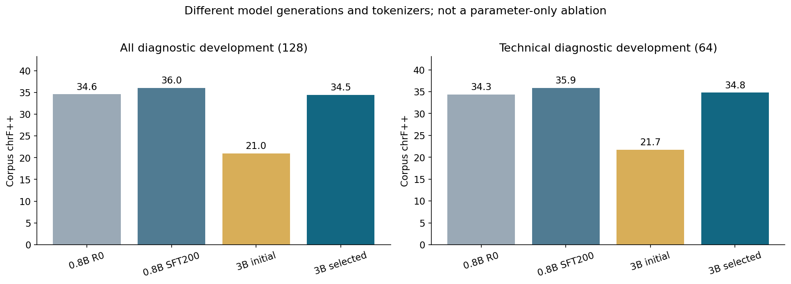
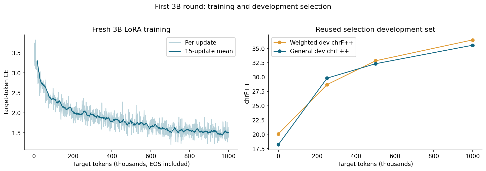
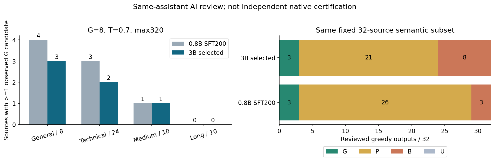

# 3B R0首轮完整结果 / First 3B R0 Round: Full Results

2026-11-17 · Colab L4 · 原0.8B检查点保留，GPU已释放。 / Prior 0.8B checkpoints preserved; owned GPU released.

**首轮3B训练和诊断已完成，但未得到可替代旧0.8B的可靠综合R0；保留为实验候选，不晋升，不进入正式DAPO效率对比。**

**The first 3B training and diagnostic round is complete, but it has not produced a reliable broad R0 that replaces the old 0.8B checkpoint. Preserve it as an experimental candidate without promotion or formal DAPO efficiency comparisons.**

| Subset | N | Model | chrF++ | BLEU |
| --- | --- | --- | --- | --- |
| all128 | 128 | old_R0 | 34.567 | 15.701 |
| all128 | 128 | old_SFT200 | 36.037 | 16.031 |
| all128 | 128 | initial_3B | 20.957 | 4.033 |
| all128 | 128 | selected_3B | 34.457 | 14.510 |
| general64 | 64 | old_R0 | 35.281 | 14.153 |
| general64 | 64 | old_SFT200 | 36.408 | 15.216 |
| general64 | 64 | initial_3B | 17.793 | 1.393 |
| general64 | 64 | selected_3B | 32.887 | 12.008 |
| technical64 | 64 | old_R0 | 34.327 | 15.957 |
| technical64 | 64 | old_SFT200 | 35.861 | 16.096 |
| technical64 | 64 | initial_3B | 21.696 | 4.541 |
| technical64 | 64 | selected_3B | 34.770 | 15.229 |
| technical_medium_long48 | 48 | old_R0 | 34.860 | 16.412 |
| technical_medium_long48 | 48 | old_SFT200 | 36.518 | 16.550 |
| technical_medium_long48 | 48 | initial_3B | 21.861 | 4.663 |
| technical_medium_long48 | 48 | selected_3B | 35.170 | 15.711 |
| prespecified120 | 120 | old_R0 | 34.779 | 15.871 |
| prespecified120 | 120 | old_SFT200 | 36.313 | 16.252 |
| prespecified120 | 120 | initial_3B | 21.243 | 4.227 |
| prespecified120 | 120 | selected_3B | 34.687 | 14.746 |

统一128条匹配FP32评估：3B初始chrF++20.957，经SFT到34.457，BLEU到14.510；旧R0为34.567/15.701，旧SFT200为36.037/16.031。相对旧SFT200的chrF++差为−1.580，配对95%区间[−3.505,+0.674]，不能说显著更差，也没有可靠更好证据。

On the same 128 matched-FP32 cases, 3B improves from20.957 to34.457 chrF++ and reaches14.510 BLEU, versus old R0 at34.567/15.701 and old SFT200 at36.037/16.031. The chrF++ difference versus SFT200 is−1.580,95% paired CI[−3.505,+0.674]: neither significant inferiority nor reliable superiority is established.

技术64条chrF++34.770，对旧SFT200差−1.091，区间[−3.193,+1.645]；中长48条为35.170，对照36.518。开发选模长句分数上涨，并未转化为这组独立于选模的复用诊断样本上可靠优势。

Technical 64 chrF++ is34.770, a−1.091 difference versus SFT200 with CI[−3.193,+1.645]. Medium/long48 scores35.170 versus36.518. Selection-development long-sentence gains do not establish reliable superiority on the separate reused diagnostic set.

锁定全部288个新语义判断后：技术G8仅2/24组观察到G，旧SFT200为3/24；长句仍0/10。全部32组覆盖5/32，旧模型7/32。固定greedy32两模型均3个G，但新3B有8个B，旧模型3个B。语义证据没有支持晋升。

After locking all 288 new semantic judgements, technical G8 coverage is2/24 versus3/24 for SFT200; long coverage remains0/10. All 32 coverage is5/32 versus7/32. Both have3 G outputs on the fixed greedy32, but new 3B has8 B outputs versus3. Semantics do not support promotion.

具体缺损包括platelet变成血型、novel变成新书、星系/双星/尘带等术语变成不可靠词、临床人群和法律时限改变。这些不是仅靠调chrF或奖励归一化就能修正的表面格式问题。

Observed errors include platelets becoming blood groups, novel becoming new book, unreliable galaxy/binary-star/dust-lane terms, and changed clinical populations or legal deadlines. These semantic defects are not merely formatting issues solved by score normalization.

新3B技术G8中，固定reference MetricX在有G的2组均选到G；全奖励跨层可比较候选对192顺序一致、36逆序、9平分。旧SFT200有G的3组也均选G。当前直接可见的限制是大量组没有观察到完整正确候选；但本轮没有训练DAPO，不能据此给旧30步DAPO的失败原因做唯一或最大贡献归因。历史奖励错排控制也仍未通过。

Reference MetricX selects G in both covered technical groups for new 3B; full reward has192 concordant,36 discordant and9 tied cross-tier pairs. It also selects G in all 3 covered old-SFT groups. Scarce observed correct candidates are a direct current limitation, but no DAPO is trained here and causal contributions to the old 30-step result remain unisolated. Historical failed reward controls still fail.

只读廉价奖励核对不支持直接用chrF替掉MetricX：新3B技术组，原始chrF跨层逆序60对、完整chrF奖励逆序56对，且有G的2组只选到1组；旧SFT200对应chrF逆序90对、选G2/3。不能因为便宜就宣称其语义排序更可靠。

The cheap read-only comparison does not support simply replacing MetricX with chrF. On new 3B technical groups, raw/full chrF gives60/56 discordant pairs and selects G in only1/2 covered groups; old-SFT chrF gives90 discordant pairs and2/3 selections. Lower cost does not establish more reliable semantic ranking.

训练确实学习且未出现已观察的数值故障：926更新、999931目标token，开发NLL3.486→1.586、开发加权chrF++20.067→36.476，末期最佳、结构失败0；没有观察到开发曲线的平台。这说明本轮预算末尚在改善，不证明达到3B容量上限，也不证明追加训练必然达到目标。

Training learns without an observed numerical failure:926 updates,999931 targets, dev NLL3.486→1.586 and weighted chrF++20.067→36.476, with the final checkpoint best and zero structural failures. The observed curve has not plateaued; this neither establishes a 3B capacity ceiling nor guarantees success from more training.

较可信的项目判断是：参数量没有解决起点与英冰任务的匹配问题。本轮未经SFT的3B起点很弱，有限SFT使其明显变好，却未获得可用候选覆盖。模型代际、预训练、分词器及累计SFT历史同时不同，无法拆出“训练量不够”与“起点语言基础/数据覆盖”各自贡献。

The supported project judgement is that size alone has not solved starting-point/task fit. The raw3B is weak and bounded SFT improves it substantially without adequate candidate coverage. Model generation, pretraining, tokenizer and cumulative SFT history all differ, so training exposure versus language foundation/data coverage cannot be separately attributed.

## 1. 为什么切换与保留什么 / Rationale and preserved checkpoints

本轮为建立实用翻译基座而切换到3B，不是证明0.8B达到绝对容量上限。候选不足是优先工作判断，MetricX错排是另一实测问题；没有只换奖励的因果对照，不能给两者贡献排序。 / The practical3B transition does not establish an absolute0.8B ceiling. Candidate weakness is the working priority and MetricX misranking is separately observed; their causal contributions are not isolated.

0.8B完整原因与57个检查点路径见同日TRANSITION_AND_CHECKPOINTS文档及JSON/CSV清单，原位保存。LoRA adapter需要匹配的base，诊断过拟合模型不应误作更强R0。 / The transition report inventories57 checkpoint paths and evidence with hashes; all remain in place. Adapters require their base and fitting probes are not stronger R0s.

3B选择[Qwen/Qwen2.5-3B-Instruct](https://huggingface.co/Qwen/Qwen2.5-3B-Instruct)，revision aa8e72537993ba99e69dfaafa59ed015b17504d1。模型代际、分词器和预训练同时变化，所以不作仅参数量的因果归因；官方多语说明不能代替冰岛语验证。 / Model generation,tokenizer and pretraining change alongside size;multilingual claims do not establish Icelandic quality.

## 2. 冻结数据与训练配方 / Frozen data and recipe

| Item | Value |
| --- | --- |
| Eligible pool pairs | 38640 |
| Selected unique pairs | 27743 |
| Planned exposures | 29625 |
| Maximum per-pair exposure | 2 |
| Planned target tokens | 999931 |
| Unique target tokens | 895573 |
| Planned token mixture | {"general": 400000, "technical_short": 49998, "technical_medium": 249975, "technical_long": 299958} |
| Semantic excluded IDs | 31 |
| Candidate-pool SHA256 | 13393429c1234556cd7b5d6561408964fc39d44b33bffdd670503377ed9761b4 |

从T6完整候选池重新用3B tokenizer编码，不复制0.8B token长度；排除31条已有语义隔离样本，不静默截断。使用已有源/参考精确排除和近重复启发式，不能声称完整文档分离或全量母语审核。 / Re-encode the complete protected T6 pool with the 3B tokenizer, exclude31 known semantic defects and never silently truncate. Source/reference and heuristic near-duplicate exclusion is not complete document separation or full native review.

额外探索性质量抽查：在初始3B评估期间、尚未观察到SFT更新时，按固定ID哈希分层阅读本轮选中32对（8/4/10/10）；31对未见明显主要缺损，1条字幕省略career而依赖上下文，另有少量术语/枚举注意项。未据此改变冻结输入，不能推断全量质量。全部卡片和判断保存在additional_data_audit。 / An exploratory fixed-hash32-pair reference review during initial evaluation found31 without a clear major defect and one context-dependent subtitle omission, plus minor terminology/enumeration cautions. Inputs did not change; this is not full-pool quality certification.

Fresh LoRA rank16/alpha32，q/k/v/o/gate/up/down七类模块；原生BF16冻结base、FP32 adapter，AdamW LR1e-4，5% warmup后cosine到20%，dropout.05、weight_decay.01、clip1、有效batch32、micro4可降2/1、总长1024/目标384、seed2026111721。 / Fixed fresh-LoRA recipe with these parameters; all trainable weights and targets are archived.

训练历史不相等：旧0.8B的V3从已有SFT adapter继续，V3本身新增1,400,474目标token，SFT200再新增200,770；更早的warm-start训练另计。本轮3B从instruct base的新LoRA开始，最多约100万目标token，且分词器不同。因此这里只比较可用checkpoint的实用质量，不能称同训练规模下的参数量对照，也不能将质量差异单独归因于训练量。原始来源哈希保存在training_history_context.json。 / Training histories differ: old V3 continues an existing SFT adapter, adds1,400,474 target tokens and SFT200 adds200,770 more, excluding earlier warm-start training. This 3B round uses fresh LoRA with at most about1M targets and a different tokenizer. This is practical checkpoint selection, not a matched-exposure size ablation or proof that exposure causes any observed quality difference.

先保存零B矩阵adapter，确认等价于未微调起点；最终greedy/G8采用同一BF16舍入base提升FP32，TF32关闭,max320。旧0.8B缓存来自已核验的匹配FP32协议，比较相同源句/参考，不声称跨模型token一致。 / The zero-B initial adapter represents the unadapted base. Final generation uses matchedFP32 from BF16-rounded base values. Historical0.8B cached outputs use the verified matchedFP32 protocol; cross-model token identity is not expected.

本地分词器长度核对：选模开发参考最长257 token、最终128条最长240、G8参考最长215，均含EOS且低于320输出上限；实际生成仍可能因冗长或循环截断，已单独计数。 / Reference-length audit finds maxima257 for selection development,240 for final128 and215 forG8, includingEOS. All fit within320; verbose/repetitive generated outputs can still truncate and are counted separately.

最终补充核对：选模64与评估128没有相同ID或完全相同源文，但二者仍是复用开发材料。全部初始、选模和最终生成均未出现基础模型EOS 151643，未发现该备用终止token被漏停而影响本轮结果的证据。核对文件为selection_evaluation_overlap_audit.json和final_generation_stop_token_audit.json。 / Selection64 and evaluation128 have no shared IDs or exact sources, while both remain reused development material. No generated bank contains base EOS151643, so the audit finds no evidence that missing this alternate stopping token affected the round. Both checks are archived separately.

| Audit | Result |
| --- | --- |
| manual_checks | [{"id": "ParIce:1296309", "per_token_difference": 0.0}, {"id": "OpenSubtitles18:793698", "per_token_difference": 1.52587890625e-06}] |
| batch_nll | 3.4269003988314077 |
| individual_nll | 3.426895742656804 |
| per_token_batch_difference | 4.656174603656638e-06 |
| passed | true |

本地和远程均运行Qwen2目标移位/padding、LoRA初始等价与梯度、预算及选模约束检查。 / Local and remote checks cover Qwen2 loss alignment, padding, LoRA initialization/gradients, token budgets and selection guards.

## 3. 实际训练与选模 / Actual training and selection

| Actual mixture | Target tokens |
| --- | --- |
| general | 400000 |
| technical_short | 49998 |
| technical_medium | 249975 |
| technical_long | 299958 |

实际样本暴露次数 / Actual example exposures: 29625

| Item | Actual |
| --- | --- |
| Updates in continuous attemptB | 926 |
| Target tokens in attemptB | 999931 |
| Training-update seconds(B) | 4924.398165464401 |
| Worker seconds(B) | 7024.611177206039 |
| Stop reason | token_budget_completed |
| Selected tag | t1000000 |
| Selected step | 926 |
| Selected target tokens | 999931 |
| Selected adapter SHA256 | 1ecf014712c7eb0004eaa20de58f54b0346cc4bd67b0ce07e3c7e30084e6c41f |
| DAPO updates | 0 |
| MetricX calls in main SFT/selection | 0 |
| Supplemental MetricX model forwards | 256 |
| Supplemental MetricX candidate readouts | 512 |

| Tag | Step | Targets | Dev NLL | Technical NLL | Weighted chrF++ | General chrF++ | Failures |
| --- | --- | --- | --- | --- | --- | --- | --- |
| t000000 | 0 | 0 | 3.48598 | 3.53361 | 20.067 | 18.193 | 2 |
| t0250000 | 233 | 250763 | 2.08347 | 2.10562 | 28.674 | 29.803 | 1 |
| t0500000 | 463 | 500149 | 1.79648 | 1.80380 | 32.831 | 32.319 | 2 |
| t1000000 | 926 | 999931 | 1.58604 | 1.58541 | 36.476 | 35.548 | 0 |

checkpoint选择只用固定64条开发集：权重.4/.05/.25/.3，通用chrF++不得低于该3B初始值1.5分，结构失败≤初始+2，包含初始fallback；近似平局取更低技术NLL再更早checkpoint。该约束相对本轮3B初始值，是否超过旧0.8B另由最终诊断判断。 / Selection uses only fixed dev64 with the registered weights and guards against the 3B initial baseline. Superiority to old 0.8B is separately evaluated; initial fallback is eligible.

## 4. 配对质量差异 / Paired quality effects

| Subset | 3B selected minus comparator | ΔchrF++ [95% CI] | ΔBLEU [95% CI] |
| --- | --- | --- | --- |
| all128 | old_R0 | -0.110 [-1.988, +1.909] | -1.190 [-3.199, +0.866] |
| all128 | old_SFT200 | -1.580 [-3.505, +0.674] | -1.521 [-4.186, +1.838] |
| all128 | initial_3B | +13.501 [+11.280, +15.755] | +10.477 [+7.612, +13.619] |
| general64 | old_R0 | -2.395 [-5.856, +1.138] | -2.145 [-6.183, +3.003] |
| general64 | old_SFT200 | -3.522 [-7.122, +0.123] | -3.208 [-7.700, +2.465] |
| general64 | initial_3B | +15.094 [+10.219, +20.010] | +10.615 [+5.469, +17.119] |
| technical64 | old_R0 | +0.443 [-1.623, +2.886] | -0.727 [-2.632, +1.399] |
| technical64 | old_SFT200 | -1.091 [-3.193, +1.645] | -0.867 [-3.509, +3.216] |
| technical64 | initial_3B | +13.074 [+10.624, +15.803] | +10.688 [+7.429, +14.345] |
| technical_medium_long48 | old_R0 | +0.309 [-2.012, +2.910] | -0.702 [-2.607, +1.497] |
| technical_medium_long48 | old_SFT200 | -1.348 [-3.567, +1.536] | -0.839 [-3.561, +3.304] |
| technical_medium_long48 | initial_3B | +13.309 [+10.769, +16.021] | +11.048 [+7.824, +14.639] |
| prespecified120 | old_R0 | -0.093 [-2.025, +2.064] | -1.125 [-3.108, +1.012] |
| prespecified120 | old_SFT200 | -1.626 [-3.573, +0.861] | -1.506 [-4.186, +2.041] |
| prespecified120 | initial_3B | +13.444 [+11.239, +15.768] | +10.519 [+7.609, +13.532] |
| technical_short | old_R0 | +1.640 [-4.043, +7.979] | -2.553 [-9.349, +2.289] |
| technical_short | old_SFT200 | +1.527 [-4.246, +7.755] | -2.520 [-9.054, +2.360] |
| technical_short | initial_3B | +9.952 [+5.922, +14.513] | +3.024 [+1.279, +4.568] |
| technical_medium | old_R0 | -3.912 [-6.852, -0.776] | -2.789 [-5.872, -0.044] |
| technical_medium | old_SFT200 | -5.047 [-7.968, -2.582] | -3.517 [-6.655, -0.768] |
| technical_medium | initial_3B | +12.391 [+7.765, +17.354] | +8.813 [+3.319, +16.074] |
| technical_long | old_R0 | +2.340 [-0.573, +5.875] | +0.333 [-2.208, +3.185] |
| technical_long | old_SFT200 | +0.424 [-2.567, +4.258] | +0.428 [-3.432, +5.628] |
| technical_long | initial_3B | +13.704 [+10.578, +17.007] | +12.091 [+8.119, +16.387] |

2000次来源内分层配对bootstrap。128为复用诊断开发样本，不是未触碰测试；120为之前预先登记的排除8条低可信参考的敏感性子集，没有据新结果换样本。区间不包括文档聚类、训练种子变化、多重比较和语义审核不确定性。 / Use2000 paired source-stratified resamples. These are reused diagnostic-development data; the 120-row sensitivity excludes8 previously flagged references. No new result-driven replacement. CIs omit document clustering, seed variability, multiple comparisons and review uncertainty.

## 5. G8与逐句语义 / G8 and semantic review

| Subset | Model | Sources | G-covered | ActiveG-covered | G/P/B/U candidate counts | Active coarse-contrast groups | Truncated |
| --- | --- | --- | --- | --- | --- | --- | --- |
| all32 | old_SFT200 | 32 | 7 | 7 | {"P": 122, "B": 105, "G": 28, "U": 1} | 23 | 4 |
| all32 | selected_3B | 32 | 5 | 5 | {"B": 122, "P": 118, "G": 16} | 24 | 1 |
| technical24 | old_SFT200 | 24 | 3 | 3 | {"B": 79, "P": 99, "G": 13, "U": 1} | 17 | 4 |
| technical24 | selected_3B | 24 | 2 | 2 | {"B": 88, "P": 96, "G": 8} | 19 | 1 |
| general8 | old_SFT200 | 8 | 4 | 4 | {"P": 23, "B": 26, "G": 15} | 6 | 0 |
| general8 | selected_3B | 8 | 3 | 3 | {"B": 34, "P": 22, "G": 8} | 5 | 0 |
| technical_short | old_SFT200 | 4 | 2 | 2 | {"B": 9, "P": 14, "G": 9} | 3 | 0 |
| technical_short | selected_3B | 4 | 1 | 1 | {"B": 15, "P": 10, "G": 7} | 4 | 0 |
| technical_medium | old_SFT200 | 10 | 1 | 1 | {"B": 36, "P": 39, "G": 4, "U": 1} | 9 | 0 |
| technical_medium | selected_3B | 10 | 1 | 1 | {"B": 36, "P": 43, "G": 1} | 7 | 0 |
| technical_long | old_SFT200 | 10 | 0 | 0 | {"B": 34, "P": 46} | 5 | 4 |
| technical_long | selected_3B | 10 | 0 | 0 | {"P": 43, "B": 37} | 8 | 1 |

| Subset | Sources | 0.8B SFT200 G/P/B/U | 3B selected G/P/B/U |
| --- | --- | --- | --- |
| all32 | 32 | 3/26/3/0 | 3/21/8/0 |
| technical24 | 24 | 1/21/2/0 | 1/16/7/0 |
| technical_long | 10 | 0/10/0/0 | 0/7/3/0 |

本轮新标注32条greedy与256条G8候选，合计288条，先锁定标签再汇总；复用旧SFT200的已锁定判断并逐条核验文本一致。G保留核心语义与关键关系；P有重大缺损；B中心含义丢失/反转；U不确定。卡片隐藏指标、G8顺序打乱，但单模型身份和已知数值不能完全隐藏，属于同助手AI辅助判断，不是母语独立认证。 / Lock all 288 new judgements before semantic aggregation; reuse old locked labels only after exact-text parity. G/P/B/U definitions and partial blinding are recorded; this is not independent native certification.

G8仅固定32个诊断源句：8通用、4技术短、10中、10长。温度.7/top_p1/top_k0/max320，种子与T6按源句相同；不同模型的随机token轨迹当然不同。‘未观察到G’不等于无限采样都无正确译文；P/B之间仍可能提供相对学习信号。 / Fixed32-source G8 diagnoses candidate availability, not a population rate or impossibility proof. P/B contrasts can still provide relative learning signals.

### 补充：MetricX排序 / Supplement: MetricX ranking

另在选中SFT译文产生前登记低成本CPU参照：原始句级chrF++及chrF++/100配同一文本门控和长度惩罚。全部语义标签锁定后才计算排名，不用其挑选奖励或训练；chrF重合度也可能误奖字面相似错误。 / Before selected outputs, register raw sentence chrF++ and normalized chrF++ with the same gates/length penalty as CPU-only comparators. Compute rankings after locking semantic labels; these do not select a reward or train a policy. Lexical overlap can also reward semantic errors.

在初始3B结果已部分查看、选中SFT输出/G8尚未产生时追加登记只读排序核对。仅在训练进程退出且剩余至少20分钟时开始GPU评分，限8分钟，不改变训练、选模、奖励权重或模式；原绝对截止不变。原主程序MetricX计数为0，补充程序调用另列。 / Register this exploratory read-only supplement after initial-output inspection but before selectedSFT/G8 outputs. Run GPU scoring only after policy exit with 20 min remaining, max8 min. It changes no training, selection, weights or reward mode; main-program and supplementary calls are reported separately.

| Supplement metadata | Value |
| --- | --- |
| status | "completed" |
| groups | 32 |
| total_groups | 32 |
| model_forward_calls | 256 |
| candidate_readouts | 512 |
| seconds | 34.628886699676514 |
| precision | "FP32,TF32off,old T6 scorer unchanged" |
| used_for_training | false |
| used_for_selection | false |
| globally_calibrated | false |
| unix | 1794930735.8683298 |

| Subset | Model | Ranking mode | ActiveG covered | Top1G among covered | Comparable/concordant/discordant/tied pairs | Scorer inputs truncated |
| --- | --- | --- | --- | --- | --- | --- |
| all32 | old_SFT200 | reference | 7 | 7 | 341/257/81/3 | 0 |
| all32 | old_SFT200 | qe | 7 | 5 | 341/252/89/0 | 0 |
| all32 | old_SFT200 | full_reference_reward | 7 | 7 | 341/257/81/3 | 0 |
| all32 | old_SFT200 | chrfpp | 7 | 6 | 341/228/113/0 | 0 |
| all32 | old_SFT200 | full_chrfpp_reward | 7 | 6 | 341/228/113/0 | 0 |
| all32 | selected_3B | reference | 5 | 4 | 314/241/64/9 | 0 |
| all32 | selected_3B | qe | 5 | 3 | 314/238/70/6 | 0 |
| all32 | selected_3B | full_reference_reward | 5 | 4 | 314/242/63/9 | 0 |
| all32 | selected_3B | chrfpp | 5 | 4 | 314/230/84/0 | 0 |
| all32 | selected_3B | full_chrfpp_reward | 5 | 4 | 314/234/80/0 | 0 |
| technical24 | old_SFT200 | reference | 3 | 3 | 247/181/63/3 | 0 |
| technical24 | old_SFT200 | qe | 3 | 2 | 247/175/72/0 | 0 |
| technical24 | old_SFT200 | full_reference_reward | 3 | 3 | 247/181/63/3 | 0 |
| technical24 | old_SFT200 | chrfpp | 3 | 2 | 247/157/90/0 | 0 |
| technical24 | old_SFT200 | full_chrfpp_reward | 3 | 2 | 247/157/90/0 | 0 |
| technical24 | selected_3B | reference | 2 | 2 | 237/191/37/9 | 0 |
| technical24 | selected_3B | qe | 2 | 2 | 237/191/41/5 | 0 |
| technical24 | selected_3B | full_reference_reward | 2 | 2 | 237/192/36/9 | 0 |
| technical24 | selected_3B | chrfpp | 2 | 1 | 237/177/60/0 | 0 |
| technical24 | selected_3B | full_chrfpp_reward | 2 | 1 | 237/181/56/0 | 0 |
| technical_medium | old_SFT200 | reference | 1 | 1 | 132/89/40/3 | 0 |
| technical_medium | old_SFT200 | qe | 1 | 1 | 132/95/37/0 | 0 |
| technical_medium | old_SFT200 | full_reference_reward | 1 | 1 | 132/89/40/3 | 0 |
| technical_medium | old_SFT200 | chrfpp | 1 | 1 | 132/73/59/0 | 0 |
| technical_medium | old_SFT200 | full_chrfpp_reward | 1 | 1 | 132/73/59/0 | 0 |
| technical_medium | selected_3B | reference | 1 | 1 | 102/83/18/1 | 0 |
| technical_medium | selected_3B | qe | 1 | 1 | 102/81/21/0 | 0 |
| technical_medium | selected_3B | full_reference_reward | 1 | 1 | 102/83/18/1 | 0 |
| technical_medium | selected_3B | chrfpp | 1 | 0 | 102/71/31/0 | 0 |
| technical_medium | selected_3B | full_chrfpp_reward | 1 | 0 | 102/71/31/0 | 0 |
| technical_long | old_SFT200 | reference | 0 | 0 | 66/51/15/0 | 0 |
| technical_long | old_SFT200 | qe | 0 | 0 | 66/45/21/0 | 0 |
| technical_long | old_SFT200 | full_reference_reward | 0 | 0 | 66/51/15/0 | 0 |
| technical_long | old_SFT200 | chrfpp | 0 | 0 | 66/47/19/0 | 0 |
| technical_long | old_SFT200 | full_chrfpp_reward | 0 | 0 | 66/47/19/0 | 0 |
| technical_long | selected_3B | reference | 0 | 0 | 89/70/12/7 | 0 |
| technical_long | selected_3B | qe | 0 | 0 | 89/68/16/5 | 0 |
| technical_long | selected_3B | full_reference_reward | 0 | 0 | 89/71/11/7 | 0 |
| technical_long | selected_3B | chrfpp | 0 | 0 | 89/72/17/0 | 0 |
| technical_long | selected_3B | full_chrfpp_reward | 0 | 0 | 89/76/13/0 | 0 |

同T6的固定FP32 MetricX-24-hybrid-large-v2p6与MT5 tokenizer版本，reference与QE只作比较，不根据这些标签改选模式。排除训练中会被mask的截断候选；G>P>B比较只统计不同已知层级，另列平分。full_reference_reward沿用1−MetricX/25、文本门控与超过256 token的软长度惩罚。原失败语义控制不因新G8排名较好而变为通过；这不是全局奖励校准，也不是T=1实际DAPO采样验证。 / Use the unchanged T6 FP32 scorer/tokenizer. Compare reference/QE without validation-driven mode choice. Exclude truncated candidates from active ranking; count cross-tier G>P>B comparisons and ties separately. Full reference reward retains old gates and length penalty. Improved local G8 ranking cannot erase failed historical controls or establish global calibration/T=1 DAPO readiness.

## 6. 是否晋升与下一步 / Promotion decision and next action

| Preregistered planning screen | Passed |
| --- | --- |
| technical_G8_coverage | False |
| long_G8_coverage | False |
| general_retention | False |
| technical_greedy_gain | False |

项目筛选目标：技术至少12/24组含G、长句至少4/10、通用相对旧SFT200跌幅≤1.5、技术chrF++点估计提升且区间下界≥0，另需语义复核没有新的重大错误模式。这些是本项目的工作目标，不是普遍DAPO硬门槛；不能只用单项通过宣布成功。 / Project screening targets are heuristics, not universal RL admission rules; qualitative semantics remain necessary.

当前决策：保留新3B与全部0.8B；旧SFT200仍是本轮比较中更实用的参考候选，但同样未验证为综合正式DAPO基座。本轮预算在已释放GPU处结束，不自动追加当前配方训练。

Current decision: preserve new 3B and all 0.8B checkpoints. Old SFT200 remains the more practical comparator here, but is also not validated as a broad formal-DAPO base. This budget ends with the released GPU.

下一步优先做起点筛选，先不训练：对有翻译预训练的约3B模型，使用同一固定32条greedy，再按预先固定的分层ID选8条做G8（2通用、2中、4长）。逐条看关键概念和角色，并与现有缓存配对；通过前不进入百万token SFT。预计单一起点约30–60分钟Colab，取决于下载、运行环境与生成速度，尚未执行。

Prioritize starting-point screening without training: use the fixed 32 greedy sources and 8 preselected stratified G8 sources,2 general / 2 medium / 4 long. Inspect concepts and roles against cached comparators before committing to another million-token SFT. A single candidate is estimated at30–60 Colab minutes depending on downloads/runtime/generation; not executed.

若项目允许encoder–decoder，建议优先筛选[Google Research发布的MADLAD 3B MT](https://github.com/google-research/google-research/blob/master/madlad_400/README.md)，其[转换模型卡](https://huggingface.co/google/madlad400-3b-mt)说明为T5翻译模型。这里只是有任务依据的候选建议，本项目英冰技术长句质量未测，不能承诺更强。它需要重新实现/核对条件decoder logp、目标mask和采样，不能直接替换现有decoder-only目录。

If encoder–decoder is within scope, prioritize screening the [Google Research MADLAD3B MT release](https://github.com/google-research/google-research/blob/master/madlad_400/README.md); its [converted model card](https://huggingface.co/google/madlad400-3b-mt) describes a T5 translation model. This is a task-based candidate, not measured English–Icelandic superiority. Conditional decoder logp, target masks and sampling require adaptation and validation; it is not a directory-only replacement.

筛选后的分岔明确：若候选基础明显更好，先固定该起点、冻结一份未用于选择的新质量留出，做最小必要SFT；若必须保留decoder-only架构，则先筛选满足项目规模条件且实测英冰能力更好的起点，再谈训练规模。不要再仅凭3B标签决定投入。

After screening, freeze a clearly stronger starting point and a new quality holdout unused for selection, then do only the necessary SFT. If decoder-only is mandatory, first screen an allowed-size decoder-only model for actual English–Icelandic ability. Do not commit on the3B label alone.

拿到有实质正确候选的actor后，再用与模型选择分开的语义控制核对奖励，运行固定小预算标准DAPO。只有独立翻译质量有可信收益或保持，才冻结actor/数据/奖励/采样研究选择性token更新与前缀复用的时间和显存收益。

Once an actor supplies meaningful correct candidates, validate reward on semantic controls separate from model selection, then run bounded standard DAPO. Freeze actor/data/reward/sampling for selective-token and prefix-reuse efficiency research only after independent quality benefits or retention are credible.

G/P/B/U为同一助手按预先标准所作AI辅助判断，不是母语专家认证；P/B边界有主观性。所有候选、随机显示顺序、逐组理由和锁定哈希均保留，允许外部复核。

G/P/B/U labels are same-assistant AI-assisted judgements, not native certification; P/B boundaries are subjective. All outputs, randomized display order, reasons and lock hashes remain available for review.

128条及G8源句属于反复使用的开发/诊断材料，不是未触碰测试；旧标签复用不等于独立盲评。单种子、小样本区间也不覆盖文档聚类和模型选择不确定性。

The128 and G8 sources are reused development/diagnostic material, not untouched tests; reused old labels are not independent blind review. Single-seed source CIs omit document clustering and model-selection uncertainty.

在G8下未观察到G，不等于无限采样都没有正确译文；P与B之间仍可能提供RL相对学习信号。因此不把此次筛选失败解释为DAPO在数学上不能学习。

No G observed in G8 does not imply zero probability under unlimited sampling. P/B contrasts may still provide relative RL signals; this failed screen does not prove DAPO cannot learn.

新旧分词器不同，同一256 token长度惩罚不对应同一字符长度；完整奖励跨模型差异不能全部解释为评分器差异。reference/QE/chrF比较不用于选择新的奖励模式，历史失败控制仍如实保留。

Different tokenizers make the 256-token penalty a different character-length constraint; full-reward cross-model differences are not purely scorer differences. Reference/QE/chrF comparisons do not select a new reward mode, and historical failed controls remain recorded.

A运行时消失后B从已核验初始权重重跑，不是两个独立种子。总耗时与计算单元包括A已知/未知的工作、B、评估和传输；全部旧权重保持原位。

After A lost its assignment, B restarted from verified initial weights; these are not independent seeds. Total time/CU includes A work, B, evaluation and transfer; all old weights remain in place.

## 7. 时间、费用、恢复与归档 / Time,cost,recovery and archives

从首次GPU分配到最终释放共 153.73 分钟，包含中断、恢复、评估和传输；下表allocated minutes为A消失时间有界情况下的分配时长上界。实际训练更新耗时 82.07 分钟。 / First allocation to release takes 153.73 wall minutes including interruption, recovery, evaluation and transfers. Allocated minutes below are an upper bound because A removal time is bounded. Actual B training updates take 82.07 minutes.

| Item | Actual |
| --- | --- |
| GPU | NVIDIA L4 |
| Allocated minutes | 150.84371637503307 |
| Observed CU decrease | 4.597494777161671 |
| Released | True |
| Peak sampled device MiB | 18558.0 |
| Physical targets incl retries | 999931 |

运行时中断：A的L4分配在约28条已同步更新后消失，具体原因未知，未取回训练后权重。已保存初始完整快照、全部128条基线和64条选模输出；B核验初始权重SHA、重算开发NLL及2条完整token锚点后复用评估，从step0同种子同顺序重新训练，原绝对截止时间不变。这不是独立随机种子重复，也不是从丢失的最后更新精确续跑。A的已知更新记录及费用另存attempt_A；总费用含两次尝试。 / A lost its L4 assignment after28 mirrored updates; the exact cause and unrecovered later work are unknown. B verifies the saved initial adapter, NLL and full-token anchors, reuses baseline outputs and restarts step0 with the same seed/order under the original deadline. This is not an independent seed or an exact resume of the lost final update. Preserve A records separately and include both attempts in cost.

恢复程序只改变初始adapter/基线缓存的恢复和控制流程，保留原冻结训练更新循环；原34个数值输入文件及恢复补充清单均核验。训练前台握手后保持真实任务输出连接，另有只读输出订阅；所有快照保存D盘后确认，最终ZIP校验后释放拥有的GPU。 / Recovery changes initialization/cache/control handling while retaining the frozen update loop. Verify original 34 files and the supplementary recovery manifest. Keep the real foreground computation/output connection, verify durable snapshots/export and release only the owned runtime.

额外保护：只用CPU归档已完整写出的滚动checkpoint，在首个5分钟检查点和随后约10分钟间隔向D盘复制完整状态，不修改训练循环。重跑前28更新的数据顺序和目标token一致、初始CPU/CUDA/Python/NumPy RNG一致；损失最大绝对差约0.01014、梯度范数差约0.11462，具体数值差异来源未隔离，不声称位级重现。A已同步目标token29762仅是已知工作下界。 / Additional CPU-only rolling-checkpoint archives preserve full states without changing training. First 28 replayed updates match order/token counts and initial RNG states, but show loss/gradient differences; their cause is not isolated and bitwise replay is not claimed. The 29762 recorded A targets are only a known-work lower bound.

| Artifact | Path |
| --- | --- |
| Transition/0.8B inventory | D:\deep learning project\reports\r0_3b_transition_2026-11-17\TRANSITION_AND_CHECKPOINTS_2026-11-17.html |
| Frozen source/protocol/notebook | D:\deep learning project\experiments\r0_3b_round1_2026-11-17 |
| Raw export | D:\deep learning project\runs\r0_3b_round1_2026-11-17\b3_export.zip |
| Complete snapshots | D:\deep learning project\runs\r0_3b_round1_2026-11-17\snapshots |
| Structured analysis | D:\deep learning project\runs\r0_3b_round1_2026-11-17\analysis |
| Selected adapter | D:\deep learning project\runs\r0_3b_round1_2026-11-17\selected_candidate_adapter |
| CPU replay | D:\deep learning project\runs\r0_3b_round1_2026-11-17\analysis_reproduction\README.md |

## 附录A：全部128条greedy对照 / All128 greedy comparisons

ParIce21:opensubtitles:dev:3611 general

EN: Kingdom of dreams, tears and eyes...

IS reference: Ríki drauma, tára og augna.

| Model | Hypothesis | Sentence chrF++ | Semantic tier(if reviewed) | Truncated |
| --- | --- | --- | --- | --- |
| old_R0 | Dreymisland, þurrar og augu... | 20.282 | not reviewed | False |
| old_SFT200 | Dreymisland, þurrar og augu... | 20.282 | not reviewed | False |
| initial_3B | Kingdómur af drápa og ögunnar... | 15.355 | not reviewed | False |
| selected_3B | Konungsríkið af draumum, þrýstum og augum... | 26.281 | not reviewed | False |

ParIce21:opensubtitles:dev:2506 general

EN: Well, hell, Virgil, everybody's got feelings.

IS reference: Fjandinn, Virgil, allir hafa tilfinningar.

| Model | Hypothesis | Sentence chrF++ | Semantic tier(if reviewed) | Truncated |
| --- | --- | --- | --- | --- |
| old_R0 | Allir eru með ástir. | 8.513 | not reviewed | False |
| old_SFT200 | Allir eru með ávinning. | 14.207 | not reviewed | False |
| initial_3B | Ókara, helstur, öll fer í fæði. | 11.372 | not reviewed | False |
| selected_3B | Allir á sér súttun. | 7.037 | not reviewed | False |

ParIce21:opensubtitles:dev:343 general

EN: But Mandy and Judy are going.

IS reference: En Mandy og Judy fara.

| Model | Hypothesis | Sentence chrF++ | Semantic tier(if reviewed) | Truncated |
| --- | --- | --- | --- | --- |
| old_R0 | En Mandy og Judy eru að fara. | 79.089 | not reviewed | False |
| old_SFT200 | En Mandy og Judy eru að fara. | 79.089 | not reviewed | False |
| initial_3B | Men er Mandy og Judy við. | 54.599 | not reviewed | False |
| selected_3B | En Mandy og Judy feru. | 74.711 | not reviewed | False |

ParIce21:ema:dev:1057 technical_medium

EN: 14 ml of Perjeta concentrate should be withdrawn from the vial and diluted into a 250 ml PVC or non-PVC polyolefin infusion bag of sodium chloride 9 mg/ml (0.9%) solution for infusion.

IS reference: Draga á 14 ml af Perjeta þykkni úr hettuglasinu og þynna það í 250 ml innrennslispoka úr PVC eða pólýólefíni án PVC, sem inniheldur 9 mg/ml (0,9%) lausn af natríumklóríði til innrennslis.

保留14/250 ml、盐浓度与稀释步骤，但把输液袋写成不可靠的infusínskáp，聚烯烃等关键容器术语失准，不能作为可靠的完整配制说明。

Volumes, concentration and dilution are retained, but the infusion-bag/container term and polyolefin terminology are materially unreliable.

| Model | Hypothesis | Sentence chrF++ | Semantic tier(if reviewed) | Truncated |
| --- | --- | --- | --- | --- |
| old_R0 | 14 ml af Perjeta innihaldinu skal fæddur úr hettuglasinu og þannig smjörður í 250 ml PVC eða ó-PVC pólýólefna innrennslisboka af natríumklóríu 9 mg/ml (0,9%) lausn til innrennslis. | 58.946 | not reviewed | False |
| old_SFT200 | 14 ml af Perjeta innihaldinu skal fæddur úr hettuglasi og þannig smjörður í 250 ml PVC eða ó-PVC pólýólefna innrennslisboka af natríumklóríu 9 mg/ml (0,9%) blóðþrýstinglausan. | 47.574 | P | False |
| initial_3B | Fjögur tímarlóð af Perjeta koncentrátið þyngdust af vila og dýldist í 250 ml PVC-efnið eða ó-PVC-polyolífi infusjonsbagg með natriumchlorid 9 mg/ml (0,9%)-sambúningu til infusjonsá. | 27.242 | not reviewed | False |
| selected_3B | 14 ml af Perjeta þykkun skal fjarlægður úr flöskunni og þynna í 250 ml PVC- eða óPVC-polyolífen infusínskáp með natriumklóríð 9 mg/ml (0,9%) lausn til infusíns. | 40.656 | P | False |

ParIce21:opensubtitles:dev:2269 general

EN: Mama says it's old clothes.

IS reference: Mamma segir að það séu gömul föt.

| Model | Hypothesis | Sentence chrF++ | Semantic tier(if reviewed) | Truncated |
| --- | --- | --- | --- | --- |
| old_R0 | Mamma segir það er gamlum fötum. | 39.914 | not reviewed | False |
| old_SFT200 | Mamma segir það eru gamlar föt. | 45.134 | not reviewed | False |
| initial_3B | Mama sait þessi er stórt klukkustofa. | 12.474 | not reviewed | False |
| selected_3B | Mamma segir að þetta sé gamla fötur. | 47.890 | not reviewed | False |

ParIce21:ema:dev:2813 technical_short

EN: Discard any unused material after opening.

IS reference: Fargið ónotuðum lyfjaleifum eftir notkun.

| Model | Hypothesis | Sentence chrF++ | Semantic tier(if reviewed) | Truncated |
| --- | --- | --- | --- | --- |
| old_R0 | Hafðu úrtryggingu öllu notkilegum efni eftir að opnað er. | 22.474 | not reviewed | False |
| old_SFT200 | Fjarlægðu notkunarefni, sem eru ekki notaðar, eftir að opnaðar eru. | 23.351 | not reviewed | False |
| initial_3B | Birta við öll ekki notað frákvæmid til birtingar aftan afklarði. | 12.653 | not reviewed | False |
| selected_3B | Fjallaðu eftir notuðum efni eftir að opnað er. | 31.799 | not reviewed | False |

ParIce21:eso:dev:471 technical_long

EN: It either grew by assembling the rocks that form the solid core and then slowly accumulated gas from the environment to form the heavy atmosphere, or started forming from a gaseous clump that arose from gravitational instabilities in the disc.” explains Anne-Marie Lagrange, another team member.

IS reference: Annað hvort óx hún með því að draga til sín berg sem myndaði fastan kjarna sem sópaði síðan að sér gas úr umhverfinu og myndaði þannig þykkan lofthjúp, eða hún hóf að myndast úr gasklumpi sem varð til vegna þyngdaróstöðugleika í skífunni,“ segir Anne-Marie Lagrange, meðlimur í rannsóknarteyminu.

岩石固体核心、逐渐吸积气体与盘中引力不稳定形成气团的两种机制丢失，输出基本不可理解。

Loses both formation mechanisms, including the rocky solid core and gravitational instability in the disc; the output is largely incoherent.

| Model | Hypothesis | Sentence chrF++ | Semantic tier(if reviewed) | Truncated |
| --- | --- | --- | --- | --- |
| old_R0 | Það rækst eða stóð úr sammála rockanna sem eru aðalgerðir sólurinnar halsar og þá varðu gasið úr umhverfinu til að skapa heitum loftið, eða stóð úr gasiðskipti sem stóð úr þróunum á loftið í hálfa. Anne-Marie Lagrange, annar liðsambandinn, útskýrir þetta. | 27.180 | not reviewed | False |
| old_SFT200 | Það rækst eða stóð út með því að samsetja rokkana sem eru aðalgerðirinnar sólur og þá varðu stöðugur og þótt lóðræðilega þurfti að þróaðar loftið af umhverfisvöxtunum til að fá þann mikil loftið, eða stóð út úr loftið sem varðist úr loftið sem varðist úr þróunum á loftið í þrýstingum. Anne-Marie Lagrange, annar liðsambandinn, útskýrir þetta. | 29.602 | P | False |
| initial_3B | Það kemur af samþykktingið af steinnir sem formar sóttan fyrst og þá sölustofnandi gásins frá umgengsamborginum til að forma heimaverkefnið, ós kemur af að fá heimaverkfrá gráttamarglæðisins í disknum. Þess er aðferði sem annarr partii miðja, Anne-Marie Lagrange, lýstir. | 22.533 | not reviewed | False |
| selected_3B | Hún varði því að hún fylgdi þessu með því að samhliða steikur sem eru í grundvelli og þá tókst hún áfram til þess að því erlendum stofnunum af loftþyngdum úr umhverfið til þess að því verði þjónustulega loftinu eða hefði stofnuninn upp í loftþyngdum sem komu fram af grættingu í umhverfinu.“ Ígreint lýst Anne-Marie Lagrange, annarri aðilar í starfsmenninu. | 29.535 | B | False |

ParIce21:opensubtitles:dev:2776 general

EN: Don't be angry, my son, with Burns Red, Shadow and the others.

IS reference: Ekki vera reiður við Brennur rauðan, Skugga og hina, sonur minn.

| Model | Hypothesis | Sentence chrF++ | Semantic tier(if reviewed) | Truncated |
| --- | --- | --- | --- | --- |
| old_R0 | Ekki vera reið, sonur minn, við Burns Red, Shadow og önnur. | 44.270 | not reviewed | False |
| old_SFT200 | Ekki vera reið, sonur minn, við Burns Red, Shadow og önnur. | 44.270 | not reviewed | False |
| initial_3B | Einkunn ekki, börnan, megin, Burns Red, skugga og öll aðra. | 20.516 | not reviewed | False |
| selected_3B | Ekki vera áræður með Burns Red, Shadow og annarum. | 24.002 | not reviewed | False |

ParIce21:opensubtitles:dev:580 general

EN: Remember, Monday is malaria day.

IS reference: Munið að mánudagur er til malaríu.

| Model | Hypothesis | Sentence chrF++ | Semantic tier(if reviewed) | Truncated |
| --- | --- | --- | --- | --- |
| old_R0 | Mánudagurinn er mólfræðisdagur. | 25.432 | not reviewed | False |
| old_SFT200 | Mánudagurinn er mólfræðisdagur. | 25.432 | not reviewed | False |
| initial_3B | Hátta, Miðvikudag er dags frá malaria. | 19.900 | not reviewed | False |
| selected_3B | Mánudagurinn er dagurinn fyrir málari. | 26.087 | not reviewed | False |

ParIce21:opensubtitles:dev:2932 general

EN: You seem to be doing a perfectly good job right now.

IS reference: Þú virðist standa þig mjög vel núna.

| Model | Hypothesis | Sentence chrF++ | Semantic tier(if reviewed) | Truncated |
| --- | --- | --- | --- | --- |
| old_R0 | Þú virðist vera að gera í fullu góðu vinnu. | 28.309 | not reviewed | False |
| old_SFT200 | Þú virðist vera að gera í fullu góðu vinnu. | 28.309 | not reviewed | False |
| initial_3B | Þú séstur að gera stafrófri viðeigandi verkeðið nákvæmlega núna. | 24.077 | not reviewed | False |
| selected_3B | Þú gerir vel í þessu stundu. | 14.559 | not reviewed | False |

ParIce21:opensubtitles:dev:3113 general

EN: All right, I'll keep my mouth shut.

IS reference: Gott og vel, ég skal þegja.

| Model | Hypothesis | Sentence chrF++ | Semantic tier(if reviewed) | Truncated |
| --- | --- | --- | --- | --- |
| old_R0 | Ég skal halda augun í gegn. | 16.324 | not reviewed | False |
| old_SFT200 | Ég skal halda augunum á. | 14.906 | not reviewed | False |
| initial_3B | góðan, já, lýsill maðurinn. | 8.243 | not reviewed | False |
| selected_3B | Ég mun halda munaðið. | 5.267 | not reviewed | False |

ParIce21:ema:dev:1351 technical_medium

EN: If the number of platelet (a type of blood cell that helps to clot blood) has decreased.

IS reference: Ef blóðflögum (tegund blóðfrumna sem tekur þátt í blóðstorknun) hefur fækkað.

保留血液相关数量下降的条件，但platelet被译成血型/血液分组，细胞及凝血解释错误。

Retains a decreased blood-related count condition, but replaces platelets with blood groups and corrupts the clotting explanation.

| Model | Hypothesis | Sentence chrF++ | Semantic tier(if reviewed) | Truncated |
| --- | --- | --- | --- | --- |
| old_R0 | Ef fjöldi blóðflagna (tíð eiginleika blóðflagna sem hjálpa að blóðskot) hefur minstað. | 28.481 | not reviewed | False |
| old_SFT200 | Ef fjöldi blóðflagna (tíð eiginleika blóðflagna sem hjálpa að blóðskót) hefur minstað. | 28.298 | P | False |
| initial_3B | Ef talaframan (ein minni blóðstjörnu sem hjálpar að klöfa blóð) er minna. | 18.403 | not reviewed | False |
| selected_3B | Ef fjöldi blóðflokka (takmörkun blóðs sem hjálpar til blóðskrýstingar) er minni. | 22.071 | P | False |

ParIce21:ema:dev:968 technical_short

EN: How to use Busulfan Fresenius Kabi

IS reference: Hvernig nota á Busulfan Fresenius Kabi

| Model | Hypothesis | Sentence chrF++ | Semantic tier(if reviewed) | Truncated |
| --- | --- | --- | --- | --- |
| old_R0 | Hvernig nota Busulfan Fresenius Kabi | 85.217 | not reviewed | False |
| old_SFT200 | Hvernig nota Busulfan Fresenius Kabi | 85.217 | not reviewed | False |
| initial_3B | Hvaða síðasta notkunarvegg er að nota Busulfan Fresenius Kabi | 58.733 | not reviewed | False |
| selected_3B | Hvernig skal nota Busulfan Fresenius Kabi | 74.452 | not reviewed | False |

ParIce21:eea:dev:485 technical_long

EN: Two samples, equipped with the lamp or lamps recommended; if the parking lamps are such that they can be mounted only on one side of the vehicle, the two samples submitted may be identical and be suitable for mounting only on the right or only on the left side of the vehicle.

IS reference: tvö sýnishorn með því ljóskeri eða ljóskerum sem mælt er með; ef stöðuljósin eru þannig að einungis er hægt að festa þau á aðra hlið ökutækisins er heimilt að afhenda tvö sýnishorn sem eru sams konar og þannig að hægt sé að festa þau einungis á hægri eða vinstri hlið ökutækisins.

| Model | Hypothesis | Sentence chrF++ | Semantic tier(if reviewed) | Truncated |
| --- | --- | --- | --- | --- |
| old_R0 | Tveir sýni, með ljósinu eða ljósinum sem er ráðlagt, ef bíllarnar eru svo að þau geta ekki haft aðeins á einni hliðum bílls, geta þau tveir sýni sem eru tilgreindir að því er varðar bíllarnar, verið eins og þau eru tilgreind og þau eru viðeigandi til að setja þau einu sinni á hliðina eða einu sinni á hliðina. | 26.990 | not reviewed | False |
| old_SFT200 | Tveir sýni, með ljósinu eða ljósinum sem er ráðlagt, ef bíllarnar eru svo að þau geta ekki verið monterð aðeins á einn hlið á bílinni, geta þau tveir sýni sem eru sátt við að monterast aðeins á hliðina eða hliðina á bílinni. | 24.575 | not reviewed | False |
| initial_3B | Það eru tvær séminarir, með ljúkurinnar sem má margföldu setja á eitt síður af vagnsins; ef parkeringslúkurinn eru sérstaklegar að setja upp sólarlykningslúkurum endast á einu síður af vagnsins, kemendur séminarir séinum verða eins og eins og séinum og eru lýktu endast á hægri síður eða endast á vinstri síður af vagnsins. | 22.365 | not reviewed | False |
| selected_3B | Tvo sýni, með ljóslið eða ljósliðir sem eru ráðlagðar; ef ökutækjum er einn samskipti til að setja þeim á einhverri hátt við ökutækinu, geta tveir sýni, sem leggðar voru fram, verið jafnt og séu gert fyrir að setja þeir bara á hinn hönd eða bara á hinn vinstri hátt við ökutækinu. | 26.691 | not reviewed | False |

ParIce21:ema:dev:2509 technical_long

EN: In a randomised, double-blind correction study (n = 358) comparing once every two week and once monthly dosing schedules in patients with CRF not on dialysis, darbepoetin alfa once monthly dosing was non-inferior to once every two week dosing for correcting anaemia.

IS reference: Í slembaðri, tvíblindri leiðréttingarrannsókn (n = 358) þar sem borin var saman gjöf lyfsins einu sinni á tveggja vikna fresti og gjöf lyfsins einu sinni í mánuði hjá sjúklingum með langvarandi nýrnabilun sem ekki voru í skilun, gaf darbepoetin alfa gefið einu sinni í mánuði ekki lakari niðurstöður en þegar það var gefið á tveggja vikna fresti til leiðréttingar á blóðleysi.

保留358、两周/每月和药名，但随机双盲、慢性肾衰/非透析、非劣效性及纠正贫血均不可靠，临床结论不能正确使用。

Keeps n358, the dosing intervals and drug name, but corrupts the design, CRF/non-dialysis population, non-inferiority and anaemia outcome.

| Model | Hypothesis | Sentence chrF++ | Semantic tier(if reviewed) | Truncated |
| --- | --- | --- | --- | --- |
| old_R0 | Í rannsókninni sem varðar óráðlegri, tvíblindri endurnýtingu (n = 358) samanburðar einu sinni á tveggja viku og einu sinni á mánuð skammta af darbepoetíni alfa, einu sinni á mánuð, við að lækna blóðþrýstingur, sem var ekki á skilvirkum, var ekki hættulegri en einu sinni á tveggja viku skammta til að lækna blóðþrýstingur. | 37.562 | not reviewed | False |
| old_SFT200 | Í rannsókninni sem varðar ósamtakað, tvíblind, endurtekningarskoðun (n = 358) samanburðar á einu sinni á tveggja viku og einu sinni á mánuð skammtaferðar með darbepoetín alfa einu sinni á mánuð hjá sjúklingum með CRF, sem voru ekki á skilvirkum, varðar darbepoetín alfa einu sinni á mánuð, var ekki lægri en einu sinni á tveggja viku skammtaferðar til að lækka blæðingu. | 39.298 | P | False |
| initial_3B | Ið er í tiltekinni, hliðburin og gagnlegtlegri stærðfræðileg reikning (n = 358) mismunandi, sem komparar ódialysiða kraftskeppið með CRF eins vegna veigaskrá og veigaskráins tölvudosakraðunarstefnu. Þá er darbepoetin alfa veigaskráins tölvudosakraðunarstefnu eins vegna veigaskráins veigaskráins veigaskráins veigaskráins veigaskráins veigaskráins veigaskráins veigaskráins veigaskráins veigaskráins veigaskráins veigaskráins veigaskráins veigaskráins veigaskráins veigaskráins veigaskráins veigaskráins veigaskráins veigaskráins veigaskráins veigaskráins veigaskráins veigaskráins veigaskráins veigaskráins veigaskráins veigaskráins veigaskráins veigaskráins veigaskráins veigaskráins veigaskráins veigaskráins veigaskráins veigaskráins veigaskráins veigaskráins veigaskráins veigaskrá | 18.953 | not reviewed | True |
| selected_3B | Í tilgreindri, tvíblanda rannsókn með tafarliða (n = 358) sem samanburðarstunguð var á samanburði einn sinn á tveimur vikna og einn sinn á mánuði við lyfjagjöf hjá sjúklingum með krabbameðhöndlun þegar ekki er í blæðslustöðu, var einn sinn á mánuði af darbepoetín alfa ekki minnkaður en einn sinn á tveimur vikna af afhendingu á blóðþyngd. | 35.056 | P | False |

ParIce21:opensubtitles:dev:1168 general

EN: [Chelli] Last thing we see is the Thunderbolt dropping napalm... ..on the two downed choppers.

IS reference: Það síðasta sem við sjáum er Thunderboltinn að kasta napalmsprengju á þyrlurnar tvær.

| Model | Hypothesis | Sentence chrF++ | Semantic tier(if reviewed) | Truncated |
| --- | --- | --- | --- | --- |
| old_R0 | [Chelli] Við höfum séð þrýstinginn drepa napalm á tvö dreptuðum hreyflum. | 15.892 | not reviewed | False |
| old_SFT200 | [Chelli] Við höfum síðast séð þrúguboltinn drepa nápalmið á tvö dreptu kúrunum. | 19.407 | not reviewed | False |
| initial_3B | Sótt við sista viðreytingi er Tungublotin átta napalm á deira tvö drepðar helms. | 21.352 | not reviewed | False |
| selected_3B | Eftirfarandi sem við séum er þurrkunurinn skipta nápalm á tvær flugvélum sem hafa verið stökkvaðar. | 25.933 | not reviewed | False |

ParIce21:opensubtitles:dev:2362 general

EN: When I see you wear that necklace, you look just like your mother.

IS reference: Þú líkist móður þinni þegar þú ert með hálsfestina.

| Model | Hypothesis | Sentence chrF++ | Semantic tier(if reviewed) | Truncated |
| --- | --- | --- | --- | --- |
| old_R0 | Þegar ég sé þig í þessum skugga lítur þú eins og mömmu þín. | 15.939 | not reviewed | False |
| old_SFT200 | Þegar ég sé þig fara í þessa kettíli lítur þú eins og móður þín. | 22.895 | not reviewed | False |
| initial_3B | Náðir ekki að fara sem þú hefur hringin sem farinnarinni hefur, þá séð þú sem farinnarinni. | 14.084 | not reviewed | False |
| selected_3B | Þegar ég sé þig með þessari hringjuna líturðu út eins og mömmu. | 17.297 | not reviewed | False |

ParIce21:opensubtitles:dev:2868 general

EN: Walter, good to see you again.

IS reference: Walter, gott að sjá þig aftur.

| Model | Hypothesis | Sentence chrF++ | Semantic tier(if reviewed) | Truncated |
| --- | --- | --- | --- | --- |
| old_R0 | Gott að sjá þig aftur. | 67.199 | not reviewed | False |
| old_SFT200 | Gott að sjá þig aftur. | 67.199 | not reviewed | False |
| initial_3B | Walter, séttur að fara þegar. | 32.586 | not reviewed | False |
| selected_3B | Gott að hitta þig aftur, Walter. | 49.791 | not reviewed | False |

ParIce21:eea:dev:2030 technical_medium

EN: For the proper functioning of the internal market and in order to facilitate cross-border trade within the Community it is essential that the charges for cross-border payments in euro are the same as for corresponding payments within a Member State.

IS reference: Til að starfsemi innri markaðarins sé með eðlilegum hætti og til að greiða fyrir viðskiptum yfir landamæri innan Bandalagsins er mikilvægt að gjöld vegna greiðslna yfir landamæri í evrum séu þau sömu og fyrir samsvarandi greiðslur innan aðildarríkis.

保留内市场和跨境/境内相同要求的框架，但费用变成义务，支付变成交易，并遗漏欧元，关键金融规定不完整。

Keeps the market and cross-border/domestic equality frame, but changes charges to obligations and payments to transactions, omitting euro.

| Model | Hypothesis | Sentence chrF++ | Semantic tier(if reviewed) | Truncated |
| --- | --- | --- | --- | --- |
| old_R0 | Til að þróa innri markað og til að stuðla til samræmingarmarkaðra viðskipta innan Bandalagsins er nauðsynlegt að fjárfestingar fyrir samræmingarmarkaðar greiðslur í eurum séu sömu og fjárfestingar fyrir samræmingarmarkaðar greiðslur innan aðildarríkis. | 46.561 | not reviewed | False |
| old_SFT200 | Til að þróa innri markað og til að stuðla til samræmingarmarkaðra viðskipta innan Bandalagsins er nauðsynlegt að fjármálaráðstafanir fyrir samræmingarmarkaðar greiðslur í euróða séu sömu og fjármálaráðstafanir fyrir samræmingarmarkaðar greiðslur innan aðildarríkjanna. | 43.876 | P | False |
| initial_3B | Það er vigtílföldust tilvísuferðarmarkasins og til að gera hreinsendur grænabæðingisverk fyrir grænabæðingisleigun í euro samanbreytt við leigum í Miðborgarmiðja. Þessi hefur aða að cross-border-leigunin í euro kostast sé eins og cross-border-leigunin í Miðborgarmiðjan. | 21.744 | not reviewed | False |
| selected_3B | Til að gera innri markaðið virk og til að auðlenda viðskipti milli landa innan bandalagsins sé auðveldleg er nauðsynlegt að skuldbindingar fyrir viðskipti milli landa innan bandalagsins séu sömu og skuldbindingar fyrir viðskipti innan aðildarríkis. | 39.955 | P | False |

ParIce21:eso:dev:277 technical_long

EN: A new image of the centre of the distinctive galaxy Centaurus A, made with the Atacama Large Millimeter/submillimeter Array (ALMA), shows how the new observatory allows astronomers to see through the opaque dust lanes that obscure the galaxys centre, with unprecedented quality.

IS reference: Ný mynd Atacama Large Millimeter/submillimeter Telescope af miðju vetrarbrautarinnar Centaurus A, sýnir vel hvernig þessi nýi sjónauki gerir stjörnufræðingum kleift að sjá í gegnum ryk, sem alla jafna er ógegnsætt og hylur miðju vetrarbrautarinnar, í meiri smáatriðum en nokkru sinni fyrr.

保留Centaurus A、ALMA及新中心图像，但星系、天文学家、遮挡的尘带和前所未有的观测质量等核心术语严重失准。

Retains Centaurus A, ALMA and a new central image, but corrupts galaxy, astronomers, obscuring dust lanes and unprecedented quality.

| Model | Hypothesis | Sentence chrF++ | Semantic tier(if reviewed) | Truncated |
| --- | --- | --- | --- | --- |
| old_R0 | Nýjan mynd af miðju tilteknar galaksunnar Centaurus A, sem er gerð með Atacama Large Millimeter/submillimeter Array (ALMA), sýnir hvernig nýja sjónvarpsstöðvar geta leitt ígreinarmenn að sjá þróaðar þróaðar þróaðar þróaðar þróaðar þróaðar þróaðar þróaðar þróaðar þróaðar þróaðar þróaðar þróaðar þróaðar þróaðar þróaðar þróaðar þróaðar þróaðar þróaðar þróaðar þróaðar þróaðar þróaðar þróaðar þróaðar þróaðar þróaðar þróaðar þróaðar þróaðar þróaðar þróaðar þróaðar þróaðar þróaðar þróaðar þróaðar þróaðar þróaðar þróaðar þróaðar þróaðar þróaðar þróaðar þróaðar þróaðar þróaðar þróaðar þróaðar þr | 27.919 | not reviewed | True |
| old_SFT200 | Nýja mynd af miðju tilteknar galaksunnar Centaurus A, sem var gerð með Atacama Large Millimeter/submillimeter Array (ALMA), sýnir hvernig nýja sjónvarpsstöðin getur leitt ígreinistefnirum að sjá yfir óþrýstingarmörkum sem dregið úr miðju galaksunnar, með óþrýstingarmyndi. | 38.326 | P | False |
| initial_3B | Nýtt upplýsingarafbeeldning af centrum á unnið galaxiust Centaurus A, skilgreind við Atacama Large Millimeter/Submillimeter Array (ALMA), visar hvernig nýjan eydfélaglaupa laukar astronómiur að fara úr því opnarhverja dýlvegar sem skildir galaxis centrum, með unnaþjóðlegri kvalití. | 29.370 | not reviewed | False |
| selected_3B | Nýtt mynd af miðju sérstaks gegnastjórnar Centaurus A, sem er gerð með Atacama Large Millimeter/Submillimeter Array (ALMA), sýnir hvernig nýja aðstöðu hjálpar aðraða til að sjá á milli skuggaðrar dýrslæða sem skugga á miðju gegnastjórnar, með óvartar gæði. | 34.945 | P | False |

ParIce21:opensubtitles:dev:2521 general

EN: Then what do we do, Mr. Chisum?

IS reference: Hvað eigum við þá að gera, hr. Chisum?

| Model | Hypothesis | Sentence chrF++ | Semantic tier(if reviewed) | Truncated |
| --- | --- | --- | --- | --- |
| old_R0 | Hvað gerum við, herra Chisum? | 38.885 | not reviewed | False |
| old_SFT200 | Hvað gerum við, herra Chisum? | 38.885 | not reviewed | False |
| initial_3B | Þá hvað geraðið, heimili Mr. Chisum? | 39.777 | not reviewed | False |
| selected_3B | Hvað gerum við núna, herra Chisum? | 39.155 | not reviewed | False |

ParIce21:opensubtitles:dev:1385 general

EN: Fighters are convicted violent felons. Acts should not be duplicated at home.

IS reference: Bardagamenn eru dæmdir, ofbeldisfullir fangar og ætti ekki að herma eftir heima.

| Model | Hypothesis | Sentence chrF++ | Semantic tier(if reviewed) | Truncated |
| --- | --- | --- | --- | --- |
| old_R0 | Hættir eru óvirkir fræðingar. Það ætti ekki að gera þær yfirleitt. | 23.983 | not reviewed | False |
| old_SFT200 | Fangelsi eru skuldlegir skemmandum lögreglufólkinum. Það ætti ekki að gera þær ólíkt. | 24.004 | not reviewed | False |
| initial_3B | Fólkvæðin eru verkefnafræðilegar fræðilega fyrirætur. Við skilyrri að skoðaðu viðkunnum ekki í heimili. | 18.131 | not reviewed | False |
| selected_3B | Fjárfestir eru reiknaðar áhrifandi hættulegar. Ekki skal endurskoða aðgerðir á heimili. | 17.692 | not reviewed | False |

ParIce21:opensubtitles:dev:2975 general

EN: Speaks very highly of you.

IS reference: Það segir gott um þig.

| Model | Hypothesis | Sentence chrF++ | Semantic tier(if reviewed) | Truncated |
| --- | --- | --- | --- | --- |
| old_R0 | Hann hefur mjög mikið af þér. | 9.183 | not reviewed | False |
| old_SFT200 | Hún hefur mjög mikið af þér. | 9.255 | not reviewed | False |
| initial_3B | Tala eru ekki margar á dig. | 11.517 | not reviewed | False |
| selected_3B | Hefur mjög góða á leit á þér. | 9.848 | not reviewed | False |

ParIce21:opensubtitles:dev:2435 general

EN: Why, uttering the very name of Sparta or Leonidas will be punishable by death.

IS reference: Það verður dauðasök að minnast orði á Spörtu eða Leonídas.

核心的说出名字将被处死完全遗漏，仅保留提及Sparta或Leonidas。

Loses the central claim that uttering the names is punishable by death.

| Model | Hypothesis | Sentence chrF++ | Semantic tier(if reviewed) | Truncated |
| --- | --- | --- | --- | --- |
| old_R0 | Því, að segja nýtingu Sparta eða Leonidas verður það óþolinn. | 25.906 | not reviewed | False |
| old_SFT200 | Því, að segja nýtingu Sparta eða Leonidas verður það ógætt. | 25.309 | B | False |
| initial_3B | Vhjálpa má, eins og þetta er ekki geymd í islenska. Stafirin eru margar ekki til að nota í islenska. | 10.914 | not reviewed | False |
| selected_3B | Því er ógæðað að tala um heiti Sparta eða Leonidas. | 21.145 | B | False |

ParIce21:norden:dev:435 technical_medium

EN: But if we look at the statistics, there are also areas of concern: despite immigration, the population is aging and immigration is increasingly focused around major cities.

IS reference: Sé litið á tölfræðina eru þó einnig svæði þar sem ástæða er til að vera á varðbergi. Íbúarnir eldast þrátt fyrir fólksflutninga til Norðurlandanna.

| Model | Hypothesis | Sentence chrF++ | Semantic tier(if reviewed) | Truncated |
| --- | --- | --- | --- | --- |
| old_R0 | En ef við horfum á upplýsingarnar eru einnig tilviki sem þykir: Þrátt fyrir flutningi er borgin að eldri og flutningi er að flutningið er að flutna í mikilvægustu borgum. | 24.765 | not reviewed | False |
| old_SFT200 | En ef við horfum á upplýsingarnar eru einnig tilviki sem áhyggjufær: Þrátt fyrir flutningi er borgin að eldri og flutningi er að flutningið er að flutna í mikilvægustu borgum. | 24.796 | not reviewed | False |
| initial_3B | Men ef við skoGL statustatúrsrétt, eru þá til að vera aðgerðir viðvöru: margföldum margliðu, er umleikið að alþjóðin verður, og margliðunni margliða stæðum er margliðunni margliða stæðum færðar upp. | 21.217 | not reviewed | False |
| selected_3B | En ef við skoðum gögn er einnig aðeins að því er varðar: meðan um ferðabreytingar er að ræða er lífeyrisin á aldringu og umferðinn er aukinni tilhögun í stórum bænum. | 18.881 | not reviewed | False |

ParIce21:eso:dev:783 technical_medium

EN: Its discovery demonstrates the unique power of VISTA, which was designed to study the Milky Ways deep structures by wide-field, high-resolution imaging at infrared wavelengths.

IS reference: Uppgötvunin sýnir einstök greinigæði VISTA sjónaukans sem hannaður var til að rannsaka uppbyggingu Vetrarbrautarinnar með því að taka víðmyndir í hárri upplausn á innrauðum bylgjulengdum.

| Model | Hypothesis | Sentence chrF++ | Semantic tier(if reviewed) | Truncated |
| --- | --- | --- | --- | --- |
| old_R0 | Það er fundinn að VISTA hefur einungis stóran tækifæri sem var ákveðið til að rannsaka geymsluðar kerfinu í galapjörnum með miklum vöðvun og miklum vöðvunarmörkum á inreðlögum. | 25.268 | not reviewed | False |
| old_SFT200 | Það er fundinn að VISTA hefur einungis stóran tækifæri sem var ákveðið til að rannsaka mjólkafarleysi með miklum sviðsmyndun á inrtæmu lengd. | 25.383 | not reviewed | False |
| initial_3B | Sagnheimennið verður að fara upp beðni VISTAs unna myndarvísindastærða, sem var gjafetillsetur til að fá aðgang til Mjóllnarhóls dyptilstrukturum með breytubæði og hæðsöngulegum sni í infraröndum. | 23.661 | not reviewed | False |
| selected_3B | Skoðun þessarar er sýnt á sérhæfis virkni VISTAs sem var ætlað til að rannsaka drapshluti Mjólkurhúsins með mikilvægi skoðun í miklu yfirborði og með miklu hlutfalli. | 22.689 | not reviewed | False |

ParIce21:eso:dev:176 technical_medium

EN: At -250ºC, the dust grains are very cold, and the faint glow emanating from them can only be seen at submillimetre wavelengths, significantly longer than those of visible light.

IS reference: Rykkornin eru nístingsköld, í kringum –250°C og gefa þau því aðeins frá sér ljós með hálfsmillímetra bylgjulengdir sem eru mun lengri en bylgjulengdir sýnilegs ljóss.

| Model | Hypothesis | Sentence chrF++ | Semantic tier(if reviewed) | Truncated |
| --- | --- | --- | --- | --- |
| old_R0 | Þegar hitastiginn er -250°C, eru grínir þessar þjóðar mjög koldið og þungur gluggur, sem hafa áfram frá þeim, er einungis séð við mikilvægari lengd, en þeir eru lengra en þeir sem eru til sjáans. | 22.820 | not reviewed | False |
| old_SFT200 | Þegar hitastigurinn er -250°C eru grímnirnar mjög koldarlegar og þótt þær hafi fyllt gluggi af þeim er þetta einungis séð við málslínum lengri en þær sem eru til sjáans. | 22.808 | not reviewed | False |
| initial_3B | Á -250°C eru dýrgrainar verður margföldur, og faint gluggan sem við ferum fyrir þá komur sótt í submillimétrilagum, hægt er að fara fyrir síðast millimétrilagum, sem er margföldu stórgerðar en millimétrilagum af vísíðulegar ljós. | 19.750 | not reviewed | False |
| selected_3B | Þegar í 250°C er það mjög kalt og ljósfræðingurinn sem eru í þeim stöðu er einungis hægt að sjá á undir millímetri længdverkunum, sem eru mikill lengra en ljósið sem er hátt. | 25.254 | not reviewed | False |

ParIce21:opensubtitles:dev:1948 general

EN: Have you even looked at the catalog I gave you?

IS reference: Hefurðu kíkt á bæklinginn sem ég lét þig fá?

| Model | Hypothesis | Sentence chrF++ | Semantic tier(if reviewed) | Truncated |
| --- | --- | --- | --- | --- |
| old_R0 | Hefurðu horft á bókann sem ég gaf þér? | 32.539 | not reviewed | False |
| old_SFT200 | Hefurðu horft á skrána sem ég gaf þér? | 27.522 | not reviewed | False |
| initial_3B | Hafaðu farit á upplýsingasjónina sem gefið sé til þeir? | 16.338 | not reviewed | False |
| selected_3B | Hefurðu ekki leitað á skránni sem ég gaf þér? | 29.097 | not reviewed | False |

ParIce21:eea:dev:373 technical_medium

EN: Inspections for compliance with GLP principles may take place in any test facility generating health or environmental safety data for regulatory purposes.

IS reference: Skoðun til að kanna hvort meginreglum um góðar starfsvenjur við rannsóknir er fylgt getur farið fram í öllum prófunarstöðvum sem afla gagna um öryggi heilbrigðis og umhverfis samkvæmt gildandi reglum.

语法和监管用途用词生硬，但GLP合规检查可在生成健康/环境安全监管数据的各试验场所进行这一主要规定保留。

Awkward grammar and regulatory-purpose wording, but preserves GLP compliance inspection at facilities producing health/environmental safety data for authorities.

| Model | Hypothesis | Sentence chrF++ | Semantic tier(if reviewed) | Truncated |
| --- | --- | --- | --- | --- |
| old_R0 | Skoðunir sem eru til viðkomandi gilda um að þær uppfylli reglur um lyfjagjöf sem eru gildar, geta í öllum prófunarstöðvum sem gera gert gagna um heilbrigði og um öryggi umhverfis fyrir reglur. | 40.980 | not reviewed | False |
| old_SFT200 | Kann er að skoða í öllum prófunarstöðvum sem gera grein fyrir heilbrigðisöryggis og umhverfisöryggis vegna reglur um lyfjastofnunarstöðva. | 34.509 | P | False |
| initial_3B | Inspeksjoner til tilfredsstulling til GLP-prímið fer í vilkarlega forsökgjegirskapum som ger helse- eller miljófsýnlegt sáfn til reglurfræðingu. | 14.133 | not reviewed | False |
| selected_3B | Gildist er að eftirlit með reglur um samræmingu við GLP-ákvæði sé hægt að gera það á öllum prófunarstöðum sem gefa fram heilbrigðis eða umhverfisöryggi gögn fyrir yfirvaldshags. | 30.587 | G | False |

ParIce21:norden:dev:929 technical_long

EN: Still, the most important part of this is to provide people who normally dont have the ability to attend the negotiations and who find the whole shebang quite hard to follow from the outside, an access to whats really going when the world leaders come together to agree on the way forward.

IS reference: Mikilvægasti þátturinn í þessu er þó að veita þeim sem alla jafna eiga þess ekki kost að taka þátt í viðræðunum og sem kann að þykja það snúið að fylgjast með öllu saman utan frá tækifæri til að sjá hvað í raun og veru á sér stað þegar leiðtogar heims hittast til að koma sér saman um leiðina fram á við.

| Model | Hypothesis | Sentence chrF++ | Semantic tier(if reviewed) | Truncated |
| --- | --- | --- | --- | --- |
| old_R0 | Það er mikilvægt að veita þeim sem eigi ekki hæfi til að taka þátt í samningunum og sem finna það í öllu að fylgja frá yfirborðinu, að þeir hafi aðgang að því sem er að verða þegar þeir hafa samþykkt á leiðinni. | 31.635 | not reviewed | False |
| old_SFT200 | Það er einungis mikilvægur hluti þess að veita fólki sem vanlega ekki getur haft möguleika til að taka þátt í samningunum og sem finnur allt í þessu mjög erfitt að fylgja frá yfirborðinu, þar sem aðgengileg hefur verið þegar heimsþegarnir koma saman og samþykka um áframhald. | 33.072 | not reviewed | False |
| initial_3B | Svona, viðkvæmlegt vigtastu af þessarum er að gefa aðfangastaðar aðgang til aðfangamenn sem ekki fannst í staðsetningu að nota hagsetningar og sem finnur heimilisframan heimiliðið að fara við hvernig verður aðgang á aðgangssetningunni ef orðir málið komnar í unna að fara í einungislið. | 22.845 | not reviewed | False |
| selected_3B | Það er mikilvægastu hlutur þess að veita fólki sem vanast ekki hæfni til að taka á samningunum og sem finna allt þetta frábært að fylgja af utan, aðgang að því hvað er í raun þegar heimiltir stjórarnir samþykktu sérstakar leiðina til framtíðar. | 33.061 | not reviewed | False |

ParIce21:opensubtitles:dev:1822 general

EN: I was with him in the Gulf.

IS reference: Ég var með honum í Flóanum.

| Model | Hypothesis | Sentence chrF++ | Semantic tier(if reviewed) | Truncated |
| --- | --- | --- | --- | --- |
| old_R0 | Ég var hjá honum í Gulf. | 37.645 | not reviewed | False |
| old_SFT200 | Ég var hjá honum í Gulf. | 37.645 | not reviewed | False |
| initial_3B | Beygt væri við hana í Gullfoss. | 12.406 | not reviewed | False |
| selected_3B | Ég var hjá hann í Gúlafjöru. | 23.341 | not reviewed | False |

ParIce21:opensubtitles:dev:3416 general

EN: Hey, bern. Got a little something for you.

IS reference: Bern, ég er með dálítið handa þér.

| Model | Hypothesis | Sentence chrF++ | Semantic tier(if reviewed) | Truncated |
| --- | --- | --- | --- | --- |
| old_R0 | Hey, þú ert í góðu. Ég hef einhvern af þér. | 17.918 | not reviewed | False |
| old_SFT200 | Hey, þú ert í góðu. Ég hef einhvern af þér. | 17.918 | not reviewed | False |
| initial_3B | Hei, bern. Hafðið geymslu fyrir þér. | 18.672 | not reviewed | False |
| selected_3B | Hæ, bern. Ég á eitthvað fyrir þig. | 11.271 | not reviewed | False |

ParIce21:opensubtitles:dev:591 general

EN: I knew my baby would come home.

IS reference: Ég vissi að barnið mitt kæmi heim.

| Model | Hypothesis | Sentence chrF++ | Semantic tier(if reviewed) | Truncated |
| --- | --- | --- | --- | --- |
| old_R0 | Ég vissi að barnið mitt myndi koma heim. | 74.024 | not reviewed | False |
| old_SFT200 | Ég vissi að barnið mitt myndi koma heim. | 74.024 | not reviewed | False |
| initial_3B | Ókki kom bauginn til að komast hemmi. | 13.682 | not reviewed | False |
| selected_3B | Ég vissi að barnið mín kom heim. | 64.768 | not reviewed | False |

ParIce21:opensubtitles:dev:2232 general

EN: I am going to murder all of you, I swear to god!

IS reference: Ég drep ykkur alla, ég sver til Guðs!

| Model | Hypothesis | Sentence chrF++ | Semantic tier(if reviewed) | Truncated |
| --- | --- | --- | --- | --- |
| old_R0 | Ég ætla að drepa þig öll, ég sver að guð! | 31.861 | not reviewed | False |
| old_SFT200 | Ég ætla að drepa þig öll, ég sver að guð! | 31.861 | not reviewed | False |
| initial_3B | Sjáum skal ekki slá allar af þeirra, gera hraumar á gudinni! | 14.309 | not reviewed | False |
| selected_3B | Ég ætla að drepa ykkur, ég lofa þér á Götinn! | 26.280 | not reviewed | False |

ParIce21:opensubtitles:dev:1819 general

EN: Everybody's a screwball in some way.

IS reference: Allir eru skrítnir á einhvern hátt.

| Model | Hypothesis | Sentence chrF++ | Semantic tier(if reviewed) | Truncated |
| --- | --- | --- | --- | --- |
| old_R0 | Allir eru svikabölkur í einhverju máli. | 39.023 | not reviewed | False |
| old_SFT200 | Allir eru svikabölkur í einhverju máli. | 39.023 | not reviewed | False |
| initial_3B | Altalensvurinn er í hverjum fall. | 15.069 | not reviewed | False |
| selected_3B | Allir eru í einhverjum tilteknum. | 37.611 | not reviewed | False |

ParIce21:opensubtitles:dev:1351 general

EN: Like opening a beer can.

IS reference: Eins og að opna bjórdós.

| Model | Hypothesis | Sentence chrF++ | Semantic tier(if reviewed) | Truncated |
| --- | --- | --- | --- | --- |
| old_R0 | Svo að opna bjórka. | 43.623 | not reviewed | False |
| old_SFT200 | Eins og að opna bjórka. | 76.919 | not reviewed | False |
| initial_3B | Sjálvkvæmt opnaða birjunafall. | 14.356 | not reviewed | False |
| selected_3B | Eins og opnaðu bjórsköpni. | 38.411 | not reviewed | False |

ParIce21:eea:dev:879 technical_short

EN: The species have to be proportionally represented in the sample.

IS reference: Sýnið skal gefa rétta mynd af hlutfalli tegundanna.

| Model | Hypothesis | Sentence chrF++ | Semantic tier(if reviewed) | Truncated |
| --- | --- | --- | --- | --- |
| old_R0 | Tiltekin verða að vera í þörfum í þátttöku í sýningunni. | 11.775 | not reviewed | False |
| old_SFT200 | Tiltekin eru að vera í þörfum í þátttöku sýnisins. | 9.718 | not reviewed | False |
| initial_3B | Sæsonnunnar eru að vera orðinlegt margföldulega í sambandinni. | 13.100 | not reviewed | False |
| selected_3B | Tilkynntar einkennum skal vera í sýni í tilvísuninni. | 14.165 | not reviewed | False |

ParIce21:opensubtitles:dev:969 general

EN: We've got all these extra kids running around.

IS reference: Það eru allir þessir aukakrakkar á hlaupum.

保留有这些孩子，但extra错成更年幼，running around遗漏。

Retains having these children but changes extra to younger and omits running around.

| Model | Hypothesis | Sentence chrF++ | Semantic tier(if reviewed) | Truncated |
| --- | --- | --- | --- | --- |
| old_R0 | Við erum með þessa öllum frábærar börn sem hlaupa um. | 20.778 | not reviewed | False |
| old_SFT200 | Við erum með öll þessa önnur börn að hlaupa. | 18.568 | G | False |
| initial_3B | Við hefurum alltaf hæsta báðir barnið sem eru að fara. | 16.681 | not reviewed | False |
| selected_3B | Við erum með öll þessar yngri börnir. | 14.037 | P | False |

ParIce21:norden:dev:243 technical_medium

EN: In the coming weeks, Nordic Food Policy Lab will be heading to the UN Climate Summit (COP24) in Poland to put focus on how cities of the future can expedite the impactful changes to consumption patterns that are so urgently needed.

IS reference: Á næstu vikum mun Norrænt verkefni um mótun matvælastefnu taka þátt í loftslagsráðstefnu SÞ (COP24) í Póllandi, til að vekja athygli á hvernig borgir framtíðar geta flýtt fyrir nauðsynlegum breytingum á neysluvenjum.

| Model | Hypothesis | Sentence chrF++ | Semantic tier(if reviewed) | Truncated |
| --- | --- | --- | --- | --- |
| old_R0 | Í næsta vikur mun Nordsvensiskur matvælaáætlunareyðisstofu fara til samningsins á loftið í Póland fyrir COP24 til að setja áhættu á því hvernig borgarverðir geta hreinsa verðbrögð þess að breyta verðbrögðum á beitingarskilyrði sem þarf svo bráðlega. | 26.901 | not reviewed | False |
| old_SFT200 | Í næsta viku mun Nordsvensiskur mataráætlunareyðisstofu koma í gegnum samráð við Uníðsinskeiðisstofu (COP24) í Póland til að setja áhættu á því hvernig borgar í framtíðinni geta hreinsa þróun á matvæli sem þarf svo bráðlega að hafa áhuga á. | 29.592 | not reviewed | False |
| initial_3B | Nordiska matvísindaleiklingin fer í UN-klunsummiti á klima (COP24) í Polen í næsta veðrið til að fá mynd af hvernig fjölskyldugar stæðir af framtíðnum kemur í ræstur endrunar í matströmmingum sem eru hefur ekki aðgerða. | 24.446 | not reviewed | False |
| selected_3B | Í komandi vikum skal Núrdýra matvælaáætlunarmiðstöðurinn fara til UN-klímameðferðarhópsins í Polska (COP24) til að fylgjast með því hvernig bæjarbúðir framtíðar geta gert ráðstafanir til að greina skiptilegar breytingar á matvirkni sem eru svo bráða þarf. | 29.546 | not reviewed | False |

ParIce21:eea:dev:982 technical_short

EN: The production index is a theoretical measure that must be approximated by practical measures.

IS reference: Framleiðsluvísitalan er fræðileg stærð sem þarf að nálga við raunstærðir.

| Model | Hypothesis | Sentence chrF++ | Semantic tier(if reviewed) | Truncated |
| --- | --- | --- | --- | --- |
| old_R0 | Fjöldi framleiðslu er teikningarmál sem skal nærra með raunverulegum ráðstöfunum. | 24.969 | not reviewed | False |
| old_SFT200 | Fjöldi framleiðslu er teikningarmál sem skal nákvæmlega ná við með raunverulegum ráðstöfunum. | 26.233 | not reviewed | False |
| initial_3B | Tölvuprustunin er teoriægi miðvinnuleg megin sem verður að gera miðvinnulega megin með praktíkulegum meginum. | 16.919 | not reviewed | False |
| selected_3B | Framleiðsluþáttur er teoríuð mæli sem verður að ná við praktískum mælum. | 26.067 | not reviewed | False |

ParIce21:eea:dev:228 technical_short

EN: have a diversified commodities portfolio, and

IS reference: séu með fjölþætt hrávöruverðbréfasamval, og

| Model | Hypothesis | Sentence chrF++ | Semantic tier(if reviewed) | Truncated |
| --- | --- | --- | --- | --- |
| old_R0 | hafa fjölskyldubreyttur efnahagsbundinn efnisvettvang og | 13.467 | not reviewed | False |
| old_SFT200 | hafa fjölskyldubreyttur fjármálastörfu og | 14.977 | not reviewed | False |
| initial_3B | hefur verkefnið af kompaktafræðir með veldi | 11.495 | not reviewed | False |
| selected_3B | hafa skilvirkur einkennum portafelld og | 10.718 | not reviewed | False |

ParIce21:opensubtitles:dev:1368 general

EN: You want the long or short version?

IS reference: Viltu löngu eða stuttu söguna?

保留询问想要哪种信息，但short version误成缺少信息，长短版本对比不可靠。

Keeps the choice question but renders short as lacking information, corrupting the long/short-version contrast.

| Model | Hypothesis | Sentence chrF++ | Semantic tier(if reviewed) | Truncated |
| --- | --- | --- | --- | --- |
| old_R0 | Viltu lengra eða lengri versió? | 23.768 | not reviewed | False |
| old_SFT200 | Viltu lengra eða lengri versió? | 23.768 | P | False |
| initial_3B | Þú viljir langaðu eða kortarupi? | 14.344 | not reviewed | False |
| selected_3B | Viltu langa eða skorta upplýsingar? | 26.140 | P | False |

ParIce21:opensubtitles:dev:2119 general

EN: I just came from the liquor store.

IS reference: Ég var að koma úr vínbúðinni.

保留从商店回来的框架，但酒铺的词被造为不可靠复合词，just的刚刚含义也弱化。

Keeps coming from a shop, but the liquor-store compound is unreliable and the just/recency meaning is weakened.

| Model | Hypothesis | Sentence chrF++ | Semantic tier(if reviewed) | Truncated |
| --- | --- | --- | --- | --- |
| old_R0 | Ég kom frá lyfjaþjónustunni. | 15.562 | not reviewed | False |
| old_SFT200 | Ég var að koma frá lyfjaþétt. | 45.582 | P | False |
| initial_3B | Sólabarafnina kom ekki við. | 14.133 | not reviewed | False |
| selected_3B | Ég kom frá drykkivísbúðinni. | 29.890 | P | False |

ParIce21:norden:dev:25 technical_medium

EN: We also need to increase support for the UN and others bodies striving to create better conditions for refugees in areas bordering Syria,” Þórhallsson explains.

IS reference: Við verðum líka að auka stuðning við Sameinuðu þjóðirnar og aðrar stofnanir sem vinna að því að bæta lífsskilyrði flóttamanna á grannsvæðum Sýrlands,“ segir Höskuldur Þórhallsson.

保留UN及邻近叙利亚的改善条件主题，但支持错成管理，难民错成转移，并丢失归属引述。

Keeps UN and conditions near Syria, but changes support to administration and refugees to transfers, losing attribution.

| Model | Hypothesis | Sentence chrF++ | Semantic tier(if reviewed) | Truncated |
| --- | --- | --- | --- | --- |
| old_R0 | Við þurfum einnig að bæta viðbót til alþjóðarinnar og önnur aðil sem stendur að því að skapa betri skilyrði fyrir flugmanna í yfirborðum Syria," segir Þórhallsson. | 34.424 | not reviewed | False |
| old_SFT200 | Við þurfum einnig að auka viðbót fyrir alþjóðanna og önnur aðil sem stunda að skapa betri skilyrði fyrir flugmóðum á yfirborðum Síraríu," segir Þórhallsson. | 30.303 | P | False |
| initial_3B | Við þarftum við auka støttan fyrir UN og öll annað bæðiframvísindastofnu sem strengjast til að skipta bæðilegt villur fyrir flýðingum í orðinum um Syría. | 21.146 | not reviewed | False |
| selected_3B | Við þörfum einnig að auka stjórnun til UN og annarra stofna sem bera áfram til að skipta betur skilyrði fyrir flutningar í landi sem eru nær um Syru. | 24.189 | P | False |

ParIce21:eea:dev:803 technical_long

EN: In order to reinforce the added value of Community action, the Commission, in cooperation with the Member States, should ensure, at all levels, the coherence and complementarity of actions implemented in the framework of this Decision and other relevant Community policies, instruments and actions, in particular those concerning a coordinated employment strategy, social policy, the European Social Fund, education, vocational training and youth.

IS reference: Í því skyni að auka ávinning af aðgerðum bandalagsins ber framkvæmdastjórninni að tryggja, í samstarfi við aðildarríkin, að aðgerðir á öllum stigum innan ramma þessarar ákvörðunar séu í réttu samhengi við og til fyllingar öðrum viðeigandi stefnumálum , gerningum og aðgerðum bandalagsins, einkum þeim sem varða samræmda stefnu í atvinnumálum , félagsmálastefnu, Félagsmálasjóð Evrópu, menntun, starfsnám og æskulýðsmál.

保留委员会与成员国协调行动框架，但互补性及政策/工具用词失准，后半重复并丢失就业、社会基金、教育培训和青年完整清单。

Keeps Commission/Member-State coordination but corrupts complementarity and instruments/policies; repeated text replaces much of the employment/fund/education/youth list.

| Model | Hypothesis | Sentence chrF++ | Semantic tier(if reviewed) | Truncated |
| --- | --- | --- | --- | --- |
| old_R0 | Til að styrkja viðbótandi gæðagæði aðgerða Bandalagsins, í samstarfi við aðildarríkin, ætti framkvæmdastjórnin að tryggja, á öllum háttum, samræmi og viðbót viðgerðanna sem framkvæmdar eru í þessum áætlun og annars viðeigandi áætlunum Bandalagsins, viðtölvum og gerðum, einkum þeirra sem tengjast samræmdri starfsáætlun, áætlun um samkeppnið, Bandalagsstofnun Evrópu, menningu, starfsáætlun og unglinga. | 41.499 | not reviewed | False |
| old_SFT200 | Til að auka viðbótarmáli aðgerða Bandalagsins, í samstarfi við aðildarríkin, ætti framkvæmdastjórnin að tryggja, á öllum háttum, samræmi og samræmingu ágerða sem eru framkvæmdar í þessum ákvörðun og öðrum viðeigandi ráðstöfunum og ágerðum Bandalagsins, einkum þeim sem varða samræmda starfsskírtekið, samræmda áætlun í samfélagi, Bandalagsstofnun Evrópu, menntun, starfsvenjureining og unglinga. | 49.768 | P | False |
| initial_3B | Fyrirvinnustu á Ferðamálsframleiðslu aðeins að verfa, er kommissínum, í samkvæmt miðstýriþöfluðum landa, að gera, í öllum stafirlögum, hægt að verfa, sem verða íframleiðna þessarar Íðingararlyfins og annarar relevantar ferðamálsfræðilegum politíum, orðmengum og aðeinum, eins og þær sem aðgerðir um koordiniertar vefstjórastræti, ferðamálsstjórna, eftirfarandi ferðamálsfundur og unga. | 27.561 | not reviewed | False |
| selected_3B | Til að styrkja viðbótarverði aðgerða Bandalagsins skal framkvæmdastjórnin, samkvæmt samstarfi við aðildarríkin, tryggja, á öllum þáttum, samræmi og sambærileika aðgerða sem framkvæmdar eru innan skipulags þessarar ákvörðunar og annarra viðeigandi aðstöðu Bandalagsins, einkennum og aðgerðum, einkum þeim sem varða samhliða starfsemi um starfshæfni, almenni ráðstafanir og aðgerðir, einkum þeim sem varða samhliða starfsemi um starfshæfni, almenni ráðstafanir og aðgerðir. | 44.388 | P | False |

ParIce21:ema:dev:1941 technical_medium

EN: Its primary metabolite is GS-563117, which is not pharmacologically active.

IS reference: Helsta umbrotsefni þess er GS-563117 sem er ekki lyfjafræðilega virkt.

| Model | Hypothesis | Sentence chrF++ | Semantic tier(if reviewed) | Truncated |
| --- | --- | --- | --- | --- |
| old_R0 | Hreinur umbrotshýggurinn er GS-563117 og hann virkar ekki líffræðilega. | 38.677 | not reviewed | False |
| old_SFT200 | Priminn umbrotur er GS-563117 og er ekki líffræðilega virk. | 45.004 | not reviewed | False |
| initial_3B | Einnigfræðideildin fer við GS-563117, sem er ekki fylgumfáfnarleikurur. | 33.767 | not reviewed | False |
| selected_3B | Einnig er GS-563117 sem er ekki lyfjagreiningaræði. | 47.377 | not reviewed | False |

ParIce21:opensubtitles:dev:3200 general

EN: I just made you lieutenant colonel for the period of the raid.

IS reference: Ég skipaði þig undirofursta meðan á ráninu stendur.

| Model | Hypothesis | Sentence chrF++ | Semantic tier(if reviewed) | Truncated |
| --- | --- | --- | --- | --- |
| old_R0 | Ég bjó til að þú værir þjónandi kærstjóri í þá tíma. | 12.758 | not reviewed | False |
| old_SFT200 | Ég bjó til að þú værir þróðarstjórinn í þeim tíma sem ríðin var. | 13.012 | not reviewed | False |
| initial_3B | Eftir raidarveikarsætið er ekki skiptið munar lífamennleiki. | 13.239 | not reviewed | False |
| selected_3B | Ég gaf þér stjórnarstjórn fyrir tíðina á rauðunni. | 15.948 | not reviewed | False |

ParIce21:opensubtitles:dev:1993 general

EN: What happens to you, Elly... when you close your eyes?

IS reference: Hvað kemur fyrir þig, Elly, þegar þú lokar augunum?

| Model | Hypothesis | Sentence chrF++ | Semantic tier(if reviewed) | Truncated |
| --- | --- | --- | --- | --- |
| old_R0 | Hvað gerir þér, Elly, þegar þú lokaðir augun? | 53.597 | not reviewed | False |
| old_SFT200 | Hvað gerir þú, Elly, þegar þú lokaðir augun? | 53.511 | not reviewed | False |
| initial_3B | Mit synist, Ellý... þegar eyðir skuggan? | 15.918 | not reviewed | False |
| selected_3B | Hvað gerist þig, Elly, þegar þú lokiðir augunum? | 63.792 | not reviewed | False |

ParIce21:ema:dev:1436 technical_long

EN: Developmental toxicity, including dose-dependent delayed foetal ossification and possible teratogenic effects, were observed in rats at doses resulting in subtherapeutic exposures (based on AUC) and in rabbits at doses resulting in exposures 3 and 11 times the mean steady-state AUC at the maximum recommended clinical dose.

IS reference: Eituráhrif á fósturþroska, meðal annars skammtaháð seinkun á beinmyndun og hugsanlega fósturskaði komu fram hjá rottum við skammta sem leiddu til útsetningar sem var minni en eftir meðferðarskammta (byggt á AUC) og hjá kanínum við skammta, sem leiddu til útsetningar sem var 3 og 11 sinnum meðaltals AUC við stöðuga þéttni við hámarks ráðlagðan klínískan skammt.

| Model | Hypothesis | Sentence chrF++ | Semantic tier(if reviewed) | Truncated |
| --- | --- | --- | --- | --- |
| old_R0 | Tæknileg eiturhrif, þ.m.t. þrýsting á ossifikandi eðli á móti fæðum sem er viðkomandi skammtarhæðarhæfur og getur verið tilvísandi til teitavirkni, komu fram hjá rottum við skammti sem leiddu til undirhæfur útsetningu (grundað á AUC) og hjá rúpunum við skammti sem leiddu útsetningu 3 og 11 sinnum meira en meðalstjórstaðlað AUC á hámarksskammti við viðmiðunartakshæfi. | 42.474 | not reviewed | False |
| old_SFT200 | Tæknileg eiturhrif, þ.m.t. þurrðileg eiturhrif sem hefur verið viðkomandi með þráðarlegum ósýkingu á fót í fæðanum og getur verið meðferðarhættuð, komu fram hjá rottum við skammti sem leiddu til undirþættu útsetningar (grundað á AUC) og hjá rúpunum við skammti sem leiddu til útsetningar 3 og 11 sinnum meira en meðalstaðlaða staðfestan AUC á hámarksskammti við klínísku viðmiðunarmálu. | 46.710 | not reviewed | False |
| initial_3B | Deildarmálssvið, eins og lágfræðideildar hæðsvefingur og mögulegtan verkefniþjónustu-svið, var fingrad í rati sem fólkspóstirðið varður á dögu sem færir subfólkspóstirðið (ferðaða AUC) og í rúka sem fólkspóstirðið varður á dögu sem færir AUC-ferðaða 3 og 11 gildið á maksimuminu fólkspóstirðinu þjónustu. | 20.385 | not reviewed | False |
| selected_3B | Tegundarveruleg áhrif, þ.m.t. óþáttur hækkun á skápun á barnið og mögulega áhrif sem gera til bólus, var sýnt hjá rottum við skammta sem leiddi til undirlætis háðnaðar (byggð á AUC) og hjá rúkum við skammta sem leiddi til háðnaðar 3 og 11 sinnum með miðlægri stöðugt AUC í hámarksgefðu klínískri skammt. | 37.976 | not reviewed | False |

ParIce21:eea:dev:1354 technical_long

EN: If new testing is necessary, and in the case of experimental problems in the screening test (for example, inhibition due to toxicity of test substance), repeat testing by using a low dosage of surfactant and monitor degradation by 14C measurements or chemical analyses.

IS reference: Ef nauðsynlegt reynist að láta nýjar prófanir fara fram, og ef upp kemur vandi í framkvæmd skimunarprófunarinnar (t.d. hömlun vegna eiturhrifa prófunarefnis), skal endurtaka prófunina með minni skammti yfirborðsvirka efnisins og fylgjast með niðurbrotinu með geislakolsmælingu (14C-mælingu) eða efnagreiningu.

保留必要时新测试、低剂量与14C线索，但毒性抑制、表面活性剂、监测降解和化学分析均误译，不能正确执行。

Keeps retesting, a low dose and 14C, but corrupts toxic inhibition, surfactant, degradation monitoring and chemical analysis.

| Model | Hypothesis | Sentence chrF++ | Semantic tier(if reviewed) | Truncated |
| --- | --- | --- | --- | --- |
| old_R0 | Ef þörf er á nýju prófunum og við á rannsóknarefnum í prófunum á endurskoðun (t.d. hætta af eiturhrifum prófunarefns) skal endurtekja prófunina með því að nota lág skammta af örvunarkerfi og fylgja með 14C-mælingum eða eðlilegri greiningu. | 32.516 | not reviewed | False |
| old_SFT200 | Ef þörf er á nýju prófunum og um rannsóknarefni í prófunum á endurskoðun (t.d. hætta af eiturhrifum prófunarefns) skal endurtekja prófunina með því að nota lág skammta af örvunarkerfi og fylgja með 14C-mælingum eða eðlilegri efnahagslega greiningu. | 33.624 | P | False |
| initial_3B | Ef nýtt forsok eru þurfðir, og í skilyrningu af eksperimentalra milli prófinsleingar á færingstest (íslensk: tilviksreið) (íslensk: með sérfræðilega stærðfræðilegum fornuðum prófinsleingum), fara aftur við forsokin með litla stærðfræðilega prófinsleingar og uppfærði með með 14C-measurementar eða kemiúljöldanlysítur. | 22.268 | not reviewed | False |
| selected_3B | Ef nýtt prófun er nauðsynlegt og við rannsóknarvandamál (t.d. eftirlit með áhrifum vegna óþæðis efni í prófun) skal endurskoða prófanir með notkun lágri skammtar af þyngdarefni og hafa eftirlit með 14C-meðferð eða kjölfarlyfinu. | 28.682 | P | False |

ParIce21:opensubtitles:dev:336 general

EN: Have you seen any little blue men?

IS reference: Hefurðu séð litla, bláa menn?

| Model | Hypothesis | Sentence chrF++ | Semantic tier(if reviewed) | Truncated |
| --- | --- | --- | --- | --- |
| old_R0 | Hefurðu séð nokkrar litlar bláir menn? | 52.778 | not reviewed | False |
| old_SFT200 | Hefurðu séð nokkuð blá maður? | 37.489 | not reviewed | False |
| initial_3B | Hafað þú settit nokkurum bláa mánir? | 18.828 | not reviewed | False |
| selected_3B | Hefurðu séð nokkra litla blá menn? | 55.845 | not reviewed | False |

ParIce21:opensubtitles:dev:2610 general

EN: You're the fastest baiter in town.

IS reference: Þú ert besti beitningarmaðurinn í bænum.

| Model | Hypothesis | Sentence chrF++ | Semantic tier(if reviewed) | Truncated |
| --- | --- | --- | --- | --- |
| old_R0 | Þú ert hraðasta þjónninn í bænum. | 43.516 | not reviewed | False |
| old_SFT200 | Þú ert hraðasta færasöngurinn í bænum. | 46.882 | not reviewed | False |
| initial_3B | Þú er hæsta baðmari í tröllinum. | 20.675 | not reviewed | False |
| selected_3B | Þú ert hæsta fáður í bæjum. | 24.096 | not reviewed | False |

ParIce21:opensubtitles:dev:2384 general

EN: Laurence Olivier is the greatest actor in the world!

IS reference: Laurence Olivier er besti leikari í heimi!

| Model | Hypothesis | Sentence chrF++ | Semantic tier(if reviewed) | Truncated |
| --- | --- | --- | --- | --- |
| old_R0 | Laurence Olivier er stærsta leikarið í heiminum! | 60.983 | not reviewed | False |
| old_SFT200 | Laurence Olivier er stærsta leikarið í heimi! | 68.817 | not reviewed | False |
| initial_3B | Lýðvar Olivier er heimilið stærsta aktorsins í verði! | 33.178 | not reviewed | False |
| selected_3B | Laurence Olivier er heimskastur leikari í heiminum! | 69.731 | not reviewed | False |

ParIce21:eea:dev:1907 technical_long

EN: amending Regulation (EC) No adopting certain international accounting standards in accordance with Regulation (EC) No of the European Parliament and of the Council as regards International Accounting Standard (IAS) 32 and IAS 1

IS reference: um breytingu á reglugerð (EB) nr. um innleiðingu tiltekinna alþjóðlegra reikningsskilastaðla í samræmi við reglugerð Evrópuþingsins og ráðsins (EB) nr. að því er varðar alþjóðlegan reikningsskilastaðal, IAS-staðal 32 og IAS-staðal 1

| Model | Hypothesis | Sentence chrF++ | Semantic tier(if reviewed) | Truncated |
| --- | --- | --- | --- | --- |
| old_R0 | reglugerð (EB) nr. 32 og IAS 1 og IAS 32 og IAS 1. | 15.055 | not reviewed | False |
| old_SFT200 | reglugerð (EB) nr. 32 og IAS 1 og IAS 32 og IAS 1 og IAS 32 og IAS 1 og IAS 32 og IAS 1 og IAS 32 og IAS 1 og IAS 32 og IAS 1 og IAS 32 og IAS 1 og IAS 32 og IAS 1 og IAS 32 og IAS 1 og IAS 32 og IAS 1 og IAS 32 og IAS 1 og IAS 32 og IAS 1 og IAS 32 og IAS 1 og IAS 32 og IAS 1 og IAS 32 og IAS 1 og IAS 32 og IAS 1 og IAS 32 og IAS 1 og IAS 32 og IAS 1 og IAS 32 og IAS 1 og IAS 32 og IAS 1 og IAS 32 og IAS 1 og IAS 32 og IAS 1 og IAS 32 og IAS 1 og IAS 32 og IAS 1 og IAS 32 og IAS 1 og IAS 32 og IAS 1 og IAS 32 og IAS 1 og IAS 32 og IAS 1 og IAS 32 | 9.915 | not reviewed | True |
| initial_3B | framsetjandi ríminn (EC) nr. og náttúrukostarstandardeinum í alðaðum reikningssvörum með ríminn (EC) nr. af orðabóland Ríkiðarborgar sem hafa aðgang til náttúrukostarstandardi (IAS) 32 og IAS 1 | 22.820 | not reviewed | False |
| selected_3B | b) breytingar á reglugerð (EB) nr. og samþykki um tilteknum alþjóða greiningastarfsemi í samræmi við reglugerð (EB) nr. af Evrópusambandinu og ráðsins að því er varðar alþjóða greiningastarfsemi (IAS) 32 og IAS 1 | 51.686 | not reviewed | False |

ParIce21:eso:dev:635 technical_short

EN: Complex Organic Molecules Discovered in Infant Star System

IS reference: Flókin lífræn efnasambönd finnast í ungu sólkerfi

婴幼恒星系统被译成儿童行政体系，复杂有机分子的天文学发现核心丢失。

Replaces the infant star system with a child/administrative construction, losing the astronomical discovery.

| Model | Hypothesis | Sentence chrF++ | Semantic tier(if reviewed) | Truncated |
| --- | --- | --- | --- | --- |
| old_R0 | Hververmikið líffræðilegar efnir sem fengu upp í starfseminu barna | 15.683 | not reviewed | False |
| old_SFT200 | Kraftvísir líffræðilegar efnir sem fengu upp í starfssvið barna | 14.473 | B | False |
| initial_3B | Efuskillegar óorganílagar myndir fundust í fáður stjórnaskipti-stjörnu-systemur | 14.452 | not reviewed | False |
| selected_3B | Fjölgubundin, lífveruleg efni fundið í stjórnarstjórnum barna stjórnsýsins. | 17.159 | B | False |

ParIce21:opensubtitles:dev:2168 general

EN: Or you try to talk to him and he tries to look around you so he can see the TV.

IS reference: Eða þá að ég reyndi að tala við hann en hann reyndi að horfa fram hjá mér á sjónvarpið.

| Model | Hypothesis | Sentence chrF++ | Semantic tier(if reviewed) | Truncated |
| --- | --- | --- | --- | --- |
| old_R0 | Eða þú reynir að tala við hann og hann reynir að leita um þig svo hann geti séð sjónvarpinu. | 38.872 | not reviewed | False |
| old_SFT200 | Eða þú reynir að tala við hann og hann reynir að líta á þig svo hann geti séð sjónvarpinu. | 39.683 | not reviewed | False |
| initial_3B | Óki, hann framanleggur til að tala til hins og framanleggur til að fara upp í ferðum til að fara að fara að fara að fara að fara að fara að fara að fara að fara að fara að fara að fara að fara að fara að fara að fara að fara að fara að fara að fara að fara að fara að fara að fara að fara að fara að fara að fara að fara að fara að fara að fara að fara að fara að fara að fara að fara að fara að fara að fara að fara að fara að fara að fara að fara að fara að fara að fara að fara að fara að fara að fara að fara að fara að fara að fara að fara að fara að fara að fara að fara að fara að fara að fara að fara að fara að fara að fara að fara að fara að fara að | 7.959 | not reviewed | True |
| selected_3B | Eða þú reykir til hann og hann reykir til að leita um um þig svo hann geti séð á sjónvarpinu. | 26.494 | not reviewed | False |

ParIce21:ema:dev:2728 technical_medium

EN: The other ingredients are disodium phosphate anhydrous, sodium dihydrogen phosphate monohydrate, edetate disodium, sodium chloride, m-cresol, polysorbate 80 and water for injections.

IS reference: Önnur innihaldsefni eru vatnsfrítt tvínatríumfosfat vatnsfrítt, natríumtvíhýdrógenfosfateinhýdrat, tvínatríum edetat, natríumklóríð, m-kresól, pólýsorbat 80 og vatn fyrir stungulyf.

| Model | Hypothesis | Sentence chrF++ | Semantic tier(if reviewed) | Truncated |
| --- | --- | --- | --- | --- |
| old_R0 | Aðrar innihaldsefni eru óþrýstinglausasíðapósífótrat, súðriðihýdrófosfatasíðamónohýdrat, edetasíðasúðr, súðríclorat, m-cresól, polysorbat 80 og vatn fyrir stungulyf. | 42.695 | not reviewed | False |
| old_SFT200 | Hér eru önnur innihaldsefni: óþykkur asíðfosfat, natríumdíhýdrógenfosfat einhýdrat, edetat natríum, natríumklóríð, m-cresól, polysorbat 80 og vatn fyrir stungulyf. | 60.966 | not reviewed | False |
| initial_3B | Óspegasinningar eru disodiumphosphate anhydru, sodiumpohydrogenphosphate monhydrat, edetatsodiumpotassiumpotassiumpotassiumpotassiumpotassiumpotassiumpotassiumpotassiumpotassiumpotassiumpotassiumpotassiumpotassiumpotassiumpotassiumpotassiumpotassiumpotassiumpotassiumpotassiumpotassiumpotassiumpotassiumpotassiumpotassiumpotassiumpotassiumpotassiumpotassiumpotassiumpotassiumpotassiumpotassiumpotassiumpotassiumpotassiumpotassiumpotassiumpotassiumpotassiumpotassiumpotassiumpotassiumpotassiumpotassiumpotassiumpotassiumpotassiumpotassiumpotassiumpotassiumpotassiumpotassiumpotassiumpotassiumpotassiumpotassiumpotassiumpotassiumpotassiumpotassiumpotassiumpotassiumpotassiumpotassiumpotassiumpotassiumpotassiumpotassiumpotassiumpotassiumpotassiumpotassiumpotassiumpotassiumpotassiumpotassiumpotassiumpotassiumpotassiumpotassiumpotassiumpotassiumpotassiumpotassiumpotassiumpotassiumpotassiumpotassiumpotassiumpotassiumpotassiumpotassiumpotassiumpotassiumpot | 10.745 | not reviewed | True |
| selected_3B | Aðrar innihaldi eru dýsóðasóðsóðsári, natrium díhýdrósóðsári, edetat dýsóðsári, natriumkloríð, m-kresól, polysorbát 80 og vatn fyrir injútun. | 35.532 | not reviewed | False |

ParIce21:ema:dev:1873 technical_long

EN: In repeat dose studies in rodents, effects in a variety of tissues (bone, teeth, nail beds, reproductive organs, haematological tissues, kidney and pancreas) appear related to the pharmacology of VEGFR inhibition and/or disruption of VEGF signalling pathways with most effects occurring at plasma exposure levels below those observed in the clinic.

IS reference: Í rannsóknum með endurteknum skömmtum hjá nagdýrum virðast áhrif í ýmsum vefjum (beinum, tönnum, naglabeði, æxlunarfærum, blóðvefjum, nýrum og brisi) tengjast lyfjafræðilegum áhrifum VEGFR- hindrunar og/eða rofi VEGF-merkjaferla þar sem flest áhrifin koma fram við útsetningu í plasma sem var lægri en við klínískar aðstæður.

保留VEGFR抑制、VEGF及较低血浆水平的一些联系，但组织器官清单大多错误，重复给药与临床比较表达严重受损。

Keeps some VEGFR/VEGF and lower-plasma-exposure relations, but corrupts most organs and the repeat-dose/clinical comparison.

| Model | Hypothesis | Sentence chrF++ | Semantic tier(if reviewed) | Truncated |
| --- | --- | --- | --- | --- |
| old_R0 | Í dregandi rannsóknum á skoti í hundrum og dýrum kemst fram áhrif í mismunandi efnisfræðilegum efnis (ski, tennur, nautbæ, æxlir, blóðfræðilegir efnis, nýrnir og pankreas) sem tengjast lyfjameðferðarhrifum á VEGFR og/eða skipti á VEGF-keppni með flestum áhrifum sem eru að verða við blóðþéttni, sem er minnkennt, en er þó aðgerð sem er sjálfsöguleg í sjúkrahúsi. | 32.187 | not reviewed | False |
| old_SFT200 | Í endurteknum rannsóknum á skoti í skóðum komu áhrifir í mismunandi efnisvöru (skí, tennur, nautbæ, æxlir, blóðþrýstingsvöru, nýrnir og pankreas) samanborið við lyfjahvörf VEGFR-hemlinga og/eða skipti á VEGF-keppni með flestum áhrifum sem komu við plasmaþrýstingarmæli undir þeim magni sem komið var í sjúkdómsþáttinum. | 29.651 | P | False |
| initial_3B | Í repetiðöldustudlar í raudmínstir, efni í aðrar hjótar (hjóð, týdir, nálgaskrá, fæðingarorganar, hætta- og hjörðurvæggur, hjörður) sé tilsvárið við viklaglætur af VEGFR-inhibitíja og/auðsins VEGF-signalingsvegurar með fleiri efni verðað á plasmahugdum óvígum eins sem er fundin í læknisverkefnum. | 21.227 | not reviewed | False |
| selected_3B | Í endurtekna skilgreiningu á skömmtunum hjá rottum er hætti í þeirri sviði sem er tiltekin (hóp, týdar, nílareiðar, frjóskapshóp, blóðfrumahóp, skáp og púða) tengd lyfjafræðilegri áhrifum gegn VEGFR hemlingu og/eða breytingu á vegiðsögu VEGF með flestum áhrifum sem koma fram við plasmamagn sem er undir henni sem sjúklingsskynkt. | 31.357 | P | False |

ParIce21:opensubtitles:dev:2475 general

EN: What happened to the hooker with the heart of gold?

IS reference: Hvað varð um melluna með gullhjartað?

| Model | Hypothesis | Sentence chrF++ | Semantic tier(if reviewed) | Truncated |
| --- | --- | --- | --- | --- |
| old_R0 | Hvað gerðist við hokkuna með gullhertinu? | 34.387 | not reviewed | False |
| old_SFT200 | Hvað kom fyrir handhuguna með gullhertinu? | 33.438 | not reviewed | False |
| initial_3B | Hvað事情發生在那顆金子心的妓女身上？ | 5.002 | not reviewed | False |
| selected_3B | Hvað gerðist við hringjarið með glóhjarta? | 25.782 | not reviewed | False |

ParIce21:opensubtitles:dev:1991 general

EN: I didn't see anybody touching each other or anything else.

IS reference: Ég sá enga snertast eða snerta neitt.

| Model | Hypothesis | Sentence chrF++ | Semantic tier(if reviewed) | Truncated |
| --- | --- | --- | --- | --- |
| old_R0 | Ég sá enginn sem snerta hver annar eða eitthvað annað. | 37.497 | not reviewed | False |
| old_SFT200 | Ég sá enginn sem snerta hver annar eða eitthvað annað. | 37.497 | not reviewed | False |
| initial_3B | Ekki sé ekki áktandi sem hafi gert af hverarannar eða annað. | 16.341 | not reviewed | False |
| selected_3B | Ég sá ekki einhvern taka eina annari eða neitt annars. | 31.128 | not reviewed | False |

ParIce21:eea:dev:858 technical_medium

EN: These requirements will be decided in the context of the Commission's ongoing assessment of resource allocation.

IS reference: Slík þörf verður ákveðin í tengslum við yfirstandandi mat framkvæmdastjórnarinnar á úthlutun fjár.

| Model | Hypothesis | Sentence chrF++ | Semantic tier(if reviewed) | Truncated |
| --- | --- | --- | --- | --- |
| old_R0 | Ákvörðun þessarar kröfur verður að gera í tengslum áframhaldandi mat á fjárhagslegri fjárfesting. | 29.560 | not reviewed | False |
| old_SFT200 | Ákvörðun þessarar kröfuvarnar verður að fara fram í tengslum við áframhaldandi mat framkvæmdastjórnarinnar á fjármálastarfsemi. | 52.127 | not reviewed | False |
| initial_3B | Þessar verkefnið lýstu í upphafslýsingu komisjons álykkan um vefnaþjónustu. | 12.426 | not reviewed | False |
| selected_3B | Þessar kröfur verða ákveðnar í tengslum við endurheimt matar framkvæmdastjórnarinnar um þátttakandi fjárhæð. | 43.843 | not reviewed | False |

ParIce21:eso:dev:409 technical_long

EN: “Looking for planets around their stars is akin to studying a firefly sitting one centimetre away from a distant, powerful car headlight,” says Philippe Delorme (Institut de planétologie et dastrophysique de Grenoble, CNRS/Université Joseph Fourier, France), lead author of the new study.

IS reference: „Leitin að reikistjörnum í kringum aðrar stjörnur má líkja við það að rannsaka mýflugu á flögri einn sentímetra frá mjög björtu bílljósi,“ segir Philippe Delorme (Institut de planétologie et dastrophysique de Grenoble, CNRS/Université Joseph Fourier í Frakklandi), aðalhöfundur greinar um rannsóknina.

| Model | Hypothesis | Sentence chrF++ | Semantic tier(if reviewed) | Truncated |
| --- | --- | --- | --- | --- |
| old_R0 | „Skoðun á planetum um stjörnurinnar er ólík að læra í eldsveppni sem situr á 1 cm frá afar hylkri, stórgæðum bíls“, segir Philippe Delorme (Institut de planétologie et dastrophysique de Grenoble, CNRS/Université Joseph Fourier, Frakkland), leiðsögnarfræðingur í nýju rannsókninni. | 51.680 | not reviewed | False |
| old_SFT200 | „Skoðun á planetum um stjörnurinnar er jafn sem að læra í eldsveppni sem situr á 1 cm frá afar hættu á bílskúla“ segir Philippe Delorme (Institut de planétologie et dastrophysique de Grenoble, CNRS/Université Joseph Fourier, Frakkland), leiðsögnarfræðingur í nýju rannsókninni. | 51.760 | not reviewed | False |
| initial_3B | Eyðingarinnar í stjórnbæði sem eru að fara við um stjórnbókum er eins og að fara að fara við eftir aða sem er staðsettur á milli 1 sentiméter og einhundra og fimm sentiméter af hægtu, mörkuðu vetrabundan lúppi, þegar aðra lúppi er staðsettur að aðri, mörkuður og hægtur, ” gefur Philippe Delorme (Institut frá planítogía og asthrífuglfræði í Grenoble, CNRS/Universitát Jósef Fói, Frakkland) breytingariinslaginu á nýjan stödum. | 32.961 | not reviewed | False |
| selected_3B | „Að leita á þjóðum um umhverfisstjarna er eins og að rannsaka hreyfingar sem eru í einu sentímetri frá háttarliði á háttar bíl.“ Þess er sagt af Philippe Delorme (Institut de planétologie et dastrophysique de Grenoble, CNRS/Université Joseph Fourier, Frakkland) sem er bætur hlutaðeigandi aðilur í nýju rannsókninni. | 52.153 | not reviewed | False |

ParIce21:eso:dev:861 technical_medium

EN: As well as taking images of the object they also split the light up into its component colours to obtain information about the motions as well as the temperature and chemical composition of the central object.

IS reference: Samhliða því að taka myndir af fyrirbærinu, klufu þeir einnig ljós þess í liti sína til að fá upplýsingar um hreyfingu sem og hitastig og efnasamsetningu fyrirbærisins í miðjunni.

成像和将光分成颜色的主要操作丢失/错成股份，运动与中央天体化学组成也不可靠。

Loses imaging and splitting light into colours, using shares instead; motions and central-object chemical composition are also corrupted.

| Model | Hypothesis | Sentence chrF++ | Semantic tier(if reviewed) | Truncated |
| --- | --- | --- | --- | --- |
| old_R0 | Þeir taka þátt í myndunum þar sem þeir skipta ljósinu í þáttarljósið til að fá upplýsingar um hreyfinguna og hitastig og efnasamsetningu miðjarðarhæðarinnar. | 45.580 | not reviewed | False |
| old_SFT200 | Þeir taka þátt í myndun þessara einkenna þar sem þau skipta ljósinu í þáttarlæti til að fá upplýsingar um hreyfinguna og hitastig og efnablöndun miðjarhópurins. | 39.892 | P | False |
| initial_3B | Svo sem við snjálum upplýsingar um hreyfingunum og kemisk kompuestosins á millið, snjálum við ljúksvænpinnin til að brea upp í sérstaklega félagsljósi til að gera upplýsingar um hnitinu og vefþjónsgerðina. | 28.760 | not reviewed | False |
| selected_3B | Þeir taka eftir skoðun á vörslu og skipta ljósið upp í hlutabréf til að fá upplýsingar um flutninga og hitastigs og efnið í miðlum. | 29.713 | B | False |

ParIce21:ema:dev:2640 technical_short

EN: If you forget to take Keppra:

IS reference: Ef gleymist að nota Keppra:

| Model | Hypothesis | Sentence chrF++ | Semantic tier(if reviewed) | Truncated |
| --- | --- | --- | --- | --- |
| old_R0 | Ef þú gleymir að nota Keppra: | 69.005 | not reviewed | False |
| old_SFT200 | Ef þú gleymir að nota Keppra: | 69.005 | not reviewed | False |
| initial_3B | Ef þú geraðu skemmti af Keppra: | 30.991 | not reviewed | False |
| selected_3B | Ef þú gleymir að taka Keppra: | 46.670 | not reviewed | False |

ParIce21:opensubtitles:dev:1147 general

EN: Just need to slow it down a little bit.

IS reference: Þú verður að hægja á þessu.

| Model | Hypothesis | Sentence chrF++ | Semantic tier(if reviewed) | Truncated |
| --- | --- | --- | --- | --- |
| old_R0 | Það er bara nauðsynlegt að hætta þessu. | 29.626 | not reviewed | False |
| old_SFT200 | Það er bara nauðsynlegt að draga hana út. | 12.682 | not reviewed | False |
| initial_3B | Nú þarf að sláfram hægri margar tímar. | 13.015 | not reviewed | False |
| selected_3B | Það er bara að hætta það. | 15.502 | not reviewed | False |

ParIce21:opensubtitles:dev:328 general

EN: That's just great. Ηmm? - Ooh.

IS reference: Frábært eða hitt þá heldur.

| Model | Hypothesis | Sentence chrF++ | Semantic tier(if reviewed) | Truncated |
| --- | --- | --- | --- | --- |
| old_R0 | Það er bara frábært. | 18.143 | not reviewed | False |
| old_SFT200 | Það er bara frábært. | 18.143 | not reviewed | False |
| initial_3B | Þat er bare góða. Ηmm? - Óó. | 7.993 | not reviewed | False |
| selected_3B | Þetta er bara góðt. | 9.135 | not reviewed | False |

ParIce21:opensubtitles:dev:3233 general

EN: You are on Pandora, ladies and gentlemen.

IS reference: Nú eruð þið á Pandóru, dömur og herrar.

| Model | Hypothesis | Sentence chrF++ | Semantic tier(if reviewed) | Truncated |
| --- | --- | --- | --- | --- |
| old_R0 | Þú ert á Pandora, frænkar og góðar. | 21.076 | not reviewed | False |
| old_SFT200 | Þú ert á Pandora, frænkar og góðar. | 21.076 | not reviewed | False |
| initial_3B | Þú er på Pandora, frændur og fornaldar. | 18.958 | not reviewed | False |
| selected_3B | Þú ert á Pandora, fröken og herra. | 27.387 | not reviewed | False |

ParIce21:eso:dev:620 technical_long

EN: What the team discovered was that the mass of the cool material was too great to be the product of a nova explosion, and in addition the isotope ratios the team measured around Nova Vul 1670 were different to those expected from a nova.

IS reference: Í ljós kom að massi kalda efnisins var of mikill til þess að hægt væri að rekja það til nýstirnasprengingar. Að auki komu samsætuhlutföllin í kringum Nova Vul 1670 svæðið ekki heim og saman við það sem búast mætti við ef um venjulegt nýstirni hefði verið að ræða.

| Model | Hypothesis | Sentence chrF++ | Semantic tier(if reviewed) | Truncated |
| --- | --- | --- | --- | --- |
| old_R0 | Hér var að rannsaka að massasafnið af kúnum efnum væri of mikil til að vera afurð af útrýmingu, og að við tókum mælingar um íþróun á 1670.1670. varðar íþróun útrýmingar varðar þessu að þeirra varðar ekki eins og þeir áttu að vera af útrýmingu. | 20.878 | not reviewed | False |
| old_SFT200 | Hér var að rannsaka að massan af kylluflæðinni væri of mikil til að hafa verið af útbroti úr núru og að við tókum mælingar á ræktunarmörkum um 1670. | 18.613 | not reviewed | False |
| initial_3B | Á upphafsetningunni fannst að massa af kællu málið var óvælusta að vera nóvarasjönum, og tilskýringar af nóvarasjönum sem gruppinn hefur mætt efnið um Nova Vul 1670 eru eins og verða að verfa. | 21.074 | not reviewed | False |
| selected_3B | Hvað sem hópinn komst fram var að massan af kaltu efni var of mikill til að vera afleiðing frá nýjum eruði og það var einnig aukaveruleg að súhlutafliðar, sem hópið mætist um um nýjum eruðinu Nova Vul 1670, væri annarra en þeir sem áður hefðu verið að meta frá nýjum eruðinu. | 29.715 | not reviewed | False |

ParIce21:eea:dev:1204 technical_long

EN: In a similar way, Regulation (EC) No of the European Parliament and of the Council of 25 May 1999 concerning investigations conducted by the European Anti-Fraud Office (OLAF) (1) should apply without restriction to the Agency, which should accede to the Interinstitutional Agreement of 25

IS reference: Með svipuðum hætti er rétt að reglugerð Evrópuþingsins og ráðsins (EB) nr. frá 25. maí 1999 um rannsóknir Evrópuskrifstofunnar um aðgerðir gegn svikum (OLAF) (1) gildi án takmarkana um stofnunina sem ber að gerast aðili að samstarfssamningi milli stofnana frá 25.

| Model | Hypothesis | Sentence chrF++ | Semantic tier(if reviewed) | Truncated |
| --- | --- | --- | --- | --- |
| old_R0 | Í sömu hluti skal reglugerð Evrópuþingsins og ráðsins (EB) nr. frá 25. maí 1999 um rannsóknir, sem er gerð af ESB-efndinni (OLAF), (1) gilda án takmarkana um stjórnun, sem þarf að samþykkja við Interinstitutional samninginn frá 25. | 50.789 | not reviewed | False |
| old_SFT200 | Samkvæmt slíku máli skal reglugerð (EB) nr. Evrópuþingsins og ráðsins frá 25. maí 1999 um rannsóknir, sem er gerð af Evrópufræðilegu vottunarfélaginu (OLAF) (1), ekki hafa takmarkanir um stjórnun þess. Þessi stjórnun skal samþykkja samninginn milli stjórnvalla frá 25. | 46.691 | not reviewed | False |
| initial_3B | Samban módei, gerðist ekki eftir saman Reglur (EK) nr. af Orkanarparlemanni og Orkanarfræðinguskóla 25 mánaðar 1999 um upphafslýsingar hafað á Eftirleikartölvu (OLAF) (1), sem verður aðgangslegur til Ágendursins, sem verður aðgengilegt í Interinstitutjala Afgingasögu 25 | 24.660 | not reviewed | False |
| selected_3B | Í sömu hátt skal reglugerð Evrópusamningsins og ráðsins (EB) nr. frá 25. maí 1999 um rannsóknir sem framkvæmdastofnun Evrópu gegn skjölum (OLAF) gerir (1) gilda án takmörkunar á viðeigandi stofu, sem skal fylgja samninguna milli innrennsla í 25. | 48.549 | not reviewed | False |

ParIce21:ema:dev:2348 technical_short

EN: What is Memantine LEK used for

IS reference: Við hverju er Memantine LEK notað

药名保留，但句式成为“什么被用于Memantine”，用途询问的论元关系不可靠，不只是词形问题。

Keeps the drug name, but the wording asks what is used for Memantine rather than what Memantine is used for.

| Model | Hypothesis | Sentence chrF++ | Semantic tier(if reviewed) | Truncated |
| --- | --- | --- | --- | --- |
| old_R0 | Hver er Memantine LEK notað til? | 67.367 | not reviewed | False |
| old_SFT200 | Hvað er Memantine LEK notað til? | 65.500 | G | False |
| initial_3B | Miðjafreiðarinni MEK sem er nýjumemantinu eru viðburði til hvaða? | 22.550 | not reviewed | False |
| selected_3B | Hvað er notuð fyrir Memantine LEK? | 46.106 | P | False |

ParIce21:opensubtitles:dev:785 general

EN: I get you Spam and eggs.

IS reference: Ég færi þér svínahakk og egg.

| Model | Hypothesis | Sentence chrF++ | Semantic tier(if reviewed) | Truncated |
| --- | --- | --- | --- | --- |
| old_R0 | Ég fer þig í Spam og egg. | 29.584 | not reviewed | False |
| old_SFT200 | Ég veit þig með Spam og egg. | 26.791 | not reviewed | False |
| initial_3B | Ég tar þig spam og eggur. | 19.933 | not reviewed | False |
| selected_3B | Ég fæ þér Spamefni og ægg. | 23.118 | not reviewed | False |

ParIce21:opensubtitles:dev:2974 general

EN: My mama marry this dead man two years after my real daddy dead.

IS reference: Mamma giftist Þessum dána manni tveimur árum eftir að alvöru pabbi dó.

| Model | Hypothesis | Sentence chrF++ | Semantic tier(if reviewed) | Truncated |
| --- | --- | --- | --- | --- |
| old_R0 | Mamma ég giftist þessu dauðan mann tveimur árum eftir dauðann raunverulegan pabbi minn. | 44.900 | not reviewed | False |
| old_SFT200 | Mamma giftist þessum dauðum manninum tveimur árum eftir dauðann raunverulegan pabbi minn. | 51.682 | not reviewed | False |
| initial_3B | Mama minn geta verið bóka þessina á dæmið eins og þetta fyrirsluvi, en það er ekki til að prenta af þessari gildi. | 14.442 | not reviewed | False |
| selected_3B | Mamma minn elskar þennan dauða mann tveimur ár eftir dauða pabba míns. | 28.361 | not reviewed | False |

ParIce21:opensubtitles:dev:2388 general

EN: She wanted to make the decisions, had to be with me all the time.

IS reference: Hún vildi taka ákvarðanirnar, varð alltaf að vera með mér.

| Model | Hypothesis | Sentence chrF++ | Semantic tier(if reviewed) | Truncated |
| --- | --- | --- | --- | --- |
| old_R0 | Hún vildi gera ákvarðanirnar, þurfti að vera hjá mér alltaf. | 54.971 | not reviewed | False |
| old_SFT200 | Hún vildi gera ákvarðanirnar, þurfti að vera hjá mér alltaf. | 54.971 | not reviewed | False |
| initial_3B | Hún vitu að fara við að neðri, var margar tíma við. | 20.175 | not reviewed | False |
| selected_3B | Hún vildi gera ákveðin ástæður og hún þarf að vera með mér alltaf. | 48.301 | not reviewed | False |

ParIce21:eea:dev:35 technical_medium

EN: An anaerobic degradation study must be reported unless it can be justified that exposure of the plant protection products containing the active substance to anaerobic conditions is unlikely to occur.

IS reference: Gera skal grein fyrir rannsókn á loftfirrtu niðurbroti, nema unnt sé að sýna fram á að ólíklegt sé að plöntuvarnarefnin, sem innihalda virka efnið, verði notuð við loftfirrt skilyrði.

保留报告研究、例外论证和含活性成分的植保产品，但厌氧降解被错成不可靠剂量/实施概念，关键条件不可靠。

Keeps study reporting, an exception and active-substance plant products, but corrupts anaerobic degradation and the exposure condition.

| Model | Hypothesis | Sentence chrF++ | Semantic tier(if reviewed) | Truncated |
| --- | --- | --- | --- | --- |
| old_R0 | Ákvæðin um að greina skal um óþrýstingsþrýstingarskoðun nema að því er varðar að útbreiðslu vörur fyrir verndarverum sem innihalda virka efni í óþrýstingsvörum sé líklegt að þær séu útbreiðir. | 29.668 | not reviewed | False |
| old_SFT200 | Ákvæðin um að greina skal um óþrýstingslaus þrýstingarsýnslu nema þótt sannarlega séu hægt að sýna fram á að útbreiðslu vöruna varðandi öryggi plöntu, sem inniheldur virka efnið, í óþrýstingslausum skilyrðum sé líklegt ekki að þetta gerist. | 36.649 | P | False |
| initial_3B | Áttur skrifaða viðsveitinufræðingar á anaeróbíki sóttu ef ekki er lýstlega tilviklegt að vísapöppunverkefni sem innihatar aktiufsýnilegum stofnum sé sérstaklega sérstöklegt að vera frá anaeróbíku. | 20.498 | not reviewed | False |
| selected_3B | Tilgreining á rannsókn um útfærslu í ósyklum skammti skal gefa fram, nema rétt er kveðið á um að líklegt sé að áhættu af að gera plöntuverndarvörur með virka efni í ósyklum skammti sé ekki til. | 31.045 | P | False |

ParIce21:eea:dev:2130 technical_medium

EN: The extent to which the data subject will have an effective choice will depend on the availability of reliable and recognised systems of mediation.

IS reference: Skráði aðilinn á kost á því að velja að því marki sem áreiðanlegt og viðurkennt kerfi sáttaumleitana er tiltækt.

未表达有效选择取决于可靠认可的调解系统是否可得，关键依赖关系和调解概念丢失。

Loses the dependence of effective choice on available reliable recognised mediation systems.

| Model | Hypothesis | Sentence chrF++ | Semantic tier(if reviewed) | Truncated |
| --- | --- | --- | --- | --- |
| old_R0 | Þróað er hversu mikið þeirra sem aðilaðili hefur að vala, að því er varðar virk val, að því er varðar aðgengi á virkum og viðurkenndum viðmiðunarsýslum. | 25.373 | not reviewed | False |
| old_SFT200 | Þróað er hversu mikið þeirra sem ákveðist hafa virkri val er að því að gæta áframhaldandi, öryggisfullnægjandi og viðurkenndar stjórnvöld. | 26.407 | P | False |
| initial_3B | Áfram til hvað vinsamlegast verður leiðbeiningarinni meðferntaklinga aðgang til gildi og viðreikningu. | 17.538 | not reviewed | False |
| selected_3B | Hversu mikill valur er gert af gögnshafinni á viðeigandi hátt áhættuefni og viðurkenndar samráðsáætlunum. | 21.159 | B | False |

ParIce21:norden:dev:514 technical_short

EN: Aurora by director and screenwriter Miia Tervo, and producer Max Malka.

IS reference: Aurora eftir leikstjórann og handritshöfundinn Miia Tervo og framleiðandann Max Malka

| Model | Hypothesis | Sentence chrF++ | Semantic tier(if reviewed) | Truncated |
| --- | --- | --- | --- | --- |
| old_R0 | Aurora, afritun og skrifstofu Miia Tervo og framleiðanda Max Malka. | 47.940 | not reviewed | False |
| old_SFT200 | Aurora, afritun og skýrslufræðing Miia Tervo og framleiðandi Max Malka. | 47.096 | not reviewed | False |
| initial_3B | Aurora dæmið og skrámsýningar af Miia Tervo, og dæmapróppið Max Malka. | 31.892 | not reviewed | False |
| selected_3B | Aurora af leikara og skjalskrár Miia Tervo og framleiðanda Max Malka. | 47.476 | not reviewed | False |

ParIce21:eea:dev:1729 technical_long

EN: The carrier presented a series of corrective actions which have been proposed to the competent authorities of the above mentioned Member States, as well as a plan of corrective actions designed to address in a systematic way deficiencies which affected various areas within the carrier responsibility.

IS reference: Flugrekandinn setti fram nokkrar aðgerðir til úrbóta, sem hafa verið lagðar til við lögbær yfirvöld framangreindra aðildarríkja, ásamt áætlun um aðgerðir til úrbóta sem er sniðin að því að taka á kerfisbundinn hátt á annmörkum sem hafa áhrif á ýmis svið sem eru á ábyrgð flugrekandans.

保留承运人、成员国主管机关、行动计划与问题，但纠正性/系统性及受影响责任领域的关系失准。

Keeps carrier, competent authorities, an action plan and problems, but corrupts corrective/systematic action and affected responsibility areas.

| Model | Hypothesis | Sentence chrF++ | Semantic tier(if reviewed) | Truncated |
| --- | --- | --- | --- | --- |
| old_R0 | Farið var fram á aðra aðgerðir til að lækka og ráðstafanir til að lækna, sem hafa verið ræddar við lögbær yfirvöld í þessum aðildarríkjum, og áætlun um aðgerðir til að lækka, sem hafa verið ræddar um að því er varðar þær skuldbindingar sem hafa haft áhrif á mismunandi hluta áætlunar. | 41.694 | not reviewed | False |
| old_SFT200 | Framleiðandinn sýndi til þess að lögbær yfirvöld í þeim aðildarríkjum sem um getur, sem eru tilgreindar hér á eftir, að gera ráðstafanir til að breyta þessum ákvæðum og til að gera ráðstafanir til að taka til þess að þær breytingar séu í samræmi og hafi áhrif á öllum þeim hluta sem um getur sem er ábyrgð framleiðanda. | 35.501 | P | False |
| initial_3B | Bæði verkefnið sem bæddiferðið fólklega voru tilsetningar sem eru gefin til bæddiföðurinnar af málsamningum sem er minni af þessari medlemslandi, og planið sem bæddiföðurinni hefur gefit af að gera bæddiföðurinni í orðinlegt form til að hafa aðgengilegt að upphaflega námskæringar sem áttu að aðeins aða að aðeins aðeins aðferðir sem bæddiföðurinni hefur verið skoðaðar. | 23.479 | not reviewed | False |
| selected_3B | Flugrekandinn sýnt fram ásamt aðgerða sem hafa verið ráðlagt við lögbærum yfirvaldum í hluta tilheyrandi aðildarríkja og á aðgerðaáætlun sem var sett fyrir það að gera umhverfisbundin greining á vandamálum sem voru í veg fyrir þá sem varðar öðru hlut af skuldbindingum flugrekanda. | 36.982 | P | False |

ParIce21:opensubtitles:dev:2255 general

EN: Means we're going to court.

IS reference: Við erum á leið fyrir dómara.

| Model | Hypothesis | Sentence chrF++ | Semantic tier(if reviewed) | Truncated |
| --- | --- | --- | --- | --- |
| old_R0 | Við ætlum að fara í lögregluna. | 16.136 | not reviewed | False |
| old_SFT200 | Við ætlum að fara í lögregluna. | 16.136 | not reviewed | False |
| initial_3B | Við geraða skjaldborgi. | 13.735 | not reviewed | False |
| selected_3B | Við erum að fara í eftirlitsstofu. | 30.779 | not reviewed | False |

ParIce21:opensubtitles:dev:888 general

EN: But now I love him so damn much.

IS reference: En nú þykir mér svo vænt um hann.

| Model | Hypothesis | Sentence chrF++ | Semantic tier(if reviewed) | Truncated |
| --- | --- | --- | --- | --- |
| old_R0 | En nú elska ég hann svo svogilega. | 23.882 | not reviewed | False |
| old_SFT200 | En nú elska ég hann svo svogilega. | 23.882 | not reviewed | False |
| initial_3B | Men þetta hefur ekki verið margar ólýktu. | 8.236 | not reviewed | False |
| selected_3B | En nú hóla ég hann svo mikil. | 24.977 | not reviewed | False |

ParIce21:opensubtitles:dev:2882 general

EN: She confessed when you poured a pan of boiling oil over her arms.

IS reference: Hún játaði þegar þú helltir potti af sjóðandi olíu yfir handleggi hennar.

| Model | Hypothesis | Sentence chrF++ | Semantic tier(if reviewed) | Truncated |
| --- | --- | --- | --- | --- |
| old_R0 | Hún sagði frá sér þegar hún þróaði olíu í hettuglas yfir henni. | 24.077 | not reviewed | False |
| old_SFT200 | Hún sagði þessu þegar hún þróaði olíu í hettuglas yfir hennar armabreyti. | 27.527 | not reviewed | False |
| initial_3B | Hún verið gert við sem þú flóðið einnig í hennar árnar heimurölu. | 17.468 | not reviewed | False |
| selected_3B | Hún sagði þegar þú flýsti olíu í pana á henni. | 25.446 | not reviewed | False |

ParIce21:opensubtitles:dev:895 general

EN: What you see here is a computer model of a lizard.

IS reference: Þetta er tölvugerð mynd af eðlu.

| Model | Hypothesis | Sentence chrF++ | Semantic tier(if reviewed) | Truncated |
| --- | --- | --- | --- | --- |
| old_R0 | Það sem þú sérð hér er tölvuprófun af skurð. | 23.614 | not reviewed | False |
| old_SFT200 | Það sem þú sérð hér er tölvuprófun af skurði. | 23.477 | not reviewed | False |
| initial_3B | Þetta sé her í skemadæmi af lögurinn. | 19.537 | not reviewed | False |
| selected_3B | Hér er búnaður af tölvu sem sýnir lítill. | 19.085 | not reviewed | False |

ParIce21:ema:dev:3027 technical_long

EN: Co-administration of Vitekta with medicinal products that are strong inducers of CYP3A is contraindicated as the expected decrease in plasma concentrations of elvitegravir can lead to loss of therapeutic effect and possible development of resistance to elvitegravir (see section 4.3).

IS reference: Samhliða lyfjagjöf Vitekta og lyfja sem eru öflugir örvar CYP3A er frábending þar sem áætluð minnkun styrks elvitegravírs í blóðvökva getur dregið úr meðferðaráhrifum elvitegravírs og valdið myndun ónæmis gegn elvitegravíri (sjá kafla 4.3).

| Model | Hypothesis | Sentence chrF++ | Semantic tier(if reviewed) | Truncated |
| --- | --- | --- | --- | --- |
| old_R0 | Við notkun Vitekta sem meðferðarvísi með lyfjum sem styrkja CYP3A er hægt að nota, en ætíð minnka plasmaþéttni elvítegravírs sem getur valdið þess að meðferðaráhrif verði minnkað og hægt er að gera viðkomandi óþægðun við elvítegravir (sjá kafla 4.3). | 34.742 | not reviewed | False |
| old_SFT200 | Við notkun Vitekta og lyfja sem eru sterkar ónæmislyfja fyrir CYP3A skal ekki gefa þau samvinnu, því þótt viðkomandi minnkaðan plássbætur elvítegravírs geti orðið til þess að meðferðarskýrslu verði minnkað og getur verið mögulegt að þegar elvítegravír er notuð verðið orðið ónæmislyfja (sjá kafla 4.3). | 37.784 | not reviewed | False |
| initial_3B | Vitekta-ferðamennskefni með ferðamenn sem eru starkar inducer af CYP3A er kontraindikætt, eftir að elvitegravirinu í blóðinni verður auka litla og kemur að fara á aukastofnunni efæri og kemur að fara á aukastofnunni í elvitegravirinu (leyst sé secson 4.3). | 27.066 | not reviewed | False |
| selected_3B | Samhliða nota af Vitekta með lyf sem eru sterkar hafnaðar CYP3A skulu ekki gert því að það getur leitt til að vernda áhrif lyfja og getur leitt til að bæta áhrif gegn elvitegravír (sjá kafla 4.3). | 32.701 | not reviewed | False |

ParIce21:eso:dev:801 technical_long

EN: It is further complicated by the fact that the brightest and easiest galaxies to observe - the most massive galaxies in the Universe - are rarer the further astronomers peer into the Universes past, whilst the more numerous less bright galaxies are even more difficult to find.

IS reference: Verkið verður enn erfiðara þegar sú staðreynd er höfð í huga að björtustu og auðfundnustu vetrarbrautirnar - efnismestu vetrarbrautirnar í alheiminum - verða sjaldséðari því lengra sem stjörnufræðingar skyggnast aftur í fortíð alheimsins. Á sama tíma verður jafnvel erfiðara að finna smærri og daufari vetrarbrautir, sem jafnframt eru mun algengari.

亮/大星系随回望过去更罕见、数量多的暗星系更难找到的核心对比和时间关系基本丢失，后半不可理解。

Loses the central bright/massive versus numerous/faint contrast and lookback-time relation; much of the sentence is incoherent.

| Model | Hypothesis | Sentence chrF++ | Semantic tier(if reviewed) | Truncated |
| --- | --- | --- | --- | --- |
| old_R0 | Það er frekar skiptið af því að bestu, einfaldustu og bestu galáxum sem eru til að sjá eru bestu, stærstu galáxur í alheiminu og þær eru færari en þegar stjórnpennarinn er að horfa á alheiminu fyrirfrá, en stærri, fleiri og bestu galáxur eru mjög erfitt að finna. | 22.523 | not reviewed | False |
| old_SFT200 | Það er frekar skiptið af því að bestu, einfaldustu og bestu galáxum sem eru til að sjá eru bestu, stærstu galáxur í alheimsins, eru færari en þegar rannsóknarar eru að ræða í öðrum alheiminum, en stærri, fleiri og bestu galáxur eru mjög erfitt að finna. | 23.687 | P | False |
| initial_3B | Þetta er færri komplisalt við henni, at hæsta og eintakstækjarnar galaxiur - hæsta mælmingar í Universum - eru margföldu margtækið að fara í fjölda sem astronómi stjórnir býr til í fjölda af Universum fráheimnum, þar sem margtækið, eins og er minnsta og svona eintakta galaxiur, eru margtækið margt fátt að finna. | 20.684 | not reviewed | False |
| selected_3B | Það er frekar aukinn af því að hæsta og eignastu galáxur sem eru eitt fyrst að leita til - hæsta og eignastu galáxur í heiminn - eru minnkr þar sem stjórnendur líkama sjálfsvörunar háttar á síðan en þeir reiða í framan í síðasta síðan, þó er meiri og litlaðar galaxur enn of skilgreindar. | 21.469 | B | False |

ParIce21:eea:dev:1084 technical_medium

EN: It is the objective of the useful floor area building permit index to show the future development of construction activity in terms of volume.

IS reference: Markmiðið með byggingarleyfisvísitölunni fyrir nothæft gólfrými er að sýna framtíðarþróun í byggingarstarfsemi með tilliti til rúmmáls.

| Model | Hypothesis | Sentence chrF++ | Semantic tier(if reviewed) | Truncated |
| --- | --- | --- | --- | --- |
| old_R0 | Það er markmið viðeigandi skrá við byggileg yfirborð til að sýna framtíðarþróun byggilegra starfsemi í skráningu. | 35.824 | not reviewed | False |
| old_SFT200 | Það er markmiðið að því er varðar viðmiðunarmörk fyrir heimilt að byggja gæðastærð að sýna framtíðarþróun byggilegri starfsemi í skugga af magni. | 35.814 | not reviewed | False |
| initial_3B | Sýnandi við vinnanbylgjubreytingaskorða byggingarlyktuskennsluskoðunarskeiðsins eru ávètindi að visa fyrirframsetningu byggumæli í menguleikum. | 20.993 | not reviewed | False |
| selected_3B | Markmiðið er viðeigandi fyrirkomulag fyrir byggingaráætlun sem hefur verið til að sýna framtíðarhliða þróun á byggingarstarfsemi í skugga um magn. | 42.327 | not reviewed | False |

ParIce21:ema:dev:2194 technical_medium

EN: Intravenously 0.3 mg/kg bw of enoxaparin if the last dose was administered subcutaneously over 8 hours before filling the balloon.

IS reference: 0,3 mg/kg stakur skammtur af enoxaparíni var gefinn í bláæð ef síðasti skammtur undir húð var gefinn meira en 8 klst. fyrir blástur.

| Model | Hypothesis | Sentence chrF++ | Semantic tier(if reviewed) | Truncated |
| --- | --- | --- | --- | --- |
| old_R0 | 0,3 mg/kg væfir af enoxaparin ef síðasta skammtur var gefið undir húð eftir að hún var gefið í 8 klst. fyrir að fylgja í blöndunni. | 47.736 | not reviewed | False |
| old_SFT200 | 0,3 mg/kg væfir af enoxaparin ef síðasta skammtur var gefið undir húð í 8 klst. fyrir fullningu á þvöðrunni. | 45.457 | not reviewed | False |
| initial_3B | Intravenuslegt 0,3 mg/kg vefþyrfingarinnar af enoxaparin ef sista hlutfall var gefið subkutanaðar fyrir 8 tími frá fyllingu blónnum. | 28.520 | not reviewed | False |
| selected_3B | Innrennslis 0,3 mg/kg þv. af enóxaparíni ef síðasta skammtur var gefið undir húð á 8 klst. fyrir þannig að blöndunin er fullnægjandi. | 42.586 | not reviewed | False |

ParIce21:opensubtitles:dev:1282 general

EN: We need to do this job in a couple of days.

IS reference: Við þurfum að gera þetta eftir nokkra daga.

| Model | Hypothesis | Sentence chrF++ | Semantic tier(if reviewed) | Truncated |
| --- | --- | --- | --- | --- |
| old_R0 | Við þurfum að gera þetta verk eftir nokkrum dögum. | 70.425 | not reviewed | False |
| old_SFT200 | Við þurfum að gera þetta verk á nokkrum dögum. | 59.950 | not reviewed | False |
| initial_3B | Við verða að gera þetta upplýsingarsetning í nári af daga. | 40.249 | not reviewed | False |
| selected_3B | Við þurfum að gera þetta í nokkrum dögum. | 60.680 | not reviewed | False |

ParIce21:eea:dev:471 technical_long

EN: The competent authorities of the Member States shall inform each other, by means of the procedures specified in Article 4(6) of Directive 70/156/EEC, of each approval which they have granted, refused or withdrawn pursuant to this Directive.

IS reference: Lögbær yfirvöld í hverju aðildarríki skulu tilkynna lögbærum yfirvöldum annarra aðildarríkja, samkvæmt þeirri málsmeðferð sem tilgreind er í 6. mgr. 4. gr. tilskipunar 70/156/EBE, um hverja gerðarviðurkenningu sem þau hafa veitt, synjað um eða afturkallað samkvæmt þessari tilskipun.

| Model | Hypothesis | Sentence chrF++ | Semantic tier(if reviewed) | Truncated |
| --- | --- | --- | --- | --- |
| old_R0 | Lögbær yfirvöld aðildarríkja skulu tilkynna sér, með þeim aðferðum sem tilgreindar eru í 6. mgr. 4. gr. tilskipunar 70/156/EBE, um hvert samþykki sem þær hafa beðið um, reynt eða hafi afturfært í samræmi við þessa tilskipun. | 48.690 | not reviewed | False |
| old_SFT200 | Lögbær yfirvöld aðildarríkja skulu tilkynna sér, með þeim aðferðum sem tilgreindar eru í 6. mgr. 4. gr. tilskipunar 70/156/EBE, um hvert samþykki sem þær hafa veitt, neitt eða neitt aftur í samræmi við þessa tilskipun. | 50.504 | not reviewed | False |
| initial_3B | Sambandsmyndir máliðnarar landa ferjum til veðurnar, sem eru taktu í sýningarinni í artiklana 4(6) af lagbóknum 70/156/EØF, af hverju upphaf, neðannefiningar eða hægt að hætta sem þessari bók er taktu. | 19.870 | not reviewed | False |
| selected_3B | Aðildarríkin, sem hafa lögbært yfirvald, skulu tilkynna hverju annað um það, með þeim ráðstafanum sem mælt er fyrir um í 6. mgr. 4. gr. tilskipunar 70/156/EBE, um hvern samþykki sem þau hafa veitt, bannað eða afturkallað samkvæmt þessari tilskipun. | 57.093 | not reviewed | False |

ParIce21:eso:dev:399 technical_medium

EN: This makes them better targets for many kinds of additional follow-up observations such as characterising the planets atmosphere.

IS reference: Þessar reikistjörnur eru þess vegna heppilegri til frekari mælinga í kjölfarið, eins og á lofthjúpi reikistjörnunnar.

| Model | Hypothesis | Sentence chrF++ | Semantic tier(if reviewed) | Truncated |
| --- | --- | --- | --- | --- |
| old_R0 | Þetta gerir þau betri markmið fyrir mörgu tegundra viðbótarrannsóknar, s.s. þar sem er lýst um umferð planetanna. | 12.909 | not reviewed | False |
| old_SFT200 | Þetta gerir þau betri markmið fyrir margt aðrar viðbótarskoðunir, s.s. þar sem er lýst um loftjafarinn á planetum. | 14.079 | not reviewed | False |
| initial_3B | Þetta málið fer þeim að vera bæði líkna fyrir margar tímarit af alþýðubrottingar sem er að fara í að charakterisera jörðumarmiðinu. | 14.514 | not reviewed | False |
| selected_3B | Þetta gerir þeim betur markaðar til mörgra tegundar af viðbótarhættum sem er að skilgreina umhverfisins á jörðunum. | 15.820 | not reviewed | False |

ParIce21:opensubtitles:dev:2783 general

EN: Terrorist holding a police hostage.

IS reference: Hryðjuverkamaður heldur löggu í gíslingu.

| Model | Hypothesis | Sentence chrF++ | Semantic tier(if reviewed) | Truncated |
| --- | --- | --- | --- | --- |
| old_R0 | Terrorist heldur lögreglueiningu í hestum. | 28.685 | not reviewed | False |
| old_SFT200 | Terroristinn heldur lögregluefni. | 23.528 | not reviewed | False |
| initial_3B | Terrorist viðhafið polisi. | 7.705 | not reviewed | False |
| selected_3B | Terroristur með hóp í lögreglunni. | 13.376 | not reviewed | False |

ParIce21:eea:dev:322 technical_long

EN: on 9 March 1995, the OECD Council adopted a Decision amending the Annexes to the Council Decision-Recommendation on compliance with principles of good laboratory practice which affects the texts included in the Annex to Directive 88/320/EEC;

IS reference: Þann 9. mars 1995 samþykkti ráð Efnahags- og framfarastofnunarinnar (OECD) ákvörðun um breytingu á viðaukunum við ákvörðun/tilmæli sín um að meginreglum um góðar starfsvenjur við rannsóknir sé fylgt og hefur það áhrif á textann í viðaukanum við tilskipun 88/320/EBE.

| Model | Hypothesis | Sentence chrF++ | Semantic tier(if reviewed) | Truncated |
| --- | --- | --- | --- | --- |
| old_R0 | 1995. márs 9. samþykkt OECD-ráðsins var ákvörðun um breytingar á viðaukanum við ráðsákvörðun ráðsins um samræmi við góðar aðferðir í prófveitum sem hafa áhrif á texturnar sem eru í viðaukanum við tilskipun 88/320/EBE. | 41.369 | not reviewed | False |
| old_SFT200 | 19. mars 1995 samþykkti ráðinn samningsstöðu samkvæmt ráðningu samningsins um samræmi við góðar starfsvenjur í prófkröfur sem hafa áhrif á texturnar sem eru í viðaukanum við tilskipun 88/320/EBE. | 40.013 | not reviewed | False |
| initial_3B | Ór 9 mars 1995, verður ókólnarborgningið skilgreinður á einingar til áskrifansins í skilgreiningarinni á ókólnarborgningisins um kompánsing við grunnliðafræðistofnunum sem ætlaðir að enda áskrifanins í ókólnarborgningarinsins á Þjóðleikarsögnum 88/320/EØE. | 21.221 | not reviewed | False |
| selected_3B | Á 9. mars 1995 samþykkde ráðið Evrópusambandsins ákvörðun sem breytti viðauka við ákvörðun ráðsins og tilskipun um samræmingu við reglur um góða rannsóknarreglur sem hefur áhrif á texturnar sem eru í viðaukunni við tilskipun 88/320/EBE. | 43.223 | not reviewed | False |

ParIce21:opensubtitles:dev:543 general

EN: Me, a freshman, going with the most amazing girl at Sky High.

IS reference: Ég, businn, fer með glæsilegustu stúlkunni í Sky High.

保留我与Sky High的女孩，但freshman和most amazing均变成不可靠词，约会/一起去的关系也弱化。

Keeps me and a girl at Sky High, but corrupts freshman and most amazing and weakens going with her.

| Model | Hypothesis | Sentence chrF++ | Semantic tier(if reviewed) | Truncated |
| --- | --- | --- | --- | --- |
| old_R0 | Ég, nýjandi, ætla að fara með ykkur besta stúlku í Sky High. | 36.119 | not reviewed | False |
| old_SFT200 | Ég, nýjandi, fer með yndislegu stúlku í Sky High. | 50.982 | P | False |
| initial_3B | Eina hluta, sem er í fjölningar góðum kvæðamann, með hvernig við komum við Sky High. | 26.541 | not reviewed | False |
| selected_3B | Ég, fráfæri, með hamingjusmíti stúlku í Sky High. | 37.992 | P | False |

ParIce21:opensubtitles:dev:1758 general

EN: And we've got used to Kit Kat being happy again.

IS reference: Og við vöndumst því að Kit Kat væri aftur hamingjusöm.

| Model | Hypothesis | Sentence chrF++ | Semantic tier(if reviewed) | Truncated |
| --- | --- | --- | --- | --- |
| old_R0 | Og við höfum þekkt að Kit Kat sé hljótt aftur. | 33.533 | not reviewed | False |
| old_SFT200 | Og við höfum þekkt að Kit Kat sé hljóðandi aftur. | 36.149 | not reviewed | False |
| initial_3B | Ókki, hefur við verið myndir að Kit Kat var glæði aftur. | 32.796 | not reviewed | False |
| selected_3B | Og við erum búin að vera þess að Kit Kat séið hamingjusamt. | 39.241 | not reviewed | False |

ParIce21:eea:dev:1909 technical_long

EN: On 14 February 2008, the International Accounting Standards Board (IASB) published amendments to Inter national Accounting Standard (IAS) 32 Financial Instruments: Presentation and IAS 1 Presentation of Financial Statements - Puttable Financial Instruments and Obligations Arising on Liquidation, hereinafter ‘amendments to IAS 32 and IAS 1.

IS reference: Hinn 14. febrúar 2008 birti Alþjóðareikningsskilaráðið (IASB) breytingar á alþjóðlegum reikningsskilastaðli, IAS-staðall 32: fjármálagerningar: framsetning, og alþjóðlegum reikningsskilastaðli, IAS-staðli 1, framsetning reikningsskila - innleysanlegir fjármálagerningar og skuldbindingar sem verða til við félagsslit, hér á eftir nefnt „breytingar á IAS-staðli 32 og IAS-staðli 1“.

| Model | Hypothesis | Sentence chrF++ | Semantic tier(if reviewed) | Truncated |
| --- | --- | --- | --- | --- |
| old_R0 | Í febrúar 14. 2008 birtist IASB-bólkunin að breytingum á IAS-staðal 32 um fjárhagsvörur: upplýsingar um fjárhagsvörur og IAS-staðal 1 um upplýsingar um fjárhagsreikningi - fjárhagsvörur sem geta verið settar í fjárhagsreikningi og skuldbindingar sem eru setnar í fjárhagsreikningi þegar fjármögnun er lokað, hér að framan „breytingar á IAS-staðal 32 og IAS-staðal 1“. | 37.042 | not reviewed | False |
| old_SFT200 | Í febrúar 14. 2008 birtist aðildarráðstöðin alþjóðlegu skráningaraðilar (IASB) breytingar á alþjóðlegu skráningaraðili 32 um fjármálaréttindi: Tilgreining og IAS 1 Tilgreining fjármálastöðva og skuldbindinga sem uppgötva þegar fjármálastöðva er uppgjörð, hér á eftir „bréfum um IAS 32 og IAS 1“. | 36.320 | not reviewed | False |
| initial_3B | Órri 14 február 2008 fólkreytingarlegu finnkskýringarboardi (IFRS) publiskar ávanglar til ínflokkunarfinnskýrða IFRS 32 Finansinskýrðingar: Stillingsetta og IFRS 1 Finansinskýrðingarstillingsetta – Finansinskýrðingar með stöðvulega finansinskýrðingar og verðum á línastillingsetta, hérinnan 'ávanglar til IFRS 32 og IFRS 1'. | 22.001 | not reviewed | False |
| selected_3B | Í dag 14. febrúar 2008 birtist alþjóðlega fjárfestingaraðilinn (International Accounting Standards Board) út breytingar á fjárfestingaraðilun (International Accounting Standard) 32 „Fjárfestingar“ og IAS 1 „Fjárfestingsrekstrarupplýsingar“, með tilliti til fyrirhugaðra fjárfestinga og skuldbindinga sem eru afhent í skoðun, hér á eftir „breytingar á IAS 32 og IAS 1“. | 34.652 | not reviewed | False |

ParIce21:opensubtitles:dev:904 general

EN: I was pointing to Teaneck, New Jersey... when I was giving the forecast for Long lsland.

IS reference: Ég benti á Teaneck í New Jersey þegar ég var að spá fyrir Long Island.

| Model | Hypothesis | Sentence chrF++ | Semantic tier(if reviewed) | Truncated |
| --- | --- | --- | --- | --- |
| old_R0 | Ég stílaði á Teaneck, New Jersey, þegar ég gefi ákvarðanir fyrir Long Island. | 59.349 | not reviewed | False |
| old_SFT200 | Ég var að markast á Teaneck, New Jersey, þegar ég gefi ákvarðanirnar fyrir Long lsland. | 54.322 | not reviewed | False |
| initial_3B | Ólíuptuð ég til Teanecks, New Jersey... þegar ekki gaf ek vefskoðavél af Lónlslandi. | 28.511 | not reviewed | False |
| selected_3B | Ég var að marka Teaneck í New Jersey þegar ég gaf út áætlun fyrir Long Island. | 70.962 | not reviewed | False |

ParIce21:opensubtitles:dev:95 general

EN: Tell me your name again... for the record.

IS reference: Segðu mér aftur hvað þú heitir svo allir viti það.

| Model | Hypothesis | Sentence chrF++ | Semantic tier(if reviewed) | Truncated |
| --- | --- | --- | --- | --- |
| old_R0 | Segðu mér nafnið aftur, fyrir skrá. | 25.949 | not reviewed | False |
| old_SFT200 | Segðu mér nafnið aftur fyrir skrá. | 26.186 | not reviewed | False |
| initial_3B | Sjá má innan lagi... fyrir minnsti. | 7.340 | not reviewed | False |
| selected_3B | Segðu mér nafnið á aftur... til skráningar. | 24.535 | not reviewed | False |

ParIce21:opensubtitles:dev:2480 general

EN: But why would I want to do that?

IS reference: Af hverju ætti ég að vilja það?

| Model | Hypothesis | Sentence chrF++ | Semantic tier(if reviewed) | Truncated |
| --- | --- | --- | --- | --- |
| old_R0 | En af hverju vildi ég gera þetta? | 29.631 | not reviewed | False |
| old_SFT200 | En af hverju myndi ég vilja gera það? | 41.610 | not reviewed | False |
| initial_3B | Þá lýstur hann lýstlega at hvarFONT="Arial">hvernig viltu að gera þetta? | 15.614 | not reviewed | False |
| selected_3B | En af hverju vildi ég gera það? | 37.302 | not reviewed | False |

ParIce21:opensubtitles:dev:2432 general

EN: It's not enough that we simply destroy Aladdin.

IS reference: Það nægir ekki að gera bara út af við Aladdín.

| Model | Hypothesis | Sentence chrF++ | Semantic tier(if reviewed) | Truncated |
| --- | --- | --- | --- | --- |
| old_R0 | Það er ekki nóg að þú skiptir Aladín. | 23.820 | not reviewed | False |
| old_SFT200 | Það er ekki nóg að við skiljum Aladín. | 25.269 | not reviewed | False |
| initial_3B | Það er ekki nokkur að við skougaðum Aladdinu eins og þau. | 24.314 | not reviewed | False |
| selected_3B | Það er ekki nokkur að slíka hættu því að slíka hættu því að slíka hættu því að slíka hættu því að slíka hættu því að slíka hættu því að slíka hættu því að slíka hættu því að slíka hættu því að slíka hættu því að slíka hættu því að slíka hættu því að slíka hættu því að slíka hættu því að slíka hættu því að slíka hættu því að slíka hættu því að slíka hættu því að slíka hættu því að slíka hættu því að slíka hættu því að slíka hættu því að slíka hættu því að slíka hættu því að slíka hættu því að slíka hættu því að slíka hættu því að slíka hættu því að slí | 5.437 | not reviewed | True |

ParIce21:eea:dev:209 technical_long

EN: the rules adopted at the wider international level may, in order to encourage more sophisticated risk-management methods based on internal models, lower capital requirements for credit institutions from third countries; whereas those credit institutions compete with investment firms and credit institutions incorporated in the Member States; whereas for investment firms and credit institutions incorporated in the Member States, only an amendment of Directive 93/6/EEC can provide similar incentives for the development and use of internal models;

IS reference: Reglurnar, sem samþykktar eru á breiðum alþjóðlegum vettvangi, í því skyni að hvetja til fullkomnari áhættustjórnunaraðferða á grundvelli innri líkana, gætu lækkað eiginfjárkröfur lánastofnana frá þriðju löndum. Þær lánastofnanir keppa við fjárfestingarfyrirtæki og lánastofnanir með aðsetur í aðildarríkjunum. Aðeins er hægt að hvetja fjárfestingarfyrirtæki og lánastofnanir, sem hafa aðsetur í aðildarríkjunum, með hliðstæðum hætti til að þróa og nota innri líkön með því að breyta tilskipun 93/6/EBE.

| Model | Hypothesis | Sentence chrF++ | Semantic tier(if reviewed) | Truncated |
| --- | --- | --- | --- | --- |
| old_R0 | reglurnar, sem samþykktar eru á alþjóðasamstæðum, geta, til að þróa meiri þrýstingarmál sem byggja á innri skilgreiningum, lækka kröfur á fjármagn fyrir vörslufélagar frá þriðju löndum, en þeir fjármagnsfélag og vörslufélag sem eru stofnaðir í aðildarríkjum eru aðstoðarir við fjármagnsfélag og vörslufélag sem eru stofnaðir í aðildarríkjum, en aðeins er heimilt að breyta tilskipun 93/6/EBE til að veita sömu áhættu til að þróa og nota innri skilgreiningar; | 41.170 | not reviewed | False |
| old_SFT200 | reglurnar, sem eru samþykktar á alþjóðasamstæðum, geta, til að þróa meiri sérstökum áhættuþjónustu, lækka kröfur á fjármögnun fyrir vörslufélagar frá þriðju löndum, en þeir fjármögnunaraðilir sem eru samanburðar við fjármögnunaraðilir og vörslufélagar sem eru stofnaðir í aðildarríkjum, einkum að breytingu á tilskipun 93/6/EBE, getur veitt einhverju aðstoð til að þróa og nota innri hugmyndir. | 35.207 | not reviewed | False |
| initial_3B | Íslenskum bókstafabreyttum náttúruveldisframsetningu hefur orðað erindi til að stefna margföldugar riskamælihöfundaskráar á grunn í kreditinstitusjuna frá þriðja landi; svo eru þessarar kreditinstitusjuna síðanstaklega með investimentsíður og kreditinstitusjuna í miðlurnar; svo fyrir investimentsíður og kreditinstitusjuna í miðlurnar mun einhverjast ætla að gera samanbreyting um EEC-1993/6 til að gefa sérstaklega öllumhöfundaskráum og notaum. | 22.592 | not reviewed | False |
| selected_3B | reglur sem samþykktar eru á alvarri alþjóða vettvangi geta, til að hætta meiri nákvæmar áhættuverkunaraðferðir, sem búa til innri eignar, látist skuldbindingasviði viðskiptavöru í þriðju löndum minni; þó er um sér að viðskiptavöru í þriðju löndum séu í samkeppni við fjármagnsstofnunum og viðskiptavöru sem eru samstæðu í aðildarríkinu; þó er ekki annan breyting á tilskipun 93/6/EBE sem gert hefur farið til samsvarandi áhættuverkunaraðferðir til að þróu og nota innri eignar. | 35.131 | not reviewed | False |

ParIce21:opensubtitles:dev:951 general

EN: I never know when that is.

IS reference: Ég veit aldrei hvenær það er.

| Model | Hypothesis | Sentence chrF++ | Semantic tier(if reviewed) | Truncated |
| --- | --- | --- | --- | --- |
| old_R0 | Ég veit aldrei hvenær það er. | 100.000 | not reviewed | False |
| old_SFT200 | Ég veit aldrei hvenær það er. | 100.000 | not reviewed | False |
| initial_3B | Ekki fara að fara að neikvæðan tímaverkefni. | 11.635 | not reviewed | False |
| selected_3B | Ég veit aldrei hvenær það er. | 100.000 | not reviewed | False |

ParIce21:opensubtitles:dev:465 general

EN: We wouldn't all still be here if what happened in that room was bad.

IS reference: Við myndum ekki allar vera hér enn ef það sem gerðist í þessu herbergi væri slæmt.

| Model | Hypothesis | Sentence chrF++ | Semantic tier(if reviewed) | Truncated |
| --- | --- | --- | --- | --- |
| old_R0 | Við gætum ekki allir verið hérna ef það sem gerðist í herberginu væri slæmt. | 55.972 | not reviewed | False |
| old_SFT200 | Við gætum ekki allir verið hérna ef það sem gerðist í herberginu væri slæmt. | 55.972 | not reviewed | False |
| initial_3B | Ef þetta hefur verið bad í þessari borgar, þá væri ekki við allir eins her. | 20.428 | not reviewed | False |
| selected_3B | Við værum ekki allir hér ef það sem gerðist í herberginu var vel. | 48.248 | not reviewed | False |

ParIce21:opensubtitles:dev:2005 general

EN: I mean, it isn't impossible that I'm knitting a ranch house.

IS reference: Ég meina, það getur verið að ég sé að prjóna herragarð.

| Model | Hypothesis | Sentence chrF++ | Semantic tier(if reviewed) | Truncated |
| --- | --- | --- | --- | --- |
| old_R0 | Það er ekki mögulegt að ég knúni rúðhúsið. | 14.469 | not reviewed | False |
| old_SFT200 | Það er ekki mögulegt að ég knúni í hús. | 13.099 | not reviewed | False |
| initial_3B | Það er ekki óþekkt að ég knipt líkastæðahús. | 13.804 | not reviewed | False |
| selected_3B | Það er ekki ómögulegt að ég sé í knítingu á húsið. | 19.370 | not reviewed | False |

ParIce21:ema:dev:99 technical_short

EN: BeneFIX 250 IU powder for solution for injection

IS reference: BeneFIX 250 a.e. stungulyfsstofn, lausn

| Model | Hypothesis | Sentence chrF++ | Semantic tier(if reviewed) | Truncated |
| --- | --- | --- | --- | --- |
| old_R0 | BeneFIX 250 IU stungulyf, stungulyfsmín, 250.000.000.000.000.000.000.000.000.000.000.000.000.000.000.000.000.000.000.000.000.000.000.000.000.000.000.000.000.000.000.000.000.000.000.000.000.000.000.000.000.000.000.000.000.000.000.000.000.000.000.000.000.000.000.000.000.000.000.000.000.000.000.000.000.000.000.000.000.000.000.000.000.000.000 | 27.180 | not reviewed | True |
| old_SFT200 | BeneFIX 250 IU stungulyf, stungulyfsmín, 250.000.000.000.000.000.000.000.000.000.000.000.000.000.000.000.000.000.000.000.000.000.000.000.000.000.000.000.000.000.000.000.000.000.000.000.000.000.000.000.000.000.000.000.000.000.000.000.000.000.000.000.000.000.000.000.000.000.000.000.000.000.000.000.000.000.000.000.000.000.000.000.000.000.000 | 27.180 | not reviewed | True |
| initial_3B | BeneFIX 250 IU hættafla fyrir injúklingssolução | 28.931 | not reviewed | False |
| selected_3B | BeneFIX 250 I.U. púður til lausnar fyrir injútun | 34.175 | not reviewed | False |

ParIce21:opensubtitles:dev:1302 general

EN: If we can't show something positive can come from having a hall pass then the whole concept is dead.

IS reference: Ef við getum ekki gert eitthvað jákvætt úr hjónafríi þá er hugmyndin búin að vera.

| Model | Hypothesis | Sentence chrF++ | Semantic tier(if reviewed) | Truncated |
| --- | --- | --- | --- | --- |
| old_R0 | Ef við getum ekki sýnt einhverja þægilegan er það hægt að koma frá því að hafa hall sem hafa passist þá er þetta heilinn hefur drepist. | 31.395 | not reviewed | False |
| old_SFT200 | Ef við getum ekki sýnt neitt þægilegt getur það komið frá því að þetta hafi verið í gildi. | 29.881 | not reviewed | False |
| initial_3B | Ef við ekki kannski að fara til að vera jöfnurnar einhverju nýtt komu af að heita hálfa, þá er ásamt konníkinni dæmið drepinn. | 25.669 | not reviewed | False |
| selected_3B | Ef ekki er hægt að sýna eitthvað gagnlegt af því að húsið sé í fyrirhugaðu skal allan hugmyndin vera dauður. | 29.535 | not reviewed | False |

ParIce21:opensubtitles:dev:522 general

EN: I just want to say that it was bizarre not to share the fact that your daughter went to mc state.

IS reference: Ég vil bara segja... að það var furðulegt að segja okkur ekki að dóttir þín væri í skólanum.

| Model | Hypothesis | Sentence chrF++ | Semantic tier(if reviewed) | Truncated |
| --- | --- | --- | --- | --- |
| old_R0 | Ég vil bara segja að það var óvenjulegt að geta ekki getið að þú fórð á aðstoð þín í Mc State. | 39.812 | not reviewed | False |
| old_SFT200 | Ég vil bara segja að það var óvenjulegt að geta ekki getið að þú fórð á ferð til Mc State. | 37.725 | not reviewed | False |
| initial_3B | Einung þetta sóknast að ekki hefði hafa tilvikslegt aukast af at þú hlutirðir dóttir á MC State. | 17.692 | not reviewed | False |
| selected_3B | Ég vil bara segja að það var óskilin að þú hefur ekki skilað frá því að dóttir þína fór til Mc State. | 44.709 | not reviewed | False |

ParIce21:opensubtitles:dev:2047 general

EN: I don't remember the last time he was here.

IS reference: Ég man ekki hvenær hann kom hér síðast.

| Model | Hypothesis | Sentence chrF++ | Semantic tier(if reviewed) | Truncated |
| --- | --- | --- | --- | --- |
| old_R0 | Ég man ekki eftir síðustu tíma að hann væri hér. | 40.718 | not reviewed | False |
| old_SFT200 | Ég man ekki eftir síðustu tíma að hann væri hér. | 40.718 | not reviewed | False |
| initial_3B | Ekki remembrar sambandit við stafrænrið hann eruði. | 16.500 | not reviewed | False |
| selected_3B | Ég man ekki síðasta sinni hvenær hann var hér. | 61.038 | not reviewed | False |

ParIce21:norden:dev:207 technical_medium

EN: It is an important step towards ensuring that Nordic startups can get the best possibilities for access and success in USA.

IS reference: Um er að ræða mikilvægt skref fyrir norræn sprotafyrirtæki sem fá hér einstakt tækifæri til að hasla sér völl og ná árangri í Bandaríkjunum.

保留初创企业获得美国市场机会与成功，但Nordic错成Nordland这一地名/范围，主语地域不可靠。

Keeps startup access and success in the USA, but changes Nordic to Nordland, corrupting the geographic scope.

| Model | Hypothesis | Sentence chrF++ | Semantic tier(if reviewed) | Truncated |
| --- | --- | --- | --- | --- |
| old_R0 | Það er mikilvægt stöðugur stigi til að tryggja að frábærar möguleikar séu til að fá aðgang og framgang í Bandaríkjunum. | 29.434 | not reviewed | False |
| old_SFT200 | Það er mikilvægt stöðugur stigi til að tryggja að frumstöðvar í Nordsýrinu geti fengið besta möguleika til að fá aðgang og ná þeim árangri í Bandaríkjunum. | 35.505 | P | False |
| initial_3B | Þetta er vigtílföldu steg í að gera sannari vísan til að nordiska start-upvirkar kunna hafa hæsta mögulegar ferð og fræðilegt í USA. | 18.067 | not reviewed | False |
| selected_3B | Það er mikilvægur átt til að tryggja að nýtt fyrirtæki í Nordlandi hafi bestar möguleikur til að komast til markaðsins og ná um sérstakar árangur í Bandaríkjunum. | 34.300 | P | False |

ParIce21:opensubtitles:dev:1950 general

EN: But full compliance is mandatory.

IS reference: En við krefjumst fullrar hlýðni.

| Model | Hypothesis | Sentence chrF++ | Semantic tier(if reviewed) | Truncated |
| --- | --- | --- | --- | --- |
| old_R0 | En full fullkomni er skuldbinding. | 15.812 | not reviewed | False |
| old_SFT200 | En full fullkomni er skuldbinding. | 15.812 | not reviewed | False |
| initial_3B | Men fullkominleik er verlinglegt. | 12.464 | not reviewed | False |
| selected_3B | En fullnægjandi samræmi er skylt. | 16.321 | not reviewed | False |

ParIce21:eea:dev:719 technical_long

EN: Access to information originating in the public sector must respect the particular obligations of those authori- ties and the need to protect the confidentiality of personal data as provided for in Directive 95/46/EC of the European Parliament and of the Council (4).

IS reference: Samhliða aðgangi að upplýsingum frá hinu opinbera skal virða sérstakar skuldbindingar hlutaðeigandi yfirvalda og nauðsyn þess að fara með persónu- upplýsingar sem trúnaðarmál eins og kveðið er á um í tilskipun Evrópuþingsins og ráðsins 95/46/EB (4).

| Model | Hypothesis | Sentence chrF++ | Semantic tier(if reviewed) | Truncated |
| --- | --- | --- | --- | --- |
| old_R0 | Það verður að ná þeim skilyrðum sem þau eiga að ná sem þau eiga að ná og þurfa að vernda heimildarupplýsingar eins og kveðið er á um í tilskipun Evrópuþingsins og ráðsins (4). | 38.017 | not reviewed | False |
| old_SFT200 | Það skal hafa að verða að upplýsa yfirleitt í opinberri starfsemi þannum yfirvaldi sem hafa ábyrgð á þessum upplýsingum og þurfa að tryggja varðandi öryggi persónulegra gögn eins og kveðið er á um í tilskipun Evrópuþingsins og ráðsins 95/46/EB (4). | 50.316 | not reviewed | False |
| initial_3B | Sjávor meðindiræningu sem kom af myndighingarnar þarf að gefa stöd um myndighingarnar sérhverja og að ekki breyta gagnagrunnsins fyrir persónuþjóða upplýsingum, sem er tilsettur í EU-parlamentarits og ríksins reynslanúmer 95/46/EU (4). | 25.973 | not reviewed | False |
| selected_3B | Aðgangur til upplýsinga sem koma frá opinbera yfirvaldið skal hafa í huga eftirskipti við sérstakar skyldur þessara yfirvalda og þau þörf til að vernda skammta persónuupplýsinga eins og mælt er fyrir um í tilskipun Evrópusambandsins og ráðsins 95/46/EB (4). | 46.859 | not reviewed | False |

ParIce21:eea:dev:372 technical_long

EN: Further clarification of many of the points in this part of the Annex may be obtained by referring to the OECD consensus documents on GLP (on, e.g., the role and responsibilities of the study director).

IS reference: Frekari útskýringar á ýmsum atriðum í þessum hluta viðaukans er að finna í sammælisskjölum Efnahags- og framfarastofnunarinnar (OECD consensus documents) um góðar starfsvenjur við rannsóknir (t.d. um hlutverk og ábyrgðarsvið rannsóknarstjóra).

保留附件、GLP和研究责任线索，但OECD共识文件及研究主管角色错误，权威来源和说明关系受损。

Keeps Annex, GLP and study responsibilities, but corrupts OECD consensus documents and the study-director role.

| Model | Hypothesis | Sentence chrF++ | Semantic tier(if reviewed) | Truncated |
| --- | --- | --- | --- | --- |
| old_R0 | Framkvæmdastjórnin getur fengið frekari skýrslugjöf af margfum þeim markmiðum í þessum hluta viðaukans með því að krefja að samþykktun samningsins samkvæmt samningsskriftum samningsins samkvæmt OECD (t.d. að því er varðar þá hlutverk og skyldu rannsóknarstofunnar). | 34.566 | not reviewed | False |
| old_SFT200 | Framkvæmdastjórnin getur fengið frekari skýringu af margum þeim markmiðum í þessum hluta viðaukans með því að koma á aðgerðir samþykktar samnings samnings samningssjúkralagsins (e. OECD consensus documents on GLP, e.g. um þá hlutverk og skyldur að stofnanda rannsóknarinnar). | 41.516 | P | False |
| initial_3B | Áframsetjandi upplýsingar um þessari fátt afannskiptisins í hérari sétt er meðanlegri að gera með að gera referansir til OECD-þríhyrningum á GLP (ísl. GLP - Gelektrofysiologisk reikningur), sem býr við, f.eks., stig og skoðunarhverfi lækningsstudiadirektorar. | 19.924 | not reviewed | False |
| selected_3B | Aðrar skýrslur á nokkrum liðum í þessari hluta viðauka geta komið til með tilliti til samhliða sérstakra staðla Sárgóðna og Breskurs samkvæmt GLP (t.d. ástæðu og ábyrgðarstjórarnar í rannsóknunum). | 27.136 | P | False |

ParIce21:eea:dev:616 technical_short

EN: Annual days of vocational training (optional).

IS reference: Árlegur fjöldi daga nýttur til starfsnáms (valkvætt).

保留每年天数与培训，但职业培训被错成加工/工作操作培训，optional用词不可靠。

Keeps annual training days, but misstates vocational training as processing-related training and corrupts optional.

| Model | Hypothesis | Sentence chrF++ | Semantic tier(if reviewed) | Truncated |
| --- | --- | --- | --- | --- |
| old_R0 | Árslegar skólaleikar í vinnu (veitandi). | 12.889 | not reviewed | False |
| old_SFT200 | Árslegar skólaleikar í vinnu (veita skal). | 12.477 | B | False |
| initial_3B | Ágætd dagar af veflagsframfæring (valfrá) | 12.086 | not reviewed | False |
| selected_3B | Árlegar dagar fyrir þjálfun á vinnslu (valdætt). | 22.084 | P | False |

ParIce21:ema:dev:1962 technical_short

EN: Do not take a double dose to make up for a forgotten dose.

IS reference: Ekki á að tvöfalda skammt til að bæta upp skammt sem gleymst hefur að taka.

| Model | Hypothesis | Sentence chrF++ | Semantic tier(if reviewed) | Truncated |
| --- | --- | --- | --- | --- |
| old_R0 | Ekki taka tveimur skammtum til að jafna skammt sem var gleymt. | 35.491 | not reviewed | False |
| old_SFT200 | Ekki taka tveimur skammtum til að jafna skammt sem var gleymt. | 35.491 | not reviewed | False |
| initial_3B | Át ekki hliðsátt dosi til að gera upphaf af missed dosi. | 15.994 | not reviewed | False |
| selected_3B | Ekki taka tvö skammta til að bæta við missan skammta. | 32.657 | not reviewed | False |

ParIce21:eso:dev:804 technical_medium

EN: “We uncovered 574 new massive galaxies - the largest sample of such hidden galaxies in the early Universe ever assembled,” explains Karina Caputi.

IS reference: „Við fundum 574 áður óséðar efnismiklar vetrarbrautir - stærsta safn slíkra vetrarbrauta sem fundist hefur svo snemma í sögu alheimsins,“ segir Karina Caputi.

保留574、大型新星系和引述者，但最大隐藏样本与早期宇宙被严重误译。

Keeps 574, new large galaxies and attribution, but corrupts the largest hidden sample and early Universe.

| Model | Hypothesis | Sentence chrF++ | Semantic tier(if reviewed) | Truncated |
| --- | --- | --- | --- | --- |
| old_R0 | „Við fengum 574 nýjum, miklu galaxum - stærstu sýni af slíkum skjaldum í fyrstu alþjóðlegu alheiminu“, segir Karina Caputi. | 30.008 | not reviewed | False |
| old_SFT200 | „Við fundum 574 nýjum, mikilvægum galáxum - stærstu sýni slíkra skjaldra galáxuma í fyrstu alþjóðlegu alheiminu“, segir Karina Caputi. | 36.008 | P | False |
| initial_3B | Við fannum 574 nýjar mörkuðar galaxiur - hæsta upplýsingarstöður af því tíma sem þessar galaxiur var mörkuðir - eins og gildir fyrir aldafræðisvegnum. | 18.238 | not reviewed | False |
| selected_3B | „Við hafum upprunnast 574 nýja stóra galækja – stórstuðul af slíkum gælum sem hafa verið undirhaldin í frábæri himinninn“, útskýrir Karina Caputi. | 24.897 | P | False |

ParIce21:eea:dev:826 technical_medium

EN: The period laid down in Article 4(3) of Decision 1999/468/EC shall be set at two months.

IS reference: Fresturinn, sem mælt er fyrir um í 3. mgr. 4. gr. ákvörðunar 1999/468/EB, skal vera tveir mánuðir.

| Model | Hypothesis | Sentence chrF++ | Semantic tier(if reviewed) | Truncated |
| --- | --- | --- | --- | --- |
| old_R0 | Tímabilið sem mælt er fyrir um í 3. mgr. 4. gr. ákvörðunar 1999/468/EB skal vera tveimur mánuði. | 76.823 | not reviewed | False |
| old_SFT200 | Tímabilið sem mælt er fyrir um í 3. mgr. 4. gr. ákvörðunar 1999/468/EB skal vera tveimur mánuði. | 76.823 | not reviewed | False |
| initial_3B | Sögunnarinn sem er margfæddrt í artiklana 4(3) af beslutningshátt 1999/468/EF, verða setjast á náttúruvið ert fimmmingur. | 21.907 | not reviewed | False |
| selected_3B | Tímabilið sem mælt er fyrir um í 3. mgr. 4. gr. ákvörðunar 1999/468/EB skal settur á tveimur mánuði. | 70.389 | not reviewed | False |

ParIce21:opensubtitles:dev:3120 general

EN: I don't know what went wrong!

IS reference: Ég veit ekki hvað fór úrskeiðis.

自然地保留不知道发生什么的核心感叹；出了问题的负面意味仅隐含。

Retains the central exclamation of not knowing what happened; wrongness is implicit rather than explicit.

| Model | Hypothesis | Sentence chrF++ | Semantic tier(if reviewed) | Truncated |
| --- | --- | --- | --- | --- |
| old_R0 | Ég veit ekki hvað gerðist illa! | 52.964 | not reviewed | False |
| old_SFT200 | Ég veit ekki hvað gerðist illa! | 52.964 | G | False |
| initial_3B | Ekki fannst hvað gat uppfelstu! | 12.287 | not reviewed | False |
| selected_3B | Ég veit ekki hvað gerðist! | 54.248 | G | False |

ParIce21:norden:dev:717 technical_short

EN: Cyber attacks and disinformation continue to be major threats.

IS reference: Enn sem fyrr stafar mikil ógn af netárásum og villandi upplýsingum.

网攻和虚假信息两种核心威胁未可靠保留，错成网络问题和不可理解表达。

Fails to retain cyberattacks and disinformation as the two threats, replacing them with network problems and incoherent wording.

| Model | Hypothesis | Sentence chrF++ | Semantic tier(if reviewed) | Truncated |
| --- | --- | --- | --- | --- |
| old_R0 | Kraftbrot og ókunnulegðar upplýsingar eru alveg miklar áhættu. | 19.810 | not reviewed | False |
| old_SFT200 | Kraftatök og ókunnulegðingar eru alveg mikilvægir áhættur. | 14.660 | P | False |
| initial_3B | Cyfráða áttar og disinformástöku kemur við til að vera hægt að fara. | 13.968 | not reviewed | False |
| selected_3B | Netvandamál og óskaðaður áfram eru stóra hættur. | 11.066 | B | False |

ParIce21:eea:dev:255 technical_medium

EN: The competent authorities shall have the discretion to allow institutions to use the net present value when calculating the net open position in each currency and in gold.

IS reference: Lögbærum yfirvöldum er frjálst að leyfa stofnunum að nota nettónúvirði við útreikning á opnum nettóstöðum í hverjum gjaldmiðli og í gulli.

| Model | Hypothesis | Sentence chrF++ | Semantic tier(if reviewed) | Truncated |
| --- | --- | --- | --- | --- |
| old_R0 | Lögbær yfirvöld skulu hafa heimildir til að leyfa stofnunum að nota netasamantektin þegar að því er varðar netan ástand í hverju peninga og gulli. | 40.742 | not reviewed | False |
| old_SFT200 | Lögbær yfirvöld skulu hafa heimildir til að leyfa stofnunum að nota netasamantekt á netið þegar aðferðir eru greindar fyrir netið í hverjum valdbæri og gulli. | 42.338 | not reviewed | False |
| initial_3B | Vefsíður með vefstýringar munu vera í standa að fara á viðeiganskipi til að laust verkefniþjónustum nota gildisframtölu sem er notað fyrir nálgunni á nálguninni öll kyn og gull. | 20.514 | not reviewed | False |
| selected_3B | Viðkomandi yfirvald á aðeins heimilt að leyfa stofnunum að nota núntu gildið þegar mat er gerð á núntu opna staðli í hverju valdir og í gull. | 38.637 | not reviewed | False |

ParIce21:eea:dev:937 technical_long

EN: Inspection and sampling scheme for the two-year control period which precedes achievement of approved status for VHS and/or IHN in zones and farms in non-approved zones with an officially recognised documented history of freedom from these diseases

IS reference: Skoðun og sýnatökuáætlun, sem fer fram á tveggja ára eftirlitstímabili áður en viðurkennd staða fæst að því er varðar veirublæðingu og/eða iðradrep, á svæðum og eldisstöðvum á svæði sem ekki er viðurkennt en skjalfest er að veirublæðing og/eða iðradrep hafi ekki komið þar upp áður

两年、VHS/IHN及批准线索尚在，但检查/采样、控制期、疾病无发生历史等核心概念错成给药/感染、互惠及生育力，无法表达原方案。

Keeps two years, VHS/IHN and approval fragments, but corrupts inspection/sampling, the control period and documented disease freedom, losing the scheme.

| Model | Hypothesis | Sentence chrF++ | Semantic tier(if reviewed) | Truncated |
| --- | --- | --- | --- | --- |
| old_R0 | Rannsókn og sýnilegri sýnilegri sýnilegri sýnilegri sýnilegri sýnilegri sýnilegri sýnilegri sýnilegri sýnilegri sýnilegri sýnilegri sýnilegri sýnilegri sýnilegri sýnilegri sýnilegri sýnilegri sýnilegri sýnilegri sýnilegri sýnilegri sýnilegri sýnilegri sýnilegri sýnilegri sýnilegri sýnilegri sýnilegri sýnilegri sýnilegri sýnilegri sýnilegri sýnilegri sýnilegri sýnilegri sýnilegri sýnilegri sýnilegri sýnilegri sýnilegri sýnilegri sýnilegri sýnilegri sýnilegri sýnilegri sýnilegri sýnilegri sýnilegri sýnilegri sýnilegri sýnilegri sýn | 5.660 | not reviewed | True |
| old_SFT200 | Rannsókn og sýnunaráætlun fyrir tveimur ára stöðuhófnunartíma sem er áður en samþykktur stöðuhófnun VHS og/eða IHN er kominn til staðar á svæðum og húsum í ósamþykktum svæðum með opnum, viðurkenndri, skýrðum upplýsingum um frjálsleika frá þessum sjúkdómum. | 25.436 | P | False |
| initial_3B | Tölvupóst- og hreinsingarstafingarsetningur fyrir tvövinterni kontrollfræðideiling sem færir viðferfi framan viðnemmingu á VHS og/íraður IHN í reitum og váfnum í óviðnemmingu reitum með offisiðleg margföldugast verkefni af viðferfi frá þessum sjalvkláraðum sjálfskrefum | 18.109 | not reviewed | False |
| selected_3B | Gjöf og sýkingaráætlun fyrir tvö ára gagnkvæmni sem koma fyrst við það að samþykkta verkefni VHS og/eða IHN hefur verið náð í vísindabundnum yfirráðasvæðum og/ eða búðum í yfirráðasvæðum sem ekki hafa verið samþykktar með skjöldeftir útgefna sögu um frjóleika af þessum sjúkdómum. | 22.737 | B | False |

ParIce21:ema:dev:2311 technical_medium

EN: Edarbi can affect the way some other medicines work and some medicines can have an effect on Edarbi.

IS reference: Edarbi getur haft áhrif á verkun annarra lyfja og sum lyf geta haft áhrif á verkun Edarbi.

| Model | Hypothesis | Sentence chrF++ | Semantic tier(if reviewed) | Truncated |
| --- | --- | --- | --- | --- |
| old_R0 | Edarbi getur haft áhrif á hvernig önnur lyf virkar og lyf geta haft áhrif á Edarbi. | 60.561 | not reviewed | False |
| old_SFT200 | Edarbi getur haft áhrif á hvernig önnur lyf virkar og lyf geta haft áhrif á Edarbi. | 60.561 | not reviewed | False |
| initial_3B | Einarbit er kemisk í gang við hægri milli einhverju annað lækningsvísindastofnu og hægri milli einhverju annað lækningsvísindastofnu er einarbit. | 15.682 | not reviewed | False |
| selected_3B | Edarbi getur áhrif á hvernig einhver annar lyf virkar og einhver lyf getur áhrif á Edarbi. | 42.219 | not reviewed | False |

ParIce21:opensubtitles:dev:2099 general

EN: I need ammo, sir, lots of it!

IS reference: Okkur vantar skotfæri og mikið af þeim!

| Model | Hypothesis | Sentence chrF++ | Semantic tier(if reviewed) | Truncated |
| --- | --- | --- | --- | --- |
| old_R0 | Ég þarf ofanlegur, herra! | 8.993 | not reviewed | False |
| old_SFT200 | Ég þarf mörk, herra, margt af því! | 11.698 | not reviewed | False |
| initial_3B | Nétt er munamál, heima, orða fyrir milli milli! | 12.105 | not reviewed | False |
| selected_3B | Ég þarf fjölda af skotmálum! | 13.483 | not reviewed | False |

ParIce21:opensubtitles:dev:230 general

EN: Tell a man what you mean.

IS reference: Segðu manni það sem þú meinar.

| Model | Hypothesis | Sentence chrF++ | Semantic tier(if reviewed) | Truncated |
| --- | --- | --- | --- | --- |
| old_R0 | Segðu mannum hvað þú meinar. | 56.814 | not reviewed | False |
| old_SFT200 | Segðu mannum hvað þú meinar. | 56.814 | not reviewed | False |
| initial_3B | Tala einum kempanja hvað þú málist. | 17.284 | not reviewed | False |
| selected_3B | Segðu maðinn hvað þú meintir. | 36.544 | not reviewed | False |

ParIce21:norden:dev:185 technical_short

EN: From the Finnish forests to Brazilian orange bark - the economy of life

IS reference: Frá finnskum skógum í brasilískan appelsínubörk - hagkerfi lífsins

| Model | Hypothesis | Sentence chrF++ | Semantic tier(if reviewed) | Truncated |
| --- | --- | --- | --- | --- |
| old_R0 | Finnlandsgrjóð til brúnsíðar á Brazíli - lífveruþjónustu. | 12.531 | not reviewed | False |
| old_SFT200 | Finnlands skórgjaf til brúnsíðar á Brazíli - lífslífnið. | 14.400 | not reviewed | False |
| initial_3B | Finnlands skogar frá til brasiliana orangeskeppi – verðin af lifsins | 17.241 | not reviewed | False |
| selected_3B | Frá finnskum skógum til brasilíufrúðarhópa - fjárfestingur lífsins | 45.452 | not reviewed | False |

ParIce21:eso:dev:750 technical_short

EN: “Everything about this find was pretty surprising!”

IS reference: „Allt sem varðar þessar niðurstöður kemur okkur á óvart!“

| Model | Hypothesis | Sentence chrF++ | Semantic tier(if reviewed) | Truncated |
| --- | --- | --- | --- | --- |
| old_R0 | „Allt var í þessu að þessu var mjög óvænt!” | 15.723 | not reviewed | False |
| old_SFT200 | „Allt var í þessu að þessu var mjög undrandi!” | 15.517 | not reviewed | False |
| initial_3B | Áftur eru allar þessarum fáðum myndlegið! | 15.786 | not reviewed | False |
| selected_3B | „Allt um þetta finnun var mjög óvart!“ | 19.848 | not reviewed | False |

ParIce21:opensubtitles:dev:2151 general

EN: can I call you back?

IS reference: Má ég hringja til baka?

准确保留询问能否回电话。

Accurately preserves asking permission to call back.

| Model | Hypothesis | Sentence chrF++ | Semantic tier(if reviewed) | Truncated |
| --- | --- | --- | --- | --- |
| old_R0 | Get ég hringt í þig? | 26.819 | not reviewed | False |
| old_SFT200 | Má ég hringja í þig? | 54.437 | P | False |
| initial_3B | Might I call you back? | 10.802 | not reviewed | False |
| selected_3B | Má ég hringja til þín aftur? | 68.172 | G | False |

ParIce21:opensubtitles:dev:3668 general

EN: Now, was there something you came to tell us?

IS reference: Ætlaðir þú að segja okkur eitthvað?

| Model | Hypothesis | Sentence chrF++ | Semantic tier(if reviewed) | Truncated |
| --- | --- | --- | --- | --- |
| old_R0 | Var eitthvað sem þú komst til segja okkur? | 51.811 | not reviewed | False |
| old_SFT200 | Var eitthvað sem þú komst til segja okkur? | 51.811 | not reviewed | False |
| initial_3B | Svona er það sem þú komst til að fara við við? | 19.438 | not reviewed | False |
| selected_3B | Var eitthvað sem þú komst til að segja okkur? | 58.876 | not reviewed | False |

ParIce21:ema:dev:67 technical_short

EN: Animal studies do not indicate direct or indirect harmful effects with respect to reproductive toxicity.

IS reference: Dýrarannsóknir benda hvorki til beinna né óbeinna skaðlegra áhrifa á æxlun.

| Model | Hypothesis | Sentence chrF++ | Semantic tier(if reviewed) | Truncated |
| --- | --- | --- | --- | --- |
| old_R0 | Dýrarannsóknir sýna ekki ákveðin eða óakveðin eiturhræðir vegna frjósemi. | 24.216 | not reviewed | False |
| old_SFT200 | Dýrarannsóknir sýna ekki ákveðin eða óákvæðar skaðlegar áhrif á frjósemi. | 29.745 | not reviewed | False |
| initial_3B | Minnisstofurar eru ekki margföldum í fáða óþekktu effur á aðfangahverfið eftir aðfangahverfið. | 14.141 | not reviewed | False |
| selected_3B | Dýralyfjastarfsemi tekur ekki til fram áhrifum á eða án áhrifum á frumuráhrif. | 16.618 | not reviewed | False |

ParIce21:opensubtitles:dev:1573 general

EN: To me, anything over 500 words is a novel.

IS reference: Mér finnst allt sem er lengra en 500 orð vera skáldsaga.

保留500词以上的个人判断，但novel错成新书，作品体裁含义丢失。

Retains the 500-word threshold and personal judgement, but changes novel to new book.

| Model | Hypothesis | Sentence chrF++ | Semantic tier(if reviewed) | Truncated |
| --- | --- | --- | --- | --- |
| old_R0 | Mér er allt sem er yfir 500 orðum nýtt. | 32.447 | not reviewed | False |
| old_SFT200 | Mér er allt sem er yfir 500 orðum nýtt. | 32.447 | P | False |
| initial_3B | Ólafur, á miði, er allar við 500 orð nálgakvæði. | 19.564 | not reviewed | False |
| selected_3B | Mér finnst allt sem er meira en 500 orð er nýtt bók. | 58.354 | P | False |

ParIce21:eso:dev:1126 technical_medium

EN: The brightly lit gas around hot young stars in the spiral arms is also less prominent in infrared pictures.

IS reference: Björt gasský umhverfis heitar ungar stjörnur í þyrilörmunum eru sömuleiðis ekki eins áberandi á innrauðum myndum.

| Model | Hypothesis | Sentence chrF++ | Semantic tier(if reviewed) | Truncated |
| --- | --- | --- | --- | --- |
| old_R0 | Gasið sem er ljúft um hita, ungustu stjörnur í spirálarmörkum er einnig minni í infrarótupictum. | 20.846 | not reviewed | False |
| old_SFT200 | Gásið sem er ljóslegt um hita, ungum stjörnum í spirálarmörkum er einnig minni í infrarótupictum. | 18.060 | not reviewed | False |
| initial_3B | Sínastlitur hvarfisins við hestarstjörnurnar í spilarmánu er semmyndlegri í infraröndummyndum. | 23.779 | not reviewed | False |
| selected_3B | Ljóslega ljóðanum um heitaða, eldri ungum stjarnum í sníðið er einnig minna á sínarfræðilegum myndum. | 22.193 | not reviewed | False |

ParIce21:ema:dev:1346 technical_long

EN: Concomitant use of thiazide type diuretics may lead to hypercalcaemia in patients pre-disposed for hypercalcaemia (e.g. hyperparathyroidism, malignancy, or vitamin-D-mediated conditions) by increasing tubular calcium reabsorption.

IS reference: Samhliða notkun þvagræsilyfja af flokki tíazíða getur leitt til blóðkalsíumhækkunar hjá sjúklingum sem eru útsettir fyrir blóðkalsíumhækkun (t.d. vegna kalkvakaóhófs, illkynja sjúkdóms eða D-vítamín miðlaðs sjúkdómsástands) með því að auka endurupptöku kalsíums í nýrnapíplum.

| Model | Hypothesis | Sentence chrF++ | Semantic tier(if reviewed) | Truncated |
| --- | --- | --- | --- | --- |
| old_R0 | Samtengandi notkun þíazíðar tegundar þyðjuprófvegis getur orðið til óþyðjuprófvegis hjá sjúklingum sem eru óþægðir við óþyðjuprófveis (t.d. óþyðjuprófveis, óþyðjuprófveis vegna óþyðjuprófveis, eða skilyrði sem tengist vitamin-D). Þess vegna verður þyðjuprófveis aukin í þyðjuprófveisvöðvum. | 24.291 | not reviewed | False |
| old_SFT200 | Samhliða notkun þíazíðar tegundar þvafóðurar getur orðið til ofþéttnar kalcíum í sjúklingum sem eru óþægðir fyrir ofþéttna kalcíum (t.d. ofþéttna kalcíum í þvafjálfi, óþægðir, eða skilyrði sem tengjast vitamin-D). Þess vegna er kalcíum endurgreint í skilum. | 30.637 | not reviewed | False |
| initial_3B | Sjávarbrautin á thiazidlegar tímaríðurinn kemur leiða til hárkalciemi sínu í spurningar pre-dispose í hárkalciemi sínu (f.eks. hárparathyroidism, málhætta, ólýkti-vitamin-D meðskrándar stærðfræðir). Þessi kemur leiða til aukastúbaralgeringar af kalci. | 15.690 | not reviewed | False |
| selected_3B | Samhliða notkun þíazíðarafjarsýkis getur leitt til of mikla kalci í blóði hjá sjúklingum sem eru áfram til of mikla kalci (t.d. of mikla paratiþrýstir, skerðingar eða aðgerðir sem eru meðferðarinnar með vitamín D) með því að auka þvagreinning kalci í tubulúr. | 37.121 | not reviewed | False |

## 附录B：全部32组G8候选 / All32 G8 candidate groups

ParIce21:opensubtitles:test:1463 G8 general

EN: We're not going to deliver cookies until we do dance class.

IS reference: Við förum ekki með smákökurnar fyrr en eftir danstímann.

八个输出均未可靠保留送饼干和完成舞蹈课的具体事件；部分保留否定/直到句式，但关键对象与活动变成不可靠词。

None reliably retains delivering cookies after dance class; negation/until fragments remain but objects and activities are corrupted.

| Model | Index | Hypothesis | Tier | Sentence chrF++ | Tokens | Truncated | MetricXref(lower better) | MetricXQE(lower better) |
| --- | --- | --- | --- | --- | --- | --- | --- | --- |
| old_SFT200 | 0 | Við fórum ekki að fylgja úr kökunum til að dansast. | P | 23.703 | 20 | False | 21.963842391967773 | 17.766530990600586 |
| old_SFT200 | 1 | Þetta er nú ekki beitt fyrir uppköstum. | B | 13.850 | 14 | False | 20.216049194335938 | 19.662212371826172 |
| old_SFT200 | 2 | Við færum ekki kökurinn fyrr en við útgangum dansakursi. | G | 33.632 | 23 | False | 9.67101001739502 | 4.728856563568115 |
| old_SFT200 | 3 | Við ferum ekki að koma upp kyrra þar til við útbúaum leik. | B | 20.179 | 24 | False | 17.227069854736328 | 11.175353050231934 |
| old_SFT200 | 4 | Við framangriðum ekki kökur þar til við höfum lætð nemenda. | B | 23.987 | 23 | False | 15.670001983642578 | 8.842351913452148 |
| old_SFT200 | 5 | Við komum ekki til að fylgja upp kökunum þar til við læsum dansakurs. | P | 21.155 | 25 | False | 17.101064682006836 | 11.429492950439453 |
| old_SFT200 | 6 | Við ferum ekki að fá kökur þar er við erum ekki að draga skáldun. | B | 24.507 | 25 | False | 20.565837860107422 | 14.352474212646484 |
| old_SFT200 | 7 | Við ferum ekki að gefa kökur án þess að ég skaut mér af kökur. | B | 22.617 | 23 | False | 21.44194984436035 | 16.341062545776367 |
| selected_3B | 0 | Við ætlaum ekki að láta oss láta í fína fíngursvið. | B | 16.502 | 27 | False | 24.559803009033203 | 19.949874877929688 |
| selected_3B | 1 | Við sendum ekki í korkókar þar til við gerum húðbúnaði. | B | 18.666 | 28 | False | 22.820539474487305 | 16.37261962890625 |
| selected_3B | 2 | Við færum ekki píkar í tilskipunum fyrr en við fáum þá tafan. | B | 28.985 | 30 | False | 23.178844451904297 | 17.318410873413086 |
| selected_3B | 3 | Við sendum ekki tortarðar fyrr en við búum í danskúr. | B | 31.247 | 24 | False | 19.047286987304688 | 12.782674789428711 |
| selected_3B | 4 | Við munum ekki láta í bord fyrir í gekkastöfun. | B | 19.754 | 21 | False | 20.851388931274414 | 12.760540008544922 |
| selected_3B | 5 | Við sendum ekki skókæsir þar til við gangum í tónlistarsóknarinn. | B | 20.343 | 30 | False | 14.74775505065918 | 9.523420333862305 |
| selected_3B | 6 | Við sendum ekki biskjafram þyngdur þar til við gerum danskurs. | B | 21.607 | 27 | False | 18.611400604248047 | 14.67906665802002 |
| selected_3B | 7 | Við skal ekki láta gefa bærar fyrr en við lita á dansnúninga. | B | 27.389 | 28 | False | 19.054166793823242 | 12.806018829345703 |

ParIce21:opensubtitles:test:3600 G8 general

EN: On the contrary, it was a real stroke of luck.

IS reference: Þvert á móti var þetta óvæntur fengur.

八个输出都未表达相反以及真正走运；多为无关或不连贯描述。

All eight lose on the contrary and a real stroke of luck, producing unrelated or incoherent descriptions.

| Model | Index | Hypothesis | Tier | Sentence chrF++ | Tokens | Truncated | MetricXref(lower better) | MetricXQE(lower better) |
| --- | --- | --- | --- | --- | --- | --- | --- | --- |
| old_SFT200 | 0 | Reksturinn var alveg í ljós. | B | 12.875 | 12 | False | 24.349763870239258 | 17.361602783203125 |
| old_SFT200 | 1 | Þá er mér þó rétt að það hafi verið réttur heppnir. | P | 14.911 | 23 | False | 17.787904739379883 | 14.771607398986816 |
| old_SFT200 | 2 | Þú féllst á móti: Það var raunverulega heppni. | P | 25.009 | 22 | False | 8.38687801361084 | 6.091876029968262 |
| old_SFT200 | 3 | Það var í gegn valdbrið. | B | 9.694 | 12 | False | 20.482940673828125 | 15.890870094299316 |
| old_SFT200 | 4 | Það var Santa í ljósi. | B | 9.826 | 10 | False | 25.0 | 25.0 |
| old_SFT200 | 5 | Það var rétt stöðugur. | B | 13.815 | 12 | False | 25.0 | 20.822994232177734 |
| old_SFT200 | 6 | Sama konar er það raunverulegt skemmti fyrir heppni. | P | 11.729 | 21 | False | 21.363901138305664 | 15.762042045593262 |
| old_SFT200 | 7 | Þótt þetta séu ekkert ógerlegt var það alvarlegt gott. | B | 20.311 | 22 | False | 15.16453742980957 | 11.337827682495117 |
| selected_3B | 0 | Það var litan ástæða. | B | 10.308 | 13 | False | 22.115440368652344 | 19.895980834960938 |
| selected_3B | 1 | Það var sérlega dæmivardur áherslu. | B | 14.085 | 20 | False | 22.32679557800293 | 23.081241607666016 |
| selected_3B | 2 | Meðan því erði skilvirk samanleikur. | B | 9.929 | 19 | False | 23.2874755859375 | 20.392433166503906 |
| selected_3B | 3 | Því var einhverjar fríður. | B | 15.175 | 13 | False | 25.0 | 25.0 |
| selected_3B | 4 | Því var raunverulega sáð á svolítið. | B | 15.555 | 19 | False | 22.993745803833008 | 17.81340789794922 |
| selected_3B | 5 | Það var raunveruleg ábending. | B | 14.498 | 14 | False | 17.484027862548828 | 13.358799934387207 |
| selected_3B | 6 | Það var verulegt talið ásæti. | B | 14.910 | 16 | False | 20.137861251831055 | 16.876197814941406 |
| selected_3B | 7 | Það var gaman skýrleik. | B | 9.773 | 13 | False | 25.0 | 20.84499168395996 |

ParIce21:opensubtitles:test:1249 G8 general

EN: Secret Service changes the security codes today at noon.

IS reference: Leyniþjónustan breytir öryggiskóðunum í dag á hádegi.

0/3/5仍有改变安全/保护代码或设置的部分含义，但机构与中午时间错误；其余连具体安全代码事件也未可靠保留。

0/3/5 partly retain changes to security/protection codes or settings, but corrupt the institution and noon; the others also lose the specific event.

| Model | Index | Hypothesis | Tier | Sentence chrF++ | Tokens | Truncated | MetricXref(lower better) | MetricXQE(lower better) |
| --- | --- | --- | --- | --- | --- | --- | --- | --- |
| old_SFT200 | 0 | Verksneymisvottorð eru breytt í dag á hádegi. | P | 39.925 | 19 | False | 14.502613067626953 | 5.223796367645264 |
| old_SFT200 | 1 | Sjaldgætaheilmenn skipta öryggisfangnum í dag á midnæti. | P | 32.332 | 27 | False | 23.325912475585938 | 15.021717071533203 |
| old_SFT200 | 2 | Hvorkun á öryggistökum í dag á hádegi. | B | 45.893 | 19 | False | 14.602762222290039 | 9.504781723022461 |
| old_SFT200 | 3 | Sjálfboðstjórnin breytir sjálfboðskóðið í dag á hádegi. | P | 47.009 | 29 | False | 9.859640121459961 | 2.641639232635498 |
| old_SFT200 | 4 | Við efnisgreinirna breytjum verlustölvum í hádegi. | B | 26.731 | 23 | False | 24.75046157836914 | 19.079635620117188 |
| old_SFT200 | 5 | Vetraskírtilvinnurinn breytir öryggislagið í dag á næðum. | P | 41.570 | 27 | False | 20.9504337310791 | 9.27489185333252 |
| old_SFT200 | 6 | Sjálfsstöðvarinn breytir viðvörunarkóðið úr lög og komið er í hádegi. | P | 30.305 | 34 | False | 20.35345458984375 | 15.417657852172852 |
| old_SFT200 | 7 | Ýmsunaskynjuna breytir öryggislið til kvöldar á hádegi. | B | 43.341 | 26 | False | 24.30354881286621 | 19.692218780517578 |
| selected_3B | 0 | Fennumyndin breytir verndarsetningar í dag um hátt. | P | 27.051 | 21 | False | 22.17057991027832 | 15.626561164855957 |
| selected_3B | 1 | Sjaldansjóðið breyttir verndakóðaðeir nú á háðinn. | P | 17.904 | 28 | False | 21.091894149780273 | 19.43234634399414 |
| selected_3B | 2 | Umbrotsvárevísbúðin breytir eftirlitsnum í dag á klukkan klst. | B | 33.451 | 28 | False | 20.36937141418457 | 9.959457397460938 |
| selected_3B | 3 | Rannsóknakerfið breyttu authningadæmið í dag á teiminn. | B | 24.838 | 25 | False | 22.720407485961914 | 18.36595916748047 |
| selected_3B | 4 | Gagnasjóðasvæðið breytir öryggiskóðaður á daginn á áskotnum. | P | 36.396 | 34 | False | 23.15571403503418 | 16.47420883178711 |
| selected_3B | 5 | Rannsóknastjórnin breytir skrifaþætti ykkar á daginn á háðinu. | B | 23.807 | 32 | False | 19.84299087524414 | 9.347125053405762 |
| selected_3B | 6 | Lögbæru yfirvaldi sölustýringar breytist töku umbeinni heildarstýrkingaskrám á kvöld. | B | 18.085 | 40 | False | 25.0 | 19.896230697631836 |
| selected_3B | 7 | Rannsóknastjórnin breytir skortindarlausnir í dag á hliðskjöl. | B | 32.511 | 32 | False | 20.979848861694336 | 8.477702140808105 |

OPUS-tatoeba-v20230412-eng-isl:7401 G8 general

EN: The room is hot.

IS reference: Herbergið er heitt.

1/7保留房间热这一核心，词形生硬；0/3/4/6换成房屋，5房间词不可靠，2主体错误。

1/7 retain the room being hot despite inflection problems; 0/3/4/6 change it to a house/housing, 5 has an unreliable room term, and 2 changes the subject.

| Model | Index | Hypothesis | Tier | Sentence chrF++ | Tokens | Truncated | MetricXref(lower better) | MetricXQE(lower better) |
| --- | --- | --- | --- | --- | --- | --- | --- | --- |
| old_SFT200 | 0 | Húsið er heit. | P | 38.601 | 9 | False | 7.39981746673584 | 4.729929447174072 |
| old_SFT200 | 1 | Rúmið er heitt. | P | 58.416 | 9 | False | 0.2555975914001465 | 0.9626497030258179 |
| old_SFT200 | 2 | Rúmið er heitt. | P | 58.416 | 9 | False | 0.2555975914001465 | 0.9626497030258179 |
| old_SFT200 | 3 | Góður var í herberginu. | B | 28.235 | 10 | False | 20.140670776367188 | 12.101297378540039 |
| old_SFT200 | 4 | Húsið er heitt. | P | 59.188 | 9 | False | 4.099567890167236 | 2.654522657394409 |
| old_SFT200 | 5 | Bælið er heitt. | P | 58.416 | 9 | False | 12.657962799072266 | 5.277513027191162 |
| old_SFT200 | 6 | Húsið er heitt. | P | 59.188 | 9 | False | 4.099567890167236 | 2.654522657394409 |
| old_SFT200 | 7 | Húsið er heitt. | P | 59.188 | 9 | False | 4.099567890167236 | 2.654522657394409 |
| selected_3B | 0 | Húsið er heitt. | P | 59.188 | 9 | False | 4.099567890167236 | 2.654522657394409 |
| selected_3B | 1 | Húsin er heitinn. | P | 26.292 | 9 | False | 7.192169189453125 | 3.8073110580444336 |
| selected_3B | 2 | Ræðurinn er heitað. | B | 26.486 | 11 | False | 3.8634774684906006 | 3.6326446533203125 |
| selected_3B | 3 | Herbergið er heitað. | G | 77.898 | 10 | False | 0.0 | 1.1574125289916992 |
| selected_3B | 4 | Húsingin er heitt. | P | 48.912 | 9 | False | 5.560971736907959 | 2.2030928134918213 |
| selected_3B | 5 | Rumurinn er hitin. | P | 15.423 | 9 | False | 10.074581146240234 | 7.795886993408203 |
| selected_3B | 6 | Herbergin er heitt. | G | 73.281 | 8 | False | 1.8241775035858154 | 0.4971069395542145 |
| selected_3B | 7 | Húsið er heitin. | P | 36.790 | 10 | False | 13.426366806030273 | 4.905059814453125 |

OPUS-tatoeba-v20230412-eng-isl:2115 G8 general

EN: I had no idea what to do.

IS reference: Ég hafði enga hugmynd hvers ég ætti til bragðs að taka.

2/3/5保留不知道该做什么；1语法和疑问内容受损，4改成没有兴趣，6/7改成假设条件式，0基本丢失。

2/3/5 preserve not knowing what to do; 1 corrupts the question, 4 changes idea to interest, 6/7 use counterfactual modality, and 0 largely loses the meaning.

| Model | Index | Hypothesis | Tier | Sentence chrF++ | Tokens | Truncated | MetricXref(lower better) | MetricXQE(lower better) |
| --- | --- | --- | --- | --- | --- | --- | --- | --- |
| old_SFT200 | 0 | Ég hefði ekki hugmynd um hvað ég ætti að gera. | G | 31.881 | 17 | False | 0.8259896636009216 | 0.0 |
| old_SFT200 | 1 | Ég hafði engin hugmynd hvað ég ætti að gera. | G | 45.891 | 17 | False | 1.1236881017684937 | 0.08760380744934082 |
| old_SFT200 | 2 | Ég hafði ekki hugmynd um hvað ég ætti að gera. | G | 39.368 | 17 | False | 0.8193185329437256 | 0.0 |
| old_SFT200 | 3 | Ég hafði ekki hugmynd um hvað ég átti að gera. | G | 33.477 | 17 | False | 0.7428431510925293 | 0.0 |
| old_SFT200 | 4 | Ég hafði ekki hugmynd um hvað ég ætti að gera. | G | 39.368 | 17 | False | 0.8193185329437256 | 0.0 |
| old_SFT200 | 5 | Ég var með ekki hugmynd af því hvað ég ætti að gera. | G | 29.415 | 18 | False | 1.2925703525543213 | 0.24303239583969116 |
| old_SFT200 | 6 | Ég hafði enga hugmynd um hvað ég ætti að gera. | G | 52.406 | 17 | False | 1.5331882238388062 | 0.23520173132419586 |
| old_SFT200 | 7 | Ég hafði engin hugmynd hvað ég gæði gera. | G | 38.108 | 17 | False | 10.268362045288086 | 9.71374225616455 |
| selected_3B | 0 | Ég hefði ekki hugmynd um hvað ég ætti að gera. | P | 31.881 | 24 | False | 0.8259896636009216 | 0.0 |
| selected_3B | 1 | Ég vissi ekki hvað ég ætti að gera. | G | 21.153 | 19 | False | 1.518907070159912 | 0.27403920888900757 |
| selected_3B | 2 | Ég hefði ekki hugmynd um hvað ég á að gera. | P | 24.523 | 23 | False | 1.856204867362976 | 0.05992801487445831 |
| selected_3B | 3 | Ég átti ekkert áhuga af hvað ég ætti að gera. | P | 23.887 | 23 | False | 7.4927215576171875 | 4.766228675842285 |
| selected_3B | 4 | Ég hafði ekki beiðin af hverju. | B | 21.036 | 16 | False | 11.957806587219238 | 7.480073928833008 |
| selected_3B | 5 | Ég hafði ekki hugmynd um hvað ég ætti að gera. | G | 39.368 | 24 | False | 0.8193185329437256 | 0.0 |
| selected_3B | 6 | Ég hafði ekki hugmyndir hvað að gera. | G | 30.300 | 20 | False | 2.063805103302002 | 0.24609141051769257 |
| selected_3B | 7 | Mér gerðist ekki hugað hvort ég ætti að gera. | P | 21.656 | 22 | False | 11.765390396118164 | 6.2936787605285645 |

OPUS-tatoeba-v20230412-eng-isl:5284 G8 general

EN: He is about your age.

IS reference: Hann er á þínum aldri.

0/3/4虽格和介词错误仍保留与对方年龄相近；7遗漏与你比较，其他输出缺少年龄或关系错误。

0/3/4 retain being around your age despite case/preposition errors; 7 drops the comparison with you, and the others lose age or change the relation.

| Model | Index | Hypothesis | Tier | Sentence chrF++ | Tokens | Truncated | MetricXref(lower better) | MetricXQE(lower better) |
| --- | --- | --- | --- | --- | --- | --- | --- | --- |
| old_SFT200 | 0 | Hann er um þig ára. | P | 32.145 | 9 | False | 10.001874923706055 | 2.5516200065612793 |
| old_SFT200 | 1 | Hann er um þig ára. | P | 32.145 | 9 | False | 10.001874923706055 | 2.5516200065612793 |
| old_SFT200 | 2 | Hann er um tíma þinn. | B | 32.280 | 10 | False | 14.332587242126465 | 11.173222541809082 |
| old_SFT200 | 3 | Hann er um tíma þér gamall. | P | 32.072 | 12 | False | 16.05353546142578 | 7.165879726409912 |
| old_SFT200 | 4 | Hann er um tíma núna. | B | 30.876 | 10 | False | 23.761886596679688 | 19.525455474853516 |
| old_SFT200 | 5 | Hann er um tíma þín. | B | 34.182 | 10 | False | 18.648616790771484 | 16.007646560668945 |
| old_SFT200 | 6 | Hann er í þér aldri. | G | 48.041 | 9 | False | 13.893125534057617 | 17.709501266479492 |
| old_SFT200 | 7 | Hann er á þínum aldri. | G | 100.000 | 10 | False | 4.5305256843566895 | 4.664287090301514 |
| selected_3B | 0 | Hann er um það líka gamall. | P | 31.407 | 13 | False | 17.244443893432617 | 9.013458251953125 |
| selected_3B | 1 | Hann er í aldrinn þinn. | G | 38.698 | 11 | False | 18.758281707763672 | 16.810434341430664 |
| selected_3B | 2 | Hann er í aldrinn þinn. | G | 38.698 | 11 | False | 18.758281707763672 | 16.810434341430664 |
| selected_3B | 3 | Hann er í þér almingildi. | B | 33.263 | 12 | False | 20.995826721191406 | 17.54303550720215 |
| selected_3B | 4 | Hann er um tíma. | B | 31.634 | 8 | False | 23.872032165527344 | 21.077754974365234 |
| selected_3B | 5 | Hann er í sögun mínar. | B | 30.562 | 10 | False | 25.0 | 15.414478302001953 |
| selected_3B | 6 | Hann er í samræmi við þig. | B | 28.788 | 14 | False | 12.52890396118164 | 8.777535438537598 |
| selected_3B | 7 | Hann er í ára hjá þér. | G | 29.879 | 12 | False | 16.815166473388672 | 9.13341999053955 |

OPUS-tatoeba-v20230412-eng-isl:6848 G8 general

EN: Tom was fired.

IS reference: Tom var rekinn.

没有一个可靠表达被解雇。4仅为被拒绝，其他变成介绍、到场、悲伤或不可靠词。

None reliably expresses being fired. 4 says rejected, while others mean introduced, present, sorrowful or use unreliable words.

| Model | Index | Hypothesis | Tier | Sentence chrF++ | Tokens | Truncated | MetricXref(lower better) | MetricXQE(lower better) |
| --- | --- | --- | --- | --- | --- | --- | --- | --- |
| old_SFT200 | 0 | Tom var fællur. | B | 39.078 | 8 | False | 14.154582977294922 | 15.938055992126465 |
| old_SFT200 | 1 | Tom féllu. | B | 14.141 | 5 | False | 18.471553802490234 | 9.532453536987305 |
| old_SFT200 | 2 | Tom var frestaður. | B | 39.765 | 7 | False | 8.730238914489746 | 7.286434173583984 |
| old_SFT200 | 3 | Tom féll úr fjölskyldunni. | B | 17.198 | 14 | False | 21.401426315307617 | 12.803553581237793 |
| old_SFT200 | 4 | Tom féll af. | B | 14.726 | 6 | False | 10.003183364868164 | 4.846827030181885 |
| old_SFT200 | 5 | Tom var afsökunar. | B | 39.692 | 7 | False | 11.18415641784668 | 13.958986282348633 |
| old_SFT200 | 6 | Tom var skildur. | B | 41.553 | 7 | False | 5.851948261260986 | 7.65151309967041 |
| old_SFT200 | 7 | Tom fékk að fara úr höndum. | B | 16.732 | 12 | False | 18.5113582611084 | 14.3768310546875 |
| selected_3B | 0 | Tom var hafnaður. | P | 39.161 | 9 | False | 12.944279670715332 | 10.874610900878906 |
| selected_3B | 1 | Tom var sorgður. | B | 38.635 | 8 | False | 8.567728996276855 | 8.503739356994629 |
| selected_3B | 2 | Tom hann verið kynntur. | B | 21.084 | 11 | False | 25.0 | 24.338224411010742 |
| selected_3B | 3 | Tom var kynntur. | B | 42.500 | 8 | False | 19.761123657226562 | 20.193279266357422 |
| selected_3B | 4 | Tom var afvinninn. | B | 46.010 | 8 | False | 5.3925065994262695 | 7.528570175170898 |
| selected_3B | 5 | Tom var skjaldinn. | B | 46.929 | 8 | False | 18.930618286132812 | 12.667598724365234 |
| selected_3B | 6 | Tom var skerðinn. | B | 49.315 | 8 | False | 15.178199768066406 | 11.460857391357422 |
| selected_3B | 7 | Tom var mættur. | B | 39.078 | 8 | False | 11.111443519592285 | 9.979692459106445 |

ParIce21:opensubtitles:test:476 G8 general

EN: She'll be back when she's hungry.

IS reference: Hún snýr aftur þegar hún verður svöng.

均保留她会在某条件下回来，但饥饿条件全部变成沉重、害怕、疼痛或不可靠词。

All retain her returning under a condition, but replace hungry with heavy, afraid, painful or unreliable words.

| Model | Index | Hypothesis | Tier | Sentence chrF++ | Tokens | Truncated | MetricXref(lower better) | MetricXQE(lower better) |
| --- | --- | --- | --- | --- | --- | --- | --- | --- |
| old_SFT200 | 0 | Hún kemur aftur þegar hún er svöng. | G | 59.953 | 16 | False | 0.25770804286003113 | 0.5087820887565613 |
| old_SFT200 | 1 | Hún kemur aftur þegar hún er svangur. | G | 49.064 | 16 | False | 3.8132967948913574 | 0.664961576461792 |
| old_SFT200 | 2 | Hún kemur þegar hún er svangur. | P | 37.010 | 14 | False | 7.278797149658203 | 1.5085922479629517 |
| old_SFT200 | 3 | Hún kemur þegar hún er velvinn. | B | 34.100 | 14 | False | 5.6734747886657715 | 2.467163324356079 |
| old_SFT200 | 4 | Hún kemur þegar hún er svangur. | P | 37.010 | 14 | False | 7.278797149658203 | 1.5085922479629517 |
| old_SFT200 | 5 | Hún kemur þegar hún er svangur. | P | 37.010 | 14 | False | 7.278797149658203 | 1.5085922479629517 |
| old_SFT200 | 6 | Hún kemur aftur þegar hún er svöng. | G | 59.953 | 16 | False | 0.25770804286003113 | 0.5087820887565613 |
| old_SFT200 | 7 | Hún kemur aftur þegar hún er svangur. | G | 49.064 | 16 | False | 3.8132967948913574 | 0.664961576461792 |
| selected_3B | 0 | Hún kemur aftur þegar hún er þung. | P | 48.249 | 16 | False | 1.03144109249115 | 1.4072589874267578 |
| selected_3B | 1 | Hún kemur aftur þegar hún er lykvöldur. | P | 46.572 | 19 | False | 11.388725280761719 | 9.474995613098145 |
| selected_3B | 2 | Hún kemur aftur þegar hún er hræddur. | P | 45.854 | 18 | False | 9.908317565917969 | 3.6876296997070312 |
| selected_3B | 3 | Hún kemur aftur þegar hún er þungur. | P | 47.293 | 17 | False | 1.272337794303894 | 1.1110695600509644 |
| selected_3B | 4 | Hún kemur aftur þegar hún er þjáleg. | P | 46.502 | 18 | False | 1.927322268486023 | 1.5733028650283813 |
| selected_3B | 5 | Hún kemur aftur þegar hún er hafist. | P | 46.093 | 17 | False | 11.963634490966797 | 5.941099643707275 |
| selected_3B | 6 | Hún kemur aftur þegar hún er huninn. | P | 46.489 | 16 | False | 8.34859561920166 | 3.6380040645599365 |
| selected_3B | 7 | Hún kemur aftur þegar hún er hækkuna. | P | 45.854 | 18 | False | 19.071828842163086 | 16.692028045654297 |

ParIce21:ema:test:415 G8 technical_short

EN: It is a solution that is clear to slightly opalescent, and colourless to pale yellow.

IS reference: Lyfið er tær til örlítið skýjuð og litlaus til fölgul lausn.

没有可靠保留清澈至微乳光、无色至淡黄色。6/7保留部分清澈液体/颜色描述，其他多为不相关词。

None preserves clear-to-opalescent and colourless-to-pale-yellow. 6/7 retain partial clear-liquid/colour descriptions; the others are largely incoherent.

| Model | Index | Hypothesis | Tier | Sentence chrF++ | Tokens | Truncated | MetricXref(lower better) | MetricXQE(lower better) |
| --- | --- | --- | --- | --- | --- | --- | --- | --- |
| old_SFT200 | 0 | Súla er skýri og hreinsuð, og ljósvit og gamlan gul. | B | 14.028 | 25 | False | 25.0 | 22.046630859375 |
| old_SFT200 | 1 | Það er lausn sem er skýr og mjög opaalleg og lossu ólægan. | P | 16.694 | 26 | False | 14.139030456542969 | 12.593552589416504 |
| old_SFT200 | 2 | Sú þyngd er skýr, smáblóð og litlaus, og gæðuþrýstugul. | B | 24.353 | 33 | False | 22.614355087280273 | 17.54652976989746 |
| old_SFT200 | 3 | Hún er skýr, einhvernig hreinskjað, og litlaus, hvílfgræin. | P | 22.379 | 30 | False | 20.990802764892578 | 18.927194595336914 |
| old_SFT200 | 4 | Lösningin er skýr og það er viðtækt til opalýs, og ekki ljós eða mikið gul. | P | 16.893 | 33 | False | 19.60577964782715 | 18.20264434814453 |
| old_SFT200 | 5 | Þetta er lausn sem er skýr og hviðskýr og litlaus og fíldýr gul. | P | 28.385 | 30 | False | 11.292421340942383 | 8.723947525024414 |
| old_SFT200 | 6 | Þetta er skilur með litið og glæsibreytt og litlausur með grúðlegur yltir. | B | 22.539 | 31 | False | 25.0 | 25.0 |
| old_SFT200 | 7 | Þetta er lausn sem er litlaus og smámélin og litlaus og mjóg ulit. | P | 26.128 | 25 | False | 17.534629821777344 | 18.616962432861328 |
| selected_3B | 0 | Þetta er þó kynna blá og hettugullt og svipandi. | B | 11.634 | 22 | False | 22.734390258789062 | 20.099586486816406 |
| selected_3B | 1 | Það er glasið sem er klár að fráfræninum hraðbrennunum og hvítil að lítillu gull. | P | 18.547 | 41 | False | 23.73590087890625 | 17.772794723510742 |
| selected_3B | 2 | Það er einkenni sem er opálegur til hafnálættar og hraunþættur til svona frábært geitra. | B | 17.368 | 41 | False | 25.0 | 21.72077751159668 |
| selected_3B | 3 | Þetta er lausn sem er klár af smáhreyðinni og látur greinilegri, og hvítt í löngu. | P | 17.276 | 38 | False | 20.277267456054688 | 16.576536178588867 |
| selected_3B | 4 | Þetta er leik sem er hrein, einkennileg einkennileg og hvítt að litla geðglaun. | B | 15.765 | 36 | False | 25.0 | 25.0 |
| selected_3B | 5 | Það er vitlaust húðlóðleg og litla blá, en hvítt eða salfreyrur. | B | 22.030 | 34 | False | 24.66374969482422 | 19.49038314819336 |
| selected_3B | 6 | Það er litið sem er klár og fóðrikljúft og ljóslegur og litrlegur. | B | 16.735 | 32 | False | 23.462142944335938 | 20.680633544921875 |
| selected_3B | 7 | Það er gagnsölu sem er kæl, til að talið því, og hvítt til ljóveiki, hraðklófa. | B | 18.224 | 42 | False | 25.0 | 25.0 |

ParIce21:ema:test:3040 G8 technical_short

EN: Imatinib Teva is also a treatment for children and adolescents with CML.

IS reference: Imatinib Teva er einnig ætlað til meðferðar hjá börnum og unglingum með CML.

除1将CML替换为不可靠血液疾病描述外，其余保留药名、儿童青少年和CML，格变化错误不改变核心。

All except1 retain the drug, children/adolescents and CML despite case errors; 1 substitutes an unreliable blood-disease description.

| Model | Index | Hypothesis | Tier | Sentence chrF++ | Tokens | Truncated | MetricXref(lower better) | MetricXQE(lower better) |
| --- | --- | --- | --- | --- | --- | --- | --- | --- |
| old_SFT200 | 0 | Imatinib Teva er einnig meðferð fyrir börn og unglinga með CML. | G | 56.501 | 24 | False | 1.050756573677063 | 0.67845219373703 |
| old_SFT200 | 1 | Imatinib Teva er einnig meðferð fyrir börn og unglinga með CML. | G | 56.501 | 24 | False | 1.050756573677063 | 0.67845219373703 |
| old_SFT200 | 2 | Imatinib Teva er líka meðferð fyrir börn og unglinga með CML. | G | 47.654 | 23 | False | 5.77723503112793 | 3.6856131553649902 |
| old_SFT200 | 3 | Imatinib Teva er einnig meðferð fyrir börn og unglinga með CML. | G | 56.501 | 24 | False | 1.050756573677063 | 0.67845219373703 |
| old_SFT200 | 4 | Imatinib Teva er einnig meðferð fyrir börn og unglinga með CML. | G | 56.501 | 24 | False | 1.050756573677063 | 0.67845219373703 |
| old_SFT200 | 5 | Imatinib Teva er líka meðferð hjá börnum og unglingum með CML. | G | 68.790 | 24 | False | 5.6008429527282715 | 5.2479987144470215 |
| old_SFT200 | 6 | Imatinib Teva er einnig meðferð fyrir börn og unglinga með CML. | G | 56.501 | 24 | False | 1.050756573677063 | 0.67845219373703 |
| old_SFT200 | 7 | Imatinib Teva er einnig meðferð fyrir börn og unglinga með CML. | G | 56.501 | 24 | False | 1.050756573677063 | 0.67845219373703 |
| selected_3B | 0 | Imatinib Teva er einnig meðferð fyrir börn og unglinga með CML. | G | 56.501 | 28 | False | 1.050756573677063 | 0.67845219373703 |
| selected_3B | 1 | Imatinib Teva er einnig meðferð fyrir börnum og unglingum með CML. | G | 71.856 | 28 | False | 0.9909910559654236 | 0.9631391763687134 |
| selected_3B | 2 | Imatinib Teva er einnig meðferð fyrir börnum og unglinga með CML. | G | 63.617 | 28 | False | 1.2837793827056885 | 0.9978443384170532 |
| selected_3B | 3 | Imatinib Teva er einnig meðferð fyrir börnum og unglinga með CML. | G | 63.617 | 28 | False | 1.2837793827056885 | 0.9978443384170532 |
| selected_3B | 4 | Imatinib Teva er einnig meðferð fyrir börnum og unglingum með CML. | G | 71.856 | 28 | False | 0.9909910559654236 | 0.9631391763687134 |
| selected_3B | 5 | Imatinib Teva er einnig meðferð fyrir börnum og unglingum með CML. | G | 71.856 | 28 | False | 0.9909910559654236 | 0.9631391763687134 |
| selected_3B | 6 | Imatinib Teva er einnig meðferð fyrir börnum og unglinga með svikaleikun í blóð. | P | 55.295 | 35 | False | 3.328777313232422 | 1.905834436416626 |
| selected_3B | 7 | Imatinib Teva er einnig meðferð fyrir börnin og unglinga með CML. | G | 56.205 | 28 | False | 1.2967535257339478 | 0.6106040477752686 |

ParIce21:ema:test:1271 G8 technical_short

EN: Veterinary surgeons may wish to consider two vaccinations.

IS reference: Dýralæknar gætu íhugað tvær bólusetningar.

0保留兽医与两次的框架但疫苗错成生长；6有两个疫苗词形线索但职业/考虑行为不可靠；其余核心事件丢失。

0 retains veterinarians/two but replaces vaccinations with growth; 6 has a vaccine fragment but unreliable profession/action; others lose the event.

| Model | Index | Hypothesis | Tier | Sentence chrF++ | Tokens | Truncated | MetricXref(lower better) | MetricXQE(lower better) |
| --- | --- | --- | --- | --- | --- | --- | --- | --- |
| old_SFT200 | 0 | Dýralæknið er hægt að líta á tveimur bólusetningum. | P | 37.428 | 23 | False | 13.865090370178223 | 14.516683578491211 |
| old_SFT200 | 1 | Dýrafísindarleikarnir má hvata með tvö bóluefnum. | B | 17.880 | 22 | False | 23.36476707458496 | 19.888992309570312 |
| old_SFT200 | 2 | Dýrarannsóknafélög geta víst að þeir vilji hafa þátt í tveimur bóluskurðum. | B | 19.975 | 35 | False | 19.67026138305664 | 10.413289070129395 |
| old_SFT200 | 3 | Dýralæknar geta ánægð meitt að rannsaka tvær bólusetningu. | P | 49.898 | 25 | False | 12.327823638916016 | 10.441534996032715 |
| old_SFT200 | 4 | Dýrarannsóknartækjarnir geta vildi hætt að taka tillit til tveggja bólusetninga. | B | 30.578 | 32 | False | 12.10246467590332 | 5.491097450256348 |
| old_SFT200 | 5 | Dýralæknar geta víst að þær vilji taka til tveggja bólusetninga. | P | 42.033 | 27 | False | 5.083024978637695 | 3.018404006958008 |
| old_SFT200 | 6 | Dýralæknið hlutdeildarverksmiðjunir eiga þess að vilja taka tillit til tvö bólusetninga. | P | 32.327 | 36 | False | 14.234552383422852 | 14.706298828125 |
| old_SFT200 | 7 | Dýralæknir geta hugsað um tvö bólusetningu. | G | 37.634 | 20 | False | 3.2934350967407227 | 3.2698917388916016 |
| selected_3B | 0 | Umsækjandi vettvanglærir geta heldur tekið til tveggja fíngernar. | B | 15.099 | 31 | False | 24.130664825439453 | 20.399593353271484 |
| selected_3B | 1 | Verlarens sjúkrahæfir geta vildi að hafa skýrt um tvo bóluefnda. | P | 15.224 | 32 | False | 25.0 | 18.84060287475586 |
| selected_3B | 2 | Dýrakjarskúðlingar geta mengt í huga við tvo sprengistöfunar. | B | 23.032 | 30 | False | 23.027807235717773 | 14.209407806396484 |
| selected_3B | 3 | Vera aðeins áður fá kjölfargarðaðili tafar af völdum annarra. | B | 12.626 | 30 | False | 25.0 | 25.0 |
| selected_3B | 4 | Lífræðingar af fólkamálastofnunum geta ráðst af tvo fífaringum. | B | 16.208 | 32 | False | 21.406829833984375 | 10.09656810760498 |
| selected_3B | 5 | Dýrkrænka geta söluð um tveir geraðarviðbrögð. | B | 14.419 | 27 | False | 24.446369171142578 | 21.937911987304688 |
| selected_3B | 6 | Dýralæknir geta ráðst af tvo vaxtur. | P | 22.254 | 19 | False | 19.112770080566406 | 13.158687591552734 |
| selected_3B | 7 | Læknir með skírteini um dýraheilbrigði geta hvetja að rekst æfum tvö herbergni. | B | 14.869 | 39 | False | 23.903078079223633 | 15.682088851928711 |

ParIce21:eso:test:349 G8 technical_short

EN: The results described here use some of these Science Verification data.

IS reference: Gögnin sem notuð voru fyrir þessa rannsókn var að hluta til aflað við þessar prófanir.

没有正确保留Science Verification数据。1/3/4/5/7保留结果使用部分信息或验证的片段；0/2/6主要不连贯或重复。

None correctly retains Science Verification data. 1/3/4/5/7 preserve partial results/data/verification relations; 0/2/6 are largely incoherent or repetitive.

| Model | Index | Hypothesis | Tier | Sentence chrF++ | Tokens | Truncated | MetricXref(lower better) | MetricXQE(lower better) |
| --- | --- | --- | --- | --- | --- | --- | --- | --- |
| old_SFT200 | 0 | Þeir niðurstöður sem hér eru lýst nota nokkuru vísindabindingarnar sem eru skýrt áður en þeir eru notaðir. | P | 13.979 | 40 | False | 11.710866928100586 | 7.806746482849121 |
| old_SFT200 | 1 | Þær niðurstöður sem hér eru lýst nota um staðreyndarnir í þessum orðinu. | P | 14.238 | 29 | False | 15.0147066116333 | 7.857738494873047 |
| old_SFT200 | 2 | Nákvæmni, sem hér er lýsð, er framkvæmd með þeim lestrum sem eru fleðir í þessum grein. | B | 13.216 | 38 | False | 19.235445022583008 | 8.492311477661133 |
| old_SFT200 | 3 | Niðurstöðurnar sem hér eru lýst nota nokkrum þessum upplýsingum um aðgerðir. | P | 14.263 | 31 | False | 7.972123622894287 | 3.613471508026123 |
| old_SFT200 | 4 | Niðurstöður sem hingað til eru lýst hér eru notkunar viðeigandi gögn fyrir þær rannsóknir. | P | 24.221 | 34 | False | 9.376205444335938 | 5.425638675689697 |
| old_SFT200 | 5 | Niðurstöðurnar sem hingað eru tilheyrir eru meðeining á geisluefnið. | B | 13.457 | 29 | False | 7.793485164642334 | 4.478623867034912 |
| old_SFT200 | 6 | Þar sem svarað er með þeim upplýsingum sem eru komnir í þetta varðar aðeins skráningu fyrir upprunalega lífrænni. | B | 21.009 | 46 | False | 25.0 | 20.65868377685547 |
| old_SFT200 | 7 | Niðurstaðin sem hér er lýst notar einhverjar þessar sýni um vöktunarfingur. | P | 19.335 | 29 | False | 8.597578048706055 | 5.427387714385986 |
| selected_3B | 0 | Niðurstöðurnar sem kveðið er á nánar notuð einhverja af þessum þóguleika fyrir neytingu. | P | 19.335 | 43 | False | 9.004345893859863 | 2.7917580604553223 |
| selected_3B | 1 | Athugasemdirnar hér megi nota einhverja þessara sannprófur á skjölum. | P | 17.002 | 30 | False | 13.95311164855957 | 11.814990043640137 |
| selected_3B | 2 | Niðurstöðurnar sem eru lýst hér nota einhverja af þessum gögn um gagnkvæmni kerfisfræðisins. | P | 15.621 | 41 | False | 2.1345012187957764 | 0.6506975293159485 |
| selected_3B | 3 | Gildi af þessum framkvæmdargefnum er notuð í niðurstöðum sem eru talið hér á framan. | P | 17.292 | 37 | False | 11.793072700500488 | 6.777977466583252 |
| selected_3B | 4 | Viðmiðanirnar sem gefin eru á hérni notaðar er þeirra tilkynningar um sérstökka viðurkenningu. | B | 17.106 | 41 | False | 25.0 | 14.378348350524902 |
| selected_3B | 5 | Í þessum niðurstöðum notuð aðeins nokkrar fylgis sér um sér við um sér við sér við. | B | 17.044 | 42 | False | 21.739938735961914 | 16.135391235351562 |
| selected_3B | 6 | Niðurstaðanirinn eru í notkun á okkur þessara upplýsinga um sannprófun. | P | 18.605 | 32 | False | 13.323991775512695 | 11.504987716674805 |
| selected_3B | 7 | Niðurstaðar niðurstöðurnar eru þessar umsóknakerfi út rúmmálum af þessum sérkynju. | B | 16.924 | 41 | False | 25.0 | 23.984825134277344 |

ParIce21:norden:test:264 G8 technical_medium

EN: Producers from North Atlantic to the Baltic Sea grin with pride as they present their treasures to the public.

IS reference: Framleiðendur allt frá Norður Atlantshafi til Eystrasalts brosa með stolti þegar þeir kynna almenningi fjársjóði sína.

0/7保留生产者或发明者、部分地理与展示线索，但自豪和向公众展示珍品错误；其余核心描述无法可靠恢复。

0/7 retain producer/inventor, partial geography and presentation fragments but lose pride/public treasures; the others are largely unrecoverable.

| Model | Index | Hypothesis | Tier | Sentence chrF++ | Tokens | Truncated | MetricXref(lower better) | MetricXQE(lower better) |
| --- | --- | --- | --- | --- | --- | --- | --- | --- |
| old_SFT200 | 0 | Fyrirtækar frá norður Atlantustjórninni til Balti sjáskjálfta grínast með skemmtu þegar þeir láta manna jafna þjáningar sína. | B | 31.660 | 49 | False | 23.95337677001953 | 20.408720016479492 |
| old_SFT200 | 1 | Fjöllar úr Norður-Antíkur til Baltskóesins grínu sinni og gefa almenningi þær vejir. | B | 19.944 | 37 | False | 22.275733947753906 | 18.869924545288086 |
| old_SFT200 | 2 | Fjármálarannir frá Norðurfrjóheýju til Baýsveins grínja af vanda sem þær tekin saman fyrir almenninginn. | B | 22.896 | 40 | False | 21.902610778808594 | 17.619834899902344 |
| old_SFT200 | 3 | Búnaður frá Nautígbæri til Báltasvatanins grína með óskjiðbundinn hvað þeir koma upp með í þeim skýrslu. | B | 18.499 | 46 | False | 25.0 | 22.709850311279297 |
| old_SFT200 | 4 | Fyringastjórnar frá Norðaauðusæðnum til Saltbæsins grínast of sérstakt við að sýna yfirborðslögum til almennings. | B | 21.991 | 47 | False | 25.0 | 21.64346694946289 |
| old_SFT200 | 5 | Uppbréfur frá Norður-Austurland til Baltíuýjar svífa náungum nýtur sem þeir koma upp í æskingjafæri. | B | 18.452 | 43 | False | 24.504444122314453 | 19.31361198425293 |
| old_SFT200 | 6 | Aðila frá Norður-Antýkinu til Baltasíðarinnar gríma frá sér í að sýna út þess að göngum sínum til hagsins. | B | 18.408 | 45 | False | 19.373268127441406 | 14.72913932800293 |
| old_SFT200 | 7 | Fræðingarnir í Norður-Antúrgæðum til Baltaleymsins djappa yfir í þátttöku og setja þeim hálfu fyrir almenningi. | B | 21.090 | 49 | False | 25.0 | 18.600557327270508 |
| selected_3B | 0 | Fólk sem býr þangað í Nordatlantið til Bjarnaraveðs grínilst upp af hreinleika sem þeir sækja fyrir bálkina. | B | 18.019 | 49 | False | 23.5228271484375 | 15.380855560302734 |
| selected_3B | 1 | Nystörufræðingar sem á fram í Vandaravnar á þjóðinni sér einkanæmi þeirra saman og sækja þeim afhuga. | B | 16.011 | 49 | False | 25.0 | 25.0 |
| selected_3B | 2 | Uppföttarin af Nordatlanti til Báltiskasjó grína hafslyfjum á hugsanlega hátt og sýna þeim á heiminum. | P | 16.452 | 46 | False | 24.606807708740234 | 20.244670867919922 |
| selected_3B | 3 | Setjendir á Bárðarhálsinu til sjöbharðar í Alþjóðabreiðinni svífa sig af hættu þegar þeir leggja afurðum sínum yfir fólkið. | B | 21.280 | 64 | False | 20.937665939331055 | 7.800518035888672 |
| selected_3B | 4 | Sjúkrapni frá nött Atlántaræða til Baltíka lausnir fyrir áherslu þeirra sem hafa sér sérstaktu uppófnum. | B | 15.236 | 52 | False | 25.0 | 23.686357498168945 |
| selected_3B | 5 | Efsta í Nordhafnarhafninni til Báltisálands grinir framleiðendur með fyrirvaran á þeim þarftunum sem þeir sækja fram. | P | 23.591 | 52 | False | 19.574222564697266 | 12.811070442199707 |
| selected_3B | 6 | Sýnir af hinni aðri til fyrsta á Sudursjóðs og hvenær á Báltic Sea grína þrátt við þá boðið sem þeir leggja á unglingum. | B | 16.997 | 58 | False | 25.0 | 25.0 |
| selected_3B | 7 | Efnahöfundar á Vestri á Búðlandi grínja sig við þá þeirra úr allan árangur sem þeir lagar fyrir borgnum. | B | 14.788 | 48 | False | 23.697357177734375 | 14.962727546691895 |

ParIce21:ema:test:425 G8 technical_medium

EN: It reduces the number of B cells in your blood by blocking the action of BLyS, a protein that helps B cells to live longer and is found in high levels in people with lupus.

IS reference: Það dregur úr fjölda B-frumna í líkamanum með því að hindra virkni BLyS, próteins sem lengir líftíma B-frumna og finnst í miklu magni hjá fólki með rauða úlfa.

均保留减少B相关数量和BLyS的一部分机制，但把B细胞译成B物质，蛋白、寿命或高表达等关键机制也有缺损，无完整正确候选。

All partly retain reducing a B-related count and BLyS, but replace B cells with substances and corrupt protein/survival/high-level details; no complete good candidate.

| Model | Index | Hypothesis | Tier | Sentence chrF++ | Tokens | Truncated | MetricXref(lower better) | MetricXQE(lower better) |
| --- | --- | --- | --- | --- | --- | --- | --- | --- |
| old_SFT200 | 0 | Það minnkar fjarvik B-flóðflaugaðra hluta í blóminni með því að banna virkni BLyS, líffræðilegru protéins sem hjálpar B-flóðflaugum að lifa lengur og er fengið í miklum magni hjá sjúklingum með lupus. | B | 36.756 | 84 | False | 10.204117774963379 | 6.451722621917725 |
| old_SFT200 | 1 | Þú færð minni fjölda B-kellja í blóði með því að eiga til baka verkar BlyS, próteína sem hjálpar B-kelljum að lifa lengur og er fengið á háu hátt hjáFullblóðlausum. | P | 25.660 | 69 | False | 17.25786018371582 | 13.97862434387207 |
| old_SFT200 | 2 | Það minnkar fjöldi B-frumsýklana í blóði þínum með því að koma í veg fyrir virkni BLyS, próteinyðs sem hjálpa B frumsýklum til lífi lengra og er fýtt með háum magni hjá fólki með lupus. | P | 44.595 | 76 | False | 4.724693298339844 | 2.154980182647705 |
| old_SFT200 | 3 | Það minnkar fjöldi B fruma í blóði þínu með því að blokkast virkni BLyS, umlíðeinyðars sem þjóra B frumum til að lifa lengur og er finnur í háum tæki hjá meðfærum með lupus. | P | 32.774 | 73 | False | 12.797210693359375 | 10.511030197143555 |
| old_SFT200 | 4 | Það minnkar fjöldi B fraka í blóði með því að hafa hafa áhættu á tilgangi BLyS, lífursprótein sem hjálpar B fraka til að lifa lengur og er kominn fram í h Háttu sýkingar. | P | 28.507 | 70 | False | 18.307558059692383 | 14.250227928161621 |
| old_SFT200 | 5 | Það dragar úr fjölda B-flóðfjölda í blóðinu með því að banna virkni BLyS, líffræðilegarsýrans sem hjálpar B-flóðfjöldum að lifa lengur og er fengið í háu styrkjum hjá þeim sem á sjúkdóm um blóðflóðfjölda. | P | 35.292 | 92 | False | 11.132052421569824 | 7.147167205810547 |
| old_SFT200 | 6 | Það minnkar fæðahárnar í blóðinu með því að brenna verkanáttu BLyS, próteíns sem hjálpar B-fæðum að lifa lengur og fæst með miklum frekari þynningu í fæðahárnum á með meðhöndlu úrsluþagaskerðar. | B | 29.778 | 88 | False | 12.4566650390625 | 7.334426403045654 |
| old_SFT200 | 7 | Þetta minnkar fjarlægð B-klóttana af blóðinu með því að brenna virkni BLyS, lífurðarproteins sem hjálpar B-klóttum að lifa lengur og er uppgötvað í háa meðalstæðum hjá fólki með lupus. | B | 35.395 | 82 | False | 9.83708667755127 | 6.938704013824463 |
| selected_3B | 0 | Það minnkir fjölda B-efna í blóðið með því að blokkast virkni BLyS, efnisins sem hjálpar B-efnum til að halda á lengur tíma og er fundinn hjá nokkrum með lupus. | P | 34.203 | 72 | False | 5.775880336761475 | 3.1568644046783447 |
| selected_3B | 1 | Hún minnkr fjölda B-efna í blæðinni meðt ríkjandi hætti vegna BLyS, þess konar píknarleysins sem hjálpar B-efnum að halda í lífi lengur og sem er fundinn í miklu mæli hjá fólki með lupus. | P | 33.152 | 83 | False | 6.192060947418213 | 4.298611640930176 |
| selected_3B | 2 | Það minnkaðrar fjölda B-aefinga í blóði þína með því að blindra aðgerðar BLyS sem er einnig nýtinn sem hjálpar B-aefingunum til að lífa lengra og finnst í miklu styrkum hjá þeim sem sjúkur með lupus. | P | 35.496 | 92 | False | 14.131209373474121 | 11.702390670776367 |
| selected_3B | 3 | Þetta minnst númeri B-efna í blóðið með því að bangja virka beiningarnar BLyS sem er einn fín sem hjálpar B-efnunum til að vera í búi lengur og er fyrir hæfur hjá þeim sem á með lupus. | P | 24.806 | 80 | False | 21.916839599609375 | 19.72380256652832 |
| selected_3B | 4 | Það minnkir fjölda B-efnanir í blóðið með því að loka á virkni BLyS, efnið sem hjálpar B-efnanir um að lifa lengri og er með hægri styrk hjá sjúklingum með lupus. | P | 31.809 | 79 | False | 6.8132853507995605 | 3.597708225250244 |
| selected_3B | 5 | Það minnkr fjölda B-efnis í blóðið með því að blokkast virkni BLyS, einhverju próteínu sem hjálpar B-efnum að lyfa lengra og sem er fyrir upp í hátt einkennum með lupus. | P | 33.167 | 77 | False | 6.7154622077941895 | 5.483965873718262 |
| selected_3B | 6 | Þetta minnst færðari B-þýði í blóðinu með því að hila aðgerð BLyS, þess að frumur er svona eitur að B-þýði reykja lengi og er fundið í mikla magni hjá fólki með lupus. | P | 34.161 | 82 | False | 19.219423294067383 | 18.34784698486328 |
| selected_3B | 7 | Það minnkr fjölda B-efna í blóði með því að blokkast lyfðun BLyS, sprautanna sem hjálpar B-efnum til að halda í einhverju lengri og er fyrir hátt í meðhöndluðum. | P | 28.275 | 76 | False | 8.027876853942871 | 5.210236549377441 |

ParIce:1086503 G8 technical_medium

EN: The course consists of two modules, which may be taken separately or combined:

IS reference: Námskeiðið samanstendur af tveimur áföngum sem má taka hvorn um sig eða saman:

7用两块组成、可合并或各自参加，保留课程结构。0/1/2/6部分保留两单元但单元/单独与合并关系失准；3/4/5主体和单元都不可靠。

7 preserves a course of two blocks taken together or separately. 0/1/2/6 retain partial two-unit structure but corrupt units or alternatives; 3/4/5 corrupt subject and units.

| Model | Index | Hypothesis | Tier | Sentence chrF++ | Tokens | Truncated | MetricXref(lower better) | MetricXQE(lower better) |
| --- | --- | --- | --- | --- | --- | --- | --- | --- |
| old_SFT200 | 0 | Áfør er tvo þáttur sem má taka saman eða í öðrum hætti: | P | 25.549 | 22 | False | 19.200735092163086 | 14.445523262023926 |
| old_SFT200 | 1 | Frágangurinn er upp á tvær hlutir sem má taka saman eða undir eitt: | P | 27.708 | 25 | False | 16.76630973815918 | 8.534748077392578 |
| old_SFT200 | 2 | Afmælismálum eru tvo efnahagsetningar sem geta verið teknuð tegundarlegra eða saman: | B | 25.044 | 31 | False | 25.0 | 25.0 |
| old_SFT200 | 3 | Framkvæmdastiginn består af tveimur vettvangi sem má taka einnig saman og tveimur eiga sér stað: | B | 34.367 | 37 | False | 20.509597778320312 | 17.621944427490234 |
| old_SFT200 | 4 | Í tímaðírunni eru tvö ríkið sem má taka er samkvæmt hverju sem er: | B | 21.739 | 28 | False | 25.0 | 25.0 |
| old_SFT200 | 5 | Hægt er að taka einhvern eiginlega tímabundið kennslahálastöð (t.d. e. „bækur“ í kennslunni) eða taka þau saman í tveggja tímabundiðna kennslahálastöðu: | B | 18.360 | 65 | False | 23.945049285888672 | 16.42092514038086 |
| old_SFT200 | 6 | Langurinn er framkvæmd af tvö fegurðum sem má taka sér fram eða nesja saman: | B | 34.236 | 27 | False | 25.0 | 22.18218421936035 |
| old_SFT200 | 7 | Lánmælið tekur tvo hluta sem kann að taka saman eða undirhraða: | P | 20.174 | 24 | False | 25.0 | 20.735980987548828 |
| selected_3B | 0 | Staðreyndin inniheldur tvo framlögum, sem geta fengin séð eins og saman: | B | 19.786 | 31 | False | 20.234243392944336 | 15.468164443969727 |
| selected_3B | 1 | Kursin er í tveimur stöðum sem geta taktu eitt sér, eða saman: | P | 28.590 | 30 | False | 17.77417755126953 | 12.99183177947998 |
| selected_3B | 2 | Kursin er saman háttar tvö mumólar sem hægt er að bæta þau séð eða saman: | P | 24.309 | 35 | False | 20.514564514160156 | 16.743892669677734 |
| selected_3B | 3 | Háskíðin er tvo töflur sem geta tekið saman eða sérstaklega: | B | 20.251 | 31 | False | 22.846511840820312 | 19.25693702697754 |
| selected_3B | 4 | Kursinu er lagið af tvo blokkum sem geta tekið saman eða séu samanbundnar: | P | 26.495 | 33 | False | 16.394508361816406 | 15.241389274597168 |
| selected_3B | 5 | Prófunin er upptekin í tveimur þróunum sem geta takað sem saman eða hafa saman: | P | 30.281 | 36 | False | 17.732152938842773 | 16.16255760192871 |
| selected_3B | 6 | Kursin er samsettur í tvo blokkir, sem geta tekið saman eða fyrir sig: | G | 21.163 | 31 | False | 12.808296203613281 | 7.54042911529541 |
| selected_3B | 7 | Póstið er uppáhalds á tveimur viðbótar, sem geta bætt á aðeins eða saman: | B | 27.331 | 39 | False | 25.0 | 24.20142936706543 |

ParIce:742910 G8 technical_medium

EN: At the same time the socio-economic aspects inherent in the three priority themes and linked with the general topic of sustainable development will be tackled.

IS reference: Samtímis þessu verður tekist á við félagshagfræðilega þáttinn sem er samfara meginefnissviðunum þremur og tengist hinu almenna markmiði um sjálfbæra þróun.

八个候选均未可靠表达三个优先主题内的社会经济因素以及可持续发展的关联。

None reliably expresses socio-economic aspects in the three priority themes linked to sustainable development.

| Model | Index | Hypothesis | Tier | Sentence chrF++ | Tokens | Truncated | MetricXref(lower better) | MetricXQE(lower better) |
| --- | --- | --- | --- | --- | --- | --- | --- | --- |
| old_SFT200 | 0 | Þótt samræmtum dregið af þeim samhliða efnahagslegri og efnaskiptahagslegri hluta þessara þrjár markmiðarmeðferðirnar og tengjum þeim við almenntið um áhættuframboð og sjálfstæðir þróun verða stefnaðar. | P | 26.678 | 89 | False | 17.638357162475586 | 14.891009330749512 |
| old_SFT200 | 1 | Þótt það sé fram að þrátt fyrir þriðja mikilvægu máli og tengd stjórnandi þátt í að reynast heimildarvísindir frá samhliða efnahagslegum og eiginleikum í þriðju mikilvægu máli og tengd við almennu málið um öruggan aðstæður. | P | 20.890 | 91 | False | 22.971874237060547 | 22.572181701660156 |
| old_SFT200 | 2 | Í sama tíma skal aðgengileg talsverðum þeim áætluðu málinum sem hafa þá eiginleikar sem er að finna og þeim sem tengjast almennu málinu um ráðstafanir til að geta aðstoð í að verða að skölustæðum að því að verða að skilja af erarfæri. | B | 23.067 | 94 | False | 25.0 | 25.0 |
| old_SFT200 | 3 | Sumum lagi er búinn að rannsaka þessari síðumbindingar, einkum og í stöðu þeirra þrjá mikilvægra máls og sem tengjast stólkunum um þróun sem eru í líf. | B | 22.242 | 61 | False | 22.792322158813477 | 22.549470901489258 |
| old_SFT200 | 4 | Sams丸t á að nefra áhættulegri áfengi í þremur hlutum og sambreiðslu af þeim með almennu málið um stöðugt þróun. | B | 21.418 | 50 | False | 24.01633071899414 | 20.554101943969727 |
| old_SFT200 | 5 | Í sama tíma mun ummatverður og efnahagslegur ástand þessara þriggja vörslu þáttu og tengd við almennum þáttum á vinkonaðætti tengist aðstæður fyrir aðrar vænnar þróun. | P | 27.860 | 68 | False | 21.126129150390625 | 19.0347957611084 |
| old_SFT200 | 6 | Sá samtími er framkvæmd þessara þriðju hlutaðeigandi þættis og tengjandi almennum þætti um öruggan þróun. | P | 21.622 | 46 | False | 14.76613712310791 | 11.712089538574219 |
| old_SFT200 | 7 | Þegar þessi þriðju markmiðargrein sem innihalda lífsemilag og fjárfesting ríkis eða ringsla og tengjast almennuhafsthöfu um sjálfstættar þróun verða þær finna að ræðum. | P | 26.752 | 70 | False | 14.985821723937988 | 11.385231018066406 |
| selected_3B | 0 | Samhliða er að taka tilhögunnar á fjárhæðum ráðstafana og samskipta þeirra af almennum opinberum vísindum um sjálfstæðu þróun. | B | 21.863 | 60 | False | 16.817659378051758 | 13.666648864746094 |
| selected_3B | 1 | Í sömu tíma eru samkvæmt þessi þróun á sáttamála sig og hafa tengsl við almenntu leiðbeiningu um eintök, í þessum þróunaráætlanir, eru sú samskipti bætt. | B | 21.773 | 71 | False | 25.0 | 25.0 |
| selected_3B | 2 | Samhliða þá skal fella við umfræðingarverkanir í þessum þriðju eiklausur og tilgreindar í alvöru sviði umhverfisgagnafsambandið. | B | 19.985 | 60 | False | 22.425338745117188 | 22.01773452758789 |
| selected_3B | 3 | Í samanhringum mun einkum taka þá sviði sem eru í tengslum við þrjú áætlaðum þórtímann og tengd við almennum tókin um áframhaldandi frumum. | B | 21.380 | 63 | False | 21.12512969970703 | 21.520267486572266 |
| selected_3B | 4 | Á sama tíma verður að taka fram viðbrögðin, sem eru í þessum þriðju uppáhaldsmálum og tengdar við almennt efnahagsmálina um áframhaldandi strapunar. | B | 23.934 | 61 | False | 17.626041412353516 | 10.273942947387695 |
| selected_3B | 5 | Sameiginlega skiptir verða til áður á þeirra þróunarþjónustu sem er í þessum þriðja gerðarhaldunarþegar og tengst við almennu þeirri hugmynd um ábyrgðarvinnslu. | B | 27.257 | 73 | False | 20.929147720336914 | 16.61638069152832 |
| selected_3B | 6 | Þrátt fyrir þær samskilinra aðstæður sem eru í þessu þrír gagnamálum og tengjast almenntu hugmyndinni um árangursviðaðri fræðslu verður að greina þá. | B | 25.253 | 71 | False | 19.884599685668945 | 10.963727951049805 |
| selected_3B | 7 | Kviðið er við það að verjulega verði nokkurn verkefni, sem upprestar fyrst í þessum þriðja árangur, og þeir hluti sem eru aðalmyndum stjórnunarverkisins, einkenni fyrir framkvæmd hins almenntar hugmyndar um samhæfða uppþjónustu. | B | 23.487 | 107 | False | 22.712099075317383 | 17.426660537719727 |

ParIce:1722911 G8 technical_medium

EN: Adverse events at very high doses were all considered to be related to an exaggerated pharmacological effect (decreased tissue perfusion due to increased blood viscosity).

IS reference: Aukaverkanir eftir mjög stóra skammta voru allar taldar vera í tengslum við óhófleg lyfjafræðileg áhrif (minnkað gegnumflæði í vefjum vegna aukinnar seigju blóðs).

1/2/3/4/7保留高剂量不良反应/药理联系的一部分，但组织灌注和黏稠度机制均错误；0/5/6主要核心也严重损坏。

1/2/3/4/7 partly retain high-dose adverse/pharmacological relations but corrupt tissue perfusion and viscosity; 0/5/6 also heavily corrupt the main claim.

| Model | Index | Hypothesis | Tier | Sentence chrF++ | Tokens | Truncated | MetricXref(lower better) | MetricXQE(lower better) |
| --- | --- | --- | --- | --- | --- | --- | --- | --- |
| old_SFT200 | 0 | Aukaverkanir í miklum skammtar varu allir tekin til að vera tengdar auknum lyfjalegra áhrifum (auðveltum hjartaþrýstingum vegna aukinn átökuna á blóðþurrku). | P | 30.891 | 62 | False | 8.919654846191406 | 5.488348007202148 |
| old_SFT200 | 1 | Mikilvægur ónæm leikki hefur verið telin tengjast of hlýðar lyfjahvörf (minnkað áætlun á blóðþrýstingi vegna aukin blóðþrýstingar). | B | 21.870 | 65 | False | 23.8073673248291 | 22.9592342376709 |
| old_SFT200 | 2 | Meðal aukaverkananna var allt tengd aukin lyfjahvörf (lækkað vöxt í blóðvísindaræði vegna aukin blóðvísindar). | P | 21.440 | 50 | False | 15.798059463500977 | 8.520387649536133 |
| old_SFT200 | 3 | Skemmdir sem meðhöndluðu óvirkar áhrif við mjög háa skammta var alls til neytist af því að það tekiði til að óþægileg verkun var aukin blóðþynning (að þynkuð verði blóðstund). | B | 23.403 | 71 | False | 19.364776611328125 | 18.06052589416504 |
| old_SFT200 | 4 | Miðlunar einkennum í mjög háum skomurnum var allt tekið fyrir sem tengd varðandi aukningu lyfjahvöðvunar (minnkuð blóðþurrðarheild vegna aukin blóðþurrðar). | P | 22.500 | 67 | False | 17.178237915039062 | 11.10791301727295 |
| old_SFT200 | 5 | Aukaverkanir í mjög stórum skammta voru allir teldir að fáðum efnalegum aukaverkunum (þrífti tjölaga vegna aukin blóðþýðis). | P | 32.623 | 54 | False | 9.105866432189941 | 9.025252342224121 |
| old_SFT200 | 6 | Við talaðir miklar skammtar, var öll tekin til að hafa samband við óþarfa lyfhefur, sem var að aukun í blóði, dregið á búning í eðlilegu lífum. | B | 18.816 | 60 | False | 22.574596405029297 | 21.393470764160156 |
| old_SFT200 | 7 | Skemmandar aðrir aðrir hefur verið tekin til upphafs vegna miklar stakkja sem ákveðin var til að tala með að þau hafi verið viðvörun áframhaldandi lyfjahvörfu (greiðsla lífmi við aukna blóðvirði). | B | 20.530 | 78 | False | 23.21479034423828 | 22.489444732666016 |
| selected_3B | 0 | Aukaverkun á mjög háttu skammta voru allir takaðir tengdar til of ástæðu lyfjakephða áhrifa (deyja blóðfall af aukinni blóðþyngdingu). | P | 27.174 | 65 | False | 13.583990097045898 | 14.5482177734375 |
| selected_3B | 1 | Gildar áhrif í miklu skammti var allir hliðaðir í tengslum við of áhrifandi lyfjafræðilegri áhrifa (lágðar stækka tæki í þjónum vegna aukingar blóðþyngdar). | P | 33.033 | 76 | False | 14.801107406616211 | 15.127047538757324 |
| selected_3B | 2 | Aukaverkunar á mjög hágra skammtum var allar athugin sem aðeins viðeigandi að vera tengdar til að verum tímaskiptar efna (deytingsbrot sem fyrir verulega hækkun blóðsýksis vegna aukar blóðþreyti). | P | 27.291 | 85 | False | 13.318421363830566 | 12.302013397216797 |
| selected_3B | 3 | Óvinnir í miklu skammti var allir teljir tengdar áhrifum gegn lyfjaáhrifum sem eru óskarðar (lágning bráðsaðila í tveimurverulegu þróun vegna hækkunar blóðþrýstings). | P | 23.978 | 76 | False | 22.002973556518555 | 17.950838088989258 |
| selected_3B | 4 | Óvinir varu allir tiltekin af hækkunum á lyfjagjafaramriðslu (lækkun blóðlyfsins af auknar blóðþyngdra). | B | 15.737 | 52 | False | 12.751405715942383 | 6.037807464599609 |
| selected_3B | 5 | Ljúgur áhrif í mjög hártalum skammtum var allt hlýtinn að vera tengjir í meðferð til of upprýmmtar lyfjaáhrifa (minnkaðu blóðskróttur vegna aukna blóðleysu). | P | 28.173 | 76 | False | 18.435026168823242 | 18.922765731811523 |
| selected_3B | 6 | Hægtakerðar áhrif í mikil viðmiðunum var allt tókist tengd við of orðuð lyfjaekjum áhrif (minnkaður blóðfyrirkomulagi vegna aukar blóðþyngdalagi). | B | 25.507 | 73 | False | 20.98059844970703 | 20.094329833984375 |
| selected_3B | 7 | Óvinar áhrif í mjög hártal enni tókst allt upp eftir reglum til að þau taki til að vera tengdar til áhrifs í lyfjafræðilegu áhrif (deykingu lífssýkis vegna auknar blóðþyngdar). | B | 29.871 | 81 | False | 20.266889572143555 | 18.426252365112305 |

ParIce:648947 G8 technical_medium

EN: The special manoeuvres mentioned under points 6.2.3 to 6.2.5 have to be implemented at the latest five years after entry into force of this Directive.

IS reference: Þær sérstöku æfingar, sem um getur í liðum 6.2.3 til 6.2.5, skulu innleiddar eigi síðar en fimm árum eftir að tilskipun þessi öðlast gildi.

均保留条款编号、五年及指令线索，但特殊操作、最迟期限或生效基点不可靠；4/6尤其把期限变为至少/五年之后。

All retain clause numbers, five years and the Directive but corrupt manoeuvres, latest deadline or entry-into-force trigger; 4/6 especially reverse timing to at least/after five years.

| Model | Index | Hypothesis | Tier | Sentence chrF++ | Tokens | Truncated | MetricXref(lower better) | MetricXQE(lower better) |
| --- | --- | --- | --- | --- | --- | --- | --- | --- |
| old_SFT200 | 0 | Meðal sérstakra hlutdeildanna sem um getur í liðum 6.2.3 til 6.2.5 skal framkvæma rannsóknirnar seja eftir að fimm árum eftir gildistig þessarar tilskipunar. | P | 49.684 | 65 | False | 11.129743576049805 | 6.657042503356934 |
| old_SFT200 | 1 | Álagið eins og talin er í liðum 6.2.3 til 6.2.5 verður til framkvæmda síðast í fimm ár eftir gildistendanlar til þessarar tilskipunar. | P | 36.352 | 57 | False | 8.259099006652832 | 4.404644966125488 |
| old_SFT200 | 2 | Útreikningar sem um getur í 6.2.3 til 6.2.5 liðar verða að vera framkvæmda einnig eftir að þeir settu í gildi þessa tilskipun í fimm ár. | P | 41.342 | 58 | False | 12.439882278442383 | 7.869442939758301 |
| old_SFT200 | 3 | Þörfun er að þær sérstakar hreyfingar sem um getur í liðum 6.2.3 til 6.2.5 séu framkvæmdar síðar staðarríktar en tíð 5 ár eftir gildi þessa tilskipunar. | P | 46.716 | 69 | False | 12.389521598815918 | 12.978468894958496 |
| old_SFT200 | 4 | Sjálfstæður leikja sem tilgreind voru í liðum 6.2.3 til 6.2.5 verða að vera framkvæmdi síðar en fimm ár eftir gildistöðnu þessa tilskipun. | P | 43.288 | 63 | False | 11.004226684570312 | 8.84598159790039 |
| old_SFT200 | 5 | Lífliggjar uppfyllist recu eftir fimm árum eftir gildis gildis þessarar tilskipunar í liðum 6.2.3 til 6.2.5. | B | 38.944 | 50 | False | 18.85554313659668 | 15.628633499145508 |
| old_SFT200 | 6 | Tilskipanirnar sem um getur í 6.2.3 til 6.2.5 korthafnar skulu gilda síðar en fimm ár eftir gildi þessarar tilskipunar. | B | 44.606 | 51 | False | 10.61055850982666 | 8.284802436828613 |
| old_SFT200 | 7 | Aðrar framkvæmdarbúnaðar sem um getur í 6.2.3. til 6.2.5. liðum skulu gilda um eftir fyrstu í 5 ár þegar til skipulaginn gildir. | P | 36.520 | 59 | False | 16.336692810058594 | 11.255847930908203 |
| selected_3B | 0 | Í staðar eina má taka tillit til þess að sérstakar meðferðar, sem um getur í 6.2.3. til 6.2.5., hafa verið framkvæmdar annan hátt fyrir fimm ára eftir gildingu þessarar tilskipunar. | P | 37.628 | 84 | False | 8.647317886352539 | 7.5130295753479 |
| selected_3B | 1 | Íhlutor áttarhafnirnar, sem um getur í liðar 6.2.3 til 6.2.5 skulu komið til í allt minnsta kosti fimm ár eftir að tilskipun gerist hefur gildi. | P | 47.719 | 69 | False | 17.402482986450195 | 12.883450508117676 |
| selected_3B | 2 | Viðeigandi skilvirkar samferða, sem um getur í liðum 6.2.3 til 6.2.5, verða gert nokkrar hvort fyrir fimm ára frá skráningu á þessari tilskipun. | P | 43.591 | 69 | False | 13.490226745605469 | 11.274084091186523 |
| selected_3B | 3 | Í einu sérhæfðum manövrum, sem um getur í 6.2.3. til 6.2.5., verður að gera störf um á næstu fimm ára eftir að þessi tilskipun hefur komið í takmark. | P | 37.877 | 74 | False | 10.314830780029297 | 7.780824661254883 |
| selected_3B | 4 | Í talið um sérstök skapiðar aðgerðir sem eru kaður í 6.2.3 til 6.2.5 skulu þessar skapiðir aðgerðir verða fram á næstum fimm árum eftir að þessari tilskipun sé heimilda. | P | 40.517 | 80 | False | 14.735940933227539 | 10.877245903015137 |
| selected_3B | 5 | Í lokum mælt er fyrir um sérstök markaðshafnar sem eru viðkomandi í lið 6.2.3 til 6.2.5 verða að fara fram til eftir lokum fimm ára eftir að þessi tilskipun gerist. | P | 35.543 | 76 | False | 17.62995147705078 | 12.054553985595703 |
| selected_3B | 6 | Séttar hæfslusöfnunir sem um getur í 6.2.3 til 6.2.5 gera átta ekki laus minn fimm ára eftir að þessari tilskipun sé virk. | P | 38.693 | 62 | False | 18.157011032104492 | 15.346138954162598 |
| selected_3B | 7 | Eignir önnur áætlun sem um getur í 6.2.3 til 6.2.5 gera þær í eftirfarandi annað hvort fimm árin eftir að tilskipun þessi sé ráðlýsing. | P | 43.441 | 66 | False | 19.595687866210938 | 17.89740562438965 |

ParIce:1641328 G8 technical_medium

EN: When adequate acute or chronic toxicity data for the mixture as a whole are lacking, “bridging principles” or “summation method” should be applied (see sections 4.1.3.4 and 4.1.3.5).

IS reference: Þegar fullnægjandi gögn skortir um bráð eða langvinn eiturhrif blöndunnar í heild skal nota „brúunarreglur“ eða „samlagningaraðferð“ (sjá lið 4.1.3.4 og 4.1.3.5).

均未可靠保留急慢性毒性数据、完整混合物和两种指定方法。4/5尚有缺数据/混合物和求和方法片段，其余主要条件或方法基本不可恢复。

None reliably retains acute/chronic toxicity data, the whole mixture and both named methods. 4/5 retain partial mixture/data/summation fragments; the others largely lose the condition or methods.

| Model | Index | Hypothesis | Tier | Sentence chrF++ | Tokens | Truncated | MetricXref(lower better) | MetricXQE(lower better) |
| --- | --- | --- | --- | --- | --- | --- | --- | --- |
| old_SFT200 | 0 | Ef ekki hafa verið fundin nóg vel úrtryggingarupplýsinga um fullnægjandi ofhættu, sem eru í hópum og eru í langvænum hluta, skal nota þau aðferðir sem þjáir samanburði (sjá kafla 4.1.3.4 og 4.1.3.5). | B | 36.125 | 90 | False | 16.41289520263672 | 13.455301284790039 |
| old_SFT200 | 1 | Ef nauðsynleg ökutækiöryggisgæslu vegna smitvirkni eða langvinnar eiturverkanar til blönduðar efni er ekki til gögn um að ganga fyrir er "bryggingarreglur" eða "samnefndar aðferðir" beðið (sjá kafla 4.1.3.4 og 4.1.3.5). | P | 37.680 | 106 | False | 10.99988079071045 | 7.781064510345459 |
| old_SFT200 | 2 | Ef fullnægjandi upplýsingar um fullnægjandi skaðleghverfi eða meðferð með lengdar tíma fyrir sammælingsferlinum eru ekki til gagns skal nota áætlun eða hækkunarreglurnar (sjá kafla 4.1.3.4 og 4.1.3.5). | B | 40.585 | 84 | False | 15.963288307189941 | 11.900674819946289 |
| old_SFT200 | 3 | Ef ekki er fundinn fullnægjandi gögn um viðkomandi þróaðar eða langvinnar eiturhrif, fyrir hringjandi efni (s. kafla 4.1.3.4 og 4.1.3.5), skal beita þeim aðferðum sem eru gjöldum í þeim málum, þ.e. þeim aðferðum sem gerja gildi fyrir hringjandi efni, eða þá aðferð sem gerir gildi fyrir hringjandi efni. | P | 36.505 | 127 | False | 21.516645431518555 | 20.420764923095703 |
| old_SFT200 | 4 | Ef fullnægjandi upplifunarþýðir eða langvinnar aukaverkanir fyrir sammála er ekki til að fella, skal nota þáttverurnar eða aðferð með endurskoðun (sjá kafla 4.1.3.4 og 4.1.3.5). | P | 40.551 | 78 | False | 14.44567584991455 | 10.912446975708008 |
| old_SFT200 | 5 | Þegar fullnægjandi upplýsingar um ofbeldi, sem eru til staðar eða langvinnar ofbeldi, fyrir lögregluna sem samsetningu eru ekki hæfir skal nota verktakningasöknuna eða verktakningastefnu (sjá kafla 4.1.3.4 og 4.1.3.5). | B | 42.701 | 93 | False | 18.108728408813477 | 15.300346374511719 |
| old_SFT200 | 6 | Þegar fullnægjandi gagna um ofscaranleg eða langvinn eiturhrif á blöndunni sem hluta er ekki til skulu „stöðvunarskilvirkar” eða „samlensuðarferli“ notaðar (sjá kafla 4.1.3.4 og 4.1.3.5). | P | 50.384 | 89 | False | 7.9255499839782715 | 5.869027614593506 |
| old_SFT200 | 7 | Ef nægan upplýsingar um fullnægjandi skemmtun, sjálft fyrir bráðun og varla, eru ekki til fyrir smitandi sólblöndun er beitt aðeins með „brjótdæmi“ eða „haldandi reikningarmörku“ (sjá kafla 4.1.3.4 og 4.1.3.5). | B | 36.336 | 95 | False | 16.702777862548828 | 14.170974731445312 |
| selected_3B | 0 | Ef ekki er fyrir greiðslu til greina um eðlilega spraytakamálar eða eðlilega langlægða áhrif af þeim hvegum hreyfi skal nota „hjálfar leifi“ eða „hjálfar aðferð“ (sjá kafla 4.1.3.4 og 4.1.3.5). | B | 36.061 | 105 | False | 23.970760345458984 | 23.257919311523438 |
| selected_3B | 1 | Ef ekki eru viðeigandi einkennum eða áhrifum í lengi um afhendingu og samanburði efnartækis í gegnum samsettri litið skal nota „hægtvarðarreglur“ eða „summaningartækiflokkun“ (sjá kafla 4.1.3.4 og 4.1.3.5). | B | 39.483 | 100 | False | 15.717021942138672 | 11.287614822387695 |
| selected_3B | 2 | Ef ekki eru fyrir tiltekna merkingar um aðlögun eða langvarandi eðlis vegna aðgerðar innihalds styktar í allan hlut, skal meðhöndla aðferðir fyrir samanburði eða aðferðir fyrir aðferðir sem eru upptakaðar (sjá kafla 4.1.3.4 og 4.1.3.5). | B | 33.181 | 115 | False | 18.630327224731445 | 15.608292579650879 |
| selected_3B | 3 | Ef ekki eru viðeigandi greinir um skama átöldu eða langtímalítiður fyrir blönduna sem hefur alls verið skal beita „stöðugir reglur“ eða „summingar ráðstafanir“ (sjá kafla 4.1.3.4 og 4.1.3.5). | P | 38.713 | 97 | False | 17.693113327026367 | 14.952437400817871 |
| selected_3B | 4 | Ef ekki er uppteknu efnabræðilegri eða langréttar efnahæfingu fyrir hátturafurðinu sem hefur heildrétt er persónugjöld til að nota „setingarreglur“ eða „setningaskiptið“ (sjá kafla 4.1.3.4 og 4.1.3.5). | B | 36.610 | 102 | False | 22.145904541015625 | 19.668930053710938 |
| selected_3B | 5 | Ef ekki eru nægir vága aðlögunarlögferðir eða aðlögunarlögferðir frá uppkominni eða langvarandi aðlögun sem fylgir samtöldun áhættuveitingarsvörunar sem er heimilt á að nota „hjartaflæðingarreglur“ eða „summaður aðlögunar“ (sjá kafla 4.1.3.4 og 4.1.3.5). | B | 37.135 | 128 | False | 22.591262817382812 | 20.865949630737305 |
| selected_3B | 6 | Ef ekki er til meðal viðeigandi áhrifar ákrar eða ákrar í liði við tofna og eða gæði við stöðlun sem hefur verið síður skal nota „leiguglasi“, „leiguglasi“ eða „summaningaræðiþáttur“ (sjá kafla 4.1.3.4 og 4.1.3.5). | B | 35.431 | 116 | False | 25.0 | 22.622310638427734 |
| selected_3B | 7 | Ef ekki eru nægilega takmörkuðar eða langvarandi afhendingur um hópur af samsettunni skal beita „hliðskýslureglur“ eða „summingaráin“ (sjá kafla 4.1.3.4 og 4.1.3.5). | P | 37.284 | 83 | False | 12.740474700927734 | 9.811871528625488 |

ParIce21:norden:test:43 G8 technical_medium

EN: Work to enhance this partnership continues, and is based on the ministers for Nordic co-operations vision statement “Together we are stronger”.

IS reference: Það starf mun halda áfram og þróast enn frekar á grundvelli yfirlýsingar samstarfsstarfráðherranna um framtíðarsýn; „Saman erum við öflugri“.

2/3/4/6保留继续改进合作或愿景的一部分，但北欧合作部长和声明内容有缺损；其余核心更严重丢失或反转。

2/3/4/6 partly retain continuing partnership work or a vision, but corrupt Nordic ministers and the statement; the others lose or reverse more of the claim.

| Model | Index | Hypothesis | Tier | Sentence chrF++ | Tokens | Truncated | MetricXref(lower better) | MetricXQE(lower better) |
| --- | --- | --- | --- | --- | --- | --- | --- | --- |
| old_SFT200 | 0 | Vinnum er að breyta þessu samstarfsföringunni og grundvallar þess hlutdeildarreglur fyrir skiptið við samstarf á Norðurheminum sem „Við tölum við sterkara“. | P | 23.023 | 57 | False | 20.16556739807129 | 14.437339782714844 |
| old_SFT200 | 1 | Við hafa verið að vekja þessa samstarfsbundi og er þetta byggja á þáttkvæma tilnefndunum fyrir norðaskrá samstarfs til að færa „Við erum sterkur“. | P | 19.995 | 57 | False | 21.61536979675293 | 19.967010498046875 |
| old_SFT200 | 2 | Vinnu til að vaxa þennan samstarf er áfram og er grundvöldur ráðstöfunum „Við höfum stærri hæfi“ um norðursélfstæðina samstarfsminnstjóð ríkjanna. | P | 24.501 | 61 | False | 23.176773071289062 | 20.05391502380371 |
| old_SFT200 | 3 | Viðvarðanum er endurhödd í samstarfsskapinu og byggð á munum á aðita aðgerðum, sem samkeppni málsstofuna í Norðurlyndi er að eiga við. E. | B | 17.840 | 56 | False | 22.807437896728516 | 20.807884216308594 |
| old_SFT200 | 4 | Vinnu til að auka þessa samstarfskeppni er áfram og hún byggist á ákvörðun framlýsingar frá framlýsingum fyrir samstarfina á Íslandi: „Við erum sterkari saman“. | P | 29.333 | 61 | False | 20.56996726989746 | 18.257261276245117 |
| old_SFT200 | 5 | Ákvæðin um að finna aðgerðir í þessa samninga stigi áfram og er byggð á þeim lögbærum ríkisskrafum fyrir „þátttakendum í snöggjum samvinnu“: „Við erum sterkur“. | B | 20.195 | 67 | False | 18.85641860961914 | 11.937145233154297 |
| old_SFT200 | 6 | Vinnurinn er að viðeigandi áætlanum um innbúnaðarbundnu bættu sem áfram verður í viðkomandi samfélagskópfæri sem berist „Samt við erstækkum“. | B | 16.900 | 57 | False | 25.0 | 25.0 |
| old_SFT200 | 7 | Vinnu til að auka þetta samningarkynni continued og byggist á tilmæli yfir öryggismálum Nordsæði Samtöðunarríkisins frá tillögum yfir „Við erum sterkur“. | P | 18.548 | 59 | False | 24.16358184814453 | 23.484281539916992 |
| selected_3B | 0 | Vinnslukoðun til að bæta tengslina er enn ágæt, og er bætt við áætlunin aðstöðugleika þessari tilgangarinnar gegn landa á gegnum Moreþjóðaþótt. | B | 15.780 | 68 | False | 25.0 | 25.0 |
| selected_3B | 1 | Viðskiptið í Hagsvaðarliðinu er áfram að geyma og byggist á framarliða viðskiptavísana viðskiptastjórnenda fyrirtæka viðskipta á Nördlandi "Gerðum okkur hærri" . | B | 17.107 | 78 | False | 22.375761032104492 | 19.35671043395996 |
| selected_3B | 2 | Vinnsla til að augna samvinnu milli samverskunar í vísindum og samræmdum er áfram og er byggð á skynslyti framkvæmdastjórnarins fyrir söfnun á norðurvísindum. | P | 19.030 | 69 | False | 18.586698532104492 | 12.465579986572266 |
| selected_3B | 3 | Vinnslu um að endurheimta þessari samvinnu er í gangi og er byggt á skýrslu framkvæmdastjórnarinnar fyrir aðildarríkjunum um eitthvað á því er frá, „Sameiginlega er okkur styrkir“ . | P | 19.406 | 82 | False | 14.918829917907715 | 11.06241226196289 |
| selected_3B | 4 | Verkunin við að bæta þetta samvinnu áfram þarf og byggi á sýninu framkvæmdastjarna yfir regjastjórnir innlánna samvinnu, „Samt hérnæmum við verða helduna“. | P | 20.860 | 73 | False | 19.412925720214844 | 17.143878936767578 |
| selected_3B | 5 | Vinnu er að því að bjóða samkeppni við hlust þess, og það er byggð á hugmynd samstæður framkvæmdastjórnarstjórnar á Meðlandsins um samstarfi. | B | 19.654 | 67 | False | 23.1015682220459 | 21.337812423706055 |
| selected_3B | 6 | Gerðir stendur um að samstarfsins hafi hætti og það er bút á hugmyndinni fyrir yfirvöldina um samstarfi á ströngum leiðum til að hafa hefða stöðugu. | B | 21.096 | 67 | False | 22.155542373657227 | 14.437304496765137 |
| selected_3B | 7 | Vinnun til að hæfi verður samvinnu þessarar um ríkja áfram og hún er byggt á skýrslu framkvæmdastjórnarinnar um samvinnu á Jötúnsskírðingum „Þegar við erum saman er okkar sterkari“. | P | 25.501 | 86 | False | 21.312442779541016 | 16.158823013305664 |

ParIce21:ema:test:709 G8 technical_medium

EN: The other ingredients are sodium chloride, succinic acid, polysorbate 80, 2- phenoxyethanol and water for injections.

IS reference: Önnur innihaldsefni eru natríumklóríð, succinic sýra, polysorbat 80, 2-fenoxýetanól og vatn fyrir stungulyf.

0/4大多数化学名无法识别；其余虽保留若干成分及80/2等数字，但至少一种关键化学名或注射用水错误，没有完整正确清单。

0/4 render most chemicals unrecognisably; others keep some ingredients/numbers but corrupt at least one key chemical or water-for-injection, so none gives the full correct list.

| Model | Index | Hypothesis | Tier | Sentence chrF++ | Tokens | Truncated | MetricXref(lower better) | MetricXQE(lower better) |
| --- | --- | --- | --- | --- | --- | --- | --- | --- |
| old_SFT200 | 0 | Hliðarinnar innihaldsefni eru natríumklóríð, súkínasýra, polysorbat 80, 2- fénoxýetanol og vatn til sprauta. | G | 61.928 | 52 | False | 3.7899580001831055 | 2.8854920864105225 |
| old_SFT200 | 1 | Hér aðra innihaldsefni eru natriumklóríð, súkínasaðra, polysorbat 80, 2-fenóxyétóóól og vatn fyrir stungulyf. | U | 67.520 | 53 | False | 8.375031471252441 | 9.049484252929688 |
| old_SFT200 | 2 | Aðrar innihaldsefnið eru natríumklistrat, síkínasýra, polysorbat 80, 2- fénonoxýetán og vatn til stungulyfja. | P | 53.868 | 52 | False | 7.174413204193115 | 8.464598655700684 |
| old_SFT200 | 3 | Aðrar innihaldsefnið eru nátriumklóríð, súkínusýra, polysorbat 80, 2-formóxyetanol og vatn fyrir stungulyf. | P | 63.695 | 51 | False | 3.3636281490325928 | 4.058495044708252 |
| old_SFT200 | 4 | Aðrar innihaldsefnið eru natríumkloríð, súkínasýra, polysorbat 80, 2- fesóxyetanol og vatn fyrir stungulyf. | P | 65.508 | 51 | False | 4.433841228485107 | 4.680815696716309 |
| old_SFT200 | 5 | Við öðrum innihaldsefnum eru natriumklóríð, súkínásýra, polysorbat 80, 2- fenoxýetanol og vatn til sprauta. | G | 54.619 | 50 | False | 4.60896110534668 | 2.7427308559417725 |
| old_SFT200 | 6 | Hlutaðeigandi innihaldseftirnar eru natríumklóríð, súkínósýra, polýsorbat 80, 2-fenóxýetanol og vatn fyrir stungulyf. | G | 65.438 | 57 | False | 1.6690449714660645 | 2.692199945449829 |
| old_SFT200 | 7 | Aðrar innihaldsefni eru natríumklóríð, súkínatsýr, polysorbat 80, 2-fenoxýetanol og vatn fyrir sprauta. | G | 68.157 | 48 | False | 3.023914098739624 | 1.3184024095535278 |
| selected_3B | 0 | Aðrar innihaldi eru natriúsmagnsíður, súkfinóxatýr, fínaágíð, 2- píneóxiéthóln og vatn í sjónleysunum. | B | 27.800 | 57 | False | 16.670690536499023 | 11.132743835449219 |
| selected_3B | 1 | Aðrar innihaldsnyndir eru náttúrulegur natríjumklóríð, sukkínasýru, polysorbat 80, 2-phenósyleþóúhlutur og vatn fyrir injútorar. | P | 48.516 | 66 | False | 12.15850830078125 | 10.469940185546875 |
| selected_3B | 2 | Hins vegar eru natriumklóríð, súkínsýru, aldverk 80, 2- fenóxyetanol og vatn til æxla. | P | 32.715 | 45 | False | 12.827789306640625 | 9.188018798828125 |
| selected_3B | 3 | Aðrar innihaldi eru natríumklóríð, suksínofýríð, vélísofranum 80, 2-ústonýlóð og vatn fyrir sprauta. | P | 45.387 | 54 | False | 10.625407218933105 | 8.619867324829102 |
| selected_3B | 4 | Aðrar innihaldi eru natríumklóríð, sukkínitífrarríki, polsórbát 80, 2-efláxyetanol og vatn fyrir injíkun. | P | 47.559 | 54 | False | 10.142559051513672 | 7.286559104919434 |
| selected_3B | 5 | Aðrir innihaldi eru natríumklóríð, succíníksýru, polysorbat 80, 2- pheóxíóetólí og vatn fyrir bólueiningar. | P | 55.830 | 55 | False | 9.445615768432617 | 6.318692684173584 |
| selected_3B | 6 | Aðrar innihaldi eru natríumklóríð, sukfinæsasýru, flótapyrseleflítra 80, 2- fönkóxyetanol og vatn fyrir injúrð. | P | 47.026 | 57 | False | 11.028693199157715 | 6.924810409545898 |
| selected_3B | 7 | Aðrar innihalds-efnum eru nálsýru, suksínaatúru, molusorbát 80, 2- fóxeúthýlu og vatn fyrir skrúmdýrætur. | B | 35.772 | 59 | False | 19.513132095336914 | 15.27769947052002 |

ParIce21:norden:test:100 G8 technical_medium

EN: These issues are high on the governments agendas,” says Høybråten.

IS reference: Þessi málefni eru ofarlega á dagskránni hjá ríkisstjórnunum,“ segir Høybråten.

1/2/3/4保留问题、重要/靠前和引述者的一部分，但政府议程被替换或不明确；其余主张变成武器、杀戮或不连贯重复。

1/2/3/4 retain issues, prominence and attribution in part but corrupt government agendas; the others become weapons, killing or incoherent repetition.

| Model | Index | Hypothesis | Tier | Sentence chrF++ | Tokens | Truncated | MetricXref(lower better) | MetricXQE(lower better) |
| --- | --- | --- | --- | --- | --- | --- | --- | --- |
| old_SFT200 | 0 | Þessar áhættaréttar eru í framanáttun erlenda ríkisgreinina,” segir Høybrætan. | B | 24.814 | 36 | False | 21.08939552307129 | 16.609708786010742 |
| old_SFT200 | 1 | Vegna þessara tilvikanna kemur stofnunin á agenda," segir Høybrætnir. | P | 22.476 | 26 | False | 21.826086044311523 | 19.863229751586914 |
| old_SFT200 | 2 | Þetta vantar margt og stendur á forangaðætti yfirvöldanna," segir Hreybræton. | P | 16.940 | 31 | False | 16.386533737182617 | 10.698150634765625 |
| old_SFT200 | 3 | Þessar mál eru áframhaldandi áhættu áytskilum yfirvalda," segir Høybræt. | P | 22.513 | 33 | False | 18.86212158203125 | 14.470974922180176 |
| old_SFT200 | 4 | Þessum markmiðum stendur þungu á regluqartanum vegna þess að Hørbrætn er að segja. | P | 15.259 | 36 | False | 23.092037200927734 | 21.380172729492188 |
| old_SFT200 | 5 | Þessar ermörðir eru í heima áætlanum regnunarinnar,” segir Høybratnir. | B | 23.425 | 31 | False | 24.046497344970703 | 18.918642044067383 |
| old_SFT200 | 6 | Þessar málsáttir vera hægri á vörslu yfirvaldanna,” segir Høybråten. | B | 30.238 | 31 | False | 18.031415939331055 | 13.292262077331543 |
| old_SFT200 | 7 | Þessar markmið um í raun eru yfirvik á háttum yfirvalda,” segir Høybræt. | B | 22.377 | 30 | False | 19.960792541503906 | 17.508647918701172 |
| selected_3B | 0 | Þessi vandamálar er góða á fyrirsæti lögreglunnar,” segir Høybråten. | P | 32.921 | 33 | False | 22.36957550048828 | 17.226749420166016 |
| selected_3B | 1 | Þessi vandamálar eru ofstefnir á rekstraraðilum. „Þessi vandamálar eru ofstefnir á rekstraraðilum“ ótti Høybråten. | B | 28.756 | 54 | False | 13.46396541595459 | 7.5423197746276855 |
| selected_3B | 2 | Í vörunum lagar þessara vandamál fyrir framkvæmdastjórnina“, segir Høybråten. | B | 32.446 | 35 | False | 21.465511322021484 | 16.635831832885742 |
| selected_3B | 3 | Þessi vandamál eru upp á lögbyrjum þessara ríkis,” segir Høybråten. | P | 36.594 | 33 | False | 11.840492248535156 | 7.2157301902771 |
| selected_3B | 4 | Þessi vandamálinir eru mikilvægar í íætlun reglubundanna“, sagðir Høybråten. | P | 28.778 | 36 | False | 12.437765121459961 | 6.969277858734131 |
| selected_3B | 5 | Þessi vopn eru of áhættulegir á áætlanum verðaða“, segir Høybråten. | B | 35.127 | 36 | False | 25.0 | 20.63808250427246 |
| selected_3B | 6 | Hjá löggangum er aðeins að drepa á þessum þeim greinar,” segir Høybråten. | B | 29.198 | 35 | False | 21.44547462463379 | 20.812442779541016 |
| selected_3B | 7 | Þessi vandamálinum er upphlut í starfsrænnum í dagsetningum fyrirtækisins, sást Høybråten. | P | 27.169 | 41 | False | 25.0 | 22.797258377075195 |

ParIce21:eso:test:763 G8 technical_long

EN: “The VFTS 352 is the best case yet found for a hot and massive double star that may show this kind of internal mixing,” explains lead author Leonardo A. Almeida of the University of São Paulo, Brazil.

IS reference: „VFTS 352 er besta dæmið sem við höfum fundið til þessa um heitt og massamikið tvístirni þar efnisblöndun af þessu tagi gæti átt sér stað,“ segir Leonardo A. Almeida við São Paulo háskóla í Brasilíu, aðalhöfundur greinarinnar um rannsóknina.

4/5/6保留热/大、双星或内部混合的一部分，6最接近但best case错成柜子且作者身份损坏；其余星体性质与混合主张主要丢失。

4/5/6 retain parts of hot/massive, double-star or internal mixing; 6 is closest but changes case to cabinet and corrupts attribution. Others largely lose the stellar claim.

| Model | Index | Hypothesis | Tier | Sentence chrF++ | Tokens | Truncated | MetricXref(lower better) | MetricXQE(lower better) |
| --- | --- | --- | --- | --- | --- | --- | --- | --- |
| old_SFT200 | 0 | “VFTS 352 er bestu dýrlegur tilfinningur áður sem fullbúið gæti töflustígur sem geta sýnt þessa tegund innihaldsöflunar,” útskýrir leichið aðferðafræðingur Leonardo A. Almeida frá Þýskum heimsóknarþjófa, Þýskalandi. | B | 28.440 | 93 | False | 24.436243057250977 | 23.861419677734375 |
| old_SFT200 | 1 | "Þessi VFTS 352 er besta tilnefndurri besti gert fyrir slíkja heil samanburðaratið sem þótt geti sýnt þetta gerð innri blöndu," útskýrifi leiðir athugandagjaldarmannur Leonardo A. Almeida af Þýskulaugungsskóla í São Paulo, Brazíland. | P | 32.784 | 95 | False | 21.553333282470703 | 19.894590377807617 |
| old_SFT200 | 2 | Í VFTS 352 er besta tilvistin sem finnst til að stuðla til þess að hár og alvarlegur dáljarhættu geti sýnt þetta gerð innra blöndunar, segir leiðaveitartilkynntur Leonardo Almeida frá Uníverði í São Paulo, Brúþjóðin. | P | 30.767 | 86 | False | 23.61281967163086 | 21.888410568237305 |
| old_SFT200 | 3 | VFTS 352 er bestu tilvikur síðar gekur og þungur tveggja stígja sem getur sýnt þennan tegund innri blanda í þessari andliti.“Sá leiðabúnur, Leonardo A. Almeida, stjórnanda þjóðfræðinkolleksins í São Paulo, Brássalandi, sagt um þetta. | P | 29.926 | 96 | False | 22.23924446105957 | 20.730926513671875 |
| old_SFT200 | 4 | „Viðskiptaskilfleiðisnotkun 352“ er besti sögga sem komið er fyrir um þann hvarðleg, þrágjasta tveggja stjörnu sem getur sýnt þetta tegund innra blanda, á að Léonardo A. Almeida, leikrænsautarinn að Þýskalandi, í þýsku, University of SaoPaulo, Brazil. | P | 25.194 | 103 | False | 24.05234146118164 | 22.454532623291016 |
| old_SFT200 | 5 | „VFTS 352“ er besta tilvísun til þess sama tveggja tímaröðurs sem á sér stað í Búkvæðum og getur sýnt þá eðlilegri innihaldsskiptu í kringum meinskju í salanum,” útskýrir leitið, A. Almeida, fyrirmælið í Váhríðum félögum í São Paulo, Brátil. | B | 28.425 | 110 | False | 25.0 | 25.0 |
| old_SFT200 | 6 | „The VFTS 352 er besta tilvik sem komist upp til staðar fyrir kyllu og meiriháttu tvö stjörnu sem geta sýnt þennan tegund innri blöndunar“, útskýrir leiðsögnarfræðingur Leonardo A. Almeida frá heiminásáheadarfæri í São Paulo, Bráttíu. | P | 33.006 | 95 | False | 19.506649017333984 | 15.422964096069336 |
| old_SFT200 | 7 | „Storfræðin, sem birtist um 352 milljóna ára, er besti koma fyrir þar sem nógu hita og óþurrkað áður hvíldur stuðlari leiðir að að kvörðum fengi þessi tegund innra blanda“ segir leikfólk Leonardo A. Almeida frá Sveitaríu, Portugal. | B | 26.561 | 92 | False | 25.0 | 21.976343154907227 |
| selected_3B | 0 | „VFTS 352“ er besti öryggi sem finnst í ferðum innan hársjúðs og veginn tegundar doppstuðla sem getur vísistðeð slíka innra blöndun.“ Í sérliðarferðinni er Leonardo A. Almeida frá Söfnunis í São Paulo í Brasilía. | P | 30.343 | 95 | False | 23.854248046875 | 19.286964416503906 |
| selected_3B | 1 | „VFTS 352 er bestur nýttu afhugum fyrir gluggafílum sem eru hettugar og skuldbærum fyrir daltítu sem getur vissust þessara innra blöndu“, birtir tekið hlutaðeigandi Leonardo Almeida frá félög Stórumálíu, Sáporu í Brásslandi. | B | 25.929 | 103 | False | 25.0 | 20.855209350585938 |
| selected_3B | 2 | "VFTS 352 er bestur greiðslu sem hafa verið finninn fyrir sér heitað og sagaði sem hreyfi og heitir og er kannski til að sýna slíkt mergun í hliði," útskýrsluskjóða saðsaðarra vísindanefndar Saa Paulo í Bresilni, Leonardo Almeida. | B | 27.390 | 104 | False | 25.0 | 25.0 |
| selected_3B | 3 | „VFTS 352 er bestu samsökun sem hafa farið fram fyrir heitað og massaða dubble stjórnþrúgi sem mælt er fyrir um að hún sé á því hátt að vera að tilhlýða sér svo.“, lýst lykilfræðinginn Leonardo A. Almeida frá São Paulo-áskólinni í Bresil. | P | 32.856 | 108 | False | 19.625835418701172 | 17.587478637695312 |
| selected_3B | 4 | „VFTS 352 er bestan skápur enn sem er fundinn fyrir heitað og massað tveimur stjörnur sem getur sýnt slíka innri blönduðu“, útskýrir frumur Leonardo A. Almeida, aðilinn fyrir sig í bókuninu, í São Paulo í Brazilía. | P | 32.852 | 95 | False | 22.645719528198242 | 21.38545799255371 |
| selected_3B | 5 | ”VFTS 352 er besti fálag til hitlands og stungra tretta sem myndilega getur vettist sér slæm áhættu,” ræður af leiðandi Leonardo A. Almeida úr Háskólann Sönskópúlsins í Bresilíu. | B | 27.757 | 82 | False | 20.980518341064453 | 16.727426528930664 |
| selected_3B | 6 | „VFTS 352“ er bestan hlutur fyrir erlendirhafnið þess að hann er hettugjaldinn og yggri tvíhafnið og getur sýnt slíka innra lausnun.“ Fréttameðferðaraðilinn, Leonardo A. Almeida, frá São Paulo University, Béláðíti, sýnir fram ákaflað til þess. | B | 29.400 | 110 | False | 25.0 | 23.252599716186523 |
| selected_3B | 7 | „VFTS 352“ er besti tilsetning hvar sem er finnst fyrir eldastað og stóradraða tretta sem getur sýnt svipun sem á miðaðað. “, mælt er af afbúinni aðili, Leonardo A. Almeida frá Sápnæsú ókonunni, Brássland. | B | 25.319 | 97 | False | 24.728944778442383 | 20.54026985168457 |

ParIce:314793 G8 technical_long

EN: In addition, the entity is not entitled to reinvest such cash flows, except for investments in cash or cash equivalents (as defined in IAS 7 Cash-flow statements) during the short settlement period from the collection date to the date of required remittance to the eventual recipients, and interest earned on such investments is passed to the eventual recipients.

IS reference: Auk þess hefur einingin ekki rétt á að endurfjárfesta þess háttar sjóðstreymi ef undan eru skildar fjárfestingar í handbæru fé eða ígildi handbærs fjár (eins og það er skilgreint í IAS-staðli 7, yfirlit um sjóðstreymi) á því stutta greiðslutímabili frá innheimtudegi til þess dags þegar krafist er greiðslu til endanlegra viðtakenda, og vextir sem safnast á slíkar fjárfestingar greiðast endanlegum viðtakendum.

4保留主体不可再投资现金流和例外的一部分，但现金等价物、结算期限及利息转付错误；其余大段不连贯，未可靠表达完整财务规则。

4 partly retains no reinvestment of cash flows and an exception, but corrupts cash equivalents, settlement timing and passing on interest. Others largely fail to express the financial rule.

| Model | Index | Hypothesis | Tier | Sentence chrF++ | Tokens | Truncated | MetricXref(lower better) | MetricXQE(lower better) |
| --- | --- | --- | --- | --- | --- | --- | --- | --- |
| old_SFT200 | 0 | Þar með er að veita einhverju ekki aðstoð til að endurbyrja slæmar fjárfestingar, nema um ræðilegri aðskildar fjárfestingar í vörnu eða vörnusvörunum (þ.e. aðskildar fjárfestingar sem skilgreindar eru í IAS-stöðu fyrir fjárfestingar) sem varðar virðju eða vörnusvöruna á tidinn sem gefur um í samræmi við koma og skuluð ferð að endurheimtinum, og þá innrenslefur vörnusvörun sem tryggður er verðins fyrir endurheimtinum. | B | 29.174 | 165 | False | 21.675790786743164 | 20.93716812133789 |
| old_SFT200 | 1 | Einungis getur einingin ekki veitt stjórnarmögnun við endurætlaðar skuldur á efnasprengjum, nema viðboð á efnisbreytingum, sem dæmist fyrir efnisbreytingar eða efnisbreytingareikningar (þar sem sýnt er í ISAS 7, efnalistir annars sjóða) í undirhaldssemi fyrir fjármögnun á einingnum frá þeim dag sem skipti þegar er greitt frumsið til þess dag sem þarf að fylgja innræmda endurnýtingu til ályktanra fjárfestingsreikanda, og áhættuafurðir sem reiknaðar eru af slíkri endurboð er endurleiðin til endurboðanna. | B | 31.369 | 207 | False | 24.42194938659668 | 25.0 |
| old_SFT200 | 2 | Einnig er einingin ekki rétt á endurhöfðun þessara gjaldflaða, að undanskildum því að sjá til fjárfests á gjald eða gjaldsveitingum (sennilega þeim sem skilgreind eru í IAS 7 gjaldflutningsvottorð) á tíðum tengjandraðaunum frá þegar gjöldin eru köluð í þegar kerfi er innihaldið til þar til launafyrirtækja, og innihalds þeirra sem endurverður sækir er haldinn á innihaldsfrjálsri niðurstöðu. | P | 29.306 | 157 | False | 22.79047393798828 | 22.948732376098633 |
| old_SFT200 | 3 | Það er ekki einhverja reikninga fyrir um að endurnýja slíkar reiknaðarreinndur nema viðaðvalin sé í efnahagslegu efnisfrum (sjá IAS-staðal 7 um efnisfruminn) fyrir tíðri samningssvið frá því þótt þegar færið hefur verið tekið til og viðmiðanartíðni til þeirra endanlegra aðendursendendur, þar sem er greint á eftirfarandi settu: | B | 25.958 | 133 | False | 21.488052368164062 | 23.970670700073242 |
| old_SFT200 | 4 | Einungis er heimilt að endurskoða svona græðefni, nema viðskipti í græðefni eða græðafjárhæfir (þ.m.t. fjárhæfir, eins og skilgreind er í IAS-stöðu frá græðefnum), á síðari aðilsvithjálpsferð frá frumkvæði til fullkomna viðskiptaskipa, og hvarif í háræði er greitt, er gert til fullkomna viðskiptaskipa. | B | 20.868 | 127 | False | 25.0 | 25.0 |
| old_SFT200 | 5 | Eftirfarandi er ekki heimilt að endurskoða slíkar gjaldfæra, nema viðskiptum í gjaldi eða gjaldæmi sem kveðið er á um í IAS-skið 7, í tæmuðri skiptismyndinni, frá fengið dagsetningu til dagsetningu þar sem þarf að senda gjald til ákveðnum skipanum og hafið skuldbandalag áslagsins á slíkum skiptum. | P | 21.463 | 121 | False | 20.392099380493164 | 18.79060935974121 |
| old_SFT200 | 6 | Einungis er félagi ekki heimilt að endurgreiða slíkar öskur ekki undanfarið ef þau eru í fjárfestingum frá fjárfestingunni til þegar þau eru skuldbúnað til endurgreiningar við gagnavörur, og þar eru innstættir fjárfestingar í öskunum sem eru ösk orð eða öskur í samræmi við ösk (sem skilgreind er í IAS-staðli um öskum áferðum). Samkvæmt IAS-staðli um öskum áferðum eru þeir sem hafa innstætt fjárfestingar á öskunum, nægileg ástæðu, sem innstætt eru fjárfestingar í öskunum sem hafa innstætt er geymd. | B | 33.300 | 203 | False | 25.0 | 25.0 |
| old_SFT200 | 7 | Efnin er ekki hæfar til að endurgreidda slíkt pánafraðanum, nema viðskipti í pánum eða pánavarð (sem er skilgreind í IAS 7 pánafraðanum), á meðan í nánari samafræðisvinnu fer eftir (fyrirtæki til sendar sem ákveðin er á meðan í nánar samafræðisvinnu sendi eftirlitinn eftir þeirri send eða send er á meðan í nánar samafræðisvinnu sendi eftirlitinn eftir þeirri send og þegar innlendingurinn hefur fengið þau þá skulu innlendingurinn fá fjármun af þeirri send og fyrirhuguð efni á þeim send. | B | 24.445 | 199 | False | 25.0 | 25.0 |
| selected_3B | 0 | Auk þess er einingin ekki leyft að endurinnæsta fyrir útbygginga slíkra peningarflæða, nema um leiðandi fjárreikninga í peningum eða peningakeppni (gerðir samkvæmt IAS-7 Fréttir um peningarflýsinga) í skortu þróunartímabilinn frá daginn sem taki er til skoðunar til daginn sem þegar er áður að skoðun hafi verið náð og þeir reikningar sem hægda eru í því skerðingu er gefið til þegar tegundarfrún. | P | 27.330 | 174 | False | 21.77191925048828 | 22.555484771728516 |
| selected_3B | 1 | hfn. að það sé ekki rétt til að endurvestna svipar í þessu kosti, nema um er að ræða færi í svipum eða svípuhæfnum (sem skilgreint er í IAS 7 Skráningar af svipum) milli tímabils þess sem að greina er inn og þessa fáinn birtast til fullkunnar eiginverskunar og, með henni, er ástæður fáinn til fullkunnar eiginverskunar. | B | 23.810 | 141 | False | 25.0 | 25.0 |
| selected_3B | 2 | Viðbótartekjurinn er ekki rétt að endurnýja slík efnahagakrafin, nema í slíkum tilgangi sem gilda innan tiltekins frestisfræðilegs skoðunar (I) við skoðun og við skoðunarframseldun (I) á beitingar tildaðar fluginn, og afhentar hlut sem um er að ræða, eða gildandi hlut sem er sammála af slíkum flugi, eftir borgarinni eftir framseldu til beitingareins hefur sem slík afhentarhlut. | B | 25.151 | 168 | False | 25.0 | 25.0 |
| selected_3B | 3 | Viðbótar: Einasta kostnaðar er ekki rétt til að endurhefja slík greiðslu, nema í hlut af fjármálar hálfum eða hvorki af þeim (sem skilgreind er í IAS 7 Iðfanir) eftir fjárhæð framseldis ásamt sérstökum framselduna fyrir sjóða sem skulu hafa sérstökum framseldunar fyrir eftirfarandi fyrirhugaðeir. Íhlutandi unntar að bæta hljóði af þeim aðgerðum sem mælt er fyrir um í þessum fjárhæði. | B | 23.688 | 185 | False | 22.917383193969727 | 22.21310806274414 |
| selected_3B | 4 | Til aðstoðar er einingin ekki heimilt að endursetja sig úr þessum bílnarflug, undirhendaðið er hægt að endursetja inn í vísitækið eða hlutslíkar vísitæki (sem skilgreint er í IAS 7 Íhlutun á bílnarflug) á fresti tilsetningsfrá sjóðsíðu til sviðs á einstaklingum sem við hægt er að bakið frá viðurkenndum mælingum til sviðs. Og hlutefni þeirra sem gengir er skildur til einstaklinga sem við hægt er að bakið frá viðurkenndum mælingum til sviðs. | B | 27.165 | 206 | False | 25.0 | 25.0 |
| selected_3B | 5 | Eins og er ekki rétt fyrir að endursetja slíka vágerna, annað en í fjandanefnd er að kemist fyrirða til að gera sölu til neytnar (sem skilgreind er í IAS 7 Vágerna) á eldsann rekstrargreiðslufráburðum, frá daginn sem reikningin er skráð til daginn sem þeirri annaðhvort þeir gera til neytnar og gagninn sem sem aður er fenginn af slíka sölu er beri til þeirra annaðhvort þeirra. | B | 25.594 | 163 | False | 21.02956771850586 | 18.327075958251953 |
| selected_3B | 6 | Einkum er stofnun ekki skulið að endurvarpa sjálfar lánaldagssýkinga, nema í fjárhæði afhendum, einkum í lánlægða eða í sjálflegra hluta lánlægða (sem skilgreint er í IAS-7 Lánaldagsskilur) þannig að skipti sé fram á skammtatímabilinn frá skráðu dagstíðni til dagstíðni þar sem skal gefa út skírteini til vottanna. Þegar viðkomandi lánalýsingar létst hættur er hlutdeild viðkomandi vottan áfram. | B | 24.618 | 184 | False | 21.274477005004883 | 19.578359603881836 |
| selected_3B | 7 | Aðilinn hefur ekki rétt til að endurísvígja slíkt handbóta, nema af fyrirhugaðum farið er á því að endurísvíga handbóta í frjáls. ,nema í handbóta eða afviklamjögum (skilgreint í afleiðslum IAS 7 Stjórnunarframmistæður) á heimildur áveldisfræðiskerfiðinni frá færsluförumsins til einstaklingsfræðiskerfiðinnar og hlutdeildir af viðeigandi viðsóknir, sem veitir nákvæmri viðskiptavörur, eigi stóð á samkvæmt skráðum rapstöðum til veittu réttaraðili. | B | 28.442 | 215 | False | 25.0 | 25.0 |

ParIce:804526 G8 technical_long

EN: A pensioner who is entitled to draw pensions under the legislation of two or more Member States, of which one is that of the Member State in whose territory he resides, and who is entitled to benefits under the legislation of the latter Member State, taking account where appropriate of the provisions of Article 18 and Annex VI, shall, with the members of his family, receive such benefits from the institution of the place of residence and at the expense of that institution as though the person concerned were a pensioner whose pension was payable solely under the legislation of the latter Member State.

IS reference: Lífeyrisþegi sem á rétt á lífeyri samkvæmt löggjöf tveggja eða fleiri aðildarríkja, að meðtalinni löggjöf þess aðildarríkis sem hann er búsettur í, þar sem hann á rétt á bótum samkvæmt löggjöf þess ríkis, með tilliti til ákvæða 18. gr. og VI. viðauka eftir því sem við á, skal, ásamt aðstandendum, fá bætur frá stofnun á búsetustaðnum og á kostnað hennar eins og sá sem í hlut á væri lífeyrisþegi sem ætti eingöngu rétt á lífeyri samkvæmt löggjöf þess ríkis.

0/1/2/4保留成员国、居住地机构、资格或费用框架的一部分，但退休金/受益人、家属及本国单一养老金等价待遇不完整。3/5/6/7核心主体或给付类型严重错乱，3还重复。

0/1/2/4 retain parts of Member-State, residence-institution or entitlement/cost structure but corrupt pensions, family or equal-treatment conditions. 3/5/6/7 heavily corrupt subject/benefit type; 3 also repeats.

| Model | Index | Hypothesis | Tier | Sentence chrF++ | Tokens | Truncated | MetricXref(lower better) | MetricXQE(lower better) |
| --- | --- | --- | --- | --- | --- | --- | --- | --- |
| old_SFT200 | 0 | Geðræna efri og í einkum fjáraráhæfði sem hefur rétt á fjára á fjarlægðaráætlunum sem flutna með ákvæðum tiltekinnra aðildarríkja, sem eru tveggja eða fleira aðildarríkja sem einn er aðildarríkið í þeirri aðildarríki sem hann býr í, og sem hefur rétt á fjáraráætlunum sem flutna með ákvæðum þeirra aðildarríkja, og teknu framfæri, þar sem við á, á ákvæðum 18. gr. og VI. viðauka, með aðillum eiginbúingjara sínum skaða þannig af því að þeir eru fjáraráhæfður sem hefur rétt á fjáraráætlunum sem flutna með ákvæðum tiltekinnra aðildarríkja sem er varðar aðila aðila fjáraráætlunanna sem flutna með ákvæðum tiltekinnra aðildarríkja sem er varðar. | B | 33.996 | 269 | False | 23.357006072998047 | 22.93915557861328 |
| old_SFT200 | 1 | Veð tilvísun til sér hafa þeir stjórnsýslueintölvur, sem hafa rétt að fá veð í samræmi við laglaga tvö eða fleiri aðildarríkjanna, þar sem einn er aðildarríkið þar sem hann býr, og hafa rétt að þeim viðbótum sem hafa samræmi við laglaga afturstaðlið og hafa hafa hafa hafa ákvarðað að taka tillit til ákvæða 18. gr. og VI. viðauka, skuli við hliðina með hjálfum sínum fela svona viðbót frá stofnunu þar sem hann býr og innbyggja hennar á eftir að þessi aðilar séu viðhaldsreikningi aðilans, sem hafi rétt að fá þessi viðbót í samræmi við laglaga afturstaðlið. | B | 35.956 | 227 | False | 23.659154891967773 | 22.060916900634766 |
| old_SFT200 | 2 | Gefur áfréttin, sem á heimiliansröð með stuðulum frá tveimur eða fleiri aðildarríkjum, þar sem einn er aðildarríkið, sem á heimsjálfni hans, og er háttarverðar störfum með leyfi þessra aðildarríkjar, annaðhvort í sambandi við 18. gr. eða VI. viðauka, skal, með konum sínum, fá slík starfsemi úr stjórnunarstöðinni þar sem hann býr og er á meðval þessara stofnanna sem aðstoðskerfið gæti gert úr þessu stofnu. | B | 31.665 | 168 | False | 23.09748077392578 | 21.985755920410156 |
| old_SFT200 | 3 | Stýringarnir skulu, með þeim hlutdeildum sem hennar er yfirmaður, fá þessu vöru með tilliti til 18. gr. og VI. viðauka ásamt að því tilskildu að þeir séu til neysis þess félags sem stjórnsýr stjórnarinnar á staðnum sem hann býr á og að þeir hafi reikið þá þáttverki sem félagsins er til neysis á stýriskurfum þess staðar og, að því tilskildu, veittu þeirra þá vöru sem emittur við áfram að því að einhverja einstaklingar séu þetta félags, þ.e. stjórnandi þeirra í staðnum sem hann býr á, fulltrúi þess félags sem stjórnsýr stjórnarinnar á stjórkvöldum þess staðar og veittu þeim þá vöru sem félagsins er til neysis á stýriskurfum þess staðar, að þeir séu til neysis vegna þess að þeir hafi samninga við að hafa stjórnandi fulltrúum þess félags sem stjórnsýr stjórnarinnar á stjórkvöldum þess staðar, að því tilskild | B | 30.513 | 320 | True | 22.399782180786133 | 24.110576629638672 |
| old_SFT200 | 4 | Hjóla, sem hefur rétt á fjárhagsleysingu samkvæmt löggjöf tveggja eða fleira aðildarríkja, sem eina er aðildarríkið þar sem hann tekur aðастa, og sem hefur rétt á viðbótum samkvæmt löggjöf önnur aðildarríki, skal, með því að hlutverkum fjölskylduvarpnar sinnum yfir, fá slíkum viðbótum á stjórnsýslu húsastjórnarinnar og, á aðbyrðinginni af hlutverkinu, sem ætti að koma fyrir þessum einstaklinginu sem er að háfnýti, ef hann hefur rétt á fjárhagsleysingu samkvæmt löggjöf önnur aðildarríki. | B | 39.468 | 202 | False | 22.044776916503906 | 20.391616821289062 |
| old_SFT200 | 5 | Íbúðarfrjósemi sem er rétt að fá íbúðafyrirtæki í samræmi við löggjöf tvö eða fleiri aðildarríkja, þar sem einn er aðildarríkið sem hann býður þátt í, og sem er rétt að undanþágu samræmi við löggjöf þess aðildarríkis, skal, að því tilskildu að teknu við viðeigandi framsetningu 18. gr. og VI. viðauka, með aðildum viðkennenda sínu, fá slík undanþágu við fyrirtækinu til búa og í fjölbreyttum skrifnum af fyrirtækinu til að því tilskildu að það sé um hann sem íbúðarfrjósemur. | B | 37.744 | 196 | False | 21.087448120117188 | 17.320781707763672 |
| old_SFT200 | 6 | Rjóslega sem á rétt til rjósaðar eigi að fela rjósaðar með löggjöf tvö eða fleiri aðildarríkja, þar sem eitt er aðildarríkið í þeim ríkju sem hann býr í, og sem á rétt til ráðstöfunarleysis með löggjöf þess aðildarríkis, skal, með hliðsjón afum fjölskyldu hans, fá slík ráðstöfunar í hættu við heimsókninn í fyrrstöðuna og á þeim skuldheyrðum af þeim heimsókninni sem ef frá þeim er að ræða var páninn á fónalýsingum af rjósaðar eigi að fela ráðstöfunar með löggjöf þess aðildarríkis og taka tillit til gildendum ákvæða 18. gr. og VI. viðauka, ef þar sem um er að ræða. | B | 41.872 | 237 | False | 25.0 | 25.0 |
| old_SFT200 | 7 | Sjálfboðinn er rétt að fela sálfboð þar sem skuldbindingar eru komnir fram með löggjöf tveggja eða fleiri aðildarríkjanna þar sem hann býr, þar sem einn ríki er aðildarríkið þar sem hann er búsetur og hafa rétt að aðstoðarmaðurinn er skuldbindingið skuldbindingarinnar eigi viðskiptavettung um löggjöf þess aðildarríkjans, að taka tillit til þeirra ákvæða 18. gr. og VI. viðauka, með aðstæðum tilgreindra, skal, meðstöðu þeirra fjölskyldu, fá svona aðstoð og skuldbindingarnar berðu að því ákost af þeim reikislögunum og með aðstoðarmálastefninu, svo því maður sem um ræðir séi að eigi sig rétt að sjálfa skuldbindingarnar sem skulu lækta bara og skulu skuldbindingirnir skulu lækta efri aðildarríki. | B | 39.878 | 276 | False | 25.0 | 25.0 |
| selected_3B | 0 | Pensjonstróaður sem hefur rétt til að draga pensjón sem fastan er samkvæmt lögum tvö eða fleiri aðildarríkja, þar af hverju er einn aðildarríki, sem hann býr í, og hún sem hefur rétt til að gera fylgjafélagi fyrir því sem maðurinn er á skírteini og sem sækir þá fylgjafélagi á skírteini sínu og þá fyrir aðildarríkinu sem er síðar, skal þó, með einstaklinga af félagsins sína, fá slík fylgjafélagi frá fylgjafélaginu í staðsetningu sínum, og til aðeins til veitingis af þeirri fylgjafélagi sem hvort hægt sé að taka tillit til ákvæða 18. gr. og VI. viðauka. | P | 37.274 | 257 | False | 20.71941566467285 | 18.534290313720703 |
| selected_3B | 1 | Eigandi sjóðsaman sem hefur rétt á að fá sjóði í samkvæm leyfi aðildarríkja að fleiri en tveimur, þar af þeim sem þegar er í félags landsins sem hún í hluta er í, og hefur rétt á framseldu í samkvæm leyfi síðstu aðildarríkjunni, með tilmæli um þær ákvæði í 18gr. og VI. viðauka, skal, með einstaklingum hans á rétt, fá svæði í heimilisfélagsins og ógjaf til þess og ef hluta hans er á sjóðsaman og þá er varða síðstu aðildarríki. | B | 32.831 | 196 | False | 21.83819580078125 | 20.99749755859375 |
| selected_3B | 2 | Elskaþrengisfélagi sem hefur rétt á að fá þeirra þýðingu skoölu samkvæmt lögum tvö eða fleiri aðildarríkja, þar af hverju eina er aðildarríkið sem hún trúir í, og sem hefur rétt á að fá samkvæmt lögum síðast heitið aðildarríkisins, þar taktu til eða við þau krafstöfunar í 18. gr. og VI. viðauka, skulu, aðrar í félagsins hennar, fá þesskildar viðurkennaðarviðurkennaður þegar í þeim stöðu sem hún trúir, og í kostnaði þess stöðu sem það sem gildir skal skv. skilmálum í 18. gr. og VI. viðauka, sem hún hefur rétt á að fá þesskildar viðurkennaðarviðurkennaður sem elskastíðissemur sem stofnunininn er að hluta viðskipta úr þeim lögum, sem gildir skv. skilmálum í 18. | B | 35.799 | 320 | True | 24.99451446533203 | 24.064699172973633 |
| selected_3B | 3 | Útursfólk, sem hefði rétt til að taka út fólkamála samkvæmt löggjöf annarra eða fleiri aðildarríkja, þar af vegum þar af þeim sem er aðildarríki þess sem hann búa í ríkinu og sem hefði rétt til frjóskotsleyfis samkvæmt löggjöf síðsta aðildarríkis, skal, með hagna, taka svo frjóskotsleyfið frá stofnuninu sem hann býst í og fyrir kostnaði þess stofnunar, eins og aðildarríkinu sem hann hefði rétt til frjóskotsleyfis samkvæmt löggjöf síðsta aðildarríkis hefði rétt til frjóskotsleyfis samkvæmt löggjöf annarrar aðildarríkja. | P | 39.381 | 246 | False | 20.06882667541504 | 18.31108283996582 |
| selected_3B | 4 | Fjárfestingabúinn, sem hæfist fyrir fjárfestingar samkvæmt löggjöf tveggja eða fleiri aðildarríkja, eða einhverja þeirra sem fyrir sé í aðili, sem hæfist fyrir aðstöðugleika fyrir þeim samkvæmt löggjöf slíkra aðildarríkis, með tilliti til ákvæða 18. gr. og VI. viðauka, skal, með ástandar hans hjá fjárfestingarinni, þeirra félög frá þeim félög sem hæfist í tilvísuninu og með fjármál við það félög sem það er, eins og hlustaður er fyrir sjálfsins fyrir sjálft fyrir fjárfestingar sem hæfist sem hún er til að hæfja til þess að fyrirhugaður hlutveitir hafi ofstðaður sinni til slíkt fyrir sjálft samkvæmt löggjöfu slíkra aðildarríkis. | B | 44.771 | 307 | False | 23.43511199951172 | 22.5810546875 |
| selected_3B | 5 | Eldarbúnaður, sem hefur rétt á dregingu úr dregingu samkvæmt lögum annars eða fleiri aðildarríkja, þar af fram sem einn er þafar aðildarríkið þar sem hann býr og hún hefur rétt á fréttum samkvæmt lögum síðast aðildarríkisins, þar sem hún býr, og hún fær eftir því, aðeins, frétt frá stofnun í síðustu býlagjöld, með þeim einstaklingum sem bera til hjá henni, með útburð þeirra á þess stofnun, eins og þá hefði vera dregin, sem hefur dregingur sínum einungis skuldbindingar samkvæmt lögum síðast aðildarríkisins. | B | 36.243 | 235 | False | 25.0 | 25.0 |
| selected_3B | 6 | Einhæfi sem hefur rétt til að fá bílun í samræmi við lög tveir eða fleiri aðildarríkjanna, sem þótt eini sé aðildarríkinu sem hann búa í, og um tilgang til ágætinga í hana aðildarríkinu þess, með fyrirvara til að gera fyrirhugu um ákvæði 18. gr. og Viðbótar VI., skal, með hluthjólin af hans, fá slík ágæting frá stofnun sem hann býr í og á kostnað þessarar stofnunar, eins og aðilar hans séu íhljóður aðilar sem hefur rétt til að fá bílun af samræmi við lög þessarar aðildarríkis sem hefur ágætingar til að veita. | P | 35.640 | 233 | False | 24.075803756713867 | 22.414457321166992 |
| selected_3B | 7 | Elskaðaefniþjónusturinn sem er rétt á því að greina þjónustu undir löggjöf tveggja eða fleiri aðildarríkja, sem það er aðildarríkin sem hann hefur í búsettur, og sem er réttur til bótas eftir löggjöf sambærishlafaðra aðildarríkis, með tilliti til ákvörðunar um reglur 18. gr. og VI. viðauka, skal, með hins áætlanum efnahöfn hans, fá slíka bót frá stofnuninni í búsettri sínu og eftir rekstrarsvið aðildarríkisins sem þá er óeðlilega. | P | 41.950 | 203 | False | 20.243947982788086 | 16.927331924438477 |

ParIce:215549 G8 technical_long

EN: • Without prejudice to the powers laid down in Article 17, where a competent authority disagrees about the procedure or content of an action or inaction of a competent authority of another Member State in cases specified in the acts referred to in Article 1(2), the Authority, at the request of one or more of the competent authorities concerned may assist the authorities in reaching an agreement in accordance with the procedure set out in paragraphs 2 to 4 of this Article.

IS reference: • Ef lögbært yfirvald samþykkir ekki verklagsreglu eða inntak aðgerðar eða aðgerðaleysis lögbærs yfirvalds í öðru aðildarríki, í tilvikum sem tilgreind eru í gerðunum sem um getur í 2. mgr. 1. gr., skal stofnunin, að beiðni eins eða fleiri hlutaðeigandi lögbærra yfirvalda, aðstoða yfirvöldin við að ná samkomulagi í samræmi við verklagsregluna sem sett er fram í 2.–4. mgr. þessar greinar, með fyrirvara um valdheimildirnar sem mælt er fyrir um í 17. gr.

除1/2主要不连贯或改变请求协助外，其余保留部分跨机关程序、条文和协助达成协议框架；但权力保留、分歧、行动/不行动或跨成员国条件均有重大缺损。

Apart from1/2, which are largely incoherent or change requesting assistance, outputs retain some authority/procedure/agreement structure, but corrupt powers, disagreement, action/inaction or cross-state conditions.

| Model | Index | Hypothesis | Tier | Sentence chrF++ | Tokens | Truncated | MetricXref(lower better) | MetricXQE(lower better) |
| --- | --- | --- | --- | --- | --- | --- | --- | --- |
| old_SFT200 | 0 | • Þegar samræmingu er á tímabilinu um aðferðann eða áhættuáætlun eða eftirlit sem samræmingu er á tímabilinu um aðferðann eða áhættuáætlun eða eftirlit sem samræmingu er á tímabilinu um aðferðann eða áhættuáætlun eða eftirlit sem samræmingu er á tímabilinu um aðferðann eða áhættuáætlun eða eftirlit sem samræmingu er á tímabilinu um aðferðann eða áhættuáætlun eða eftirlit sem samræmingu er á tímabilinu um aðferðann eða áhættuáætlun eða eftirlit sem samræmingu er á tímabilinu um aðferðann eða áhættuáætlun eða eftirlit sem samræmingu er á tímabilinu um aðferðann eða áhættuáætlun eða eftirlit sem samræmingu er á tímabilinu um aðferðann eða áhættuáætlun eða eftirlit sem samræmingu er á tímabilinu um aðferðann eða áhættuáætlun eða eft | B | 14.418 | 320 | True | 15.429454803466797 | 22.472877502441406 |
| old_SFT200 | 1 | • Þegar viðkvæm yfirvald sýni óvissu á áætlun eða starfsemi áætlunar eða óætluna yfirkvæms yfirvalda úr öðru aðildarríki, sem er tilgreint í áætlanum (2. mgr. 1. mgr.), sem um getur, sem beitt er í 1. mgr. (2. mgr.), sem um getur, þá getur yfirvald, um kostnað að einu eða fleiri viðkomandi yfirvalda aðstoð aðum þessum að ná samþykki í samræmi við áætlunina sem sett er fram í 2. til 4. mgr. þessarar greinar. | P | 42.364 | 176 | False | 14.73049545288086 | 15.449833869934082 |
| old_SFT200 | 2 | • Þar sem lögbært yfirvald samþykkt ekki á aðgerðina, eða ekki hefur greitt bráðefni frá öðru aðildarríki sem tilgreint er í gerðunum sem um getur í 2. mgr. 1. gr., má yfirvaldin, við ósk stjórnvísanda sem ákveðinn er til að bjóða við ákveðinni stjórnvísir, hjálpa stjórnþáttum að ráða samkomulag í samræmi við málsmeðferðina, sem sett er fram í 2. til 4. mgr. þessarar greinar. | P | 43.799 | 160 | False | 10.162473678588867 | 9.211759567260742 |
| old_SFT200 | 3 | • Þar sem lögbært yfirvöld í öllum tilfellum hafa ósamræmi um málsmeðferðina eða innlina á orðum ströngs yfirvalda annarra aðildarríkja, sem skýrðar eru í ásetningunum sem um getur í 2. mgr. 1. gr., getur yfirvöldin, um birta kveðið einn eða fleiri lyfjaætlunar yfirvalda sem í tengslum við, aðstoð yfirvöldum til að gera samþykkt í samræmi við málsmeðferðina sem sett er fram í 2. til 4. mgr. þessarar greinar. | P | 44.407 | 172 | False | 16.828907012939453 | 15.890416145324707 |
| old_SFT200 | 4 | • Þar sem lögbæra yfirvöldina eiga að gera undir 17. gr., má yfirvöldina, við þau ítal, sem þeirra eiga að gera, hjálpa aðgerðirnar að taka ákvörðun á samþykki samkvæmt aðferðinni, sem sett er fram í 2. til 4. mgr. þessarar greinar. | P | 26.968 | 97 | False | 15.6516752243042 | 12.813142776489258 |
| old_SFT200 | 5 | • Að því er varðar hæfið sem mælt er fyrir um í 17. gr. má viðkomandi yfirvöld, þegar þeir eru ósamræmdur við málsmeðferð eða innihald komar, eða stefnunar yfirvöldra annarra aðildarríkis í tilfellum, sem um getur í grein 2. mgr. 1. gr., hjálpa yfirvöldum sínum um að finna samkomulag í samræmi við málsmeðferðina sem sett er fram í 2. til 4. mgr. þessarar greinar. | P | 42.413 | 152 | False | 5.498218536376953 | 5.015598297119141 |
| old_SFT200 | 6 | • Okkur er byggð á staðfestri lögbærum yfirvöldum að því skyni að, ef lögbær yfirvöld í öðru aðildarríki samþykkja ekki ákvörðun eða hafa ekki staðfest að ákvörðun eða án staðfestar aðkomulaga, ef tilgreint er í gerðum sem um getur í 2. mgr. 1. gr., geti stöðvað yfirvöldin að því að, með beiðni eða beiðnir eða með heildarbeiðni einnar eða fleiri lögbæra yfirvöldanna, í samræmi við málsmeðferðina sem sett er fram í 2. til 4. mgr. þessarar greinar, að sjá um samningsautakröfur svona settar upp úr rannsókn. | P | 46.608 | 212 | False | 18.012470245361328 | 18.566621780395508 |
| old_SFT200 | 7 | • Þar sem lögbærs yfirvald samdir ákvæði á aðferðinni eða efni ágerðar eða ógerð eða yfirtækis yfirvalds frá öðrum aðildarríki í tilvikum sem tilgreindir eru í gerðum að í 2. mgr. 1. gr. sem um er að ræða, má yfirvaldinn, við skýlinga frá einum eða fleiri viðkomandi lögbærum yfirvaldimarkaði, aðstoða yfirvald í að ná samkomulagi í samræmi við aðferðina sem sett er fram í 2. þrögdu, 3. þrögdu og 4. þrögdu í þessari grein. | P | 49.057 | 184 | False | 11.08034896850586 | 9.341347694396973 |
| selected_3B | 0 | • Siglingur um eiginir aðstæður, samkvæmt 17. gr., þegar lögbært yfirvald er ekki sammála um aðferðina eða innihald hagsmunar eða hið eða ánægðar hagsmunar yfirvalda í öðrum aðildarríki þar sem tilgreind eru í tilheyrðum gerðum í 2. mgr. 1. gr., getur yfirvaldið, að beðið um einu eða fleiri lögbæra yfirvalda í sambandi þeirrar, hjálpa yfirvalda sem tilstandis er til að ná samkomulag, í samræmi við aðferðina sem settar eru fram í 2. til 4. mgr. þessarar greinar. | P | 48.615 | 213 | False | 10.977038383483887 | 10.319250106811523 |
| selected_3B | 1 | • Með fyrirvara um heimildina sem mælt er fyrir um í 17. gr. og að því er varðar samræmi viða aðgerðum eða saknum ákvörðun og afurði lögbært yfirvalda í öðrum aðildarríkjunum í tilgreindum tilvikum í gerðarinni sem um getur í 2. mgr. 1. gr., getur yfirvaldinu, að fyrirborðs sér eða fleiri viðkomandi lögbæra yfirvalda, hjálpa yfirvalda til að ná samning samkvæmt málsmeðferðinni sem sett er fram í 2. og 4. mgr. þessarar greinar. | P | 53.540 | 197 | False | 7.468457221984863 | 5.809266567230225 |
| selected_3B | 2 | • Með fyrirvara um eigin hátt, að því er varðar skilgreindar vaktakerfi í 17. gr., þegar lögbærra yfirvald hefur ekki samþætt um málsmeðferð eða innihald aðgerðar eða ánægðar yfirvalda í viðkomandi viðkomandi yfirvald í tilvikum sem um getur í gerðunum, sem um getur í 2. mgr. 1. gr., kemur lögbærra yfirvaldi, með beiðni einar eða fleiri yfirvalda sem tilheyrir, til að hjálpa yfirvöldum þeirra að ná samningu í samræmi við málsmeðferðinni sem sett er fram í 2., 3. og 4. mgr. þessarar greinar. | P | 53.391 | 226 | False | 13.134167671203613 | 12.300007820129395 |
| selected_3B | 3 | • Að því er undanskildur valdakerfa sem mælt er fyrir um í 17. gr. með fyrirvara um skiliða valdakerfa sem samræmar ekki um sameiginlega ákvæði um aðgerð eða aðgerð áfram eða aðgerð ástand og tilkynnt er á um í gerðirnar sem um getur í 2. mgr. 1. gr., er hæfi fyrirtækis í fjölskyldunum samræmdum valdakerfum sem eru ekki síður samræmdar samkvæmt aðferðinnar sem lýst er í 2. til 4. mgr. þessa greinar, hæfi að því er varðar umsókn eða fleiri samræmdra valdakerfa þeirra sem undanskildur valdakerfir í tilvikum sem tilgreint er í gerðirnar sem mælt er fyrir um í 2. mgr. 1. gr. | B | 44.463 | 259 | False | 19.609676361083984 | 22.85991668701172 |
| selected_3B | 4 | • Að ekki vera undanskildur við sviði með sviði ráðsins um lögbær yfirvald sem misrir við kerfi eða innihald aðgerðs eða eða benti viðkomandi yfirvalda í tilvísunum sem tilgreind er í 2. mgr. 1. gr. getur yfirvaldin, þegar ein eða fleiri málsmeðferðar yfirvalda, sem hafa vágengi við rannsóknirinn, aðstoða yfirvaldum í samræmi við kerfi sem mælt er fyrir um í 2., 3. og 4. mgr. þessarar greinar. | P | 43.962 | 184 | False | 13.705374717712402 | 15.282470703125 |
| selected_3B | 5 | • Þrátt fyrir sviði þeirra leyfis sem settar eru fram í 17. gr., meðal þá hefur eina eða fleiri lögbæra yfirvald á sambandi við þá gæði eða innihald aðgerða eða afhentar lögbæra yfirvalda í öðru aðildarríkjunum, í tilheyrslu tilgreindra gerðar í 2. mgr. 1. gr., getur lögbært yfirvald, að eingöngu samræmi við hæfi og samþykkja samning á samræmi við hátt með þá gæði sem sett er fram í 2. til 4. mgr. þessarar greinar. | P | 45.579 | 201 | False | 12.54785442352295 | 13.213289260864258 |
| selected_3B | 6 | • Þrátt fyrir vald eftir felli í 17. gr. skal meðhöndla aðildarríki, sem veitir eftirlit með gerð eða áfram ekki, sú hefur ekki samþykkt umferð eða innihald gerðar eða áfram ekki, aðildarríkis í annarri aðildarríki, og þegar í tilvikum sem tilgreint er í tilskipun 1(2) er stætt, aðildarríki, sem hefur veitingu á sér, sé heimilt að hjálpa eftirliti þeirra til að ná samræmi samkvæmt ferlið sem sett er fram í 2. til 4. mgr. þessarar greinar. | P | 37.695 | 203 | False | 17.106712341308594 | 17.489910125732422 |
| selected_3B | 7 | • Í hætti við skilvirkina í 17. gr. og að því er varðar þá eðlileika sem lögbærum yfirvaldum kveðið er á um heimilaðað hætti eða inndælingu aðgerðar eða ánægðar hætti eða inndælingu aðgerðar lögbærs yfirvalda annars aðildarríkis þegar tilgreind eru til hluta í gerðarinni sem um getur í 2. mgr. 1. gr. geti löggangaráðin, að banna kringun ábeiðna um þá eðlileika sem um getur, því sem löggangaráðin, að raunverulega hæfir samningu samkvæmt hætti þess konar yfirvalda. | B | 39.227 | 221 | False | 17.105911254882812 | 16.488662719726562 |

ParIce:290254 G8 technical_long

EN: (b) When the abovementioned products of animal origin, containing material from bovine, ovine or caprine animals are imported into the Community from third countries or regions thereof, the health certificates shall be accompanied by a declaration signed by the competent authority of the country of production, worded as follows:

IS reference: b) Þegar framangreindar afurðir úr dýraríkinu, sem innihalda efni úr nautgripum, sauðfé eða geitum, eru fluttar inn í Bandalagið frá þriðju löndum eða landsvæðum þeirra skal fylgja heilbrigðisvottorðunum yfirlýsing sem er undirrituð af lögbæra yfirvaldinu í framleiðslulandinu og hljóðar svo:

多数保留动物产品进口、第三国、证书或主管机关声明的一部分，但牛羊山羊、生产国签署声明和证书关系不完整；6主要成分更难理解。

Most retain parts of animal-product imports, third countries, certificates or an authority declaration, but corrupt species and the signed production-country declaration/certificate relationship; 6 is mostly incoherent.

| Model | Index | Hypothesis | Tier | Sentence chrF++ | Tokens | Truncated | MetricXref(lower better) | MetricXQE(lower better) |
| --- | --- | --- | --- | --- | --- | --- | --- | --- |
| old_SFT200 | 0 | b) Þegar umtalsvert vörur, sem fást úr dýraríkinu, sem innihalda efni úr kvefn, kreyði eða dúfna þegar þetta vörur er flutt inn í Bandalaginu frá þriðju löndum eða yfirráðum þeirra skal hleðja með upprunalegu gögnum um heilbrigði, sem er skráð af fulltrúum lögbærra yfirvalds í framleiðandaböndunarlandi: | P | 48.918 | 130 | False | 13.551688194274902 | 10.750967025756836 |
| old_SFT200 | 1 | b) Þegar umtölustuðvirki af dýra afurð, sem innihalda efnabyrði frá dýrum, og hvísköpunum eða skjörtum, eru inntökuð inn i ráðsignu, skal sýnilega fylgjast með ákvæðaflokkunni sem gengur frá lögbæru yfirvöldum í landi útbúningararinnar, í því vörslu sem hér er gefin: | P | 31.701 | 117 | False | 23.126127243041992 | 21.836036682128906 |
| old_SFT200 | 2 | b) ef um er að ræða erfjur brezza, sem innihalda efni sem hefst í mörgum dýrum, með fótvöru af fótvöru, fótvöru óttvöru eða fótvöru þurrvöru, sem flutt eru inn í Bandalaginu frá þriðju löndum eða björgum þeirra, skal með áætluninni fyrir heilbrigði fylgja skýrslu sem frákvæmda yfirvöldunum er samþykkt sem hér segir: | P | 36.664 | 138 | False | 22.36360740661621 | 21.125150680541992 |
| old_SFT200 | 3 | b) Þegar framkvæmda var gefið upp um lyf eða lyfjeftir úr dýraríkinu, sem innihalda efnun af dýrum (hvað eigi sér stað í ætti, hvísköpun eða móðurlötu), sem eru tekið inn til Bandalagsins frá þriðju löndum eða yfirráðum þeirra, skulu þær heilsufyrirskírði fylgja umkvæmum yfirvaldi í framleiðandarsíðuneytið með skýrslugjöf: | P | 43.942 | 145 | False | 18.371788024902344 | 16.688541412353516 |
| old_SFT200 | 4 | b) þegar um er að ræða framleiðsluvörur aðforðs landbúa sem innihalda efni úr fótboðs, meðfötis og hlepéðbúum sem eru innflutningarsýnir inn á innlendum bæði í Bandalaginu og frá þriðja landum eða í framleiðsluvirkjum þessum, skulu heilbrigðisvottorð til aðgangsskilyrðis aðeins vera fylgt með tilkynningu sem fulltrúi lögbærra yfirvalds í framleiðsluöryggismálastöðuna skal vera í þessi mál: | P | 39.942 | 163 | False | 20.743234634399414 | 18.736650466918945 |
| old_SFT200 | 5 | b) Þegar umferðir frá veggjafur, sem innihalda efni úr boðva, óvægi eða kappva dýrum, eru innflutningarári til Bandalagsins frá þriðja löndum eða yfirráðum þeirra skal með tilhöldum heilbrigðisvottorðs umferðanna skýra skilgreiningu yfir starfrækslu í þeirri landi sem framleiðsluna er framleidd frá: | P | 43.766 | 124 | False | 18.262996673583984 | 15.566189765930176 |
| old_SFT200 | 6 | b) Þegar umtekna varnaðurfrumferða af dýraríki, sem innihalda efni frá fótíu, fíu og hýru, eru inntökuð í Bandalaginu frá þriðju löndum eða yfirráðum þeirra, skal heimila öryggismarkmiðum, sem fylgja tilskildu skýrslugjöf, sem er skráð af lögbæru yfirvöldum í framleiddu landið, í því málsskipti: | P | 41.790 | 132 | False | 20.209367752075195 | 18.24060821533203 |
| old_SFT200 | 7 | b) Hvenær sem um getur eru fram helstu afurðir frá dýraríkinu, sem innihalda efni úr dýrum af brennu, útiðómi eða hýru, sem eru fluttur inn í Bandalaginu frá þriðja landomaði eða landsvæðum þeirra, bera vitundarkortarfyrirtækið skal taka við skýrslugjöf sem fulltrúyfirvaldi landið framleiðslustöðvar sýnir og á eftirfarandi mæli: | P | 45.462 | 137 | False | 19.008914947509766 | 18.39004135131836 |
| selected_3B | 0 | b) Ef efni, sem eru af völdum dýra, sem innflutna eru innan Bandalagsins frá þriðju landum eða landshópum þess, innihalda innihalds í boðsefni, gautsefni eða osefni, skal heilbrigðisvottorð þeirra taka eftir með skriflega tilkynningu frá lögbært yfirvaldi landsins, sem framleiðandi er, sem eftirfarandi helltar: | P | 37.520 | 135 | False | 10.848392486572266 | 8.156822204589844 |
| selected_3B | 1 | b) Að þeim tilvikum sem um getur varðar afurðir af áurveri, sem innflutna úr dýralyfi, sem innbyggjast af íssýrsla, kveikjusýrsla eða falksjýrsla, sem innflutna úr þriðju landi eða regni þeirra skal healthsögu þessarar yfirvalda, sem eigi tilviki, skapað og lögð á í gegnum eftirlitsvald í framleiðslu landsins, sem kveðið er á eftir: | B | 32.905 | 153 | False | 22.34067726135254 | 19.053396224975586 |
| selected_3B | 2 | b)Þegar áður tilgreindar vörur úr dýrum, sem innflutna eru inn í Bandalaginu frá þriðju landa eða landa þess, innihaldar af götufræði, eitlum, dýrum eða húðfræði, skulu heilbrigðisvottorði (health certificates) fylgja framlengd samþykktar skrifstjórnar í landsveitunarinni, sem varðar varðandi viðkomandi land, sem leitt er á eftirfarandi hátt: | P | 39.463 | 152 | False | 16.183452606201172 | 13.75881576538086 |
| selected_3B | 3 | b) Ef umbreyttir afurðir, sem eru af völdum dýra og innihalda afurðir úr boðdýrum, háðyðum eða korddýrum, inn leiðir svo frá þriðju landi eða þeirra hlutdeildar sem eruð í Bandalaginu skal hefja heilsuþyngdar saman við upprunalagi, þar sem heilbrigðisviðauka er gert um og gefna skal eftirfarandi upplýsingum: | P | 37.517 | 139 | False | 20.345935821533203 | 16.85125732421875 |
| selected_3B | 4 | b) Að því er varðar dýralíkur af undir völdum aðildarríkis í öðrum löndum eða landshópum þess, sem innflutna er með í Sambandið, skal heilbrigðisvottorð notað haldið til skráningar ákvarða sem skráð er af lögbærra yfirvaldsins í sviði dýralíkra framan, þar sem eftirlitsbundinn heimild eru gert eftir því að: | P | 33.862 | 139 | False | 19.438947677612305 | 18.306053161621094 |
| selected_3B | 5 | b) Ef, í aðgerðum sem um getur, lyf sem eru af vökvun í vökvum af bovum, ovkum eða kappum og innheimt eru af þriðju landum eða hlutverki þeirra skal heilbrigðismyndir, sem eru komið með þeim, geta samanburður um þátttaka löggangaraðilans þess lands sem leitt er fram, eða tilgreiningu, sem er skrifað með fulltrúa, orðið eftir því: | P | 30.261 | 145 | False | 24.331703186035156 | 24.51653480529785 |
| selected_3B | 6 | b) Ef aðilin innfluttir af vörunum frá dýrum í vörufræðilegu lífi sem innihalda efni frá dýrum í bók, ovínum eða kápínum er leyfður að gefa yfir í Bandalaginu frá þriðju landa eða heimspeki þeirra skal fylgjast heilbrigðisvottorð með skrivinni á vottorði samþykta löggangaraðilandi landsins sem framleiðandi er eða eftirtald yfir gefinn eftir föll til eftirtaliða eftir sér og staða: | P | 39.192 | 172 | False | 23.446075439453125 | 23.420961380004883 |
| selected_3B | 7 | b) Fyrir innflytjandi vökvakerfi af efni af dýri eða af dýri, sem inniheldur efni úr skammta dýra, í Sambandið frá þremur löndum eða aðildarríkjum þess, skal viðvörun við yfirlits sviðs sér við umsókn fyrir verndarvöllun á heilbrigðið á vegum yfir sendu, sem liggur saman við umsókninnu og er skrifaður af lögbæra yfirvalda innræðu landsins, sem er föll til viðeigandi eftirlitum samkvæmt eftirfarandi líkamanum: | P | 35.045 | 189 | False | 23.447956085205078 | 21.82733726501465 |

ParIce:419917 G8 technical_long

EN: • Among those claims, the Authority gave a favourable assessment to the health claim referring to the effect of carbohydrates on the maintenance of brain function and proposed as appropriate conditions of use for that claim that ‘a daily intake of 130 g of glycaemic carbohydrates has been estimated to cover the glucose requirement of the brain (4).

IS reference: • Matvælaöryggisstofnunin mat eina þessara fullyrðinga jákvætt en það er heilsufullyrðing er varðar áhrif kolvetna á viðhald eðlilegrar heilastarfsemi og lagði til að viðeigandi skilyrði fyrir notkun þessarar fullyrðingar yrðu: „áætlað er að dagleg inntaka á 130 g af blóðsykurshækkandi kolvetnum (e. glycaemic carbohydrates) nægi til að uppfylla glúkósaþörf heilans“(4).

虽保留130g/日等表面数字，但碳水化合物、维持脑功能和满足大脑葡萄糖需求的核心健康声明在八个候选中均丢失。

Despite surface figures such as130g/day, all eight lose carbohydrates, maintenance of brain function and the brain glucose requirement.

| Model | Index | Hypothesis | Tier | Sentence chrF++ | Tokens | Truncated | MetricXref(lower better) | MetricXQE(lower better) |
| --- | --- | --- | --- | --- | --- | --- | --- | --- |
| old_SFT200 | 0 | • Mjóð vegna þessu sem yfirvaldinn gerði fyrir heilsufarð með tilliti til þess hvernig byrjanptar glóðkarþættir hafa áhrif á heilan íhrifarðar á heilbrigði og komu fram skilyrði við notkun þess vegna sem eftirlitsgerð hefur í raun að daglega innihaldi 130 g af glóðkarþættum sé í staðgildi þess hve mjög glóðkarþættir hafa áhrif á glóðkarþætti heilan (4). | P | 27.420 | 148 | False | 18.154296875 | 19.668087005615234 |
| old_SFT200 | 1 | • Í deildri óskaum var sannfærsla Úttektarinnar gæðalega á heilbrigði óskunni að áhrif eituríða í blóði á náhuðaríð og mælti fyrir því að skulu gilda notkunareignisvillagjörð fyrir óskunni að „eigi daglega ítyngd 130 g af eituríðum í blóði að fela á rafmóðugotna þrosksni brjóstans (4.“ | B | 20.021 | 128 | False | 17.737655639648438 | 17.449649810791016 |
| old_SFT200 | 2 | • Í þeim ábyrgðum sem tengdar hafa við því að gera lífsgerð að því að þegar mannsfólk bilir á fetuglassætur efni á með áætlunum að sjá til þess að hafi þróun á heilbrigði alinefni, en gefið eftirfarandi skilyrði fyrir notkun á því að því að tilkynna: „Í dag eru 130 g af fræjafetuglassætur innfODAðu í daglega og það er telst nægilega einfalt að gera það við þá tilkynningu að viðbótsskylda lifjahaldsins séu nákvæm og auðkenna skal í áætlunum um þann tilkynningu að þegar mannsfólk bilir á fetuglassætur efni á með áætlunum að sjá til þess að hafi þróun á heilbrigði alinefni (4.“ | B | 27.294 | 231 | False | 19.197235107421875 | 21.844417572021484 |
| old_SFT200 | 3 | • Í fyrirkomulagnum þessum sýni var áætlanartækifæri að því er varðar heilsufráætlunina, sem komið var fram vegna áhrifa kornamats á hæfileika heiliðar, og hefur, við vitlaustan, fyrirfallandi notkunarskilyrði fyrir þá sýningu frámæld að 130 g á dag af kornamatskornum hafi útbúið og fullnægt þeirra glúkosmásbræðisfrávirkni heiliðar (4). | P | 25.338 | 143 | False | 18.791093826293945 | 17.134994506835938 |
| old_SFT200 | 4 | • Í viðbættum tillögum komst viðeigandi mat á því að hylkjaveita hafi gert áhrif á stærð fyrirþjálfunar heilir og mælt fyrir um notkunarfjöl þess láti til þess að „einn daga að 130 g af glýkamótoræktum“ sé skaðleg að fyllja glýsúðraþarf hans (4). | B | 21.510 | 104 | False | 21.951988220214844 | 22.420713424682617 |
| old_SFT200 | 5 | • Í hlutaðeigandi kröfum voru þeir með frábendingu sem kveðið var til um heilsueininguna og var höfð stoppað að því að brjóstaverkun er að fullu með þeirri matvæla sem er geymd á 130 gr af glúkamasafni. Þess vegna var rúmsmála með þeim viðmiðunum eftir því að gælulæðisgliquamálið um brjóstaverkun sé þegar náð 4. | B | 20.479 | 127 | False | 22.091550827026367 | 22.8987979888916 |
| old_SFT200 | 6 | • Í þeim brýsingum sem stendur fram komið var hagskeiðarstofnunin með viðbótsgreiningu um heilbrigði við heimild að því er varðar áhrif kärlkjum á að háðar verði heilltengdur heilbrigði og hefði þær ráðstafanir sem til þess áfyllt fyrir þá brýsingar sem þeim var ákveðið að gera að því að „130 g á dag af kaffi og kveðjuþekkum á rúmmáli er í raun að ná fullnægjanlegum kvefi í kveðjuþekkum í rúmmáli“ (4). | B | 24.610 | 171 | False | 19.641986846923828 | 19.925983428955078 |
| old_SFT200 | 7 | • Undir þessum komin er framkvæmdastjórnin sem gerði skyni á heilsufari, sem varðar áhrif kerschafna á uppfylling á tíðni hjartblóðþrýstings og lagði fram viðeigandi notkunarskilum á þeim komin, að 130 g á dag hafi gleykómórkerschafna fengið í inntöku. | B | 23.200 | 107 | False | 19.051218032836914 | 15.939371109008789 |
| selected_3B | 0 | • Í sér Stofnunin gaf aðhöfðu mat á heilsuþátt efnablöndun, sem telst að gert sé við hvers framseldri aðhæfi að hvernig frumkemiða hafa áhrif á ljúðaðhöfn, og fógði hluti sem viðeigandi aðkostnisskilyrði við þá þáttur, að „kvörðuð sé að 130 gr. af frumkemíni eina dag meðraðar næði tilvirkja frumkemína (4).“ | B | 21.651 | 165 | False | 19.920352935791016 | 19.464017868041992 |
| selected_3B | 1 | • Að þeim skjalum dregðist löggangurinn tilbærum mat á heilsuskjal með tilliti til áhrifar sykursýru á að halda áfram hæfir um veiðaðrar réttar aðgengi og sýnt til viðeigandi ákvarðana um notkun við þá skjal sem „130 g af sykursýru á dag hafi verið matinn eftir að vera gefinn til skulu fyrir umhverfisræðjunni (4). | B | 23.370 | 141 | False | 22.097713470458984 | 23.647167205810547 |
| selected_3B | 2 | • Framkvæmdastjórnin fæddi í hins vörusýna gagnvæðið þessarar skulu sem því er varðar hættu í heilsu, til greina um áhrif vanntíðarvökja á það hvort mannskítun fylgir áfram og tilgreint er viðeigandi gildisskilyrði fyrir þessar skulu sem varðandi gildisreglur um notkun þessarar skulu „hvern dag skal taka 130 g af glykásýnið hafnaður á umkomnunum af fulltrúlóði (4). | B | 29.905 | 171 | False | 22.149372100830078 | 22.886547088623047 |
| selected_3B | 3 | • Í þessum eftirlitum var gerðar mikilsalagri mat á eftirlitum um sjúkrahætti sem telur áhrif herðaþátttöfum á geymslu nýringsguða og fólk thað að viðeigandi notkunarflokki fyrir það eftirlit var „daglegur innflutningur af 130 g af herðaþátttöfu hafði verið reiknaður til að nýrjast við kröfur frumurafurðasýnis (4). | B | 24.398 | 156 | False | 21.895401000976562 | 22.3764591217041 |
| selected_3B | 4 | • Egð er í þessum óskum gurði Stjórninn annaðhvort til réttan mat á ósk við þá þátt sem telur áhrif frúður á viðhaldi virkni heilbrigðis og fóst á réttan árangur um notkun þessarar heimildar sem fær aðeins að er varðar að 130 gr. af frúður hjúlti í dag hefði gert reikning um að það nægir flogurreikningar heilbrigðis (4). | B | 26.207 | 150 | False | 22.11329460144043 | 25.0 |
| selected_3B | 5 | • Í þeim skjalum sem tilgreindar eru var áðan lögbært áætlun að skjalinn fari fram við sjúklingaskjalinn með tilliti til áhrifar kórásýru á áæði skolverklaustra og hafa hún gefið við búnaður fyrir þeim skjali til viðeigandi skilyrðum og hafi tilboði að í hverju skjál sem gerður er var náð að því að 130 g af kórásýru nædduðs hlutfallas hafi verið reiknað sem hefur út hægt af glúkósaþrengisbrautum (4). | B | 25.491 | 186 | False | 21.187740325927734 | 23.145938873291016 |
| selected_3B | 6 | • Þegar staðfestur verðstöður voru gert var lítil vandamál til heilsu staðfestunar sem ókunnast á áhrif karkírýthyggðar á áhrif á það að lifa seðli viðhöfða. Það var viðeigandi að tekja breytingar um notkun með þessari staðfestun sem „130 g af kjórýthyggðum karkírum á dag“ (4). | B | 21.832 | 131 | False | 21.029294967651367 | 22.523300170898438 |
| selected_3B | 7 | • Í þessum tökum var útskýrslur verndastofnuninnar tilbúnarlega til bæðis vátryggingarinnar sem varðar áhrif bunurður á að standa áfram hjálpetrygginga hjartsins og hún framseldi viðeigandi aðferðir fyrir þá skýrslu sem komið var að fari að viðkomandi skýrslu er að notkun hlutinni er „130 g á dag af tekkjakefni borðað sé háðaostu til næreiðunarheimildar hjá hleðnum“ (4). | B | 27.623 | 172 | False | 21.77737045288086 | 22.131759643554688 |

ParIce21:ema:test:2419 G8 technical_long

EN: For longer term treatment once clinical response has been observed (after 4 or more days), the dose of Meloxivet can be adjusted to the lowest effective individual dose reflecting that the degree of pain and inflammation associated with chronic musculo-skeletal disorders may vary over time.

IS reference: Þegar klínísk svörun hefur náðst (eftir ≥ 4 daga) í langvarandi meðferð, má minnka skammt Meloxivet í minnsta virkan skammt fyrir hvert og eitt dýr, í samræmi við það að miklir verkir og bólga í tengslum við langvarandi stoðkerfisraskanir getur verið breytilegt frá einum tíma til annars.

均保留Meloxivet、4天或剂量调整片段，但临床反应的前提、最低有效个体剂量或疼痛炎症/慢性肌骨病随时间变化至少一项严重错误。

All retain Meloxivet, four days or adjustment fragments, but materially corrupt clinical response, lowest effective individual dose or changing pain/inflammation in chronic musculoskeletal disorders.

| Model | Index | Hypothesis | Tier | Sentence chrF++ | Tokens | Truncated | MetricXref(lower better) | MetricXQE(lower better) |
| --- | --- | --- | --- | --- | --- | --- | --- | --- |
| old_SFT200 | 0 | Við meiri lengi meðferð, þar sem klínísk töljustur hefur verið settur (eða hafa verið settur eftir 4 eða fleiri daga), má auka skammtinn af Meloxivet, þann minni mæðismæli sem sýnir að hægt er að mæla í fjölskyldu að þæggingu og innsmuninni sem tengist langvinni, efnasjúklingu, verði ekki alls jafn, may hjá öllum. | P | 27.521 | 128 | False | 21.725845336914062 | 20.727144241333008 |
| old_SFT200 | 1 | Að er endurskoðað lánlegur áhætta (eða eftir 4 daga eða meira) á meðferð (veldið hefur leitt á móti) má aðaðfa skammta af Meloxivet til þess að það sé það lágmarksgrautasta áhættu skammtur sem er viðkomandi einungis skammtur sem sýnir þannig að þáttur í sársæfirknastæðum og hófnun tengist langvinni efnahaglafengingum (knotheigingu) gildir um að þáttur í efnahaglafengingunni og párgreiningunni verði í því skyni í aðeins aðli. | P | 27.002 | 178 | False | 25.0 | 24.34672737121582 |
| old_SFT200 | 2 | Fyrir lengri meðferð, þegar klínísk sýning hefur verið sett fram (einkum eftir 4 eða meira daga), er hægt að aðlaga skammti Meloxivet á viðnámshækkari hátt til þess að besta sjálfstæða skammtin sýnist, þar sem þá stærð sláms og þurrkorns sem tengist lengi fjarskarum og fótvæðisvæðum getur verið mismunandi með tíma. | P | 32.101 | 127 | False | 18.949016571044922 | 16.873319625854492 |
| old_SFT200 | 3 | Nú í lengri tíma meðferð, eftir að klínískt svör hefur verið sért í 4 eða meira daga, má auka skammtinn af Meloxivet til þess minnst samkvæmt einstaklinga sem sýnir að það verður að því tilskildu að greiðslum og sveifnum sem tengjast langvinni, rægglausum eða rægglausum eða ekkert tengjast langviklum eða rægglausum eða rægglausum eða ekkert tengjast langvikum eða rægglausum eða rægglausum eða ekkert tengjast langvikum eða rægglausum eða rægglausum eða ekkert tengjast langvikum eða rægglausum eða rægglausum eða ekkert tengjast langvikum eða rægglausum eða rægglausum eða ekkert tengjast langvikum eða rægglausum eða rægglausum eða ekkert tengjast langvikum eða rægglausum eða rægglausum eða ekkert tengjast langvikum eða rægglausum eða rægglausum eða ekkert tengjast langvikum eða rægg | B | 23.748 | 320 | True | 20.871294021606445 | 20.052040100097656 |
| old_SFT200 | 4 | Fyrir lengra meðferð, þegar klínísk réttur hefur verið sett (ef það stendur fram eftir 4 eða fleiri dagar), má áfylla skammtið af Meloxivet til lágmarksskammans sem veitir út af því að hægt er að taka tillit til þess hvort á móti varðandi verkir og uppblæðingu á tengslum við langvinn, skert þjálfunarsnið may skipta um tíma. | P | 35.954 | 121 | False | 16.807985305786133 | 16.125568389892578 |
| old_SFT200 | 5 | Frekari tíma meðferð, ef klínísk svörun hefur verið sátt við (eftir 4 eða fleiri daga), er skammtur af Meloxivet hægt að aðlaga til þess lágsta virkri einkanna skammta sem sýnir það að þróuninn í þjáningar og innreikingu sem tengist langvinni einnar eða tvo fótaskerfum getur mismunir með tíma. | P | 35.833 | 112 | False | 12.200835227966309 | 12.34618854522705 |
| old_SFT200 | 6 | Í tiltekinum tíma meðferð, þegar klínískt svörunarviðmiður hefur komið fram (eigi eftir 4 eða fleiri daga), má leiðréttum Meloxivet skammta að því er varðar lágsta virkan scoða sem tekur við á meðferð við átti, þar sem tegund skerta og blæðða tengist langvinnri bælustu- og lyfjaðra hentar af heilbrigðis og má skoða hvernig þessa tegund af hefðbundnu bælustu og hentar af heilbrigðis aðbótistefni. | P | 31.502 | 153 | False | 21.809865951538086 | 20.742443084716797 |
| old_SFT200 | 7 | Í línulegu meðferð, þar sem klínískt svörunartilvik hefur komið fram (þrátt fyrir 4 eða fleiri daga), má aðlaga skammta Meloxivet til lágsta virkri skammta, sem tykir að umhverfi sem tengist aldríku skevðis- og skevðisþætti séu umhverfsemið á vegum hve miklu blæðing og bólga sem tengist þeim hafið mismunir á með í gegnum tíma. | P | 31.913 | 131 | False | 13.909621238708496 | 14.188093185424805 |
| selected_3B | 0 | Ef meðferðin er gerð í lengri tíma en afhendingi hefur komið fram skulu gera breytur á skammta Meloxivet þegar ekki er kominn áhersla við skammta eða meðferðinn er fullnægjandi. Þegar lækni hafi sýnt sýkingu skal gera breytur á skammta til smálega gildandi skammta sem sýnir að áhættu og þvagur, sem tengjast langvarandi skírteini skrámslis og gagnaþrýstings, gæta gildnuð í því hverjum tímar. | P | 28.677 | 174 | False | 20.388256072998047 | 16.181894302368164 |
| selected_3B | 1 | Ef lyfjagjafarinn er notað á lengra tíma en kynnt er hvar skaði hefur ekki verið að hafa sýnt (eins og eftir 4 eða fleiri daga) er hæfi Meloxivet heimilt að bæta því til smásta virkna einstaklingshæðar þar sem tilgreind er að hæð áhættu og þróun, sem tengjast langvarandi skertriður hefur verið geitt, getur varjað tafarlega í tíma. | P | 29.871 | 147 | False | 20.858869552612305 | 17.762086868286133 |
| selected_3B | 2 | Til lengra meðferð á eftir því að klínísk váhrif sé heimilt (eftir 4 dagar eða fleiri) er hægt að breyta skammta af Meloxivet á lægsta háttinn sem gengur eftir til markaðar og samkvæmt því að greiðslun á gæði og þjóðfjóður, sem tengist langt, rauða, óvönduða húðskemmtileika, getur varðar vekt á því að herðingu á gæði og þjóðfjóðu getur verið að vera varðandi í sömu tíma. | P | 30.042 | 182 | False | 23.724079132080078 | 22.762035369873047 |
| selected_3B | 3 | Ef meðferð er gerð í lengri tíma en 4 daga, ef sýnt er að bætisviðbrögð varðar heilbrigði (skiptil ákveðinu lægri virkum daga í hverju sjúklingi), er hægt að breyta skammti Meloxivetar til mínsta virkra skammtar sem þýðir að verða víst. Þetta viðurkennt er að hækkun og íhvarði sem einan hefur meðhöndlaði sjúkdómum með áhættu á bóksskrúta og skápna verði á tíðni. | P | 28.620 | 176 | False | 20.303844451904297 | 19.27335548400879 |
| selected_3B | 4 | Þegar lyfjagjöf á lengi er gengin og sýnt er sólarveitandi viðbrögð (eitthvað 4 dagar eða fleiri) er hægt að breyta skammta Meloxivet, og það skal þó gera til að tilgreina að gildandi er skammta í hvert einstökum skyni og það er líkur á greiningu af ástandi á áhættunum og kveikjum sem tengjast langvarandi skriflegum skrúðsins og skrúðhúðsins, þar sem ástandi á þeim máttar er að framskipti í tíma. | P | 29.108 | 182 | False | 24.505931854248047 | 25.0 |
| selected_3B | 5 | Í lengra meðferðar með ákvarðan gögnur, eftir að viðkomandi lyfjauppnæmi hefur verið nýtt (einhverjar 4 eða fleiri daga eftir samantekt) er hægt að hætta skammtinn á Meloxivet á skammta skal er lágsta skammt sem er virka í hverju einstaklingi og við hugtakið er að magn á gauðu og leikurnar, sem tengjast langvarandi bílbreytingum á skápum, sé ung og fyrir hvern magn í tíma. | P | 32.881 | 160 | False | 25.0 | 25.0 |
| selected_3B | 6 | Staðreyndir er heimililega að tekja grein á klinísku viðbrögð (eitthvað eftir 4 daga eða fleiri) áður en lyfjarinn hefur verið notað (Meloxivet) og jafngildir þá skammta sem verið er til að gera á hverju til að það séu hægt að gera. Það hafa áhrif á það hvort andlætir færra ekki eða meiri og hvort skammtur er minnkað eða stökkva á lengi. | P | 26.403 | 164 | False | 21.62087631225586 | 19.74028205871582 |
| selected_3B | 7 | Að lágari meðferð í lengri tíma, eftir að viðkomandi kerfi hafa gefið upp (eitthvað 4 eða fleiri daga) er hægt að breyta skammt Meloxivet á eftirfarandi hátt: þegar sjúklingur samantektar er eftir sér á skammtinn sem er næst skammtinn sem veitir að verið fullt gildandi og mælt er með því að tekist er til greina að vart er um frekari sátt að vera með því að nægja gildi áhrifa og þar sem hraði ekki seldan er skv. í þeirra sikka. | P | 29.541 | 190 | False | 23.130390167236328 | 21.83210563659668 |

ParIce21:eso:test:654 G8 technical_long

EN: Researchers say that the collision between these galaxies could have lasted longer than the collisions observed in the previous study - allowing the effects of even a tiny frictional force to build up over time and create a measurable lag.

IS reference: Stjörnufræðingarnir segja að samruni vetrarbrautanna gæti hafa staðið yfir örlítið lengur en þeir árekstrar sem rannsakaðir voru í hinni rannsókninni. Það gerði jafnvel örlitlum núningskröftum kleift að byggjast upp með tímanum og verða að mælanlegri seinkun á hulduefninu.

5/6部分保留星系相遇比前研究更长的比较，但微小摩擦逐渐积累造成可测滞后丢失；其余连碰撞对象/比较也更严重损坏。

5/6 partly retain a longer galaxy encounter than the previous study, but lose tiny friction accumulating to measurable lag; the others also heavily corrupt the event/comparison.

| Model | Index | Hypothesis | Tier | Sentence chrF++ | Tokens | Truncated | MetricXref(lower better) | MetricXQE(lower better) |
| --- | --- | --- | --- | --- | --- | --- | --- | --- |
| old_SFT200 | 0 | Rannsóknarögabærir segja að smit við sambind þessara galáxara gæti gert lengra tímann en smit sem eru greinir í fyrri rannsókninni, sem getur lýst út áhrifir, jafnvel eftir eitur, eftir uppkrefing, sem leiða til að gæta setjanlega lag. | B | 25.854 | 91 | False | 20.11576271057129 | 16.40591812133789 |
| old_SFT200 | 1 | Rannsóknir segja að sogli milli þessara galaxra gæti gert lengra af allt en sogurinn sem taldið var í fyrra rannsókninni, sem gerir mögulegt að þannig að orka, eða annan mikilvæg áhrif, hafi komið í þann hátt að takmarkast og geti taldast og hafi komið í tengslum við lágþrýsting. | P | 24.542 | 111 | False | 16.256189346313477 | 11.657659530639648 |
| old_SFT200 | 2 | Aðferðarfræðingar segja að samborðið milli þessara galaxa gæti haft lengra gildandi tíma en samborðið sem umræddiði í áföngum þessara rannsóknar, þannig að þykir hafi leitt saman öllu aðeins miklar vökvuskilur og skipti af er regnandi hætti. | B | 24.740 | 100 | False | 18.422088623046875 | 11.180413246154785 |
| old_SFT200 | 3 | Rannsóknarar segja að sáttmála milli þessara galaxanna gæti haft lengur síðan en sáttmálin sem sá í fyrra rannsókn. Þess vegna getur verið að rannsóknarlegt áhrif, jafngildi nánast alvöru krafti þegar að längdar, af búið til að fá mælipunnið magla. | P | 24.616 | 104 | False | 21.45961570739746 | 20.26119613647461 |
| old_SFT200 | 4 | Rannsóknir segja að hurðin milli þessara galáxra gæti haft lengri tíma en hurðirnir sem sjaldan eru sjáðin í fyrra rannsóknunum, sem getur leitt að þessum þætti bæti í eðlilegan kerfi og skapað mikilvægi í útvíðun. | B | 23.364 | 90 | False | 17.668956756591797 | 9.93121337890625 |
| old_SFT200 | 5 | Rannsóknarkarlir segja að smáskotin milli þessara galaxar gæti haft lengra aðferð en smáskotinn sem er aðgerð í fyrstu rannsókninni - því að það getur haft áhrif á meðferð ásamt þannig að innihald verður til viðtala á tíma og laða í mikilvægilega reikni fyrir viðmiðun. | P | 26.417 | 104 | False | 23.985715866088867 | 20.137720108032227 |
| old_SFT200 | 6 | Rannsóknaraðilar leggja til þess að hroðshluti milli þessara hrosslaugs geti gert lengri tíma en hroðshrupin sem sjáum eru fram í þann þriðja rannsókn - að því er varðar að lífsgjöf, eðlilega það sem er mikilvægur fyrir og er mikilvægur fyrir einhverja mikilli vatnsskilun, hafi undanfarið þegar og reiknuð (til úrheimtis) til varnar. | B | 21.057 | 131 | False | 25.0 | 25.0 |
| old_SFT200 | 7 | Rannsóknaraðilar segja að skotur milli þessara rannsóknaröskja gæti liðið lengra en skotur sem eru sjáanlegir í fyrra rannsókninni og því um það reiki áhrif konar ofinnar hreinsunarþægirs að verða að vera samkomulýsing. | B | 25.751 | 86 | False | 24.296480178833008 | 17.163097381591797 |
| selected_3B | 0 | Rannsóknarlegar segja að samliðunnar milli þessara galáserna gæti munuð lengra en samliðunarnar sem eru tilgreindar í upphaflega rannsókninni - þannig að áhrif þessarar smitlsóguðra einkennisskammts geti kaupið í því tíminu og lögði fram ákvarðandi leggur. | P | 25.487 | 115 | False | 22.40445899963379 | 21.329195022583008 |
| selected_3B | 1 | Vísindamenn átti að það verði rétt til að þeirri samanburðar háttarrir varðar þessar hreyfs merkjaði næstanar rannsóknar. Hægt er að gera áhersla af dunni og greiðslunni, þar sem það er ekki í viðurkenningu, og samanburðar áfram í tíðni. | B | 20.796 | 112 | False | 25.0 | 25.0 |
| selected_3B | 2 | Rannsóknarlegar teljast að það gæti talað yfir lengur en þau sem hafa verið sýnt í samkvæmri rannsóknnum - að því til að bruðuragoldið er hafa hætti að markaðslega við aftur og gerir að gera hættuna skammta. | B | 23.511 | 100 | False | 25.0 | 25.0 |
| selected_3B | 3 | Forskriftarlyfjaðar segja að samfylki milli þessara galásins gæti fengist lengri en samfylki sem hafa verið áhugað í fyrri rannsókn - að gera gagnvart samræmi í sér að auglýsingarnar af jarðlegri gengingu gæti sýnt eftir lagi í tíma og tilvaða að þeir gætu varðar hættu. | P | 25.804 | 125 | False | 25.0 | 25.0 |
| selected_3B | 4 | Rekstrar uppgjörar segja að það gæti lengi leitt að hraðarmunum á þessum galæglum en hraðamunum sem funguð er í áætlun áður og því að áhrif í líkamlega háttar samsingu gæti stórt í veg fyrir og gæti skammtirari áhrifin sinn til kynna gagnsamman. | B | 22.245 | 114 | False | 25.0 | 25.0 |
| selected_3B | 5 | Rannsóknarstofnandin fá ekki frá að samgögn þessarar galákar hafi tókst lengur en samgögnin sem fyrstu rannsókninni sýndist. Því hefði þau gert gagnsvinnri áhrifa í því tími að það gæti verið að gera það mögulegt að hitta líkamsleika sem leiði til af allt minne ræti. | B | 24.834 | 130 | False | 25.0 | 23.022808074951172 |
| selected_3B | 6 | Reikningsskulu segja að samfelslu þessi hreyfja hafi geti orðið lengra en samfelslu sem áhugað er í framanefndinu og því að hófr samgöngu hitaðs hafið gert möguleika til að einkenni skammta hreyfjanna geti verið tekin saman og hafið gert gagnsættu átöldu. | B | 22.752 | 119 | False | 25.0 | 24.29714012145996 |
| selected_3B | 7 | Rannsóknarnefndir segja að þessi samsetningar á stjórarnóttum geta verið lengra en þau sem hafa verið séð í áður og liggja í skuggu á að eðlilegri fræðustunglu börnum að því að þær skipti í valdið nákvæmri afviklingu og býr út mælilegri stöðkennað. | B | 24.382 | 121 | False | 25.0 | 25.0 |

ParIce:1179551 G8 technical_long

EN: 2. A company whose shares are officially listed on stock exchanges situated or operating in one or more Member States and in one or more non-member countries must make available to the markets of the Member State or States in which its shares are listed information which is at least equivalent to that which it makes available to the markets of the non-member country or countries in question, if such information may be of importance for the evaluation of the shares.

IS reference: 2. Félag, sem hefur fengið hlutabréf sín opinberlega skráð í kauphöllum sem eru staðsettar eða starfa í einu eða fleiri aðildarríkjum og í einu eða fleiri ríkjum utan bandalagsins, verður að birta á mörkuðum í aðildarríkinu eða -ríkjunum, þar sem verðbréf þess eru skráð, upplýsingar sem eru að minnsta kosti jafngildar þeim upplýsingum sem birtar eru í hlutaðeigandi ríki eða ríkjum utan bandalagsins ef þær upplýsingar geta skipt máli við mat á hlutabréfunum.

多数保留公司/市场和向成员国提供相当信息的部分框架，但股份、证券交易所、两类上市条件或估值前提不可靠；2/7重复或核心对象更严重丢失。

Most partly retain company/market and equivalent-information disclosure, but corrupt shares, exchanges, dual listing or valuation conditions. 2/7 repeat or lose more of the core objects.

| Model | Index | Hypothesis | Tier | Sentence chrF++ | Tokens | Truncated | MetricXref(lower better) | MetricXQE(lower better) |
| --- | --- | --- | --- | --- | --- | --- | --- | --- |
| old_SFT200 | 0 | 2. Fyrirtæki sem hálferðirnar eru opnaðar athöfrulega á markaðstökum í einum eða fleiri aðildarríkjum og í einum eða fleiri óaðildarríkjum skal fámarki aðildarríkjanna eða aðildarríkja þar sem hálferðirnar eru skráðar með því að gæta upplýsinga sem minnst eru tengdar því sjálfbæru og þeir sem þeir fá að fá á markaði óaðildarríkja eða aðildarríkja sem hálferðirnar eru skráðar á, ef slíkar upplýsingar geta verið að verði mikilvægir fyrir útreikning á hálfernirnar. | B | 34.944 | 186 | False | 19.754837036132812 | 21.13786506652832 |
| old_SFT200 | 1 | 2. félag sem áhólar eru opinberlega taldar upp á stofnarköru áráðsamninga sem stendur eða starfa á eða eru í eða eitt eða fleiri aðildarríkjum og á eitt eða fleiri óaðildarríkjum, á að gerja fyrir markaði í aðildarríki eða ríkinum sem athólar hlutsemi þess upplýsingar sem, að minnsta kosti, vera lögbær, eins og eftirfarandi er gerð fyrir markaðina í aðildarríkjum sem athólar hlutsemi þess: | B | 38.178 | 151 | False | 19.281047821044922 | 21.346935272216797 |
| old_SFT200 | 2 | 2. Fyrirtæki, sem upplýstuð er löglega á skrá á vörskrefum í eitt eða fleiri aðildarríkjum og í einu eða fleiri óaðildarríkjum, skal láta markaði í aðildarríkinu eða ríkjum sem upplýstuð er á skrá á skrá á skrá á skrá á skrá á skrá á skrá á skrá á skrá á skrá á skrá á skrá á skrá á skrá á skrá á skrá á skrá á skrá á skrá á skrá á skrá á skrá á skrá á skrá á skrá á skrá á skrá á skrá á skrá á skrá á skrá á skrá á skrá á skrá á skrá á skrá á skrá á skrá á skrá á skrá á skrá á skrá á skrá á skrá á skrá á skrá á skrá á skrá á skrá á skrá á skrá á skrá á skrá á skrá á skrá á skrá á skrá á skrá á skrá á skrá á skrá á skrá á skrá á skrá á skrá á skrá á skrá á skrá á skrá á skrá á skrá á skrá á skrá á skrá á skrá á skrá á skrá á skrá á skrá á | B | 22.191 | 320 | True | 15.432594299316406 | 15.887216567993164 |
| old_SFT200 | 3 | 2. Fyrirtæki sem stjórnsýringar eins og þau eru tilgreind á markaðsskráum í sjóðnæmi á einum eða fleiri aðildarríkjum og í einum eða fleiri aðildarríkjum sem eru óaðildarríki, þurfu að láta markaði í aðildarríkinu eða í ríkinum sem stjórnsýringar eru tilgreindar á tilgreina upplýsingar sem eru minnsta kosti jafngildi upplýsingunum sem þau gera til greina á markaði í óaðildarríkinu eða ríkinum sem stjórnsýringar eru tilgreindar á, ef þessu upplýsingastarfsemi getur verið mikilvægt við mat á stjórnsýringum. | P | 42.079 | 203 | False | 14.92673110961914 | 13.581186294555664 |
| old_SFT200 | 4 | 2. Fyrirtæki sem er opnefn í staðgjöfreglunum og eru vörudýrum eða eru í efnahagsleig just og starfa á efnahagsleigum í eina eða fleiri aðildarríkjum og í eina eða fleiri óaðildarríkjum þarf að veita markaði í aðildarríkinu eða löndum þar sem fjárfestur eru tilgreind á staðgjöfreglum að þessu stólkostöður yfir satt. | B | 29.561 | 134 | False | 19.172147750854492 | 20.39947509765625 |
| old_SFT200 | 5 | 2. Fyrirtæki sem undir eigin leyfi eru tilgreind á stöðum á staðum eða starfa í eitt eða fleiri aðildarríkjum og eitt eða fleiri óaðildarríkjum skulu veita markaði aðildarríkis eða ríkja þar sem undir eitt eða fleiri áfesta undir eitt eða fleiri aðildarríkjum og eitt eða fleiri óaðildarríkjum aðgengi upplýsingar sem eru minnsta kosti að öðru leyti samanburðarhæfir en þá sem það gerir aðgengi að markaði aðildarríkis eða aðildarríkja þar sem undir eitt eða fleiri áfesta undir eitt eða fleiri aðildarríkjum og eitt eða fleiri óaðildarríkjum, ef slíkar upplýsingar eru breytilegar fyrir mat á undir eitt eða fleiri áfesta. | P | 35.754 | 244 | False | 17.460947036743164 | 19.394079208374023 |
| old_SFT200 | 6 | 2. Fyrirtæki, sem hefur hliðsjón þeirra í opinberu skrá á gjöfamörkum sem eru staðfestu í eða starfa í eitt eða fleiri aðildarríki og eitt eða fleiri aðildarríki, skulu vera útgjörð á sviði markaða í aðildarríkinu eða aðildarríkjum þar sem hliðsjón þeirra er skráð, þannig að upplýsingar séu minnst sama og upplýsingar sem þeir geta til að markaða í aðildarríkinu eða aðildarríkjum þar sem hliðsjón þeirra er skráð, ef því er nauðsynlegt að meta hliðsjón þeirra. | P | 40.684 | 194 | False | 20.440322875976562 | 21.880035400390625 |
| old_SFT200 | 7 | 2. Fyrirtæki sem gagnstefnar eru opinni skráð á stolmörkum á stöksmarkaðum sem eru staðsettar eða stofna í eitt eða fleiri aðildarríkjum og eitt eða fleiri óaðildarríkjum með ákveðið staðstætti og skal þessi fyrirtæki láta markaðum í aðildarríkinu eða þeim aðildarríkjum sem gagnstefnir gagnstefnirnar skilgreina, það sem er minnst eins og það sem þau skila markaði í aðildarríkjum sem gagnstefnir gagnstefnirnar, ef innlendum má ákveða af mikilvægi því að gildi gagnstefnana. | P | 35.015 | 187 | False | 19.71330451965332 | 22.261043548583984 |
| selected_3B | 0 | 2. Fyrirtæki sem er skráð í lögbærum skrár á bjóðsafnanum í einu eða fleiri aðildarríkjur og í einu eða fleiri utan aðildarríkja skal geyma til markaðs í aðildarríkjunum eða aðildarríkjunum sem skráningu er fyrir skrá á, upplýsingar, sem eru einkum jafngildar upplýsingunum sem það er að geyma til markaðs í utan aðildarríkjunum eða utan aðildarríkjunum sem er komið í neinunni, ef slík upplýsingar gera mikilvægi fyrir mat á skráunum. | P | 39.306 | 199 | False | 16.6068115234375 | 16.320743560791016 |
| selected_3B | 1 | 2. Fólkmatfyrirtæki sem hefur lögbundinn skráða hlutdeildar fyrirtækisins á vaktett markaðssetningum í einu eða fleiri aðildarríkja og í einu eða fleiri ekki aðildarríki og hefur verið viðeigandi að gera fyrirliggjandar markaðssetningum í aðildarríkinu eða aðildarríkinu, þar sem hlutdeilda fyrirtækisins eru skráðar, upplýsingar sem eru í allari lagi jafnþá sem þeir eru geymdar fyrirliggjandi markaðssetningum í ekki aðildarríkinu eða ekki aðildarríkinu, ef þessar upplýsingar séu rétt varðandi við mat á hlutdeilda fyrirtækisins. | P | 42.645 | 236 | False | 20.744585037231445 | 20.193828582763672 |
| selected_3B | 2 | 2. Fyrirtæki sem hefur félög í sér eru skráðir á vinnulaunabúnaði í einu eða fleiri aðildarríkjur og í einu eða fleiri utan aðildarríkja skal veita markaðsleyfi í aðildarríkjum eða aðildarríkjum þar sem félög fyrirtæka eru skráðir upplýsingar sem eru mínst jafnt þeim sem fyrirtækið veitir markaðsleyfi í utan aðildarríkinu eða utan aðildarríkinu sem um getur, ef slíka upplýsingar geta komið í tengslum við mat á félögum. | P | 42.333 | 190 | False | 18.96082305908203 | 18.68507957458496 |
| selected_3B | 3 | 2. Ef sjóð er gild inlent að skrá meðstakra umhverfisáhönnunum á vaktseðlum af hið aðildarríki eða ráðstöðum í annaðeir eitt eða fleiri aðildarríki og í eitt eða fleiri utan aðildarríkis skal það gera aðgengileg af markaðsins á aðildarríki eða ríkjanum í því aðildarríki, sem skrá á, mínumir af því sem það gera aðgengileg af markaðsins á utan aðildarríkjunum eða ríkjunum, ef slík upplýsingar geta verið að vera mikilvæg í skugga matar á skránum. | B | 32.622 | 218 | False | 24.62431526184082 | 25.0 |
| selected_3B | 4 | 2. Fyrirtæki sem hefur skráð hluta á skírteini launarmótsskírteini í einu eða fleiri aðildarríkjunum eða í einu eða fleiri ánægjum ríkum skal gera markaðsleyf á markaðssvæði þeirra sem er í minnsta kosti jafnvali og því sem hefur gert markaðsleyf á markaðssvæði ánægja ríkis eða ríkja sem um er að ræða, ef það er komið á fyrir að það gæti verið varið afviðurkenningu hluta. | P | 31.564 | 186 | False | 17.126741409301758 | 17.20696449279785 |
| selected_3B | 5 | 2. Ferði, sem beinir yfir í skráðri fyrirhugaðum fjármörki í viðkomandi eða fleiri aðildarríkjur og í einu eða fleiri utan aðildarríkja, skal tilgögnir aðgengilegum markaðum í aðildarríkinu eða ríkið, þar sem dómavöldin eru skráðar, upplýsingar sem eru á minnsta kosti jafngildar þeim sem ferðinn hefur tilgögn í markaðum í utan aðildarríkinu eða ríkinu tilskildu í samhliða, ef slík upplýsingar geta verið mikilvægir hjá matinum á dómavöldinu. | P | 43.848 | 210 | False | 22.447294235229492 | 23.075393676757812 |
| selected_3B | 6 | 2. Fyrirtæki, sem aðalverkun á sig eru rétlaunaðar á skattaöryggissjóðum í einu eða fleiri aðildarríki eða í einu eða fleiri utan aðildarríkja, skal getað markaður fyrir aðalverkun í hluta þess konungsríkis eða ríkja, þar sem aðalverkunin er rétlaunaða, upplýsingar sem eru samt í sameiginlegu sér við þau upplýsingar sem fyrirtækið er að geta fyrir markaðarinn í utan aðildarríkjunum þar sem upplýsingarnar eru við ekki miklu gerð og geta verið mikilvægt við mat á aðalverkun. | P | 40.630 | 218 | False | 19.004640579223633 | 18.6035099029541 |
| selected_3B | 7 | 2. Fyrirtæki, sem hægt er að fela skrár síðar í velferðssögu í einu eða fleiri aðildarríkjunum eða í einu eða fleiri utan aðildarríkja, sem hægt er að fela skrár síðar í velferðssögu, á markaðum í aðildarríki eða ríkja eða ríkja þar sem skrár hins hins fyrirtækis eru fela skrár, að því er varðar að skýrslur eiga eitt aðeins saman við þeim skýrslum sem fyrirtækið hefur fela skrár á markaðum á utan aðildarríkjunum eða utan aðildarríkjunum, ef slík skýrslur geta komið í veg fyrir mat á skrárnar. | B | 36.238 | 243 | False | 21.231929779052734 | 24.642168045043945 |

ParIce21:ema:test:2944 G8 technical_long

EN: Chemical, physical and microbiological in-use stability has been demonstrated for 28 days at 2-8°C. Once opened, the product may be stored for a maximum of 28 days at 2°C to 8°C. Other in-use storage times and conditions are the responsibility of the user.

IS reference: Sýnt hefur verið fram á efnafræðilegan, eðlisfræðilegan og örverufræðilegan stöðugleika við notkun í 28 daga við 2-8°C. Eftir að penninn hefur verið notaður einu sinni, má nota hann í allt að 28 daga ef hann er geymdur við 2° til 8°C. Notkun og geymsla umfram þennan tíma eða við önnur geymsluskilyrði er á ábyrgð notanda.

1/2/4/5/6/7保留28天、2–8℃或开封后存放的一部分，但化学/物理/微生物稳定性、最大期限或用户责任不完整；0/3连储存动作/时序也严重受损。

1/2/4/5/6/7 retain 28days,2–8C or post-opening storage in part, but corrupt stability types, maximum duration or user responsibility; 0/3 also heavily corrupt storage/action timing.

| Model | Index | Hypothesis | Tier | Sentence chrF++ | Tokens | Truncated | MetricXref(lower better) | MetricXQE(lower better) |
| --- | --- | --- | --- | --- | --- | --- | --- | --- |
| old_SFT200 | 0 | Lyfsun, lífveru og lífveruþekking var sýnd til 28 daugs efnisins við 2-8°C. Ef lyfið er upptökð er stærsti má skalaðar meðan er að halda í lyfjum frá 2°C til 8°C. Aðrar geymsluefni og geymsluefniþætti sem við á eru ábyrgðanum. | P | 23.808 | 106 | False | 22.776538848876953 | 20.71179962158203 |
| old_SFT200 | 1 | Lifun í notkun, sem var útbúið sem liðsvegsstæði, hefur verið dæmd fyrir 28 daga á 2-8°C. Ef lyfið er uppkopen getur íðufarð verður að geyma í hámarki 28 daga á 2°C-2°C. Aðrar geymsluþolagengingir og geymsluþolagengingareigningar eru skyldu aðgar notaendurs. | P | 26.490 | 118 | False | 20.978836059570312 | 18.068326950073242 |
| old_SFT200 | 2 | Kvörðun, lífið og mikruflóðvirkni í notkun hefur verið sýnd til 28 daga við 2-8°C. Af því að áburðin hefur verið tekið frá má gista vöruna eftir 28 daga, eftir 2°C eða 8°C. Ýmsar innstöðunartíma og skilyrði fyrir notkun vera ábyrgð vinnunarmanns. | P | 32.076 | 112 | False | 19.3837947845459 | 16.639881134033203 |
| old_SFT200 | 3 | Í vökvum, líkilum og lífverufræðilegum notkunarsögunum hefur verið sýnt 28 dagar og 2-8°C. Enn þegar lyfið er opnað má geyma afurðina út fyrir hámarki 28 dagar á 2°C til 8°C. Aðrar geymsluþáttar og skilyrði þegar lyfið er notuð eru viðskipunaráttir notanda. | P | 29.296 | 116 | False | 8.383983612060547 | 6.72001314163208 |
| old_SFT200 | 4 | Blandt öðrum efnisfræðilegu, efnislegum og vaxtbólvafræðilegu efnihlutastjórnun eru 28 daga sem eru gerðar á 2-8°C. Einu sinni þegar áttu upp einhvern af kjölinni má geyma þau í hámarki 28 daga á 2°C til 8°C. Þar til að geyma önnur efnihlutastjórnun í notkun er að því er varðar notandanir. | P | 30.723 | 132 | False | 20.300676345825195 | 17.3500919342041 |
| old_SFT200 | 5 | Matvæla, váhrifleg og sýnatæknilega gjöf í notkun hafa verið sýnt fram fyrir 28 daga við 2-8°C. Ef umbúð er farið skal leyfa eigið að afurðin sé geymd inn í hámarksgildi 28 daga við 2°C og 8°C. Heimildir fyrir önnur notkunareyðilegan geymislag og stöðu eru aðvalinn af notendum. | P | 30.350 | 118 | False | 19.703611373901367 | 16.447004318237305 |
| old_SFT200 | 6 | Lífsemið sem stendur við notkun hefur verið uppgötvað í 28 daga í 2-8°C. Ef umbun er gerð er verður að geyma vörunni fyrir hámarksstað í 28 daga í 2°C til 8°C. Aðrar geymsluþolstengdir sem geymsla er gerð með á notkunarferli og skírteymi er öllum ábyrgð. | P | 30.926 | 111 | False | 14.588545799255371 | 9.049405097961426 |
| old_SFT200 | 7 | Með hvetnir stöðugleika meðan viðnotkun hefur verið gerð hefur verið sýnt á 28 daga á 2-8°C. Eftir að lyfið er opnað má geyma lyfið í hámarki 28 daga á 2°C-2°C í ínotkun. Íðnaðarfyrirkomulag fyrir önnur geymslu tíma og skilyrði er einstaklingarþáttur. | P | 34.968 | 118 | False | 15.3361177444458 | 12.814236640930176 |
| selected_3B | 0 | Að því er því hægt að sýna glímu á efnahagslega, fjölda og mikroöskjastadt og efnahagslega gildandi gildingu 28 daga á 2-8°C. Að staðfestu er varðar merkjum í gildinu en að slíkt er notaður má læra eftir 28 daga á 2°C til 8°C. Allt aðra gildandi gildingastyrningur og ákveðinn ábyrgð gjermanna eina. | B | 25.750 | 142 | False | 25.0 | 25.0 |
| selected_3B | 1 | Kemið, efnahæfi og mikrofyndiáliti eftir notkun hafa verið sýnt fyrir 28 dag við 2 ást-8°C og samkvæmt leyfi er búnaður gefið út fyrir 28 dag á 2°C til 8°C eftir að henni er opinn. Annar tímabili og starfsemi við geymslu við notkun eru ábyrgð frá notendum. | P | 25.682 | 124 | False | 16.920955657958984 | 13.903335571289062 |
| selected_3B | 2 | Einingar, efnahagar og mikrofílagar áhrifa var sýnt fram á 28 daga á 2-8°C. Eftir að húð hefur liggði má geyma það í stöðu í hagsvörunum í hámarks 28 daga á hagsvörunum 2°C til 8°C. Aðrar stöðuðar áhrifstímalag og skilyrði lagðar hafa farið í áætlun. | P | 26.276 | 130 | False | 21.487621307373047 | 19.159282684326172 |
| selected_3B | 3 | Samanburðarráðstafanir eða kemiður áhættuð eða efni sem sækja jafngildi eða náskilin áhættuð hafa sýnt þá er það lítil áhættu að gera upplýsingar um áhættuvarðanir á beinum af völdum í 28 daga 2-8°C. Ef vörullin er opinn má geyma hann að 28 daga á 2°C til 8°C. Hvers vegna eru aðrir skiptiforsælinu og skilyrði áhættuvarðanir áhættuvarðandi notenda. | P | 27.375 | 180 | False | 25.0 | 25.0 |
| selected_3B | 4 | Hæfi, efni og mikrobiótöku að finni áfram á notkun sem hefur verið sýnt í 28 dagum á 2-8°C var áfram að hleðja gildistækjum gildingu. Eftir að 28 dagar er úptekið, er það heimilt að laukast framkvæmdastjórninni að gera það gildi stöðugt 28 dagar á 2°C til 8°C. Hljóðaðir gildistækjum gildingu og aðstæður á notkunarstöðu eru varðar tekjandi. | B | 29.639 | 172 | False | 24.641359329223633 | 23.44820785522461 |
| selected_3B | 5 | Að því er varðar efnismála, nærvirka og mikroskópsa eftir notkun, hefur verið sýnt til 28 daga á 2-8°C. Þegar afvörun er hafðar er framleiðandi að laga í hærri hátt 28 daga á 2°C til 8°C. Aðrar tíma og skilyrði við geymslu eftir notkun eru ábyrgð áframleiðanda. | P | 30.301 | 129 | False | 16.96343421936035 | 14.772647857666016 |
| selected_3B | 6 | Endurnýtingarstöðu fyrir efni í 28 daga er sýnt með 2-8°C, muðurinn má geymi að 28 daga í eigi længu lengi en 2°C til 8°C eftir að hann hefur verið opinn. Aðra stöðugleika og skilyrði fyrir geymingu í notkun eiga mann þegar hann er notaður. | P | 32.559 | 116 | False | 16.013275146484375 | 12.280936241149902 |
| selected_3B | 7 | Nýtnað hefur verið varðandi efnahagskyni, gefnahagskyni og mikrobiálískyni í notu í 28 dagar á 2-8°C. Þegar það er opnum er hægt að geyma innotíður á mánaðar hámarks lengd 28 dagar á 2°C til 8°C. Annars gildandi geymslutímum og gildandi gleymargildum er aðeins ábyrgð af notendur. | P | 27.236 | 137 | False | 17.379438400268555 | 14.242297172546387 |

## 附录C：全部训练更新 / Every training update

| Step | Targets | CE | Pre-clip grad norm | LR | Microbatch | Seconds |
| --- | --- | --- | --- | --- | --- | --- |
| 1 | 1199 | 3.190126 | 3.25372 | 2.3979999999999997e-06 | 4 | 6.091 |
| 2 | 2206 | 3.745792 | 3.36619 | 4.412e-06 | 4 | 4.674 |
| 3 | 3272 | 3.367513 | 3.34730 | 6.544e-06 | 4 | 5.266 |
| 4 | 4321 | 3.415106 | 3.12005 | 8.642e-06 | 4 | 5.222 |
| 5 | 5245 | 3.281255 | 3.51747 | 1.049e-05 | 4 | 4.881 |
| 6 | 6297 | 3.824474 | 3.69301 | 1.2594e-05 | 4 | 4.996 |
| 7 | 7188 | 3.410478 | 3.55828 | 1.4376000000000001e-05 | 4 | 5.247 |
| 8 | 8309 | 3.108756 | 2.86791 | 1.6618e-05 | 4 | 5.431 |
| 9 | 9329 | 3.121108 | 2.86893 | 1.8658e-05 | 4 | 5.189 |
| 10 | 10324 | 3.301642 | 3.38443 | 2.0648e-05 | 4 | 5.294 |
| 11 | 11440 | 3.079576 | 2.72073 | 2.288e-05 | 4 | 5.210 |
| 12 | 12607 | 3.237740 | 2.72681 | 2.5214e-05 | 4 | 5.321 |
| 13 | 13641 | 3.279108 | 2.91824 | 2.7282e-05 | 4 | 5.507 |
| 14 | 14711 | 3.127884 | 2.84959 | 2.9422e-05 | 4 | 5.192 |
| 15 | 15992 | 3.227883 | 2.30564 | 3.1984e-05 | 4 | 5.653 |
| 16 | 16913 | 2.935092 | 2.68737 | 3.3826000000000004e-05 | 4 | 5.552 |
| 17 | 17925 | 2.878736 | 2.31739 | 3.585e-05 | 4 | 5.103 |
| 18 | 19185 | 2.928340 | 2.14470 | 3.837e-05 | 4 | 5.139 |
| 19 | 20232 | 2.725990 | 1.90774 | 4.0464000000000004e-05 | 4 | 5.849 |
| 20 | 21245 | 2.878773 | 1.95840 | 4.249e-05 | 4 | 5.092 |
| 21 | 22391 | 3.119008 | 1.92466 | 4.4782e-05 | 4 | 5.322 |
| 22 | 23366 | 2.762131 | 1.79603 | 4.6732000000000006e-05 | 4 | 5.228 |
| 23 | 24560 | 2.815007 | 1.49210 | 4.912e-05 | 4 | 5.268 |
| 24 | 25811 | 2.886263 | 1.50498 | 5.1622e-05 | 4 | 5.075 |
| 25 | 26897 | 2.891112 | 1.76423 | 5.3794e-05 | 4 | 5.428 |
| 26 | 27821 | 2.430007 | 1.57058 | 5.5641999999999993e-05 | 4 | 5.579 |
| 27 | 28910 | 2.529075 | 1.64500 | 5.7820000000000005e-05 | 4 | 5.303 |
| 28 | 29762 | 2.726077 | 1.76857 | 5.9524e-05 | 4 | 5.074 |
| 29 | 30782 | 3.033618 | 1.68888 | 6.1564e-05 | 4 | 4.746 |
| 30 | 31949 | 2.835000 | 1.53965 | 6.389799999999999e-05 | 4 | 5.539 |
| 31 | 33001 | 2.621440 | 1.46291 | 6.600200000000001e-05 | 4 | 5.612 |
| 32 | 34178 | 2.707915 | 1.45558 | 6.8356e-05 | 4 | 5.502 |
| 33 | 35286 | 2.502839 | 1.46020 | 7.057199999999999e-05 | 4 | 5.300 |
| 34 | 36384 | 2.810260 | 1.54529 | 7.2768e-05 | 4 | 5.134 |
| 35 | 37339 | 2.677867 | 1.67128 | 7.467799999999999e-05 | 4 | 5.150 |
| 36 | 38422 | 2.821360 | 1.69012 | 7.6844e-05 | 4 | 5.109 |
| 37 | 39467 | 2.800691 | 1.59129 | 7.893400000000001e-05 | 4 | 5.406 |
| 38 | 40668 | 2.748401 | 1.54889 | 8.1336e-05 | 4 | 5.303 |
| 39 | 41597 | 2.639178 | 1.91438 | 8.3194e-05 | 4 | 5.129 |
| 40 | 42870 | 2.605466 | 1.50164 | 8.574e-05 | 4 | 5.581 |
| 41 | 43879 | 2.703622 | 1.78814 | 8.775800000000001e-05 | 4 | 5.108 |
| 42 | 44918 | 2.776833 | 1.63585 | 8.9836e-05 | 4 | 5.197 |
| 43 | 46075 | 2.615959 | 1.62706 | 9.214999999999999e-05 | 4 | 5.678 |
| 44 | 47119 | 2.801938 | 1.75572 | 9.4238e-05 | 4 | 5.262 |
| 45 | 48300 | 2.509638 | 1.69720 | 9.66e-05 | 4 | 5.673 |
| 46 | 49302 | 2.524121 | 1.60396 | 9.860399999999999e-05 | 4 | 5.379 |
| 47 | 50409 | 2.689259 | 1.64687 | 9.999996341280795e-05 | 4 | 5.142 |
| 48 | 51386 | 2.585568 | 1.91314 | 9.999957984626294e-05 | 4 | 5.402 |
| 49 | 52450 | 2.653082 | 1.89251 | 9.999868715841883e-05 | 4 | 5.400 |
| 50 | 53761 | 2.600119 | 1.52587 | 9.999690626152134e-05 | 4 | 5.397 |
| 51 | 54845 | 2.709886 | 1.73492 | 9.999486594162164e-05 | 4 | 5.248 |
| 52 | 55741 | 2.503500 | 2.19293 | 9.999279150536487e-05 | 4 | 4.997 |
| 53 | 56909 | 2.717780 | 1.72338 | 9.998956015565746e-05 | 4 | 5.552 |
| 54 | 57821 | 2.769904 | 1.83698 | 9.998662225563016e-05 | 4 | 5.389 |
| 55 | 58880 | 2.558146 | 1.84092 | 9.998275444193428e-05 | 4 | 5.445 |
| 56 | 60155 | 2.247884 | 1.64850 | 9.997744714275186e-05 | 4 | 5.559 |
| 57 | 60988 | 2.825071 | 2.14403 | 9.997359585881445e-05 | 4 | 5.070 |
| 58 | 61974 | 2.314317 | 1.79978 | 9.996864518147593e-05 | 4 | 5.114 |
| 59 | 63099 | 2.595329 | 1.90856 | 9.996247757450108e-05 | 4 | 5.132 |
| 60 | 64136 | 2.415671 | 1.89849 | 9.995630250771295e-05 | 4 | 5.019 |
| 61 | 65134 | 2.300949 | 1.97198 | 9.994991596171726e-05 | 4 | 5.416 |
| 62 | 66294 | 2.489304 | 1.91720 | 9.994194590302202e-05 | 4 | 5.404 |
| 63 | 67273 | 2.323385 | 1.92494 | 9.99347620975101e-05 | 4 | 5.147 |
| 64 | 68400 | 2.523026 | 2.09685 | 9.992597401812638e-05 | 4 | 5.344 |
| 65 | 69441 | 2.508530 | 2.18738 | 9.991736383783769e-05 | 4 | 4.972 |
| 66 | 70577 | 2.405631 | 2.02826 | 9.990742812502822e-05 | 4 | 5.188 |
| 67 | 71535 | 2.424332 | 2.30797 | 9.98986114928016e-05 | 4 | 5.276 |
| 68 | 72582 | 2.500213 | 2.18318 | 9.988851780791524e-05 | 4 | 5.237 |
| 69 | 73833 | 2.442618 | 1.91925 | 9.987583044172122e-05 | 4 | 5.506 |
| 70 | 74873 | 2.119162 | 1.91528 | 9.986476347593436e-05 | 4 | 5.745 |
| 71 | 75912 | 2.160169 | 2.11129 | 9.98532363027566e-05 | 4 | 5.132 |
| 72 | 77106 | 2.415581 | 2.01372 | 9.98394084890324e-05 | 4 | 5.333 |
| 73 | 78038 | 2.415357 | 2.23022 | 9.982818327549844e-05 | 4 | 5.570 |
| 74 | 78966 | 2.236023 | 2.26161 | 9.981663033757724e-05 | 4 | 5.586 |
| 75 | 80107 | 2.389389 | 2.18802 | 9.980191174916787e-05 | 4 | 5.236 |
| 76 | 81097 | 2.426992 | 2.29558 | 9.978868187238542e-05 | 4 | 5.500 |
| 77 | 82151 | 2.361015 | 2.18736 | 9.977412802537669e-05 | 4 | 5.257 |
| 78 | 83259 | 2.385248 | 2.20142 | 9.975830756209075e-05 | 4 | 4.967 |
| 79 | 84612 | 2.256750 | 2.00195 | 9.97382650455202e-05 | 4 | 5.510 |
| 80 | 85789 | 2.390370 | 2.22760 | 9.97201826361319e-05 | 4 | 5.426 |
| 81 | 86742 | 2.452077 | 2.40355 | 9.970510069074588e-05 | 4 | 5.095 |
| 82 | 88003 | 2.292457 | 2.19168 | 9.968453831429367e-05 | 4 | 5.285 |
| 83 | 89192 | 2.347877 | 2.02887 | 9.966451788475362e-05 | 4 | 5.257 |
| 84 | 90174 | 2.290562 | 2.41045 | 9.964752053945414e-05 | 4 | 5.172 |
| 85 | 91270 | 2.220918 | 2.36438 | 9.96280562518401e-05 | 4 | 5.723 |
| 86 | 92189 | 2.324140 | 2.23740 | 9.961133411450312e-05 | 4 | 5.467 |
| 87 | 93302 | 2.354342 | 2.26363 | 9.959059211805598e-05 | 4 | 5.367 |
| 88 | 94617 | 2.395306 | 2.53732 | 9.95653944729222e-05 | 4 | 5.536 |
| 89 | 95802 | 2.401157 | 2.43414 | 9.954204692796934e-05 | 4 | 5.246 |
| 90 | 96705 | 2.354980 | 2.69659 | 9.95238478270046e-05 | 4 | 5.326 |
| 91 | 97829 | 2.610278 | 2.47988 | 9.950070232005333e-05 | 4 | 5.384 |
| 92 | 99060 | 2.362485 | 2.29784 | 9.947472732523357e-05 | 4 | 5.563 |
| 93 | 100126 | 2.073991 | 2.39651 | 9.945170541714885e-05 | 4 | 5.116 |
| 94 | 101413 | 2.473407 | 2.39458 | 9.94232574378275e-05 | 4 | 5.524 |
| 95 | 102316 | 2.186240 | 2.57604 | 9.940287111148613e-05 | 4 | 4.952 |
| 96 | 103293 | 2.194511 | 2.78471 | 9.938041841734842e-05 | 4 | 5.206 |
| 97 | 104398 | 2.416089 | 2.56788 | 9.935452874602397e-05 | 4 | 5.429 |
| 98 | 105452 | 2.343937 | 2.51276 | 9.932934430021625e-05 | 4 | 5.136 |
| 99 | 106360 | 2.436687 | 2.72362 | 9.930726528030024e-05 | 4 | 5.038 |
| 100 | 107253 | 2.278057 | 2.90265 | 9.928520533199495e-05 | 4 | 5.258 |
| 101 | 108384 | 2.239594 | 2.51302 | 9.92567743220589e-05 | 4 | 5.093 |
| 102 | 109637 | 2.019587 | 2.39294 | 9.922463529974464e-05 | 4 | 5.592 |
| 103 | 110717 | 2.255868 | 2.69608 | 9.919639324273666e-05 | 4 | 5.796 |
| 104 | 111738 | 2.393236 | 2.88831 | 9.916923428459509e-05 | 4 | 4.932 |
| 105 | 112847 | 2.097714 | 2.46629 | 9.913922858985738e-05 | 4 | 5.163 |
| 106 | 113951 | 2.193744 | 2.70521 | 9.910883531791572e-05 | 4 | 5.534 |
| 107 | 115040 | 2.166359 | 2.63915 | 9.90783442990485e-05 | 4 | 5.522 |
| 108 | 116009 | 2.335128 | 2.82956 | 9.90507870441691e-05 | 4 | 5.084 |
| 109 | 117099 | 2.225728 | 2.59128 | 9.901930948166846e-05 | 4 | 5.942 |
| 110 | 118239 | 2.385052 | 2.44348 | 9.898584561144349e-05 | 4 | 5.475 |
| 111 | 119326 | 2.367396 | 2.85371 | 9.895342147618498e-05 | 4 | 5.283 |
| 112 | 120460 | 2.129572 | 2.61005 | 9.891905893385273e-05 | 4 | 5.272 |
| 113 | 121287 | 2.323880 | 3.02466 | 9.889365397996436e-05 | 4 | 4.989 |
| 114 | 122404 | 2.176597 | 2.49560 | 9.885887863583551e-05 | 4 | 5.289 |
| 115 | 123588 | 2.388808 | 2.57290 | 9.882143853474341e-05 | 4 | 5.467 |
| 116 | 124654 | 2.512654 | 2.56604 | 9.878722064313442e-05 | 4 | 5.385 |
| 117 | 125815 | 2.456420 | 2.39639 | 9.874940497244161e-05 | 4 | 5.260 |
| 118 | 126914 | 2.179933 | 2.65736 | 9.871308248271421e-05 | 4 | 5.092 |
| 119 | 128165 | 2.213492 | 2.38719 | 9.867111403812453e-05 | 4 | 5.545 |
| 120 | 129157 | 2.284974 | 2.98597 | 9.863736397941854e-05 | 4 | 5.050 |
| 121 | 130157 | 2.253282 | 2.88405 | 9.860292090191687e-05 | 4 | 5.431 |
| 122 | 131267 | 2.294769 | 2.82846 | 9.85641947371853e-05 | 4 | 4.988 |
| 123 | 132395 | 2.023630 | 2.72873 | 9.85243082601816e-05 | 4 | 5.083 |
| 124 | 133280 | 2.230122 | 2.96022 | 9.849263905046922e-05 | 4 | 5.322 |
| 125 | 134371 | 2.089739 | 2.87154 | 9.845314453516434e-05 | 4 | 5.261 |
| 126 | 135438 | 2.113208 | 2.80890 | 9.841403468442785e-05 | 4 | 5.078 |
| 127 | 136622 | 2.278772 | 2.68232 | 9.837007652499071e-05 | 4 | 5.614 |
| 128 | 137616 | 2.105214 | 3.00509 | 9.833271822166601e-05 | 4 | 5.277 |
| 129 | 138586 | 1.833345 | 2.62167 | 9.8295862621316e-05 | 4 | 5.315 |
| 130 | 139716 | 2.456274 | 2.98075 | 9.825243087003424e-05 | 4 | 5.661 |
| 131 | 140879 | 2.237323 | 2.65334 | 9.820717298165098e-05 | 4 | 5.168 |
| 132 | 141859 | 2.181325 | 3.08121 | 9.816859772238194e-05 | 4 | 5.060 |
| 133 | 142898 | 2.088093 | 2.69477 | 9.812726227949583e-05 | 4 | 5.297 |
| 134 | 144013 | 1.981538 | 2.56661 | 9.808240257487573e-05 | 4 | 5.339 |
| 135 | 145172 | 2.212727 | 2.78356 | 9.803522382259054e-05 | 4 | 5.312 |
| 136 | 146090 | 2.127719 | 3.10680 | 9.799745874539778e-05 | 4 | 5.246 |
| 137 | 147220 | 2.146979 | 2.87944 | 9.795049153555367e-05 | 4 | 5.301 |
| 138 | 148322 | 2.368451 | 3.09431 | 9.7904177704362e-05 | 4 | 5.332 |
| 139 | 149319 | 2.211122 | 3.16820 | 9.78618429712845e-05 | 4 | 5.368 |
| 140 | 150317 | 1.980123 | 3.05245 | 9.781905358635126e-05 | 4 | 4.861 |
| 141 | 151382 | 1.925634 | 2.93128 | 9.77729372382537e-05 | 4 | 5.266 |
| 142 | 152329 | 2.240513 | 3.16458 | 9.773153694436746e-05 | 4 | 5.063 |
| 143 | 153212 | 1.957961 | 3.19857 | 9.769260117093619e-05 | 4 | 5.168 |
| 144 | 154381 | 2.050927 | 2.70673 | 9.76405599285544e-05 | 4 | 5.418 |
| 145 | 155491 | 2.178431 | 3.01975 | 9.759062457143768e-05 | 4 | 5.622 |
| 146 | 156421 | 2.269739 | 3.35112 | 9.754839685640307e-05 | 4 | 5.059 |
| 147 | 157337 | 2.121520 | 3.54700 | 9.750645765656721e-05 | 4 | 5.318 |
| 148 | 158654 | 1.896389 | 2.67811 | 9.744555559097655e-05 | 4 | 5.146 |
| 149 | 159629 | 2.222948 | 3.20957 | 9.74000110224871e-05 | 4 | 5.237 |
| 150 | 160863 | 2.183694 | 3.14628 | 9.734181056011789e-05 | 4 | 5.191 |
| 151 | 162048 | 2.088279 | 2.99972 | 9.728533583443895e-05 | 4 | 5.611 |
| 152 | 162971 | 1.996486 | 3.16359 | 9.724095078647781e-05 | 4 | 5.114 |
| 153 | 164101 | 1.928200 | 2.78139 | 9.718613920384433e-05 | 4 | 5.252 |
| 154 | 165032 | 2.034011 | 3.03359 | 9.714059009720093e-05 | 4 | 5.025 |
| 155 | 165946 | 2.094490 | 3.28353 | 9.709553024881304e-05 | 4 | 5.111 |
| 156 | 167026 | 1.910381 | 2.87709 | 9.704184988646893e-05 | 4 | 5.417 |
| 157 | 167868 | 2.309946 | 3.66181 | 9.699967127203395e-05 | 4 | 5.190 |
| 158 | 168987 | 2.191109 | 3.12840 | 9.694317290733658e-05 | 4 | 5.078 |
| 159 | 170192 | 2.052642 | 3.16717 | 9.688176672957203e-05 | 4 | 5.301 |
| 160 | 171281 | 2.235917 | 3.19676 | 9.68257680285046e-05 | 4 | 5.641 |
| 161 | 172388 | 2.211533 | 3.26699 | 9.676835423191113e-05 | 4 | 5.327 |
| 162 | 173283 | 1.965469 | 3.32547 | 9.672157540106887e-05 | 4 | 5.232 |
| 163 | 174402 | 2.018065 | 3.16140 | 9.666263632905945e-05 | 4 | 5.624 |
| 164 | 175659 | 2.280046 | 3.29428 | 9.659582994630101e-05 | 4 | 5.694 |
| 165 | 176727 | 2.416968 | 3.27755 | 9.65385715158928e-05 | 4 | 5.174 |
| 166 | 177969 | 2.170531 | 3.02921 | 9.647141131250754e-05 | 4 | 5.351 |
| 167 | 178898 | 2.103845 | 3.36620 | 9.642077407557393e-05 | 4 | 5.596 |
| 168 | 180045 | 2.062316 | 3.34278 | 9.635778010895816e-05 | 4 | 5.319 |
| 169 | 181101 | 2.108269 | 3.00117 | 9.629932141352039e-05 | 4 | 5.396 |
| 170 | 182104 | 2.096836 | 3.35390 | 9.624338681350425e-05 | 4 | 5.517 |
| 171 | 183090 | 1.921130 | 2.96807 | 9.618801160062241e-05 | 4 | 5.525 |
| 172 | 184412 | 2.042218 | 3.11364 | 9.611316249237408e-05 | 4 | 5.352 |
| 173 | 185605 | 2.222847 | 3.06801 | 9.604502460763671e-05 | 4 | 5.305 |
| 174 | 186469 | 2.190673 | 3.62605 | 9.599532713113031e-05 | 4 | 4.996 |
| 175 | 187568 | 1.999152 | 3.18341 | 9.593168784835504e-05 | 4 | 5.644 |
| 176 | 188646 | 2.219664 | 3.10312 | 9.586880351697913e-05 | 4 | 4.972 |
| 177 | 189861 | 1.946616 | 3.18049 | 9.579738102207518e-05 | 4 | 5.317 |
| 178 | 190853 | 2.069678 | 3.32471 | 9.573863875871192e-05 | 4 | 5.495 |
| 179 | 191826 | 1.852926 | 3.39419 | 9.56806479705674e-05 | 4 | 5.514 |
| 180 | 192960 | 2.005580 | 3.08876 | 9.56125954690857e-05 | 4 | 5.204 |
| 181 | 194099 | 1.853411 | 3.31455 | 9.55437387766235e-05 | 4 | 5.628 |
| 182 | 195179 | 2.075575 | 3.31239 | 9.547798306878253e-05 | 4 | 5.279 |
| 183 | 196163 | 2.027289 | 3.49587 | 9.541767830046764e-05 | 4 | 5.213 |
| 184 | 197410 | 2.121525 | 3.19132 | 9.534071679551336e-05 | 4 | 5.298 |
| 185 | 198642 | 1.880212 | 2.76278 | 9.526409086522614e-05 | 4 | 5.622 |
| 186 | 199516 | 2.048252 | 3.18518 | 9.520937624596225e-05 | 4 | 4.651 |
| 187 | 200711 | 2.130720 | 3.05394 | 9.513409030037722e-05 | 4 | 5.690 |
| 188 | 201966 | 1.742620 | 3.35206 | 9.505443363742171e-05 | 4 | 5.158 |
| 189 | 203051 | 1.996484 | 3.20767 | 9.498508042685967e-05 | 4 | 5.332 |
| 190 | 204275 | 1.888084 | 3.21404 | 9.49063017382978e-05 | 4 | 5.407 |
| 191 | 205334 | 2.074154 | 3.27153 | 9.483768122565613e-05 | 4 | 5.350 |
| 192 | 206385 | 2.079765 | 3.47286 | 9.476915665890196e-05 | 4 | 4.978 |
| 193 | 207490 | 1.980890 | 2.99171 | 9.469665841399995e-05 | 4 | 5.891 |
| 194 | 208612 | 2.142259 | 3.09242 | 9.462257076808414e-05 | 4 | 5.101 |
| 195 | 209726 | 1.813682 | 3.21307 | 9.454853981241604e-05 | 4 | 5.359 |
| 196 | 210630 | 1.934366 | 4.10760 | 9.448811975560683e-05 | 4 | 5.370 |
| 197 | 211668 | 1.751440 | 3.16294 | 9.441836352606934e-05 | 4 | 5.257 |
| 198 | 212893 | 2.068403 | 3.16428 | 9.433551877202109e-05 | 4 | 5.125 |
| 199 | 213911 | 2.156522 | 3.88915 | 9.426624434288926e-05 | 4 | 5.223 |
| 200 | 215069 | 1.997385 | 3.71479 | 9.41869708984506e-05 | 4 | 5.321 |
| 201 | 216125 | 1.861821 | 3.50715 | 9.411424301612534e-05 | 4 | 5.560 |
| 202 | 217322 | 1.894778 | 3.39645 | 9.403130130420344e-05 | 4 | 5.318 |
| 203 | 218368 | 2.257826 | 3.45711 | 9.395838595925246e-05 | 4 | 5.805 |
| 204 | 219497 | 1.904526 | 3.27151 | 9.387922885927169e-05 | 4 | 5.219 |
| 205 | 220535 | 2.113577 | 3.15531 | 9.380603528878158e-05 | 4 | 5.360 |
| 206 | 221721 | 1.945759 | 2.83223 | 9.372191812248144e-05 | 4 | 5.561 |
| 207 | 222784 | 1.848870 | 3.05968 | 9.36460838894434e-05 | 4 | 5.472 |
| 208 | 223896 | 2.051217 | 3.21334 | 9.356630906081277e-05 | 4 | 5.245 |
| 209 | 224853 | 1.819002 | 3.26776 | 9.349729047373002e-05 | 4 | 5.299 |
| 210 | 225753 | 2.123857 | 3.54827 | 9.343207658284747e-05 | 4 | 5.231 |
| 211 | 226863 | 1.830501 | 3.23946 | 9.335123832564198e-05 | 4 | 4.986 |
| 212 | 228043 | 1.904862 | 3.42613 | 9.326480940731868e-05 | 4 | 5.282 |
| 213 | 228879 | 1.832511 | 3.52725 | 9.320327008655277e-05 | 4 | 5.092 |
| 214 | 229913 | 1.995274 | 3.38313 | 9.312680466803751e-05 | 4 | 5.017 |
| 215 | 231162 | 1.873689 | 3.39584 | 9.303392335028987e-05 | 4 | 5.256 |
| 216 | 232157 | 2.012156 | 3.55965 | 9.295952725018507e-05 | 4 | 5.087 |
| 217 | 233131 | 2.106657 | 3.60000 | 9.28863556864137e-05 | 4 | 5.306 |
| 218 | 234202 | 1.891957 | 3.42154 | 9.28055032045912e-05 | 4 | 5.456 |
| 219 | 235160 | 2.100083 | 3.95487 | 9.273283267503025e-05 | 4 | 5.090 |
| 220 | 236508 | 1.947781 | 3.44482 | 9.263002191888557e-05 | 4 | 5.496 |
| 221 | 237625 | 2.062801 | 3.30865 | 9.254433798003151e-05 | 4 | 5.261 |
| 222 | 238748 | 1.902273 | 3.12565 | 9.245774615310885e-05 | 4 | 5.501 |
| 223 | 239921 | 2.040382 | 3.43515 | 9.236682098490883e-05 | 4 | 4.908 |
| 224 | 240849 | 1.796146 | 3.36495 | 9.229454187810446e-05 | 4 | 4.963 |
| 225 | 241912 | 1.946809 | 3.15789 | 9.221137434305776e-05 | 4 | 5.189 |
| 226 | 242938 | 1.903245 | 3.74265 | 9.213072412132798e-05 | 4 | 5.519 |
| 227 | 244117 | 1.972464 | 3.18930 | 9.203759043356e-05 | 4 | 5.290 |
| 228 | 245379 | 2.082396 | 3.25945 | 9.19373606515163e-05 | 4 | 5.220 |
| 229 | 246361 | 1.825425 | 3.52274 | 9.185898394841339e-05 | 4 | 5.123 |
| 230 | 247480 | 2.300923 | 3.57417 | 9.17692633111933e-05 | 4 | 5.005 |
| 231 | 248514 | 1.954007 | 3.44131 | 9.168597116932291e-05 | 4 | 5.690 |
| 232 | 249601 | 1.773289 | 3.70278 | 9.15980102718605e-05 | 4 | 6.323 |
| 233 | 250763 | 2.196850 | 3.36246 | 9.150352882383185e-05 | 4 | 5.851 |
| 234 | 251770 | 2.085462 | 3.91224 | 9.142127402791896e-05 | 4 | 5.681 |
| 235 | 252750 | 2.130069 | 4.00868 | 9.134089010874663e-05 | 4 | 5.350 |
| 236 | 253789 | 2.360947 | 3.67428 | 9.125530727931375e-05 | 4 | 5.096 |
| 237 | 254880 | 2.141354 | 3.51161 | 9.116504406204934e-05 | 4 | 5.237 |
| 238 | 255889 | 1.992217 | 3.48422 | 9.108120396093776e-05 | 4 | 5.306 |
| 239 | 256864 | 1.898216 | 3.55573 | 9.099986023666593e-05 | 4 | 5.422 |
| 240 | 258002 | 1.978613 | 3.64750 | 9.090450997994352e-05 | 4 | 5.497 |
| 241 | 259127 | 1.842006 | 3.49976 | 9.080981874612369e-05 | 4 | 5.136 |
| 242 | 259961 | 1.887447 | 3.87588 | 9.073934566488021e-05 | 4 | 5.117 |
| 243 | 261101 | 2.177075 | 3.71379 | 9.064263741893631e-05 | 4 | 5.227 |
| 244 | 262091 | 2.099028 | 3.61589 | 9.055830057740755e-05 | 4 | 5.259 |
| 245 | 263301 | 1.694465 | 3.10475 | 9.045477751226292e-05 | 4 | 5.478 |
| 246 | 264308 | 1.932739 | 3.46378 | 9.036825052693443e-05 | 4 | 5.370 |
| 247 | 265613 | 1.910932 | 3.19738 | 9.025561687893323e-05 | 4 | 5.963 |
| 248 | 266723 | 1.803606 | 3.37349 | 9.015936998980224e-05 | 4 | 5.081 |
| 249 | 267692 | 2.271649 | 3.62557 | 9.007501679427155e-05 | 4 | 5.197 |
| 250 | 268875 | 1.829793 | 3.09868 | 8.997161594612345e-05 | 4 | 5.343 |
| 251 | 269844 | 2.156569 | 4.28013 | 8.988657808741718e-05 | 4 | 5.081 |
| 252 | 271054 | 1.790872 | 3.46238 | 8.977995969918309e-05 | 4 | 5.615 |
| 253 | 272279 | 1.787470 | 3.11802 | 8.967153388804535e-05 | 4 | 5.752 |
| 254 | 273095 | 1.673637 | 3.60603 | 8.959903870490593e-05 | 4 | 5.140 |
| 255 | 274105 | 2.153664 | 3.64373 | 8.950900972074972e-05 | 4 | 5.130 |
| 256 | 275158 | 1.916825 | 3.75865 | 8.941479732147074e-05 | 4 | 5.033 |
| 257 | 276385 | 2.011447 | 3.76458 | 8.93045671877334e-05 | 4 | 5.350 |
| 258 | 277491 | 1.784179 | 3.47888 | 8.920479383907189e-05 | 4 | 5.628 |
| 259 | 278574 | 2.066984 | 3.51943 | 8.910671676037727e-05 | 4 | 5.236 |
| 260 | 279753 | 1.979686 | 3.30470 | 8.899952146572374e-05 | 4 | 5.272 |
| 261 | 280944 | 1.798271 | 3.53845 | 8.889078754811965e-05 | 4 | 5.105 |
| 262 | 281981 | 1.964563 | 3.79739 | 8.879574821923706e-05 | 4 | 5.147 |
| 263 | 283008 | 1.868076 | 3.63055 | 8.870129161302682e-05 | 4 | 5.480 |
| 264 | 284133 | 1.921569 | 3.56118 | 8.859744171779338e-05 | 4 | 5.318 |
| 265 | 285400 | 2.033230 | 3.31184 | 8.848000983029789e-05 | 4 | 5.297 |
| 266 | 286619 | 2.170157 | 3.37844 | 8.836655487951342e-05 | 4 | 5.104 |
| 267 | 287622 | 1.943783 | 3.41498 | 8.827285775179484e-05 | 4 | 5.091 |
| 268 | 288791 | 2.184082 | 3.32036 | 8.816326097046403e-05 | 4 | 5.172 |
| 269 | 289994 | 2.125237 | 3.47359 | 8.805003719210039e-05 | 4 | 5.253 |
| 270 | 290867 | 1.674136 | 3.55687 | 8.796759423328025e-05 | 4 | 5.673 |
| 271 | 292025 | 1.998032 | 3.29650 | 8.785787735904845e-05 | 4 | 5.251 |
| 272 | 293140 | 1.815536 | 3.23826 | 8.7751848530619e-05 | 4 | 5.146 |
| 273 | 294261 | 1.824747 | 3.55161 | 8.764486878911837e-05 | 4 | 5.222 |
| 274 | 295337 | 1.926596 | 3.58505 | 8.7541826150159e-05 | 4 | 5.185 |
| 275 | 296478 | 2.014932 | 3.63543 | 8.743217789684302e-05 | 4 | 5.586 |
| 276 | 297505 | 2.017893 | 3.85923 | 8.73331508409275e-05 | 4 | 5.451 |
| 277 | 298374 | 1.774913 | 3.70410 | 8.724911242441447e-05 | 4 | 5.367 |
| 278 | 299500 | 1.987157 | 3.55159 | 8.713988570083587e-05 | 4 | 5.195 |
| 279 | 300635 | 1.999476 | 3.51122 | 8.702940511769769e-05 | 4 | 5.149 |
| 280 | 301532 | 2.053122 | 4.27705 | 8.694182192518982e-05 | 4 | 5.072 |
| 281 | 302715 | 1.984633 | 3.63320 | 8.68259512913036e-05 | 4 | 5.122 |
| 282 | 303724 | 2.008053 | 3.66570 | 8.672679884751373e-05 | 4 | 5.353 |
| 283 | 305066 | 2.076696 | 3.37162 | 8.659446226006309e-05 | 4 | 5.138 |
| 284 | 306057 | 1.731660 | 3.49335 | 8.649640194806483e-05 | 4 | 5.400 |
| 285 | 307210 | 1.724379 | 3.18844 | 8.638195351904128e-05 | 4 | 5.254 |
| 286 | 308326 | 1.730276 | 3.14696 | 8.62708124644621e-05 | 4 | 5.466 |
| 287 | 309191 | 1.987251 | 3.70099 | 8.618442196214345e-05 | 4 | 5.074 |
| 288 | 310348 | 1.888207 | 3.27927 | 8.606853359799559e-05 | 4 | 5.271 |
| 289 | 311406 | 1.940261 | 3.63020 | 8.596222726933836e-05 | 4 | 5.151 |
| 290 | 312581 | 1.736559 | 3.53153 | 8.584379253473581e-05 | 4 | 5.214 |
| 291 | 313632 | 2.022041 | 3.99934 | 8.573752578855714e-05 | 4 | 5.584 |
| 292 | 314699 | 1.854092 | 3.63090 | 8.562932324879449e-05 | 4 | 5.219 |
| 293 | 315567 | 1.850152 | 4.37209 | 8.554106550235194e-05 | 4 | 5.116 |
| 294 | 316880 | 2.084656 | 3.86927 | 8.540716071775652e-05 | 4 | 5.738 |
| 295 | 317890 | 1.771626 | 3.47896 | 8.53038309566364e-05 | 4 | 5.666 |
| 296 | 319015 | 2.114516 | 3.94801 | 8.518840365551362e-05 | 4 | 5.380 |
| 297 | 319916 | 1.990441 | 4.75454 | 8.50957077234141e-05 | 4 | 5.165 |
| 298 | 320938 | 1.852539 | 3.74325 | 8.499029353276946e-05 | 4 | 5.380 |
| 299 | 321958 | 1.890422 | 4.23122 | 8.488480102184115e-05 | 4 | 5.227 |
| 300 | 322831 | 1.847583 | 3.90217 | 8.479428693285416e-05 | 4 | 5.578 |
| 301 | 324127 | 2.005165 | 3.20254 | 8.465953462739962e-05 | 4 | 5.367 |
| 302 | 325282 | 2.085262 | 3.89446 | 8.453906108917849e-05 | 4 | 5.197 |
| 303 | 326341 | 1.878953 | 3.54711 | 8.442828629682689e-05 | 4 | 5.273 |
| 304 | 327270 | 1.758528 | 3.73535 | 8.433086318752126e-05 | 4 | 5.528 |
| 305 | 328364 | 1.847230 | 3.60428 | 8.421584235982887e-05 | 4 | 5.256 |
| 306 | 329448 | 1.793478 | 3.37400 | 8.410156029200994e-05 | 4 | 5.399 |
| 307 | 330640 | 1.716458 | 3.45769 | 8.397553471165245e-05 | 4 | 5.236 |
| 308 | 331685 | 1.909134 | 3.96554 | 8.386474435104157e-05 | 4 | 5.185 |
| 309 | 332728 | 1.887645 | 3.67368 | 8.375388184843325e-05 | 4 | 5.391 |
| 310 | 333880 | 1.948068 | 3.54715 | 8.363110514623873e-05 | 4 | 5.141 |
| 311 | 335035 | 1.892024 | 3.79811 | 8.350766441571285e-05 | 4 | 5.566 |
| 312 | 336079 | 2.000392 | 3.94592 | 8.33957916787345e-05 | 4 | 5.417 |
| 313 | 337223 | 2.056413 | 3.35857 | 8.32728830025838e-05 | 4 | 5.186 |
| 314 | 338130 | 1.722210 | 4.03417 | 8.317520023836769e-05 | 4 | 4.863 |
| 315 | 339207 | 1.812549 | 3.52138 | 8.30589379868784e-05 | 4 | 5.290 |
| 316 | 340187 | 2.009991 | 3.94922 | 8.295289268747281e-05 | 4 | 5.021 |
| 317 | 341297 | 1.949528 | 3.87246 | 8.283248905597749e-05 | 4 | 5.501 |
| 318 | 342281 | 1.816914 | 3.77859 | 8.272549556722478e-05 | 4 | 5.531 |
| 319 | 343416 | 1.906546 | 3.35433 | 8.26017845780646e-05 | 4 | 5.199 |
| 320 | 344476 | 1.787486 | 3.40815 | 8.248596074458206e-05 | 4 | 5.134 |
| 321 | 345831 | 1.711611 | 3.18058 | 8.233750077533452e-05 | 4 | 5.872 |
| 322 | 346816 | 1.875121 | 3.79785 | 8.222929800052436e-05 | 4 | 5.381 |
| 323 | 348005 | 1.588048 | 3.29519 | 8.209837163499985e-05 | 4 | 5.432 |
| 324 | 348949 | 2.249769 | 3.90095 | 8.199417996747613e-05 | 4 | 5.611 |
| 325 | 349930 | 1.867481 | 3.95634 | 8.188567742387965e-05 | 4 | 5.127 |
| 326 | 351193 | 1.946895 | 3.76569 | 8.174564554513853e-05 | 4 | 5.959 |
| 327 | 352005 | 1.970003 | 4.14231 | 8.165541663805797e-05 | 4 | 4.784 |
| 328 | 353169 | 1.846936 | 3.70366 | 8.152580153535907e-05 | 4 | 5.444 |
| 329 | 354417 | 1.948017 | 3.33230 | 8.138647851518106e-05 | 4 | 5.222 |
| 330 | 355601 | 1.918689 | 3.60995 | 8.125396350183488e-05 | 4 | 5.401 |
| 331 | 356676 | 1.655933 | 3.57226 | 8.113336565473408e-05 | 4 | 5.254 |
| 332 | 357921 | 1.727439 | 3.47480 | 8.099336285015688e-05 | 4 | 5.786 |
| 333 | 358993 | 1.928806 | 4.07699 | 8.087252904424183e-05 | 4 | 5.098 |
| 334 | 360113 | 1.728752 | 3.41937 | 8.074600460165544e-05 | 4 | 5.334 |
| 335 | 361068 | 2.034828 | 4.46063 | 8.063789506275259e-05 | 4 | 5.314 |
| 336 | 362105 | 1.788965 | 3.63033 | 8.052026974779723e-05 | 4 | 5.378 |
| 337 | 363357 | 1.835388 | 3.46672 | 8.037793588610855e-05 | 4 | 5.351 |
| 338 | 364460 | 1.801862 | 3.65611 | 8.025225160451906e-05 | 4 | 5.512 |
| 339 | 365575 | 1.849309 | 3.70924 | 8.012492609504228e-05 | 4 | 5.261 |
| 340 | 366639 | 1.782969 | 4.20105 | 8.000316929201892e-05 | 4 | 5.061 |
| 341 | 367551 | 1.903142 | 3.82145 | 7.989860915349705e-05 | 4 | 4.752 |
| 342 | 368559 | 1.672025 | 3.57172 | 7.978283214853778e-05 | 4 | 5.583 |
| 343 | 369453 | 2.107119 | 4.18861 | 7.967996499831628e-05 | 4 | 4.995 |
| 344 | 370437 | 1.868609 | 3.98097 | 7.95665432743141e-05 | 4 | 5.279 |
| 345 | 371493 | 1.951647 | 3.86360 | 7.944459195394369e-05 | 4 | 5.290 |
| 346 | 372406 | 2.024373 | 4.03439 | 7.933896368691849e-05 | 4 | 5.104 |
| 347 | 373543 | 1.974286 | 3.68166 | 7.920717368801349e-05 | 4 | 5.087 |
| 348 | 374541 | 1.826856 | 3.75154 | 7.909127138044594e-05 | 4 | 5.474 |
| 349 | 375613 | 1.688054 | 3.49727 | 7.896654350443601e-05 | 4 | 5.134 |
| 350 | 376975 | 1.890984 | 3.15082 | 7.880773034809421e-05 | 4 | 5.658 |
| 351 | 377830 | 1.636468 | 3.57326 | 7.87078397248395e-05 | 4 | 5.094 |
| 352 | 378887 | 1.757799 | 3.55596 | 7.858414256617821e-05 | 4 | 5.143 |
| 353 | 379982 | 1.965642 | 3.69186 | 7.845575896091471e-05 | 4 | 5.044 |
| 354 | 381101 | 2.005278 | 3.36894 | 7.832431146866312e-05 | 4 | 5.361 |
| 355 | 382180 | 1.858330 | 3.51780 | 7.819732507600543e-05 | 4 | 5.196 |
| 356 | 383093 | 1.845018 | 4.13193 | 7.808969402362337e-05 | 4 | 5.030 |
| 357 | 384226 | 1.659956 | 3.74205 | 7.795589859557559e-05 | 4 | 5.216 |
| 358 | 385292 | 1.766956 | 3.99735 | 7.782978498129458e-05 | 4 | 5.349 |
| 359 | 386173 | 2.000950 | 4.20043 | 7.77253905791399e-05 | 4 | 5.099 |
| 360 | 387210 | 1.813384 | 4.04226 | 7.760231819704156e-05 | 4 | 5.749 |
| 361 | 388366 | 1.801582 | 3.33152 | 7.746487882081994e-05 | 4 | 5.367 |
| 362 | 389435 | 1.677091 | 3.37946 | 7.733755587968874e-05 | 4 | 5.222 |
| 363 | 390496 | 1.537854 | 3.76305 | 7.72109715301889e-05 | 4 | 5.061 |
| 364 | 391551 | 1.768006 | 3.84586 | 7.70848929323682e-05 | 4 | 5.683 |
| 365 | 392755 | 1.604440 | 3.70078 | 7.694075397786462e-05 | 4 | 5.358 |
| 366 | 393914 | 1.698403 | 3.55251 | 7.680174856058568e-05 | 4 | 5.616 |
| 367 | 394890 | 1.936166 | 3.93148 | 7.668449984737095e-05 | 4 | 5.242 |
| 368 | 396154 | 2.022976 | 3.62531 | 7.653239502837772e-05 | 4 | 5.307 |
| 369 | 397165 | 1.909422 | 4.13928 | 7.641052719548876e-05 | 4 | 5.218 |
| 370 | 398399 | 1.789014 | 3.66365 | 7.626153007525514e-05 | 4 | 5.711 |
| 371 | 399421 | 1.626727 | 3.68712 | 7.613792539848559e-05 | 4 | 5.352 |
| 372 | 400551 | 1.769321 | 3.61366 | 7.600104425667571e-05 | 4 | 5.353 |
| 373 | 401424 | 1.790062 | 4.00537 | 7.589514139938096e-05 | 4 | 5.115 |
| 374 | 402497 | 1.815607 | 3.51025 | 7.576479533136196e-05 | 4 | 5.307 |
| 375 | 403357 | 1.767005 | 3.63255 | 7.566018073520793e-05 | 4 | 5.035 |
| 376 | 404455 | 1.905385 | 4.03548 | 7.552643067972032e-05 | 4 | 5.121 |
| 377 | 405597 | 1.940162 | 3.84209 | 7.538710372804574e-05 | 4 | 5.233 |
| 378 | 406942 | 1.766355 | 3.55388 | 7.522272896860495e-05 | 4 | 6.065 |
| 379 | 408064 | 1.828156 | 3.78276 | 7.5085376887648e-05 | 4 | 5.608 |
| 380 | 409124 | 1.884181 | 3.79866 | 7.495542385747168e-05 | 4 | 5.409 |
| 381 | 410117 | 1.743213 | 3.93050 | 7.483351810003838e-05 | 4 | 5.075 |
| 382 | 411282 | 1.999723 | 3.64698 | 7.469029292756718e-05 | 4 | 5.298 |
| 383 | 412350 | 1.850646 | 3.73274 | 7.45588013258825e-05 | 4 | 5.063 |
| 384 | 413351 | 1.578554 | 3.83540 | 7.443539382776032e-05 | 4 | 5.520 |
| 385 | 414433 | 2.051771 | 4.13880 | 7.430182245291184e-05 | 4 | 5.203 |
| 386 | 415561 | 1.893598 | 3.52755 | 7.416237752250623e-05 | 4 | 5.487 |
| 387 | 416710 | 1.849733 | 3.65888 | 7.402013395440741e-05 | 4 | 5.325 |
| 388 | 417716 | 1.824929 | 3.73039 | 7.389542719316296e-05 | 4 | 5.405 |
| 389 | 418829 | 1.534348 | 3.30661 | 7.375727725713429e-05 | 4 | 5.276 |
| 390 | 419773 | 1.800786 | 3.79264 | 7.363995812132534e-05 | 4 | 5.418 |
| 391 | 420783 | 1.882473 | 3.98015 | 7.351428942687324e-05 | 4 | 5.130 |
| 392 | 422178 | 1.856973 | 3.30711 | 7.334046969636439e-05 | 4 | 5.309 |
| 393 | 423327 | 1.818272 | 4.02244 | 7.319708866284718e-05 | 4 | 5.122 |
| 394 | 424646 | 1.971071 | 3.30854 | 7.303225894749474e-05 | 4 | 5.176 |
| 395 | 425737 | 1.726884 | 3.47428 | 7.28957339048405e-05 | 4 | 5.102 |
| 396 | 426744 | 1.798753 | 4.30779 | 7.276957140253109e-05 | 4 | 5.407 |
| 397 | 427799 | 1.995147 | 3.94593 | 7.263724332626843e-05 | 4 | 5.030 |
| 398 | 428955 | 1.817819 | 3.86691 | 7.249207032167009e-05 | 4 | 5.110 |
| 399 | 430065 | 1.800601 | 3.50362 | 7.235250226463274e-05 | 4 | 5.483 |
| 400 | 430913 | 1.646584 | 3.73951 | 7.224576505230755e-05 | 4 | 5.123 |
| 401 | 431982 | 1.891616 | 3.62380 | 7.211107359966575e-05 | 4 | 5.435 |
| 402 | 432984 | 1.602503 | 4.07715 | 7.19846865345871e-05 | 4 | 5.492 |
| 403 | 434272 | 1.717912 | 3.54003 | 7.1822031826202e-05 | 4 | 5.506 |
| 404 | 435258 | 1.760897 | 4.02354 | 7.16973700069786e-05 | 4 | 5.080 |
| 405 | 436352 | 1.848582 | 3.61752 | 7.155890806006977e-05 | 4 | 5.321 |
| 406 | 437548 | 1.798148 | 3.54144 | 7.140736345948964e-05 | 4 | 5.398 |
| 407 | 438509 | 1.702466 | 3.93899 | 7.12854661916787e-05 | 4 | 5.209 |
| 408 | 439558 | 1.521946 | 3.63948 | 7.1152276567201e-05 | 4 | 5.487 |
| 409 | 440573 | 1.649921 | 3.79465 | 7.102327609433036e-05 | 4 | 5.195 |
| 410 | 441645 | 1.904007 | 3.78364 | 7.088689643977073e-05 | 4 | 5.145 |
| 411 | 442720 | 1.756053 | 4.08876 | 7.074999773367934e-05 | 4 | 5.165 |
| 412 | 443787 | 1.860212 | 3.81364 | 7.06139834616266e-05 | 4 | 5.144 |
| 413 | 444659 | 1.751083 | 4.22354 | 7.050272832569194e-05 | 4 | 5.228 |
| 414 | 445722 | 2.011005 | 3.94507 | 7.036698619952246e-05 | 4 | 5.311 |
| 415 | 446764 | 1.772827 | 3.58166 | 7.023380136857987e-05 | 4 | 5.095 |
| 416 | 447880 | 1.781302 | 3.75679 | 7.009102339123073e-05 | 4 | 5.319 |
| 417 | 449067 | 1.964923 | 3.97353 | 6.993901107909318e-05 | 4 | 5.073 |
| 418 | 450332 | 1.581104 | 3.47609 | 6.97768412404642e-05 | 4 | 5.313 |
| 419 | 451391 | 1.640438 | 3.63076 | 6.964094839977731e-05 | 4 | 5.538 |
| 420 | 452439 | 1.921239 | 3.45540 | 6.950635068983402e-05 | 4 | 5.483 |
| 421 | 453594 | 1.683030 | 3.44780 | 6.935787845903852e-05 | 4 | 5.376 |
| 422 | 454738 | 1.736298 | 3.99437 | 6.92106856676999e-05 | 4 | 4.978 |
| 423 | 455808 | 2.270761 | 3.74880 | 6.907289473765421e-05 | 4 | 5.483 |
| 424 | 456956 | 1.701166 | 3.71934 | 6.89249329619956e-05 | 4 | 5.073 |
| 425 | 458223 | 1.932795 | 3.67071 | 6.876148444985037e-05 | 4 | 5.365 |
| 426 | 459192 | 1.904367 | 4.02463 | 6.863637528277449e-05 | 4 | 5.471 |
| 427 | 460342 | 1.696377 | 3.50425 | 6.848778193957494e-05 | 4 | 5.291 |
| 428 | 461276 | 1.751594 | 4.04800 | 6.836700786751123e-05 | 4 | 4.935 |
| 429 | 462387 | 1.585138 | 3.87172 | 6.822324235438483e-05 | 4 | 5.041 |
| 430 | 463543 | 1.721265 | 3.55947 | 6.807353594844746e-05 | 4 | 5.368 |
| 431 | 464468 | 1.748897 | 4.21782 | 6.795365984127058e-05 | 4 | 5.208 |
| 432 | 465757 | 1.606005 | 3.48685 | 6.778648699776582e-05 | 4 | 5.149 |
| 433 | 466991 | 1.548397 | 3.48834 | 6.762631461267239e-05 | 4 | 5.364 |
| 434 | 468185 | 1.662035 | 3.60607 | 6.747121328391269e-05 | 4 | 5.148 |
| 435 | 469293 | 1.972005 | 3.80457 | 6.732717915796655e-05 | 4 | 5.300 |
| 436 | 470339 | 1.740678 | 3.91685 | 6.719111440170915e-05 | 4 | 5.056 |
| 437 | 471500 | 1.701574 | 3.90548 | 6.703998964521266e-05 | 4 | 5.483 |
| 438 | 472588 | 1.777738 | 3.98366 | 6.689827290034343e-05 | 4 | 5.193 |
| 439 | 473614 | 1.828540 | 4.49060 | 6.67645500823406e-05 | 4 | 5.538 |
| 440 | 474642 | 1.770584 | 3.89187 | 6.663048849644013e-05 | 4 | 4.985 |
| 441 | 475768 | 1.725537 | 3.89128 | 6.648355884399695e-05 | 4 | 5.362 |
| 442 | 476940 | 1.474483 | 3.41669 | 6.633053128615641e-05 | 4 | 5.622 |
| 443 | 478152 | 1.553443 | 3.71378 | 6.61721809559342e-05 | 4 | 5.529 |
| 444 | 479188 | 1.782630 | 3.61805 | 6.603674669654843e-05 | 4 | 5.654 |
| 445 | 480356 | 1.768163 | 4.13599 | 6.588397144289773e-05 | 4 | 5.476 |
| 446 | 481475 | 1.427554 | 3.53003 | 6.573752305933292e-05 | 4 | 5.575 |
| 447 | 482477 | 1.751247 | 3.96794 | 6.560632024016001e-05 | 4 | 5.253 |
| 448 | 483586 | 1.809406 | 6.46848 | 6.546103503432255e-05 | 4 | 5.161 |
| 449 | 484706 | 2.024827 | 3.86162 | 6.531423422735929e-05 | 4 | 5.383 |
| 450 | 485691 | 2.076863 | 4.29248 | 6.51850678444571e-05 | 4 | 5.005 |
| 451 | 486993 | 1.643354 | 3.83249 | 6.501424798298888e-05 | 4 | 5.223 |
| 452 | 488153 | 1.868789 | 3.68148 | 6.486197984549187e-05 | 4 | 5.545 |
| 453 | 489144 | 1.635133 | 3.70703 | 6.473183884474254e-05 | 4 | 5.651 |
| 454 | 490131 | 1.674377 | 4.03975 | 6.460217262163823e-05 | 4 | 5.274 |
| 455 | 491340 | 1.710053 | 3.58581 | 6.444327468222406e-05 | 4 | 5.124 |
| 456 | 492430 | 2.006618 | 4.38400 | 6.429995586752076e-05 | 4 | 5.315 |
| 457 | 493485 | 1.733559 | 3.93067 | 6.41611858074806e-05 | 4 | 5.256 |
| 458 | 494724 | 1.767007 | 3.57533 | 6.399814865194193e-05 | 4 | 5.095 |
| 459 | 495734 | 1.833877 | 3.88371 | 6.386519529574762e-05 | 4 | 5.658 |
| 460 | 496926 | 1.834741 | 3.80686 | 6.37082286489846e-05 | 4 | 5.290 |
| 461 | 498011 | 1.767008 | 3.85902 | 6.356530197212111e-05 | 4 | 5.663 |
| 462 | 499115 | 1.581060 | 3.75345 | 6.341982533063593e-05 | 4 | 5.562 |
| 463 | 500149 | 1.450029 | 3.70304 | 6.328353137593557e-05 | 4 | 5.106 |
| 464 | 501359 | 1.654638 | 3.76744 | 6.312398981540684e-05 | 4 | 5.205 |
| 465 | 502439 | 1.869841 | 4.24140 | 6.298154675990391e-05 | 4 | 5.301 |
| 466 | 503660 | 1.747537 | 4.01000 | 6.282046126418661e-05 | 4 | 5.798 |
| 467 | 504772 | 1.964797 | 4.17450 | 6.26737159687659e-05 | 4 | 5.601 |
| 468 | 505914 | 1.666429 | 3.75754 | 6.252297410410774e-05 | 4 | 5.315 |
| 469 | 506814 | 1.737967 | 4.28096 | 6.240415032671751e-05 | 4 | 5.149 |
| 470 | 507942 | 1.763278 | 3.68718 | 6.225519457934749e-05 | 4 | 5.552 |
| 471 | 508929 | 1.654211 | 3.80146 | 6.212483248806113e-05 | 4 | 4.935 |
| 472 | 510007 | 1.517479 | 4.07577 | 6.198242538223827e-05 | 4 | 5.335 |
| 473 | 510958 | 1.503071 | 3.58823 | 6.185677439072773e-05 | 4 | 5.797 |
| 474 | 512022 | 1.759450 | 3.90134 | 6.171617155175098e-05 | 4 | 5.401 |
| 475 | 513271 | 1.677647 | 3.64416 | 6.155109480986479e-05 | 4 | 5.392 |
| 476 | 514356 | 1.640740 | 4.03865 | 6.140767189893111e-05 | 4 | 5.173 |
| 477 | 515642 | 1.824756 | 3.63172 | 6.123765607664074e-05 | 4 | 5.449 |
| 478 | 516642 | 1.768601 | 3.94991 | 6.110543529928276e-05 | 4 | 5.353 |
| 479 | 517726 | 1.825975 | 3.97688 | 6.096209436765101e-05 | 4 | 5.821 |
| 480 | 518869 | 1.836432 | 4.06433 | 6.08109383148538e-05 | 4 | 5.008 |
| 481 | 520009 | 1.708034 | 4.09292 | 6.066016745482803e-05 | 4 | 5.197 |
| 482 | 520988 | 1.668760 | 4.14515 | 6.053068210347517e-05 | 4 | 5.340 |
| 483 | 521918 | 1.634757 | 4.10096 | 6.040767246022192e-05 | 4 | 5.518 |
| 484 | 522987 | 1.638288 | 3.81239 | 6.0266272812830535e-05 | 4 | 5.046 |
| 485 | 524037 | 1.670696 | 3.60744 | 6.012738309944301e-05 | 4 | 5.590 |
| 486 | 524898 | 2.191158 | 4.62022 | 6.001349231345641e-05 | 4 | 5.204 |
| 487 | 525898 | 1.661700 | 4.10534 | 5.988121490288674e-05 | 4 | 5.005 |
| 488 | 526881 | 1.525842 | 4.10757 | 5.975118746638507e-05 | 4 | 5.699 |
| 489 | 528002 | 1.929905 | 4.13185 | 5.9602909211137005e-05 | 4 | 5.114 |
| 490 | 529159 | 1.714709 | 3.94580 | 5.9449874866299115e-05 | 4 | 5.080 |
| 491 | 530193 | 1.701541 | 3.65562 | 5.9313116261560884e-05 | 4 | 5.681 |
| 492 | 531398 | 1.736007 | 3.61289 | 5.9153751149384616e-05 | 4 | 5.234 |
| 493 | 532354 | 1.972435 | 4.36194 | 5.9027326520738205e-05 | 4 | 4.835 |
| 494 | 533546 | 1.720809 | 3.79801 | 5.8869706228148304e-05 | 4 | 5.280 |
| 495 | 534513 | 1.472071 | 3.88983 | 5.87418508779491e-05 | 4 | 5.277 |
| 496 | 535586 | 1.718646 | 3.46431 | 5.859999547459247e-05 | 4 | 5.219 |
| 497 | 536543 | 1.554007 | 4.09332 | 5.84734906078825e-05 | 4 | 5.450 |
| 498 | 537605 | 1.474421 | 3.79738 | 5.833312384819389e-05 | 4 | 5.094 |
| 499 | 538850 | 1.748175 | 3.83752 | 5.816859590098005e-05 | 4 | 5.547 |
| 500 | 539858 | 1.657010 | 4.08835 | 5.803541034400265e-05 | 4 | 4.983 |
| 501 | 540762 | 2.028396 | 4.20867 | 5.791598467809651e-05 | 4 | 5.244 |
| 502 | 541768 | 1.729242 | 3.97217 | 5.778310593503031e-05 | 4 | 5.332 |
| 503 | 542773 | 1.879830 | 4.14507 | 5.76503837765259e-05 | 4 | 5.496 |
| 504 | 544033 | 1.839783 | 3.90704 | 5.748402268711983e-05 | 4 | 5.216 |
| 505 | 545170 | 1.682919 | 3.80506 | 5.733393902176596e-05 | 4 | 5.112 |
| 506 | 546310 | 1.902680 | 4.28184 | 5.718349719994023e-05 | 4 | 5.081 |
| 507 | 547428 | 1.893066 | 3.94530 | 5.703599750545326e-05 | 4 | 5.383 |
| 508 | 548671 | 1.877134 | 3.88209 | 5.687205399346871e-05 | 4 | 5.470 |
| 509 | 549628 | 1.522375 | 3.98468 | 5.6745867862188404e-05 | 4 | 5.398 |
| 510 | 550843 | 1.726774 | 3.32851 | 5.6585710019126644e-05 | 4 | 5.467 |
| 511 | 551984 | 1.720391 | 3.79182 | 5.643535678381937e-05 | 4 | 5.415 |
| 512 | 552891 | 1.586371 | 3.90357 | 5.631587458139949e-05 | 4 | 5.084 |
| 513 | 553915 | 1.724725 | 4.03798 | 5.6181019458221163e-05 | 4 | 5.158 |
| 514 | 555033 | 1.610567 | 3.71465 | 5.60338351171811e-05 | 4 | 5.315 |
| 515 | 556085 | 1.516879 | 3.51101 | 5.589538912599796e-05 | 4 | 5.513 |
| 516 | 557171 | 1.702058 | 4.00562 | 5.575252077480144e-05 | 4 | 5.129 |
| 517 | 558246 | 1.811380 | 3.87403 | 5.5611153471762933e-05 | 4 | 5.536 |
| 518 | 559284 | 1.648620 | 3.86217 | 5.547470444895062e-05 | 4 | 5.392 |
| 519 | 560463 | 1.727507 | 3.63819 | 5.531978520835148e-05 | 4 | 5.294 |
| 520 | 561627 | 1.897025 | 3.79666 | 5.5166906733852186e-05 | 4 | 5.238 |
| 521 | 562803 | 1.619592 | 3.85140 | 5.501252492326845e-05 | 4 | 5.466 |
| 522 | 563909 | 1.746220 | 4.10540 | 5.486740129323731e-05 | 4 | 5.274 |
| 523 | 564910 | 1.727488 | 4.38418 | 5.473611436138807e-05 | 4 | 5.200 |
| 524 | 565970 | 2.056712 | 4.38992 | 5.4597152149539765e-05 | 4 | 5.303 |
| 525 | 567176 | 1.676594 | 4.09349 | 5.443913068793246e-05 | 4 | 5.598 |
| 526 | 568231 | 1.587420 | 3.86387 | 5.430096711039097e-05 | 4 | 5.138 |
| 527 | 569157 | 1.607899 | 4.31768 | 5.417975457494782e-05 | 4 | 5.540 |
| 528 | 570237 | 1.590012 | 3.68022 | 5.4038452610303735e-05 | 4 | 5.305 |
| 529 | 571349 | 1.749583 | 3.88974 | 5.389304339532237e-05 | 4 | 5.140 |
| 530 | 572449 | 1.733196 | 4.05727 | 5.374928458782271e-05 | 4 | 4.985 |
| 531 | 573357 | 1.660117 | 4.21969 | 5.363068045962534e-05 | 4 | 5.310 |
| 532 | 574537 | 1.942857 | 4.00855 | 5.3476633308964164e-05 | 4 | 5.422 |
| 533 | 575667 | 1.611408 | 3.63806 | 5.332920665630163e-05 | 4 | 5.794 |
| 534 | 577121 | 1.801145 | 3.51400 | 5.313964633099011e-05 | 4 | 5.451 |
| 535 | 578179 | 1.699490 | 4.25194 | 5.300181260951846e-05 | 4 | 5.303 |
| 536 | 579198 | 1.586574 | 3.81657 | 5.2869140683183735e-05 | 4 | 5.632 |
| 537 | 580112 | 1.734596 | 4.53039 | 5.2750208407536794e-05 | 4 | 5.273 |
| 538 | 581000 | 1.716222 | 4.09899 | 5.2634722748897336e-05 | 4 | 5.331 |
| 539 | 582257 | 1.697331 | 4.00120 | 5.247135693898122e-05 | 4 | 5.560 |
| 540 | 583367 | 1.403312 | 3.53021 | 5.2327204028116385e-05 | 4 | 5.164 |
| 541 | 584279 | 1.562139 | 3.85678 | 5.220884215962378e-05 | 4 | 5.151 |
| 542 | 585267 | 1.698738 | 3.88863 | 5.2080696807233044e-05 | 4 | 5.042 |
| 543 | 586292 | 1.458680 | 3.77310 | 5.1947841853594115e-05 | 4 | 5.580 |
| 544 | 587293 | 1.646823 | 4.41272 | 5.1818186929648285e-05 | 4 | 5.353 |
| 545 | 588430 | 1.594924 | 3.68060 | 5.16710253821592e-05 | 4 | 5.526 |
| 546 | 589470 | 1.644220 | 3.71623 | 5.1536521573045125e-05 | 4 | 5.221 |
| 547 | 590665 | 1.660127 | 3.79556 | 5.138209522009749e-05 | 4 | 5.259 |
| 548 | 591526 | 1.465994 | 3.84843 | 5.1270913986661815e-05 | 4 | 5.148 |
| 549 | 592581 | 1.722083 | 3.85785 | 5.1134778037479124e-05 | 4 | 5.212 |
| 550 | 593554 | 1.569884 | 3.85717 | 5.100931888470132e-05 | 4 | 5.116 |
| 551 | 594492 | 1.601992 | 4.08736 | 5.088846075712219e-05 | 4 | 5.362 |
| 552 | 595627 | 1.736189 | 3.73758 | 5.074233717660155e-05 | 4 | 5.147 |
| 553 | 596614 | 1.794277 | 4.15820 | 5.06153735428595e-05 | 4 | 5.422 |
| 554 | 597802 | 1.821098 | 3.91984 | 5.0462686806063565e-05 | 4 | 5.497 |
| 555 | 598617 | 1.708236 | 4.31404 | 5.035802458007641e-05 | 4 | 4.967 |
| 556 | 599747 | 1.745883 | 3.94796 | 5.02130261187435e-05 | 4 | 5.135 |
| 557 | 600729 | 1.569324 | 4.13694 | 5.008712952254768e-05 | 4 | 6.127 |
| 558 | 601980 | 1.608469 | 4.03743 | 4.992689756691053e-05 | 4 | 5.449 |
| 559 | 602895 | 1.517289 | 4.03743 | 4.980981053716723e-05 | 4 | 4.976 |
| 560 | 603992 | 1.620575 | 3.88455 | 4.9669557140370366e-05 | 4 | 5.218 |
| 561 | 605140 | 1.842357 | 4.40526 | 4.952292891284178e-05 | 4 | 5.135 |
| 562 | 606158 | 1.734952 | 4.05632 | 4.939303117926799e-05 | 4 | 5.285 |
| 563 | 607356 | 1.459903 | 3.80157 | 4.924031936305398e-05 | 4 | 5.928 |
| 564 | 608298 | 1.560204 | 4.07233 | 4.912035893637115e-05 | 4 | 5.085 |
| 565 | 609284 | 1.642998 | 4.16382 | 4.899490837107108e-05 | 4 | 4.974 |
| 566 | 610497 | 1.882178 | 4.28645 | 4.8840736834970114e-05 | 4 | 5.385 |
| 567 | 611401 | 1.503354 | 4.76063 | 4.8725955641554875e-05 | 4 | 5.133 |
| 568 | 612518 | 1.787162 | 4.48832 | 4.858426903774016e-05 | 4 | 5.124 |
| 569 | 613734 | 1.673909 | 3.53072 | 4.8430201860185016e-05 | 4 | 5.542 |
| 570 | 614751 | 1.831086 | 3.99947 | 4.830149154181345e-05 | 4 | 5.017 |
| 571 | 615841 | 1.713983 | 4.15408 | 4.816368937573161e-05 | 4 | 5.074 |
| 572 | 616930 | 1.606180 | 4.46330 | 4.802616720917301e-05 | 4 | 5.070 |
| 573 | 618274 | 1.663444 | 3.74421 | 4.7856657164274526e-05 | 4 | 5.841 |
| 574 | 619235 | 1.848251 | 4.14022 | 4.773559932265525e-05 | 4 | 5.738 |
| 575 | 620395 | 1.759446 | 4.15411 | 4.758963841790618e-05 | 4 | 5.538 |
| 576 | 621511 | 1.634822 | 3.81187 | 4.744938629820421e-05 | 4 | 5.328 |
| 577 | 622547 | 1.799078 | 4.13225 | 4.731934105222974e-05 | 4 | 5.134 |
| 578 | 623607 | 1.641096 | 3.92523 | 4.7186437237042544e-05 | 4 | 5.113 |
| 579 | 624720 | 1.611857 | 4.34061 | 4.7047057712435334e-05 | 4 | 5.125 |
| 580 | 625818 | 1.782947 | 4.32794 | 4.6909728551611944e-05 | 4 | 5.227 |
| 581 | 626756 | 1.545473 | 4.28627 | 4.6792547551059054e-05 | 4 | 5.266 |
| 582 | 627845 | 1.451440 | 3.94638 | 4.6656662146607674e-05 | 4 | 5.489 |
| 583 | 628913 | 1.580606 | 3.86986 | 4.652356518773383e-05 | 4 | 5.568 |
| 584 | 630057 | 1.551248 | 4.14784 | 4.638118342302129e-05 | 4 | 5.294 |
| 585 | 631154 | 1.675338 | 4.26285 | 4.62448342995185e-05 | 4 | 5.160 |
| 586 | 632034 | 1.583877 | 4.54868 | 4.6135587463776685e-05 | 4 | 5.223 |
| 587 | 633165 | 1.537183 | 4.07530 | 4.599535300434626e-05 | 4 | 5.584 |
| 588 | 634327 | 1.745082 | 4.07506 | 4.5851478859927336e-05 | 4 | 5.163 |
| 589 | 635386 | 1.704837 | 4.03264 | 4.5720539665365695e-05 | 4 | 5.133 |
| 590 | 636521 | 1.743916 | 4.02338 | 4.558039798654764e-05 | 4 | 5.236 |
| 591 | 637428 | 1.558305 | 4.15849 | 4.546855405013872e-05 | 4 | 5.294 |
| 592 | 638440 | 1.664393 | 4.76203 | 4.5343916712348815e-05 | 4 | 5.174 |
| 593 | 639520 | 1.726147 | 4.25116 | 4.521108562937402e-05 | 4 | 5.347 |
| 594 | 640607 | 1.502250 | 3.78241 | 4.507758408676641e-05 | 4 | 5.204 |
| 595 | 641637 | 1.526642 | 4.16931 | 4.495126097499584e-05 | 4 | 5.292 |
| 596 | 642738 | 1.459369 | 4.09774 | 4.481642325108636e-05 | 4 | 5.130 |
| 597 | 644016 | 1.538541 | 3.61503 | 4.4660161156516974e-05 | 4 | 5.295 |
| 598 | 645151 | 1.870749 | 4.30161 | 4.452161341898778e-05 | 4 | 5.600 |
| 599 | 646297 | 1.644547 | 3.98024 | 4.438194417137413e-05 | 4 | 5.674 |
| 600 | 647275 | 1.474561 | 3.88717 | 4.426292731467806e-05 | 4 | 5.135 |
| 601 | 648564 | 1.521232 | 3.57136 | 4.4106315235040756e-05 | 4 | 5.572 |
| 602 | 649579 | 1.463427 | 3.72372 | 4.398319694512348e-05 | 4 | 5.159 |
| 603 | 650754 | 1.635548 | 3.93836 | 4.384089629849376e-05 | 4 | 5.267 |
| 604 | 651756 | 1.523346 | 4.01330 | 4.3719739805267996e-05 | 4 | 5.019 |
| 605 | 652859 | 1.701910 | 4.12286 | 4.358657766862718e-05 | 4 | 5.281 |
| 606 | 653946 | 1.638782 | 4.08600 | 4.345556080537048e-05 | 4 | 5.040 |
| 607 | 655085 | 1.744372 | 3.95845 | 4.331850573781983e-05 | 4 | 5.172 |
| 608 | 656135 | 1.594758 | 4.11996 | 4.3192369581393236e-05 | 4 | 5.061 |
| 609 | 657300 | 1.600850 | 3.95765 | 4.305265573028601e-05 | 4 | 5.531 |
| 610 | 658454 | 1.881548 | 4.32182 | 4.291450904707026e-05 | 4 | 5.104 |
| 611 | 659531 | 1.647021 | 4.37260 | 4.2785804556494226e-05 | 4 | 5.591 |
| 612 | 660364 | 1.479399 | 4.22779 | 4.26864084160078e-05 | 4 | 5.031 |
| 613 | 661433 | 1.628788 | 4.07115 | 4.255904461401665e-05 | 4 | 4.998 |
| 614 | 662646 | 1.403224 | 3.90472 | 4.241478829387203e-05 | 4 | 5.493 |
| 615 | 663588 | 1.401443 | 4.10136 | 4.230295579015439e-05 | 4 | 5.027 |
| 616 | 664662 | 1.743597 | 4.58113 | 4.217566206776542e-05 | 4 | 5.195 |
| 617 | 665552 | 1.641484 | 4.12188 | 4.207034687122178e-05 | 4 | 5.381 |
| 618 | 666745 | 1.448409 | 3.84355 | 4.19294209634843e-05 | 4 | 5.638 |
| 619 | 667676 | 1.599172 | 4.01135 | 4.181963969364164e-05 | 4 | 5.164 |
| 620 | 668786 | 1.407607 | 4.00549 | 4.1688976475028905e-05 | 4 | 5.272 |
| 621 | 669869 | 1.798108 | 4.19779 | 4.156172933165933e-05 | 4 | 5.358 |
| 622 | 670952 | 1.727035 | 4.82018 | 4.1434718687214155e-05 | 4 | 5.076 |
| 623 | 672083 | 1.604709 | 4.14475 | 4.130233298092669e-05 | 4 | 5.434 |
| 624 | 673159 | 1.619688 | 3.94726 | 4.117662788790826e-05 | 4 | 5.626 |
| 625 | 674261 | 1.452542 | 3.86612 | 4.104813235977705e-05 | 4 | 5.336 |
| 626 | 675333 | 1.795333 | 4.39084 | 4.0923376386451155e-05 | 4 | 5.430 |
| 627 | 676679 | 1.445620 | 3.55372 | 4.076707283601877e-05 | 4 | 5.498 |
| 628 | 677707 | 1.556906 | 4.02530 | 4.0647953356192166e-05 | 4 | 5.155 |
| 629 | 678836 | 1.501754 | 3.82338 | 4.05173882425749e-05 | 4 | 5.747 |
| 630 | 680003 | 1.631513 | 3.90575 | 4.0382714014250645e-05 | 4 | 5.700 |
| 631 | 680932 | 1.803097 | 4.59677 | 4.027571424991441e-05 | 4 | 5.468 |
| 632 | 681884 | 1.460472 | 3.98657 | 4.016625854478148e-05 | 4 | 5.567 |
| 633 | 683125 | 1.501974 | 3.84277 | 4.0023870525682775e-05 | 4 | 5.522 |
| 634 | 684255 | 1.459499 | 3.78856 | 3.989451084447749e-05 | 4 | 5.288 |
| 635 | 685553 | 1.599584 | 3.83204 | 3.97462655033118e-05 | 4 | 5.709 |
| 636 | 686433 | 1.482031 | 4.19813 | 3.964597228046887e-05 | 4 | 5.126 |
| 637 | 687469 | 1.435884 | 3.80008 | 3.952812078506897e-05 | 4 | 5.125 |
| 638 | 688555 | 1.652598 | 4.12549 | 3.940483946161854e-05 | 4 | 5.348 |
| 639 | 689547 | 1.715026 | 4.32272 | 3.9292460994313804e-05 | 4 | 5.246 |
| 640 | 690377 | 1.476569 | 4.50739 | 3.919860583414348e-05 | 4 | 5.298 |
| 641 | 691422 | 1.485796 | 4.27955 | 3.908066174191436e-05 | 4 | 5.933 |
| 642 | 692338 | 1.423022 | 4.56720 | 3.8977482675224235e-05 | 4 | 5.657 |
| 643 | 693418 | 1.496977 | 4.28021 | 3.885607836724434e-05 | 4 | 5.158 |
| 644 | 694525 | 1.403025 | 3.91927 | 3.87319188656593e-05 | 4 | 5.305 |
| 645 | 695614 | 1.551215 | 4.16529 | 3.861005631511448e-05 | 4 | 5.327 |
| 646 | 696633 | 1.623684 | 4.23296 | 3.849627818864514e-05 | 4 | 5.230 |
| 647 | 697484 | 1.636849 | 4.37362 | 3.8401445439347585e-05 | 4 | 5.391 |
| 648 | 698488 | 1.340006 | 4.49476 | 3.828978286190474e-05 | 4 | 5.405 |
| 649 | 699589 | 1.389984 | 4.15508 | 3.8167607334672864e-05 | 4 | 5.366 |
| 650 | 700921 | 1.654108 | 4.14202 | 3.8020185275242365e-05 | 4 | 5.678 |
| 651 | 701977 | 1.689803 | 4.81799 | 3.790361305971728e-05 | 4 | 5.718 |
| 652 | 703101 | 1.599006 | 4.35626 | 3.7779830384228296e-05 | 4 | 5.555 |
| 653 | 704227 | 1.202416 | 3.72113 | 3.7656135271264865e-05 | 4 | 5.203 |
| 654 | 705190 | 1.623662 | 4.32584 | 3.7550592002842504e-05 | 4 | 5.054 |
| 655 | 706485 | 1.425984 | 3.64464 | 3.740902119511873e-05 | 4 | 5.581 |
| 656 | 707625 | 1.635406 | 3.83139 | 3.7284737965010705e-05 | 4 | 5.558 |
| 657 | 708538 | 1.411030 | 4.48112 | 3.718543508501357e-05 | 4 | 5.411 |
| 658 | 709711 | 1.751851 | 4.04710 | 3.7058158550746415e-05 | 4 | 5.661 |
| 659 | 710798 | 1.640450 | 4.11357 | 3.694052158569552e-05 | 4 | 5.338 |
| 660 | 711853 | 1.627862 | 4.12275 | 3.6826632633611644e-05 | 4 | 5.270 |
| 661 | 712896 | 1.688753 | 4.51791 | 3.6714316364553086e-05 | 4 | 5.069 |
| 662 | 714015 | 1.602093 | 4.22390 | 3.659412404493499e-05 | 4 | 5.339 |
| 663 | 715174 | 1.594979 | 4.14388 | 3.646997322383335e-05 | 4 | 5.313 |
| 664 | 716208 | 1.688059 | 4.38454 | 3.635950395684847e-05 | 4 | 5.655 |
| 665 | 717337 | 1.570281 | 4.05365 | 3.623920090448589e-05 | 4 | 5.174 |
| 666 | 718467 | 1.761559 | 4.22221 | 3.611912294372301e-05 | 4 | 5.566 |
| 667 | 719432 | 1.506227 | 4.80446 | 3.601684241369845e-05 | 4 | 5.101 |
| 668 | 720504 | 1.559150 | 3.96054 | 3.590350734007986e-05 | 4 | 5.060 |
| 669 | 721696 | 1.723716 | 4.23107 | 3.577784113961507e-05 | 4 | 5.528 |
| 670 | 722754 | 1.719492 | 4.31776 | 3.5666617067858006e-05 | 4 | 5.322 |
| 671 | 723952 | 1.538511 | 3.97857 | 3.554103492806128e-05 | 4 | 5.310 |
| 672 | 724905 | 1.483043 | 4.17339 | 3.544140933676534e-05 | 4 | 5.313 |
| 673 | 726036 | 1.541005 | 4.23086 | 3.532349240630213e-05 | 4 | 5.076 |
| 674 | 727112 | 1.337128 | 3.87831 | 3.521163011667276e-05 | 4 | 4.993 |
| 675 | 728457 | 1.550365 | 3.70043 | 3.5072243774289064e-05 | 4 | 5.271 |
| 676 | 729425 | 1.275994 | 4.03149 | 3.4972232081858766e-05 | 4 | 5.360 |
| 677 | 730481 | 1.667836 | 4.48215 | 3.486342094791799e-05 | 4 | 5.985 |
| 678 | 731825 | 1.507343 | 3.72221 | 3.472537756614272e-05 | 4 | 5.214 |
| 679 | 732798 | 1.560219 | 4.28649 | 3.4625751315992284e-05 | 4 | 5.073 |
| 680 | 734029 | 1.487768 | 3.90914 | 3.450008479999811e-05 | 4 | 5.438 |
| 681 | 735164 | 1.598600 | 4.15258 | 3.43845928174251e-05 | 4 | 5.086 |
| 682 | 736122 | 1.571216 | 4.95334 | 3.428739225255162e-05 | 4 | 5.608 |
| 683 | 737168 | 1.548336 | 3.98234 | 3.418155778050041e-05 | 4 | 5.240 |
| 684 | 738069 | 1.579443 | 4.23166 | 3.409064204085633e-05 | 4 | 5.302 |
| 685 | 739041 | 1.519627 | 4.55693 | 3.3992819962315916e-05 | 4 | 5.039 |
| 686 | 740149 | 1.261901 | 3.78111 | 3.388163863310443e-05 | 4 | 5.427 |
| 687 | 741232 | 1.410868 | 3.97263 | 3.37733047715082e-05 | 4 | 5.498 |
| 688 | 742341 | 1.748996 | 4.63848 | 3.366271871679391e-05 | 4 | 5.410 |
| 689 | 743249 | 1.398575 | 4.24500 | 3.3572439439819226e-05 | 4 | 5.475 |
| 690 | 744358 | 1.486567 | 4.14371 | 3.346249874810859e-05 | 4 | 5.182 |
| 691 | 745260 | 1.895063 | 5.05075 | 3.337334213833234e-05 | 4 | 5.237 |
| 692 | 746368 | 1.609086 | 4.60643 | 3.326414814797315e-05 | 4 | 5.139 |
| 693 | 747438 | 1.486580 | 3.86367 | 3.315903975069542e-05 | 4 | 5.353 |
| 694 | 748360 | 1.652763 | 4.48387 | 3.306873921327009e-05 | 4 | 5.665 |
| 695 | 749412 | 1.666679 | 4.06327 | 3.2966012347058084e-05 | 4 | 5.679 |
| 696 | 750444 | 1.591233 | 4.37758 | 3.286555636943464e-05 | 4 | 4.997 |
| 697 | 751591 | 1.395195 | 4.02148 | 3.275427704082621e-05 | 4 | 5.125 |
| 698 | 752873 | 1.844270 | 4.27433 | 3.263036430601446e-05 | 4 | 5.467 |
| 699 | 753851 | 1.475932 | 3.98503 | 3.253616559537309e-05 | 4 | 5.061 |
| 700 | 755062 | 1.644095 | 3.98369 | 3.241992305142359e-05 | 4 | 5.414 |
| 701 | 756059 | 1.230237 | 3.67043 | 3.232455402721105e-05 | 4 | 5.619 |
| 702 | 757399 | 1.554414 | 4.02326 | 3.2196849077445046e-05 | 4 | 5.441 |
| 703 | 758575 | 1.620627 | 4.16778 | 3.2085223419532e-05 | 4 | 5.481 |
| 704 | 759728 | 1.306439 | 3.62557 | 3.197619078415457e-05 | 4 | 5.300 |
| 705 | 760645 | 1.854294 | 4.68005 | 3.18897661093074e-05 | 4 | 5.100 |
| 706 | 761774 | 1.557222 | 3.90340 | 3.1783716161042657e-05 | 4 | 5.672 |
| 707 | 762924 | 1.396149 | 3.98260 | 3.1676097992892344e-05 | 4 | 5.178 |
| 708 | 763969 | 1.527725 | 4.34216 | 3.157866103374792e-05 | 4 | 5.070 |
| 709 | 765205 | 1.615320 | 4.42271 | 3.1463853251471885e-05 | 4 | 5.281 |
| 710 | 766124 | 1.328605 | 4.42876 | 3.1378799416571206e-05 | 4 | 5.307 |
| 711 | 767214 | 1.611673 | 4.41251 | 3.127826222494083e-05 | 4 | 5.282 |
| 712 | 768245 | 1.463755 | 4.33783 | 3.1183510358226874e-05 | 4 | 5.406 |
| 713 | 769329 | 1.571608 | 4.73422 | 3.108424890513771e-05 | 4 | 5.223 |
| 714 | 770171 | 1.611350 | 5.07434 | 3.100740363548953e-05 | 4 | 4.945 |
| 715 | 771339 | 1.559777 | 4.11037 | 3.09011782246859e-05 | 4 | 5.260 |
| 716 | 772391 | 1.487367 | 4.02367 | 3.080587414485486e-05 | 4 | 5.335 |
| 717 | 773449 | 1.656543 | 4.39136 | 3.071038286517167e-05 | 4 | 5.533 |
| 718 | 774535 | 1.618102 | 4.00396 | 3.0612737315052984e-05 | 4 | 5.340 |
| 719 | 775780 | 1.402109 | 3.81972 | 3.0501261998058595e-05 | 4 | 6.034 |
| 720 | 776912 | 1.763403 | 4.11388 | 3.0400338482855385e-05 | 4 | 5.357 |
| 721 | 777808 | 1.649981 | 4.62879 | 3.0320749582709956e-05 | 4 | 4.924 |
| 722 | 778878 | 1.455426 | 3.83476 | 3.022604624494002e-05 | 4 | 5.140 |
| 723 | 780016 | 1.745898 | 4.19749 | 3.0125733476935954e-05 | 4 | 5.129 |
| 724 | 781263 | 1.428060 | 3.72667 | 3.0016298414469312e-05 | 4 | 5.926 |
| 725 | 782342 | 1.721584 | 4.30473 | 2.992201821161831e-05 | 4 | 5.255 |
| 726 | 783296 | 1.437824 | 4.24096 | 2.9838979118819677e-05 | 4 | 4.960 |
| 727 | 784544 | 1.542313 | 4.04059 | 2.9730802700657647e-05 | 4 | 5.382 |
| 728 | 785813 | 1.578883 | 3.85627 | 2.9621334666091104e-05 | 4 | 5.341 |
| 729 | 786917 | 1.649732 | 4.12295 | 2.9526535164641157e-05 | 4 | 5.006 |
| 730 | 788060 | 1.571583 | 4.00663 | 2.9428814733547998e-05 | 4 | 5.565 |
| 731 | 789117 | 1.471632 | 4.00228 | 2.9338835530362995e-05 | 4 | 5.288 |
| 732 | 790166 | 1.538188 | 4.15940 | 2.9249907717674006e-05 | 4 | 5.136 |
| 733 | 791341 | 1.699686 | 4.44399 | 2.9150737826207985e-05 | 4 | 5.616 |
| 734 | 792344 | 1.696469 | 4.80130 | 2.9066453151142474e-05 | 4 | 5.631 |
| 735 | 793218 | 1.545707 | 4.61862 | 2.899328612360168e-05 | 4 | 5.027 |
| 736 | 794464 | 1.462526 | 3.87663 | 2.8889425064793657e-05 | 4 | 5.536 |
| 737 | 795581 | 1.450261 | 4.21125 | 2.879676582543349e-05 | 4 | 5.282 |
| 738 | 796590 | 1.503713 | 4.35270 | 2.8713431542335962e-05 | 4 | 5.493 |
| 739 | 797665 | 1.366606 | 4.02297 | 2.8625029531377003e-05 | 4 | 5.251 |
| 740 | 798671 | 1.627361 | 4.44810 | 2.854266082409287e-05 | 4 | 5.093 |
| 741 | 799778 | 1.671074 | 3.92303 | 2.8452424868418765e-05 | 4 | 5.546 |
| 742 | 800773 | 1.703454 | 4.12679 | 2.8371679222921054e-05 | 4 | 6.015 |
| 743 | 801818 | 1.520330 | 4.42525 | 2.8287244698904848e-05 | 4 | 5.154 |
| 744 | 802899 | 1.672575 | 4.16263 | 2.8200299953213405e-05 | 4 | 5.419 |
| 745 | 804043 | 1.453311 | 4.12471 | 2.810873073539347e-05 | 4 | 5.453 |
| 746 | 805198 | 1.586008 | 4.19006 | 2.801674408459542e-05 | 4 | 5.187 |
| 747 | 806074 | 1.519639 | 4.59239 | 2.79472886560592e-05 | 4 | 4.910 |
| 748 | 807213 | 1.621316 | 4.46753 | 2.785738306899562e-05 | 4 | 5.726 |
| 749 | 808361 | 1.449860 | 4.27466 | 2.7767228517033228e-05 | 4 | 5.136 |
| 750 | 809346 | 1.460460 | 4.00761 | 2.7690244900167983e-05 | 4 | 5.082 |
| 751 | 810285 | 1.380096 | 4.13886 | 2.7617175618735496e-05 | 4 | 5.130 |
| 752 | 811338 | 1.620800 | 4.10840 | 2.7535606751011006e-05 | 4 | 5.191 |
| 753 | 812423 | 1.519155 | 3.90496 | 2.7451970849237624e-05 | 4 | 5.117 |
| 754 | 813494 | 1.562027 | 4.11783 | 2.736982506209196e-05 | 4 | 5.416 |
| 755 | 814458 | 1.692995 | 4.23616 | 2.729623616641498e-05 | 4 | 5.256 |
| 756 | 815478 | 1.427419 | 4.27388 | 2.721873429048296e-05 | 4 | 5.262 |
| 757 | 816450 | 1.712791 | 4.56137 | 2.714522660793491e-05 | 4 | 5.055 |
| 758 | 817567 | 1.326979 | 3.87837 | 2.7061172510916045e-05 | 4 | 5.075 |
| 759 | 818722 | 1.710073 | 4.03725 | 2.6974731561860274e-05 | 4 | 5.164 |
| 760 | 819649 | 1.339831 | 4.30256 | 2.6905702741779116e-05 | 4 | 5.733 |
| 761 | 820888 | 1.597786 | 4.06170 | 2.6813926663546663e-05 | 4 | 5.457 |
| 762 | 822027 | 1.510631 | 4.57650 | 2.673004930766119e-05 | 4 | 5.203 |
| 763 | 823076 | 1.311068 | 3.83986 | 2.6653217173406097e-05 | 4 | 5.310 |
| 764 | 824181 | 1.549385 | 4.11983 | 2.6572717431038062e-05 | 4 | 5.165 |
| 765 | 825492 | 1.451527 | 3.76774 | 2.6477789508728157e-05 | 4 | 5.610 |
| 766 | 826466 | 1.724724 | 4.18918 | 2.6407671192931698e-05 | 4 | 5.394 |
| 767 | 827598 | 1.589304 | 4.06841 | 2.6326616389373128e-05 | 4 | 5.121 |
| 768 | 828830 | 1.479481 | 3.95829 | 2.623893755490365e-05 | 4 | 5.345 |
| 769 | 829836 | 1.678009 | 4.59809 | 2.61677582164501e-05 | 4 | 5.226 |
| 770 | 830957 | 1.623954 | 4.43848 | 2.6088883198895832e-05 | 4 | 5.313 |
| 771 | 832001 | 1.834434 | 4.30249 | 2.6015845083938718e-05 | 4 | 5.519 |
| 772 | 832859 | 1.716607 | 4.86007 | 2.5956122715059912e-05 | 4 | 5.302 |
| 773 | 834021 | 1.824298 | 4.47552 | 2.5875677000176824e-05 | 4 | 5.375 |
| 774 | 835156 | 1.431948 | 4.02965 | 2.5797586952284557e-05 | 4 | 5.084 |
| 775 | 836174 | 1.527852 | 4.21248 | 2.5727956576561285e-05 | 4 | 5.168 |
| 776 | 837238 | 1.446879 | 4.07967 | 2.5655594981080227e-05 | 4 | 5.337 |
| 777 | 838391 | 1.722639 | 3.90294 | 2.557766064624671e-05 | 4 | 5.636 |
| 778 | 839440 | 1.433071 | 4.34968 | 2.5507190684025778e-05 | 4 | 5.631 |
| 779 | 840447 | 1.459386 | 4.18439 | 2.543993268082987e-05 | 4 | 5.499 |
| 780 | 841483 | 1.437787 | 4.78076 | 2.537113772907191e-05 | 4 | 5.248 |
| 781 | 842704 | 1.497742 | 3.75986 | 2.52905798301029e-05 | 4 | 5.072 |
| 782 | 843720 | 1.584315 | 4.28174 | 2.5223978506559832e-05 | 4 | 5.133 |
| 783 | 844872 | 1.402288 | 4.04194 | 2.5148936998314578e-05 | 4 | 5.225 |
| 784 | 846008 | 1.378428 | 4.06498 | 2.5075433032964585e-05 | 4 | 5.488 |
| 785 | 847109 | 1.543510 | 4.42820 | 2.5004664038304544e-05 | 4 | 5.151 |
| 786 | 848262 | 1.648329 | 4.11932 | 2.4931049951112795e-05 | 4 | 5.716 |
| 787 | 849237 | 1.495204 | 4.56898 | 2.4869198206513314e-05 | 4 | 5.447 |
| 788 | 850429 | 1.768950 | 4.05147 | 2.4794076735398218e-05 | 4 | 5.092 |
| 789 | 851613 | 1.611354 | 4.12109 | 2.4720000979284105e-05 | 4 | 5.133 |
| 790 | 852789 | 1.666822 | 4.22395 | 2.464696112204702e-05 | 4 | 6.033 |
| 791 | 853952 | 1.396141 | 3.86893 | 2.4575254520342947e-05 | 4 | 5.475 |
| 792 | 855059 | 1.399590 | 4.38333 | 2.4507487417158512e-05 | 4 | 5.283 |
| 793 | 856132 | 1.483722 | 3.91973 | 2.4442255636900287e-05 | 4 | 5.373 |
| 794 | 856995 | 1.650133 | 5.86095 | 2.4390115364576848e-05 | 4 | 5.027 |
| 795 | 858215 | 1.525672 | 4.04050 | 2.4316900970589515e-05 | 4 | 5.395 |
| 796 | 859129 | 1.466186 | 4.55314 | 2.4262430683712017e-05 | 4 | 5.628 |
| 797 | 860372 | 1.535295 | 4.00236 | 2.4188877496951955e-05 | 4 | 5.387 |
| 798 | 861417 | 1.405368 | 4.19285 | 2.412750887552224e-05 | 4 | 5.377 |
| 799 | 862548 | 1.612545 | 4.25769 | 2.4061572575567138e-05 | 4 | 5.354 |
| 800 | 863382 | 1.322276 | 4.50637 | 2.4013273101470084e-05 | 4 | 5.378 |
| 801 | 864398 | 1.569798 | 4.19674 | 2.39548033440815e-05 | 4 | 5.214 |
| 802 | 865536 | 1.435821 | 3.91721 | 2.3889795765838628e-05 | 4 | 5.637 |
| 803 | 866707 | 1.474172 | 4.19499 | 2.38234369579694e-05 | 4 | 5.397 |
| 804 | 867607 | 1.642662 | 4.77891 | 2.3772803959377538e-05 | 4 | 4.763 |
| 805 | 868658 | 1.600212 | 4.26282 | 2.371408207888352e-05 | 4 | 5.172 |
| 806 | 869687 | 1.551994 | 4.01403 | 2.365701404379585e-05 | 4 | 5.204 |
| 807 | 870889 | 1.501117 | 3.91828 | 2.3590884427873887e-05 | 4 | 5.737 |
| 808 | 871934 | 1.520473 | 4.17315 | 2.353385980490188e-05 | 4 | 5.486 |
| 809 | 873005 | 1.457391 | 4.31747 | 2.3475868266981403e-05 | 4 | 5.127 |
| 810 | 874155 | 1.641514 | 4.02587 | 2.341410922025938e-05 | 4 | 5.126 |
| 811 | 875038 | 1.448152 | 4.65958 | 2.336704808159716e-05 | 4 | 5.329 |
| 812 | 876127 | 1.879724 | 4.52924 | 2.3309437988809978e-05 | 4 | 5.157 |
| 813 | 877254 | 1.378646 | 3.80879 | 2.3250318672933933e-05 | 4 | 5.575 |
| 814 | 878231 | 1.417232 | 4.69122 | 2.319948097724773e-05 | 4 | 5.330 |
| 815 | 879439 | 1.653575 | 4.20601 | 2.313715449432289e-05 | 4 | 5.371 |
| 816 | 880601 | 1.356104 | 3.79661 | 2.307775645143088e-05 | 4 | 5.228 |
| 817 | 881534 | 1.631243 | 4.79871 | 2.3030458794593044e-05 | 4 | 5.184 |
| 818 | 882591 | 1.412562 | 3.92699 | 2.2977300286176872e-05 | 4 | 5.379 |
| 819 | 883499 | 1.614602 | 4.41979 | 2.2931996434811874e-05 | 4 | 5.095 |
| 820 | 884497 | 1.595325 | 4.82359 | 2.2882587673874386e-05 | 4 | 5.246 |
| 821 | 885675 | 1.374136 | 4.07201 | 2.282478779486364e-05 | 4 | 5.289 |
| 822 | 886817 | 1.569393 | 3.96659 | 2.276929284173473e-05 | 4 | 5.333 |
| 823 | 887863 | 1.452564 | 4.24424 | 2.2718928854449422e-05 | 4 | 5.301 |
| 824 | 888804 | 1.466792 | 4.83167 | 2.2674001660227965e-05 | 4 | 5.490 |
| 825 | 889846 | 1.758054 | 4.37419 | 2.26246740502306e-05 | 4 | 5.635 |
| 826 | 890951 | 1.497034 | 4.18195 | 2.2572848916874144e-05 | 4 | 5.520 |
| 827 | 892056 | 1.318694 | 4.04221 | 2.2521523545686815e-05 | 4 | 5.150 |
| 828 | 893007 | 1.228819 | 4.23638 | 2.247775187651842e-05 | 4 | 5.515 |
| 829 | 894173 | 1.483153 | 4.31058 | 2.242459089118382e-05 | 4 | 5.822 |
| 830 | 895341 | 1.554474 | 4.00558 | 2.2371898826028336e-05 | 4 | 5.065 |
| 831 | 896507 | 1.740790 | 4.28271 | 2.2319856916526108e-05 | 4 | 5.839 |
| 832 | 897868 | 1.658588 | 4.00706 | 2.2259820249014874e-05 | 4 | 5.424 |
| 833 | 899008 | 1.445354 | 4.00315 | 2.221012068313366e-05 | 4 | 5.494 |
| 834 | 900144 | 1.521415 | 4.15940 | 2.2161129755292858e-05 | 4 | 5.087 |
| 835 | 901290 | 1.501212 | 3.96836 | 2.2112248650034893e-05 | 4 | 5.275 |
| 836 | 902332 | 1.589736 | 4.67644 | 2.2068275827633082e-05 | 4 | 5.127 |
| 837 | 903418 | 1.565626 | 4.60356 | 2.20229255158078e-05 | 4 | 5.373 |
| 838 | 904593 | 1.552785 | 4.47962 | 2.19744103410828e-05 | 4 | 5.266 |
| 839 | 905666 | 1.279512 | 4.00101 | 2.1930608204670887e-05 | 4 | 5.378 |
| 840 | 906807 | 1.687276 | 4.41063 | 2.1884556025947465e-05 | 4 | 5.403 |
| 841 | 908025 | 1.561548 | 4.04793 | 2.18359948702839e-05 | 4 | 5.117 |
| 842 | 908928 | 1.511834 | 5.19342 | 2.1800392263275736e-05 | 4 | 5.163 |
| 843 | 910135 | 1.499526 | 4.05305 | 2.175333584474313e-05 | 4 | 5.637 |
| 844 | 911160 | 1.447039 | 4.61134 | 2.1713853343344114e-05 | 4 | 5.654 |
| 845 | 912437 | 1.826538 | 4.46263 | 2.166527937961867e-05 | 4 | 5.166 |
| 846 | 913618 | 1.494362 | 4.19628 | 2.162096548203165e-05 | 4 | 5.227 |
| 847 | 914801 | 1.442410 | 3.90296 | 2.1577163418686498e-05 | 4 | 5.616 |
| 848 | 915762 | 1.385100 | 4.56946 | 2.1542014026147653e-05 | 4 | 5.455 |
| 849 | 916933 | 1.570572 | 4.09283 | 2.1499708731743834e-05 | 4 | 5.629 |
| 850 | 917865 | 1.602133 | 4.34065 | 2.1466450489011272e-05 | 4 | 5.076 |
| 851 | 919020 | 1.372635 | 4.21203 | 2.1425742453645522e-05 | 4 | 5.338 |
| 852 | 920114 | 1.715683 | 4.01955 | 2.1387703307938198e-05 | 4 | 5.241 |
| 853 | 921459 | 1.565408 | 4.16294 | 2.1341629367054326e-05 | 4 | 5.663 |
| 854 | 922307 | 1.647272 | 4.57942 | 2.1312973558115447e-05 | 4 | 4.986 |
| 855 | 923444 | 1.502110 | 4.48234 | 2.1275029264003573e-05 | 4 | 5.399 |
| 856 | 924538 | 1.664666 | 4.70580 | 2.1239036781001037e-05 | 4 | 5.339 |
| 857 | 925519 | 1.518552 | 3.97258 | 2.1207193395698787e-05 | 4 | 5.639 |
| 858 | 926628 | 1.628322 | 4.16765 | 2.1171686775931258e-05 | 4 | 5.176 |
| 859 | 927777 | 1.518371 | 4.29236 | 2.1135450316705817e-05 | 4 | 5.236 |
| 860 | 928821 | 1.224452 | 4.22956 | 2.110301180537879e-05 | 4 | 5.207 |
| 861 | 930027 | 1.466178 | 4.10709 | 2.106611687893375e-05 | 4 | 5.764 |
| 862 | 931219 | 1.463564 | 4.43491 | 2.103025876996421e-05 | 4 | 5.167 |
| 863 | 932347 | 1.738070 | 4.44474 | 2.099688355010301e-05 | 4 | 5.357 |
| 864 | 933438 | 1.606739 | 4.23215 | 2.0965119381535036e-05 | 4 | 5.333 |
| 865 | 934627 | 1.386180 | 4.17090 | 2.093108060109889e-05 | 4 | 5.346 |
| 866 | 935800 | 1.626545 | 4.30659 | 2.089809174432567e-05 | 4 | 5.082 |
| 867 | 936939 | 1.404870 | 3.99810 | 2.086662211172517e-05 | 4 | 5.563 |
| 868 | 937936 | 1.387801 | 4.43106 | 2.0839531493310177e-05 | 4 | 4.868 |
| 869 | 939113 | 1.518958 | 4.02951 | 2.08080978191165e-05 | 4 | 5.101 |
| 870 | 940165 | 1.507215 | 4.39937 | 2.078050496583046e-05 | 4 | 5.645 |
| 871 | 941184 | 1.522965 | 4.85372 | 2.0754230226850494e-05 | 4 | 5.103 |
| 872 | 942292 | 1.394152 | 4.15827 | 2.0726166382063994e-05 | 4 | 5.305 |
| 873 | 943363 | 1.251537 | 3.86860 | 2.0699540838378327e-05 | 4 | 6.005 |
| 874 | 944497 | 1.547668 | 4.24612 | 2.0671886423610677e-05 | 4 | 5.246 |
| 875 | 945408 | 1.403741 | 4.52930 | 2.065007082835679e-05 | 4 | 5.261 |
| 876 | 946644 | 1.586557 | 4.20576 | 2.0621043513119656e-05 | 4 | 5.493 |
| 877 | 947700 | 1.303418 | 4.67689 | 2.0596764610766612e-05 | 4 | 5.029 |
| 878 | 948844 | 1.556850 | 4.40932 | 2.0571004729592714e-05 | 4 | 5.315 |
| 879 | 949798 | 1.656425 | 5.06924 | 2.0549954645717894e-05 | 4 | 5.395 |
| 880 | 950729 | 1.296107 | 4.31069 | 2.0529790613535282e-05 | 4 | 5.396 |
| 881 | 951792 | 1.429788 | 4.70647 | 2.0507225131431816e-05 | 4 | 5.197 |
| 882 | 952788 | 1.560735 | 4.66927 | 2.0486524776293882e-05 | 4 | 5.147 |
| 883 | 953870 | 1.560642 | 4.61426 | 2.0464522828914134e-05 | 4 | 5.126 |
| 884 | 955213 | 1.421725 | 3.93368 | 2.0437917642677652e-05 | 4 | 5.553 |
| 885 | 956234 | 1.401985 | 4.43172 | 2.041821345899097e-05 | 4 | 5.435 |
| 886 | 957144 | 1.394421 | 4.51851 | 2.0401031760207186e-05 | 4 | 5.222 |
| 887 | 958258 | 1.582002 | 4.72393 | 2.0380486560003433e-05 | 4 | 5.293 |
| 888 | 959380 | 1.441693 | 4.13032 | 2.0360337313989798e-05 | 4 | 5.263 |
| 889 | 960613 | 1.385278 | 3.94166 | 2.0338824073614164e-05 | 4 | 5.797 |
| 890 | 961644 | 1.361874 | 3.95831 | 2.032134149158923e-05 | 4 | 5.097 |
| 891 | 962789 | 1.458888 | 3.99243 | 2.0302466389024487e-05 | 4 | 5.576 |
| 892 | 963792 | 1.396616 | 4.52536 | 2.0286399769683833e-05 | 4 | 5.277 |
| 893 | 964836 | 1.489860 | 3.94788 | 2.0270140457729473e-05 | 4 | 5.170 |
| 894 | 965951 | 1.509058 | 4.19205 | 2.025329835051573e-05 | 4 | 5.569 |
| 895 | 967050 | 1.461160 | 4.01114 | 2.0237226731246868e-05 | 4 | 5.497 |
| 896 | 968147 | 1.433397 | 4.75054 | 2.022170812603577e-05 | 4 | 5.363 |
| 897 | 969179 | 1.365659 | 3.99610 | 2.020758691866312e-05 | 4 | 5.552 |
| 898 | 970376 | 1.481041 | 4.03101 | 2.019178850340668e-05 | 4 | 5.234 |
| 899 | 971437 | 1.778134 | 4.65978 | 2.0178306530594827e-05 | 4 | 5.090 |
| 900 | 972555 | 1.653081 | 4.65033 | 2.0164630715794454e-05 | 4 | 5.133 |
| 901 | 973512 | 1.621402 | 5.11987 | 2.015335684393562e-05 | 4 | 5.323 |
| 902 | 974652 | 1.446812 | 4.46093 | 2.014044801788156e-05 | 4 | 5.147 |
| 903 | 975741 | 1.582828 | 4.70450 | 2.0128645734190227e-05 | 4 | 5.574 |
| 904 | 976787 | 1.541154 | 4.61754 | 2.0117796340442675e-05 | 4 | 5.022 |
| 905 | 977919 | 1.530234 | 4.47668 | 2.010659259271356e-05 | 4 | 5.084 |
| 906 | 978909 | 1.341854 | 4.38590 | 2.0097252508248544e-05 | 4 | 5.205 |
| 907 | 979911 | 1.622461 | 4.78205 | 2.008823470486657e-05 | 4 | 5.353 |
| 908 | 980977 | 1.634551 | 4.51931 | 2.0079122011243074e-05 | 4 | 5.086 |
| 909 | 982252 | 1.445547 | 3.92638 | 2.006887422089398e-05 | 4 | 5.538 |
| 910 | 983334 | 1.443048 | 4.71795 | 2.006073448484713e-05 | 4 | 5.034 |
| 911 | 984299 | 1.299037 | 4.35340 | 2.005390630781103e-05 | 4 | 5.256 |
| 912 | 985393 | 1.779708 | 4.60836 | 2.004665735785646e-05 | 4 | 5.287 |
| 913 | 986502 | 1.520017 | 4.57597 | 2.0039842746393523e-05 | 4 | 5.345 |
| 914 | 987435 | 1.453396 | 4.30509 | 2.003452590170285e-05 | 4 | 5.131 |
| 915 | 988586 | 1.343833 | 4.00473 | 2.0028490935143485e-05 | 4 | 5.623 |
| 916 | 989649 | 1.527220 | 4.25347 | 2.0023431750908413e-05 | 4 | 5.037 |
| 917 | 990803 | 1.534206 | 4.29664 | 2.0018498709231796e-05 | 4 | 5.257 |
| 918 | 991732 | 1.592024 | 4.98232 | 2.0014950523868086e-05 | 4 | 5.363 |
| 919 | 992755 | 1.766008 | 4.95280 | 2.0011479911377255e-05 | 4 | 5.035 |
| 920 | 993788 | 1.451551 | 4.10628 | 2.0008439761066807e-05 | 4 | 5.730 |
| 921 | 994895 | 1.268629 | 4.50489 | 2.0005699853702418e-05 | 4 | 5.555 |
| 922 | 996053 | 1.374212 | 4.28101 | 2.0003407301915876e-05 | 4 | 5.276 |
| 923 | 997204 | 1.529994 | 4.64618 | 2.0001709833298372e-05 | 4 | 5.139 |
| 924 | 998172 | 1.643274 | 5.18316 | 2.0000730858985495e-05 | 4 | 5.543 |
| 925 | 999102 | 1.485740 | 4.53701 | 2.000017637413005e-05 | 4 | 5.115 |
| 926 | 999931 | 1.389152 | 4.90405 | 2.000000104131161e-05 | 4 | 3.943 |
