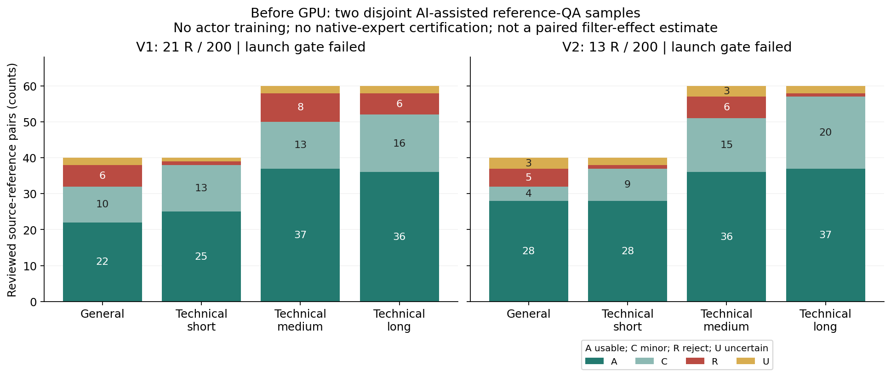

# 系统性3B翻译SFT：数据准备与停止结果 / Systematic 3B translation SFT: data preparation and stop report

2026-11-19 · Europe/Berlin · STOPPED BEFORE GPU — NO NEW R0

已执行CPU数据准备，但未启动训练。首次200对参考审查有21对R、7对U；按方案完成唯一一次过滤修订后，另外200对有13对R、10对U。两次均未满足预先提出的启动门槛，因此停在GPU分配之前。原A及其他旧模型保留，本轮GPU时间和计算单元消耗均为0，没有产生新R0。

CPU data preparation was executed, but training was not launched. The first200-pair reference audit yielded21R and7U. After the one permitted filter revision, a disjoint200-pair audit yielded13R and10U. Both missed the registered launch gate, so execution stopped before GPU allocation. OriginalA and older models are preserved. This task used0GPU minutes/compute units and created no newR0.

这里的R是本次AI辅助源文/参考审查判定的重要监督缺陷，包含错配、重要含义变化和严重OCR；不是母语专家认证的全语料错误率。部分严格忠实性判断可能有争议，全部句子和注释均保留。没有新的Qwen训练或翻译评估，所以不能把本报告称为“又一轮SFT效果不好”。

R denotes material supervision problems in this AI-assisted source/reference audit, including misalignment, important meaning changes and severeOCR. It is not a native-certified corpus-wide error rate. Some strict-fidelity judgements may be disputed; all pairs/notes remain available. No newQwen training or translation-quality evaluation occurred, so this is not another failed-SFT result.

| 状态 / Status | 实测 / Actual |
| --- | --- |
| Raw pairs scanned | 3,221,716 |
| V1 eligible candidates | 181,287; not semantically approved |
| V2 eligible candidates | 99,937; not semantically approved |
| V2 pool after held-out group exclusions | 92,677 |
| Disjoint reviewed pairs | 200 + 200; source and reference overlap0 |
| Original archive recheck | All400 source/reference pairs match original ZIP lines exactly |
| New actor translation calls / optimizer updates | 0 / 0 |
| Colab assignments / GPU minutes / CU | 0 / 0 / 0 |
| Preserved A SHA256 | 9acc23c9595ac0b771bf8f21d125d18f3e993c3f449775377262e7ab73020199 |

## 1. 执行范围与事前停止规则 / Scope and preregistered stop rule

用户于2026-11-19授权按昨日方案开始。该方案明确要求先做CPU数据准备和200对审查；R≤4/200、U≤20/200、各层R比例≤5%才启动GPU。首次失败后最多修订一次过滤规则，并用不重合的200对复审；再次失败则停止。此处执行原规则，没有根据结果降低阈值，也没有进行第三次筛选复审。

The user authorized execution on2026-11-19. The written plan requires CPU preparation and200-pairQA before GPU: R≤4/200, U≤20/200, and stratumR≤5%. One filter revision plus a disjoint200-pair re-audit is allowed after failure. A second failure stops execution. Thresholds were not lowered and no third screening/review was performed.

这些是本项目控制预算的工程启动线，不是WMT标准或“噪声超过2%就一定训不好”的科学定律。停止说明本批数据没有满足已承诺的准备要求，不证明在更宽松噪声条件下训练一定无效。

These are project budget/quality guards, notWMT standards or a law that more than2%noise makesSFT fail. Stopping means this preparation did not meet its promised requirements, not that training under looser noise conditions is proven ineffective.

原方案 / Original proposal: D:\deep learning project\reports\r0_3b_systematic_sft_2026-11-18\R0_3B_SYSTEMATIC_SFT_PLAN_2026-11-18.md

本次授权与方案哈希 / Authorization and proposal hash: D:\deep learning project\experiments\r0_3b_systematic_sft_2026-11-19\execution_authorization.json

## 2. 数据、处理步骤与来源 / Data, preparation and provenance

ParIceFiltered · D:\deep learning project\data\raw\r2_2026-11-13\parice_filtered.zip · SHA256 3dfbca7d7f4e0c03dc3e9a888baba9620691090b32f3b57db40fb29316b28094

OpenSubtitles18 · D:\deep learning project\data\raw\r2_2026-11-13\OpenSubtitles-v2018-en-is.zip · SHA256 ad41577a1c412f4368446565557bedd73d7c2e335cbe3aee79dd6f409bc90b88

Tatoeba · D:\deep learning project\data\raw\train\Tatoeba-v2023-04-12-en-is.zip · SHA256 58e68029f73646a261d651f9caddd30f8fdd3ca924a88e620c8906db642c2718

| 步骤 / Step | 已完成 / Completed |
| --- | --- |
| 1 | Verified parentA weights and copiedA into a separate dated preparation directory |
| 2 | Built separate actualA lineage, known held-out protection and conservative prior-training test exclusions |
| 3 | Scanned3,221,716 archive pairs; structural/OCR/numeric/completeness filtering; fixed reservoirs |
| 4 | Stock-equivalent97-language langid checks,pinned3B tokenization,prompt/target limits,heuristic near exclusions |
| 5 | Prepared512 reference-QA candidates and200 training-reference cards with source-group isolation |
| 6 | Read and locked all200V1 source/reference labels; gate failed |
| 7 | Registered the one global source/reference-only V2 revision; no actor outputs orMetricX selection |
| 8 | Prepared disjoint200V2 cards; read/locked them; gate failed |
| 9 | Re-read all400 pairs directly from originalZIPs; confirmed exact match and unchanged archives/A |
| 10 | Offline count/gate replay,full400-caseCSV/JSONL,bilingualMD/HTML,figure and browserQA |

训练池与评估来源按规范化源文/参考精确匹配、5gram/Jaccard≥0.85启发式和来源组隔离。字幕有成对XML文档ID；扁平ParIce/Tatoeba缺少真实文档ID，使用相邻100行组只是代理，不能称完整文档去污染。历史来源清单也有追溯局限。没有为了“新”而一概排除所有从未训练的候选池。

Protection uses normalized exact source/reference matches,5gram/Jaccard≥0.85 heuristics and source groups. Subtitles retain pairedXML documentIDs; flatParIce/Tatoeba use100-line adjacency proxies, not true document decontamination. Historical inventories also have limits. Entire untrained candidate pools were not categorically excluded merely to manufacture novelty.

准备时修正过一次来源清单分类：自动QE接受全池不等于人工看过的保留集，初稿清单已存provenance_v0_before_inventory_fix；修正发生在原始扫描之前。首次扫描调用因threadpoolctl导入路径中止，调整为使用已有依赖后才开始正式扫描。这些都是CPU准备问题，没有GPU工作或模型更新。

An early inventory correction distinguished a whole automaticQE pool from inspected held-out cards; the initial inventory is preserved. It preceded raw scanning. The first scan invocation stopped at a threadpoolctl import-path issue; the retained scan used existing dependencies. These were CPU preparation issues, with no GPU work or model updates.

## 3. 两次锁定审查的全部统计 / Complete locked audit counts

| 版本 / Version | 层 / Stratum | N | A | C | R | U | R / N |
| --- | --- | --- | --- | --- | --- | --- | --- |
| v1 | general | 40 | 22 | 10 | 6 | 2 | 15.0% |
| v1 | technical_short | 40 | 25 | 13 | 1 | 1 | 2.5% |
| v1 | technical_medium | 60 | 37 | 13 | 8 | 2 | 13.3% |
| v1 | technical_long | 60 | 36 | 16 | 6 | 2 | 10.0% |
| v2 | general | 40 | 28 | 4 | 5 | 3 | 12.5% |
| v2 | technical_short | 40 | 28 | 9 | 1 | 2 | 2.5% |
| v2 | technical_medium | 60 | 36 | 15 | 6 | 3 | 10.0% |
| v2 | technical_long | 60 | 37 | 20 | 1 | 2 | 1.7% |

| 版本 / Version | 200对汇总 / Counts | 总R门槛 / R≤4 | 不确定门槛 / U≤20 | 分层门槛 / StratumR≤5% | 结果 / Outcome |
| --- | --- | --- | --- | --- | --- |
| v1 | {'C': 52, 'A': 120, 'R': 21, 'U': 7} | False | True | False | NOT PASSED |
| v2 | {'A': 129, 'R': 13, 'C': 48, 'U': 10} | False | True | False | NOT PASSED |

A表示可用参考；C表示主要含义可用但有小的措辞、语法、格式或孤立OCR问题；R表示重要监督缺陷；U表示无法可靠判断。A/C不等于全量人工认证。审查只看源文和参考，没有MetricX分数或新actor译文。V1/V2样本、池和部分领域标签不同，21降至13只作描述，不能称配对或因果意义的改善，也不估计整个语料的真实错误率。

A is usable;C retains main meaning with minor wording,grammar,formatting or isolatedOCR issues;R is a material supervision defect;U is uncertain. A/C is not full human certification. Only source/reference text was reviewed,withoutMetricX or newactor translations. V1/V2 use different samples/pools and some revised domains.21→13 is descriptive,not a paired/causal gain or a corpus-wide true error estimate.

## 4. 重要可复核案例 / Material auditable examples

以下案例用于说明问题不全是风格差异，并非第三轮审查、另一位专家裁决或事后修改标签。某些专业原文在完整文档里允许用代词或上下文简写，但不能直接当作当前“只给一个英文句段”的完整监督目标。

These cases illustrate problems beyond style; they are not a third audit,independent expert adjudication or relabeling. Some pronouns/contextual shorthand may be valid in the original document yet unsuitable as complete targets for the current standalone English-segment input.

v1 · card27 · Payment intention reversed

ID: ParIceFiltered:544436

EN: I'd like to get your gas money.

Reference: Þú þarft ekki að borga bensínkostnaðinn, takk.

Review: Requesting the gas money becomes saying the other person need not pay; payment intention is reversed.

v1 · card46 · Haemolysis versus dialysis

ID: ParIceFiltered:469693

EN: Haemolysis is the dose limiting toxicity of ribavirin therapy.

Reference: Blóðskilun er skammtatakmarkandi eiturvirkni ríbavírín meðferðar.

Review: Haemolysis is translated as blóðskilun (dialysis), a different medical process; the key toxicity term is wrong.

v1 · card119 · Genotoxicity versus carcinogenicity

ID: ParIceFiltered:883730

EN: Non-clinical data reveal no special hazard for humans based on conventional studies of safety pharmacology, repeated dose toxicity or genotoxicity.

Reference: Forklínískar upplýsingar benda ekki til neinnar sérstakrar hættu fyrir menn, á grundvelli hefðbundinna rannsókna á lyfjafræðilegu öryggi, eiturverkunum eftir endurtekna skammta eða krabbameinsvaldandi áhrifum.

Review: Genotoxicity is translated as carcinogenic effects, changing the tested safety endpoint.

v1 · card165 · Whole legal alternative omitted

ID: ParIceFiltered:1550214

EN: Where the country concerned does not issue such documents or certificates, they may be replaced a declaration on oath or, in Member States where there is no provision for declarations on oath, by a solemn declaration made by the person concerned before a judicial or administrative authority, a notary or a competent professional or trade body, in the country of origin or in the country whence that person comes.

Reference: Þegar viðkomandi aðildarríki gefur ekki út þessi skjöl eða vottorð getur í stað þeirra komið eiðsvarin yfirlýsing viðkomandi einstaklings frammi fyrir dóms- eða stjórnvaldi, lögbókanda eða öðrum lögbærum stéttar- eða fagsamtökum í upprunalandi hans eða í síðasta dvalarlandi.

Review: The alternative solemn declaration when declarations on oath are unavailable is omitted, removing an entire legal condition and option.

v2 · card9 · Different drug-information sentence

ID: ParIceFiltered:212580

EN: BindRen does not contain calcium and your doctor may prescribe additional calcium tablets.

Reference: BindRen getur eitt og sér ekki læknað þetta ástand, og verður því að ávísa öðrum lyfjum handa þér.

Review: Source says BindRen contains no calcium and doctor may prescribe calcium tablets; reference instead says it cannot cure the condition alone and other medicines must be prescribed.

v2 · card16 · Energy density versus energy content

ID: ParIceFiltered:1268759

EN: The only major component he still needs is a power source of high-energy density.

Reference: Eina höfuðefnið sem hann vantar ennþá er aflgjafi með mikið orkuinnihald .

Review: High energy density is reduced to high energy content; density and total content are not equivalent.

v2 · card52 · NS5A identifier shortened

ID: ParIceFiltered:218565

EN: Both patients had virus at baseline harboring NS5A RAVs.

Reference: Báðir sjúklingarnir voru með veiru við grunngildi sem hýsti NS5 RAV.

Review: The viral target identifier NS5A is shortened to NS5; the specific resistance-associated identifier is not preserved.

v2 · card82 · Instrument identity omitted in standalone pair

ID: ParIceFiltered:1335820

EN: The SPHERE instrument, mounted on ESOs Very Large Telescope, has made it possible to observe the complex dynamics of young solar systems - including one seen developing in real-time.

Reference: Tækið hefur gert stjörnufræðingum kleift að rannsaka í smáatriðum flókið samspil efnis í ungum sólkerfum og sjá breytingar á þeim í rauntíma.

Review: SPHERE, ESO and the Very Large Telescope are omitted and replaced by generic the device; a central observational setup is lost.

v2 · card132 · Age effect becomes symptoms

ID: ParIceFiltered:670982

EN: In patients who were treated empirically or who had invasive candidiasis, a similar modest effect of age was seen in older patients relative to younger patients.

Reference: Hjá raunvíslega meðhöndluðum sjúklingum eða sjúklingum með ífarandi Candida sveppasýkingu komu fram svipuð væg einkenni hjá eldri sjúklingum sem og yngri sjúklingum.

Review: A modest effect of age is replaced by mild symptoms and the older-versus-younger comparison is changed.

v2 · card183 · Dual instruction versus instrument flight

ID: ParIceFiltered:685716

EN: In the case of a PPL(A) or PPL(H) entrant, 50 % of the hours flown prior to the course shall be credited, up to a maximum of 40 hours flying experience, or 45 hours if an aeroplane night rating has been obtained, of which up to 20 hours may count towards the requirement for dual instruction flight time.

Reference: Ef um er að ræða handhafa einkaflugmannsskírteinis fyrir flugvél eða þyrlu má viðurkenna 50% af þeim tíma sem neminn hefur flogið fyrir námskeiðið, að hámarki 40 tíma flugreynslu eða að hámarki 45 tíma ef næturflugsréttinda hefur verið aflað, en þar af má viðurkenna 20 tíma upp í kröfurnar um blindflugstíma með kennara.

Review: Dual-instruction flight time is rendered as instrument/blind-flying time with an instructor, changing which flight hours qualify for credit.

## 5. 一次修订做了什么，以及仍没解决什么 / The one revision and its limits

| 修订 / Revision | 结果边界 / Limit |
| --- | --- |
| Context risk | Removed many non-Tatoeba first-person/contraction/very-short context-dependent pairs; cannot detect every third-person/book paraphrase |
| Completeness anchors | Checked explicitnegation,alternatives,participation,subjectidentity,modality andselectedtemporal cases; heuristics can falsely reject valid paraphrases |
| Clinical/financial anchors | Screened selected toxicity,cell-surface,authorization,equivalent-unit andfinancial-instrument mismatches; not comprehensive semantic verification |
| OCR hygiene | Removed known split suffixes,isolated letters andgluedlegal dates; previously unseenOCR forms remain |
| Domain metadata | Expanded lexicalanchors,not authoritative subcorpuslabels; treatment can mean vehicle-waste treatment or equal treatment,notmedicine |

V2留下99,937对，隔离候选保留来源组后训练候选为92,677对；它们仍未获本轮启动资格，不能写成“已准备好9万高质量训练数据”。领域标签由词汇规则产生，抽查发现跨领域误标，不能用这些计数宣称医疗、法律、天文已经真正均衡。全部规则、拒绝列表、改类计数与原始版本均已保存。

V2 retained99,937 pairs,or92,677 training candidates after held-out group exclusion. They did not qualify for launch; do not call them90k approved high-quality training pairs. Lexical domains contain cross-domain mistakes,so counts do not establish a truly balanced medical/legal/astronomy distribution. Rules,rejections,reclassification and prior versions are preserved.

## 6. 对旧0.8B和3B原因判断的含义 / Implications for earlier0.8B and3B diagnoses

本轮直接证明的是“新准备的训练池仍含当前任务下的重要监督问题，且未通过自己的启动规则”。两轮所有R源文与A已知实际训练链的精确源文重合都是0；所以不能说这些具体坏样本导致了旧A失败，也不能据此估计旧训练集噪声。精确不重合仍不等于语义、近重复或预训练完全未见。

This audit establishes important supervision problems in the newly prepared pool and failure of the project launch rule. EveryR source has0 exact overlap with A’s known actual training-source hashes. Therefore these particular cases do not demonstrate the cause of priorA’s failures or estimate old-data noise. Exact nonoverlap does not establish semantic/near/pretraining novelty.

既有结论保留：0.8B能记忆小集合但未泛化；3B SFT有过真实收益但技术正确候选仍少；MetricX错排是另一条问题。新数据QA不是新的SFT/DAPO对照，不能量化这些因素对旧训练结果的贡献，不能宣布参数容量上限，也不能断言“只修数据就一定得到强R0”。

Earlier findings remain:0.8B memorized a tiny set without generalizing;3B SFT produced real gains but weak technical candidate availability;MetricX misranking is separate. DataQA is not a newSFT/DAPO comparison and cannot allocate causal contributions,establish a capacity ceiling,or guarantee that fixing data alone yields a strongR0.

## 7. 下一步应改变数据构建方式 / Next: change data construction, not another word-rule pass

保持通用Qwen3B与现有A。下一项应是按原始子语料和文档对齐来源构建监督，而不是对同一混合扁平句对池再加第三轮关键词过滤：保留EEA、EMA、ESO、通用来源及文档ID，先检查对齐、缺句和上下文依赖，再按来源选择可用训练部分。领域归属由真实来源辅助，而不是只靠shall、treatment或galaxy命中。

Keep general-purposeQwen3B andA. The next preparation should use original subcorpus/document-alignment provenance rather than a third word-rule pass over the same flat mixture. Retain EEA,EMA,ESO,general-source anddocument identities; inspect alignment,missingclauses andcontext dependence before selecting usable training subsets. Domain assignment should use provenance,not only shall/treatment/galaxy hits.

ParIce提供方明确区分多个子语料，原始发布页也展示了XML文档结构；这说明有值得检查的来源级路径，不保证其中任何一份训练子集已经达到质量目标。官网提到人工核查的dev/test不能拿来训练。本轮仅查了目录，没有下载或审核新的训练版本，也没有启动新的数据筛选试验。

The ParIce provider lists separate subcorpora and the original release catalog exposesXML document structure. That is a concrete provenance-level route to inspect,not proof that a particular training subset passes quality targets. Manually checked dev/test material must not be used for training. Only catalogs were inspected here; no new release was downloaded/audited and no further screening experiment was launched.

[ParIce provider](https://parice.arnastofnun.is/) · [Original corpus catalog](https://repository.clarin.is/repository/xmlui/handle/20.500.12537/16) · [Split catalog](https://repository.clarin.is/repository/xmlui/handle/20.500.12537/24)

这是后续建议，不是已完成的数据修复。下一轮仍须在GPU前固定实际数据与验收规则；来源级准备若无法提供足够可靠监督，应报告资源缺口，而非继续承诺一次8小时SFT会解决。

This is a recommendation,not completed data repair. Any next execution must freeze actual data and acceptance before GPU. If provenance-level preparation cannot supply adequate supervision,report that resource gap rather than promise an8-hourSFT cure.

## 8. 成本、权重与实现状态 / Cost, weights and implementation status

| 项目 / Item | 实际 / Actual |
| --- | --- |
| GPU allocation request | None; no ownership/allocation_request file |
| Colab assignments | 0 |
| Actor translations / updates / newR0 | 0 / 0 / none |
| Initial and final observed CU | 251.04827779719415 → 251.04827779719415 |
| Observed CU decrease | 0.0 |
| ParentA | Original and copied adapter hashes match |
| Raw archives | Unchanged SHA256; all400 reviewed pairs independently re-read |
| Training implementation | Draft core/trainer prepared; not GPU-integrated or validated; no launchbundle |
| Finaltest/G8 outputs | Not generated;512reference candidates are not completed evaluation results |

CPU准备、语言识别和分词不是GPU训练；本轮没有重新登录、挂载Drive、申请GPU或购买额度。草稿代码不能当作已验证的训练交付，不应绕过数据门槛直接运行。

CPU preparation,languageID andtokenization are notGPU training. No newlogin,Drive mount,GPU request or quota purchase occurred. Draft training code is not a validated training deliverable and should not be run to bypass the data gate.

## 9. 文件索引与CPU复算 / Artifacts and offline replay

| 用途 / Purpose | 路径 / Path |
| --- | --- |
| ReportMD/HTML | D:\deep learning project\reports\r0_3b_systematic_sft_2026-11-19 |
| Plan/authorization/provenance/filter versions | D:\deep learning project\experiments\r0_3b_systematic_sft_2026-11-19 |
| Locked200+200 cards/labels | D:\deep learning project\experiments\r0_3b_systematic_sft_2026-11-19\QA |
| All400CSV/JSONL,counts,illustrativecases | D:\deep learning project\runs\r0_3b_systematic_sft_2026-11-19\analysis |
| Raw400pair recheck | D:\deep learning project\runs\r0_3b_systematic_sft_2026-11-19\analysis\raw_archive_recheck.json |
| Offline recomputation | D:\deep learning project\experiments\r0_3b_systematic_sft_2026-11-19\execution_tools\p11_reproduce_QA.py |
| Executionstate | D:\deep learning project\runs\r0_3b_systematic_sft_2026-11-19\current_state.json |
| PreservedA | D:\deep learning project\runs\r0_3b_overnight_2026-11-18\final_selected_adapter |

用项目Python运行execution_tools中的p11_reproduce_QA.py可离线复算锁定计数、分层结果和门槛；它不会重新调用模型、重标注、发起网络请求或训练。原始400对回读的独立核对已单独记录，复算脚本不重复整个扫描。

Run p11_reproduce_QA.py with the projectPython to recompute locked counts,strata andgates offline. It does not callmodels,relabel,network ortrain. The separate400-pair raw recheck is recorded; the countreplay does not repeat the entire scan.

## 10. 全部400对审查 / All400 reviewed pairs

v1 · 0 · general · C · ParIceFiltered:537535

Domain metadata (heuristic): general

EN: I can't believe I got so caught up.

Reference: Ég trúi ekki að ég hafi tapað mér svona.

AI reference grade: C — Usable core translation with minor idiomatic, formatting, tense/grammar or register compression; no clear central reversal.

v1 · 1 · general · A · ParIceFiltered:823981

Domain metadata (heuristic): general

EN: Maybe they have a cure.

Reference: Kannski hafa þeir lækningu.

AI reference grade: A — Core meanings, roles and clauses are preserved; no clear material supervision defect.

v1 · 2 · general · A · ParIceFiltered:388689

Domain metadata (heuristic): general

EN: Even odder features lie in the outer parts of the cluster.

Reference: Við ytri hluta þyrpingarinnar eru enn furðulegri fyrirbæri.

AI reference grade: A — Core meanings, roles and clauses are preserved; no clear material supervision defect.

v1 · 3 · general · A · ParIceFiltered:292965

Domain metadata (heuristic): general

EN: Containers other than plastic bags shall be securely closed either by means of a suitable stopper or by a screw-cap of metal or plastic material having, if necessary, an air-tight plastic liner.

Reference: Ílátum öðrum en plastpokum skal lokað vandlega, annaðhvort með hæfilegum tappa eða með skrúfuloki úr málmi eða plasti, með loftþéttri plastlíningu ef nauðsynlegt þykir.

AI reference grade: A — Core meanings, roles and clauses are preserved; no clear material supervision defect.

v1 · 4 · general · C · ParIceFiltered:674768

Domain metadata (heuristic): general

EN: Insert a second line for identification number 3220 reading: '(1),(2),(3),(5) 3,6 10 0,72 g'.

Reference: Setja skal inn aðra línu fyrir kenninúmer 3220 sem hér segir: „1., 2., 3., 5. liður - 3,6 10 0,72 g“.

AI reference grade: C — Usable core translation with minor idiomatic, formatting, tense/grammar or register compression; no clear central reversal.

v1 · 5 · general · C · ParIceFiltered:105796

Domain metadata (heuristic): general

EN: And Fatty Hodge has pounced on her.

Reference: Og Hodges feita stökk á hana.

AI reference grade: C — Usable core translation with minor idiomatic, formatting, tense/grammar or register compression; no clear central reversal.

v1 · 6 · general · R · ParIceFiltered:1610224

Domain metadata (heuristic): general

EN: You'll be safe there.

Reference: Þú verður óhult.

AI reference grade: R — The reference drops the location restriction there from the safety statement.

v1 · 7 · general · A · ParIceFiltered:759703

Domain metadata (heuristic): general

EN: I've been stalling 'em until I could see you.

Reference: Ég tafði þá til að geta hitt þig fyrst.

AI reference grade: A — Core meanings, roles and clauses are preserved; no clear material supervision defect.

v1 · 8 · general · C · ParIceFiltered:1090838

Domain metadata (heuristic): general

EN: Spinal or regional anaesthesia is advised prior to intramuscular administration, due to the number of injections required.

Reference: Ráðlegt þykir að nota mænudeyfingu eða leiðsludeyfingu fyrir inngjöf í vöðva þar sem stungustaðir eru mjög margir.

AI reference grade: C — Usable core translation with minor idiomatic, formatting, tense/grammar or register compression; no clear central reversal.

v1 · 9 · general · C · ParIceFiltered:770041

Domain metadata (heuristic): general

EN: I wonder if that's the same Frank Deverell that came and thanked me for not shooting his son in the goddamn head.

Reference: Ætli þetta sé sá sami Frank Deverell og þakkaði mér fyrir að hafa ekki skotið son hans í hausinn.

AI reference grade: C — Usable core translation with minor idiomatic, formatting, tense/grammar or register compression; no clear central reversal.

v1 · 10 · general · A · ParIceFiltered:1381532

Domain metadata (heuristic): general

EN: This event shall not be triggered in cases no valid GNSS signal was detectable by the GNSS receiver within the last 30 days.

Reference: Þetta sértilvik skal ekki koma upp í tilvikum þar sem GNSS-móttökubúnaðurinn hefur ekki numið neitt gilt GNSS-merki síðustu 30 dagana.

AI reference grade: A — Core meanings, roles and clauses are preserved; no clear material supervision defect.

v1 · 11 · general · A · OpenSubtitles18:341592

Domain metadata (heuristic): general

EN: Look at the screen.

Reference: Líttu á skjáinn.

AI reference grade: A — Core meanings, roles and clauses are preserved; no clear material supervision defect.

v1 · 12 · general · R · ParIceFiltered:510435

Domain metadata (heuristic): general

EN: Horseracing's all about excitement.

Reference: Veðreiðar snúast um það.

AI reference grade: R — The explicit excitement is replaced by a context-dependent that; the main complement is missing.

v1 · 13 · general · A · ParIceFiltered:632635

Domain metadata (heuristic): general

EN: In a comic, you know how you can tell who the arch-villain's going to be?

Reference: Veistu hvernig maður veit hver erkióvinurinn er í myndasögum?

AI reference grade: A — Core meanings, roles and clauses are preserved; no clear material supervision defect.

v1 · 14 · general · U · ParIceFiltered:1089906

Domain metadata (heuristic): general

EN: Specific studies on fertility have not been performed.

Reference: Ekki hafa verið gerðar sérstakar rannsóknir á áhrifum lyfsins á frjósemi.

AI reference grade: U — Reference narrows the statement to effects of a drug not explicitly named in this standalone source; context dependence is uncertain.

v1 · 15 · general · A · ParIceFiltered:105500

Domain metadata (heuristic): general

EN: And Elon the Zebulonite died, and was buried in Aijalon in the country of Zebulun.

Reference: Síðan andaðist Elón, niðji Sebúlons, og var grafinn í Ajalon í Sebúlonslandi.

AI reference grade: A — The source facts, conditions, roles and key relations are preserved; no clear material defect.

v1 · 16 · general · C · ParIceFiltered:566667

Domain metadata (heuristic): general

EN: If the cause cannot be identified or it is not possible to solve the problem, pause the treatment and change the applicator.

Reference: Ef ekki er hægt að greina orsökina eða ómögulegt reynist að leysa vandamálið skal gera hlé á meðferðinni og skipta um áhald.

AI reference grade: C — Core meaning is usable with some generic wording, idiomatic literalness or reduced register.

v1 · 17 · general · A · ParIceFiltered:1234529

Domain metadata (heuristic): general

EN: The last enemy to be destroyed is death.

Reference: Dauðinn er síðasti óvinurinn, sem verður að engu gjörður.

AI reference grade: A — The source facts, conditions, roles and key relations are preserved; no clear material defect.

v1 · 18 · general · A · ParIceFiltered:608299

Domain metadata (heuristic): general

EN: I'll need them both.

Reference: Ég þarf þau bæði.

AI reference grade: A — The source facts, conditions, roles and key relations are preserved; no clear material defect.

v1 · 19 · general · C · ParIceFiltered:618028

Domain metadata (heuristic): general

EN: I'm gonna lure that sucker out into the open and take his picture.

Reference: Ég ætla að tæla greyið fram og mynda það.

AI reference grade: C — Core meaning is usable with some generic wording, idiomatic literalness or reduced register.

v1 · 20 · general · A · ParIceFiltered:160908

Domain metadata (heuristic): general

EN: Are you sure it's completely isolated?

Reference: Ertu viss að þetta sé alveg einangrað?

AI reference grade: A — The source facts, conditions, roles and key relations are preserved; no clear material defect.

v1 · 21 · general · R · ParIceFiltered:1604570

Domain metadata (heuristic): general

EN: You hear what he was yelling when we brought the dummy in?

Reference: Heyrðuð þið öskrin í honum þegar hann kom inn með stóra fávitann?

AI reference grade: R — Source we brought the dummy in becomes he came in with the big idiot; actor and event relation change.

v1 · 22 · general · A · ParIceFiltered:576996

Domain metadata (heuristic): general

EN: If you are breast feeding talk to your doctor before using this medicine.

Reference: Ef þú ert með barn á brjósti skaltu leita ráða hjá lækninum áður en þú notar lyfið.

AI reference grade: A — The source facts, conditions, roles and key relations are preserved; no clear material defect.

v1 · 23 · general · A · ParIceFiltered:1308013

Domain metadata (heuristic): general

EN: The requested authority shall promptly notify the requesting authority whether it accepts the proposed appointment.

Reference: Yfirvaldið sem beiðni er beint til skal tafarlaust tilkynna yfirvaldinu sem leggur fram beiðni hvort það samþykki tillöguna um tilnefningu.

AI reference grade: A — The source facts, conditions, roles and key relations are preserved; no clear material defect.

v1 · 24 · general · C · ParIceFiltered:738522

Domain metadata (heuristic): general

EN: It's a blueprint for a house of success.

Reference: Þetta er teikning af húsi árangurs.

AI reference grade: C — Core meaning is usable with some generic wording, idiomatic literalness or reduced register.

v1 · 25 · general · U · ParIceFiltered:1277667

Domain metadata (heuristic): general

EN: The pile is formed by means of a mould.

Reference: Hrúgan er útbúin með formi.

AI reference grade: U — Pile may denote a technical pile or a heap; without provenance context the reference heap cannot be certified.

v1 · 26 · general · C · ParIceFiltered:1271878

Domain metadata (heuristic): general

EN: The other ingredients are sucrose, polysorbate 80, monobasic sodium phosphate monohydrate and dibasic sodium phosphate heptahydrate.

Reference: Ö nnur innihaldsefni eru súkrósi, pólýsorbat 80, einbasískt natríumfosfat einhýdrat og tvíbasískt natríumfosfat heptahýdrat.

AI reference grade: C — Ingredient list and chemistry are preserved; initial Ö nnur contains a visible OCR word split.

v1 · 27 · general · R · ParIceFiltered:544436

Domain metadata (heuristic): general

EN: I'd like to get your gas money.

Reference: Þú þarft ekki að borga bensínkostnaðinn, takk.

AI reference grade: R — Requesting the gas money becomes saying the other person need not pay; payment intention is reversed.

v1 · 28 · general · A · ParIceFiltered:768672

Domain metadata (heuristic): general

EN: I will go away and so will my boys.

Reference: Ég mun fara í burtu og líka strákarnir mínir.

AI reference grade: A — The source facts, conditions, roles and key relations are preserved; no clear material defect.

v1 · 29 · general · A · ParIceFiltered:868832

Domain metadata (heuristic): general

EN: Neoclarityn oral solution is also used to relieve the symptoms associated with urticaria (a skin condition caused by an allergy).

Reference: Neoclarityn mixtúra, lausn, er einnig notuð til að draga úr einkennum ofsakláða (einkenni í húð vegna ofnæmis).

AI reference grade: A — The source facts, conditions, roles and key relations are preserved; no clear material defect.

v1 · 30 · general · R · ParIceFiltered:903297

Domain metadata (heuristic): general

EN: Now, we get a daily bulletin about all ex-prisoners returning to our manor.

Reference: Við fáum fréttir af öllum fyrrverandi föngum sem flytja aftur í hverfið.

AI reference grade: R — Reference omits the explicit daily bulletin/frequency and reduces it to receiving news.

v1 · 31 · general · A · ParIceFiltered:1208833

Domain metadata (heuristic): general

EN: The facilitator shall transmit the written coordination arrangements to the members of the college and to CESR.

Reference: Samræmingaraðili skal senda skriflega samræmingarfyrirkomulagið til aðila að samstarfshópnum og samstarfsnefndar evrópskra verðbréfaeftirlitsaðila.

AI reference grade: A — The source facts, conditions, roles and key relations are preserved; no clear material defect.

v1 · 32 · general · A · OpenSubtitles18:877062

Domain metadata (heuristic): general

EN: How does any wife take such things?

Reference: Hvernig tekur eiginkona slíkum hlutum?

AI reference grade: A — The source facts, conditions, roles and key relations are preserved; no clear material defect.

v1 · 33 · general · A · ParIceFiltered:1479697

Domain metadata (heuristic): general

EN: We'll outsmart them every step.

Reference: Við sjáum við þeim alla leið.

AI reference grade: A — The source facts, conditions, roles and key relations are preserved; no clear material defect.

v1 · 34 · general · A · ParIceFiltered:1138278

Domain metadata (heuristic): general

EN: That's him, the one with the staff.

Reference: Það er þessi þarna með stafinn.

AI reference grade: A — The source facts, conditions, roles and key relations are preserved; no clear material defect.

v1 · 35 · general · C · OpenSubtitles18:832413

Domain metadata (heuristic): general

EN: What the hell is going on?

Reference: -Hvað er á seyði?

AI reference grade: C — Core meaning is usable with some generic wording, idiomatic literalness or reduced register.

v1 · 36 · general · R · ParIceFiltered:1183703

Domain metadata (heuristic): general

EN: The confidential nature of any proprietary data shall be respected.

Reference: Fara skal með gögn sem njóta einkaleyfaverndar sem trúnaðarmál.

AI reference grade: R — Proprietary data is narrowed to patent-protected data; proprietary information need not be patented.

v1 · 37 · general · A · ParIceFiltered:845525

Domain metadata (heuristic): general

EN: Mills and grinders likely to appreciably heat the sample shall not be used.

Reference: Ekki skal nota kvarnir eða mölunartæki sem líklegt er að hiti sýnið verulega.

AI reference grade: A — The source facts, conditions, roles and key relations are preserved; no clear material defect.

v1 · 38 · general · A · ParIceFiltered:1192914

Domain metadata (heuristic): general

EN: The details of the assessment shall be provided in accordance with established guidance.

Reference: Láta skal í té nánari upplýsingar um matið í samræmi við gildandi leiðbeiningar.

AI reference grade: A — The source facts, conditions, roles and key relations are preserved; no clear material defect.

v1 · 39 · general · A · ParIceFiltered:814555

Domain metadata (heuristic): general

EN: Make sure the sample well in the strip lines up with the green light on the test strip guide.

Reference: Tryggið að safnhólfið á strimlinum falli ofan á græna ljósið í mælistrimilsraufinni.

AI reference grade: A — The source facts, conditions, roles and key relations are preserved; no clear material defect.

v1 · 40 · technical_short · C · ParIceFiltered:393576

Domain metadata (heuristic): other_technical

EN: Except at least a dog knows not to lick the electrical sockets.

Reference: Nema hundurinn hefur vit á að sleikja ekki innstungurnar.

AI reference grade: C — Usable main meaning with minor wording, modal/format/register or footnote/OCR/grammar issues; some domain assignments need correction.

v1 · 41 · technical_short · A · ParIceFiltered:1126910

Domain metadata (heuristic): medical

EN: Temsirolimus should be used with caution when treating patients with hepatic impairment.

Reference: Gæta skal varúðar við notkun temsirolimus þegar sjúklingar með skerta lifrarstarfsemi eru meðhöndlaðir.

AI reference grade: A — Clinical/legal/technical facts, names, numbers and conditions are preserved.

v1 · 42 · technical_short · U · ParIceFiltered:970910

Domain metadata (heuristic): medical

EN: PK-efficacy analyses were not performed for clinical endpoints.

Reference: Ekki var gerð greining á verkun lyfjahvarfa fyrir klíníska endapunkta.

AI reference grade: U — PK-efficacy relationship is rendered as efficacy of pharmacokinetics; terminology relation is uncertain and needs expert verification.

v1 · 43 · technical_short · C · ParIceFiltered:1137485

Domain metadata (heuristic): medical

EN: That's a total violation of my doctor-patient confidentiality.

Reference: Það er brot á þagnarskyldu milli læknis og sjúklings.

AI reference grade: C — Usable main meaning with minor wording, modal/format/register or footnote/OCR/grammar issues; some domain assignments need correction.

v1 · 44 · technical_short · A · ParIceFiltered:1393076

Domain metadata (heuristic): medical

EN: This medicinal product contains 15.6 mmol (or 359.6 mg) sodium per dose.

Reference: Þetta lyf inniheldur 15,6 mmól (eða 359,6 mg) af natríum í hverjum skammti.

AI reference grade: A — Clinical/legal/technical facts, names, numbers and conditions are preserved.

v1 · 45 · technical_short · C · ParIceFiltered:1177675

Domain metadata (heuristic): legal

EN: The Commission should provide information on climate change expenditure within the Programme.

Reference: Framkvæmdastjórninni ber að veita upplýsingar um útgjöld í tengslum við loftslagsbreytingar innan áætlunarinnar.

AI reference grade: C — Usable main meaning with minor wording, modal/format/register or footnote/OCR/grammar issues; some domain assignments need correction.

v1 · 46 · technical_short · R · ParIceFiltered:469693

Domain metadata (heuristic): medical

EN: Haemolysis is the dose limiting toxicity of ribavirin therapy.

Reference: Blóðskilun er skammtatakmarkandi eiturvirkni ríbavírín meðferðar.

AI reference grade: R — Haemolysis is translated as blóðskilun (dialysis), a different medical process; the key toxicity term is wrong.

v1 · 47 · technical_short · A · ParIceFiltered:154567

Domain metadata (heuristic): medical

EN: Approximately 10% of the administered methotrexate is metabolised intrahepatically.

Reference: Um það bil 10% af gefnu metótrexati er umbrotið í lifur.

AI reference grade: A — Clinical/legal/technical facts, names, numbers and conditions are preserved.

v1 · 48 · technical_short · A · ParIceFiltered:87726

Domain metadata (heuristic): medical

EN: All these patients had previously taken PEG-ADA.

Reference: Allir höfðu þessir sjúklingar áður fengið PEG-ADA.

AI reference grade: A — Clinical/legal/technical facts, names, numbers and conditions are preserved.

v1 · 49 · technical_short · A · ParIceFiltered:831183

Domain metadata (heuristic): legal

EN: Member States concerned: Denmark, Estonia, Finland, Germany, Latvia, Lithuania, Poland, and Sweden.

Reference: Hlutaðeigandi aðildarríki: Danmörk, Eistland, Finnland, Þýskaland, Lettland, Litháen, Pólland og Svíþjóð.

AI reference grade: A — Clinical/legal/technical facts, names, numbers and conditions are preserved.

v1 · 50 · technical_short · C · ParIceFiltered:1206251

Domain metadata (heuristic): other_technical

EN: The evaluation procedure shall include an assessment visit to the manufacturer's premises.

Reference: Hluti af matsverkefninu skal vera eftirlitsferð um athafnasvæði framleiðandans.

AI reference grade: C — Usable main meaning with minor wording, modal/format/register or footnote/OCR/grammar issues; some domain assignments need correction.

v1 · 51 · technical_short · A · ParIceFiltered:246947

Domain metadata (heuristic): medical

EN: Can I talk to any of your past and/or existing patients?

Reference: Get ég fengið að tala við einhverja af fyrrverandi og/eða núverandi sjúklingum þínum?

AI reference grade: A — Clinical/legal/technical facts, names, numbers and conditions are preserved.

v1 · 52 · technical_short · A · ParIceFiltered:488637

Domain metadata (heuristic): medical

EN: Hepatic impairment: no dose adjustment is required in patients with hepatic impairment.

Reference: Skert lifrarstarfsemi: ekki þarf að breyta skömmtum hjá sjúklingum með skerta lifrarstarfsemi.

AI reference grade: A — Clinical/legal/technical facts, names, numbers and conditions are preserved.

v1 · 53 · technical_short · A · ParIceFiltered:645628

Domain metadata (heuristic): other_technical

EN: Includes crude oil burned for electricity generation.

Reference: Tekur til jarðolíu sem brennd er til raforkuframleiðslu.

AI reference grade: A — Clinical/legal/technical facts, names, numbers and conditions are preserved.

v1 · 54 · technical_short · A · ParIceFiltered:271935

Domain metadata (heuristic): medical

EN: Close monitoring of blood parameters is advised in these patients.

Reference: Ráðlagt er að hafa náið eftirlit með blóðgildum þessara sjúklinga.

AI reference grade: A — Clinical/legal/technical facts, names, numbers and conditions are preserved.

v1 · 55 · technical_short · A · ParIceFiltered:1136440

Domain metadata (heuristic): legal

EN: That revised Annex came into force on 1 January 2007.

Reference: Endurskoðaði viðaukinn öðlaðist gildi 1. janúar 2007.

AI reference grade: A — Clinical/legal/technical facts, names, numbers and conditions are preserved.

v1 · 56 · technical_short · C · ParIceFiltered:1436148

Domain metadata (heuristic): other_technical

EN: Type III test (verifying emissions of crankcase gases) 5.2.1.3.1.

Reference: Prófun III (eftirlit með útblæstri úr sveifarhúsi) 5.2.1.3.1.

AI reference grade: C — Usable main meaning with minor wording, modal/format/register or footnote/OCR/grammar issues; some domain assignments need correction.

v1 · 57 · technical_short · C · ParIceFiltered:875843

Domain metadata (heuristic): medical

EN: No change in exposure to carbamazepine or its metabolite carbamazepine-epoxide was noted.

Reference: Engin breyting varð á útsetningu fyrir karbamazepíni eða umbrotsefni þess, karbamazepín-epoxíði kom fram.

AI reference grade: C — Usable main meaning with minor wording, modal/format/register or footnote/OCR/grammar issues; some domain assignments need correction.

v1 · 58 · technical_short · A · ParIceFiltered:379104

Domain metadata (heuristic): medical

EN: Enoxaparin pharmacokinetics appears to be linear over the recommended dose ranges.

Reference: Lyfjahvörf enoxaparíns virðast vera línuleg á ráðlögðu skammtabili.

AI reference grade: A — Clinical/legal/technical facts, names, numbers and conditions are preserved.

v1 · 59 · technical_short · A · ParIceFiltered:1354382

Domain metadata (heuristic): legal

EN: The values for concentration or for the percentage of reduction shall apply.

Reference: Gildin fyrir styrk eða hundraðshlutalækkun skulu notuð.

AI reference grade: A — Clinical/legal/technical facts, names, numbers and conditions are preserved.

v1 · 60 · technical_short · A · ParIceFiltered:1116105

Domain metadata (heuristic): medical

EN: Tabulated information on dosing by body weight of patient.

Reference: Tafla með upplýsingum um skammta miðað við líkamsþyngd sjúklings.

AI reference grade: A — Clinical/legal/technical facts, names, numbers and conditions are preserved.

v1 · 61 · technical_short · C · ParIceFiltered:446388

Domain metadata (heuristic): medical

EN: Further metabolism involves peptide hydrolysis and N-acetylation.

Reference: Áframhaldandi umbrot krefst peptíð vatnsrofs og N-asetýleringar.

AI reference grade: C — Usable main meaning with minor wording, modal/format/register or footnote/OCR/grammar issues; some domain assignments need correction.

v1 · 62 · technical_short · A · ParIceFiltered:258815

Domain metadata (heuristic): medical

EN: Cerdelga has not been studied in patients with hepatic impairment.

Reference: Cerdelga hefur ekki verið rannsakað hjá sjúklingum með skerta lifrarstarfsemi.

AI reference grade: A — Clinical/legal/technical facts, names, numbers and conditions are preserved.

v1 · 63 · technical_short · C · ParIceFiltered:1569141

Domain metadata (heuristic): medical

EN: Withhold YERVOY dosea in patients with the following immune-related adverse reactions.

Reference: Fresta skal YERVOY skammtia hjá sjúklingum með eftirfarandi ónæmistengdar aukaverkanir.

AI reference grade: C — Usable main meaning with minor wording, modal/format/register or footnote/OCR/grammar issues; some domain assignments need correction.

v1 · 64 · technical_short · A · ParIceFiltered:1001451

Domain metadata (heuristic): medical

EN: Qtern can be used in patients with mild or moderate hepatic impairment.

Reference: Nota má Qtern hjá sjúklingum með vægt eða miðlungsmikið skerta lifrarstarfsemi.

AI reference grade: A — Clinical/legal/technical facts, names, numbers and conditions are preserved.

v1 · 65 · technical_short · A · ParIceFiltered:1397230

Domain metadata (heuristic): legal

EN: This recommendation shall apply from 1 January 1997.

Reference: Tilmæli þessi gilda frá 1. janúar 1997.

AI reference grade: A — The substantive clinical or legal meaning, quantities, negation and conditions are preserved.

v1 · 66 · technical_short · C · ParIceFiltered:425017

Domain metadata (heuristic): medical

EN: Formation of pharmacologically inactive non-polar ceramide analogues of fingolimod was also observed.

Reference: Einnig sást myndun lyfjafræðilega óvirkrar óskautaðrar ceramid hliðstæðu fingolimods.

AI reference grade: C — Main meaning usable with minor number agreement, terminology/modality or contextual explicitation/specificity differences.

v1 · 67 · technical_short · A · ParIceFiltered:877140

Domain metadata (heuristic): medical

EN: No dosage adjustment is considered necessary for patients with renal impairment.

Reference: Ekki er talin þörf á skammtaaðlögun hjá sjúklingum með skerta nýrnastarfsemi.

AI reference grade: A — The substantive clinical or legal meaning, quantities, negation and conditions are preserved.

v1 · 68 · technical_short · A · ParIceFiltered:832572

Domain metadata (heuristic): legal

EN: Member States may provide for others to be considered as its co-authors.

Reference: Aðildarríki geta sett reglur um að aðrir geti einnig talist vera höfundar verksins.

AI reference grade: A — The substantive clinical or legal meaning, quantities, negation and conditions are preserved.

v1 · 69 · technical_short · C · ParIceFiltered:1277226

Domain metadata (heuristic): medical

EN: The pharmacokinetics were similar across sex and ethnic groups.

Reference: Lyfjahvörf voru svipuð milli kynja og kynþátta.

AI reference grade: C — Main meaning usable with minor number agreement, terminology/modality or contextual explicitation/specificity differences.

v1 · 70 · technical_short · C · ParIceFiltered:1428085

Domain metadata (heuristic): legal

EN: Transparency and certainty in the implementation of this Directive should be ensured.

Reference: Tryggja skal gagnsæi og áreiðanleika í framkvæmd þessarar tilskipunar.

AI reference grade: C — Main meaning usable with minor number agreement, terminology/modality or contextual explicitation/specificity differences.

v1 · 71 · technical_short · A · ParIceFiltered:881007

Domain metadata (heuristic): medical

EN: No interaction studies with other vaccines or medicinal products have been performed.

Reference: Engar rannsóknir hafa verið gerðar á milliverkunum við önnur bóluefni eða lyf.

AI reference grade: A — The substantive clinical or legal meaning, quantities, negation and conditions are preserved.

v1 · 72 · technical_short · A · ParIceFiltered:1048773

Domain metadata (heuristic): medical

EN: Seventeen (1%) patients required permanent discontinuation from treatment.

Reference: Sautján (1%) sjúklingar þurftu að hætta meðferð fyrir fullt og allt.

AI reference grade: A — The substantive clinical or legal meaning, quantities, negation and conditions are preserved.

v1 · 73 · technical_short · A · ParIceFiltered:654481

Domain metadata (heuristic): medical

EN: Infliximab has not been studied in these patient populations.

Reference: Ekki hafa farið fram rannsóknir með infliximabi á þessum sjúklingahópum.

AI reference grade: A — The substantive clinical or legal meaning, quantities, negation and conditions are preserved.

v1 · 74 · technical_short · A · ParIceFiltered:853847

Domain metadata (heuristic): medical

EN: Most of my patients don't take my assignments this seriously.

Reference: Fæstir sjúklinga minna taka verkefni mín svona alvarlega.

AI reference grade: A — The substantive clinical or legal meaning, quantities, negation and conditions are preserved.

v1 · 75 · technical_short · A · ParIceFiltered:1382914

Domain metadata (heuristic): medical

EN: This HIV-1 mutation was observed in vitro and in HIV-1 infected patients.

Reference: Þessi HIV-1 stökkbreyting sást in vitro og hjá HIV-1 sýktum sjúklingum.

AI reference grade: A — The substantive clinical or legal meaning, quantities, negation and conditions are preserved.

v1 · 76 · technical_short · A · ParIceFiltered:1316424

Domain metadata (heuristic): medical

EN: There were no significant effects of erlotinib on the pharmacokinetics of capecitabine.

Reference: Erlótiníb hafði engin marktæk áhrif á lyfjahvörf capecítabíns.

AI reference grade: A — The substantive clinical or legal meaning, quantities, negation and conditions are preserved.

v1 · 77 · technical_short · A · ParIceFiltered:1431029

Domain metadata (heuristic): medical

EN: Tresiba can be used in elderly patients.

Reference: Nota má Tresiba handa öldruðum sjúklingum.

AI reference grade: A — The substantive clinical or legal meaning, quantities, negation and conditions are preserved.

v1 · 78 · technical_short · C · ParIceFiltered:163353

Domain metadata (heuristic): legal

EN: Article 135 shall apply from 1 August 2008.

Reference: Ákvæði 135grgilda frá 1ágúst 2008.

AI reference grade: C — The legal date and article remain recoverable but target contains glued OCR forms 135grgilda and 1ágúst.

v1 · 79 · technical_short · C · ParIceFiltered:1398751

Domain metadata (heuristic): legal

EN: This Regulation should therefore be confined to the necessary additional provisions.

Reference: Þessi reglugerð skal því takmarkast við nauðsynleg viðbótarákvæði.

AI reference grade: C — Main meaning usable with minor number agreement, terminology/modality or contextual explicitation/specificity differences.

v1 · 80 · technical_medium · A · ParIceFiltered:960796

Domain metadata (heuristic): medical

EN: Patients with TIH and evidence of deterioration in renal function should be appropriately evaluated with consideration given as to whether the potential benefit of treatment with Zoledronic acid Actavis outweighs the possible risk.

Reference: Sjúklinga með blóðkalsíumhækkun vegna æxla og vísbendingar um versnun á nýrnastarfsemi skal meta á viðeigandi hátt og íhuga skal hvort mögulegur ávinningur meðferðar með Zoledronic acid Actavis vegi þyngra en hugsanleg áhætta.

AI reference grade: A — The substantive clinical or legal meaning, quantities, negation and conditions are preserved.

v1 · 81 · technical_medium · A · ParIceFiltered:726705

Domain metadata (heuristic): other_technical

EN: It is important for regulators to encourage network operators and terminal equipment manufacturers to cooperate in order to facilitate access by disabled users to electronic communications services.

Reference: Mikilvægt er fyrir stjórnvald að hvetja rekstraraðila neta og framleiðendur notendabúnaðar til að eiga samstarf um að auðvelda aðgang fatlaðra notenda að rafrænni fjarskiptaþjónustu.

AI reference grade: A — The substantive clinical or legal meaning, quantities, negation and conditions are preserved.

v1 · 82 · technical_medium · A · ParIceFiltered:730009

Domain metadata (heuristic): medical

EN: It is possible to modify the patient data at any time, except during treatment, before exiting the “End” screen.

Reference: Mögulegt er að breyta upplýsingum um sjúklinginn hvenær sem er, nema meðan á meðferð stendur, áður en farið er úr lokaskjánum.

AI reference grade: A — The substantive clinical or legal meaning, quantities, negation and conditions are preserved.

v1 · 83 · technical_medium · A · ParIceFiltered:1321558

Domain metadata (heuristic): legal

EN: The same way, articles designed or clearly intended for individual use in play by children in shallow water, covered by Directive 88/378/EEC, are excluded.

Reference: Á sama hátt eru þeir hlutir undanskildir sem eru hannaðir eða greinilega ætlaðir til einstaklingsbundinna nota barna að leik í grunnu vatni og falla undir tilskipun 88/378/EBE.

AI reference grade: A — The substantive clinical or legal meaning, quantities, negation and conditions are preserved.

v1 · 84 · technical_medium · C · ParIceFiltered:81825

Domain metadata (heuristic): other_technical

EN: • All markings mentioned in points 2.1.1.2.1 and 2.1.1.2.2 shall be legibly and permanently moulded into or onto the sidewall and produced as part of the process during manufacture.

Reference: • Allar merkingar sem getið er í liðum 2.1.1.2.1 og 2.1.1.2.2 skulu mótaðar á læsilegan og varanlegan hátt á hlið hjólbarðans sem þáttur í framleiðsluferlinu.

AI reference grade: C — Main meaning usable with minor number agreement, terminology/modality or contextual explicitation/specificity differences.

v1 · 85 · technical_medium · A · ParIceFiltered:330683

Domain metadata (heuristic): legal

EN: • Directive 2007/2/EC requires Member States to monitor the implementation and use of their infrastructures for spatial information and to report on the implementation of that Directive.

Reference: • Í tilskipun 2007/2/EB er kveðið á um að aðildarríki skuli fylgjast með framkvæmd og notkun grunngerða sinna fyrir landupplýsingar og gefa skýrslur um framkvæmd þeirrar tilskipunar.

AI reference grade: A — The substantive clinical or legal meaning, quantities, negation and conditions are preserved.

v1 · 86 · technical_medium · C · ParIceFiltered:514902

Domain metadata (heuristic): legal

EN: However, as a minimum, data on the total monthly stat istical value of the imports and exports shall be transmitted to the Commission (Eurostat).

Reference: Þó skal að lágmarki senda gögn um heildar mánaðarlegt tölfræðilegt verðmæti inn- og útflutnings til framkvæmdastjórnarinnar (Hagstofu Evrópusambandsins).

AI reference grade: C — Correct statistical-value translation, but English source contains OCR-split stat istical.

v1 · 87 · technical_medium · C · ParIceFiltered:144625

Domain metadata (heuristic): legal

EN: Any decision taken pursuant to the provisions adopted in implementation of this Directive to refuse or withdraw component type-approval, or prohibit sale and use, shall state in detail the reasons on which it is based.

Reference: Allar ákvarðanir teknar samkvæmt reglum, sem samþykktar eru til framkvæmdar ákvæðum þessarar tilskipunar og þar sem synjað er um gerðarviðurkenningu eða hún dregin til baka eða markaðssetning eða notkun bönnuð, skal rökstyðja ítarlega.

AI reference grade: C — Main meaning usable with minor number agreement, terminology/modality or contextual explicitation/specificity differences.

v1 · 88 · technical_medium · A · ParIceFiltered:338105

Domain metadata (heuristic): legal

EN: Domain names considered by a Member State court to be defamatory, racist or contrary to public policy should be blocked and eventually revoked once the court decision becomes final.

Reference: Lénsheiti, sem dómstóll aðildarríkis telur vera ærumeiðandi, sýna kynþáttafordóma eða stríða gegn opinberri stefnu skal loka fyrir og afturkalla að fengnum endanlegum dómsúrskurði.

AI reference grade: A — The substantive clinical or legal meaning, quantities, negation and conditions are preserved.

v1 · 89 · technical_medium · A · ParIceFiltered:1119734

Domain metadata (heuristic): legal

EN: Taking the approach applied to fossil fuels would for biomass not be consistent with the objective of promoting renewable energy under Directive 2009/28/EC of the European Parliament and of the Council (3).

Reference: Hvað varðar lífmassa þá myndi sú aðferð sem notuð er fyrir jarðefnaeldsneyti ekki samræmast markmiði tilskipunar Evrópuþingsins og ráðsins 2009/28/EB(3) um að auka notkun endurnýjanlegrar orku.

AI reference grade: A — The substantive clinical or legal meaning, quantities, negation and conditions are preserved.

v1 · 90 · technical_medium · C · ParIceFiltered:1307560

Domain metadata (heuristic): legal

EN: The report shall also specifically address the cost of the statistical system and the burden on business arising from this Regulation in relation to its benefits.

Reference: Í skýrslunni skal einnig fjallað sérstaklega um kostnaðinn við hagskýrslukerfið og fyrirhöfn fyrirtækja vegna þessarar reglugerðar með tilliti til þess ávinnings sem þau hafa af því.

AI reference grade: C — Usable core statement with some implicit narrowing, technical wording or specificity/modality differences.

v1 · 91 · technical_medium · A · ParIceFiltered:686658

Domain metadata (heuristic): medical

EN: In the case of early termination of the clinical investigation on safety grounds this notification shall be communicated to all Member States and the Commission.

Reference: Ef um er að ræða snemmbúin lok klínískrar rannsóknar af öryggisástæðum skal senda þessa tilkynningu til allra aðildarríkjanna og framkvæmdastjórnarinnar.

AI reference grade: A — Substantive conditions, measurements, entities and clause relationships are retained.

v1 · 92 · technical_medium · R · ParIceFiltered:239496

Domain metadata (heuristic): legal

EN: • By 2007 the Commission had received intercalibration results for a number of biological quality elements.

Reference: • Árið 2007 bárust framkvæmdastjórninni niðurstöður millikvörðunar fyrir nokkra líffræðilega gæðaþætti.

AI reference grade: R — By 2007 had received is rendered as received in 2007, changing the stated timing window.

v1 · 93 · technical_medium · A · ParIceFiltered:427082

Domain metadata (heuristic): medical

EN: For patients with creatinine clearance 10-19 ml/min: Administration of 33 mg (1 scoop) tenofovir disoproxil (as fumarate) 33 mg/g granules once daily is recommended.

Reference: Fyrir sjúklinga með kreatínínúthreinsun 10-19 ml/mín.: Mælt er með að gefa 33 mg (1 skeið) tenófóvír tvísóproxíl (sem fúmarat) 33 mg/g kyrni einu sinni á dag.

AI reference grade: A — Substantive conditions, measurements, entities and clause relationships are retained.

v1 · 94 · technical_medium · A · ParIceFiltered:378556

Domain metadata (heuristic): other_technical

EN: Engine exhaust system The test engine shall be equipped with an exhaust system presenting an exhaust back pressure at the upper limit specified by the manufacturer for the engine operating conditions which result in maximum declared power.

Reference: Útblásturskerfi hreyfils Útblásturskerfi prófunarhreyfilsins skal vera þannig úr garði gert að bakþrýstingur útblásturs sé við efri mörk þess sem framleiðandi tilgreinir fyrir þær notkunaraðstæður sem hafa í för með sér tilgreint hámarksafl.

AI reference grade: A — Substantive conditions, measurements, entities and clause relationships are retained.

v1 · 95 · technical_medium · A · ParIceFiltered:965271

Domain metadata (heuristic): medical

EN: Peripheral neuropathy, mainly Grade 1 and predominantly sensory, has been reported in clinical studies with trastuzumab emtansine.

Reference: Tilkynnt hefur verið um útlægan taugakvilla, aðallega af stigi 1 og einkum í skyntaugum, í klínískum rannsóknum á trastuzúmab emtansíni.

AI reference grade: A — Substantive conditions, measurements, entities and clause relationships are retained.

v1 · 96 · technical_medium · A · ParIceFiltered:853565

Domain metadata (heuristic): medical

EN: Most cases were described as diffuse or generalised over the scalp (no complete hair loss reported) and occurred most often during the first 6 months and with spontaneous resolution on-treatment for most of the patients.

Reference: Flestum tilfellum var lýst sem dreifðum eða almennum í hársverðinum (ekki var tilkynnt um algeran hármissi) og komu þau oftast fram á fyrstu 6 mánuðunum og gengu sjálfkrafa til baka hjá flestum sjúklingunum meðan á meðferð stóð.

AI reference grade: A — Substantive conditions, measurements, entities and clause relationships are retained.

v1 · 97 · technical_medium · R · ParIceFiltered:515313

Domain metadata (heuristic): legal

EN: • However, by way of derogation from point 1, Member States which do not have a national reference laboratory are to use the services of the Community reference laboratory or of national reference laboratories in other Member States.

Reference: • Þrátt fyrir ákvæði 1. liðar geta aðildarríki, sem hafa engar innlendar tilvísunarrannsóknarstofur, þó notfært sér þjónustu tilvísunarrannsóknarstofu Bandalagsins eða innlendrar tilvísunarrannsóknarstofur í öðrum aðildarríkjum.

AI reference grade: R — Are to use the specified laboratory services is weakened to may/can use (geta), changing the regulatory obligation.

v1 · 98 · technical_medium · C · ParIceFiltered:443663

Domain metadata (heuristic): medical

EN: From treatment initiation, patients should be closely followed and the dose titrated until an effective dose is reached and confirmed for two consecutively treated episodes of BTP.

Reference: Fylgja skal sjúklingunum vel eftir frá upphafi meðferðar og auka skammtinn smám saman þar til virkum skammti er náð og það hefur verið staðfest með verkun gegn tveimur gegnumbrotsverkjum í röð.

AI reference grade: C — Usable core statement with some implicit narrowing, technical wording or specificity/modality differences.

v1 · 99 · technical_medium · C · ParIceFiltered:839268

Domain metadata (heuristic): legal

EN: Member States shall take all reasonable measures to avoid the spread of porcine reproductive and respiratory syndrome from infected holdings.

Reference: Aðildarríkin skulu gera viðunandi ráðstafanir til að forðast að bláeyra (PRRS) breiðist út frá sýktu bújörðunum.

AI reference grade: C — Usable core statement with some implicit narrowing, technical wording or specificity/modality differences.

v1 · 100 · technical_medium · A · ParIceFiltered:48270

Domain metadata (heuristic): other_technical

EN: • A coefficient of 1,7 is applied to the particulate emission limit value in the case of engines with a power rating of 85 kW or less.

Reference: • Losunarmörk efnisagna eru margfölduð með stuðlinum 1,7 ef um er að ræða hreyfla með vélarafli sem er 85 kW eða minna.

AI reference grade: A — Substantive conditions, measurements, entities and clause relationships are retained.

v1 · 101 · technical_medium · A · ParIceFiltered:1422375

Domain metadata (heuristic): medical

EN: Total dose of belatacept in mg equals the patient weight in kg times the belatacept dose in mg/kg (5 or 10 mg/kg, see section 4.2).

Reference: Heildarskammtur belatacepts í mg jafngildir líkamsþyngd sjúklingsins í kg margfaldað með belatacept skammtinum í mg/kg (5 eða 10 mg/kg, sjá kafla 4.2).

AI reference grade: A — Substantive conditions, measurements, entities and clause relationships are retained.

v1 · 102 · technical_medium · A · ParIceFiltered:1204381

Domain metadata (heuristic): legal

EN: • The estimate shall be forwarded by the Commission to the European Parliament and the Council (hereinafter referred to as the ‘budgetary authority') together with the preliminary draft general budget of the European Union.

Reference: • Framkvæmdastjórnin skal senda Evrópuþinginu og ráðinu (sem hér á eftir eru nefnd fjárveitingavaldið) áætlunina ásamt fyrstu drögum að fjárlögum Evrópusambandsins.

AI reference grade: A — Substantive conditions, measurements, entities and clause relationships are retained.

v1 · 103 · technical_medium · A · ParIceFiltered:213447

Domain metadata (heuristic): legal

EN: • Biphenyl (E 230), orthophenyl phenol (E 231) and sodium orthophenyl phenol (E 232) are listed as preservatives in and on citrus fruits in Directive 95/2/EC.

Reference: • Bífenýl (E 230), ortófenýlfenól (E 231) og natríumortófenýlfenól (E 232) eru skráð sem rotvarnarefni í og á sítrusávexti í tilskipun 95/2/EB.

AI reference grade: A — Substantive conditions, measurements, entities and clause relationships are retained.

v1 · 104 · technical_medium · A · ParIceFiltered:515489

Domain metadata (heuristic): medical

EN: However, clinical trials revealed no evidence of medicinal product-induced ocular changes in humans.

Reference: Hins vegar leiddu klínískar rannsóknir ekki í ljós neinar vísbendingar um breytingar á augum manna af völdum lyfsins.

AI reference grade: A — Substantive conditions, measurements, entities and clause relationships are retained.

v1 · 105 · technical_medium · C · ParIceFiltered:1173267

Domain metadata (heuristic): legal

EN: • The Commission may add to the list of the functions in paragraph 2 after proper consultation of industry stakehold ers.

Reference: • Framkvæmdastjórnin getur bætt við verkefnum á verkefnaskrána í 2. mgr., að höfðu viðeigandi samráði við hagsmunaaðila í atvinnugreininni.

AI reference grade: C — Reference preserves meaning, but source contains an OCR-split word (stakehold ers or auth orities).

v1 · 106 · technical_medium · A · ParIceFiltered:50378

Domain metadata (heuristic): legal

EN: • A corrective amount applicable to the export refunds may be set by the Commission in respect of the cereals and rice sectors.

Reference: • Framkvæmdastjórnin getur ákveðið leiðréttingarfjárupphæð fyrir útflutningsendurgreiðslu að því er varðar korn- og hrísgrjónageirana.

AI reference grade: A — Substantive conditions, measurements, entities and clause relationships are retained.

v1 · 107 · technical_medium · A · ParIceFiltered:1514897

Domain metadata (heuristic): medical

EN: When laboratory abnormalities and adverse events were combined across concomitant and monotherapy treatment phases, Grade 3 or Grade 4 neutrophil abnormalities including neutropenic events were observed in 8 % of the patients.

Reference: Þegar rannsóknastofufrávik og aukaverkanir í samhliða og einlyfjameðferðarfösum voru tekin saman varð vart við 3. eða 4. stigs daufkyrningafrávik að meðtöldum tilvikum um daufkyrningafæð hjá 8% sjúklinga.

AI reference grade: A — Substantive conditions, measurements, entities and clause relationships are retained.

v1 · 108 · technical_medium · C · ParIceFiltered:370439

Domain metadata (heuristic): medical

EN: Efavirenz has been shown to induce P450 enzymes, resulting in the induction of its own metabolism.

Reference: Sýnt hefur verið fram á að efavírenz örvar P450 ensím, og veldur þannig innleiðingu á eigin umbrotum.

AI reference grade: C — Usable core statement with some implicit narrowing, technical wording or specificity/modality differences.

v1 · 109 · technical_medium · A · ParIceFiltered:644040

Domain metadata (heuristic): legal

EN: • In certain circumstances, Member States should be authorised to grant exemptions from measures to prevent or limit the input of pollutants into groundwater.

Reference: • Við tilteknar aðstæður skulu aðildarríkin hafa heimild til að veita undanþágur frá ráðstöfunum til að koma í veg fyrir eða takmarka íkomu mengunarvalda í grunnvatn.

AI reference grade: A — Substantive conditions, measurements, entities and clause relationships are retained.

v1 · 110 · technical_medium · R · ParIceFiltered:1319654

Domain metadata (heuristic): medical

EN: The safety and efficacy of nevirapine has not been established in patients with significant underlying liver disorders.

Reference: Öryggi og verkun nevírapíns hefur ekki verið metin hjá sjúklingum með alvarlega undirliggjandi lifrarsjúkdóma.

AI reference grade: R — Safety/efficacy not established becomes not assessed; the reference changes the claim about assessment/evidence.

v1 · 111 · technical_medium · C · ParIceFiltered:1443839

Domain metadata (heuristic): legal

EN: Until that time, Member States may decide whether to equip their control auth orities with such remote early detection equipment.

Reference: Fram að þeim tíma geta aðildarríki ákveðið hvort þau sjái eftirlitsyfirvöldum sínum fyrir slíkum búnaði til snemmgreiningar með fjartengingu.

AI reference grade: C — Reference preserves meaning, but source contains an OCR-split word (stakehold ers or auth orities).

v1 · 112 · technical_medium · R · ParIceFiltered:92034

Domain metadata (heuristic): medical

EN: Although no specific information on pharmacodynamic interactions in the central nervous system is available, this should be borne in mind when co-prescribing medicinal products with central nervous system depressant action.

Reference: Þó svo engar upplýsingar séu til um milliverkanir þessara lyfja í miðtaugakerfinu, þá skal hafa þetta í huga þegar ávísað er lyfjum sem hafa áhrif á miðtaugakerfið.

AI reference grade: R — Reference omits specific/pharmacodynamic qualification and changes CNS-depressant action to merely affecting the CNS.

v1 · 113 · technical_medium · A · ParIceFiltered:1107472

Domain metadata (heuristic): other_technical

EN: • Suitable internal standards with physico-chemical properties comparable to analytes of interest shall be used.

Reference: • Nota skal viðeigandi innri staðla með eðlisefnafræðilegum eiginleikum sem eru sambærilegir við greiniefnin sem eru til mælinga.

AI reference grade: A — Substantive conditions, measurements, entities and clause relationships are retained.

v1 · 114 · technical_medium · C · ParIceFiltered:745024

Domain metadata (heuristic): legal

EN: It shall immediately inform the Commission and the other Member States thereof and shall indicate whether the appointment has been withdrawn completely or only in respect of certain inspections.

Reference: Það skal þegar í stað tilkynna það framkvæmdastjórninni og hinum aðildarríkjunum og upplýsa hvort útnefningin hefur verið afturkölluð að fullu eða aðeins að því er varðar vissa þætti skoðunar.

AI reference grade: C — Usable core statement with some implicit narrowing, technical wording or specificity/modality differences.

v1 · 115 · technical_medium · A · ParIceFiltered:929312

Domain metadata (heuristic): legal

EN: Only the net cost, as determined in accordance with Article 12, of the obligations laid down in Articles 3 to 10 may be financed.

Reference: Einungis er heimilt að fjármagna hreinan kostnað, eins og hann er ákvarðaður í samræmi við 12. gr., við skyldurnar sem mælt er fyrir um í 3. til 10. gr.

AI reference grade: A — Core facts, restrictions, entities and quantities are preserved across the source clauses.

v1 · 116 · technical_medium · A · ParIceFiltered:1105970

Domain metadata (heuristic): medical

EN: Such reactions may especially be seen if the preparation is applied repeatedly, or administered to patients known to be hypersensitive to constituents of the product.

Reference: Viðbrögð sem þessi geta einkum komið fyrir eftir endurtekna skammta, eða ef lyfið er gefið sjúklingum sem vitað er að hafa ofnæmi fyrir innihaldsefnum lyfsins.

AI reference grade: A — Core facts, restrictions, entities and quantities are preserved across the source clauses.

v1 · 117 · technical_medium · R · ParIceFiltered:1244332

Domain metadata (heuristic): legal

EN: The maximum level of yessotoxins in the animals referred to in Article 1 (the whole body or any part edible separately) shall be 1 mg of yessotoxin equivalent/kg. The methods of analysis are set out in the Annex.

Reference: Hámarksviðmiðunargildi jessótoxína í dýrum, sem um getur í 1. gr., (öllum skrokknum eða einstökum ætum hlutum hans) er 1 mg af jessótoxíni á hvert kg. Greiningaraðferðirnar eru settar fram í viðaukanum.

AI reference grade: R — Reference drops yessotoxin-equivalent from the regulated concentration unit, replacing it with yessotoxin mass alone.

v1 · 118 · technical_medium · A · ParIceFiltered:641593

Domain metadata (heuristic): medical

EN: In both studies, the proportion of patients who were composite responders to Truberzi 100 mg twice daily was statistically significantly higher than placebo.

Reference: Í báðum rannsóknunum var hlutfall sjúklinga sem sýndu samsetta svörun með 100 mg af Truberzi tvisvar á dag tölfræðilega marktækt hærra en hjá þeim sem fengu lyfleysu.

AI reference grade: A — Core facts, restrictions, entities and quantities are preserved across the source clauses.

v1 · 119 · technical_medium · R · ParIceFiltered:883730

Domain metadata (heuristic): medical

EN: Non-clinical data reveal no special hazard for humans based on conventional studies of safety pharmacology, repeated dose toxicity or genotoxicity.

Reference: Forklínískar upplýsingar benda ekki til neinnar sérstakrar hættu fyrir menn, á grundvelli hefðbundinna rannsókna á lyfjafræðilegu öryggi, eiturverkunum eftir endurtekna skammta eða krabbameinsvaldandi áhrifum.

AI reference grade: R — Genotoxicity is translated as carcinogenic effects, changing the tested safety endpoint.

v1 · 120 · technical_medium · A · ParIceFiltered:374932

Domain metadata (heuristic): legal

EN: • Eliminating distortions of competition between transport undertakings in the Member States, the proper functioning of the internal market and improved competitiveness all depend on fair mechanisms being established to charge hauliers for the cost of infrastructure use.

Reference: • Til að útiloka röskun á samkeppni milli flutningafyrirtækja í aðildarríkjunum og koma á eðlilegri starfsemi innri markaðarins og bæta samkeppnishæfni þarf að koma á réttlátri skipan við álagningu gjalda á flutningafyrirtæki vegna kostnaðar við notkun grunnvirkja.

AI reference grade: A — Core facts, restrictions, entities and quantities are preserved across the source clauses.

v1 · 121 · technical_medium · A · ParIceFiltered:870779

Domain metadata (heuristic): other_technical

EN: Nevertheless the environment where air heating products, cooling products and high temperature process chillers are installed has an impact on the maximum noise emissions that can be accepted.

Reference: Hins vegar hefur umhverfið, þar sem vörur til lofthitunar, vörur til kælingar og vökvakælar fyrir vinnslukerfi með hátt úttakshitastig eru uppsettir, áhrif á hvaða hámarkshávaðamengun telst ásættanleg.

AI reference grade: A — Core facts, restrictions, entities and quantities are preserved across the source clauses.

v1 · 122 · technical_medium · A · ParIceFiltered:688556

Domain metadata (heuristic): other_technical

EN: • In the case of towed vehicles equipped with hydraulically operated drum brakes the adjustment of the brakes shall be as specified by the manufacturer.

Reference: • Ef um er að ræða eftirvagna búna vökvaknúnum skálarhemlum skal stilla hemlana eins og framleiðandinn tilgreinir.

AI reference grade: A — Core facts, restrictions, entities and quantities are preserved across the source clauses.

v1 · 123 · technical_medium · U · ParIceFiltered:1192998

Domain metadata (heuristic): other_technical

EN: The detection of methanol also in the colder outer regions of the disc shows that it is able to escape off the grains at temperatures much lower than its sublimation temperature, necessary to trigger thermal desorption.

Reference: Mælingar á metanóli í kaldari svæðum skífunnar sýna að það getur losnað af ögnum við hitastig sem er mun lægra en þurrgufunarhitastigið sem þar til að hrinda af stað varmafrásogi.

AI reference grade: U — Technical desorption term and a missing word near sem þar til need verification; do not certify this scientific reference.

v1 · 124 · technical_medium · R · ParIceFiltered:367753

Domain metadata (heuristic): legal

EN: • Each year by 30 June, the Member States shall submit a report of national fuel quality data for the preceding calendar year.

Reference: • Eigi sí ar en 30. júní ár hvert skulu a ildarríkin leggja fram sk rslu me gögnum um gæ i innlends eldsneytis á undangengnu almanaksári.

AI reference grade: R — Multiple Icelandic words have missing letters/spaces inside words; the target is materially OCR-damaged supervision.

v1 · 125 · technical_medium · A · ParIceFiltered:1005368

Domain metadata (heuristic): medical

EN: Rash occurred more commonly in treatment-experienced patients receiving regimens containing ISENTRESS and darunavir compared to patients receiving ISENTRESS without darunavir or darunavir without ISENTRESS (see section 4.8).

Reference: Útbrot voru algengari hjá meðferðarreyndum sjúklingum, sem fengu meðferð sem innihélt ISENTRESS og darúnavír, samanborið við sjúklinga sem fengu ISENTRESS án darúnavírs eða darúnavír án ISENTRESS (sjá kafla 4.8).

AI reference grade: A — Core facts, restrictions, entities and quantities are preserved across the source clauses.

v1 · 126 · technical_medium · A · ParIceFiltered:1172378

Domain metadata (heuristic): legal

EN: The Commission and the other Member States shall be informed of such measures by the date of their entry into force at the latest.

Reference: Tilkynna ber framkvæmdastjórninni og hinum aðildarríkjunum um slíkar ráðstafanir eigi síðar en þegar þær koma til framkvæmda.

AI reference grade: A — Core facts, restrictions, entities and quantities are preserved across the source clauses.

v1 · 127 · technical_medium · A · ParIceFiltered:877175

Domain metadata (heuristic): medical

EN: No dosage adjustment is necessary if methadone is coadministered with REYATAZ and ritonavir.

Reference: Ekki er nauðsynlegt að breyta skömmtum þegar metadon er gefið samhliða REYATAZ og rítónavíri.

AI reference grade: A — Core facts, restrictions, entities and quantities are preserved across the source clauses.

v1 · 128 · technical_medium · A · ParIceFiltered:198651

Domain metadata (heuristic): medical

EN: Based on the results of a population pharmacokinetic analysis in healthy volunteers and patients with PAH, the pharmacokinetics of ambrisentan were not significantly influenced by gender or age (see section 4.2).

Reference: Samkvæmt niðurstöðum úr lyfjahvarfafræðilegum hópgreiningum hjá heilbrigðum sjálfboðaliðum og sjúklingum með lungnaháþrýsting, höfðu aldur og kyn ekki marktæk áhrif á lyfjahvörf ambrisentans (sjá kafla 4.2).

AI reference grade: A — Core facts, restrictions, entities and quantities are preserved across the source clauses.

v1 · 129 · technical_medium · C · ParIceFiltered:641262

Domain metadata (heuristic): legal

EN: In awarding their public contracts, contracting authorities shall apply the national procedures adjusted for the purposes of this Directive.

Reference: Þegar gera á opinberra samninga skulu samningsyfirvöld beita innlendum útboðsaðferðum sem eru lagaðar að efni þessarar tilskipunar.

AI reference grade: C — Meaning is recoverable with minor grammar/modal style or an isolated target spelling defect.

v1 · 130 · technical_medium · R · ParIceFiltered:1203690

Domain metadata (heuristic): legal

EN: The equipment must be indicated by signs in accordance with the national regulations transposing Directive 77/576/EEC into law.

Reference: Hann skal auðkenndur með skiltum í samræmi við þær innanlandsreglur sem settar hafa verið til að framfylgja tilskipun 77/576/EBE.

AI reference grade: R — Explicit source subject the equipment becomes an unbound Hann without naming the equipment; standalone reference loses its referent.

v1 · 131 · technical_medium · A · ParIceFiltered:1172712

Domain metadata (heuristic): legal

EN: • The Commission evaluated the infant feeding bottle market and received an indication by the relevant producers that voluntary action by the industry for replacements on the market are ongoing and the economic impact of the proposed measure is limited.

Reference: • Framkvæmdastjórnin lagði mat á markaðinn fyrir pela fyrir ungbörn og fékk upplýsingar frá viðkomandi framleiðendum um að iðngreinin væri, að eigin frumkvæði, að skipta þeim út á markaðnum og að efnahagsleg áhrif hinnar fyrirhuguðu ráðstöfunar væru takmörkuð.

AI reference grade: A — Core facts, restrictions, entities and quantities are preserved across the source clauses.

v1 · 132 · technical_medium · A · ParIceFiltered:959661

Domain metadata (heuristic): medical

EN: Patients with chronic hepatitis B or C and treated with anti-retroviral agents are at increased risk for severe and potentially fatal liver adverse events and may require blood tests for control of liver function.

Reference: Sjúklingar með langvinna lifrarbólgu B eða C sem eru á meðferð með andretróveirulyfjum eru í aukinni hættu á alvarlegum og mögulega banvænum aukaverkunum frá lifur, og það getur þurft blóðprufur til að fylgjast með lifrarstarfsemi.

AI reference grade: A — Core facts, restrictions, entities and quantities are preserved across the source clauses.

v1 · 133 · technical_medium · U · ParIceFiltered:833594

Domain metadata (heuristic): legal

EN: Member States shall also specify whether they are extending the scope of their tolling regime to cover vehicles below the 12-tonne threshold.

Reference: Aðildarríki skulu einnig tilgreina hvort þau eru að rýmka gildissvið tollafyrirkomulags til að ná yfir ökutæki undir 12 tonna þröskuldinum.

AI reference grade: U — Tolling is rendered with a term that may imply customs/tariff arrangements rather than road tolls; domain term uncertain.

v1 · 134 · technical_medium · A · ParIceFiltered:1044320

Domain metadata (heuristic): medical

EN: Selection of the 150 mg dose of ivacaftor for children 6 to 11 years of age was based on achievement of comparable pharmacokinetics as those observed for adult patients.

Reference: Val á 150 mg skammti af ivacaftori fyrir börn á aldrinum 6 til 11 ára var byggt á því að sambærilegum lyfjahvörfum var náð og sáust hjá fullorðnum.

AI reference grade: A — Core facts, restrictions, entities and quantities are preserved across the source clauses.

v1 · 135 · technical_medium · A · ParIceFiltered:1242454

Domain metadata (heuristic): legal

EN: • The manufacturer shall lodge an application for EC type-examination with a single notified body of its choice.

Reference: • Framleiðandinn skal leggja fram umsókn um EB-gerðarprófun hjá einni tilkynntri stofu að eigin vali.

AI reference grade: A — Core facts, restrictions, entities and quantities are preserved across the source clauses.

v1 · 136 · technical_medium · C · ParIceFiltered:1261749

Domain metadata (heuristic): legal

EN: The notified body must assess the number of items of equipment to sample and whether it is necessary to perform, or have performed, all or part of final assessment on the pressure equipment samples.

Reference: Tilkynntur aðili metur hvað nauðsynlegt er að taka mörg sýnishorn og hvort nauðsynlegt sé að framkvæma eða láta framkvæma lokamatið allt eða að hluta á sýnishornum af þrýstibúnaði.

AI reference grade: C — Meaning is recoverable with minor grammar/modal style or an isolated target spelling defect.

v1 · 137 · technical_medium · A · ParIceFiltered:519405

Domain metadata (heuristic): legal

EN: However, taking into account the nature of the amending provisions, which have a direct application and are binding in their entirety, it is appropriate to replace that Decision with a Regulation.

Reference: Hins vegar er rétt, að teknu tilliti til eðlis breytingaákvæðanna sem gilda beint og eru bindandi í heild sinni, að í stað þeirrar ákvörðunar komi reglugerð.

AI reference grade: A — Core facts, restrictions, entities and quantities are preserved across the source clauses.

v1 · 138 · technical_medium · C · ParIceFiltered:1443706

Domain metadata (heuristic): medical

EN: Until further information is available, it is advised that before seeking to conceive, male patients should cease Zavesca and maintain reliable contraceptive methods for 3 months thereafter.

Reference: Þar til nánari upplýsingar liggja fyrir er ráðlagt að karlar hætti að nota Zavesca og noti öruggar getnaðarvarnri áfram í 3 mánuði áður en þeir reyna að geta börn.

AI reference grade: C — Meaning is recoverable with minor grammar/modal style or an isolated target spelling defect.

v1 · 139 · technical_medium · A · ParIceFiltered:658289

Domain metadata (heuristic): medical

EN: In general, the adverse reactions profile in children and adolescents was similar to that observed in adults, although there is a paediatric-specific concern regarding growth inhibition.

Reference: Almennt voru aukaverkanir hjá börnum og unglingum svipaðar og þær sem komu fram hjá fullorðnum þó svo sérstakt áhyggjuefni sé vaxtaskerðing hjá börnum.

AI reference grade: A — Core facts, restrictions, entities and quantities are preserved across the source clauses.

v1 · 140 · technical_long · C · ParIceFiltered:1547555

Domain metadata (heuristic): legal

EN: Where, pursuant to paragraph 1, the expiry date of the guarantee or storage life from the date of manufacture of several additives belonging to the same group or different groups has to be stated, Member States shall require that a single date of guarantee or a single reference to the storage life from the date of manufacture may be indicated for all the additives, namely the deadline which will be reached first.

Reference: Ef nauðsynlegt er, samkvæmt 1mgr., að tilgreina síðasta dag ábyrgðar eða geymsluþols frá framleiðsludegi fyrir nokkur aukefni sem tilheyra sama flokki eða mismunandi flokkum skulu aðildarríkin kveða á um að tilgreina megi dagsetningu á ábyrgðinni eða eina tilvísun til geymsluþols fyrir öll aukefnin, þ.eþann dag sem fyrr rennur upp.

AI reference grade: C — Core long-segment meaning is retained with minor spacing, technical lexical or modality differences.

v1 · 141 · technical_long · A · ParIceFiltered:436490

Domain metadata (heuristic): medical

EN: For the treatment of patients who are co-infected with HIV and are currently receiving or plan to receive treatment with lamivudine or the combination lamivudine-zidovudine, the dose of lamivudine prescribed for HIV infection (usually 150 mg/twice daily in combination with other antiretrovirals) should be maintained.

Reference: Við meðferð hjá sjúklingum sem einnig eru sýktir af HIV og eru á eða munu fá meðferð með lamivúdíni eða samsetta meðferð með lamivúdíni og zídóvúdíni, skal halda lamivúdín skammtinum sem gefinn er við HIV sýkingu (venjulega 150 mg/tvisvar á dag í samsettri meðferð með öðrum andretróveirulyfjum).

AI reference grade: A — The longer source clauses, conditions, actors, dates and scope are preserved.

v1 · 142 · technical_long · C · ParIceFiltered:1524247

Domain metadata (heuristic): legal

EN: • Where a project declared to be of European interest includes a cross-border section which is technically and financially indivisible, the Member States concerned shall coordinate their procedures for assessing the socio-economic effects thereof and use their best endeavours to conduct a transnational enquiry prior to granting construction permission and within the existing framework.

Reference: • Þegar verkefni, sem lýst hefur verið yfir að varði evrópska hagsmuni, nær yfir landamærasvæði sem eru órjúfanleg heild tæknilega og fjárhagslega skulu hlutaðeigandi aðildarríki samræma aðferðir sínar við að meta félagsleg og hagræn áhrif verkefnisins og gera sitt ítrasta til láta fara fram millilandaúttekt áður en byggingarleyfi er veitt og innan gildandi ramma.

AI reference grade: C — Core long-segment meaning is retained with minor spacing, technical lexical or modality differences.

v1 · 143 · technical_long · C · ParIceFiltered:521387

Domain metadata (heuristic): legal

EN: However, this should not prevent Member States from requiring the payment service provider of the payer to act in due diligence and verify, where technically possible and without requiring manual intervention, the coherence of the unique identifier, and where the unique identifier is found to be incoherent, to refuse the payment order and inform the payer thereof.

Reference: Þetta skal þó ekki koma í veg fyrir aðildarríkin geti gert kröfu um að greiðslumiðlun greiðanda sýni tilhlýðilega kostgæfni og sannreyni, ef það er tæknilega unnt og án handvirks inngrips, samfellu sérstaks kennimerkis og hafna greiðslufyrirmælunum ef ekki er um samfellu sérstaks kennimerkis að ræða og tilkynna greiðanda um það.

AI reference grade: C — Core long-segment meaning is retained with minor spacing, technical lexical or modality differences.

v1 · 144 · technical_long · C · ParIceFiltered:732801

Domain metadata (heuristic): legal

EN: It is therefore to be expected that this Regulation will be extended to the European Economic Area and that amendments may be sought to the existing arrangements between the European Union and European third countries, with a view to accommodating the requirements of the .eu TLD so that entities in those countries may participate in it.

Reference: Því má gera ráð fyrir að reglugerð þessi muni einnig ná til Evrópska efnahagssvæðisins og að leitast verði eftir breytingum á núverandi fyrirkomulagi á milli Evrópusambandsins og þriðju landa innan Evrópu, með það í huga að taka tillit til krafna .eu höfuðlénsins þannig að einingar innan þessara landa geti tekið það upp.

AI reference grade: C — Core long-segment meaning is retained with minor spacing, technical lexical or modality differences.

v1 · 145 · technical_long · A · ParIceFiltered:1250927

Domain metadata (heuristic): other_technical

EN: The minimisation of nitrates is used to reduce NOX emissions deriving from the decomposition of these raw materials when applied as an oxidising agent for very high quality products where a very colourless (clear) glass is required or for other glasses to provide the required characteristics.

Reference: Lágmörkun á nítrötum er notuð til að draga úr losun köfnunarefnisoxíðs (NOX) sem stafar af niðurbroti þessara hráefna þegar þau eru notuð sem oxandi efni fyrir hágæðavörur ef gerð er krafa um mjög litlaust (glært) gler eða fyrir annað gler til að gefa því tilskilda eiginleika.

AI reference grade: A — The longer source clauses, conditions, actors, dates and scope are preserved.

v1 · 146 · technical_long · A · ParIceFiltered:1197278

Domain metadata (heuristic): legal

EN: The draft review reports and the views of the Authority were reviewed by the Member States and the Commission within the Standing Committee on the Food Chain and Animal Health and finalised on 1 June 2012 in the format of the Commission review reports for denathonium benzoate, methyl nonyl ketone and plant oils/spearmint oil.

Reference: Aðildarríkin og framkvæmdastjórnin endurskoðuðu drögin að endurskoðunarskýrslunum og álit Matvælaöryggisstofnunarinnar, innan ramma fastanefndarinnar um matvælaferlið og heilbrigði dýra, og þeirri endurskoðun lauk 1. júní 2012 með endurskoðunarskýrslu framkvæmdastjórnarinnar um denatóníumbensóat, metýlnónýlketón og plöntuolíur/garðmintuolíu.

AI reference grade: A — The longer source clauses, conditions, actors, dates and scope are preserved.

v1 · 147 · technical_long · A · ParIceFiltered:521877

Domain metadata (heuristic): legal

EN: However, where, in the opinion of the competent authorities, the responsibility of the parent undertaking owning a share of the capital is limited strictly and unambiguously to that share of the capital, such competent authorities may give permission for the solvency deficit of the subsidiary undertaking to be taken into account on a proportional basis.

Reference: Telji lögbær yfirvöld á hinn bóginn að ábyrgð móðurfélags, sem á hlutafé í félaginu, sé skýrt og ótvírætt bundin við það hlutafé geta lögbær yfirvöld heimilað að hlutfallslega verði tekið tillit til ófullnægjandi gjaldþols dótturfélagsins.

AI reference grade: A — The longer source clauses, conditions, actors, dates and scope are preserved.

v1 · 148 · technical_long · A · ParIceFiltered:632388

Domain metadata (heuristic): legal

EN: • In accordance with the Treaty, in applying a quality policy and in order to allow a high level of quality of spirit drinks and diversity in the sector, Member States should be able to adopt rules stricter than those laid down in this Regulation on the production, description, presentation and labelling of spirit drinks produced in their own territory.

Reference: • Í samræmi við sáttmálann skulu aðildarríkin, þegar þau beita gæðastefnu og til að stuðla að háu gæðastigi brenndra drykkja og fjölbreytni í geiranum, geta samþykkt reglur sem eru strangari en þær sem mælt er fyrir um í þessari reglugerð um framleiðslu, lýsingu, kynningu og merkingu á brenndum drykkjum sem framleiddir eru á yfirráðasvæði þeirra.

AI reference grade: A — The longer source clauses, conditions, actors, dates and scope are preserved.

v1 · 149 · technical_long · A · ParIceFiltered:1521491

Domain metadata (heuristic): legal

EN: Where a chemical safety report is required and where a waste stage analysis has been performed, the information on the waste management measures shall be consistent with the identified uses in the chemical safety report and the exposure scenarios from the chemical safety report set out in the annex to the safety data sheet.

Reference: Ef efnaöryggisskýrslu er krafist, og ef gerð hefur verið greining á úrgangsskeiðinu, skulu upplýsingarnar um ráðstafanir við úrgangsstjórnun vera í samræmi við tilgreinda notkun í efnaöryggisskýrslunni og þær sviðsmyndir af váhrifum úr efnaöryggisskýrslunni sem settar eru fram í viðaukanum við öryggisblaðið.

AI reference grade: A — The longer source clauses, conditions, actors, dates and scope are preserved.

v1 · 150 · technical_long · A · ParIceFiltered:1235046

Domain metadata (heuristic): legal

EN: • The laws of a Member State may provide that the statutes, the instrument of incorporation or the general meeting, acting in accordance with the rules for a quorum, a majority and publication set out in paragraph 4, may give the power to restrict or withdraw the right of pre-emption to the company body which is empowered to decide on an increase in subscribed capital within the limit of the authorised capital.

Reference: • Lög aðildarríkis mega kveða á um að samþykktir, stofnsamningur eða hluthafafundur, í samræmi við reglur um ályktunarhæfi, meirihluta og birtingu samkvæmt 4. mgr., geti heimilað takmörkun eða afturköllun á forkaupsrétti og falið það vald þeirri stofnun félagsins sem hefur heimild til að taka ákvörðun um að hækka hlutafé innan takmarka þeirra sem gilda um samþykkt hlutafé.

AI reference grade: A — The longer source clauses, conditions, actors, dates and scope are preserved.

v1 · 151 · technical_long · C · ParIceFiltered:945312

Domain metadata (heuristic): astronomy_science

EN: "Our discovery is a giant leap in terms of observing frequency, thanks to the use of ALMA, and in terms of distance to the black hole where the magnetic field has been probed - of the order of only a few light-days from the event horizon.

Reference: „Uppgötvunin er stórt skref fram á við þegar kemur að tíðinni sem notuð var við mælingarnar, þökk sé ALMA, og hvað varðar fjarlægð segulsviðsins frá svartholinu - aðeins örfáa ljósdaga frá sjóndeildinni.

AI reference grade: C — Core long-segment meaning is retained with minor spacing, technical lexical or modality differences.

v1 · 152 · technical_long · A · ParIceFiltered:152727

Domain metadata (heuristic): legal

EN: • Application of this Directive to the airport of Gibraltar shall be suspended until the arrangements in the Joint Declaration made by the Foreign Ministers of the Kingdom of Spain and the United Kingdom on 2 December 1987 have come into operation.

Reference: • Beitingu þessarar tilskipunar gagnvart flugvellinum á Gíbraltar er frestað þar til tilhögunin, sem kemur fram í sameiginlegri yfirlýsingu utanríkisráðherra Konungsríkisins Spánar og Breska konungsríkisins frá 2. desember 1987, er komin til framkvæmda.

AI reference grade: A — The longer source clauses, conditions, actors, dates and scope are preserved.

v1 · 153 · technical_long · A · ParIceFiltered:662970

Domain metadata (heuristic): legal

EN: • In order for the internal banking market to operate effectively the Committee of European Banking Supervisors should contribute to the consistent application of this Directive and to the convergence of supervisory practices throughout the Community, and should report on a yearly basis to the Community institutions on progress made.

Reference: • Til að innri bankamarkaður starfi með skilvirkum hætti skal evrópska bankaeftirlitsnefndin stuðla að samræmdri beitingu þessarar tilskipunar og að samleitnum eftirlitsvenjum innan Bandalagsins og senda stofnunum Bandalagsins árlega skýrslu um hvernig til hefur tekist.

AI reference grade: A — The longer source clauses, conditions, actors, dates and scope are preserved.

v1 · 154 · technical_long · A · ParIceFiltered:1146401

Domain metadata (heuristic): legal

EN: The acceptance of the N.SIS II compliance tests will be based on a report, prepared by an expert appointed by the Member States, containing a detailed analysis of the test results and conclusions as to the validation of the Member States national systems.

Reference: Samþykki samræmisprófana landskerfanna (N.SIS II) verður grundvallað á skýrslu sem tilnefndur sérfræðingur aðildarríkjanna semur og hefur að geyma ítarlega greiningu á niðurstöðum prófananna og niðurstöður varðandi fullgildingu landskerfa aðildarríkjanna.

AI reference grade: A — The longer source clauses, conditions, actors, dates and scope are preserved.

v1 · 155 · technical_long · R · ParIceFiltered:1283641

Domain metadata (heuristic): medical

EN: • The procedure to monitor dioxins and furans can only be authorized if the detection limit for the sampling and analysis of the individual dioxins and furans is sufficiently low to allow the determination of a meaningful result in terms of toxicity equivalents.

Reference: • Einungis er hægt að hafa eftirlit með díoxínum og fúrönum ef greiningarmörk fyrir sýnatöku og greiningu einstakra díoxína og fúrana er nægilega lágt til að fá marktæka niðurstöðu að því er varðar eiturhrifajafngildi.

AI reference grade: R — Only authorizing the monitoring procedure becomes only being able to monitor; regulatory permission is replaced by feasibility.

v1 · 156 · technical_long · A · ParIceFiltered:1177695

Domain metadata (heuristic): legal

EN: • The Commission should regularly submit to the European Parliament and the Council a synthesis, covering the EU and each Member State separately, of the reports on enforcement activities and the level of compliance submitted by Member States under this Directive.

Reference: • Framkvæmdastjórnin skal reglulega leggja fyrir Evrópuþingið og ráðið samantekt, þar sem fjallað er um ESB og hvert aðildarríki sérstaklega, um skýrslur um aðgerðir til að framfylgja lögum og fylgni við kröfur, sem aðildarríkin leggja fram samkvæmt þessari tilskipun.

AI reference grade: A — The longer source clauses, conditions, actors, dates and scope are preserved.

v1 · 157 · technical_long · A · ParIceFiltered:1197273

Domain metadata (heuristic): legal

EN: The draft review report and the view of the Authority were reviewed by the Member States and the Commission within the Standing Committee on the Food Chain and Animal Health and finalised on 1 February 2013 in the format of the Commission review report for ethylene.

Reference: Aðildarríkin og framkvæmdastjórnin endurskoðuðu drögin að endurskoðunarskýrslunni og álit Matvælaöryggisstofnunarinnar, innan ramma fastanefndarinnar um matvælaferlið og heilbrigði dýra, og þeirri endurskoðun lauk 1. febrúar 2013 með endurskoðunarskýrslu framkvæmdastjórnarinnar um etýlen.

AI reference grade: A — The longer source clauses, conditions, actors, dates and scope are preserved.

v1 · 158 · technical_long · A · ParIceFiltered:1549816

Domain metadata (heuristic): legal

EN: • Where the Commission considers that an existing aid scheme is not, or is no longer, compatible with the common market, it shall inform the Member State concerned of its preliminary view and give the Member State concerned the opportunity to submit its comments within a period of one month.

Reference: • Telji framkvæmdastjórnin að yfirstandandi aðstoðarkerfi samrýmist ekki eða samrýmist ekki lengur hinum sameiginlega markaði ber henni að tilkynna hlutaðeigandi aðildarríki um bráðabirgðaálit sitt og gefa því kost á að koma athugasemdum sínum á framfæri innan eins mánaðar.

AI reference grade: A — The longer source clauses, conditions, actors, dates and scope are preserved.

v1 · 159 · technical_long · A · ParIceFiltered:285161

Domain metadata (heuristic): legal

EN: • Compound feed and feed materials containing the substance specified in the Annex which are produced and labelled before 23 September 2016 in accordance with the rules applicable before 23 September 2015 may continue to be placed on the market and used until the existing stocks are exhausted if they are intended for food-producing animals.

Reference: • Fóðurblöndur og fóðurefni sem innihalda efnið, sem eru tilgreind í viðaukanum, sem eru framleidd og merkt fyrir 23. september 2016 í samræmi við reglur sem voru í gildi fyrir 23. september 2015, má áfram setja á markað og nota þar til birgðir eru uppurnar, ef þau eru ætluð fyrir dýr sem gefa af sér afurðir til manneldis.

AI reference grade: A — The longer source clauses, conditions, actors, dates and scope are preserved.

v1 · 160 · technical_long · R · ParIceFiltered:311153

Domain metadata (heuristic): medical

EN: Data from in vitro studies and clinical trials suggest that the immunomodulatory, anti-inflammatory and anti-neoplastic effects of thalidomide may be related to suppression of excessive tumour necrosis factor-alpha (TNF-a) production, down-modulation of selected cell surface adhesion molecules involved in leukocyte migration and anti-angiogenic activity.

Reference: Gögn úr rannsóknum in vitro og klínískum rannsóknum gefa til kynna að ónæmismótandi, bólgueyðandi og æxlishemjandi áhrif thalidomíðs geti verið tengd bælingu of mikillar framleiðslu TNF-alfa, hemlun tiltekinna sameinda fyrir loðun við frumuveggi sem taka þátt í flutningi hvítra blóðkorna og hindrun nýmyndunar æða.

AI reference grade: R — Cell-surface adhesion is rendered as adhesion to cell walls; this changes the biological surface/location concept.

v1 · 161 · technical_long · A · ParIceFiltered:642510

Domain metadata (heuristic): medical

EN: In case of insufficient glucose control or a tendency to hyperglycaemic or hypoglycaemic episodes, the patient's adherence to the prescribed treatment regimen, injection sites and proper injection technique and all other relevant factors must be reviewed before dose adjustment is considered.

Reference: Sé stjórn á glúkósa ófullnægjandi eða ef tilhneiging er til blóðsykurshækkunar eða blóðsykursfalls, verður að meta meðferðarfylgni sjúklingsins, stungustaði og rétta aðferð við lyfjagjöf svo og alla aðra þætti sem skipt geta máli, áður en íhugað er að breyta skammti.

AI reference grade: A — The long-segment conditions, actors, safety limits, dates and principal clause relationships are preserved.

v1 · 162 · technical_long · A · ParIceFiltered:1087764

Domain metadata (heuristic): other_technical

EN: Special attention shall be paid to the surroundings of open flame devices, hot areas or engines and auxiliary machines, oil and fuel overflows, uncovered oil and fuel pipes and routing of electrical wiring in particular away from heat sources and hot areas.

Reference: Sérstaklega skal gæta að umhverfi tækja, sem nota opinn eld, heitum svæðum eða vélum og hjálparvélum, olíu og eldsneytisyfirfalli, óvörðum olíu og eldsneytisleiðslum og einkum að raflagnir séu ekki settar upp nálægt varmagjöfum og heitum svæðum.

AI reference grade: A — The long-segment conditions, actors, safety limits, dates and principal clause relationships are preserved.

v1 · 163 · technical_long · A · ParIceFiltered:331377

Domain metadata (heuristic): legal

EN: Directive 95/47/EC provided an initial regulatory framework for the nascent digital television industry which should be maintained, including in particular the obligation to provide conditional access on fair, reasonable and non-discriminatory terms, in order to make sure that a wide variety of programming and services is available.

Reference: Í tilskipun 95/47/EB var kveðið á um upphaflegan regluramma fyrir stafræna sjónvarpsiðnaðinn í mótun sem ber að viðhalda, einkum skyldunni um að veita skilyrtan aðgang með skilmálum sem eru réttlátir, sanngjarnir og án mismununar, í því skyni að tryggja fjölbreytt úrval dagskrárgerðar og þjónustu.

AI reference grade: A — The long-segment conditions, actors, safety limits, dates and principal clause relationships are preserved.

v1 · 164 · technical_long · U · ParIceFiltered:922532

Domain metadata (heuristic): medical

EN: Once the patient has been stabilised on the anticoagulation treatment and any complications of the thromboembolic event have been managed, the treatment with dexamethasone and thalidomide or its analogues may be restarted at the original dose dependent upon a benefit risk assessment.

Reference: Þegar sjúklingur er orðinn stöðugur á segavarnandi meðferð og allir fylgikvillar segareks hafa verið meðhöndlaðir, má hefja meðferð með dexametasóni og talídómíði eða hliðstæðum þeirra á ný með upphaflegum skammti á grundvelli mats á ávinningi og áhættu.

AI reference grade: U — Its analogues becomes their analogues; attachment may incorrectly extend to dexamethasone as well as thalidomide.

v1 · 165 · technical_long · R · ParIceFiltered:1550214

Domain metadata (heuristic): legal

EN: Where the country concerned does not issue such documents or certificates, they may be replaced a declaration on oath or, in Member States where there is no provision for declarations on oath, by a solemn declaration made by the person concerned before a judicial or administrative authority, a notary or a competent professional or trade body, in the country of origin or in the country whence that person comes.

Reference: Þegar viðkomandi aðildarríki gefur ekki út þessi skjöl eða vottorð getur í stað þeirra komið eiðsvarin yfirlýsing viðkomandi einstaklings frammi fyrir dóms- eða stjórnvaldi, lögbókanda eða öðrum lögbærum stéttar- eða fagsamtökum í upprunalandi hans eða í síðasta dvalarlandi.

AI reference grade: R — The alternative solemn declaration when declarations on oath are unavailable is omitted, removing an entire legal condition and option.

v1 · 166 · technical_long · U · ParIceFiltered:187732

Domain metadata (heuristic): other_technical

EN: At the periodic intervals in the service accumulation schedule determined by the manufacturer, and, where appropriate, also stipulated by the type-approval authority according to section 3.2.2, the engine shall be tested for gaseous and particulate emissions over the ESC and ETC tests.

Reference: Með reglulegu millibili í kerfisbundnu eftirliti sem framleiðandi ákvarðar og, þar sem við á, einnig sem gerðarviðurkenningaryfirvald mælir fyrir um samkvæmt lið 3.2.2, skal prófa losun mengandi lofttegunda og agna frá hreyflinum í ESC- og ETC-prófunum.

AI reference grade: U — Service-accumulation schedule is rendered as systematic monitoring; specialist terminology equivalence is uncertain.

v1 · 167 · technical_long · R · ParIceFiltered:1182320

Domain metadata (heuristic): legal

EN: The composition of LAB will be modified by the Commission so as to make better provision for the participation in its work of public authorities and of relevant market actors as a complement to the participation of independent legal experts specialized in the various topics for examination.

Reference: Framkvæmdastjórninni er heimilt að breyta samsetningu lagaráðsins þannig að það geti betur sinnt starfi sínu með opinberum yfirvöldum og þeim aðilum á upplýsingamarkaðinum sem í hlut eiga til viðbótar áliti óháðra sérfræðinga sem hafa sérþekkingu á einstökum sviðum.

AI reference grade: R — Will be modified becomes permission to modify; legal specialization/participation wording is also weakened or narrowed.

v1 · 168 · technical_long · A · ParIceFiltered:1350587

Domain metadata (heuristic): legal

EN: • The UNEP/FAO arrangements have been subsumed in the Rotterdam Convention on the Prior Informed Consent Procedure for Certain Hazardous Chemicals and Pesticides in International Trade (PIC), which was signed on 11 September 1998 and which is being applied voluntarily on an interim basis pending its entry into force.

Reference: • Fyrirkomulag Umhverfismálastofnunar Sameinuðu þjóðanna og Matvæla- og landbúnaðarstofnunarinnar hefur verið fellt inn í samninginn um fyrir fram upplýst samþykki fyrir tilteknum hættulegum efnum og varnarefnum í alþjóðaviðskiptum (PIC) sem var undirritaður í Rotterdam 11. september 1998 og sem beitt er til bráðabirgða á valfrjálsum grundvelli þar til hann öðlast gildi.

AI reference grade: A — The long-segment conditions, actors, safety limits, dates and principal clause relationships are preserved.

v1 · 169 · technical_long · C · ParIceFiltered:1545997

Domain metadata (heuristic): legal

EN: Where it is not possible, for constitutional reasons, for a Member State to nomi nate only one PES, the relevant PES should be identified, keeping their number to a minimum and without chan ging the rule that one Member State equals one vote on the Board.

Reference: Sé aðildarríki ekki fært, af stjórnskipulegum ástæðum, að tilnefna aðeins eina opinbera vinnumiðlun ætti að tilgreina viðkomandi opinberar vinnumiðlanir, en halda fjölda þeirra í lágmarki, án þess að breyta þeirri reglu að hvert aðildarríki hafi eitt atkvæði í stjórninni.

AI reference grade: C — Main meaning remains usable but source OCR splits or approximate technical wording need hygiene filtering.

v1 · 170 · technical_long · A · ParIceFiltered:1207630

Domain metadata (heuristic): other_technical

EN: • The existing system should be supplemented by a procedure under which interested parties are informed of measures intended to be taken with regard to electrical equipment presenting a risk to the health or safety of persons or domestic animals, or to property.

Reference: • Bæta ætti við núverandi kerfi málsmeðferð þar sem hagsmunaaðilar eru upplýstir um fyrirhugaðar ráðstafanir að því er varðar rafföng sem skapa áhættu fyrir heilbrigði eða öryggi manna eða húsdýra eða eigna.

AI reference grade: A — The long-segment conditions, actors, safety limits, dates and principal clause relationships are preserved.

v1 · 171 · technical_long · A · ParIceFiltered:699032

Domain metadata (heuristic): other_technical

EN: Intrinsically safe electrical systems, or parts thereof are of category ‘ia' if they comply with the requirements for intrinsically safe electrical apparatus of category ‘ia' (see 5.2 of European Standard EN 50020 ‘Intrinsic safety'), except that the intrinsically safe electrical system as a whole shall be considered as a single item of electrical apparatus.

Reference: Rafkerfi með sjálftryggri útfærslu, eða hlutar þeirra, eru í flokki „ia“ ef þau samræmast kröfum um rafföng með sjálftryggri útfærslu í flokki „ia“ (sjá lið 5.2 í Evrópustaðli EN 50020 „Sjálftrygg útfærsla“), nema að líta ber á rafkerfi með sjálftryggri útfærslu í heild sem eitt einstakt raffang.

AI reference grade: A — The long-segment conditions, actors, safety limits, dates and principal clause relationships are preserved.

v1 · 172 · technical_long · A · ParIceFiltered:1219663

Domain metadata (heuristic): legal

EN: The general criteria for sampling, frequency of sampling and any conditions to be observed in implementing (a), (b) and (c) shall be laid down in accordance with the procedure provided for in Article 17, after consultation of the Scientific Veterinary Committee and before 1 January 1995.

Reference: Mæla skal fyrir um almennar viðmiðanir fyrir sýnatöku, hve oft hún skal fara fram og skilyrði sem ber að hlíta við framkvæmd a-, b- og c-liðar í samræmi við málsmeðferðina í 17. gr., að höfðu samráði við vísindanefndina um dýraheilbrigði og fyrir 1. janúar 1995.

AI reference grade: A — The long-segment conditions, actors, safety limits, dates and principal clause relationships are preserved.

v1 · 173 · technical_long · C · ParIceFiltered:1184315

Domain metadata (heuristic): other_technical

EN: • The consumption of a required reagent is defined as critical emission-related unscheduled maintenance for the purpose of conducting a service accumulation schedule and for inclusion in the maintenance instructions furnished by manufacturers to owners of new heavy-duty vehicles or heavy-duty engines.

Reference: • Notkun á tilskildu virku efni er skilgreint sem ófyrirséð mikilvægt viðhald tengt losun að því er varðar framkvæmd á kerfisbundnu eftirliti og í viðhaldsleiðbeiningum sem framleiðandi afhendir eigendum nýrra, þungra ökutækja og þungra hreyfla.

AI reference grade: C — Main meaning remains usable but source OCR splits or approximate technical wording need hygiene filtering.

v1 · 174 · technical_long · A · ParIceFiltered:1379186

Domain metadata (heuristic): legal

EN: This Directive implements the Agreement on Maritime Labour Convention, 2006, concluded on 19 May 2008 between the organisations representing management and labour in the maritime transport sector (European Community Shipowners Associations, ECSA and European Transport Workers Federation, ETF) as set out in the Annex.

Reference: Þessi tilskipun er til framkvæmdar samningi um samþykkt um vinnuskilyrði farmanna, 2006, sem aðilar vinnumarkaðarins í sjóflutningageiranum (Samtök skipaeigenda í Evrópubandalaginu (ECSA) og Samband félaga flutningaverkamanna í Evrópu (ETF)) gerðu með sér 19. maí 2008, eins og sett er fram í viðaukanum.

AI reference grade: A — The long-segment conditions, actors, safety limits, dates and principal clause relationships are preserved.

v1 · 175 · technical_long · A · ParIceFiltered:1242294

Domain metadata (heuristic): legal

EN: The manufacturer shall ensure that the gaseous and particulate matter exhaust pollutant emissions of the engine type do not exceed the gaseous and particulate matter exhaust pollutant emissions as specified for the engine categories and power ranges under the scope of Directive 97/68/EC.

Reference: Framleiðandi skal tryggja að losun mengunarefna og mengandi efnisagna með útblæstri frá gerð hreyfils fari ekki yfir þá losun mengunarefna og mengandi efnisagna sem tilgreind er fyrir þá flokka hreyfla og þau aflsvið sem falla undir gildissvið tilskipunar 97/68/EB.

AI reference grade: A — The long-segment conditions, actors, safety limits, dates and principal clause relationships are preserved.

v1 · 176 · technical_long · R · ParIceFiltered:149761

Domain metadata (heuristic): legal

EN: • A participating Member State may prohibit the marketing of seed of a population if it considers that, in view of the purpose of the experiment, it is not appropriate that additional quantities of seed of the population concerned are placed on the market.

Reference: • Aðildarríki er heimilt að banna setningu fræs úr stofni á markað ef það telur, með hliðsjón af tilganginum með tilrauninni, að ekki sé heppilegt að meira magn af fræi úr viðkomandi stofni verði sett á markað.

AI reference grade: R — The participating qualification on the Member State is omitted, broadening which states may prohibit seed marketing.

v1 · 177 · technical_long · A · ParIceFiltered:839151

Domain metadata (heuristic): legal

EN: Member States shall take all measures necessary to ensure that the competent authorities concerned communicate the appropriate information to each other, in particular regarding compliance with the requirements adopted for manufacturing authorization, or for authorization to place products on the market.

Reference: Aðildarríkin skulu gera allar viðeigandi ráðstafanir til að tryggja að hlutaðeigandi lögbær yfirvöld láti hvert öðru í té viðeigandi upplýsingar, einkum um það hvort fullnægt hafi verið skilyrðum fyrir framleiðsluleyfinu eða leyfinu fyrir markaðssetningu lyfjanna.

AI reference grade: A — The long-segment conditions, actors, safety limits, dates and principal clause relationships are preserved.

v1 · 178 · technical_long · C · ParIceFiltered:136684

Domain metadata (heuristic): medical

EN: An in vivo study shall be conducted only if in vitro/in che mico test methods described under point 8.3.1 are not ap plicable, or the results obtained from those studies are not adequate for classification and risk assessment according to point 8.3.

Reference: Rannsókn í lífi skal aðeins gerð ef prófunaraðferðir í glasi/í efni, sem lýst er í lið 8.3.1, eiga ekki við eða ef niðurstöðurnar úr þeim rannsóknum eru ekki fullnægjandi fyrir flokkun og áhættumat samkvæmt lið 8.3.

AI reference grade: C — Main meaning remains usable but source OCR splits or approximate technical wording need hygiene filtering.

v1 · 179 · technical_long · A · ParIceFiltered:330674

Domain metadata (heuristic): legal

EN: • Directive 2006/88/EC lays down the animal health requirements for the placing on the market, and the importation and the transit through the Community of aquaculture animals and products thereof, and certain minimum preventive and control measures for certain diseases in those animals.

Reference: • Í tilskipun 2006/88/EB er mælt fyrir um kröfur um heilbrigði dýra að því er varðar setningu á markað, innflutning og umflutning lagareldisdýra og afurða þeirra um Bandalagið og tilteknar fyrirbyggjandi lágmarksráðstafanir og lágmarksvarnarráðstafanir sem varða tiltekna sjúkdóma í þessum dýrum.

AI reference grade: A — The long-segment conditions, actors, safety limits, dates and principal clause relationships are preserved.

v1 · 180 · technical_long · A · ParIceFiltered:1375136

Domain metadata (heuristic): legal

EN: This approach has also been followed in the Memorandum of Understanding on key principles on the digitisation and making available of out-of-commerce works, signed on 20 September 2011 by representatives of European libraries, authors, publishers and collecting societies and witnessed by the Commission.

Reference: Viljayfirlýsing um helstu meginreglur um stafvæðingu og tiltækileika verka sem ekki er lengur hægt að nálgast á almennum markaði, sem fulltrúar evrópskra bókasafna, höfundar, útgefendur og innheimtusamtök rétthafa undirrituðu 20. september 2011 og framkvæmdastjórnin vottaði, fylgir einnig þessari nálgun.

AI reference grade: A — Principal entities, conditions, procedural duties, dates and scope are retained.

v1 · 181 · technical_long · A · ParIceFiltered:832655

Domain metadata (heuristic): legal

EN: Member States may provide that the delivery of end-of life vehicles is not fully free of charge if the end-of life vehicle does not contain the essential components of a vehicle, in particular the engine and the coachwork, or contains waste which has been added to the end-of life vehicle.

Reference: Aðildarríkjunum er heimilt að kveða á um að afhending úr sér genginna ökutækja sé ekki að öllu án endurgjalds ef úr sér gengna ökutækið inniheldur ekki nauðsynlega íhluti ökutækis, einkum hreyfilinn og yfirbygginguna, eða inniheldur úrgang sem bætt hefur verið við úr sér gengna ökutækið.

AI reference grade: A — Principal entities, conditions, procedural duties, dates and scope are retained.

v1 · 182 · technical_long · C · ParIceFiltered:1335418

Domain metadata (heuristic): legal

EN: The specific exclusion of whole blood, plasma and blood cells of human origin from that Directive, however, has led to a situation whereby their quality and safety, in so far as they are intended for transfusion and not processed as such, are not subject to any binding Community legislation.

Reference: Heilblóð, blóðvökvi og blóðfrumur úr mönnum eru skýrt undanskilin gildissviði þeirrar tilskipunar en það hefur leitt til þess að engin bindandi Bandalagsákvæði taka til gæða og öryggis þeirra ef þau eru ætluð til blóðinngjafar en ekki til vinnslu.

AI reference grade: C — Core meaning is retained with a processing-state wording nuance, nonliteral procedural phrasing, source typo or untranslated minor term.

v1 · 183 · technical_long · A · ParIceFiltered:1570898

Domain metadata (heuristic): legal

EN: Without prejudice to Article 3, Member States shall inform the Commission no later than 31 December 1990 of the measures taken to comply with this Article and shall inform it of any existing regulations or of plans to introduce new licensing procedures or to change existing procedures.

Reference: Aðildarríki skulu upplýsa framkvæmdastjórnina eigi síðar en 31. desember 1990 um ráðstafanir gerðar til að fara að ákvæðum þessarar greinar og allar gildandi reglugerðir og fyrirætlanir um að setja nýjar meðferðarreglur um leyfisveitingu eða breyta þeim sem við lýði eru, samanber þó 3. gr.

AI reference grade: A — Principal entities, conditions, procedural duties, dates and scope are retained.

v1 · 184 · technical_long · A · ParIceFiltered:1180850

Domain metadata (heuristic): legal

EN: • The competent authority of a Member State shall make the results of official controls available to the competent authority of another Member State upon request, where a containment method is used for the first time in that Member State, in order to facilitate the introduction of the new containment method.

Reference: • Sé þess óskað skal lögbært yfirvald aðildarríkis gera niðurstöður úr opinberu eftirliti aðgengilegar fyrir lögbært yfirvald annars aðildarríkis, þegar afmörkunaraðferð er notuð í fyrsta skipti í því aðildarríki, til að greiða fyrir upptöku nýju afmörkunaraðferðarinnar.

AI reference grade: A — Principal entities, conditions, procedural duties, dates and scope are retained.

v1 · 185 · technical_long · C · ParIceFiltered:413109

Domain metadata (heuristic): legal

EN: • Following discussion on appropriate measures and concerns expressed as regards possible risks for infants and young children following acute dietary intake exposure, the Commission asked EFSA for a comple mentary scientific statement on nitrates in vegetables, whereby the possible risks for infants and young children related to the presence of nitrates in fresh vegetables are assessed in more detail, also considering the acute dietary intake, taking into account recent occurrence data on the presence of nitrates in vegetables, more detailed consumption data of vegetables by infants and young children and the possibility of the estab lishment of slightly higher than the current maximum levels for nitrates in leafy vegetables.

Reference: • Í kjölfar umræðna um viðeigandi ráðstafarnir og áhyggjuefni, sem voru látin í ljós að því er varðar hugsanlega áhættu fyrir ungbörn og smábörn af bráðum, fæðutengdum váhrifum, óskaði framkvæmdastjórnin eftir vísindalegri viðbótaryfirlýsingu frá Matvælaöryggisstofnuninni um nítröt í grænmeti þar sem hugsanleg áhætta fyrir ungbörn og smábörn í tengslum við tilvist nítrata í fersku grænmeti er metin nánar, að teknu tilliti til bráðra, fæðutengdra áhrifa, með tilliti til nýrra gagna um hversu oft nítröt fyrirfinnast í grænmeti, nákvæmari gagna um neyslu ungbarna og smábarna á grænmeti og til þess að hækka mögulega hámarksgildi fyrir nítröt í blaðgrænmeti lítillega umfram núverandi hámarksgildi.

AI reference grade: C — Translation is substantively usable but the English source contains OCR-split words requiring hygiene filtering.

v1 · 186 · technical_long · C · ParIceFiltered:1212338

Domain metadata (heuristic): legal

EN: • The fixing of a series of practical criteria is designed to determine by an exhaustive procedure that only one Member State has jurisdiction over a media service provider in connection with the provision of the services which this Directive addresses.

Reference: • Tilgangurinn með því að fastsetja röð hagnýtra viðmiðana er sá að hægt sé að ákveða með óyggjandi hætti að aðeins eitt aðildarríki hafi lögsögu yfir veitanda fjölmiðlaþjónustu í tengslum við þá þjónustustarfsemi sem þessi tilskipun tekur til.

AI reference grade: C — Core meaning is retained with a processing-state wording nuance, nonliteral procedural phrasing, source typo or untranslated minor term.

v1 · 187 · technical_long · C · ParIceFiltered:1552489

Domain metadata (heuristic): legal

EN: Where the results of the controls carried out in one Member State indicate the need for investigation in one or more other Member States on in one or more third countries, the Member State concerned shall inform the other Member States and the Commission thereof.

Reference: Nú benda niðurstöður eftirlits í aðildarríki til þess að þörf sé á rannsókn í einu eða fleiri aðildarríki eða einu eða fleiri þriðju löndum og skal hlutaðeigandi aðildarríki þá tilkynna það hinum aðildarríkjunum og framkvæmdastjórninni.

AI reference grade: C — Core meaning is retained with a processing-state wording nuance, nonliteral procedural phrasing, source typo or untranslated minor term.

v1 · 188 · technical_long · A · ParIceFiltered:692588

Domain metadata (heuristic): medical

EN: In the latter case, the summaries of preclinical information and clinical information shall include data, preferably in tables, providing sufficient detail to allow assessors to reach a decision on the potential toxicity of the investigational medicinal product and the safety of its use in the proposed clinical trial.

Reference: Í seinna tilvikinu skulu samantektirnar úr forklínísku og klínísku upplýsingunum innihalda gögn, helst í töflum, sem veita nægilegar upplýsingar til að matsmenn geti komist að niðurstöðu um möguleg eiturhrif rannsóknarlyfsins og örugga notkun lyfsins í fyrirhugaðri klínískri prófun.

AI reference grade: A — Principal entities, conditions, procedural duties, dates and scope are retained.

v1 · 189 · technical_long · A · ParIceFiltered:818203

Domain metadata (heuristic): other_technical

EN: Manufacturers shall, where deemed appropriate with regard to ensuring the accuracy, reliability and stability of the declared performance of a construction product, carry out sample testing of construction products placed or made available on the market, investigate, and, if necessary, keep a register of complaints, of non-conforming products and of product recalls, and keep distributors informed of any such monitoring.

Reference: Ef það er talið viðeigandi í því skyni að tryggja nákvæmni, áreiðanleika og stöðugleika tilgreinds nothæfis byggingarvöru skulu framleiðendur framkvæma úrtaksprófanir á byggingarvörum, sem eru settar eða boðnar fram á markaði, rannsaka og, ef nauðsyn krefur, halda skrá yfir kvartanir, vörur sem uppfylla ekki kröfur og innköllun vara og upplýsa dreifendur um slíka vöktun.

AI reference grade: A — Principal entities, conditions, procedural duties, dates and scope are retained.

v1 · 190 · technical_long · R · ParIceFiltered:688351

Domain metadata (heuristic): legal

EN: • In the case of the association of underwriters known as ‘Lloyd's, asset categories shall also include guarantees and letters of credit issued by credit institutions within the meaning of Directive 2000/12/EC of the European Parliament and of the Council (1) or by assurance undertakings, together with verifiable sums arising out of life assurance policies, to the extent that they represent funds belonging to members.

Reference: • Ef um er að ræða samtök vátryggjenda sem þekkt eru undir nafninu Lloyd's skal eignaflokkurinn einnig taka til ábyrgða og skuldabréfa sem gefin eru út af lánastofnunum í skilningi tilskipunar Evrópuþingsins og ráðsins 2000/12/EB (1) eða líftryggingafélögum, ásamt fjárhæðum sem unnt er að færa sönnur á og til eru komnar vegna líftryggingaskírteina enda standi þær fyrir sjóði sem tilheyrir félagsaðilum.

AI reference grade: R — Letters of credit are rendered as debt securities/bonds (skuldabréf), changing the financial instrument.

v1 · 191 · technical_long · C · ParIceFiltered:931474

Domain metadata (heuristic): legal

EN: • On the basis of the results of that assessment, the Commission carried out a detailed assessment of instal lations where potential irregularities in the application of the harmonised allocation rules were identified, seeking further clarification from the competent authorities of the Member State concerned.

Reference: • Á grundvelli niðurstaðnanna úr þessu mati vann framkvæmdastjórnin ítarlegt mat á stöðvum þar sem greinst höfðu hugsanleg frávik í beitingu samræmdu úthlutunarreglnanna og leitaði frekar skýringa frá lögbærum yfirvöldum hlutaðeigandi aðildarríkja.

AI reference grade: C — Translation is substantively usable but the English source contains OCR-split words requiring hygiene filtering.

v1 · 192 · technical_long · C · ParIceFiltered:551233

Domain metadata (heuristic): legal

EN: • If a Competent Body receives a written supervision report from the Accreditation or Licensing Body which provides evi dence that the activities of the environmental verifier were not performed adequately enough to ensure that the requirements of this Regulation are met by the applicant organisation, it shall refuse to register that organisation.

Reference: • Berist þar til bærum aðila skrifleg eftirlitsskýrsla frá faggildingar- eða leyfisveitingarstofu, sem sýnir fram á að störf umhverfissannprófanda hafi ekki verið innt nægilega vel af hendi til að tryggt sé að umsóknarfyrirtækið/-stofnunin uppfylli kröfurnar í þessari reglugerð, skal hann synja fyrirtækinu/stofnuninni um skráningu.

AI reference grade: C — Translation is substantively usable but the English source contains OCR-split words requiring hygiene filtering.

v1 · 193 · technical_long · C · ParIceFiltered:828555

Domain metadata (heuristic): medical

EN: Median PFS and overall survival (OS) times were shorter for XELIRI versus FOLFIRI (PFS 5.9 versus 9.6 months and OS 14.8 versus 19.9 months), in addition to which excessive rates of diarrhoea were reported in patients receiving the XELIRI regimen (41% XELIRI, 5.1% FOLFIRI).

Reference: Miðgildislengd lifunar án versnunar sjúkdóms og heildarlifunar var styttri fyrir XELIRI en FOLFIRI (lifun án versnunar sjúkdóms 5,9 borið saman við 9,6 mánuði og heildarlifun 14,8 borið saman við 19,9 mánuði), auk þess sem tilkynnt var um mikla tíðni niðurgangs hjá sjúklingum sem fengu XELIRI regimen (41% XELIRI, 5.1% FOLFIRI).

AI reference grade: C — Core meaning is retained with a processing-state wording nuance, nonliteral procedural phrasing, source typo or untranslated minor term.

v1 · 194 · technical_long · A · ParIceFiltered:177318

Domain metadata (heuristic): other_technical

EN: A steering control representative of the steering control type to be approved plus, at the manufacturer's discretion, with the agreement of the technical service, those parts of the vehicle which are essential for the test, shall be submitted to the technical service responsible for conducting approval tests, for the tests referred to in items 5.2 and 5.3 below.

Reference: Afhenda skal tækniþjónustunni sem annast prófanirnar fyrir gerðarviðurkenningu stjórnvöl sem er dæmigerður fyrir þá gerð sem á að viðurkenna ásamt, að ósk framleiðanda og með samþykki tækniþjónustunnar, þá hluta ökutækisins sem teljast nauðsynlegir með tilliti til prófananna sem um getur í liðum 5.2. og 5.3 hér á eftir.

AI reference grade: A — Principal entities, conditions, procedural duties, dates and scope are retained.

v1 · 195 · technical_long · A · ParIceFiltered:993079

Domain metadata (heuristic): legal

EN: Progress towards the air quality targets and long term objectives for ozone set in this Directive should be determined by the targets and emission ceilings provided for in Directive 2001/81/EC and, if appropriate, by implementing air quality plans as provided for in this Directive.

Reference: Ákvarða skal hvernig miðar að ná markmiðum um loftgæði og langtímamarkmiðum um óson, sem sett eru fram í þessari tilskipun, með viðmiðunum og efri mörkum fyrir losun sem kveðið er á um í tilskipun 2001/81/EB og, ef við á, með framkvæmd áætlana um loftgæði sem kveðið er á um í tilskipuninni.

AI reference grade: A — Principal entities, conditions, procedural duties, dates and scope are retained.

v1 · 196 · technical_long · C · ParIceFiltered:1160322

Domain metadata (heuristic): legal

EN: The auditing team shall review the technical documentation referred to in point 3.1(f), in order to verify the manufacturers ability to identify the relevant requirements of this Directive and to carry out the necessary examin ations with a view to ensuring compliance of the safety components for lifts with those requirements.

Reference: Úttektarhópurinn skal endurskoða tækniskjölin sem um getur í f-lið í lið 3.1 til að sannreyna getu framleiðandans til að greina viðkomandi kröfur í þessari tilskipun og framkvæma nauðsynlegar athuganir í því skyni að tryggja að öryggisíhlutirnir fyrir lyftur uppfylli þessar kröfur.

AI reference grade: C — Translation is substantively usable but the English source contains OCR-split words requiring hygiene filtering.

v1 · 197 · technical_long · A · ParIceFiltered:177720

Domain metadata (heuristic): legal

EN: As the objective pursued by the Commission in publishing an informal preliminary notice is to receive third party comments as soon as possible after the notification has been received, such a notice is usually published without first providing it to the notifying parties for their comments.

Reference: Þar sem markmið framkvæmdastjórnarinnar með birtingu óformlegrar bráðabirgðaauglýsingar er að fá athugasemdir þriðju aðila sem fyrst eftir viðtöku tilkynningar er slík auglýsing venjulega birt án þess að hún sé fyrst send tilkynnendum til umsagnar.

AI reference grade: A — Principal entities, conditions, procedural duties, dates and scope are retained.

v1 · 198 · technical_long · A · ParIceFiltered:446488

Domain metadata (heuristic): legal

EN: Furthermore a reinsurance undertaking which has already been authorised in its home Member State should not be subject to additional supervision or checks related to its financial soundness performed by the competent authorities of an insurance undertaking which is reinsured by that reinsurance undertaking.

Reference: Enn fremur ætti endurtryggingafélag, sem þegar hefur fengið starfsleyfi í heimaaðildarríki sínu, ekki að vera undir viðbótareftirliti eða sæta rannsóknum á fjárhagslegum styrkleika þess sem lögbært yfirvald vátryggingafélags, sem er endurtryggt af því endurtryggingafélagi, annast.

AI reference grade: A — Principal entities, conditions, procedural duties, dates and scope are retained.

v1 · 199 · technical_long · A · ParIceFiltered:145746

Domain metadata (heuristic): legal

EN: • Any loss of the driver card shall be reported in a formal declaration to the competent authorities of the issuing Member State and to the competent authorities of the Member State of the drivers normal residence if this is different.

Reference: • Tapist ökumannskort skal það tilkynnt með formlegri yfirlýsingu til lögbærra yfirvalda útgáfuaðildarríkisins og til lögbærra yfirvalda aðildarríkisins þar sem ökumaðurinn hefur fasta búsetu ef það er annað.

AI reference grade: A — Principal entities, conditions, procedural duties, dates and scope are retained.

v2 · 0 · general · A · ParIceFiltered:1407577

Domain metadata (heuristic): general

EN: Those tables should therefore be amended to ensure correct application of the specified testing conditions.

Reference: Því ætti að breyta þessum töflum til að tryggja rétta notkun á tilgreindum prófunarskilyrðum.

AI reference grade: A — Source facts, clauses, roles, numbers and conditions are preserved without a clear material supervision defect.

v2 · 1 · general · A · ParIceFiltered:982881

Domain metadata (heuristic): general

EN: Preclinical studies have shown preferential localisation of alendronate to sites of active resorption.

Reference: Forklínískar rannsóknir sýna að alendrónat sest fremur á staði þar sem beineyðing á sér stað.

AI reference grade: A — Source facts, clauses, roles, numbers and conditions are preserved without a clear material supervision defect.

v2 · 2 · general · A · ParIceFiltered:1288496

Domain metadata (heuristic): general

EN: The put option would be exercised only if the exercise price were higher than the market price and the call option would be exercised only if the exercise price were lower than the market price.

Reference: Sölurétturinn væri því aðeins nýttur að nýtingarverðið væri hærra en markaðsverðið og kauprétturinn væri því aðeins nýttur að nýtingarverðið væri lægra en markaðsverðið.

AI reference grade: A — Source facts, clauses, roles, numbers and conditions are preserved without a clear material supervision defect.

v2 · 3 · general · A · ParIceFiltered:276923

Domain metadata (heuristic): general

EN: Come, behold the works of the LORD, what desolations he hath made in the earth.

Reference: Komið, sjáið dáðir Drottins, hann veldur eyðingu á jörðu.

AI reference grade: A — Source facts, clauses, roles, numbers and conditions are preserved without a clear material supervision defect.

v2 · 4 · general · A · ParIceFiltered:340771

Domain metadata (heuristic): general

EN: Do not restart breastfeeding until the doctor tells you it is safe to do so.

Reference: Ekki hefja brjóstagjöf aftur fyrr en læknirinn segir að það sé óhætt.

AI reference grade: A — Source facts, clauses, roles, numbers and conditions are preserved without a clear material supervision defect.

v2 · 5 · general · A · ParIceFiltered:1322459

Domain metadata (heuristic): general

EN: • The scientific name of the items listed in the column ‘Examples of individual products within the groups to which the MRLs apply, where possible and relevant, is mentioned.

Reference: • Vísindaheiti þeirra afurða sem eru taldar upp í dálkinum „Dæmi um einstakar afurðir innan flokkanna sem hámarksgildi leifa eiga við um“ eru gefin upp þar sem því verður við komið og þau skipta máli.

AI reference grade: A — Source facts, clauses, roles, numbers and conditions are preserved without a clear material supervision defect.

v2 · 6 · general · A · Tatoeba:4259

Domain metadata (heuristic): general

EN: I could not come because of the heavy rain.

Reference: Ég komst ekki sökum úrhellisins.

AI reference grade: A — Source facts, clauses, roles, numbers and conditions are preserved without a clear material supervision defect.

v2 · 7 · general · A · ParIceFiltered:426234

Domain metadata (heuristic): general

EN: For one brief moment, the Gates family could hold its head up.

Reference: Eitt augnablik gat Gates-fjölskyldan borið höfuðið hátt.

AI reference grade: A — Source facts, clauses, roles, numbers and conditions are preserved without a clear material supervision defect.

v2 · 8 · general · A · ParIceFiltered:1614370

Domain metadata (heuristic): general

EN: You must not take Revlimid if you are pregnant, as it is expected to be harmful for an unborn baby.

Reference: Þú mátt ekki taka Revlimid ef þú ert þunguð, þar sem búist er við að það skaði ófætt barn.

AI reference grade: A — Source facts, clauses, roles, numbers and conditions are preserved without a clear material supervision defect.

v2 · 9 · general · R · ParIceFiltered:212580

Domain metadata (heuristic): general

EN: BindRen does not contain calcium and your doctor may prescribe additional calcium tablets.

Reference: BindRen getur eitt og sér ekki læknað þetta ástand, og verður því að ávísa öðrum lyfjum handa þér.

AI reference grade: R — Source says BindRen contains no calcium and doctor may prescribe calcium tablets; reference instead says it cannot cure the condition alone and other medicines must be prescribed.

v2 · 10 · general · R · ParIceFiltered:1268355

Domain metadata (heuristic): general

EN: The old Siberian saw her, and knew what was going to happen.

Reference: Marfa gamla sá kvenfjandann koma og hún þóttist vita hvað til stóð.

AI reference grade: R — Standalone source old Siberian/her is replaced by named Marfa and a derogatory arriving woman; contextual identities/actions not stated by source are introduced.

v2 · 11 · general · A · ParIceFiltered:1183977

Domain metadata (heuristic): general

EN: • The consideration receivable on disposal of an item of property, plant and equipment is recognised initially at its fair value.

Reference: • Endurgjaldskrafan, sem myndast við ráðstöfun varanlegs rekstrarfjármunar, er í upphafi færð á gangvirði.

AI reference grade: A — Source facts, clauses, roles, numbers and conditions are preserved without a clear material supervision defect.

v2 · 12 · general · A · ParIceFiltered:1122156

Domain metadata (heuristic): general

EN: TAXOTERE 20 mg/0.5 ml concentrate for solution for infusion is a clear viscous, yellow to brownyellow solution.

Reference: TAXOTERE 20 mg/0,5 ml innrennslisþykkni, lausn er tær, seigfljótandi, gul til gulbrún lausn.

AI reference grade: A — Source facts, clauses, roles, numbers and conditions are preserved without a clear material supervision defect.

v2 · 13 · general · C · ParIceFiltered:1081163

Domain metadata (heuristic): general

EN: So, Pooh decided to go directly to Owl's house, hoping that Owl could help unpuzzle him.

Reference: Svo Bangsi ákvað að fara beint til Uglu, í von um að Ugla gæti afundrað hann.

AI reference grade: C — Main meaning is usable with some character naming or technical wording approximation.

v2 · 14 · general · A · ParIceFiltered:340745

Domain metadata (heuristic): general

EN: Do not remove the transdermal patch from the sachet until you are ready to use it.

Reference: Ekki taka forðaplásturinn úr skammtapokanum fyrr en þú ætlar að nota hann.

AI reference grade: A — Source facts, clauses, roles, numbers and conditions are preserved without a clear material supervision defect.

v2 · 15 · general · U · ParIceFiltered:1267126

Domain metadata (heuristic): general

EN: The objective is to ensure that the definition, implementation and evaluation of a national selfregulation framework benefits from the full participation of the parties concerned, such as the public authorities, the users, consumers and the businesses which are directly or indirectly involved in the audiovisual and on-line information services industries.

Reference: Markmiðið er að tryggja að skilgreining, framkvæmd og mat á lagaramma innra eftirlits hvers ríkis njóti góðs af fullri þátttöku hlutaðeigandi aðila, til dæmis opinberra yfirvalda, notenda, neytenda og fyrirtækjanna sem beint eða óbeint koma að hljóð- og myndmiðlun og að beinlínutengdri upplýsingaþjónustu.

AI reference grade: U — National self-regulation framework is rendered as a legal framework for internal control; institutional terminology equivalence is uncertain.

v2 · 16 · general · R · ParIceFiltered:1268759

Domain metadata (heuristic): general

EN: The only major component he still needs is a power source of high-energy density.

Reference: Eina höfuðefnið sem hann vantar ennþá er aflgjafi með mikið orkuinnihald .

AI reference grade: R — High energy density is reduced to high energy content; density and total content are not equivalent.

v2 · 17 · general · C · ParIceFiltered:643689

Domain metadata (heuristic): general

EN: In case the secondary pressure relief device is a burst disc and is installed within the inner tank, an appropriate exhaust vent in the outer jacket is required.

Reference: Ef annar þrýstilokinn er öryggisskífa og er komið fyrir í innri tankinum, er viðeigandi loftops krafist á ytri hlífinni.

AI reference grade: C — Main meaning is usable with some character naming or technical wording approximation.

v2 · 18 · general · A · ParIceFiltered:442493

Domain metadata (heuristic): general

EN: From an environmental point of view, it is considered good practice to use charcoal filters with scavenging equipment.

Reference: Með tilliti til umhverfisverndar teljast það góðir starfshættir að nota lyfjakolasíur í lofthreinsibúnaði.

AI reference grade: A — Source facts, clauses, roles, numbers and conditions are preserved without a clear material supervision defect.

v2 · 19 · general · A · ParIceFiltered:316360

Domain metadata (heuristic): general

EN: Definition Acacia gum is a dried exudation obtained from the stems and branches of natural strains of Acacia senegal (L) Willdenow or closely related species of Acacia (family Leguminosae).

Reference: Skilgreining Arabískt gúmmí er þurrkaður safi sem seytlar úr stofnum og greinum náttúrulegra stofna senegalakasíu, Acacia senegal (L.) Willdenow eða náskyldum akasíutegundum (ætt Leguminosae).

AI reference grade: A — Source facts, clauses, roles, numbers and conditions are preserved without a clear material supervision defect.

v2 · 20 · general · R · ParIceFiltered:439574

Domain metadata (heuristic): general

EN: For young infants the contents may be mixed with infant formula, expressed breast milk or fruit puree and for infants and children under 6 years, mixed with soft food such as mashed potatoes or apple puree.immediately.

Reference: Fyrir ungbörn er hægt að blanda innihaldinu út í þurrmjólk, brjóstamjólk eða ávaxtamauk og fyrir ungbörn og börn undir 6 ára aldri má blanda innihaldi hylkisins út í mjúkan mat á borð við stappaðar kartöflur eða eplamauk.

AI reference grade: R — Source has a corrupted puree.immediately ending; reference drops immediately, losing an explicit administration-timing qualifier.

v2 · 21 · general · A · ParIceFiltered:923616

Domain metadata (heuristic): general

EN: One day it happened that Rodny Hauskuld's daughter, the mother of Hauskuld Njal's son, came to the Springs.

Reference: Það var einu hverju sinni að Hróðný Höskuldsdóttir, móðir Höskulds Njálssonar, kom til Keldna.

AI reference grade: A — Source facts, clauses, roles, numbers and conditions are preserved without a clear material supervision defect.

v2 · 22 · general · A · ParIceFiltered:1391608

Domain metadata (heuristic): general

EN: This link is provided to you as a service and will take you to a site maintained by a third party who is solely responsible for the content.

Reference: Þessi tengill er birtur í þjónustuskyni og fer með þig á vefsvæði sem þriðji aðili sér um og sá aðili ber fulla ábyrgð á innihaldi þess.

AI reference grade: A — Source facts, clauses, roles, numbers and conditions are preserved without a clear material supervision defect.

v2 · 23 · general · A · ParIceFiltered:1258245

Domain metadata (heuristic): general

EN: The next day, when they came down from the mountain, a large crowd met him.

Reference: Daginn eftir, er þeir fóru ofan af fjallinu, kom mikill mannfjöldi á móti honum.

AI reference grade: A — Source facts, clauses, roles, numbers and conditions are preserved without a clear material supervision defect.

v2 · 24 · general · A · ParIceFiltered:51690

Domain metadata (heuristic): general

EN: • Actions to be taken at Community level in the field of maritime safety and pollution prevention at sea should be in line with internationally agreed rules and standards.

Reference: • Aðgerðir á vettvangi bandalagsins, er varða öryggi á sjó og varnir gegn mengun sjávar, skulu vera í samræmi við samþykktar alþjóðareglur og alþjóðastaðla.

AI reference grade: A — Source facts, clauses, roles, numbers and conditions are preserved without a clear material supervision defect.

v2 · 25 · general · A · OpenSubtitles18:991370

Domain metadata (heuristic): general

EN: Did she break Manhattan's heart to engineer his exile to make room for Dreiberg?

Reference: Særði hún Manhattan hjartasári til að senda hann í útlegð og rýma fyrir Dreiberg?

AI reference grade: A — Core facts, conditions, numerical values and procedural statements are preserved.

v2 · 26 · general · A · ParIceFiltered:155358

Domain metadata (heuristic): general

EN: • A proliferation of variation procedures leading to frequent changes in the terms of the decision granting the marketing authorisation for centralised marketing authorisations has been identified.

Reference: • Að því er varðar miðlæg markaðsleyfi hefur komið í ljós ör fjölgun málsmeðferða vegna breytinga sem aftur hefur í för með sér tíðar breytingar á skilmálum ákvarðana um veitingu markaðsleyfa.

AI reference grade: A — Core facts, conditions, numerical values and procedural statements are preserved.

v2 · 27 · general · A · ParIceFiltered:954154

Domain metadata (heuristic): general

EN: • Partner(s) of a group holding are natural persons owning, renting or otherwise managing together one agricultural holding or managing together their individual holdings as if they were one holding.

Reference: • Samstarfsaðili eða -aðilar á bújörð með sameiginlegan rekstur eru einstaklingar sem eiga, leigja eða stjórna á annan hátt í sameiningu einni bújörð eða stjórna í sameiningu einstökum bújörðum sínum eins og um eina bújörð væri að ræða.

AI reference grade: A — Core facts, conditions, numerical values and procedural statements are preserved.

v2 · 28 · general · A · ParIceFiltered:1094318

Domain metadata (heuristic): general

EN: Statistics on the economic activity of enterprises form an essential part of this programme.

Reference: Hagskýrslur um atvinnustarfsemi fyrirtækja eru mikilvægur hluti þessarar áætlunar.

AI reference grade: A — Core facts, conditions, numerical values and procedural statements are preserved.

v2 · 29 · general · C · ParIceFiltered:120767

Domain metadata (heuristic): general

EN: And the children of the captivity kept the passover upon the fourteenth day of the first month.

Reference: Þeir sem komnir voru heim úr útlegðinni héldu páska á fjórtánda degi fyrsta mánaðarins.

AI reference grade: C — Usable meaning with conventional contextual phrasing, distributive wording, minor aspect or internal word-hyphenation issues.

v2 · 30 · general · U · ParIceFiltered:176400

Domain metadata (heuristic): general

EN: As soon as she heard that, she arose quickly, and came unto him.

Reference: Þegar María heyrði þetta reis hún skjótt á fætur og fór til hans.

AI reference grade: U — Reference resolves she to María although no name is given in this standalone source; referent identity cannot be checked.

v2 · 31 · general · A · ParIceFiltered:731941

Domain metadata (heuristic): general

EN: It is therefore appropriate to establish EU Ecolabel criteria for the product group ‘paints and varnishes.

Reference: Því er rétt að setja viðmiðanir fyrir umhverfismerki ESB vegna vöruflokksins „málning og lökk“.

AI reference grade: A — Core facts, conditions, numerical values and procedural statements are preserved.

v2 · 32 · general · A · ParIceFiltered:220960

Domain metadata (heuristic): general

EN: Breeze cement is a self-adhesive resin cement indicated for the cementation of virtually all types of restorations.

Reference: Breeze tannbindiefni er sjálfbindandi resínblanda sem hægt er að nota til bindingar í næstum öllum tannviðgerðum.

AI reference grade: A — Core facts, conditions, numerical values and procedural statements are preserved.

v2 · 33 · general · A · Tatoeba:2935

Domain metadata (heuristic): general

EN: The independent candidate took the abortion issue off his platform.

Reference: Óháði frambjóðandinn tók fóstureyðingarmálefnið af stefnuskrá sinni.

AI reference grade: A — Core facts, conditions, numerical values and procedural statements are preserved.

v2 · 34 · general · C · ParIceFiltered:363142

Domain metadata (heuristic): general

EN: Each competent national authority may lay down the specific rules for such indication of prices.

Reference: Lögbærum yfirvöldum í aðildarríkjunum er heimilt að setja sérstakar reglur um hvernig tilgreina skuli verð.

AI reference grade: C — Usable meaning with conventional contextual phrasing, distributive wording, minor aspect or internal word-hyphenation issues.

v2 · 35 · general · A · ParIceFiltered:1160127

Domain metadata (heuristic): general

EN: • The attribution of a unique identifier to a specific device and its use along the distribution chain (global use) will allow the unambiguous identification of the device itself.

Reference: • Úthlutun einkvæms kennimerkis til tiltekins tækis og notkun þess í dreifingarferlinu (hnattræn notkun) mun gera það kleift að bera ótvíræð kennsl á tækið sjálft.

AI reference grade: A — Core facts, conditions, numerical values and procedural statements are preserved.

v2 · 36 · general · A · ParIceFiltered:169559

Domain metadata (heuristic): general

EN: As evening approached, the disciples came to him and said, “This is a remote place, and it’s already getting late. Send the crowds away, so they can go to the villages and buy themselves some food.”

Reference: Um kvöldið komu lærisveinarnir að máli við hann og sögðu: "Hér er engin mannabyggð og dagur liðinn. Lát nú fólkið fara, að þeir geti náð til þorpanna og keypt sér vistir."

AI reference grade: A — Core facts, conditions, numerical values and procedural statements are preserved.

v2 · 37 · general · A · ParIceFiltered:999708

Domain metadata (heuristic): general

EN: Push ON/OFF on the User Control Panel for 1 second to power up the LUCAS device and start the self test.

Reference: Ýttu á KVEIKJA/SLÖKKVA á notendastjórnborðinu í 1 sekúndu til að kveikja á LUCAS tækinu og hefja sjálfsprófið.

AI reference grade: A — Core facts, conditions, numerical values and procedural statements are preserved.

v2 · 38 · general · R · ParIceFiltered:1050138

Domain metadata (heuristic): general

EN: Shale oil and other products derived from lique faction should be reported on the Annual oil questionnaire in Other hydro carbons.

Reference: Olía úr leirsteini og aðrar vörur sem fengnar eru fram með umbreytingu á vökva eru taldar fram í árlega olíuspurningalistanum um önnur vetniskolefni.

AI reference grade: R — Source contains broken lique faction/hydro carbons; reference also risks reversing liquefaction into transformation of liquid.

v2 · 39 · general · U · ParIceFiltered:934494

Domain metadata (heuristic): general

EN: Operation of the trans-European conventional rail system must not give rise to an inadmissible level of ground vibrations for the activities and areas close to the infrastructure and in a normal state of maintenance.

Reference: Rekstur almenna, samevrópska járnbrautakerfisins má ekki valda meiri titringi í jörð en svo að viðunandi sé fyrir næsta nágrenni grunnvirkjanna og hvers kyns starfsemi sem þar fer fram og er eðlilega við haldið.

AI reference grade: U — The normal-maintenance modifier is attached ambiguously to activities/areas rather than infrastructure; cannot certify the technical relation.

v2 · 40 · technical_short · A · ParIceFiltered:1430717

Domain metadata (heuristic): medical

EN: Treatment with somatostatin analogues was allowed as part of BSC.

Reference: Meðferð með somatostatin hliðstæðum var leyfð sem hluti af bestu stuðningsmeðferð.

AI reference grade: A — Core facts, conditions, numerical values and procedural statements are preserved.

v2 · 41 · technical_short · A · ParIceFiltered:1349414

Domain metadata (heuristic): medical

EN: The Turbospin device should be discarded after completion of the treatment pack.

Reference: Turbospin-tækinu á að fleygja þegar meðferðarpakkningin er búin.

AI reference grade: A — Core facts, conditions, numerical values and procedural statements are preserved.

v2 · 42 · technical_short · A · ParIceFiltered:426683

Domain metadata (heuristic): legal

EN: For particulates, a proportional sample shall be collected on suitable filters.

Reference: Að því er varðar agnir skal safna hlutfallslegu sýni á viðeigandi síur.

AI reference grade: A — Core facts, conditions, numerical values and procedural statements are preserved.

v2 · 43 · technical_short · A · ParIceFiltered:1099483

Domain metadata (heuristic): medical

EN: Studies in subjects with severe hepatic impairment were not performed.

Reference: Rannsóknir hjá sjúklingum með verulega skerta lifrarstarfsemi hafa ekki verið gerðar.

AI reference grade: A — Core facts, conditions, numerical values and procedural statements are preserved.

v2 · 44 · technical_short · C · ParIceFiltered:1175952

Domain metadata (heuristic): legal

EN: The Commission shall inform the Banking Advisory Committee thereof.

Reference: Framkvæm-dastjórnin sendir ráðgjafarnefndinni um bankamál greinargerð um þessi efni.

AI reference grade: C — Usable meaning with conventional contextual phrasing, distributive wording, minor aspect or internal word-hyphenation issues.

v2 · 45 · technical_short · A · ParIceFiltered:1393008

Domain metadata (heuristic): legal

EN: This measure shall not apply to mining activities.

Reference: Þessi ráðstöfun gildir ekki um námuvinnslu.

AI reference grade: A — Core facts, conditions, numerical values and procedural statements are preserved.

v2 · 46 · technical_short · C · ParIceFiltered:484734

Domain metadata (heuristic): medical

EN: He is still a patient, you are not.

Reference: Hann er samt sjúklingur, ekki þú.

AI reference grade: C — Usable meaning with conventional contextual phrasing, distributive wording, minor aspect or internal word-hyphenation issues.

v2 · 47 · technical_short · A · ParIceFiltered:332815

Domain metadata (heuristic): medical

EN: Discontinue treatment until clinical signs and clinical pathology have normalised.

Reference: Stöðvið meðferð þar til einkenni og meinafræðilegar breytur eru komin í samt lag.

AI reference grade: A — Core facts, conditions, numerical values and procedural statements are preserved.

v2 · 48 · technical_short · A · ParIceFiltered:1196643

Domain metadata (heuristic): medical

EN: The dose of Instanyl is independent of your usual cancer pain treatment.

Reference: Instanyl skammturinn er óháður venjulegri meðferð þinni við krabbameinsverkjum.

AI reference grade: A — Core facts, conditions, numerical values and procedural statements are preserved.

v2 · 49 · technical_short · A · ParIceFiltered:701406

Domain metadata (heuristic): medical

EN: In vitro plasma protein binding is low (30%).

Reference: Binding við plasmaprótein in vitro er lítil (30%).

AI reference grade: A — Core facts, conditions, numerical values and procedural statements are preserved.

v2 · 50 · technical_short · A · ParIceFiltered:280620

Domain metadata (heuristic): legal

EN: Commission Recommendation 96/280/EC concerning the definition of small and medium-sized enterprises.

Reference: Tilmæli framkvæmdastjórnarinnar 96/280/EB um skilgreiningu á litlum og meðalstórum fyrirtækjum.

AI reference grade: A — Names, quantities, negation, clinical conditions and operative meaning are preserved.

v2 · 51 · technical_short · C · ParIceFiltered:1099261

Domain metadata (heuristic): medical

EN: Studies in animals have shown reproductive and developmental toxicity (see section 5.3).

Reference: Rannsóknir á dýrum hafa sýnt fram á skaðleg áhrif á frjósemi og þroska (sjá kafla 5.3).

AI reference grade: C — Main meaning is usable with approximate terminology, a recoverable conjunction typo or reduced explicitness.

v2 · 52 · technical_short · R · ParIceFiltered:218565

Domain metadata (heuristic): medical

EN: Both patients had virus at baseline harboring NS5A RAVs.

Reference: Báðir sjúklingarnir voru með veiru við grunngildi sem hýsti NS5 RAV.

AI reference grade: R — The viral target identifier NS5A is shortened to NS5; the specific resistance-associated identifier is not preserved.

v2 · 53 · technical_short · A · ParIceFiltered:141478

Domain metadata (heuristic): astronomy_science

EN: Another, less extreme, class are known as Seyfert galaxies.

Reference: Seyfert vetrarbrautir eru annar og ekki jafn ofsafenginn hópur.

AI reference grade: A — Names, quantities, negation, clinical conditions and operative meaning are preserved.

v2 · 54 · technical_short · A · ParIceFiltered:877273

Domain metadata (heuristic): medical

EN: No dosage adjustment required for ISENTRESS or midazolam.

Reference: Ekki þörf á að aðlaga ISENTRESS skammt eða mídazólam skammt.

AI reference grade: A — Names, quantities, negation, clinical conditions and operative meaning are preserved.

v2 · 55 · technical_short · A · ParIceFiltered:71130

Domain metadata (heuristic): medical

EN: Age, gender, and race have minimal effects on the pharmacokinetics of regadenoson.

Reference: Aldur, kyn og kynþáttur hafa mjög lítil áhrif á lyfjahvörf regadenosons.

AI reference grade: A — Names, quantities, negation, clinical conditions and operative meaning are preserved.

v2 · 56 · technical_short · A · ParIceFiltered:429025

Domain metadata (heuristic): medical

EN: For Soliris, no clinical data on exposed pregnancies are available.

Reference: Ekki liggja fyrir neinar klínískar upplýsingar um notkun Soliris á meðgöngu.

AI reference grade: A — Names, quantities, negation, clinical conditions and operative meaning are preserved.

v2 · 57 · technical_short · A · ParIceFiltered:186026

Domain metadata (heuristic): medical

EN: Atripla should be administered with caution to elderly patients (see section 4.4).

Reference: Fara á varlega í að gefa öldruðum sjúklingum Atripla (sjá kafla 4.4).

AI reference grade: A — Names, quantities, negation, clinical conditions and operative meaning are preserved.

v2 · 58 · technical_short · A · ParIceFiltered:1356922

Domain metadata (heuristic): legal

EN: The warning signal mentioned in point 1.3.2. shall be activated.

Reference: Viðvörunarmerkið sem um getur í lið 1.3.2 skal verða virkt.

AI reference grade: A — Names, quantities, negation, clinical conditions and operative meaning are preserved.

v2 · 59 · technical_short · C · ParIceFiltered:1209831

Domain metadata (heuristic): medical

EN: The fiber burns during treatment.

Reference: Leiðarinn brennur meðan á meðferð stendur.

AI reference grade: C — Main meaning is usable with approximate terminology, a recoverable conjunction typo or reduced explicitness.

v2 · 60 · technical_short · A · ParIceFiltered:860224

Domain metadata (heuristic): medical

EN: Myeloid blast crisis: 260 patients with myeloid blast crisis were enrolled.

Reference: Kyrningabráðafasi (myeloid blast crisis): 260 sjúklingar með kyrningabráðafasa tóku þátt í rannsókninni.

AI reference grade: A — Names, quantities, negation, clinical conditions and operative meaning are preserved.

v2 · 61 · technical_short · A · ParIceFiltered:1175813

Domain metadata (heuristic): legal

EN: The Commission shall immediately inform the other Member States.

Reference: Framkvæmdastjórnin skal tilkynna hinum aðildarríkjunum um þetta án tafar.

AI reference grade: A — Names, quantities, negation, clinical conditions and operative meaning are preserved.

v2 · 62 · technical_short · A · ParIceFiltered:1449246

Domain metadata (heuristic): medical

EN: Use this medicine at the same time each day.

Reference: Notaðu lyfið á sama tíma dagsins á hverjum degi.

AI reference grade: A — Names, quantities, negation, clinical conditions and operative meaning are preserved.

v2 · 63 · technical_short · C · ParIceFiltered:218317

Domain metadata (heuristic): medical

EN: Both elvitegravir and cobicistat are primarily metabolised and eliminated by the liver.

Reference: Bæði elvitegravír eða kóbísistat umbrotna og hverfa brott að mestu leyti um lifur.

AI reference grade: C — Main meaning is usable with approximate terminology, a recoverable conjunction typo or reduced explicitness.

v2 · 64 · technical_short · A · ParIceFiltered:695143

Domain metadata (heuristic): medical

EN: In these patients renal biopsy showed immune complex deposition.

Reference: Vefjasýni úr nýrum sýndu fram á útfellingu ónæmisflétta hjá þessum sjúklingum.

AI reference grade: A — Names, quantities, negation, clinical conditions and operative meaning are preserved.

v2 · 65 · technical_short · C · ParIceFiltered:1304152

Domain metadata (heuristic): medical

EN: There is no evidence that zonisamide induces its own metabolism.

Reference: Ekkert bendir til þess að zonisamíð stuðli að eigin efnaskiptum.

AI reference grade: C — Main meaning is usable with approximate terminology, a recoverable conjunction typo or reduced explicitness.

v2 · 66 · technical_short · A · ParIceFiltered:1170387

Domain metadata (heuristic): medical

EN: The clinical consequences of the inhibition are not known.

Reference: Klínískar afleiðingar hömlunarinnar eru óþekktar.

AI reference grade: A — Names, quantities, negation, clinical conditions and operative meaning are preserved.

v2 · 67 · technical_short · A · ParIceFiltered:1059994

Domain metadata (heuristic): medical

EN: Should the excessive bleeding persist, patients should notify their physician.

Reference: Haldi of miklar blæðingar áfram skal sjúklingurinn láta lækninn vita.

AI reference grade: A — Names, quantities, negation, clinical conditions and operative meaning are preserved.

v2 · 68 · technical_short · A · ParIceFiltered:1200079

Domain metadata (heuristic): medical

EN: The efficacy and safety of basiliximab were evaluated in two paediatric studies.

Reference: Lagt hefur verið mat á verkun og öryggi basiliximabs í tveimur rannsóknum hjá börnum.

AI reference grade: A — Names, quantities, negation, clinical conditions and operative meaning are preserved.

v2 · 69 · technical_short · C · ParIceFiltered:1328751

Domain metadata (heuristic): medical

EN: These occurred in 23.1% of MS patients treated with natalizumab (placebo: 18.7%).

Reference: Slík viðbrögð komu fram hjá 23,1% MS-sjúklinga sem meðhöndlaðir voru með natalízúmabi (lyfleysa: 18,7%).

AI reference grade: C — Main meaning is usable with approximate terminology, a recoverable conjunction typo or reduced explicitness.

v2 · 70 · technical_short · A · ParIceFiltered:973958

Domain metadata (heuristic): medical

EN: Please enter valid patients count.

Reference: Sláðu inn gildan fjölda sjúklinga.

AI reference grade: A — Names, quantities, negation, clinical conditions and operative meaning are preserved.

v2 · 71 · technical_short · A · ParIceFiltered:1429755

Domain metadata (heuristic): medical

EN: Treatment of swine enzootic pneumonia caused by Mycoplasma hyopneumoniae.

Reference: Til meðferðar við einlendri (enzootic) svínalungnabólgu af völdum Mycoplasma hyopneumoniae.

AI reference grade: A — Names, quantities, negation, clinical conditions and operative meaning are preserved.

v2 · 72 · technical_short · C · ParIceFiltered:992740

Domain metadata (heuristic): medical

EN: Profiling of metabolites from each time period is recommended.

Reference: Mælt er með lýsingu á einkennum umbrotsefna frá hverju tímabili.

AI reference grade: C — Main meaning is usable with approximate terminology, a recoverable conjunction typo or reduced explicitness.

v2 · 73 · technical_short · U · ParIceFiltered:745166

Domain metadata (heuristic): legal

EN: It shall inform the Commission and the Authority accordingly.

Reference: Það skal tilkynna framkvæmdastjórninni og Matvælaöryggisstofnuninni um það.

AI reference grade: U — The Authority is expanded to the Food Safety Authority without standalone evidence identifying that institution.

v2 · 74 · technical_short · A · ParIceFiltered:331430

Domain metadata (heuristic): legal

EN: • Directive 96/98/EC should be amended accordingly.

Reference: • Breyta ber tilskipun 96/98/EB af þessum sökum.

AI reference grade: A — Names, quantities, negation, clinical conditions and operative meaning are preserved.

v2 · 75 · technical_short · A · ParIceFiltered:1039589

Domain metadata (heuristic): medical

EN: Secondary efficacy outcome measures were ORR and response duration.

Reference: Aukaútkomumælingar verkunar voru heildar svörunarhlutfall (ORR) og lengd svörunar.

AI reference grade: A — Names, quantities, negation, clinical conditions and operative meaning are preserved.

v2 · 76 · technical_short · C · ParIceFiltered:814635

Domain metadata (heuristic): medical

EN: Make sure you finish the complete vaccination course of three injections.

Reference: Gættu þess að þú fáir allar þrjár inndælingarnar.

AI reference grade: C — Main meaning is usable with approximate terminology, a recoverable conjunction typo or reduced explicitness.

v2 · 77 · technical_short · U · ParIceFiltered:1231665

Domain metadata (heuristic): legal

EN: Their extent and the timing shall be coordinated with the Commission (Eurostat).

Reference: Samráð skal haft við framkvæmdastjórnina (Hagstofa Evrópubandalaganna) um umfang og tímasetningu endurskoðananna.

AI reference grade: U — An unspecified their is resolved to revisions; the source gives no referent enabling verification.

v2 · 78 · technical_short · A · ParIceFiltered:854413

Domain metadata (heuristic): medical

EN: Mothers should be advised against breast-feeding while receiving this medicinal product.

Reference: Ráða á mæðrum frá brjóstgjöf meðan á notkun lyfsins stendur.

AI reference grade: A — Names, quantities, negation, clinical conditions and operative meaning are preserved.

v2 · 79 · technical_short · A · ParIceFiltered:743941

Domain metadata (heuristic): legal

EN: It shall apply with effect from 1 January 1987.

Reference: Hún kemur til framkvæmda frá 1. janúar 1987.

AI reference grade: A — Names, quantities, negation, clinical conditions and operative meaning are preserved.

v2 · 80 · technical_medium · A · ParIceFiltered:253438

Domain metadata (heuristic): medical

EN: Cases of pulmonary oedema have been reported with vasodilators (mainly prostacyclins) when used in patients with pulmonary veno-occlusive disease.

Reference: Greint hefur verið frá lungnabjúgstilfellum við notkun æðavíkkandi lyfja (einkum prostacýklína) hjá sjúklingum með teppusjúkdóm í lungnabláæðum.

AI reference grade: A — Substantive entities, limits, steps, conditions and quantitative relationships are retained.

v2 · 81 · technical_medium · C · ParIceFiltered:1248942

Domain metadata (heuristic): legal

EN: The Member States shall bring into force by 1 March 1977 at the latest the laws, regulations and administrative provisions necessary to comply with this Directive and shall forthwith inform the Commission thereof.

Reference: Aðildarríkin skulu samþykkja nauðsynleg lög og stjórnsýslufyrirmæli til að fara að tilskipun þessari eigi síðar en 1. mars 1977 og tilkynna það framkvæmdastjórninni þegar í stað.

AI reference grade: C — Core meaning is usable with an enactment/prevention nuance, lexical intensity or reduced technical explicitness.

v2 · 82 · technical_medium · R · ParIceFiltered:1335820

Domain metadata (heuristic): astronomy_science

EN: The SPHERE instrument, mounted on ESOs Very Large Telescope, has made it possible to observe the complex dynamics of young solar systems - including one seen developing in real-time.

Reference: Tækið hefur gert stjörnufræðingum kleift að rannsaka í smáatriðum flókið samspil efnis í ungum sólkerfum og sjá breytingar á þeim í rauntíma.

AI reference grade: R — SPHERE, ESO and the Very Large Telescope are omitted and replaced by generic the device; a central observational setup is lost.

v2 · 83 · technical_medium · A · ParIceFiltered:45496

Domain metadata (heuristic): legal

EN: Accordingly, the Commission may submit, during the course of the Programme, proposals for pertinent Council Recommendations.

Reference: Til samræmis við það getur framkvæmdastjórnin, meðan áætlunin varir, lagt fram tillögur um viðeigandi tilmæli ráðsins.

AI reference grade: A — Substantive entities, limits, steps, conditions and quantitative relationships are retained.

v2 · 84 · technical_medium · A · ParIceFiltered:187244

Domain metadata (heuristic): legal

EN: • At the end of the phased registration an independent audit shall be performed at the expense of the Registry and shall report its findings to the Commission.

Reference: • Við lok áfangaskiptrar skráningar skal framkvæma sjálfstæða úttekt á kostnað skráningarstofunnar og skulu niðurstöður hennar kynntar framkvæmdastjórninni.

AI reference grade: A — Substantive entities, limits, steps, conditions and quantitative relationships are retained.

v2 · 85 · technical_medium · A · ParIceFiltered:1383578

Domain metadata (heuristic): legal

EN: This indexation shall take place on the yearly anniversary of the entry into force of this Regulation.

Reference: Verðbæturnar leggjast á einu sinni á ári frá gildistökudegi þessarar reglugerðar talið.

AI reference grade: A — Substantive entities, limits, steps, conditions and quantitative relationships are retained.

v2 · 86 · technical_medium · A · ParIceFiltered:414058

Domain metadata (heuristic): medical

EN: Following this disruption of the plaque, penile curvature deformity and patient bother caused by Peyronie’s disease are reduced.

Reference: Þegar herslið hefur rofnað dregur úr reðurbugðu og óþægindum þeim sem sjúklingur verður fyrir af völdum Peyroniesjúkdóms.

AI reference grade: A — Substantive entities, limits, steps, conditions and quantitative relationships are retained.

v2 · 87 · technical_medium · A · ParIceFiltered:1378133

Domain metadata (heuristic): legal

EN: This Decision shall apply to all valid driving licences issued by the Member States which are in circulation.

Reference: Ákvörðun þessi gildir um öll gild ökuskírteini sem eru gefin út í aðildarríkjunum og eru í notkun.

AI reference grade: A — Substantive entities, limits, steps, conditions and quantitative relationships are retained.

v2 · 88 · technical_medium · A · ParIceFiltered:1248218

Domain metadata (heuristic): legal

EN: • The Member State on whose territory an inspection is carried out shall afford the Commission and Member State experts full assistance to carry out their duties.

Reference: • Aðildarríki skal veita sérfræðingum framkvæmdastjórnarinnar og aðildarríkja alla aðstoð sem þeim er nauðsynleg til að inna af hendi skyldur vegna skoðunar á yfirráðasvæði þess.

AI reference grade: A — Substantive entities, limits, steps, conditions and quantitative relationships are retained.

v2 · 89 · technical_medium · A · ParIceFiltered:1234112

Domain metadata (heuristic): legal

EN: The laboratory shall be maintained in premises and with equipment officially considered by the seed certification authority to be satisfactory for the purpose of seed testing, within the scope of the authorisation.

Reference: Rannsóknarstofan skal ráða yfir húsnæði og búnaði sem frævottunaryfirvaldið hefur viðurkennt opinberlega að sé fullnægjandi til fræprófunar á því sviði sem leyfið nær til.

AI reference grade: A — Substantive entities, limits, steps, conditions and quantitative relationships are retained.

v2 · 90 · technical_medium · A · ParIceFiltered:447647

Domain metadata (heuristic): legal

EN: Furthermore, where the product presents a risk, the distributor shall inform the manufacturer or the importer to that effect as well as the market surveillance authorities.

Reference: Ef áhætta stafar af vörunni skal dreifingaraðilinn enn fremur upplýsa framleiðandann eða innflytjandann, ásamt markaðseftirlitsyfirvöldum, þar um.

AI reference grade: A — Substantive entities, limits, steps, conditions and quantitative relationships are retained.

v2 · 91 · technical_medium · R · ParIceFiltered:959049

Domain metadata (heuristic): medical

EN: Patients who do not have enough blood platelets (primary immune thrombocytopenia (ITP) and who are at high risk of bleeding or will have surgery in the near future.

Reference: Sjúklingar sem hafa ekki nægan blóðagnafjölda (sjálfvakta blóðflagnafæð af ónæmistoga (ITP)) og sem eiga blæðingu á hættu eða sem munu gangast undir skurðaðgerð á næstunni.

AI reference grade: R — High risk of bleeding becomes risk of bleeding, dropping a clinical eligibility/severity restriction.

v2 · 92 · technical_medium · A · ParIceFiltered:90871

Domain metadata (heuristic): medical

EN: Alteplase is cleared rapidly from the circulating blood and metabolised mainly by the liver (plasma clearance 550 - 680 ml/min.).

Reference: Alteplasi hverfur fljótt úr blóðrás og umbrotnar aðallega í lifur (plasmaúthreinsun 550 - 680 ml/mín.).

AI reference grade: A — Substantive entities, limits, steps, conditions and quantitative relationships are retained.

v2 · 93 · technical_medium · C · ParIceFiltered:1619512

Domain metadata (heuristic): medical

EN: Your doctor will prevent this risk by prescribing the lowest possible corticosteroid dose for a controlled treatment of your symptoms.

Reference: Læknirinn mun draga úr slíkri hættu með því að ávísa lægsta mögulega skammti barkstera fyrir stýrða meðferð á einkennum.

AI reference grade: C — Core meaning is usable with an enactment/prevention nuance, lexical intensity or reduced technical explicitness.

v2 · 94 · technical_medium · A · ParIceFiltered:1434180

Domain metadata (heuristic): medical

EN: Twinrix Paediatric confers immunity against HAV and HBV infection by inducing specific anti-HA and anti-HBs antibodies.

Reference: Twinrix Paediatric veitir ónæmi gegn HAV- og HBV-sýkingu með því að hvetja til myndunar sérhæfðra HAV- og HBs-mótefna.

AI reference grade: A — Substantive entities, limits, steps, conditions and quantitative relationships are retained.

v2 · 95 · technical_medium · A · ParIceFiltered:175812

Domain metadata (heuristic): legal

EN: • Assets created or developed outside the Galileo and EGNOS programmes are not affected by the provisions on ownership laid down in this Regulation.

Reference: • Ákvæði um eignarhald, sem mælt er fyrir um í þessari reglugerð, hafa ekki áhrif á eignir sem verða til eða eru þróaðar utan Galíleó- og EGNOS-áætlananna.

AI reference grade: A — Substantive entities, limits, steps, conditions and quantitative relationships are retained.

v2 · 96 · technical_medium · A · ParIceFiltered:357681

Domain metadata (heuristic): legal

EN: Due consideration shall be given to the accuracy of this ratio due to variability in the data used both in measurements of concentration and of estimation.

Reference: Tilhlýðilegt tillit skal tekið til nákvæmni þessa hlutfalls vegna breytilegra gagna sem notuð eru bæði við mælingu á styrk og við mat.

AI reference grade: A — Substantive entities, limits, steps, conditions and quantitative relationships are retained.

v2 · 97 · technical_medium · A · ParIceFiltered:688348

Domain metadata (heuristic): legal

EN: In the case of the approval of bodywork as a separate technical unit the position of the body relative to the flat horizontal surface shall be specified by the manufacturer.

Reference: Ef yfirbygging hefur verið viðurkennd sem aðskilin tæknieining skal framleiðandi tilgreina hver afstaða yfirbyggingar er miðað við flatt, lárétt yfirborð.

AI reference grade: A — Substantive entities, limits, steps, conditions and quantitative relationships are retained.

v2 · 98 · technical_medium · A · ParIceFiltered:73092

Domain metadata (heuristic): medical

EN: A higher number of these patients treated with empagliflozin had adverse reactions related to volume depletion as compared to placebo (see section 4.8).

Reference: Fleiri sjúklingar sem fengu meðferð með empagliflozini fengu aukaverkanir tengdar blóðrúmmálsskerðingu samanborið við þá sem fengu lyfleysu (sjá kafla 4.8).

AI reference grade: A — Substantive entities, limits, steps, conditions and quantitative relationships are retained.

v2 · 99 · technical_medium · U · ParIceFiltered:1383864

Domain metadata (heuristic): legal

EN: This information shall appear in addition to that provided in accordance with the preceding subparagraph where the issuer also includes its own annual accounts in the listing particulars.

Reference: Þetta skal koma fram auk þess sem kveðið er á um í undanfarandi undirgrein að útgefandi felli einnig eigin ársreikning inn í skráningarlýsinguna.

AI reference grade: U — The issuer-account condition is expressed with ambiguous attachment and may become an additional obligation; cannot certify.

v2 · 100 · technical_medium · C · ParIceFiltered:1341876

Domain metadata (heuristic): astronomy_science

EN: The team discovered - and confirmed - a number of surprisingly bright very young galaxies.

Reference: Stjörnufræðingarnir fundu og staðfestu fjölmargar óvenju bjartar og mjög ungar vetrarbrautir.

AI reference grade: C — Core meaning is usable with an enactment/prevention nuance, lexical intensity or reduced technical explicitness.

v2 · 101 · technical_medium · U · ParIceFiltered:1150865

Domain metadata (heuristic): legal

EN: • The Agency shall provide technical and scientific guidance, technical support and tools facilitating the submission of information.

Reference: • Efnastofnunin skal veita tæknilega og vísindalega leiðsögn, tæknilega stoðþjónustu og tæki sem auðvelda framlagningu upplýsinga.

AI reference grade: U — Generic source Agency is resolved to the Chemicals Agency without standalone identifying information.

v2 · 102 · technical_medium · C · ParIceFiltered:676934

Domain metadata (heuristic): other_technical

EN: Installations discharging into salt water (estua rine, coastal, open sea) may be subject to an emission limit value of 450 kg chloride per tonne of titanium dioxide produced using slag.

Reference: Stöðvar sem losa í saltvatn (árósa, strandvatn, opið haf) geta verið háð viðmiðunarmörkum fyrir losun sem nema 450 kg af klóríði á hvert tonn af títandíoxíði sem er framleitt með því að nota gjall.

AI reference grade: C — Substantively faithful reference, but source contains OCR-split estua rine.

v2 · 103 · technical_medium · A · ParIceFiltered:815482

Domain metadata (heuristic): medical

EN: Male patients with sexual partners who are pregnant, possibly pregnant, or may potentially become pregnant must use condoms during sexual intercourse while taking bexarotene and for at least one month after the last dose.

Reference: Karlkynssjúklingar, sem hafa samfarir við konur sem eru barnshafandi, hugsanlega barnshafandi eða kunna að verða barnshafandi, skulu nota smokka við samfarir meðan bexaróten er notað og í að minnsta kosti einn mánuð eftir síðasta skammt.

AI reference grade: A — Substantive entities, limits, steps, conditions and quantitative relationships are retained.

v2 · 104 · technical_medium · A · ParIceFiltered:1545965

Domain metadata (heuristic): legal

EN: • Where it is necessary to add annexes to the documents providing additional information, each annex should include the reference number of the relevant document and cite the block to which it relates.

Reference: • Ef nauðsynlegt reynist að bæta viðaukum við skjölin til að veita viðbótarupplýsingar skal tilvísunarnúmer viðkomandi skjals og reiturinn, sem viðaukinn vísar til, koma fram í hverjum viðauka.

AI reference grade: A — Substantive entities, limits, steps, conditions and quantitative relationships are retained.

v2 · 105 · technical_medium · A · ParIceFiltered:422152

Domain metadata (heuristic): other_technical

EN: For generating the ETC on the test cell, the engine needs to be mapped prior to the test cycle for determining the speed vs torque curve.

Reference: Til að framkalla ETC-lotu í prófunarklefanum þarf, áður en prófunarlotan fer fram, að ákvarða feril sem sýnir snúningsvægi hreyfilsins sem fall af snúningshraða.

AI reference grade: A — Substantive entities, limits, steps, conditions and quantitative relationships are retained.

v2 · 106 · technical_medium · C · ParIceFiltered:1241346

Domain metadata (heuristic): legal

EN: The manufacture, import, possession, sale, supply and/or use of Equip WNV may be prohibited in a Member State on the whole or part of its territory pursuant to national legislation.

Reference: Framleiðsla, innflutningur, varsla, sala, dreifing og/eða notkun Equip WNV er eða getur verið óheimil í aðildarríki, ýmist í ríkinu öllu eða hluta þess í samræmi við löggjöf þess.

AI reference grade: C — Core meaning is usable with an enactment/prevention nuance, lexical intensity or reduced technical explicitness.

v2 · 107 · technical_medium · C · ParIceFiltered:884555

Domain metadata (heuristic): legal

EN: Nonetheless, the Commission may include information yet to be verified in the database, provided its status is clearly indicated.

Reference: Engu að síður getur framkvæmdastjórnin tekið inn á kerfið upplýsingar sem hafa ekki enn verið sannprófaðar, að því tilskildu að þær séu greinilega merktar sem slíkar.

AI reference grade: C — Core meaning is usable with an enactment/prevention nuance, lexical intensity or reduced technical explicitness.

v2 · 108 · technical_medium · A · ParIceFiltered:1247329

Domain metadata (heuristic): medical

EN: The median time to loss of PASI-75 response among the patients re-randomized to placebo was 5.1 weeks.

Reference: Miðgildi tímans fram að því að PASI-75 svörun var ekki lengur til staðar, meðal sjúklinga sem var endurslembiraðað í lyfleysuhóp, var 5,1 vika.

AI reference grade: A — Substantive entities, limits, steps, conditions and quantitative relationships are retained.

v2 · 109 · technical_medium · C · ParIceFiltered:1523324

Domain metadata (heuristic): legal

EN: Where applicable, it shall also notify the Commission of the exact time periods corresponding to the night period during which a higher external noise-cost charge may be imposed to reflect greater noise nuisances.

Reference: Eftir atvikum skal einnig tilkynna framkvæmdastjórninni hvaða tímabil nákvæmlega teljast til nætur, þegar beita má hærra gjaldi vegna ytri kostnaðar til að endurspegla meiri óþægindi vegna hávaða.

AI reference grade: C — Core meaning is usable with an enactment/prevention nuance, lexical intensity or reduced technical explicitness.

v2 · 110 · technical_medium · C · ParIceFiltered:1240743

Domain metadata (heuristic): medical

EN: The mammalian in vivo micronucleus test is used for the detection of damage induced by the test chemical to the chromosomes or the mitotic apparatus of erythroblasts.

Reference: Prófun í lífi á smákjörnum hjá spendýrum er notuð til að greina skemmdir sem prófunaríðefni veldur á litningum eða jafnskiptingarkerfum rauðkornamæðra.

AI reference grade: C — Usable main meaning with an isolated malformed term, contextual explicitation, compression or limited scope/modality nuance.

v2 · 111 · technical_medium · A · ParIceFiltered:729957

Domain metadata (heuristic): medical

EN: It is possible that prolonged exposure to light at the clinical research unit or accidental sunlight exposure after discharge may be responsible for the high frequency of photosensitivity reactions.

Reference: Mögulegt er að löng vera í ljósi á klínísku rannsóknardeildinni eða slysaleg vera í sólarljósi eftir útskrift geti valdið hárri tíðni ljósnæmisviðbragða.

AI reference grade: A — Facts, numerical values, clinical/legal conditions and principal relations are retained.

v2 · 112 · technical_medium · A · ParIceFiltered:667424

Domain metadata (heuristic): legal

EN: • In order to take account of those amendments to Directive 2000/25/EC, the corresponding administrative provisions of Directive 2003/37/EC should be updated.

Reference: • Til að taka tillit til þessara breytinga á tilskipun 2000/25/EB ætti að uppfæra samsvarandi stjórnsýsluákvæði í tilskipun 2003/37/EB.

AI reference grade: A — Facts, numerical values, clinical/legal conditions and principal relations are retained.

v2 · 113 · technical_medium · C · ParIceFiltered:1390671

Domain metadata (heuristic): astronomy_science

EN: This is what the team aims to do next, by following up on this research with further X-ray and spectroscopic observations.

Reference: Þetta stefna stjörnufræðingarnir að því að gera næst með því að fylgja þessari rannsókn eftir með frekari röntgen- og litrófsmælingum.

AI reference grade: C — Usable main meaning with an isolated malformed term, contextual explicitation, compression or limited scope/modality nuance.

v2 · 114 · technical_medium · C · ParIceFiltered:388293

Domain metadata (heuristic): astronomy_science

EN: Even before completion ALMA has already been used extensively for science projects and has shown great potential with the publication of many exciting science results (see eso1336, eso1334, eso1333, eso1331, eso1325, eso1318, eso1313 and eso1234).

Reference: Áður en smíði ALMA lauk hafði sjónaukinn þegar sýnt fram á getu sína og skilað mörgum spennandi niðurstöðum (sjá eso1336, eso1334, eso1333, eso1331, eso1325, eso1318, eso1313 og eso1234).

AI reference grade: C — Usable main meaning with an isolated malformed term, contextual explicitation, compression or limited scope/modality nuance.

v2 · 115 · technical_medium · A · ParIceFiltered:365016

Domain metadata (heuristic): medical

EN: Each ml contains 0.5 mg of Meloxicam and 1.5 mg of Sodium Benzoate.

Reference: Hver ml inniheldur 0,5 mg af meloxicam og 1,5 mg af natríumbensóati.

AI reference grade: A — Facts, numerical values, clinical/legal conditions and principal relations are retained.

v2 · 116 · technical_medium · A · ParIceFiltered:1294671

Domain metadata (heuristic): medical

EN: The recommended dose of Memantine ratiopharm for adults and older patients is 20 mg once a day.

Reference: Ráðlagður skammtur af Memantine ratiopharm fyrir fullorðna og eldri sjúklinga er 20 mg einu sinni á dag.

AI reference grade: A — Facts, numerical values, clinical/legal conditions and principal relations are retained.

v2 · 117 · technical_medium · A · ParIceFiltered:1113623

Domain metadata (heuristic): medical

EN: Systemic Inflammatory Response Syndrome (SIRS), which may also occur commonly due to the mechanism of action of catumaxomab, develops, in general, within 24 hours after Removab infusion, showing symptoms of fever, tachycardia, tachypnoea and leucocytosis (see section 4.8).

Reference: Bólgusótt (SIRS) sem einnig getur oft komið fram fyrir tilstilli verkunarháttar catumaxomab, þróast almennt innan 24 klukkustunda eftir Removab innrennsli, með einkennum svo sem sótthita, hraðtakti, hraðöndun og hvítfrumnafjölgun í blóði (sjá kafla 4.8).

AI reference grade: A — Facts, numerical values, clinical/legal conditions and principal relations are retained.

v2 · 118 · technical_medium · A · ParIceFiltered:432295

Domain metadata (heuristic): legal

EN: • For the monitoring of the emissions of an installation, the operator shall choose to apply either a calculation-based methodology or a measurement-based methodology, subject to specific provisions of this Regulation.

Reference: • Við vöktun losunar frá stöð skal rekstraraðilinn velja að beita annaðhvort reiknimiðaðri aðferð eða mælimiðaðri aðferð, með fyrirvara um sértæk ákvæði þessarar reglugerðar.

AI reference grade: A — Facts, numerical values, clinical/legal conditions and principal relations are retained.

v2 · 119 · technical_medium · A · ParIceFiltered:1005530

Domain metadata (heuristic): medical

EN: Rasilez is not recommended for mothers who are breast-feeding, and your doctor may choose another treatment for you if you wish to breast-feed.

Reference: Ekki er mælt með notkun Rasilez handa mæðrum sem eru með barn á brjósti og vera má að læknirinn velji aðra meðferð handa þér ef þú vilt hafa barn á brjósti.

AI reference grade: A — Facts, numerical values, clinical/legal conditions and principal relations are retained.

v2 · 120 · technical_medium · A · ParIceFiltered:328513

Domain metadata (heuristic): legal

EN: • Differences still remain in the Member States as regards the extent of the protection of employees in this respect and these differences should be reduced.

Reference: • Enn er munur frá einu aðildarríki til annars á því hversu víðtæk vernd launamanna er í þessu sambandi og ber að draga úr þeim mun.

AI reference grade: A — Facts, numerical values, clinical/legal conditions and principal relations are retained.

v2 · 121 · technical_medium · A · ParIceFiltered:198924

Domain metadata (heuristic): medical

EN: Baseline calculated creatinine clearance was not found to be a significant factor on ofatumumab pharmacokinetics in a cross-study population analysis in patients with calculated creatinine clearance values ranging from 26 to 287 ml/min.

Reference: Reiknuð kreatínínúthreinsun í upphafi reyndist ekki mikilvægur þáttur í lyfjahvörfum ofatumumabs í þýðisgreiningu á rannsóknum hjá sjúklingum með reiknuð gildi fyrir kreatínínúthreinsun á bilinu 26 til 287 ml/mín.

AI reference grade: A — Facts, numerical values, clinical/legal conditions and principal relations are retained.

v2 · 122 · technical_medium · A · ParIceFiltered:1119409

Domain metadata (heuristic): legal

EN: Taking into account that review, Directive 92/40/EEC was repealed and replaced by Directive 2005/94/EC.

Reference: Endurskoðunin leiddi til þess að tilskipun 92/40/EBE var felld úr gildi og í stað hennar kom tilskipun 2005/94/EB.

AI reference grade: A — Facts, numerical values, clinical/legal conditions and principal relations are retained.

v2 · 123 · technical_medium · U · ParIceFiltered:570772

Domain metadata (heuristic): legal

EN: If there be yet many years behind, according unto them he shall give again the price of his redemption out of the money that he was bought for.

Reference: Ef mörg ár eru eftir skal hann draga kaupverðið frá lausnargjaldinu sem miðast við fjölda áranna.

AI reference grade: U — The redemption/payment arithmetic in this archaic passage is context-dependent and cannot be confidently checked as a standalone pair.

v2 · 124 · technical_medium · R · ParIceFiltered:1193048

Domain metadata (heuristic): other_technical

EN: The determination for evaporative emissions is concluded with the measurement of hydrocarbon emissions over a 60-minute hot soak period following an urban and extra-urban driving cycle.

Reference: Ákvörðun á uppgufun lýkur með því að mælt er vetniskolefni í útblæstri á 60 mínútna tímabili eftir innanbæjar- og utanbæjarakstursferli.

AI reference grade: R — The hot-soak procedure is omitted and hydrocarbon emissions are described as exhaust, changing the evaporative-test setup.

v2 · 125 · technical_medium · R · ParIceFiltered:1328756

Domain metadata (heuristic): medical

EN: These occurred more frequently at higher zidovudine dosages (1200-1500 mg/day) and in patients with poor bone marrow reserve prior to treatment, particularly with advanced HIV disease.

Reference: Þessar aukaverkanir koma frekar fyrir við hærri skammta (1200-1500 mg/dag) og hjá sjúklingum með lítinn beinmergsforða fyrir meðferð, sérstaklega við langt genginn HIV-sjúkdóm.

AI reference grade: R — The reference omits zidovudine, losing the named drug whose high-dose adverse reactions are being described.

v2 · 126 · technical_medium · A · ParIceFiltered:579089

Domain metadata (heuristic): medical

EN: If you develop or are likely to develop cancers of the blood, you should not use Filgrastim HEXAL unless instructed by your doctor.

Reference: Ef þú færð eða ef líklegt er að þú fáir krabbamein í blóði, skaltu ekki nota Filgrastim HEXAL nema læknirinn gefi fyrirmæli um það.

AI reference grade: A — Facts, numerical values, clinical/legal conditions and principal relations are retained.

v2 · 127 · technical_medium · C · ParIceFiltered:654709

Domain metadata (heuristic): legal

EN: Information about new or changed uses has been communicated to the Commission which should lead to changes in the residue levels of azoxystrobin, chlorothalonil, ioxynil and quinoxyfen.

Reference: Framkvæmdastjórninni hefur verið tilkynnt um upplýsingar um nýja eða breytta notkun sem mun leiða til breytinga á gildum fyrir efnaleifar að því er varðar asoxýstróbín, klórþalóníl, joxýníl og kínoxýfen.

AI reference grade: C — Usable main meaning with an isolated malformed term, contextual explicitation, compression or limited scope/modality nuance.

v2 · 128 · technical_medium · A · ParIceFiltered:630832

Domain metadata (heuristic): medical

EN: In 68 to 80 years old patients the pharmacokinetics of pitolisant is not different compared to younger patients (18 to 45 years of age).

Reference: Hjá 68 til 80 ára sjúklingum eru lyfjahvörf pitólisants ekki frábrugðin þeim hjá yngri sjúklingum (18 til 45 ára).

AI reference grade: A — Facts, numerical values, clinical/legal conditions and principal relations are retained.

v2 · 129 · technical_medium · C · ParIceFiltered:920381

Domain metadata (heuristic): astronomy_science

EN: OmegaCAM is a successor to ESOs celebrated Wide Field Imager (WFI), currently installed at the MPG/ESO 2.2-metre telescope on La Silla.

Reference: OmegaCAM er arftaki Wide Field Imager (WFI) myndavélarinnar á 2,2 metra MPG/ESO sjónaukanum á La Silla.

AI reference grade: C — Usable main meaning with an isolated malformed term, contextual explicitation, compression or limited scope/modality nuance.

v2 · 130 · technical_medium · A · ParIceFiltered:80079

Domain metadata (heuristic): legal

EN: • All equipment and technical devices shall be used in accordance with validated procedures.

Reference: • Nota skal öll tæki og tæknibúnað í samræmi við fullgiltar verklagsreglur.

AI reference grade: A — Facts, numerical values, clinical/legal conditions and principal relations are retained.

v2 · 131 · technical_medium · R · ParIceFiltered:1155404

Domain metadata (heuristic): medical

EN: The antiviral activity of elvitegravir against laboratory and clinical isolates of HIV-1 was assessed in lymphoblastoid cells, monocyte/macrophage cells, and peripheral blood lymphocytes and the 50% effective concentration (EC50) values were in the range of 0.02 to 1.7 nM.

Reference: Áhrif elvitegravírs gegn veirum var metin gegn HIV-1 rannsóknarstofustofnum og við klínískar aðstæður í eitilkímfrumum, einkyrningum/átfrumum og eitilfrumum í blóði og gildi 50% hrifstyrks (EC50) voru á bilinu 0,02 til 1,7 nM.

AI reference grade: R — Clinical viral isolates are rendered as clinical circumstances/conditions, changing the experimental material/setup.

v2 · 132 · technical_medium · R · ParIceFiltered:670982

Domain metadata (heuristic): medical

EN: In patients who were treated empirically or who had invasive candidiasis, a similar modest effect of age was seen in older patients relative to younger patients.

Reference: Hjá raunvíslega meðhöndluðum sjúklingum eða sjúklingum með ífarandi Candida sveppasýkingu komu fram svipuð væg einkenni hjá eldri sjúklingum sem og yngri sjúklingum.

AI reference grade: R — A modest effect of age is replaced by mild symptoms and the older-versus-younger comparison is changed.

v2 · 133 · technical_medium · A · ParIceFiltered:518250

Domain metadata (heuristic): legal

EN: However, Member States should be able to restrict, for reasons related to road safety or infrastructure characteristics, the circulation of certain vehicles in specific parts of their road network.

Reference: Aðildarríkin ættu þó að geta takmarkað, af ástæðum sem varða umferðaröryggi eða einkenni grunnvirkja, umferð tiltekinna ökutækja á tilteknum hlutum vegakerfis síns.

AI reference grade: A — Facts, numerical values, clinical/legal conditions and principal relations are retained.

v2 · 134 · technical_medium · C · ParIceFiltered:1423685

Domain metadata (heuristic): legal

EN: • To the extent compatible with the Member States national law and practice, seafarers employment agreements shall be understood to incorporate any applicable collective bargaining agreements.

Reference: • Að því marki sem unnt er í samræmi við landslög eða venju í aðildarríki skulu ráðningarsamningar farmanna teljast fela í sér alla gildandi kjarasamninga.

AI reference grade: C — Usable main meaning with an isolated malformed term, contextual explicitation, compression or limited scope/modality nuance.

v2 · 135 · technical_medium · A · ParIceFiltered:1179638

Domain metadata (heuristic): legal

EN: The competent authorities in the Member States shall keep a record of the data collected for the previous year.

Reference: Lögbær yfirvöld í aðildarríkinu skulu halda skrá yfir upplýsingarnar sem safnað var fyrir næstliðið ár.

AI reference grade: A — Facts, numerical values, clinical/legal conditions and principal relations are retained.

v2 · 136 · technical_medium · A · ParIceFiltered:869909

Domain metadata (heuristic): medical

EN: Neutropenic fever/neutropenic sepsis was reported in 6% of Asian patients compared to 1% of White patients.

Reference: Tilkynnt var um daufkyrningafæð með hita/sýklasótt með daufkyrningafæð hjá 6% sjúklinga af asískum uppruna í samanburði við 1% hvítra sjúklinga.

AI reference grade: A — Facts, numerical values, clinical/legal conditions and principal relations are retained.

v2 · 137 · technical_medium · C · ParIceFiltered:443478

Domain metadata (heuristic): other_technical

EN: From the shape of the elimination curve of the test chemical (per se or as DOC) some conclusions may be drawn about the removal process.

Reference: Draga má vissar ályktanir varðandi fjarlægingarferlið af lögun fjarlægingarferils prófunaríðefnisins (sem það sjálft eða sem uppleyst, lífrænt kolefni (DOC)).

AI reference grade: C — Usable main meaning with an isolated malformed term, contextual explicitation, compression or limited scope/modality nuance.

v2 · 138 · technical_medium · C · ParIceFiltered:1396795

Domain metadata (heuristic): astronomy_science

EN: This provides a great opportunity for ALMA to help study the era when the first stars and galaxies “switched on” - the earliest epoch yet probed.

Reference: Þetta gerir ALMA kleift að rannsaka skeiðið þegar „kviknaði“ á fyrstu stjörnunum og vetrarbrautunum en ALMA hefur aldrei áður skyggnst jafn langt aftur í tímann.

AI reference grade: C — Usable main meaning with an isolated malformed term, contextual explicitation, compression or limited scope/modality nuance.

v2 · 139 · technical_medium · A · ParIceFiltered:838938

Domain metadata (heuristic): legal

EN: • Member States shall set out reasonable periods of time within which requests for cross-border healthcare must be dealt with and make them public in advance.

Reference: • Aðildarríkin skulu setja sanngjörn tímamörk á umfjöllun beiðna um heilbrigðisþjónustu yfir landamæri og birta þau fyrir fram.

AI reference grade: A — Facts, numerical values, clinical/legal conditions and principal relations are retained.

v2 · 140 · technical_long · A · ParIceFiltered:206269

Domain metadata (heuristic): legal

EN: Before the start of manufacture, the manufacturer must prepare documents defining the manufacturing process, in particular as regards sterilization where necessary, together with all the routine, pre-established provisions to be implemented to ensure homogeneous production and, where appropriate, conformity of the products with the type described in the EC type-examination certificate and with the requirements of this Directive which apply to them.

Reference: Áður en framleiðsla hefst skal framleiðandi útbúa skjöl þar sem framleiðsluferlið er skilgreint, einkum að því er varðar nauðsynlega sæfingu, ásamt öllum venjubundnum fyrirfram ákveðnum ákvæðum sem framkvæma verður til að tryggja einsleita framleiðslu og, eftir því sem við á, að vörurnar séu í samræmi við það gerðareintak sem lýst er í EB-gerðarprófunarvottorðinu og þær kröfur þessarar tilskipunar sem við eiga.

AI reference grade: A — The long source conditions, exceptions, actors, dates and quantities are retained; domain metadata may still require qualification.

v2 · 141 · technical_long · A · ParIceFiltered:1163297

Domain metadata (heuristic): medical

EN: The benefit in this age group has mainly been derived from study APV29005, an open label 48 week study evaluating the pharmacokinetic profiles, safety, and antiviral activity of fosamprenavir with ritonavir administered twice daily to HIV 1 protease inhibitor experienced and naive patients 2 to 18 years of age.

Reference: Ávinningurinn fyrir þennan aldurshóp hefur einkum verið fundinn út í rannsókn APV29005, opinni 48 vikna rannsókn þar sem metin eru lyfjahvörf, öryggi og veiruhamlandi áhrif fosamprenavírs ásamt rítónavíri, við gjöf tvisvar á dag hjá 2 til 18 ára sjúklingum, með eða án reynslu af meðferð með HIV-1 próteasahemlum.

AI reference grade: A — The long source conditions, exceptions, actors, dates and quantities are retained; domain metadata may still require qualification.

v2 · 142 · technical_long · A · ParIceFiltered:1381452

Domain metadata (heuristic): legal

EN: • This evaluation shall be made for each type of application method and application equipment proposed for use of the plant protection product as well as for the different types and sizes of containers to be used, taking account of mixing, loading operations, application of the plant protection product and cleaning and routine maintenance of application equipment.

Reference: • Meta ber hverja og eina notkunaraðferð og notkunarbúnað sem lögð eru til vegna notkunar fyrir plöntuverndarvöruna og einnig mismunandi stærðir og gerðir íláta sem nota á, um leið og tekið er tillit til blöndunar, áfyllingar, notkunar plöntuverndarvörunnar og þrifa og venjulegs viðhalds notkunarbúnaðar.

AI reference grade: A — The long source conditions, exceptions, actors, dates and quantities are retained; domain metadata may still require qualification.

v2 · 143 · technical_long · A · ParIceFiltered:1549228

Domain metadata (heuristic): legal

EN: Where tests are done using the active substance, the material used shall comply with the specification that will be used in the manufacture of plant protection products to be authorised, except where radio-labelled material or the purified active substance is used.

Reference: Ef prófanir eru gerðar með virka efninu skal nota efni sem uppfyllir þá forskrift sem verður notuð við framleiðslu á plöntuverndarvörunum sem á að leyfa, nema þegar notað er geislamerkt efni eða hreinsað, virkt efni.

AI reference grade: A — The long source conditions, exceptions, actors, dates and quantities are retained; domain metadata may still require qualification.

v2 · 144 · technical_long · A · ParIceFiltered:1104370

Domain metadata (heuristic): legal

EN: Such countermeasures shall be without prejudice to the obligations of the European Community and its Member States under international law, shall take into consideration all the interests concerned and shall neither directly nor indirectly lead to deflection of trade within the Community.

Reference: Þessar gagnráðstafanir breyta í engu skuldbindingum Evrópubandalagsins og aðildarríkja þess samkvæmt alþjóðalögum, í þeim skal tekið tillit til allra hagsmuna sem koma við sögu og skulu þær hvorki beint né óbeint verða til þess að viðskipti innan bandalagsins beinist í annan farveg.

AI reference grade: A — The long source conditions, exceptions, actors, dates and quantities are retained; domain metadata may still require qualification.

v2 · 145 · technical_long · A · ParIceFiltered:832500

Domain metadata (heuristic): medical

EN: Member States may permit producers, dealers and collectors on behalf of an authorised treatment facility to issue certificates of destruction provided that they guarantee that the end-of life vehicle is transferred to an authorised treatment facility and provided that they are registered with public authorities.

Reference: Aðildarríkjunum er heimilt að leyfa framleiðendum, seljendum og söfnunarstöðvum að gefa út eyðingarvottorð fyrir hönd viðurkenndra meðhöndlunarstöðva, að því tilskildu að þeir tryggi að úr sér gengna ökutækið sé flutt til viðurkenndrar meðhöndlunarstöðvar og að þeir séu skráðir hjá opinberum yfirvöldum.

AI reference grade: A — The long source conditions, exceptions, actors, dates and quantities are retained; domain metadata may still require qualification.

v2 · 146 · technical_long · A · ParIceFiltered:1286472

Domain metadata (heuristic): legal

EN: The protocol should be submitted to the Committee for review and agreement promptly, and no later than 3 months after the Commission Decision granting the marketing authorisation, in order to allow for the study to be conducted in the stipulated period.

Reference: Aðferðalýsingu rannsóknarinnar skal skila til Nefndarinnar til yfirferðar og samþykkis undireins, og ekki síðar en 3 mánuðum eftir ákvörðun Framkvæmdastjórnar ESB sem veitir markaðsleyfi, til þess að hægt sé að framkvæma rannsóknina innan þeirra tímamarka sem gert er ráð fyrir.

AI reference grade: A — The long source conditions, exceptions, actors, dates and quantities are retained; domain metadata may still require qualification.

v2 · 147 · technical_long · C · ParIceFiltered:1568909

Domain metadata (heuristic): legal

EN: • With effect from 31 December 2012, national authorities shall refuse, on grounds relating to emissions, to grant EC typeapproval or national type-approval in respect of new types of vehicles or engines which do not comply with this Regulation and its implementing measures.

Reference: • Frá og með 31. desember 2012 skulu landsyfirvöld synja, af ástæðum sem varða losun, um veitingu EB-gerðarviðurkenningar eða landsbundinnar gerðarviðurkenningar fyrir nýjar tegundir ökutækja eða hreyfla sem eru ekki í samræmi við þessa reglugerð og framkvæmdarráðstafanir hennar.

AI reference grade: C — Main meaning remains usable with OCR/citation spacing, technical document naming or limited wording differences.

v2 · 148 · technical_long · A · ParIceFiltered:832701

Domain metadata (heuristic): legal

EN: Member States may provide that where the related insurance undertaking has its registered office in a Member State other than that of the insurance undertaking for which the adjusted solvency calculation is carried out, the calculation shall take account, in respect of the related undertaking, of the solvency situation as assessed by the competent authorities of that other Member State.

Reference: Hafi tengt vátryggingafélag skráða skrifstofu í öðru aðildarríki en vátryggingafélagið, sem verið er að reikna aðlagað umframgjaldþol fyrir, geta aðildarríkin kveðið á um að við útreikninginn sé, að því er varðar tengda félagið, tekið tillit til gjaldþols þess eins og það er metið af lögbærum yfirvöldum hins aðildarríkisins.

AI reference grade: A — The long source conditions, exceptions, actors, dates and quantities are retained; domain metadata may still require qualification.

v2 · 149 · technical_long · C · ParIceFiltered:666916

Domain metadata (heuristic): legal

EN: In order to receive a pension or supplementary allowance under the legislation of a Member State, the person concerned or his sur vivors residing in the territory of another Member State shall sub mit, where appropriate, a claim either to the competent institution or to the institution of the place of residence, which shall send it to the competent institution.

Reference: Til að fá lífeyri eða viðbótargreiðslur samkvæmt löggjöf aðildarríkis skal hlutaðeigandi einstaklingur eða eftirlifendur hans, sem búsettir eru á yfirráðasvæði annars aðildarríkis, senda umsóknina til þar til bærrar stofnunar eða stofnunar á búsetu- eða dvalarstað, eftir því sem við á, sem sendir hana áfram til þar til bærrar stofnunar.

AI reference grade: C — Main meaning remains usable with OCR/citation spacing, technical document naming or limited wording differences.

v2 · 150 · technical_long · A · ParIceFiltered:413618

Domain metadata (heuristic): medical

EN: Following subcutaneous administration of 240 mg degarelix at a concentration of 40 mg/ml to prostate cancer patients in the pivotal study CS21, AUC0-28 days was 635 (602-668) day*ng/ml, Cmax was 66.0 (61.0- 71.0) ng/ml and occurred at tmax at 40 (37-42) hours.

Reference: Eftir að sjúklingum með blöðruhálskirtilskrabbamein voru gefin 240 mg af degarelixi undir húð í styrkleikanum 40 mg/ml, í grunnrannsókninni CS21 var AUC0-28 dagar 635 (602-668) dagar*ng/ml, Cmax var 66,0 (61,0-71,0) ng/ml og náðist við tmax sem var eftir 40 (37-42) klst.

AI reference grade: A — The long source conditions, exceptions, actors, dates and quantities are retained; domain metadata may still require qualification.

v2 · 151 · technical_long · A · ParIceFiltered:514898

Domain metadata (heuristic): legal

EN: However, as a last resort, the Authority should be able to address a duly justified and reasoned request for information directly to a financial institution where a national competent authority does not or cannot provide such information in a timely fashion.

Reference: Stofnunin ætti þó, eigi hún ekki annars úrkosti, að beina beiðni, sem er rökstudd með viðhlítandi hætti, beint til fjármálastofnunar þegar landsbundinn eftirlitsaðili veitir ekki, eða getur ekki veitt, slíkar upplýsingar á réttum tíma.

AI reference grade: A — The long source conditions, exceptions, actors, dates and quantities are retained; domain metadata may still require qualification.

v2 · 152 · technical_long · A · ParIceFiltered:552437

Domain metadata (heuristic): legal

EN: • If an AIFM intends to market units or shares of non-EU AIFs in a Member State other than its home Member State, the AIFM shall submit a notification to the competent authorities of its home Member State in respect of each non-EU AIF that it intends to market.

Reference: • Ef rekstraraðili sérhæfðra sjóða hefur í hyggju að markaðssetja hlutdeildarskírteini eða hlutabréf sérhæfðs sjóðs utan ESB í öðru aðildarríki en heimaaðildarríki sínu skal rekstraraðili sérhæfðra sjóða leggja fram tilkynningu til lögbærra yfirvalda í heimaaðildarríki sínu að því er varðar hvern sérhæfðan sjóð utan ESB sem hann hyggst markaðssetja.

AI reference grade: A — The long source conditions, exceptions, actors, dates and quantities are retained; domain metadata may still require qualification.

v2 · 153 · technical_long · C · ParIceFiltered:1337037

Domain metadata (heuristic): legal

EN: The statistics to be compiled will relate to the domains referred to in Article 1(a) to (f), in particular to a list of characteristics for a detailed analysis of the population of active enterprises, enterprise births, enterprise deaths and the survival of newly born enterprises and the related effects on the structure, activity and the evolution of the business population.

Reference: Hagskýrslur sem teknar verða saman munu tengjast sviðum sem um getur í atil f-lið 1. gr., einkum skrá yfir könnunaratriði fyrir nákvæma greiningu þýðis starfandi fyrirtækja, stofnun nýrra fyrirtækja, niðurlagningu fyrirtækja og að nýstofnuð fyrirtæki séu enn í rekstri, og tengd áhrif á skipulag, starfsemi og þróun fyrirtækjaþýðis.

AI reference grade: C — Main meaning remains usable with OCR/citation spacing, technical document naming or limited wording differences.

v2 · 154 · technical_long · A · ParIceFiltered:732168

Domain metadata (heuristic): legal

EN: It is, therefore, appropriate to promote the operation of a European network of the enforcement authorities of the Member States to facilitate, in a coordinated manner with other Community procedures, in particular the Community Rapid Information System (RAPEX), improved collaboration at operational level on market surveillance and other enforcement activities, in particular risk assessment, testing of products, exchange of expertise and scientific knowledge, execution of joint surveillance projects and tracing, withdrawing or recalling dangerous products.

Reference: Því er við hæfi að hvetja til starfrækslu Evrópunets eftirlitsyfirvalda í aðildarríkjunum til að auðvelda, á samræmdan hátt við önnur kerfi bandalagsins, einkum bandalagskerfi um skjót skipti á upplýsingum (RAPEX-tilkynningakerfið), bætta samvinnu um starfrækslu markaðsgæslu og aðra eftirlitsstarfsemi, einkum áhættumat, prófun á vörum, miðlun sérfræðiþekkingar og vísindalegrar þekkingar, framkvæmd sameiginlegra eftirlitsverkefna og um að rekja uppruna hættulegra vara, taka þær af markaði eða innkalla þær.

AI reference grade: A — The long source conditions, exceptions, actors, dates and quantities are retained; domain metadata may still require qualification.

v2 · 155 · technical_long · C · ParIceFiltered:239600

Domain metadata (heuristic): legal

EN: By 30 June of the year following the end of a reporting period, ships arriving at, within or departing from a port under the jurisdiction of a Member State, and which have carried out voyages during that reporting period, shall carry on board a valid document of compliance.

Reference: Eigi síðar en 30. júní árið eftir lok skýrslutímabils skal gilt samræmingarskjal vera um borð í skipum sem koma í höfn, eru í höfn eða láta úr höfn, sem fellur undir lögsögu aðildarríkis, og sem hafa farið í sjóferðir á umræddu skýrslutímabili.

AI reference grade: C — Main meaning remains usable with OCR/citation spacing, technical document naming or limited wording differences.

v2 · 156 · technical_long · A · ParIceFiltered:148307

Domain metadata (heuristic): legal

EN: Any switch shall be made within one working day of receipt of the request, shall be free of charge and shall not entail conditions or restrictions pertaining to other elements of the subscription, save that where a roaming customer who has subscribed to a special roaming package which includes more than one regulated roaming service wishes to switch to a euro-voice tariff, the roaming provider may require the switching customer to forego the benefits of the other elements of that package.

Reference: Öll skipti skulu framkvæmd innan eins virks dags frá því að beiðnin er móttekin, án endurgjalds og skulu ekki hafa í för með sér skilyrði eða takmarkanir sem lúta að öðrum þáttum áskriftarinnar, nema reikiviðskiptavinur, sem hefur gerst áskrifandi að sérstökum reikiþjónustupakka sem felur í sér fleiri en eina tegund reikiþjónustu sem reglurnar eru settar um, óskar eftir að skipta yfir í Evrópugjaldskrá fyrir talsíma, er veitanda reikiþjónustu heimilt að fara fram á að viðskiptavinurinn, sem vill skipta, afsali sér fríðindum sem hann nýtur vegna annarra þátta þessa pakka.

AI reference grade: A — The long source conditions, exceptions, actors, dates and quantities are retained; domain metadata may still require qualification.

v2 · 157 · technical_long · C · ParIceFiltered:1543811

Domain metadata (heuristic): legal

EN: • Where, despite the measures taken by the home Member State or because those measures prove to be inadequate or are lacking in that Member State, the insurance undertaking persists in violating the legal provisions in force in the host Member State, the supervisory authorities of the host Member State may, after informing the supervisory authorities of the home Member State, take appropriate measures to prevent or penalise further irregu larities, including, in so far as is strictly necessary, preventing that undertaking from continuing to conclude new insurance con tracts within the territory of the host Member State.

Reference: • Þar sem vátryggingafélagið heldur áfram að brjóta gegn lagaákvæðum sem í gildi eru í viðkomandi gistiaðildarríki þrátt fyrir áðurnefndar ráðstafanir af hálfu heimaaðildarríkis eða vegna þess að ráðstafanirnar eru ónógar eða hafa ekki verið gerðar geta yfirvöld gistiaðildarríkis, er þau hafa skýrt eftirlitsyfirvöldum heimaaðildarríkisins frá því, gert viðeigandi ráðstafanir til að koma í veg fyrir eða refsa fyrir frekari brot og þar á meðal, að því marki sem það er nauðsynlegt, komið í veg fyrir að félagið geri fleiri vátryggingasamninga á yfirráðasvæði þess.

AI reference grade: C — Main meaning remains usable with OCR/citation spacing, technical document naming or limited wording differences.

v2 · 158 · technical_long · A · ParIceFiltered:662978

Domain metadata (heuristic): legal

EN: • In order for the relevant competent authority to be able to monitor compliance as regards the derogation for market makers with respect to the notification of information about major holdings, the market maker seeking to benefit from that derogation should make known that it is acting or intends to act as market maker and for which shares or financial instruments.

Reference: • Til þess að viðkomandi lögbært yfirvald geti haft eftirlit með því að skilyrði undanþágunnar fyrir viðskiptavaka frá því að tilkynna verulega eignarhluta séu virt skal viðskiptavaki, sem æskir þess að nýta sér þessa undanþágu, skýra frá því að hann komi fram eða ætli að koma fram sem viðskiptavaki og fyrir hvaða hluti eða fjármálagerninga.

AI reference grade: A — The long source conditions, exceptions, actors, dates and quantities are retained; domain metadata may still require qualification.

v2 · 159 · technical_long · A · ParIceFiltered:416703

Domain metadata (heuristic): legal

EN: For analytical methods used for generation of data as required in this Regulation or for other purposes the applicant has to provide a justification for the method used; where necessary separate guidance will be developed for such methods on the basis of the same requirements as defined for methods for post-registration control and monitoring purposes.

Reference: Þegar um er að ræða greiningaraðferðir til að safna gögnum sem krafist er í þessari reglugerð, eða í öðrum tilgangi, þarf umsækjandinn að láta í té rökstuðning fyrir aðferðinni sem er notuð og ef nauðsyn krefur verða þróaðar sérleiðbeiningar vegna slíkra aðferða á grundvelli sömu krafna og skilgreindar eru vegna eftirlits- og vöktunaraðferða eftir skráningu.

AI reference grade: A — The long source conditions, exceptions, actors, dates and quantities are retained; domain metadata may still require qualification.

v2 · 160 · technical_long · A · ParIceFiltered:673911

Domain metadata (heuristic): legal

EN: • In respect of cereal seed, Commission Decision 80/755/ EEC of 17 July 1980 authorising the indelible printing of prescribed information on packages of cereal seed (5), as amended by Decision 81/109/EEC (6), authorised the indelible printing of the prescribed information on the package itself, on the basis of the model laid down for the label, under certain conditions which ensured that responsibility rested with the certification authority.

Reference: • Með ákvörðun framkvæmdastjórnarinnar 80/755/EBE frá 17. júlí 1980 um að heimila óafmáanlegt letur á tilskildum upplýsingum á sáðkornsumbúðum (5), eins og henni var breytt með ákvörðun 81/109/EBE (6), var, að því er varðar sáðkorn, heimilað að prenta tilskildar upplýsingar með óafmáanlegu letri á sjálfar umbúðirnar, í samræmi við fyrirmyndina að merkimiðanum, með tilteknum skilyrðum sem tryggðu að ábyrgðin hvíldi áfram á vottunaryfirvaldinu.

AI reference grade: A — The material legal/clinical clauses, exceptions, actors, deadlines and quantitative requirements are preserved.

v2 · 161 · technical_long · C · ParIceFiltered:250937

Domain metadata (heuristic): medical

EN: Cardiovascular death and stroke were both numerically more frequent in the aliskiren group that in the placebo group and adverse events and serious adverse events of interest (hyperkalaemia, hypotension and renal dysfunction) were more frequently reported in the aliskiren group than in the placebo group.

Reference: Dauðsfall vegna hjarta- og æðasjúkdóms og heilablóðfall voru algengari hjá hópnum sem fékk aliskiren en hjá hópnum sem fékk lyfleysu og oftar var tilkynnt um aukaverkanir og þær alvarlegu aukaverkanir sem sérstaklega var fylgst með (blóðkalíumhækkun, lágþrýstingur og vanstarfsemi nýrna) hjá hópnum sem fékk aliskiren en hjá hópnum sem fékk lyfleysu.

AI reference grade: C — Usable meaning with a numerical/procedural wording nuance or residual source OCR splitting.

v2 · 162 · technical_long · A · ParIceFiltered:839772

Domain metadata (heuristic): medical

EN: • Member States shall transmit to the Agency the names of national experts with proven experience in the evaluation of medicinal products who would be available to serve on working parties or scientific advisory groups of the Committee for Medicinal Products for Human Use, the Committee on Herbal Medicinal Products or the Committee for Medicinal Products for Veterinary Use, together with an indication of their qualifications and specific areas of expertise.

Reference: • Aðildarríkin skulu senda Lyfjastofnuninni nöfn þeirra sérfræðinga sinna sem staðfest er að búa yfir reynslu af mati á lyfjum og eru reiðubúnir til að taka þátt í vinnuhópum eða vísindalegum ráðgjafarhópum mannalyfjanefndar, jurtalyfjanefndar eða dýralyfjanefndar, ásamt upplýsingum um menntun, hæfi og sérsvið þeirra.

AI reference grade: A — The material legal/clinical clauses, exceptions, actors, deadlines and quantitative requirements are preserved.

v2 · 163 · technical_long · A · ParIceFiltered:1231211

Domain metadata (heuristic): medical

EN: The investigator shall report serious adverse events to the sponsor without undue delay but not later than within 24 hours of obtaining knowledge of the events, unless, for certain serious adverse events, the protocol provides that no immediate reporting is required.

Reference: Rannsakandinn skal tilkynna bakhjarlinum um alvarleg meintilvik án ástæðulausrar tafar en eigi síðar en innan 24 klukkustunda frá því að vitneskja fékkst um tilvikið, nema í rannsóknaráætluninni sé kveðið á um að fyrir tiltekin alvarleg meintilvik sé ekki þörf á tafarlausri tilkynningu.

AI reference grade: A — The material legal/clinical clauses, exceptions, actors, deadlines and quantitative requirements are preserved.

v2 · 164 · technical_long · C · ParIceFiltered:1553991

Domain metadata (heuristic): legal

EN: • Where, within three months of receipt of the information referred to in paragraph 4, no objection has been raised by either a Member State or the Commission in respect of a provi sional measure taken by a Member State, that measure shall be deemed to be justified.

Reference: • Ef aðildarríki eða framkvæmdastjórnin hafa ekki hreyft andmælum innan þriggja mánaða frá viðtöku upplýsinganna sem um getur í 4. mgr., að því er varðar bráðabirgðaráðstöfun sem aðildarríki hefur gert, skal sú ráðstöfun teljast réttlætanleg.

AI reference grade: C — Usable meaning with a numerical/procedural wording nuance or residual source OCR splitting.

v2 · 165 · technical_long · U · ParIceFiltered:415823

Domain metadata (heuristic): medical

EN: • For adventitious agents, information assessing the risk with respect to potential contamination with adventitious agents, whether they are non-viral or viral, as laid down in relevant guidelines as well as in relevant general monograph and general chapter of the European Pharmacopoeia, shall be provided.

Reference: • Að því er varðar aðskotaefni skal leggja fram upplýsingar um það hvernig áhættan á hugsanlegri mengun með aðskotaefnum er metin, hvort sem efnin eru veirukyns eða ekki, eins og mælt er fyrir um í viðkomandi viðmiðunarreglum og viðkomandi, almennum gæðalýsingum og almennum köflum Evrópsku lyfjaskrárinnar.

AI reference grade: U — The biological meaning of adventitious agents versus foreign substances needs domain-language verification.

v2 · 166 · technical_long · A · ParIceFiltered:1229748

Domain metadata (heuristic): legal

EN: • The institution which has commenced an internal procedure for deciding whether to revoke the delegation of power shall endeavour to inform the other institution and the Commission within a reasonable time before the final decision is taken, indicating the delegated power which could be subject to revocation and possible reasons for a revocation.

Reference: • Sú stofnun, sem hafið hefur innri málsmeðferð til að skera úr um hvort afturkalla eigi framsal valds, skal leitast við að upplýsa hina stofnunina og framkvæmdastjórnina um það með hæfilegum fyrirvara áður en endanleg ákvörðun er tekin og tilgreina hvaða valdheimildir, sem hafa verið framseldar, gætu verið afturkallaðar og hugsanlegar ástæður fyrir því.

AI reference grade: A — The material legal/clinical clauses, exceptions, actors, deadlines and quantitative requirements are preserved.

v2 · 167 · technical_long · A · ParIceFiltered:433332

Domain metadata (heuristic): legal

EN: For the purpose of the scrutiny by the competent authority of the home Member State, the prospectus shall be drawn up either in a language accepted by this authority or in a language customary in the sphere of international finance, at the choice of the issuer, offeror or person asking for admission to trading, as the case may be.

Reference: Með hliðsjón af umfjöllun lögbærs yfirvalds heimaaðildarríkis skal útboðs- og skráningarlýsingin samin annaðhvort á tungumáli sem það yfirvald samþykkir eða á tungumáli sem hefð er fyrir að nota í alþjóðafjármálageiranum að vali útgefanda, tilboðsgjafa eða þess sem sækir um skráningu á skipulegan markað, eftir því sem við á.

AI reference grade: A — The material legal/clinical clauses, exceptions, actors, deadlines and quantitative requirements are preserved.

v2 · 168 · technical_long · A · ParIceFiltered:65931

Domain metadata (heuristic): medical

EN: • After a marketing authorisation has been granted, the holder of the authorisation shall inform the Agency of the dates of actual marketing of the medicinal product for human use in the Member States, taking into account the various presentations authorised.

Reference: • Eftir að markaðsleyfi hefur verið veitt skal handhafi leyfisins upplýsa Lyfjastofnunina um hvenær setning mannalyfsins á markað hefjist í reynd í aðildarríkjunum, að teknu tilliti til mismunandi pakkninga lyfsins sem leyfi var veitt fyrir.

AI reference grade: A — The material legal/clinical clauses, exceptions, actors, deadlines and quantitative requirements are preserved.

v2 · 169 · technical_long · A · ParIceFiltered:1176527

Domain metadata (heuristic): legal

EN: • The Commission shall present to the European Parliament, the Council and the Economic and Social Committee a report on the experience acquired in the work carried out pursuant to this Directive after data have been collected over a period of three years.

Reference: • Framkvæmdastjórnin skal leggja fyrir Evrópuþingið, ráðið og efnahags- og félagsmálanefndina skýrslu um fengna reynslu af því starfi sem hefur verið unnið samkvæmt ákvæðum þessarar tilskipunar eftir að gögnum hefur verið safnað í þrjú ár.

AI reference grade: A — The material legal/clinical clauses, exceptions, actors, deadlines and quantitative requirements are preserved.

v2 · 170 · technical_long · A · ParIceFiltered:840109

Domain metadata (heuristic): legal

EN: • Member States should be empowered to designate testing centres located outside their territory to carry out roadworthiness tests for vehicles registered in their territory, if those testing centres have already been authorised to carry out tests on vehicles by the Member State in which they are located.

Reference: • Aðildarríkin ættu að hafa vald til að tilnefna prófunarstöðvar, sem eru staðsettar utan yfirráðasvæðis þeirra, til að framkvæma prófanir á aksturshæfni ökutækja sem eru skráð á yfirráðasvæði þeirra, ef þessar prófunarstöðvar hafa þegar fengið leyfi aðildarríkisins, þar sem þær eru staðsettar, til að framkvæma prófanir á ökutækjum.

AI reference grade: A — The material legal/clinical clauses, exceptions, actors, deadlines and quantitative requirements are preserved.

v2 · 171 · technical_long · A · ParIceFiltered:971964

Domain metadata (heuristic): legal

EN: • Plans and programmes referred to in paragraph 2 which determine the use of small areas at local level and minor modifications to plans and programmes referred to in paragraph 2 shall require an environmental assessment only where the Member States determine that they are likely to have significant environmental effects.

Reference: • Skipulags- og framkvæmdaáætlanir, sem um getur í 2. mgr., þar sem ákveðið er hvernig lítil landsvæði skulu nýtt á staðarvísu og óverulegar breytingar á skipulags- og framkvæmdaáætlunum, sem um getur í 2. mgr., þurfa einungis að fara í umhverfismat þegar aðildarríkin ákvarða að þær séu líklegar til að hafa veruleg áhrif á umhverfið.

AI reference grade: A — The material legal/clinical clauses, exceptions, actors, deadlines and quantitative requirements are preserved.

v2 · 172 · technical_long · A · ParIceFiltered:567355

Domain metadata (heuristic): legal

EN: If the data based on the reporting system of the Member State are more precise than the data provided according to that Regulation the compliance with the target shall be assessed based on the data from the Member States reporting system.

Reference: Ef gögn, sem byggjast á skýrslugjafarkerfi aðildarríkis, eru nákvæmari en gögn sem lögð eru fram samkvæmt þeirri reglugerð skal meta hvort staðið er við markmiðið á grundvelli gagna úr skýrslugjafarkerfi aðildarríkisins.

AI reference grade: A — The material legal/clinical clauses, exceptions, actors, deadlines and quantitative requirements are preserved.

v2 · 173 · technical_long · U · ParIceFiltered:666314

Domain metadata (heuristic): medical

EN: • In order to meet, in particular, the legitimate expectations of patients and to take account of the increasingly rapid progress of science and therapies, accelerated assessment procedures should be set up, reserved for medicinal products of major therapeutic interest, and procedures for obtaining temporary auth- orisations subject to certain annually reviewable conditions.

Reference: • Koma skal á flýtimatsmeðferð, einkum til að mæta réttmætum væntingum sjúklinga og taka tillit til síaukins hraða í þróun vísinda og meðferðarúrræða, sem er ætluð fyrir lyf sem eru mjög mikilvæg vegna læknismeðferðar og málsmeðferð til að fá tímabundin leyfi að uppfylltum tilteknum skilyrðum sem endurnýjuð eru árlega.

AI reference grade: U — Annually reviewable conditions become annually renewed conditions; the review/renewal requirement is uncertain, with source OCR also present.

v2 · 174 · technical_long · C · ParIceFiltered:1569284

Domain metadata (heuristic): medical

EN: • Within 30 days of its adoption, the Agency shall forward the final opinion of the Committee to the Member States, the Commission and the person responsible for placing the medicinal product on the market together with a report describing the assessment of the medicinal product and stating the reasons for its conclusions.

Reference: • Innan 30 daga frá því að nefndin skilar lokaáliti skal Lyfjamálastofnunin senda það til aðildarríkjanna, framkvæmdastjórnarinnar og þess sem ber ábyrgð á markaðssetningu lyfsins, ásamt skýrslu með mati nefndarinnar á lyfinu og rökum fyrir ályktunum hennar.

AI reference grade: C — Usable meaning with a numerical/procedural wording nuance or residual source OCR splitting.

v2 · 175 · technical_long · A · ParIceFiltered:1569366

Domain metadata (heuristic): legal

EN: • Within 90 days after receipt of the documents referred to in paragraphs 2 and 3, the Member States concerned shall approve the assessment report, the summary of product characteristics, the labelling and the package leaflet and inform the reference Member State accordingly.

Reference: • Innan 90 daga frá viðtöku skjalanna, sem um getur í 2. og 3. mgr., skulu hlutaðeigandi aðildarríki samþykkja matsskýrsluna, samantektina á eiginleikum lyfsins, merkingarnar og fylgiseðilinn og tilkynna það tilvísunaraðildarríkinu.

AI reference grade: A — The material legal/clinical clauses, exceptions, actors, deadlines and quantitative requirements are preserved.

v2 · 176 · technical_long · C · ParIceFiltered:1288396

Domain metadata (heuristic): legal

EN: • The purpose of this Regulation is to improve the func tioning of the internal market through the harmonisation of the rules on the making available on the market and the use of biocidal products, whilst ensuring a high level of protection of both human and animal health and the environment.

Reference: • Markmið þessarar reglugerðar er að bæta starfsemi innri markaðarins með því að samræma reglur um að bjóða sæfivörur fram á markaði og um notkun þeirra og tryggja um leið hátt verndarstig, bæði fyrir heilbrigði manna og dýra og fyrir umhverfið.

AI reference grade: C — Usable meaning with a numerical/procedural wording nuance or residual source OCR splitting.

v2 · 177 · technical_long · C · ParIceFiltered:408448

Domain metadata (heuristic): legal

EN: • Fireworks which are built by a manufacturer for his own use and approved for use exclusively on its territory by the Member State in which the manufacturer is estab lished, and which remain on the territory of that Member State, should not be considered as having been made available on the market and should therefore not need to comply with this Directive.

Reference: • Skoteldar, sem framleiðandi framleiðir til eigin nota og sem samþykktir eru af aðildarríkinu þar sem framleiðandi hefur staðfestu til notkunar eingöngu á yfirráðasvæði þess, og sem verða áfram á yfirráðasvæði þess aðildarríkis, ættu ekki að teljast hafa verið boðnir fram á markaði og ættu þeir því ekki að þurfa að fara að þessari tilskipun.

AI reference grade: C — Usable meaning with a numerical/procedural wording nuance or residual source OCR splitting.

v2 · 178 · technical_long · A · ParIceFiltered:715457

Domain metadata (heuristic): legal

EN: • Italy has submitted to the Commission documentation demonstrating compliance with the conditions for the officially enzootic-bovine-leukosis-free status laid down in Directive 64/432/EEC for the province of Avellino in the region Campania, for the province of Latina in the region Lazio, and for the region Liguria.

Reference: • Ítalía hefur lagt gögn fyrir framkvæmdastjórnina þar sem sýnt er fram á að skilyrðin, sem mælt er fyrir um í tilskipun 64/432/EBE, eru uppfyllt að því er varðar þá stöðu Avellino-sýslu í héraðinu Campania, Latinasýslu í héraðinu Lazio og héraðið Liguria að vera lýst opinberlega laus við smitandi hvítblæði í nautgripum.

AI reference grade: A — The material legal/clinical clauses, exceptions, actors, deadlines and quantitative requirements are preserved.

v2 · 179 · technical_long · A · ParIceFiltered:180789

Domain metadata (heuristic): medical

EN: At a sufficient number of times after the test animal has received the final dose of the veterinary medicinal product, the quantities of residues present shall be determined by validated analytical methods; the technical procedures and the reliability and sensitivity of the methods employed shall be specified.

Reference: Þegar tilraunadýrið hefur fengið síðasta skammtinn af lyfinu skal ákvarða magn lyfjaleifa í dýrinu nægilega oft með greiningaraðferðum sem hafa fengið gildingu og lýsa skal tækniaðgerðum og áreiðanleika og næmi aðferðanna sem eru notaðar.

AI reference grade: A — The material legal/clinical clauses, exceptions, actors, deadlines and quantitative requirements are preserved.

v2 · 180 · technical_long · C · ParIceFiltered:433883

Domain metadata (heuristic): legal

EN: • For the purposes of Article 19, the Board of Super visors shall convoke an independent panel consisting of the Chairperson of the Board of Supervisors, and of six other members who are not representatives of the competent authorities party to the disagreement and who have neither any interest in the conflict nor direct links to the competent authorities concerned.

Reference: • Eftirlitsstjórnin skal, að því er varðar 19. gr., kalla saman sjálfstæðan umræðuhóp sem skipaður verði formanni eftirlitsstjórnarinnar og sex öðrum aðilum hennar, sem eru ekki fulltrúar þeirra lögbæru yfirvalda sem eru aðilar að deilumálinu og hafa hvorki hagsmuna að gæta í málinu né bein tengsl við hlutaðeigandi lögbær yfirvöld.

AI reference grade: C — Usable core meaning with source/target OCR, spacing, conjunction or technical wording nuances.

v2 · 181 · technical_long · C · ParIceFiltered:239686

Domain metadata (heuristic): legal

EN: By 31 January each year Member States shall inform the Commission of the number of hauliers possessing Community authorizations on 31 December of the previous year and of the number of certified true copies corresponding to the vehicles in circulation at that date.

Reference: Eigi síðar en 31. janúar ár hvert skulu aðildarríkin tilkynna framkvæmdastjórninni hve mörg flutningafyrirtæki höfðu bandalagsleyfi 31. desember árinu áður og hversu mörg staðfest afrit, jafn mörg ökutækjunum, voru þá í umferð.

AI reference grade: C — Usable core meaning with source/target OCR, spacing, conjunction or technical wording nuances.

v2 · 182 · technical_long · A · ParIceFiltered:1113445

Domain metadata (heuristic): legal

EN: Systematic internalisers shall, while complying with the provisions set down in Article 21, execute the orders they receive from their retail clients in relation to the shares for which they are systematic internalisers at the quoted prices at the time of reception of the order.

Reference: Innmiðlarar skulu jafnframt því sem þeir uppfylla ákvæðin, sem sett eru fram í 21. gr., framfylgja þeim fyrirmælum, sem þeim berast frá almennum viðskiptavinum sínum varðandi hlutabréfin sem þeir eru innmiðlarar fyrir, á því verðtilboði sem gildir þegar fyrirmælin berast.

AI reference grade: A — Material clauses, exceptions, quantities, actors and procedural requirements are preserved.

v2 · 183 · technical_long · R · ParIceFiltered:685716

Domain metadata (heuristic): legal

EN: In the case of a PPL(A) or PPL(H) entrant, 50 % of the hours flown prior to the course shall be credited, up to a maximum of 40 hours flying experience, or 45 hours if an aeroplane night rating has been obtained, of which up to 20 hours may count towards the requirement for dual instruction flight time.

Reference: Ef um er að ræða handhafa einkaflugmannsskírteinis fyrir flugvél eða þyrlu má viðurkenna 50% af þeim tíma sem neminn hefur flogið fyrir námskeiðið, að hámarki 40 tíma flugreynslu eða að hámarki 45 tíma ef næturflugsréttinda hefur verið aflað, en þar af má viðurkenna 20 tíma upp í kröfurnar um blindflugstíma með kennara.

AI reference grade: R — Dual-instruction flight time is rendered as instrument/blind-flying time with an instructor, changing which flight hours qualify for credit.

v2 · 184 · technical_long · C · ParIceFiltered:830945

Domain metadata (heuristic): medical

EN: • Member States and the Commission shall encourage media service providers to develop codes of conduct regarding inappropriate audiovisual commercial communication, accompanying or included in children's programmes, of foods and beverages containing nutrients and substances with a nutritional or physiological effect, in particular those such as fat, trans-fatty acids, salt/sodium and sugars, excessive intakes of which in the overall diet are not recommended.

Reference: • Aðildarríkin og framkvæmdastjórnin skulu hvetja veitendur fjölmiðlaþjónustu til að þróa siðareglur um óviðeigandi hljóð- og myndsendingar í viðskiptaskyni, sem fylgja eða eru hluti af dagskrárliðum fyrir börn og varða matvæli og drykkjarvörur sem innihalda næringarefni og efni sem hafa næringar- og lífeðlisfræðileg áhrif, einkum fitu, transfitusýrur, salt/natríum og sykur, og ekki er mælt með að sé í óhóflegum mæli hluti af mataræði.

AI reference grade: C — Usable core meaning with source/target OCR, spacing, conjunction or technical wording nuances.

v2 · 185 · technical_long · C · ParIceFiltered:1351194

Domain metadata (heuristic): legal

EN: • The updated rules on food simulants and migration test ing provided by this Regulation will supersede those in Directive 78/142/EEC and the Annex to Council Directive 82/711/EEC of 18 October 1982 laying down the basic rules necessary for testing migration of the constituents of plastic materials and articles intended to come into con tact with foodstuffs (3).

Reference: • Uppfærðu reglurnar um matvælaherma og flæðiprófun, sem kveðið er á um í þessari reglugerð, munu leysa af hólmi reglurnar í tilskipun 78/142/EBE og í viðaukanum við tilskipun ráðsins 82/711/EBE frá 18. október 1982 um nauðsynlegar grundvallarreglur til að mæla flæði efna úr plastefnum og -hlutum sem ætlað er að komast í snertingu við matvæli (3).

AI reference grade: C — Usable core meaning with source/target OCR, spacing, conjunction or technical wording nuances.

v2 · 186 · technical_long · A · ParIceFiltered:44759

Domain metadata (heuristic): legal

EN: Access to inside information relating, directly or indirectly, to the issuer by persons included on such a list is without prejudice to their duty to refrain from insider dealing on the basis of any inside information as defined in Directive 2003/6/EC.

Reference: Aðgangur aðila á slíkri skrá að innherjaupplýsingum, sem tengjast útgefanda beint eða óbeint, hefur ekki áhrif á þá skyldu þeirra að forðast innherjasvik á grundvelli innherjaupplýsinga eins og skilgreint er í tilskipun 2003/6/EB.

AI reference grade: A — Material clauses, exceptions, quantities, actors and procedural requirements are preserved.

v2 · 187 · technical_long · C · ParIceFiltered:686528

Domain metadata (heuristic): legal

EN: • In the case of deficiencies which are clearly hazardous to safety, health or the environment, the competent authority of the port State where the ship is being inspected shall ensure that the ship is detained or that the operation in the course of which the deficiencies are revealed is stopped.

Reference: • Ef um er að ræða annmarka, sem sannanlega stofna öryggi og heilbrigði manna eða umhverfinu í hættu, skulu lögbær yfirvöld hafnarríkisins þar sem skipið er skoðað tryggja að farbann sé lagt á skipið eða þeirri starfsemi, sem innt var að hendi þegar annmarkarnir uppgötvuðust, verði hætt.

AI reference grade: C — Usable core meaning with source/target OCR, spacing, conjunction or technical wording nuances.

v2 · 188 · technical_long · A · ParIceFiltered:1240783

Domain metadata (heuristic): medical

EN: The Management Board of the Agency shall on the basis of an independent audit report that takes into account the recommendation of the Pharmacovigilance Risk Assessment Committee confirm and announce when the Eudravigilance database has achieved full functionality and the system meets the functional specifications drawn up pursuant to the first subparagraph.

Reference: Þegar Eudravigilance-gagnagrunnurinn hefur náð fullri virkni og kerfið uppfyllir virkniforskriftirnar sem eru samdar samkvæmt fyrstu undirgrein skal stjórn Lyfjastofnunar Evrópu staðfesta það og tilkynna á grundvelli óháðrar úttektarskýrslu þar sem höfð er hliðsjón af ráðleggingum nefndarinnar um áhættumat á sviði lyfjagátar.

AI reference grade: A — Material clauses, exceptions, quantities, actors and procedural requirements are preserved.

v2 · 189 · technical_long · A · ParIceFiltered:1104023

Domain metadata (heuristic): legal

EN: Such certificate shall be issued, either by the authorities competent in civil status matters in the country of residence of those members of the family, or by the competent institution in respect of sickness insurance in the place of residence of those members of the family, or by another institution designated by the competent authority of the Member State in whose territory those members of the family reside.

Reference: Vottorðið skal gefið út af lögbærum yfirvöldum að því er varðar borgaralega réttarstöðu í búsetulandi þessara aðstandenda, eða af þar til bærri stofnun að því er varðar sjúkratryggingar á búsetustað þessara aðstandenda, eða af annarri stofnun sem tilnefnd er af lögbæru yfirvaldi þess aðildarríkis þar sem þessir aðstandendur eru búsettir.

AI reference grade: A — Material clauses, exceptions, quantities, actors and procedural requirements are preserved.

v2 · 190 · technical_long · A · ParIceFiltered:1351834

Domain metadata (heuristic): other_technical

EN: The use of chlorobiphenyls (PCBs) is restricted to existing electrical equipment by prohibiting the import or manufacture of any PCB-filled equipment, the operation of PCB-filled electromagnets handling food or feed, and the use of PCBs as a new filling or make-up fluid in any equipment.

Reference: Notkun klórbífenýla (PCB) hefur verið takmörkuð við þann rafbúnað sem fyrir er með því að banna innflutning eða framleiðslu alls búnaðar sem inniheldur PCB, banna notkun rafsegla sem innihalda PCB og eru notaðir við meðhöndlun fæðu eða fóðurs og notkun PCB til áfyllingar eða enduráfyllingar hvers kyns búnaðar.

AI reference grade: A — Material clauses, exceptions, quantities, actors and procedural requirements are preserved.

v2 · 191 · technical_long · C · ParIceFiltered:866332

Domain metadata (heuristic): legal

EN: National regulatory authorities shall as a general rule require compensation and/or refund arrangements to be provided if the contracted service quality levels are not met, and shall ensure that any exceptions to this rule are justified by the telecommunications organization or organizations concerned and made dear in the users' contract.

Reference: Almennt skulu innlend eftirlitsyfirvöld gera kröfu um bætur og/eða endurgreiðslu ef ekki er staðið við þau gæði þjónustu sem kveðið er á um í samningnum og sjá til þess að fjarskiptafyrirtækið eða -fyrirtækin, sem í hlut eiga, réttlæti allar undantekningar frá þessari reglu og geri þær ljósar í samningi sínum við notandann.

AI reference grade: C — Usable core meaning with source/target OCR, spacing, conjunction or technical wording nuances.

v2 · 192 · technical_long · C · ParIceFiltered:962690

Domain metadata (heuristic): legal

EN: Pending the adoption of that new regu lation, Council Decision 1999/468/EC of 28 June 1999 laying down the procedures for the exercise of imple menting powers conferred on the Commission (1) continues to apply, with the exception of the regulatory procedure with scrutiny, which is not applicable.

Reference: Þar til þessi nýja reglugerð verður samþykkt, gildir ákvörðun ráðsins 1999/468/EB frá 28. júní 1999 um reglur um meðferð framkvæmdavalds sem framkvæmdastjórninni er falið (1) áfram að undanskilinni reglunefndarmeðferðinni með grannskoðun, sem gildir ekki.

AI reference grade: C — Usable core meaning with source/target OCR, spacing, conjunction or technical wording nuances.

v2 · 193 · technical_long · A · ParIceFiltered:1169239

Domain metadata (heuristic): medical

EN: • The chemicals and reagents used for the initialisation and regeneration procedures shall comply with the relevant European standards (1) or applicable national standards relating to the purity of the chemical reagents used for treatment of water intended for human consumption.

Reference: • Íðefnin og prófefnin, sem notuð eru í upphafs- og endurvirkjunarferlinu, skulu uppfylla viðeigandi Evrópustaðla (1) eða gildandi landsstaðla að því er varðar hreinleika efnafræðilegra prófefna sem notuð eru við meðhöndlun á neysluvatni.

AI reference grade: A — Material clauses, exceptions, quantities, actors and procedural requirements are preserved.

v2 · 194 · technical_long · A · ParIceFiltered:1288320

Domain metadata (heuristic): medical

EN: The purpose of this Directive is to lay down a general framework for combating discrimination on the grounds of religion or belief, disability, age or sexual orientation as regards employment and occupation, with a view to putting into effect in the Member States the principle of equal treatment.

Reference: Markmiðið með þessari tilskipun er að mæla fyrir um almennan ramma fyrir baráttuna gegn mismunun á grundvelli trúar eða skoðana, fötlunar, aldurs eða kynhneigðar að því er varðar atvinnu eða starf með það fyrir augum að framfylgja meginreglunni um jafna meðferð í aðildarríkjunum.

AI reference grade: A — Material clauses, exceptions, quantities, actors and procedural requirements are preserved.

v2 · 195 · technical_long · C · ParIceFiltered:71033

Domain metadata (heuristic): legal

EN: A gas extractor or special gas extractor shall, at the maximum flowrate of the measuring system, ensure the elimination of a gas or air pocket, measured under atmospheric pressure, of a volume at least equal to the minimum delivery without an additional error greater than 1 % of the minimum delivery.

Reference: Afloftunarventill eða sérbúinn afloftunarventill skal við hámarksrennsli í mælikerfinu geta tæmt gas- eða loftvasa, mælda við loftþrýsting andrúmsloftsins, í að minnsta kosti lágmarksmagni, án þess að viðbótarfrávik verði meiri en sem svarar 1% af því.

AI reference grade: C — Usable core meaning with source/target OCR, spacing, conjunction or technical wording nuances.

v2 · 196 · technical_long · A · ParIceFiltered:567927

Domain metadata (heuristic): other_technical

EN: • If the evaluation of each chemical requires necropsy of more animals than is reasonable for a single day, the study start may be staggered on two consecutive days, resulting in the staggering of the necropsy and the related work over two days.

Reference: • Ef matið á hverju íðefni krefst þess að kryfja þurfi fleiri dýr en ætlast má til að náist á einum degi má dreifa upphafi rannsóknarinnar á tvo samliggjandi daga, þannig að krufningin og tengd verk dreifist á tvo daga.

AI reference grade: A — Material clauses, exceptions, quantities, actors and procedural requirements are preserved.

v2 · 197 · technical_long · C · ParIceFiltered:350058

Domain metadata (heuristic): medical

EN: Dose titration should be continued until efficacy is balanced with undesirable effects and amended up or down as appropriate, to a maximum individual dose of 64 micrograms/kg body weight glycopyrronium or 6 ml (1.9 mg glycopyrronium, equivalent to 2.4 mg glycopyrronium bromide) three times a day, whichever is less.

Reference: Halda skál áfram títrun skammta þar til verkun og aukaverkanir eru í jafnvægi og þeir auknir eða minnkaðir eftir því sem við á, þar til náð er 64 míkrógrömmum/kg af líkamsþyngd í stökum hámarksskammti af glýkópyrroníumi eða 6 ml (1,9 mg glýkópyrroníum, sem jafngildir 2,4 mg af glýkópyrroníumbrómíði) þrisvar á dag, hvort sem er minna magn.

AI reference grade: C — Usable core meaning with source/target OCR, spacing, conjunction or technical wording nuances.

v2 · 198 · technical_long · A · ParIceFiltered:295416

Domain metadata (heuristic): legal

EN: • Contracts relating to the supply of specific quantities at agreed prices for a period covering one or more harvests and concluded before 1 August of the year of the first harvest concerned shall be known as ‘contracts concluded in advance.

Reference: • Samningar, sem varða afhendingu tiltekins magns á umsömdu verði fyrir tímabil sem nær yfir eitt eða fleiri uppskerutímabil og eru gerðir fyrir 1. ágúst á ári fyrsta viðkomandi uppskerutímabils, skulu kallast „fyrirframsamningar“.

AI reference grade: A — Material clauses, exceptions, quantities, actors and procedural requirements are preserved.

v2 · 199 · technical_long · C · ParIceFiltered:1522950

Domain metadata (heuristic): legal

EN: Where an operator chooses to outsource any process in the data flow, the operator shall control the quality of these processes in accordance with the risks identified according to 10.2. The operator shall define appropriate requirements for outputs and methods, and review the quality delivered.

Reference: Ef rekstraraðili velur að útvista ferli í gagnaflæðinu skal hann hafa eftirlit með gæðum þessara ferla í samræmi við áhættuna sem tilgreind er í lið 10.2.Rekstraraðilinn skal skilgreina viðeigandi kröfur er varða niðurstöður og aðferðir og meta gæðin sem þær skila.

AI reference grade: C — Usable core meaning with source/target OCR, spacing, conjunction or technical wording nuances.

