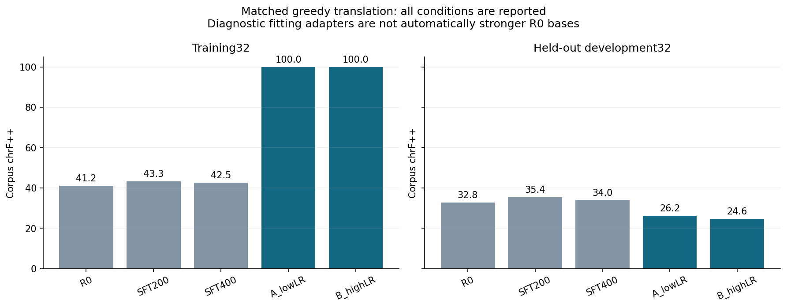
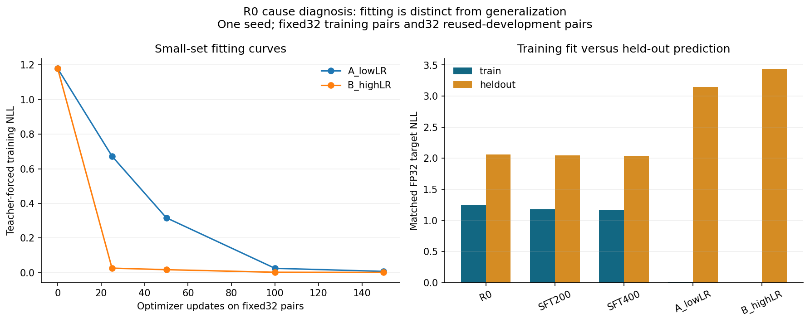
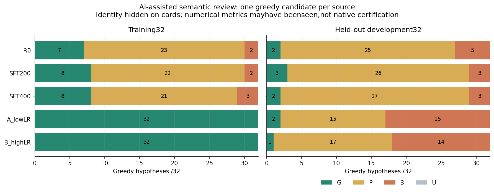

# R0 Cause Diagnosis: Full Results

Prior models preserved; owned GPU released.

**This run does not establish an absolute SFT ceiling for 0.8B. The same 0.8B, rank16 model can memorize all32 checked training pairs, but concentrated fitting fails to generalize and substantially harms held-out development outputs. A fitting–generalization gap is observed; model capacity, data coverage and training exposure are not uniquely separated as its root cause.**

This is a fitting/generalization diagnosis, not a DAPO run or automatic promotion of a probe adapter to R0.

| Split | Condition | N | Target NLL | chrF++ | BLEU | Reference exact | G/P/B/U | Truncated | Repetition |
| --- | --- | --- | --- | --- | --- | --- | --- | --- | --- |
| train | R0 | 32 | 1.25412 | 41.157 | 17.489 | 1 | 7/23/2/0 | 2 | 2 |
| train | SFT200 | 32 | 1.17812 | 43.331 | 22.331 | 1 | 8/22/2/0 | 0 | 0 |
| train | SFT400 | 32 | 1.17131 | 42.541 | 19.306 | 1 | 8/21/3/0 | 2 | 2 |
| train | A_lowLR | 32 | 0.00710 | 100.000 | 100.000 | 32 | 32/0/0/0 | 0 | 0 |
| train | B_highLR | 32 | 0.00148 | 100.000 | 100.000 | 32 | 32/0/0/0 | 0 | 0 |
| heldout | R0 | 32 | 2.06147 | 32.777 | 11.047 | 0 | 2/25/5/0 | 2 | 2 |
| heldout | SFT200 | 32 | 2.04823 | 35.407 | 12.110 | 0 | 3/26/3/0 | 0 | 0 |
| heldout | SFT400 | 32 | 2.03653 | 33.990 | 12.410 | 0 | 2/27/3/0 | 1 | 1 |
| heldout | A_lowLR | 32 | 3.14651 | 26.196 | 5.540 | 0 | 2/15/15/0 | 2 | 1 |
| heldout | B_highLR | 32 | 3.43516 | 24.643 | 6.697 | 0 | 1/17/14/0 | 1 | 1 |

A/B differ only in LR,1e-5 versus1e-4,with150 updates and87409 target tokens each from identical SFT200 weights. Both exactly reproduce all32 training references,with chrF++100 and final training NLL0.00710/0.00148. These cases do not show an inability of rank16 to store the mapping or of1e-5 to learn it. Higher LR fits faster,but does not demonstrate better development translation.

On the same32 held-out development sentences,chrF++ falls from35.41 for SFT200 to26.20 for A and24.64 for B: changes−9.21(CI−11.91 to−6.41) and−10.76(−13.75 to−7.99). BLEU also declines. A/B quality-difference intervals cross zero. This demonstrates overfitting in the repeated tiny-set probe,not independently that the earlier broad continuation was already overfit.

The semantic review covers64 sources,5 models and320 greedy translations,with labels locked before aggregation. Held-out G/P/B counts are3/26/3 for SFT200,2/15/15 for A and1/17/14 for B. Among24 technical cases,SFT200 has oneG and A/B have none. Errors include terminology,conditions/object relations and repetition. G retains core meaning and key relations;P has major defects. This is same-assistant AI review,not independent native certification or G=8 candidate coverage.

The exploratory source-swap audit does not support complete source neglect: held-out SFT200 NLL is2.048 with the correct source and3.677 with a different,approximately length-matched source from the same stratum,delta+1.629,pair-block CI[1.435,1.818]. All models show positive deltas. Source conditioning is present,but this does not certify faithful generation or separate cross-lingual ability from domain-coverage limitations.

Representative target-shift,padding and individual/batch loss audits pass;all three baselines reproduce prior matched held-out token sequences exactly. MetricX does not enter this SFT loss,fitting or selection,so it cannot cause these SFT semantic errors. Previously observed DAPO reward-ranking problems remain a separate unresolved issue.

## Question and controls

The previous single frozen-base,rank16,400k continuation was not a capacity-ceiling experiment. This run checks generation on seen pairs and controlled fitting sensitivity.

All32 passed AI quality checks and were reread before calls;each appeared once in the selected continuation prefix,not necessarily once historically. Strata8/4/10/10,2322 target tokens.

Another fixed stratified32 exclude knownG8 cases and never enter updates. They are reused development,not untouched test.

All32 held-out references were reread after baseline generation began but before inspecting hypotheses/fitting outputs. No clear major defect or overlap with the prior8 flagged references was found;no sample was changed. AI-assisted,not native certification.

All baselines regenerate both sets on this runtime. Old outputs serve only parity checks. Final decoding promotes identical BF16-rounded base values toFP32 withTF32 off,greedy,max320.

| Baseline | Old held-out full token matches | Hypothesis matches |
| --- | --- | --- |
| R0 | 32 | 32 |
| SFT200 | 32 | 32 |
| SFT400 | 32 | 32 |

## Training-computation audit

| Audit | Actual |
| --- | --- |
| Explicit-shift versus tail losses | [{"id": "OpenSubtitles18:683673", "manual_nll": 1.0898633436723189, "tail_nll": 1.089865424416282, "per_token_difference": 2.0807439630681817e-06}, {"id": "ParIce:63281", "manual_nll": 1.1905831909179687, "tail_nll": 1.1905831909179687, "per_token_difference": 0.0}] |
| Padded-batch NLL | 1.2586536718113803 |
| Individual NLL | 1.2586529107357858 |
| Per-token batch difference | 7.61075594546412e-07 |
| Passed | True |

These representative audits find no material shift/padding loss discrepancy;they are not a proof that every implementation factor is impossible. All11 model/tokenizer input files match prior hashes.

## Conditional controls and curves

Phase2 triggered: True

| Skipped condition | Registered reason |
| --- | --- |
| C_r64 | B_highLR_met_registered_memorization_criterion |

The registered descriptive fitting criterion isNLL≤0.2,chrF++≥85,reference exact≥50%. It is not a translation/DAPO gate. A/B share SFT200 initialization and differ only in LR;C is conditional onB.

| Condition | Rank | LR | Updates | Target tokens | Trainable params | Stop reason | Order SHA256 |
| --- | --- | --- | --- | --- | --- | --- | --- |
| A_lowLR | 16 | 1e-05 | 150 | 87409 | 10822656 | fixed_update_budget | a8b5ae6afbe4a8cc36054e2097ecce36246788280528e96e763a1e5342e8f4f6 |
| B_highLR | 16 | 0.0001 | 150 | 87409 | 10822656 | fixed_update_budget | a8b5ae6afbe4a8cc36054e2097ecce36246788280528e96e763a1e5342e8f4f6 |

Fresh AdamW,identical order,batch8/micro2,dropout0,weight_decay0,5-step warmup then constantLR,clip1;cap150 updates/150k targets. The probe differs from the broad continuation in repetition,dropout,schedule and batch. A/B isolate LR within the probe,not every cause of the prior run.

| Condition | Step | Target tokens | Training NLL |
| --- | --- | --- | --- |
| A_lowLR | 0 | 0 | 1.179112 |
| A_lowLR | 25 | 14286 | 0.672845 |
| A_lowLR | 50 | 28786 | 0.316996 |
| A_lowLR | 100 | 58050 | 0.024950 |
| A_lowLR | 150 | 87409 | 0.007162 |

| Condition | Step | Target tokens | Training NLL |
| --- | --- | --- | --- |
| B_highLR | 0 | 0 | 1.179112 |
| B_highLR | 25 | 14286 | 0.026003 |
| B_highLR | 50 | 28786 | 0.017075 |
| B_highLR | 100 | 58050 | 0.002183 |
| B_highLR | 150 | 87409 | 0.001442 |

Curve NLL uses the BF16-base/FP32-LoRA training-forward path in eval mode;final tables use matchedFP32. Small precision differences are not learning reversal.

## Stratified and controlled outcomes

| Split | Subset | N | Condition | chrF++ | BLEU | Target NLL | G/P/B/U |
| --- | --- | --- | --- | --- | --- | --- | --- |
| train | all | 32 | R0 | 41.157 | 17.489 | 1.25412 | 7/23/2/0 |
| train | all | 32 | SFT200 | 43.331 | 22.331 | 1.17812 | 8/22/2/0 |
| train | all | 32 | SFT400 | 42.541 | 19.306 | 1.17131 | 8/21/3/0 |
| train | all | 32 | A_lowLR | 100.000 | 100.000 | 0.00710 | 32/0/0/0 |
| train | all | 32 | B_highLR | 100.000 | 100.000 | 0.00148 | 32/0/0/0 |
| train | general | 8 | R0 | 46.288 | 22.245 | 0.74554 | 7/1/0/0 |
| train | general | 8 | SFT200 | 43.324 | 22.411 | 0.70302 | 7/1/0/0 |
| train | general | 8 | SFT400 | 42.478 | 21.889 | 0.69463 | 7/1/0/0 |
| train | general | 8 | A_lowLR | 100.000 | 100.000 | 0.00601 | 8/0/0/0 |
| train | general | 8 | B_highLR | 100.000 | 100.000 | 0.00090 | 8/0/0/0 |
| train | technical | 24 | R0 | 40.931 | 17.268 | 1.27557 | 0/22/2/0 |
| train | technical | 24 | SFT200 | 43.281 | 22.265 | 1.19817 | 1/21/2/0 |
| train | technical | 24 | SFT400 | 42.495 | 19.159 | 1.19142 | 1/20/3/0 |
| train | technical | 24 | A_lowLR | 100.000 | 100.000 | 0.00715 | 24/0/0/0 |
| train | technical | 24 | B_highLR | 100.000 | 100.000 | 0.00151 | 24/0/0/0 |
| train | technical_short | 4 | R0 | 39.983 | 12.603 | 1.03256 | 0/4/0/0 |
| train | technical_short | 4 | SFT200 | 38.062 | 12.498 | 0.96493 | 1/2/1/0 |
| train | technical_short | 4 | SFT400 | 38.211 | 12.686 | 0.97150 | 1/2/1/0 |
| train | technical_short | 4 | A_lowLR | 100.000 | 100.000 | 0.00488 | 4/0/0/0 |
| train | technical_short | 4 | B_highLR | 100.000 | 100.000 | 0.00089 | 4/0/0/0 |
| train | technical_medium | 10 | R0 | 50.456 | 35.103 | 1.09918 | 0/10/0/0 |
| train | technical_medium | 10 | SFT200 | 50.545 | 33.337 | 1.04056 | 0/10/0/0 |
| train | technical_medium | 10 | SFT400 | 52.193 | 36.949 | 1.03539 | 0/10/0/0 |
| train | technical_medium | 10 | A_lowLR | 100.000 | 100.000 | 0.00571 | 10/0/0/0 |
| train | technical_medium | 10 | B_highLR | 100.000 | 100.000 | 0.00115 | 10/0/0/0 |
| train | technical_long | 10 | R0 | 37.655 | 11.869 | 1.36043 | 0/8/2/0 |
| train | technical_long | 10 | SFT200 | 40.876 | 17.730 | 1.27489 | 0/9/1/0 |
| train | technical_long | 10 | SFT400 | 39.315 | 13.504 | 1.26675 | 0/8/2/0 |
| train | technical_long | 10 | A_lowLR | 100.000 | 100.000 | 0.00786 | 10/0/0/0 |
| train | technical_long | 10 | B_highLR | 100.000 | 100.000 | 0.00168 | 10/0/0/0 |

| Split | Subset | N | Condition | chrF++ | BLEU | Target NLL | G/P/B/U |
| --- | --- | --- | --- | --- | --- | --- | --- |
| heldout | all | 32 | R0 | 32.777 | 11.047 | 2.06147 | 2/25/5/0 |
| heldout | all | 32 | SFT200 | 35.407 | 12.110 | 2.04823 | 3/26/3/0 |
| heldout | all | 32 | SFT400 | 33.990 | 12.410 | 2.03653 | 2/27/3/0 |
| heldout | all | 32 | A_lowLR | 26.196 | 5.540 | 3.14651 | 2/15/15/0 |
| heldout | all | 32 | B_highLR | 24.643 | 6.697 | 3.43516 | 1/17/14/0 |
| heldout | general | 8 | R0 | 29.692 | 12.151 | 1.90123 | 1/6/1/0 |
| heldout | general | 8 | SFT200 | 36.484 | 19.489 | 1.93357 | 2/5/1/0 |
| heldout | general | 8 | SFT400 | 39.720 | 18.824 | 1.93391 | 1/7/0/0 |
| heldout | general | 8 | A_lowLR | 31.287 | 12.899 | 2.70504 | 2/3/3/0 |
| heldout | general | 8 | B_highLR | 31.180 | 12.532 | 3.04929 | 1/5/2/0 |
| heldout | technical | 24 | R0 | 32.942 | 10.969 | 2.07309 | 1/19/4/0 |
| heldout | technical | 24 | SFT200 | 35.293 | 11.561 | 2.05655 | 1/21/2/0 |
| heldout | technical | 24 | SFT400 | 33.586 | 11.883 | 2.04397 | 1/20/3/0 |
| heldout | technical | 24 | A_lowLR | 25.846 | 5.073 | 3.17851 | 0/12/12/0 |
| heldout | technical | 24 | B_highLR | 24.197 | 6.267 | 3.46313 | 0/12/12/0 |
| heldout | technical_short | 4 | R0 | 24.634 | 10.573 | 2.66239 | 1/1/2/0 |
| heldout | technical_short | 4 | SFT200 | 22.232 | 10.573 | 2.66889 | 1/1/2/0 |
| heldout | technical_short | 4 | SFT400 | 22.701 | 10.633 | 2.61814 | 1/1/2/0 |
| heldout | technical_short | 4 | A_lowLR | 16.700 | 4.429 | 4.31354 | 0/1/3/0 |
| heldout | technical_short | 4 | B_highLR | 16.502 | 4.287 | 4.52453 | 0/1/3/0 |
| heldout | technical_medium | 10 | R0 | 38.700 | 14.668 | 1.97999 | 0/10/0/0 |
| heldout | technical_medium | 10 | SFT200 | 37.156 | 14.086 | 1.95483 | 0/10/0/0 |
| heldout | technical_medium | 10 | SFT400 | 36.958 | 13.102 | 1.94007 | 0/10/0/0 |
| heldout | technical_medium | 10 | A_lowLR | 26.352 | 5.774 | 3.12757 | 0/4/6/0 |
| heldout | technical_medium | 10 | B_highLR | 22.374 | 5.572 | 3.38795 | 0/5/5/0 |
| heldout | technical_long | 10 | R0 | 30.515 | 8.787 | 2.08293 | 0/8/2/0 |
| heldout | technical_long | 10 | SFT200 | 35.135 | 10.223 | 2.06940 | 0/10/0/0 |
| heldout | technical_long | 10 | SFT400 | 32.532 | 11.264 | 2.06055 | 0/9/1/0 |
| heldout | technical_long | 10 | A_lowLR | 26.117 | 4.403 | 3.12938 | 0/7/3/0 |
| heldout | technical_long | 10 | B_highLR | 25.731 | 5.432 | 3.43180 | 0/6/4/0 |

| Held-out subset | Condition minusSFT200 | ΔchrF++ [95%CI] | ΔBLEU [95%CI] |
| --- | --- | --- | --- |
| all | R0 | -2.631 [-5.982, +0.092] | -1.063 [-3.729, +1.418] |
| all | SFT200 | +0.000 [+0.000, +0.000] | +0.000 [+0.000, +0.000] |
| all | SFT400 | -1.417 [-3.779, +0.427] | +0.300 [-1.124, +1.745] |
| all | A_lowLR | -9.212 [-11.910, -6.413] | -6.570 [-9.184, -3.821] |
| all | B_highLR | -10.765 [-13.749, -7.989] | -5.414 [-9.410, -2.928] |
| general | R0 | -6.792 [-14.945, -0.773] | -7.338 [-16.517, -0.962] |
| general | SFT200 | +0.000 [+0.000, +0.000] | +0.000 [+0.000, +0.000] |
| general | SFT400 | +3.236 [+0.578, +6.954] | -0.665 [-1.473, +0.000] |
| general | A_lowLR | -5.197 [-11.790, +5.035] | -6.590 [-13.438, -1.445] |
| general | B_highLR | -5.304 [-11.378, -0.360] | -6.957 [-15.306, -1.097] |
| technical | R0 | -2.351 [-5.704, +0.703] | -0.592 [-3.355, +2.097] |
| technical | SFT200 | +0.000 [+0.000, +0.000] | +0.000 [+0.000, +0.000] |
| technical | SFT400 | -1.708 [-4.080, +0.210] | +0.323 [-1.228, +1.966] |
| technical | A_lowLR | -9.448 [-12.432, -6.548] | -6.488 [-9.195, -3.747] |
| technical | B_highLR | -11.096 [-14.057, -8.306] | -5.294 [-9.192, -2.698] |
| technical_short | R0 | +2.402 [+0.785, +4.323] | +0.000 [-0.774, +0.822] |
| technical_short | SFT200 | +0.000 [+0.000, +0.000] | +0.000 [+0.000, +0.000] |
| technical_short | SFT400 | +0.469 [-0.091, +1.157] | +0.061 [-0.016, +0.822] |
| technical_short | A_lowLR | -5.532 [-13.768, -1.887] | -6.143 [-23.309, +0.490] |
| technical_short | B_highLR | -5.730 [-16.255, -0.757] | -6.286 [-22.806, +0.230] |
| technical_medium | R0 | +1.544 [-2.566, +5.027] | +0.582 [-4.372, +4.283] |
| technical_medium | SFT200 | +0.000 [+0.000, +0.000] | +0.000 [+0.000, +0.000] |
| technical_medium | SFT400 | -0.199 [-2.181, +2.479] | -0.984 [-4.731, +2.145] |
| technical_medium | A_lowLR | -10.804 [-16.171, -4.861] | -8.312 [-12.074, -1.602] |
| technical_medium | B_highLR | -14.782 [-18.803, -10.479] | -8.514 [-11.523, -4.116] |
| technical_long | R0 | -4.620 [-9.614, -0.484] | -1.436 [-5.024, +2.885] |
| technical_long | SFT200 | +0.000 [+0.000, +0.000] | +0.000 [+0.000, +0.000] |
| technical_long | SFT400 | -2.603 [-6.383, +0.086] | +1.041 [-0.736, +3.604] |
| technical_long | A_lowLR | -9.018 [-12.538, -5.631] | -5.821 [-8.504, -2.751] |
| technical_long | B_highLR | -9.404 [-13.455, -5.604] | -4.791 [-9.862, -0.203] |

| Held-out subset | Controlled comparison | ΔchrF++ [95%CI] | ΔBLEU [95%CI] |
| --- | --- | --- | --- |
| all | B_highLR minus A_lowLR | -1.553 [-5.230, +1.914] | +1.156 [-2.088, +3.080] |
| general | B_highLR minus A_lowLR | -0.107 [-10.658, +7.353] | -0.367 [-4.264, +2.540] |
| technical | B_highLR minus A_lowLR | -1.649 [-5.435, +2.045] | +1.194 [-2.142, +3.070] |
| technical_short | B_highLR minus A_lowLR | -0.197 [-3.779, +2.763] | -0.142 [-0.661, +0.503] |
| technical_medium | B_highLR minus A_lowLR | -3.978 [-10.697, +1.737] | -0.202 [-7.302, +4.941] |
| technical_long | B_highLR minus A_lowLR | -0.385 [-4.952, +4.264] | +1.029 [-1.920, +3.834] |

Intervals use2000 paired source-stratified resamples on reused development. Hidden document clusters,multiple comparisons and training-seed variability are not covered. Training-set scores are descriptive.

## Semantic outcomes and limits

Reviewed320 greedy candidates on64 sources,one candidate/model/source,not G8 coverage.

Cards hide condition IDs and scores,with a judgement hash lock before semantic aggregates. Numeric fitting metrics drive branches and mayhave beenseen;the same assistant may recognize output patterns. This is not fully blind or native-certified.

## Established and unresolved

### Supplement: source conditioning

This exploratory inference-only supplement was specified afterA results. Swap adjacent length-matched sources within each split/stratum,keep targets fixed. PositiveNLL differences indicate conditioning,not faithful translation certification;residual length/structure andteacher forcing are limitations.

| Split | Model | Correct NLL | Wrong-source NLL | Wrong−correct [95%CI] | First1 Δ | First≤8 Δ | Mean |prompt Δtokens| |
| --- | --- | --- | --- | --- | --- | --- | --- |
| train | R0 | 1.25412 | 3.17505 | +1.92094 [+1.79107,+2.06152] | +5.94677 | +3.12867 | 4.19 |
| train | SFT200 | 1.17812 | 3.15369 | +1.97557 [+1.84807,+2.11727] | +6.18635 | +3.20797 | 4.19 |
| train | SFT400 | 1.17131 | 3.13771 | +1.96640 [+1.83847,+2.10731] | +6.20009 | +3.17991 | 4.19 |
| train | A_lowLR | 0.00710 | 3.68728 | +3.68018 [+3.53094,+3.84116] | +13.07451 | +6.12272 | 4.19 |
| train | B_highLR | 0.00148 | 3.14294 | +3.14146 [+2.93498,+3.37348] | +14.48249 | +5.88990 | 4.19 |
| heldout | R0 | 2.06147 | 3.67379 | +1.61232 [+1.41978,+1.80736] | +2.85130 | +2.47047 | 2.94 |
| heldout | SFT200 | 2.04823 | 3.67695 | +1.62872 [+1.43524,+1.81777] | +2.95874 | +2.52186 | 2.94 |
| heldout | SFT400 | 2.03653 | 3.65980 | +1.62327 [+1.43154,+1.81321] | +2.94195 | +2.50394 | 2.94 |
| heldout | A_lowLR | 3.14651 | 4.76445 | +1.61794 [+1.39087,+1.83826] | +4.78267 | +3.22718 | 2.94 |
| heldout | B_highLR | 3.43516 | 5.14742 | +1.71226 [+1.48735,+1.94380] | +4.56697 | +3.51596 | 2.94 |

Supplementary intervals resample matched source-pair blocks2000 times within strata. Raw per-token arrays are archived;this behavioural contrast does not replace translation/semantic outcomes.

Memorizing32 pairs does not establish sufficient capacity for broad translation. Local storage/adaptation can coexist with weak pretrained representations or generalization ability. A practical-capacity claim requires larger,cleaner and sufficiently covering data with independent learning curves;this run does not control data scale,pretraining or full-parameter adaptation.

Each chosen pair appeared once in the selected continuation prefix,versus about37.5 exposures in this probe. Failure to memorize after one exposure is not itself training failure. Nor can we conclude that a few more epochs will produce a strong R0:extra exposure here improves memorization while harming generalization.

The registered rank64 branch is skipped because rank16 B passes the fitting criterion. There is no empirical rank64 outcome:neither ineffectiveness nor a successful remedy is established. Both LRs use one training seed and reused development data;intervals and subgroup findings remain small-sample diagnostic evidence.

This run evaluates greedy outputs without a new G=8 bank or DAPO. It cannot alone determine useful RL-signal coverage or uniquely attribute the earlier30-step DAPO result to R0. Existing models can still seed exploratory DAPO;perfect tiny-set memorization does not promote these probe adapters to stronger general bases.

## Next action

Decision:retain original R0 and SFT200;do not replace them with A/B. No new R0 is promoted. Stop repeating these32 cases and do not treat higher LR/rank as the answer. The practical priority is to test whether broader effective coverage and controlled exposure improve generalization. This prioritization is an inference,not proof of a uniquely data-driven cause.

A bounded coverage control is preferable to open-ended SFT:both arms start from SFT200,rank16,LR1e-5 with5% warmup then constant LR,identical batch/dropout,and2M target tokens each. Fix target-token mixture at25% general replay and75% technical,with technical short/medium/long about10/40/50. Repeat from an approximately400k-unique-target pool in the narrow arm;sample a clean pool approaching2M unique targets in the broad arm. Match source/length strata and quality rules;the narrow pool is a fixed random nested subset. This estimates the joint coverage/repetition strategy effect,not its unique components. These are proposed preregistration values,not executed work;do not fill data shortages with low-quality pairs.

Before training,freeze document/near-duplicate-disjoint training,selection-development and final held-out sets;keep old development for historical diagnosis. Every250k target tokens,record fixed training probes and development NLL/chrF++;select checkpoints under a preregistered general-retention constraint. Review terms,negation,numbers and conditions,preferably with an independent proficient Icelandic reviewer. A500k-token safety checkpoint can stop both arms under predefined development/semantic deterioration rules. Do not optimize training scores. These new pools and splits are not yet constructed assets.

Interpretation rule:if broader coverage improves independent semantics under matched budget,this supports a repairable data/exposure strategy,followed by G=8 and reward calibration. If training improves in both arms without development gains,stop claiming more SFT must work and treat generalization of this recipe/base as the practical bottleneck. A separate matched-data/budget adaptation-capacity control would be needed to distinguish rank from frozen-base restrictions. Even further failures establish a bottleneck within tested conditions,not an absolute mathematical0.8B ceiling.

This run ends here without automatically launching the proposed training. Resume standard DAPO and efficiency comparisons after independent translation quality and candidate signals improve. If project time prevents broad-task repair,narrow the study to tasks with verified candidate coverage and report that scope explicitly,so base-quality limitations are not confused with algorithmic efficiency.

## Actual compute and archives

| Item | Actual |
| --- | --- |
| GPU | NVIDIA L4 |
| Allocation minutes | 58.59 |
| Observed CU balance decrease | 1.8909 |
| New fitting updates | 300 |
| Fitting target tokens | 174818 |
| Optimizer-update seconds | 791.89 |
| Sampled peak device MiB | 6732.0 |
| GPU released | True |

Balance change includes setup,transfer,audits,inference and fitting and may settle late. Archive all public experiment artifacts and full states,excluding credentials/privateSDKlogs. Initial control-stream loss recovered on the same allocation.

Archive review found an old initial_adapter directory name in the packager. A packaging-only correction includes the actual adapters directory and verifies every frozen-source file;no numerical source or training run changed.

| Artifact | Path |
| --- | --- |
| Complete export | D:\deep learning project\runs\r0_cause_diagnosis_2026-11-17\t7_export.zip |
| Snapshots | D:\deep learning project\runs\r0_cause_diagnosis_2026-11-17\snapshots |
| Structured results | D:\deep learning project\runs\r0_cause_diagnosis_2026-11-17\analysis\results.json |
| All case CSV | D:\deep learning project\runs\r0_cause_diagnosis_2026-11-17\analysis\all_candidates.csv |
| Registered protocol | D:\deep learning project\reports\r0_cause_diagnosis_2026-11-17\CAUSE_DIAGNOSIS_PROTOCOL_2026-11-17.html |
| CPU replay | D:\deep learning project\runs\r0_cause_diagnosis_2026-11-17\analysis_reproduction\README.md |

## All64 sources and outputs

00 train OpenSubtitles18:683673 general

EN: -This is the last I'll see of him.

ReferenceIS: -Ég sé hann aldrei aftur.

All retain seeing him for the last time;the hans case error does not change the central meaning.

| Condition | HypothesisIS | Tier | Sentence chrF++ | Target NLL | Tokens | Truncated | Repetition |
| --- | --- | --- | --- | --- | --- | --- | --- |
| R0 | -Þetta er síðasta sem ég sé hann. | G | 29.345 | 1.08987 | 13 | False | False |
| SFT200 | -Þetta er síðasta sem ég sé hann. | G | 29.345 | 1.03113 | 13 | False | False |
| SFT400 | -Þetta er síðasta sem ég sé hans. | G | 21.866 | 1.07923 | 13 | False | False |
| A_lowLR | -Ég sé hann aldrei aftur. | G | 100.000 | 0.00650 | 11 | False | False |
| B_highLR | -Ég sé hann aldrei aftur. | G | 100.000 | 0.00082 | 11 | False | False |

01 train OpenSubtitles18:392505 general

EN: I'll prove it to you.

ReferenceIS: Ég skal sanna það fyrir þér.

Both correctly express will prove it to you; skal/mun are acceptable.

All correctly express proving it to you;skal/mun variants are acceptable.

| Condition | HypothesisIS | Tier | Sentence chrF++ | Target NLL | Tokens | Truncated | Repetition |
| --- | --- | --- | --- | --- | --- | --- | --- |
| R0 | Ég mun sanna það fyrir þér. | G | 74.141 | 0.61135 | 11 | False | False |
| SFT200 | Ég mun sanna það fyrir þér. | G | 74.141 | 0.52251 | 11 | False | False |
| SFT400 | Ég mun sanna það fyrir þér. | G | 74.141 | 0.53783 | 11 | False | False |
| A_lowLR | Ég skal sanna það fyrir þér. | G | 100.000 | 0.00517 | 11 | False | False |
| B_highLR | Ég skal sanna það fyrir þér. | G | 100.000 | 0.00089 | 11 | False | False |

02 train OpenSubtitles18:1418459 general

EN: I know you can do this.

ReferenceIS: Ég veit að þið getið þetta.

All preserve knowing you can do this;English you permits singular or plural.

| Condition | HypothesisIS | Tier | Sentence chrF++ | Target NLL | Tokens | Truncated | Repetition |
| --- | --- | --- | --- | --- | --- | --- | --- |
| R0 | Ég veit að þú getur gert þetta. | G | 54.643 | 0.35843 | 15 | False | False |
| SFT200 | Ég veit að þú getur gert þetta. | G | 54.643 | 0.32737 | 15 | False | False |
| SFT400 | Ég veit að þú getur gert þetta. | G | 54.643 | 0.31605 | 15 | False | False |
| A_lowLR | Ég veit að þið getið þetta. | G | 100.000 | 0.00424 | 15 | False | False |
| B_highLR | Ég veit að þið getið þetta. | G | 100.000 | 0.00072 | 15 | False | False |

03 train OpenSubtitles18:76864 general

EN: And I'm not Dutch. I'm Swiss.

ReferenceIS: Og ég er frá Sviss, ekki Hollandi.

0/4 are complete.1/2 substitute German for Dutch;3 corrupts Dutch into a nonword,while Swiss remains partly recoverable.

| Condition | HypothesisIS | Tier | Sentence chrF++ | Target NLL | Tokens | Truncated | Repetition |
| --- | --- | --- | --- | --- | --- | --- | --- |
| R0 | Ég er Sviss. Ég er ekki Þýskur. | P | 21.693 | 1.11286 | 16 | False | False |
| SFT200 | Ég er ekki þýskur, ég er Sviss. | P | 28.428 | 1.17511 | 15 | False | False |
| SFT400 | Ég er ekki Dýrma, ég er Sviss. | P | 29.042 | 1.13025 | 15 | False | False |
| A_lowLR | Og ég er frá Sviss, ekki Hollandi. | G | 100.000 | 0.00837 | 13 | False | False |
| B_highLR | Og ég er frá Sviss, ekki Hollandi. | G | 100.000 | 0.00141 | 13 | False | False |

04 train OpenSubtitles18:59438 general

EN: No, it was here, this morning.

ReferenceIS: Nei, hér, í morgun.

All retain no,here,this morning;ellipsis and full-sentence variants are acceptable.

| Condition | HypothesisIS | Tier | Sentence chrF++ | Target NLL | Tokens | Truncated | Repetition |
| --- | --- | --- | --- | --- | --- | --- | --- |
| R0 | Nei, þetta var hér í morgun. | G | 55.821 | 1.15228 | 12 | False | False |
| SFT200 | Nei, þetta var hér í morgun. | G | 55.821 | 1.07196 | 12 | False | False |
| SFT400 | Nei, þetta var hér í morgun. | G | 55.821 | 1.04529 | 12 | False | False |
| A_lowLR | Nei, hér, í morgun. | G | 100.000 | 0.00479 | 10 | False | False |
| B_highLR | Nei, hér, í morgun. | G | 100.000 | 0.00050 | 10 | False | False |

05 train OpenSubtitles18:1527685 general

EN: But I think that is a great quality.

ReferenceIS: En mér finnst það góður eiginleiki.

All express considering it a great quality/characteristic;gæði morphology is awkward without a clear central-meaning change.

| Condition | HypothesisIS | Tier | Sentence chrF++ | Target NLL | Tokens | Truncated | Repetition |
| --- | --- | --- | --- | --- | --- | --- | --- |
| R0 | En ég held að þetta sé frábær eiginleiki. | G | 37.335 | 0.67749 | 16 | False | False |
| SFT200 | En ég held að þetta sé frábært gæði. | G | 12.683 | 0.59307 | 15 | False | False |
| SFT400 | En ég held að þetta sé frábært gæði. | G | 12.683 | 0.57892 | 15 | False | False |
| A_lowLR | En mér finnst það góður eiginleiki. | G | 100.000 | 0.00900 | 14 | False | False |
| B_highLR | En mér finnst það góður eiginleiki. | G | 100.000 | 0.00114 | 14 | False | False |

06 train OpenSubtitles18:1254338 general

EN: Do you want to go grab a drink?

ReferenceIS: Langar þig að fá þér drykk?

All retain wanting to go for a drink;taka drykk is awkward but preserves the request.

| Condition | HypothesisIS | Tier | Sentence chrF++ | Target NLL | Tokens | Truncated | Repetition |
| --- | --- | --- | --- | --- | --- | --- | --- |
| R0 | Viltu fara og taka drykk? | G | 23.569 | 0.81250 | 10 | False | False |
| SFT200 | Viltu fara og taka drykk? | G | 23.569 | 0.76968 | 10 | False | False |
| SFT400 | Viltu fara og taka drykk? | G | 23.569 | 0.74350 | 10 | False | False |
| A_lowLR | Langar þig að fá þér drykk? | G | 100.000 | 0.00570 | 12 | False | False |
| B_highLR | Langar þig að fá þér drykk? | G | 100.000 | 0.00104 | 12 | False | False |

07 train OpenSubtitles18:1384516 general

EN: - His name is Django.

ReferenceIS: Hann heitir Django.

All candidates fully retain the name Django.

Every candidate fully preserves the name Django.

| Condition | HypothesisIS | Tier | Sentence chrF++ | Target NLL | Tokens | Truncated | Repetition |
| --- | --- | --- | --- | --- | --- | --- | --- |
| R0 | Hann heitir Django. | G | 100.000 | 0.09572 | 8 | False | False |
| SFT200 | Hann heitir Django. | G | 100.000 | 0.06849 | 8 | False | False |
| SFT400 | Hann heitir Django. | G | 100.000 | 0.07427 | 8 | False | False |
| A_lowLR | Hann heitir Django. | G | 100.000 | 0.00277 | 8 | False | False |
| B_highLR | Hann heitir Django. | G | 100.000 | 0.00036 | 8 | False | False |

08 train ParIce:987556 technical_short

EN: • The introductory part of Section 6.2 is replaced by the following:

ReferenceIS: • Eftirfarandi komi í stað inngangsins í lið 6.2:

0/3 are exact;1/2 retain opening/first-part replacement and the section number.4 does not reliably render introductory.

| Condition | HypothesisIS | Tier | Sentence chrF++ | Target NLL | Tokens | Truncated | Repetition |
| --- | --- | --- | --- | --- | --- | --- | --- |
| R0 | • Í stað forsett hluta 6.2 komi eftirfarandi: | P | 32.865 | 0.42510 | 20 | False | False |
| SFT200 | • Í fyrsta lagi komi eftirfarandi í stað fyrsta hluta 6.2.: | G | 37.649 | 0.37931 | 24 | False | False |
| SFT400 | • Í stað fyrri hluta liðar 6.2 komi eftirfarandi: | G | 33.887 | 0.37278 | 23 | False | False |
| A_lowLR | • Eftirfarandi komi í stað inngangsins í lið 6.2: | G | 100.000 | 0.00252 | 24 | False | False |
| B_highLR | • Eftirfarandi komi í stað inngangsins í lið 6.2: | G | 100.000 | 0.00065 | 24 | False | False |

09 train ParIce:700617 technical_short

EN: For the protection of non-target organisms, in particular honey bees:

ReferenceIS: Til verndar lífvera utan markhóps, einkum býflugna:

0/1/2 retain a protection/organism frame but corrupt non-target and honey bees;3/4 are complete.

| Condition | HypothesisIS | Tier | Sentence chrF++ | Target NLL | Tokens | Truncated | Repetition |
| --- | --- | --- | --- | --- | --- | --- | --- |
| R0 | Til verndar ótækkra lífverða, einkum hyljabjórða: | P | 41.398 | 1.14569 | 27 | False | False |
| SFT200 | Til verndar ótækkra lífverna, einkum hyljabjórna: | P | 42.533 | 1.08597 | 27 | False | False |
| SFT400 | Til verndar ótækkra lífverna, einkum hylkjabjögja: | P | 42.100 | 1.09742 | 27 | False | False |
| A_lowLR | Til verndar lífvera utan markhóps, einkum býflugna: | G | 100.000 | 0.00609 | 22 | False | False |
| B_highLR | Til verndar lífvera utan markhóps, einkum býflugna: | G | 100.000 | 0.00103 | 22 | False | False |

10 train ParIce:1603552 technical_short

EN: The fees are commensurate with the services provided.

ReferenceIS: Þóknanirnar eru í réttu hlutfalli við veitta þjónustu.

0/3/4 replace fees with Fáran while partly retaining proportionality to services;1/2 are complete.

| Condition | HypothesisIS | Tier | Sentence chrF++ | Target NLL | Tokens | Truncated | Repetition |
| --- | --- | --- | --- | --- | --- | --- | --- |
| R0 | Fáran er í réttu hlutfalli við þjónustuna sem gefið er. | P | 50.329 | 1.72011 | 24 | False | False |
| SFT200 | Fáran er í réttu hlutfalli við þjónustuna sem gefið er. | P | 50.329 | 1.62310 | 24 | False | False |
| SFT400 | Fáran er í réttu hlutfalli við þjónustuna sem gefið er. | P | 50.329 | 1.61820 | 24 | False | False |
| A_lowLR | Þóknanirnar eru í réttu hlutfalli við veitta þjónustu. | G | 100.000 | 0.00638 | 22 | False | False |
| B_highLR | Þóknanirnar eru í réttu hlutfalli við veitta þjónustu. | G | 100.000 | 0.00087 | 22 | False | False |

11 train ParIce:1537977 technical_short

EN: Part-time job is taken because:

ReferenceIS: Ástæður þess að hlutastarf er tekið:

1/4 are exact.0/2 substitute assistance/services and lose part-time employment.3 retains a partial work-related frame but not the full reason heading.

| Condition | HypothesisIS | Tier | Sentence chrF++ | Target NLL | Tokens | Truncated | Repetition |
| --- | --- | --- | --- | --- | --- | --- | --- |
| R0 | Aðstæður fyrir að hluta að starfi: | P | 32.501 | 0.85400 | 14 | False | False |
| SFT200 | Aðstoðarinnar er takmörkuð vegna: | B | 13.662 | 0.78331 | 17 | False | False |
| SFT400 | Aðstoðarþjónustu er tekin vegna: | B | 20.326 | 0.81690 | 16 | False | False |
| A_lowLR | Ástæður þess að hlutastarf er tekið: | G | 100.000 | 0.00468 | 17 | False | False |
| B_highLR | Ástæður þess að hlutastarf er tekið: | G | 100.000 | 0.00106 | 17 | False | False |

12 train ParIce:1798779 technical_medium

EN: Each prolonged-release tablet contains 3.15 mg pramipexole (as 4.5 mg pramipexole dihydrochloride monohydrate).

ReferenceIS: Hver forðatafla inniheldur 3,15 mg af pramipexóli (sem 4,5 mg af pramipexól tvíhýdróklóríð einhýdrati).

0/1/4 preserve the drug and3.15/4.5mg but replace prolonged-release with filled tablet;2/3 are complete.Recognizable chemical transliterations alone are not penalized.

| Condition | HypothesisIS | Tier | Sentence chrF++ | Target NLL | Tokens | Truncated | Repetition |
| --- | --- | --- | --- | --- | --- | --- | --- |
| R0 | Hver áfyllta töfla inniheldur 3,15 mg af pramipexole (sem 4,5 mg af pramipexole dihýdróklóríð monohydrati). | P | 65.155 | 0.89478 | 54 | False | False |
| SFT200 | Hver áfyllta töfla inniheldur 3,15 mg af pramipexóli (sem 4,5 mg af pramipexóli dihýdróklóríði monohýdrati). | P | 75.005 | 0.85893 | 56 | False | False |
| SFT400 | Hver áfyllta töfla inniheldur 3,15 mg af pramipexóli (sem 4,5 mg af pramipexóli dihýdróklóríði monohýdrati). | P | 75.005 | 0.85490 | 56 | False | False |
| A_lowLR | Hver forðatafla inniheldur 3,15 mg af pramipexóli (sem 4,5 mg af pramipexól tvíhýdróklóríð einhýdrati). | G | 100.000 | 0.00454 | 54 | False | False |
| B_highLR | Hver forðatafla inniheldur 3,15 mg af pramipexóli (sem 4,5 mg af pramipexól tvíhýdróklóríð einhýdrati). | G | 100.000 | 0.00090 | 54 | False | False |

13 train ParIce:1498640 technical_medium

EN: (3) the results of those inspections are relevant for the Commission to submit specific reports to the Standing Veterinary Committee based on Article 6(2) of Directive 98/58/EC;

ReferenceIS: 3) Niðurstöður úr þessum skoðunum varða framkvæmdastjórnina, sem leggur sérstakar skýrslur fyrir fastanefndina um dýraheilbrigði, á grundvelli 2. mgr. 6. gr. tilskipunar 98/58/EB.

0/4 are complete.1/2/3 preserve reporting/citations but turn the Standing Veterinary Committee into a place for a veterinarian,losing the recipient institution.

| Condition | HypothesisIS | Tier | Sentence chrF++ | Target NLL | Tokens | Truncated | Repetition |
| --- | --- | --- | --- | --- | --- | --- | --- |
| R0 | 3) niðurstöður prófunanna eru viðkomandi fyrir framkvæmdastjórnina að leggja til staðar sérstök skýrslur fyrir staðinn fyrir dýralæknirinn á grundvelli 2. mgr. 6. gr. tilskipunar 98/58/EB. | P | 57.156 | 0.74412 | 77 | False | False |
| SFT200 | 3) niðurstöður prófunanna eru viðkomandi fyrir framkvæmdastjórnina að leggja til staðar sérstakar skýrslur fyrir staðinn fyrir dýralæknirinn á grundvelli 2. mgr. 6. gr. tilskipunar 98/58/EB. | P | 60.281 | 0.63583 | 77 | False | False |
| SFT400 | 3) niðurstöður prófunanna eru viðkomandi fyrir framkvæmdastjórnina að leggja til staðar sérstakar skýrslur fyrir staðinn fyrir dýralæknirinn á grundvelli 2. mgr. 6. gr. tilskipunar 98/58/EB. | P | 60.281 | 0.62156 | 77 | False | False |
| A_lowLR | 3) Niðurstöður úr þessum skoðunum varða framkvæmdastjórnina, sem leggur sérstakar skýrslur fyrir fastanefndina um dýraheilbrigði, á grundvelli 2. mgr. 6. gr. tilskipunar 98/58/EB. | G | 100.000 | 0.00479 | 79 | False | False |
| B_highLR | 3) Niðurstöður úr þessum skoðunum varða framkvæmdastjórnina, sem leggur sérstakar skýrslur fyrir fastanefndina um dýraheilbrigði, á grundvelli 2. mgr. 6. gr. tilskipunar 98/58/EB. | G | 100.000 | 0.00103 | 79 | False | False |

14 train ParIce:1872893 technical_medium

EN: In pregnant rabbits, a maternal dose of 30 mg/kg that produced slight toxicity in the mothers showed a statistically significant increase in the incidence of litter malformations.

ReferenceIS: Í ungafullum kanínum sýndu 30 mg/kg skammtar sem höfðu smávægileg skaðleg áhrif á móður marktæka aukningu á vansköpun afkvæma.

0/4 are complete.1/2/3 retain30mg/kg and slight maternal toxicity but corrupt pregnant rabbits and offspring malformations into unrelated entities/infection,and lose statistical significance.

| Condition | HypothesisIS | Tier | Sentence chrF++ | Target NLL | Tokens | Truncated | Repetition |
| --- | --- | --- | --- | --- | --- | --- | --- |
| R0 | Í fæðugum rætum sáttu með 30 mg/kg skammt sem sýndi smá eiturhrif í mömmu sýndi stöðug tæknilega aukningu á sýkingu á fæðum. | P | 30.791 | 1.83827 | 64 | False | False |
| SFT200 | Í fæðugum rætum sýndu 30 mg/kg skammtur sem gerði smá eiturhrif á móður og sýndi stöðugt mikla aukningu á sýkingu á fæðum. | P | 38.496 | 1.75398 | 59 | False | False |
| SFT400 | Í fæðugum rætum sýndu 30 mg/kg skammtur sem gerði smá eiturhrif á móður og sýndi stöðugt mikla aukningu á sýkingu á fæðum. | P | 38.496 | 1.76314 | 59 | False | False |
| A_lowLR | Í ungafullum kanínum sýndu 30 mg/kg skammtar sem höfðu smávægileg skaðleg áhrif á móður marktæka aukningu á vansköpun afkvæma. | G | 100.000 | 0.00689 | 55 | False | False |
| B_highLR | Í ungafullum kanínum sýndu 30 mg/kg skammtar sem höfðu smávægileg skaðleg áhrif á móður marktæka aukningu á vansköpun afkvæma. | G | 100.000 | 0.00101 | 55 | False | False |

15 train ParIce:508797 technical_medium

EN: • There are at present, no alternative methods validated by ECVAM, other than those listed in Annex V to Council Directive 67/548/EEC.

ReferenceIS: • Eins og sakir standa hefur Evrópumiðstöð um fullgildingu nýrra aðferða ekki fullgilt aðrar aðferðir en þær sem eru skráðar í V. viðauka við tilskipun ráðsins 67/548/EBE.

1/2 are complete.0 corrupts the validation/negation relation;3 changes lack of validated alternatives into a prohibition;4 corrupts ECVAM and validation,while references survive.

| Condition | HypothesisIS | Tier | Sentence chrF++ | Target NLL | Tokens | Truncated | Repetition |
| --- | --- | --- | --- | --- | --- | --- | --- |
| R0 | • Engin aðrar aðferðir, sem ECE-geðsögubandalaginn ECEVAM hefur valdandi gildi, eru aðrar en þær sem eru tilgreindar í V. viðauka við tilskipun ráðsins 67/548/EBE. | P | 51.960 | 1.31445 | 72 | False | False |
| SFT200 | • Í dag eru engin annar aðferð en aðferðirnar sem eru tilgreindar í V. viðauka við tilskipun ráðsins 67/548/EBE, sem ekki hefur verið uppfyllt af ECEVAM. | P | 46.489 | 1.26027 | 65 | False | False |
| SFT400 | • Í dag er ekki hægt að nota annað aðferð en þau sem eru tilgreindar í V. viðauka við tilskipun ráðsins 67/548/EBE. | P | 42.856 | 1.24704 | 49 | False | False |
| A_lowLR | • Eins og sakir standa hefur Evrópumiðstöð um fullgildingu nýrra aðferða ekki fullgilt aðrar aðferðir en þær sem eru skráðar í V. viðauka við tilskipun ráðsins 67/548/EBE. | G | 100.000 | 0.00503 | 72 | False | False |
| B_highLR | • Eins og sakir standa hefur Evrópumiðstöð um fullgildingu nýrra aðferða ekki fullgilt aðrar aðferðir en þær sem eru skráðar í V. viðauka við tilskipun ráðsins 67/548/EBE. | G | 100.000 | 0.00121 | 72 | False | False |

16 train ParIce:2014491 technical_medium

EN: The haemoglobin response varies between patients and may be impacted by iron stores and the presence of concurrent medical problems.

ReferenceIS: Blóðrauðasvörun er mismunandi milli sjúklinga og kann að verða fyrir áhrifum af járnforða og sjúkdóma sem eru fyrir hendi á sama tíma.

1/3 are complete.The others partly retain between-patient response variation but replace iron stores,concurrent illness and the affected-by relation with urine or nonsense.

| Condition | HypothesisIS | Tier | Sentence chrF++ | Target NLL | Tokens | Truncated | Repetition |
| --- | --- | --- | --- | --- | --- | --- | --- |
| R0 | Hemóblóin-svörun verður mismunandi milli sjúklinga og getur haft áhrif á þvagið og þvagið og þar sem á aðrar ástandar. | P | 35.093 | 1.51283 | 49 | False | False |
| SFT200 | Hemógbólumveitinn breytist milli sjúklinga og getur verið hamingjusamur af irínum og þeirri tilboð sem er áframhaldandi. | P | 26.716 | 1.48837 | 47 | False | False |
| SFT400 | Hemógbólans svörun er mismunandi milli sjúklinga og getur verið hamingjusamvísandi á fersku íferðarþrýstings og þar sem á er samræmingu á meðferðarvísindum. | P | 37.933 | 1.48714 | 65 | False | False |
| A_lowLR | Blóðrauðasvörun er mismunandi milli sjúklinga og kann að verða fyrir áhrifum af járnforða og sjúkdóma sem eru fyrir hendi á sama tíma. | G | 100.000 | 0.00825 | 50 | False | False |
| B_highLR | Blóðrauðasvörun er mismunandi milli sjúklinga og kann að verða fyrir áhrifum af járnforða og sjúkdóma sem eru fyrir hendi á sama tíma. | G | 100.000 | 0.00133 | 50 | False | False |

17 train ParIce:999143 technical_medium

EN: The Member States shall inform the Commission and the other Member States of the approval of such additional regions.

ReferenceIS: Aðildarríkin skulu tilkynna framkvæmdastjórninni og hinum aðildarríkjunum um samþykki fyrir slíkum viðbótarsvæðum.

2/4 are complete.0 changes additional regions to a part;1/3 change them to administrations,altering the object of approval.

| Condition | HypothesisIS | Tier | Sentence chrF++ | Target NLL | Tokens | Truncated | Repetition |
| --- | --- | --- | --- | --- | --- | --- | --- |
| R0 | Aðildarríkin skulu tilkynna framkvæmdastjórninni og aðrir aðildarríkin um samþykki á þessum viðbótarhluta. | P | 66.128 | 0.34728 | 45 | False | False |
| SFT200 | Aðildarríkin skulu tilkynna framkvæmdastjórninni og hinum aðildarríkjum um samþykki á slíkum viðbótastjórnum. | P | 78.489 | 0.31910 | 47 | False | False |
| SFT400 | Aðildarríkin skulu tilkynna framkvæmdastjórninni og hinum aðildarríkjum um samþykki á slíkum viðbótastjórnum. | P | 78.489 | 0.31165 | 47 | False | False |
| A_lowLR | Aðildarríkin skulu tilkynna framkvæmdastjórninni og hinum aðildarríkjunum um samþykki fyrir slíkum viðbótarsvæðum. | G | 100.000 | 0.00416 | 48 | False | False |
| B_highLR | Aðildarríkin skulu tilkynna framkvæmdastjórninni og hinum aðildarríkjunum um samþykki fyrir slíkum viðbótarsvæðum. | G | 100.000 | 0.00074 | 48 | False | False |

18 train ParIce:1944560 technical_medium

EN: Patients with elevated liver enzymes (ALT/AST > 2 x ULN) or total bilirubin ≥ 1.5 x ULN were excluded in clinical trials.

ReferenceIS: Sjúklingar með hækkuð lifrarensím (ALT/AST > 2 x eðlileg efri mörk) eða heildarbilirúbín ≥ 1,5 x eðlileg efri mörk, voru útilokaðir frá klínískum rannsóknum.

1/2 are complete.0/3/4 preserve the ALT/AST andbilirubin thresholds but corrupt elevated enzymes and the trial-exclusion predicate.

| Condition | HypothesisIS | Tier | Sentence chrF++ | Target NLL | Tokens | Truncated | Repetition |
| --- | --- | --- | --- | --- | --- | --- | --- |
| R0 | Sjúklingar með hámarki lifrarensímáli (ALT/AST > 2 x ULN) eða heildarbilirubín ≥ 1,5 x ULN var skráð úr klínískum rannsóknum. | P | 52.546 | 0.99948 | 57 | False | False |
| SFT200 | Sjúklingar með hámarki lifrarensímörkun (ALT/AST > 2 x ULN) eða heildarbilirubín ≥ 1,5 x ULN var skráð úr klínískum rannsóknum. | P | 53.102 | 0.93531 | 58 | False | False |
| SFT400 | Sjúklingar með háan lofti á lifrarensímáli (ALT/AST > 2 x ULN) eða heildarbilirubín ≥ 1,5 x ULN var skráð úr klínískum rannsóknum. | P | 52.285 | 0.92554 | 59 | False | False |
| A_lowLR | Sjúklingar með hækkuð lifrarensím (ALT/AST > 2 x eðlileg efri mörk) eða heildarbilirúbín ≥ 1,5 x eðlileg efri mörk, voru útilokaðir frá klínískum rannsóknum. | G | 100.000 | 0.00609 | 75 | False | False |
| B_highLR | Sjúklingar með hækkuð lifrarensím (ALT/AST > 2 x eðlileg efri mörk) eða heildarbilirúbín ≥ 1,5 x eðlileg efri mörk, voru útilokaðir frá klínískum rannsóknum. | G | 100.000 | 0.00103 | 75 | False | False |

19 train ParIce:1288360 technical_medium

EN: However, these products for which a certificate has been issued, duly completed and signed in accordance with national rules applicable before 31 October 2007 may be imported into the Community until 31 December 2007.

ReferenceIS: Þó er heimilt að flytja þessar afurðir sem vottorð, sem eru útfyllt og undirrituð eins og vera ber í samræmi við landsreglur sem voru í gildi fyrir 31. október 2007, hafa verið gefin út fyrir, inn í Bandalagið til 31. desember 2007.“

1/2 are complete.The others retain dates/import framing but replace duly completed andsigned certificates with closed,registered orrepeated ones;0 also fails to preserve the Community destination.

| Condition | HypothesisIS | Tier | Sentence chrF++ | Target NLL | Tokens | Truncated | Repetition |
| --- | --- | --- | --- | --- | --- | --- | --- |
| R0 | Þó er heimilt að flutna þessum vörum sem hafa verið gefið út með vottorð og hafa verið lokað og skráð í samræmi við innlenda reglur sem gilda fyrir 31. október 2007, þar sem hafa verið gefið út vottorð, til 31. desember 2007. | P | 50.189 | 1.19676 | 100 | False | False |
| SFT200 | Þó má innflutningi í bandalaginu framkvæma þessum vörum sem hafa verið gefið út með vottorð og hafa verið fullkomlega endurteknuð og skráð í samræmi við landsbundin reglur sem gilda fyrir 31. október 2007, þar sem innflutningi er heimilt framkvæma þar til 31. desember 2007. | P | 49.454 | 1.14926 | 114 | False | False |
| SFT400 | Þó má innflutningi í bandalaginu framkvæma þessum vörum sem hafa verið gefið út með vottorð og hafa verið lokað og skráð í samræmi við landslög sem gilda fyrir 31. október 2007, þar sem innflutningi er heimilt framkvæma þar til 31. desember 2007. | P | 47.652 | 1.14623 | 106 | False | False |
| A_lowLR | Þó er heimilt að flytja þessar afurðir sem vottorð, sem eru útfyllt og undirrituð eins og vera ber í samræmi við landsreglur sem voru í gildi fyrir 31. október 2007, hafa verið gefin út fyrir, inn í Bandalagið til 31. desember 2007.“ | G | 100.000 | 0.00621 | 96 | False | False |
| B_highLR | Þó er heimilt að flytja þessar afurðir sem vottorð, sem eru útfyllt og undirrituð eins og vera ber í samræmi við landsreglur sem voru í gildi fyrir 31. október 2007, hafa verið gefin út fyrir, inn í Bandalagið til 31. desember 2007.“ | G | 100.000 | 0.00163 | 96 | False | False |

20 train ParIce:1999549 technical_medium

EN: Tell your doctor immediately if you experience rash and any of the other side effects of a hypersensitivity (allergic) reaction.

ReferenceIS: Segðu lækninum strax frá því ef vart verður við útbrot og einhver önnur einkenni vegna ofnæmis.

0/1 are complete.2/3/4 omit immediate notification;3 also changes the allergy gloss to discomfort,though rash/allergy framing remains.

| Condition | HypothesisIS | Tier | Sentence chrF++ | Target NLL | Tokens | Truncated | Repetition |
| --- | --- | --- | --- | --- | --- | --- | --- |
| R0 | Láttu lækninn vita ef þú ert með útbrot og hvort einhverjar annarar aukaverkanir af ofnæmisviðbrögðum (óþægðar) eru til. | P | 30.799 | 1.15771 | 52 | False | False |
| SFT200 | Láttu lækninn vita ef þú ert með útbrot og ef þú ert með öðrum aukaverkunum vegna ofnæmis. | P | 35.395 | 1.08823 | 39 | False | False |
| SFT400 | Láttu lækninn vita ef þú ert með útbrot og ef þú ert með öðrum aukaverkunum vegna ofnæmis. | P | 35.395 | 1.10091 | 39 | False | False |
| A_lowLR | Segðu lækninum strax frá því ef vart verður við útbrot og einhver önnur einkenni vegna ofnæmis. | G | 100.000 | 0.00735 | 35 | False | False |
| B_highLR | Segðu lækninum strax frá því ef vart verður við útbrot og einhver önnur einkenni vegna ofnæmis. | G | 100.000 | 0.00162 | 35 | False | False |

21 train ParIce:734865 technical_medium

EN: Coverage for the firms referred to in Article 3(1)(b)(iii) shall take one of the following forms:

ReferenceIS: Varnir fyrirtækjanna, sem um getur í iii-lið b-liðar 1. mgr. 3. gr., gegn áhættu skulu vera á einhvern eftirfarandi hátt:

1/2 are complete.0/3/4 turn coverage into an assistance unit;0 also loses itemiii,corrupting the coverage/form relation.

| Condition | HypothesisIS | Tier | Sentence chrF++ | Target NLL | Tokens | Truncated | Repetition |
| --- | --- | --- | --- | --- | --- | --- | --- |
| R0 | Hjálpareind til fyrirtækja, sem um getur í iii-lið b-liðar 1. mgr. 3. gr., skal vera í eitt af eftirfarandi formi: | P | 60.507 | 0.99370 | 47 | False | False |
| SFT200 | Hjálpareindin fyrir fyrirtækifólkinn sem um getur í b-lið 1. mgr. 3. gr. skal vera í eitt af eftirfarandi formi: | P | 43.646 | 0.94153 | 46 | False | False |
| SFT400 | Hjálpareindin fyrir fyrirtækin, sem um getur í iii-lið b-liðar 1. mgr. 3. gr., skal vera í eitt af eftirfarandi formi: | P | 59.749 | 0.93412 | 48 | False | False |
| A_lowLR | Varnir fyrirtækjanna, sem um getur í iii-lið b-liðar 1. mgr. 3. gr., gegn áhættu skulu vera á einhvern eftirfarandi hátt: | G | 100.000 | 0.00441 | 53 | False | False |
| B_highLR | Varnir fyrirtækjanna, sem um getur í iii-lið b-liðar 1. mgr. 3. gr., gegn áhættu skulu vera á einhvern eftirfarandi hátt: | G | 100.000 | 0.00088 | 53 | False | False |

22 train ParIce:114921 technical_long

EN: Whereas that mutual information procedure will not in any case replace the bilateral collaboration established by Article 7 of Directive 77/780/EEC; whereas the competent host Member State authorities can, without prejudice to their powers of control proper, continue either, in an emergency, on their own initiative or following the initiative of the competent home Member State authorities to verify that the activities of a credit institution established within their territories comply with the relevant laws and with the principles of sound administrative and accounting procedures and adequate internal control;

ReferenceIS: Þessi gagnkvæmu upplýsingaskipti koma á engan hátt í stað þess tvíhliða samstarfs sem komið var á með 7. gr. tilskipunar 77/780/EBE. Lögbær yfirvöld í gistiríki geta, án þess að rýra valdsvið sitt, annaðhvort að eigin frumkvæði, ef mikið liggur við, eða að frumkvæði lögbærra yfirvalda í heimaríki, haldið áfram að hafa eftirlit með því að starfsemi lánastofnunar sem stofnuð hefur verið á yfirráðasvæði þeirra sé í samræmi við lög þar að lútandi og reglur um trausta stjórnun og bókhald og fullnægjandi innra eftirlit.

0/1 are complete.2/3/4 weaken never replacing into not in all cases andcorrupt home/host authorities,emergency initiative andadministrative/accounting requirements,while partly retaining bank compliance.

| Condition | HypothesisIS | Tier | Sentence chrF++ | Target NLL | Tokens | Truncated | Repetition |
| --- | --- | --- | --- | --- | --- | --- | --- |
| R0 | Þessi samræmda upplýsingaskipti mun ekki í öllum tilvikum skipta í stað samstarfsinnar samstarfs sem settur er fram í 7. gr. tilskipunar 77/780/EBE; að lögbærum yfirvöldum í yfirvöldum aðildarríkisins séu, án þess að þær verðið áfram, að því tilskildu að þeir hafi aðstoð í bráðastundum eða að því tilskildu að lögbærar yfirvöld í yfirvöldum aðildarríkisins hafi aðstoð til að staðfesta að starfsemi bankar, sem sett er upp á yfirráðasvæði þeirra, sé í samræmi við viðeigandi lög og reglur um góðan starfsmál og skýrslu og fullnægjandi innri stjórnun. | P | 45.072 | 1.44907 | 229 | False | False |
| SFT200 | Þessi samræmda upplýsingaskipti mun ekki í öllum tilvikum skipta í stað samstarfs milli aðildarríkja sem settur var fram í 7. gr. tilskipunar 77/780/EBE; aðildarríkin, sem hafa lögbæra yfirvöld, geta, án þess að skerta réttindi þeirra, áfram, í bráðatímabili, eða eftir að ríkið hafi ákveðið, að því tilskildu að yfirvöld á heimildarlandi hafi verið að staðfesta að starfsemi bankar, sem sett er upp á yfirráðasvæði þeirra, sé í samræmi við viðeigandi lög og reglur um góðan starfsmálsskilyrði og fullnægjandi innri stjórnun. | P | 45.959 | 1.37319 | 219 | False | False |
| SFT400 | Þessi samræmda upplýsingaskipti mun ekki í öllum tilvikum skipta í stað samstarfs milli aðildarríkja sem settur var fram í 7. gr. tilskipunar 77/780/EBE; aðildarríkin, sem hafa lögbæra yfirvöld, geta, án þess að skerta réttindi þeirra, áfram að því er varðar bráðastund eða eftir að lögbæra yfirvöld á heimis aðildarríkinu hafi ákveðið að sjá til þess að starfsemi bankar, sem sett er upp á yfirráðasvæði þeirra, sé í samræmi við viðeigandi lög og reglur um góðan starfsmál og skýrslu og fullnægjandi innri stjórnun. | P | 46.279 | 1.36753 | 214 | False | False |
| A_lowLR | Þessi gagnkvæmu upplýsingaskipti koma á engan hátt í stað þess tvíhliða samstarfs sem komið var á með 7. gr. tilskipunar 77/780/EBE. Lögbær yfirvöld í gistiríki geta, án þess að rýra valdsvið sitt, annaðhvort að eigin frumkvæði, ef mikið liggur við, eða að frumkvæði lögbærra yfirvalda í heimaríki, haldið áfram að hafa eftirlit með því að starfsemi lánastofnunar sem stofnuð hefur verið á yfirráðasvæði þeirra sé í samræmi við lög þar að lútandi og reglur um trausta stjórnun og bókhald og fullnægjandi innra eftirlit. | G | 100.000 | 0.00838 | 218 | False | False |
| B_highLR | Þessi gagnkvæmu upplýsingaskipti koma á engan hátt í stað þess tvíhliða samstarfs sem komið var á með 7. gr. tilskipunar 77/780/EBE. Lögbær yfirvöld í gistiríki geta, án þess að rýra valdsvið sitt, annaðhvort að eigin frumkvæði, ef mikið liggur við, eða að frumkvæði lögbærra yfirvalda í heimaríki, haldið áfram að hafa eftirlit með því að starfsemi lánastofnunar sem stofnuð hefur verið á yfirráðasvæði þeirra sé í samræmi við lög þar að lútandi og reglur um trausta stjórnun og bókhald og fullnægjandi innra eftirlit. | G | 100.000 | 0.00142 | 218 | False | False |

23 train ParIce:476131 technical_long

EN: • For the purposes of this Article, ‘by electronic means shall mean that the information is sent initially and received at its destination by means of electronic equipment for the processing (including digital compression) and storage of data, and entirely transmitted, conveyed and received in a manner to be determined by Member States by wire, by radio, by optical means or by other electromagnetic means.

ReferenceIS: • Að því er snertir þessa grein merkir hugtakið „með rafrænum hætti“ að upplýsingarnar eru upphaflega sendar og við þeim tekið á ákvörðunarstað með rafrænum búnaði fyrir vinnslu (þ.m.t. stafræn þjöppun) og geymslu gagna og eingöngu sendar, fluttar og mótteknar á þann hátt sem aðildarríkin ákveða, með rafþræði, þráðlaust, með ljóstæknilegum aðferðum eða með öðrum rafsegulaðferðum.

0/2 are complete.The others retain parts of electronic transmission andMember-State determination but corrupt/omit the definition,digital compression,storage or wire/radio/optical/electromagnetic means.

| Condition | HypothesisIS | Tier | Sentence chrF++ | Target NLL | Tokens | Truncated | Repetition |
| --- | --- | --- | --- | --- | --- | --- | --- |
| R0 | • Til að gæta þessa grein skal „beðja með tölvu“ að upplýsingarnar séu sendir á fyrsta skipti og fengið á þann stað sem þær eru sendar með tölvu til að þrýsting (þ.m.t. tölvuþrýsting) og geymslu upplýsinga, og þær eru sendar, farið og fengið með því að ákvarða aðeins af aðildarríkjum með því að senda þær í tölvu, með víðum, með víðum, með óljóðum, með öðrum víðum eða með öðrum víðum. | P | 35.686 | 1.69165 | 166 | False | False |
| SFT200 | • Að því er varðar þessa grein skulu upplýsingarnar sendar með tölvu og fengin á þeim lokum með tölvu, með þeim aðferð sem þau skulu ákveðin af aðildarríkjum, með tölvu, með víðum, með ljósaferðum eða með öðrum víðumferðum. | P | 29.923 | 1.59403 | 95 | False | False |
| SFT400 | • Að því er varðar þessa grein skulu upplýsingarnar sendar með tölvu og farið inn á þá lokum með tölvu til að þær verði aðgerðir til að þróa (þ.m.t. þróa í tölvu) og geyma upplýsingarnar, og þær verða aðgerðir sem eru sendar, farið inn og farið inn með því að ákveða aðeins aðildarríkin með því að senda þær í tölvu, með víðum, með víðum, með óljóðum, með öðrum víðum eða með öðrum víðum. | P | 35.688 | 1.59396 | 164 | False | False |
| A_lowLR | • Að því er snertir þessa grein merkir hugtakið „með rafrænum hætti“ að upplýsingarnar eru upphaflega sendar og við þeim tekið á ákvörðunarstað með rafrænum búnaði fyrir vinnslu (þ.m.t. stafræn þjöppun) og geymslu gagna og eingöngu sendar, fluttar og mótteknar á þann hátt sem aðildarríkin ákveða, með rafþræði, þráðlaust, með ljóstæknilegum aðferðum eða með öðrum rafsegulaðferðum. | G | 100.000 | 0.01055 | 160 | False | False |
| B_highLR | • Að því er snertir þessa grein merkir hugtakið „með rafrænum hætti“ að upplýsingarnar eru upphaflega sendar og við þeim tekið á ákvörðunarstað með rafrænum búnaði fyrir vinnslu (þ.m.t. stafræn þjöppun) og geymslu gagna og eingöngu sendar, fluttar og mótteknar á þann hátt sem aðildarríkin ákveða, með rafþræði, þráðlaust, með ljóstæknilegum aðferðum eða með öðrum rafsegulaðferðum. | G | 100.000 | 0.00128 | 160 | False | False |

24 train ParIce:1305459 technical_long

EN: • In ships of 60 metres in length and above, in addition there shall be provided, if the aggregate of the lengths of all passenger spaces and service spaces on the deck which carries such spaces is more than 80 metres, or, if there is more than one such deck, on the deck which has the largest aggregate of such lengths, two firefighters outfits and two sets of personal equipment for every 80 metres, or part thereof, of such aggregate of lengths.

ReferenceIS: • Í skipum sem eru 60 metrar að lengd eða lengri skulu, ef heildarlengd allra farþegarýma og þjónusturýma á þilfarinu, sem slík rými eru á, er meira en 80 metrar, eða, ef slík þilför eru fleiri en eitt, þá á því þilfari þar sem þau ná mestri heildarlengd, auk þess vera tveir slökkvibúningar og tvö sett af persónuhlífum fyrir hverja 80 metra, eða hluta af þeim, af slíkri heildarlengd.

1/4 are complete.0/3 retain parts of the60/80m/count conditions but corrupt spaces,decks,firefighters outfits andpersonal equipment,and change≥60 to>60.2 loops andloses the equipment requirement.

| Condition | HypothesisIS | Tier | Sentence chrF++ | Target NLL | Tokens | Truncated | Repetition |
| --- | --- | --- | --- | --- | --- | --- | --- |
| R0 | • Í skipum sem eru lengra en 60 m. skal einnig vera veitt að því að, ef samsetning lengd á öllum þjónustuskjölum og þjónustuskjólum á skíðinni sem hentar þessum þjónustuskjólum er meiri en 80 m, eða ef þeir eru fleiri en einn, skal vera veitt að því að, ef þeir eru fleiri en einn, skal vera veitt að því að, ef þeir eru fleiri en einn, skal vera veitt að því að, ef þeir eru fleiri en einn, skal vera veitt að því að, ef þeir eru fleiri en einn, skal vera veitt að því að, ef þeir eru fleiri en einn, skal vera veitt að því að, ef þeir eru fleiri en einn, skal vera veitt að því að, ef þeir eru fleiri en einn, skal vera veitt að því að, ef þeir eru fleiri en einn, skal vera veitt að því að, ef þeir eru fleiri en einn, skal vera veitt að því að, ef þeir eru fleiri en einn, skal vera veitt að því að, ef þeir eru fleiri en einn, skal vera veitt að því að, ef þeir eru fleiri en einn, skal vera veitt að því að, ef þeir eru fle | B | 24.101 | 1.86009 | 320 | True | True |
| SFT200 | • Í skipum sem eru lengra en 60 m. skal einnig, ef samsetning lengd á öllum framanæðum og þjónustunæðum á skíðinni sem hentar þessum næðum er meiri en 80 m, eða ef þeir eru fleiri en einn, á skíðinni sem hafa stærstu samsetningu lengda slíkra næða, tveimur fyrnsýslum og tveimur setningum einstaklingsfjárgangs fyrir hvern 80 m, eða hluta þess, af samsetningu lengda slíkra næða. | P | 34.448 | 1.79625 | 155 | False | False |
| SFT400 | • Í skipum sem eru lengra en 60 metra skal einnig, ef samsetning lengd á öllum framanæðum og þjónustueðlum á skíðinni sem hentar þessum þjónustueðlum er meiri en 80 metra, eða ef þeir eru fleiri en einn, þróaðar skíðar, til að sjá á skíðinni sem hafa stærsta samsetningu þessara lengdra þjónustueðla, tvær fyrirtæki fyrir eldsveit og tvær setningar á siglaðri aðstöðu fyrir hverja 80 metra, eða hluta þess, af samsetningu lengda þessara þjónustueðla. | P | 39.548 | 1.77431 | 181 | False | False |
| A_lowLR | • Í skipum sem eru 60 metrar að lengd eða lengri skulu, ef heildarlengd allra farþegarýma og þjónusturýma á þilfarinu, sem slík rými eru á, er meira en 80 metrar, eða, ef slík þilför eru fleiri en eitt, þá á því þilfari þar sem þau ná mestri heildarlengd, auk þess vera tveir slökkvibúningar og tvö sett af persónuhlífum fyrir hverja 80 metra, eða hluta af þeim, af slíkri heildarlengd. | G | 100.000 | 0.01024 | 155 | False | False |
| B_highLR | • Í skipum sem eru 60 metrar að lengd eða lengri skulu, ef heildarlengd allra farþegarýma og þjónusturýma á þilfarinu, sem slík rými eru á, er meira en 80 metrar, eða, ef slík þilför eru fleiri en eitt, þá á því þilfari þar sem þau ná mestri heildarlengd, auk þess vera tveir slökkvibúningar og tvö sett af persónuhlífum fyrir hverja 80 metra, eða hluta af þeim, af slíkri heildarlengd. | G | 100.000 | 0.00117 | 155 | False | False |

25 train ParIce:1592226 technical_long

EN: • If points 2.4 and 2.5 apply and the further audit or check results are deemed not to be satisfactory in the opinion of the approval authority granting whole vehicle type-approval, the manufacturer shall ensure that conformity of production is restored as soon as possible by corrective actions to the satisfaction of the approval authority granting whole vehicle type-approval and to the satisfaction of the approval authority granting type-approval of the system, component or separate technical unit.

ReferenceIS: • Ef ákvæði liða 2.4 og 2.5 eiga við og niðurstöður frekari úttektar eða skoðunar teljast ekki fullnægjandi að áliti viðurkenningaryfirvalds sem veitir heildargerðarviðurkenningu ökutækis skal framleiðandinn tryggja að samræmi framleiðslu sé komið á eins fljótt og auðið er með aðgerðum til úrbóta sem viðurkenningaryfirvaldið sem veitir heildargerðarviðurkenningu ökutækis og viðurkenningaryfirvaldið sem veitir gerðarviðurkenningu fyrir kerfi, íhlut eða aðskilda tæknieiningu telja fullnægjandi.

3/4 are complete.The others retain2.4/2.5,unsatisfactory checks andmanufacturer action but corrupt approval authorities,type approval,production conformity andcorrective action.

| Condition | HypothesisIS | Tier | Sentence chrF++ | Target NLL | Tokens | Truncated | Repetition |
| --- | --- | --- | --- | --- | --- | --- | --- |
| R0 | • Ef 2.4. og 2.5. gildir og niðurstöður á frekari skoðun eða skoðun eru teldir ekki vera fullnægjandi af skoðunarákvæðinu sem gefur fullnægjandi skoðun á öllum ökutækjum, skal framleiðandi tryggja að framleiðsluþol sé endurspeglað þegar hægt er með viðbótarræðum til að uppfylla skoðunarákvæðinu sem gefur fullnægjandi skoðun á öllum ökutækjum og skoðunarákvæðinu sem gefur skoðun á ökutæki, hluta eða sérstök tæknilegri eining. | P | 32.972 | 1.03568 | 175 | False | False |
| SFT200 | • Ef 2.4. og 2.5. gildir og niðurstöður á frekari skoðun eða skoðun eru teldir ekki vera fullnægjandi af skoðunarákvæðinu sem veitir fullnægjandi skoðun á öllum ökutækjum, skal framleiðandinn tryggja að framleiðsluþol sé endurheimtð þegar hægt er með viðbótarræðum til að uppfylla skoðunarákvæðinu sem veitir fullnægjandi skoðun á öllum ökutækjum og skoðunarákvæðinu sem veitir skoðun á ökutæki, hlutaökrum eða sérstökum tæknifyrirtækjum. | P | 37.486 | 0.92994 | 183 | False | False |
| SFT400 | • Ef 2.4. og 2.5. gildir og niðurstöður á frekari skoðun eða skoðun eru teldir ekki vera fullnægjandi af því að viðurkenningaryfirvöld sem veita heildaröryggisvottorð fyrir öll ökutæki, þ.e. fullnægjandi öryggisvottorð fyrir öll ökutæki, vilja, skal framleiðandinn tryggja að framleiðsluþol sé endurspeglað og uppfyllt þannig að skemmtilegum áætlunum til að veita fullnægjandi öryggisvottorð fyrir öll ökutæki og til að veita fullnægjandi öryggisvottorð fyrir öll ökutæki sem eru í tengslum við kerfið, kerfið eða sérstök tæknilegri eining eða sérstök tæknilegri eining. | P | 38.433 | 0.91743 | 236 | False | False |
| A_lowLR | • Ef ákvæði liða 2.4 og 2.5 eiga við og niðurstöður frekari úttektar eða skoðunar teljast ekki fullnægjandi að áliti viðurkenningaryfirvalds sem veitir heildargerðarviðurkenningu ökutækis skal framleiðandinn tryggja að samræmi framleiðslu sé komið á eins fljótt og auðið er með aðgerðum til úrbóta sem viðurkenningaryfirvaldið sem veitir heildargerðarviðurkenningu ökutækis og viðurkenningaryfirvaldið sem veitir gerðarviðurkenningu fyrir kerfi, íhlut eða aðskilda tæknieiningu telja fullnægjandi. | G | 100.000 | 0.00660 | 190 | False | False |
| B_highLR | • Ef ákvæði liða 2.4 og 2.5 eiga við og niðurstöður frekari úttektar eða skoðunar teljast ekki fullnægjandi að áliti viðurkenningaryfirvalds sem veitir heildargerðarviðurkenningu ökutækis skal framleiðandinn tryggja að samræmi framleiðslu sé komið á eins fljótt og auðið er með aðgerðum til úrbóta sem viðurkenningaryfirvaldið sem veitir heildargerðarviðurkenningu ökutækis og viðurkenningaryfirvaldið sem veitir gerðarviðurkenningu fyrir kerfi, íhlut eða aðskilda tæknieiningu telja fullnægjandi. | G | 100.000 | 0.00136 | 190 | False | False |

26 train ParIce:1989245 technical_long

EN: Submission of the final clinical study report on a Post-Authorisation Safety (PAS) Observational Cohort Study to Quantify the Incidence and Comparative Safety of Selected Cardiovascular and Cerebrovascular Events in COPD Patients with Anoro compared with tiotropium (study 201038), according to a protocol agreed by the PRAC.

ReferenceIS: Að leggja fram lokaskýrslu úr klínískri öryggisrannsókn (Post-Authorisation Safety (PAS) Observational Cohort Study to Quantify the Incidence and Comparative Safety of Selected Cardiovascular and Cerebrovascular Events) hjá sjúklingum með langvinna lungnateppu með Anoro samanborið við tíótrópíum (rannsókn 201038), samkvæmt rannsóknaráætlun sem samþykkt er af PRAC.

1/3 are complete;retaining the official English study title as in the reference is acceptable.0/4 retain parts of PAS/drug/ID/PRAC but corrupt report submission,observational cohort,events orcomparison;2 loops severely.

| Condition | HypothesisIS | Tier | Sentence chrF++ | Target NLL | Tokens | Truncated | Repetition |
| --- | --- | --- | --- | --- | --- | --- | --- |
| R0 | Endaliga klínísk rannsóknarblað um öryggisrannsókn á staðfestu meðferðarhóp sem varðar öryggi meðferðar með tilvísun á vöktun (PAS) skal leggja fram í skýrslu um sýni og samræmingu öryggi við valdaðar hjartaræðisogrun og hjartaræðisogrun í sjúklingum með lungnabreytinga sem eru með tilvísun á vöktun (anoro) samanborið við tiotropium (rannsókn 201038), samþykkt af PRAC. | P | 37.441 | 1.18612 | 160 | False | False |
| SFT200 | Viðmiðun á loksinsamræmdu klínískri rannsókn á öryggi eftir lögbærum umsóknir (PAS) með rannsókn á sjálfstæðum hópum til að mæla út sjálfstæðum sjúkdómsfjölda og samræmda öryggi við sérstaklega hjá sjúklingum með lungnastæðum (COPD) og hjartaþrýstingum (cardiovascular events) og hjartahvörf (cerebrovascular events) og með tilópótriómi (tiotropium) í rannsókn 201038, samþykkt af PRAC. | P | 33.822 | 1.05878 | 171 | False | False |
| SFT400 | Viðmiðun á loksins klínískri rannsóknarblaðinu um öryggisrannsókn á staðfestu meðferðarhóp sem varðar öryggi meðferðar með tilvísun á öryggisrannsókn á staðfestu meðferðarhóp sem varðar öryggi með tilvísun á öryggisrannsókn á staðfestu meðferðarhóp sem varðar öryggi með tilvísun á öryggisrannsókn á staðfestu meðferðarhóp sem varðar öryggi með tilvísun á öryggisrannsókn á staðfestu meðferðarhóp sem varðar öryggi með tilvísun á öryggisrannsókn á staðfestu meðferðarhóp sem varðar öryggi með tilvísun á öryggisrannsókn á staðfestu meðferðarhóp sem varðar öryggi með tilvísun á öryggisrannsókn á staðfestu meðferðarhóp sem varðar öryggi með tilvísun á öryggisrannsókn á staðfestu meðferðarhóp sem varðar öryggi með tilvísun á öryggisrann | B | 15.955 | 1.05956 | 320 | True | True |
| A_lowLR | Að leggja fram lokaskýrslu úr klínískri öryggisrannsókn (Post-Authorisation Safety (PAS) Observational Cohort Study to Quantify the Incidence and Comparative Safety of Selected Cardiovascular and Cerebrovascular Events) hjá sjúklingum með langvinna lungnateppu með Anoro samanborið við tíótrópíum (rannsókn 201038), samkvæmt rannsóknaráætlun sem samþykkt er af PRAC. | G | 100.000 | 0.00502 | 124 | False | False |
| B_highLR | Að leggja fram lokaskýrslu úr klínískri öryggisrannsókn (Post-Authorisation Safety (PAS) Observational Cohort Study to Quantify the Incidence and Comparative Safety of Selected Cardiovascular and Cerebrovascular Events) hjá sjúklingum með langvinna lungnateppu með Anoro samanborið við tíótrópíum (rannsókn 201038), samkvæmt rannsóknaráætlun sem samþykkt er af PRAC. | G | 100.000 | 0.00480 | 124 | False | False |

27 train ParIce:312822 technical_long

EN: • a description of ordinary share transactions or potential ordinary share transactions, other than those accounted for in accordance with paragraph 64, that occur after the balance sheet date and that would have changed significantly the number of ordinary shares or potential ordinary shares outstanding at the end of the period if those transactions had occurred before the end of the reporting period.

ReferenceIS: • lýsingu á viðskiptum með almenna hluti eða vænta hluti, aðra en þá sem gerð er grein fyrir í samræmi við 64. lið, sem fara fram eftir dagsetningu efnahagsreiknings og sem hefði breytt verulega fjölda almennra hluta eða væntra almennra hluta, sem eru virkir í lok tímabilsins, ef þessi viðskipti hefðu átt sér stað fyrir lok reikningsskilatímabilsins.

0/4 are complete.1 changes share transactions into registration participants,losing the central financial object.2/3 partly retain share counts/conditions but corrupt balance-sheet date,outstanding status andperiod relations.

| Condition | HypothesisIS | Tier | Sentence chrF++ | Target NLL | Tokens | Truncated | Repetition |
| --- | --- | --- | --- | --- | --- | --- | --- |
| R0 | • lýsingu um almennta skipti við skipti á hlutum eða mögulegt skipti við skipti á hlutum, annarri en þeirra sem skráð eru í samræmi við 64. mgr., sem gerast eftir dagsetningu á líkamsreikningi og þættuð væri að breyta miklu fjölda almennta hluta eða mögulegra hluta sem eru úthlutaðir á lokum aðildarríkjanna ef þessi skipti hafi gerst áður en skráningsdagar lokið. | P | 41.018 | 1.44914 | 149 | False | False |
| SFT200 | • lýsingu um almennar skráningaraðilir eða mögulegum almennum skráningaraðilum, annars konar en þeirra sem skráð eru í samræmi við 64. mgr., sem gerast eftir skráningaraðildaginu og þættu myndi hafa breytt mikilvæga fjölda almennra skráningaraðila eða mögulegra almennra skráningaraðila á lokum árekksins ef þessi aðilarnir hafi gerst áður en skráningaraðildaginn lokið. | B | 33.223 | 1.36407 | 148 | False | False |
| SFT400 | • lýsing á almenningum skiptum á hluta eða mögulegum almenningum skiptum, annars en þeirra sem skráð eru í samræmi við 64. mgr., sem gerast eftir dagsetningu á lífsvísunarkerfinu og þættu væru að breyta ástæðulega fjöldi almenna hluta eða mögulegra almenna hluta sem eru fyrirfram á lok ársins ef þessi skiptir hafi gerst áður en skráningsárin lokið. | P | 39.288 | 1.35177 | 137 | False | False |
| A_lowLR | • lýsingu á viðskiptum með almenna hluti eða vænta hluti, aðra en þá sem gerð er grein fyrir í samræmi við 64. lið, sem fara fram eftir dagsetningu efnahagsreiknings og sem hefði breytt verulega fjölda almennra hluta eða væntra almennra hluta, sem eru virkir í lok tímabilsins, ef þessi viðskipti hefðu átt sér stað fyrir lok reikningsskilatímabilsins. | G | 100.000 | 0.00755 | 130 | False | False |
| B_highLR | • lýsingu á viðskiptum með almenna hluti eða vænta hluti, aðra en þá sem gerð er grein fyrir í samræmi við 64. lið, sem fara fram eftir dagsetningu efnahagsreiknings og sem hefði breytt verulega fjölda almennra hluta eða væntra almennra hluta, sem eru virkir í lok tímabilsins, ef þessi viðskipti hefðu átt sér stað fyrir lok reikningsskilatímabilsins. | G | 100.000 | 0.00136 | 130 | False | False |

28 train ParIce:593237 technical_long

EN: The purpose of this document is to give guidance on how the European Eco-management and Audit Scheme (EMAS) works for organisations operating with subsidiaries and sites located in several EU Member States and/or in third Countries, and to provide specific guidance to Member States, verifiers and organisations who can use it for registration purposes.

ReferenceIS: Tilgangurinn með þessu skjali er að veita leiðbeiningar um hvernig evrópska umhverfisstjórnunarkerfið (EMAS) virkar fyrir fyrirtæki/stofnanir sem eru með dótturfyrirtæki og athafnasvæði í mörgum aðildarríkjum ESB og/eða í þriðju löndum, ásamt því að veita aðildarríkjunum, sannprófendum og fyrirtækjum/stofnunum sérstakar leiðbeiningar sem nota má við skráningu.

0/2 are complete.The others retain cross-border organizations andregistration guidance but corrupt EMAS eco-management into economic research/ordinary activity andlose subsidiary scope.

| Condition | HypothesisIS | Tier | Sentence chrF++ | Target NLL | Tokens | Truncated | Repetition |
| --- | --- | --- | --- | --- | --- | --- | --- |
| R0 | Tilgangur þessarar skjalags er að gefa leiðbeiningar um hvernig Evrópuskjalag fyrir efnahagsrannsóknir og eftirlit (EMAS) hefur virkni fyrir fyrirtæki sem starfa með aðila og stöðvar sem eru í mörgum aðildarríkjum Evrópusambandsins og/eða í þriðju löndum og gefa sérstaka leiðbeiningar til aðildarríkja, eftirlitsaðila og fyrirtækja sem geta notað hana til skráningar. | P | 46.842 | 1.21063 | 138 | False | False |
| SFT200 | Tilgangur þessarar skjalans er að gefa leiðbeiningar um hvernig Evrópuskjalan um eðlilega starfsstöðva og skoðun (EMAS) hefur virkni fyrir fyrirtæki sem starfa með síðarljóðum stjórnum og stöðum sem eru í mörgum aðildarríkjum Evrópusambandsins og/eða í þriðju löndum og til að veita sérstakar leiðbeiningar til aðildarríkja, skoðunara og fyrirtækja sem geta notað hana til skráningar. | P | 50.107 | 1.12965 | 149 | False | False |
| SFT400 | Tilgangur þessarar skjalans er að gefa leiðbeiningar um hvernig Evrópuskjalan um eðlilegri starfsemi og skoðun (EMAS) hefur virkni fyrir fyrirtæki sem starfa með síðarlegum fyrirtækjum og stöðum sem eru í mörgum aðildarríkjum Evrópusambandsins og/eða í þriðju löndum og til að veita sérstakar leiðbeiningar til aðildarríkja, endurskoðanda og fyrirtækja sem geta notað hana til skráningar. | P | 50.708 | 1.12558 | 148 | False | False |
| A_lowLR | Tilgangurinn með þessu skjali er að veita leiðbeiningar um hvernig evrópska umhverfisstjórnunarkerfið (EMAS) virkar fyrir fyrirtæki/stofnanir sem eru með dótturfyrirtæki og athafnasvæði í mörgum aðildarríkjum ESB og/eða í þriðju löndum, ásamt því að veita aðildarríkjunum, sannprófendum og fyrirtækjum/stofnunum sérstakar leiðbeiningar sem nota má við skráningu. | G | 100.000 | 0.00785 | 138 | False | False |
| B_highLR | Tilgangurinn með þessu skjali er að veita leiðbeiningar um hvernig evrópska umhverfisstjórnunarkerfið (EMAS) virkar fyrir fyrirtæki/stofnanir sem eru með dótturfyrirtæki og athafnasvæði í mörgum aðildarríkjum ESB og/eða í þriðju löndum, ásamt því að veita aðildarríkjunum, sannprófendum og fyrirtækjum/stofnunum sérstakar leiðbeiningar sem nota má við skráningu. | G | 100.000 | 0.00134 | 138 | False | False |

29 train ParIce:1323460 technical_long

EN: • Manufacturers shall equip agricultural and forestry vehicles with systems, components and separate technical units affecting their braking performance that are designed, constructed and assembled so as to enable the vehicle in normal use and maintained according to the prescriptions of the manufacturer to comply with the detailed technical requirements and testing procedures laid down in Articles 4 to 17.

ReferenceIS: • Framleiðendur skulu setja í ökutæki fyrir landbúnað og skógrækt kerfi, íhluti og aðskildar tæknieiningar sem hafa áhrif á hemlaafköst þeirra og eru hönnuð, smíðuð og sett saman þannig að ökutæki í eðlilegri notkun, sem viðhaldið er í samræmi við forskriftir framleiðanda, nái að uppfylla þær ítarlegu tæknilegu kröfur og prófunaraðferðir sem mælt er fyrir um í 4. til 17. gr.

1/3 are complete.0/2 retain manufacturers,units andArticles4–17 but corrupt agricultural/forestry vehicles andbraking into territory/telecommunications orcombustion.4 repeats andloses the compliance requirement.

| Condition | HypothesisIS | Tier | Sentence chrF++ | Target NLL | Tokens | Truncated | Repetition |
| --- | --- | --- | --- | --- | --- | --- | --- |
| R0 | • Framleiðendur skulu setja í landbúnaðaröskur og skógræðum kerfi, hluta og sérstök tæknilegum einingum sem hafa áhrif á hæfni brennslis og eru tilreind, byggð og setin upp svo að framkvæmdastjórnin geti að því að framleiðandi sé að því að framleiðsla þess sem framleiðist í landbúnaðaröskur og skógræðum er að því að framleiðandi sé að því að framleiðsla þess sem framleiðist í landbúnaðaröskur og skógræðum er að því að framleiðandi sé að því að framleiðsla þess sem framleiðist í landbúnaðaröskur og skógræðum er að því að framleiðandi sé að því að framleiðsla þess sem framleiðist í landbúnaðaröskur og skógræðum er að því að framleiðandi sé að því að framleiðsla þess sem framleiðist í landbúnaðaröskur og skógræðum er að því að framleiðandi sé að því að framleiðsla þess sem framleiðist í landbúnaðaröskur og skógr | B | 29.448 | 1.13980 | 320 | True | True |
| SFT200 | • Framleiðendur skulu setja í ökutæki fyrir landsvæði og fjarskipti áttir, hluta og sérstök tæknilegar einingar sem hafa áhrif á hæfni brennslustjörðar og eru ákveðin, byggðar og setin upp svo að þær geti verið notuð í eðlilegum notkun og meðhöndlun á þeim í samræmi við ákvæði framleiðanda til að framfylgja nánari tæknilegum kröfum og prófunarskilyrðum sem mælt er fyrir um í 4. til 17. gr. | P | 52.162 | 1.07891 | 165 | False | False |
| SFT400 | • Framleiðendur skulu setja í ökutæki fyrir landsvæði og fjarskipti áttir, hluta og sérstakar tæknilegar einingar sem hafa áhrif á hreyfislagsmarkaði þeirra og eru áhættuð, byggðar og setin upp svo að þeim verði hægt að nota ökutækið í heildarnotkun og með viðhaldi í samræmi við ákvæði framleiðanda til að þess verði að því er varðar þær, þá uppfylli þau nákvæm tæknileg kröfur og prófunarskilyrði sem mælt er fyrir um í 4. til 17. gr. | P | 55.713 | 1.06771 | 179 | False | False |
| A_lowLR | • Framleiðendur skulu setja í ökutæki fyrir landbúnað og skógrækt kerfi, íhluti og aðskildar tæknieiningar sem hafa áhrif á hemlaafköst þeirra og eru hönnuð, smíðuð og sett saman þannig að ökutæki í eðlilegri notkun, sem viðhaldið er í samræmi við forskriftir framleiðanda, nái að uppfylla þær ítarlegu tæknilegu kröfur og prófunaraðferðir sem mælt er fyrir um í 4. til 17. gr. | G | 100.000 | 0.00734 | 158 | False | False |
| B_highLR | • Framleiðendur skulu setja í ökutæki fyrir landbúnað og skógrækt kerfi, íhluti og aðskildar tæknieiningar sem hafa áhrif á hemlaafköst þeirra og eru hönnuð, smíðuð og sett saman þannig að ökutæki í eðlilegri notkun, sem viðhaldið er í samræmi við forskriftir framleiðanda, nái að uppfylla þær ítarlegu tæknilegu kröfur og prófunaraðferðir sem mælt er fyrir um í 4. til 17. gr. | G | 100.000 | 0.00130 | 158 | False | False |

30 train ParIce:843684 technical_long

EN: 5. Before the general meeting referred to in paragraph 6, one or more independent experts appointed or approved, in accordance with the national provisions, by a judicial or administrative authority in the Member State to which the cooperative being converted into an SCE is subject shall certify mutatis mutandis that the rules of Article 22(1)(b) are respected.

ReferenceIS: 5. Fyrir félagsfundinn, sem um getur í 6. mgr., skulu óháðir sérfræðingar, einn eða fleiri, sem hafa verið tilnefndir eða samþykktir af yfirvaldi á sviði dómgæslu eða stjórnsýslu í aðildarríkinu sem samvinnufélag, sem breyta á í evrópskt samvinnufélag, heyrir undir, votta, að breyttu breytanda, að reglurnar í b-lið 1. mgr. 22. gr. hafi verið virtar.

0/2 are complete.1/3 retain independent experts/Article22 but corrupt the meeting,judicial/administrative appointment,SCE conversion andcertification.4 loops andloses the certification payload.

| Condition | HypothesisIS | Tier | Sentence chrF++ | Target NLL | Tokens | Truncated | Repetition |
| --- | --- | --- | --- | --- | --- | --- | --- |
| R0 | 5. Áður en almannatýðingurinn, sem um getur í 6. mgr., er samþykkt, er einn eða fleiri óháðan sérstök þjónustamaður, sem hefur verið tilkynntur eða samþykkt, í samræmi við innlenda reglur, af lögbærum yfirvöldum í aðildarríkinu, sem viðkomandi samstarfsstofan verður að verða að vernda, skal staðfesta, að þær reglur í b-lið 1. mgr. 22. gr. séu viðkomandi. | P | 43.932 | 1.32469 | 151 | False | False |
| SFT200 | 5. Áður en almannatýðingurinn, sem um getur í 6. mgr., er samþykkt, er einn eða fleiri óháðan sérstök sérfræðingar, sem eru tilkynntir eða samþykktar, í samræmi við innlenda ákvæði, í lögbærum yfirvöldum í aðildarríkinu, sem samvinnuð eða samvinnuð samvinnuð efnahagslegur samvinnu er samvinnuð í, skal yfirvöld þess aðildarríkis, sem samvinnuð eða samvinnuð samvinnuð efnahagslegur samvinnu er samvinnuð í, samþykktar aðgerðir, að því er varðar b-lið 1. mgr. 22. gr., að reglurnar séu viðkomandi. | P | 44.656 | 1.23055 | 224 | False | False |
| SFT400 | 5. Áður en almannatýðingurinn, sem um getur í 6. mgr., er samþykkt, er einn eða fleiri óháðan sérfræðingur, sem er tilkynntur eða samþykkt, í samræmi við innlenda ákvæði í aðildarríkinu, sem samvinnu, sem breytt er í samvinnu sem er aðskilið, er aðildarríki, sem er aðildarríki, sem er aðildarríki, sem er aðildarríki, sem er aðildarríki, sem er aðildarríki, sem er aðildarríki, sem er aðildarríki, sem er aðildarríki, sem er aðildarríki, sem er aðildarríki, sem er aðildarríki, sem er aðildarríki, sem er aðildarríki, sem er aðildarríki, sem er aðildarríki, sem er aðildarríki, sem er aðildarríki, sem er aðildarríki, sem er aðildarríki, sem er aðildarríki, sem er aðildarríki, sem er aðildarríki, sem er aðildarríki, sem er aðildarríki, sem er aðildarríki, sem er aðildarríki, | B | 29.505 | 1.22353 | 320 | True | True |
| A_lowLR | 5. Fyrir félagsfundinn, sem um getur í 6. mgr., skulu óháðir sérfræðingar, einn eða fleiri, sem hafa verið tilnefndir eða samþykktir af yfirvaldi á sviði dómgæslu eða stjórnsýslu í aðildarríkinu sem samvinnufélag, sem breyta á í evrópskt samvinnufélag, heyrir undir, votta, að breyttu breytanda, að reglurnar í b-lið 1. mgr. 22. gr. hafi verið virtar. | G | 100.000 | 0.00626 | 153 | False | False |
| B_highLR | 5. Fyrir félagsfundinn, sem um getur í 6. mgr., skulu óháðir sérfræðingar, einn eða fleiri, sem hafa verið tilnefndir eða samþykktir af yfirvaldi á sviði dómgæslu eða stjórnsýslu í aðildarríkinu sem samvinnufélag, sem breyta á í evrópskt samvinnufélag, heyrir undir, votta, að breyttu breytanda, að reglurnar í b-lið 1. mgr. 22. gr. hafi verið virtar. | G | 100.000 | 0.00217 | 153 | False | False |

31 train ParIce:63281 technical_long

EN: That certificate shall contain the name and address of the manufacturer, the conclusions of the examination, the aspects of the essential requirements covered by the examination, the conditions (if any) for its validity and the necessary data for identification of the approved type.

ReferenceIS: Vottorðið skal innihalda nafn og heimilisfang framleiðandans, niðurstöður prófunarinnar, þá þætti í grunnkröfunum sem falla undir prófunina, skilyrði fyrir því að vottorðið sé gilt (ef einhver eru) og nauðsynlegar upplýsingar til að auðkenna samþykkta gerðareintakið.

2/3 are complete.0/1/4 retain name,address,test conclusions andvalidity conditions but corrupt the examined essential requirements andidentification of the approved type.

| Condition | HypothesisIS | Tier | Sentence chrF++ | Target NLL | Tokens | Truncated | Repetition |
| --- | --- | --- | --- | --- | --- | --- | --- |
| R0 | Í skírteinið skal fara fram nafn og heimilisfang framleiðanda, niðurstöður prófunarinnar, þær þætti sem skulu viðkomandi skilyrði, skilyrðin (ef um er að ræða) um gildisgildi þess og nauðsynlegar upplýsingar til að koma á við ákveðinni gerð. | P | 48.034 | 1.19058 | 95 | False | False |
| SFT200 | Í skírteinið skal fara fram nafn og heimilisfang framleiðanda, niðurstöður prófunarinnar, þær þætti sem skulu í skýrslunni sem skilgreindar eru í skýrslunni, skilyrði (ef um er að ræða) um gildisgildi þess og nauðsynlegar gögn til að koma í ljós afurðir sem samþykktar eru. | P | 45.356 | 1.12720 | 110 | False | False |
| SFT400 | Í skírteinið skal fara fram nafn og heimilisfang framleiðanda, niðurstöður prófunarinnar, þær þætti sem skulu í skýrslunni sem skiptir um nauðsynlegar kröfur, skilyrði (ef um það sé að ræða) um gildisgildi þess og nauðsynlegar gögn til að koma á við samþykktu gerð. | P | 45.732 | 1.12237 | 105 | False | False |
| A_lowLR | Vottorðið skal innihalda nafn og heimilisfang framleiðandans, niðurstöður prófunarinnar, þá þætti í grunnkröfunum sem falla undir prófunina, skilyrði fyrir því að vottorðið sé gilt (ef einhver eru) og nauðsynlegar upplýsingar til að auðkenna samþykkta gerðareintakið. | G | 100.000 | 0.00832 | 100 | False | False |
| B_highLR | Vottorðið skal innihalda nafn og heimilisfang framleiðandans, niðurstöður prófunarinnar, þá þætti í grunnkröfunum sem falla undir prófunina, skilyrði fyrir því að vottorðið sé gilt (ef einhver eru) og nauðsynlegar upplýsingar til að auðkenna samþykkta gerðareintakið. | G | 100.000 | 0.00121 | 100 | False | False |

32 heldout ParIce21:opensubtitles:dev:2119 general

EN: I just came from the liquor store.

ReferenceIS: Ég var að koma úr vínbúðinni.

None is complete.0/1/2/3 partly retain coming/being from a place but substitute key-machine/pharmacy/nonword stores for the liquor store;4 loses even that relation.

| Condition | HypothesisIS | Tier | Sentence chrF++ | Target NLL | Tokens | Truncated | Repetition |
| --- | --- | --- | --- | --- | --- | --- | --- |
| R0 | Ég kom frá lyfjaþjónustunni. | P | 15.562 | 1.38918 | 15 | False | False |
| SFT200 | Ég var að koma frá lyfjaþétt. | P | 45.582 | 1.42293 | 15 | False | False |
| SFT400 | Ég var að koma frá lykilvélabúðinni. | P | 61.593 | 1.41567 | 17 | False | False |
| A_lowLR | Ég var að flýta mig frá elskt vorð. | B | 29.993 | 1.91990 | 16 | False | False |
| B_highLR | Ég var frá líkvinabúðinni. | P | 38.534 | 2.06851 | 13 | False | False |

33 heldout ParIce21:opensubtitles:dev:543 general

EN: Me, a freshman, going with the most amazing girl at Sky High.

ReferenceIS: Ég, businn, fer með glæsilegustu stúlkunni í Sky High.

All partly retain going with a girl at Sky High but fail to reliably render freshman;0 changes amazing into combative,and1/3 introduce an extra you/your relation.

| Condition | HypothesisIS | Tier | Sentence chrF++ | Target NLL | Tokens | Truncated | Repetition |
| --- | --- | --- | --- | --- | --- | --- | --- |
| R0 | Ég, nýjandi, ætla að fara með ykkur besta stúlku í Sky High. | P | 36.119 | 1.94281 | 27 | False | False |
| SFT200 | Ég, nýjandi, fer með yndislegu stúlku í Sky High. | P | 50.982 | 1.97121 | 23 | False | False |
| SFT400 | Ég, nýjandi, fer með yndislegu stúlku í Sky High. | P | 50.982 | 1.98168 | 23 | False | False |
| A_lowLR | Ég, nýkingur, að fara með ykkur frábærasta stúlkanu í Sky High. | P | 35.532 | 2.49558 | 27 | False | False |
| B_highLR | Ég, nýjainstainn, með mestri stríðandi stúlku í Sky High. | P | 38.657 | 2.68809 | 26 | False | False |

34 heldout ParIce21:opensubtitles:dev:2151 general

EN: can I call you back?

ReferenceIS: Má ég hringja til baka?

0/4 retain calling back;1/2/3 only express calling,losing back.4 has a tolerable verb-form error.

| Condition | HypothesisIS | Tier | Sentence chrF++ | Target NLL | Tokens | Truncated | Repetition |
| --- | --- | --- | --- | --- | --- | --- | --- |
| R0 | Get ég hringt í þig? | P | 26.819 | 1.21793 | 10 | False | False |
| SFT200 | Má ég hringja í þig? | P | 54.437 | 1.23908 | 11 | False | False |
| SFT400 | Má ég hringja í þig? | P | 54.437 | 1.21283 | 11 | False | False |
| A_lowLR | Má ég hringja í þig aftur? | G | 52.790 | 1.68347 | 13 | False | False |
| B_highLR | Get ég hringið aftur? | G | 27.076 | 2.08093 | 10 | False | False |

35 heldout ParIce21:opensubtitles:dev:2435 general

EN: Why, uttering the very name of Sparta or Leonidas will be punishable by death.

ReferenceIS: Það verður dauðasök að minnast orði á Spörtu eða Leonídas.

None fully renders death as the punishment for uttering the names.0/4 retain name/death fragments with corrupted responsibility/punishment;1/2/3 substitute intolerability,unsafety orseriousness.

| Condition | HypothesisIS | Tier | Sentence chrF++ | Target NLL | Tokens | Truncated | Repetition |
| --- | --- | --- | --- | --- | --- | --- | --- |
| R0 | Því, að segja nýtingu Sparta eða Leonidas verður það óþolinn. | B | 25.906 | 3.40684 | 25 | False | False |
| SFT200 | Því, að segja nýtingu Sparta eða Leonidas verður það ógætt. | B | 25.309 | 3.43775 | 25 | False | False |
| SFT400 | Því, að segja nýtingu Sparta eða Leonidas verður það ábyrg fyrir dauða. | P | 29.379 | 3.47833 | 27 | False | False |
| A_lowLR | Af hverju er alvarlegt að segja nafnið Sparats eða Leonidas? | B | 18.805 | 4.68093 | 22 | False | False |
| B_highLR | Af hverju gegn vera að tala nafn Sparats eða Leonidas verður ddeðleg. | P | 25.115 | 4.91172 | 26 | False | False |

36 heldout ParIce21:opensubtitles:dev:969 general

EN: We've got all these extra kids running around.

ReferenceIS: Það eru allir þessir aukakrakkar á hlaupum.

0/3 retain additional/other children running with tolerable morphology.1 substitutes wonderful,4 has a nonword modifier,and2 changes to daughters andloses running.

| Condition | HypothesisIS | Tier | Sentence chrF++ | Target NLL | Tokens | Truncated | Repetition |
| --- | --- | --- | --- | --- | --- | --- | --- |
| R0 | Við erum með þessa öllum frábærar börn sem hlaupa um. | P | 20.778 | 2.35359 | 22 | False | False |
| SFT200 | Við erum með öll þessa önnur börn að hlaupa. | G | 18.568 | 2.31589 | 20 | False | False |
| SFT400 | Við erum með allar þessa framburðarkrakkur sem hlaupa um. | P | 26.929 | 2.31330 | 23 | False | False |
| A_lowLR | Við erum með allir þessi frekari krakkar að hlaupa um. | G | 40.854 | 2.62085 | 22 | False | False |
| B_highLR | Við erum með alltaf þessarar dótturir. | B | 16.386 | 3.40148 | 17 | False | False |

37 heldout ParIce21:opensubtitles:dev:1368 general

EN: You want the long or short version?

ReferenceIS: Viltu löngu eða stuttu söguna?

None preserves the long-versus-short choice.0/1/3 say longer orlonger;2/4 corrupt short into card/narrower andrender version unreliably.

| Condition | HypothesisIS | Tier | Sentence chrF++ | Target NLL | Tokens | Truncated | Repetition |
| --- | --- | --- | --- | --- | --- | --- | --- |
| R0 | Viltu lengra eða lengri versió? | P | 23.768 | 1.63669 | 13 | False | False |
| SFT200 | Viltu lengra eða lengri versió? | P | 23.768 | 1.68444 | 13 | False | False |
| SFT400 | Viltu lengra eða lengri versió? | P | 23.768 | 1.67309 | 13 | False | False |
| A_lowLR | Lang eða þrángari upplýsingar vantar þig? | P | 12.167 | 2.62994 | 18 | False | False |
| B_highLR | Lang eða kortið langar? | P | 12.485 | 3.01317 | 10 | False | False |

38 heldout ParIce21:opensubtitles:dev:1573 general

EN: To me, anything over 500 words is a novel.

ReferenceIS: Mér finnst allt sem er lengra en 500 orð vera skáldsaga.

None correctly expresses a novel.2/3/4 use new,1 substitutes reading-like content while retaining the over500-word frame;0 also reverses over into up to anduses an unrelated predicate.

| Condition | HypothesisIS | Tier | Sentence chrF++ | Target NLL | Tokens | Truncated | Repetition |
| --- | --- | --- | --- | --- | --- | --- | --- |
| R0 | Mér er allt sem er yfir 500 orðum nýtt. | P | 32.447 | 0.95463 | 20 | False | False |
| SFT200 | Mér er allt sem er yfir 500 orðum nýtt. | P | 32.447 | 1.03067 | 20 | False | False |
| SFT400 | Mér er allt sem er yfir 500 orðum nýtt. | P | 32.447 | 1.00694 | 20 | False | False |
| A_lowLR | Mér ert eitthvað allt að 500 orð í neyðargildi. | B | 22.610 | 1.99284 | 24 | False | False |
| B_highLR | Mér finnst eitthvað með meira en 500 orðir lestir. | P | 36.876 | 1.91621 | 24 | False | False |

39 heldout ParIce21:opensubtitles:dev:3120 general

EN: I don't know what went wrong!

ReferenceIS: Ég veit ekki hvað fór úrskeiðis.

0/3/4 reasonably retain not knowing what went wrong.1 says showed badly rather than went wrong;2 substitutes showing something special andloses wrong.

| Condition | HypothesisIS | Tier | Sentence chrF++ | Target NLL | Tokens | Truncated | Repetition |
| --- | --- | --- | --- | --- | --- | --- | --- |
| R0 | Ég veit ekki hvað gerðist illa! | G | 52.964 | 1.58791 | 14 | False | False |
| SFT200 | Ég veit ekki hvað gerðist illa! | G | 52.964 | 1.64124 | 14 | False | False |
| SFT400 | Ég veit ekki hvað gerðist illa! | G | 52.964 | 1.64043 | 14 | False | False |
| A_lowLR | Ég veit ekki hvað sýndi illa! | P | 50.726 | 2.67015 | 15 | False | False |
| B_highLR | Ég veit ekki hvað sýndi sérstakar! | B | 51.534 | 3.60225 | 16 | False | False |

40 heldout ParIce21:eea:dev:616 technical_short

EN: Annual days of vocational training (optional).

ReferenceIS: Árlegur fjöldi daga nýttur til starfsnáms (valkvætt).

All lose vocational training days and the optional condition.

| Condition | HypothesisIS | Tier | Sentence chrF++ | Target NLL | Tokens | Truncated | Repetition |
| --- | --- | --- | --- | --- | --- | --- | --- |
| R0 | Árslegar skólaleikar í vinnu (veitandi). | B | 12.889 | 2.79359 | 19 | False | False |
| SFT200 | Árslegar skólaleikar í vinnu (veita skal). | B | 12.477 | 2.86856 | 19 | False | False |
| SFT400 | Árslegar skólaleikar í vinnu (veitandi). | B | 12.889 | 2.82728 | 19 | False | False |
| A_lowLR | Aðaldayir fyrir þjónustuþekjaskipti (one-time). | B | 11.200 | 5.12268 | 21 | False | False |
| B_highLR | Arðasons af kennslu (one-time). | B | 7.780 | 4.53949 | 13 | False | False |

41 heldout ParIce21:ema:dev:2348 technical_short

EN: What is Memantine LEK used for

ReferenceIS: Við hverju er Memantine LEK notað

0/3/4 retain the medicine-purpose question;1 changes it to properties and2 corrupts the opening.

| Condition | HypothesisIS | Tier | Sentence chrF++ | Target NLL | Tokens | Truncated | Repetition |
| --- | --- | --- | --- | --- | --- | --- | --- |
| R0 | Hver er Memantine LEK notað til? | G | 67.367 | 1.08467 | 12 | False | False |
| SFT200 | Hvað er Memantine LEK notað til? | G | 65.500 | 1.07251 | 13 | False | False |
| SFT400 | Hvað er Memantine LEK notað til? | G | 65.500 | 0.97533 | 13 | False | False |
| A_lowLR | Togelag Memantine LEK eru notað til: | P | 45.079 | 1.78421 | 14 | False | False |
| B_highLR | Eiginleikar Memantine LEK | P | 41.522 | 1.64917 | 10 | False | False |

42 heldout ParIce21:eso:dev:635 technical_short

EN: Complex Organic Molecules Discovered in Infant Star System

ReferenceIS: Flókin lífræn efnasambönd finnast í ungu sólkerfi

All lose the central discovery of complex organic molecules in a young star system.

| Condition | HypothesisIS | Tier | Sentence chrF++ | Target NLL | Tokens | Truncated | Repetition |
| --- | --- | --- | --- | --- | --- | --- | --- |
| R0 | Hververmikið líffræðilegar efnir sem fengu upp í starfseminu barna | B | 15.683 | 2.63456 | 29 | False | False |
| SFT200 | Kraftvísir líffræðilegar efnir sem fengu upp í starfssvið barna | B | 14.473 | 2.72009 | 28 | False | False |
| SFT400 | Hvermikið líffræðilegar efnir sem fengu upp í starfseminu barna | B | 15.869 | 2.63999 | 28 | False | False |
| A_lowLR | Complex orkaleftrar félagdir í útbúingjafrostarloft | B | 10.827 | 3.98940 | 21 | False | False |
| B_highLR | Eitinn lífviðir sem voru ökutæki fyrir ungbúna í Star-systri | B | 14.382 | 4.16438 | 26 | False | False |

43 heldout ParIce21:norden:dev:717 technical_short

EN: Cyber attacks and disinformation continue to be major threats.

ReferenceIS: Enn sem fyrr stafar mikil ógn af netárásum og villandi upplýsingum.

1/2/4 retain major-risk framing but mistranslate cyber attacks and disinformation;0/3 severely corrupt the threat claim.

| Condition | HypothesisIS | Tier | Sentence chrF++ | Target NLL | Tokens | Truncated | Repetition |
| --- | --- | --- | --- | --- | --- | --- | --- |
| R0 | Kraftbrot og ókunnulegðar upplýsingar eru alveg miklar áhættu. | P | 19.810 | 3.28690 | 29 | False | False |
| SFT200 | Kraftatök og ókunnulegðingar eru alveg mikilvægir áhættur. | P | 14.660 | 3.17234 | 27 | False | False |
| SFT400 | Kraftatök og ókunnulegðingar eru alveg mikilvægar áhættu. | P | 14.478 | 3.15763 | 27 | False | False |
| A_lowLR | Varnirbréðsurar og -skýrslur eru enn fremur stórhagðar hættur. | B | 11.252 | 4.96471 | 30 | False | False |
| B_highLR | Varnir í neti og útbótarskriftir eru almennt sérstakar lífarsvæði. | B | 13.391 | 6.12812 | 29 | False | False |

44 heldout ParIce21:eso:dev:804 technical_medium

EN: “We uncovered 574 new massive galaxies - the largest sample of such hidden galaxies in the early Universe ever assembled,” explains Karina Caputi.

ReferenceIS: „Við fundum 574 áður óséðar efnismiklar vetrarbrautir - stærsta safn slíkra vetrarbrauta sem fundist hefur svo snemma í sögu alheimsins,“ segir Karina Caputi.

1 omits574 and the central object and repeats;others preserve574 and largest-sample framing but corrupt galaxies,hidden status or the early Universe.

| Condition | HypothesisIS | Tier | Sentence chrF++ | Target NLL | Tokens | Truncated | Repetition |
| --- | --- | --- | --- | --- | --- | --- | --- |
| R0 | „Við fengum 574 nýjum, miklu galaxum - stærstu sýni af slíkum skjaldum í fyrstu alþjóðlegu alheiminu“, segir Karina Caputi. | P | 30.008 | 2.65267 | 54 | False | False |
| SFT200 | „Við fundum 574 nýjum, mikilvægum galáxum - stærstu sýni slíkra skjaldra galáxuma í fyrstu alþjóðlegu alheiminu“, segir Karina Caputi. | P | 36.008 | 2.66666 | 60 | False | False |
| SFT400 | „Við fengum 574 nýjum, miklu galaxum - stærstu sýni slíkra skjaldra galaxa í fyrstu alþjóðlegu alheiminu“, segir Karina Caputi. | P | 31.741 | 2.64308 | 56 | False | False |
| A_lowLR | „Við sást 574 nýlar, mjög staðar leifir, nýjar jálgrædur, þ.e. þær stærsti sýni af slíkum skjaldri jálgrædurum í upphafli alheimsins“, útskýrir Karina Caputi. | P | 27.097 | 3.73722 | 75 | False | False |
| B_highLR | „Við fundum nýlar lístræði - þau eru heildarstærrækið í heildri alheyringunni“, er Karina Caputi tilgangssamkvæmdastjórnirinn tilgangssamkvæmdastjórnirinn tilgangssamkvæmdastjórnirinn. | B | 25.975 | 4.44057 | 80 | False | False |

45 heldout ParIce21:eea:dev:373 technical_medium

EN: Inspections for compliance with GLP principles may take place in any test facility generating health or environmental safety data for regulatory purposes.

ReferenceIS: Skoðun til að kanna hvort meginreglum um góðar starfsvenjur við rannsóknir er fylgt getur farið fram í öllum prófunarstöðvum sem afla gagna um öryggi heilbrigðis og umhverfis samkvæmt gildandi reglum.

0/1/4 retain inspections or test facilities and safety-data fragments but corrupt GLP compliance and key relations;2/3 lose most of the proposition.

| Condition | HypothesisIS | Tier | Sentence chrF++ | Target NLL | Tokens | Truncated | Repetition |
| --- | --- | --- | --- | --- | --- | --- | --- |
| R0 | Skoðunir sem eru til viðkomandi gilda um að þær uppfylli reglur um lyfjagjöf sem eru gildar, geta í öllum prófunarstöðvum sem gera gert gagna um heilbrigði og um öryggi umhverfis fyrir reglur. | P | 40.980 | 1.88726 | 74 | False | False |
| SFT200 | Kann er að skoða í öllum prófunarstöðvum sem gera grein fyrir heilbrigðisöryggis og umhverfisöryggis vegna reglur um lyfjastofnunarstöðva. | P | 34.509 | 1.91465 | 56 | False | False |
| SFT400 | Skoðunir sem eru til viðkomandi eru hægar í öllum prófunarstöðvum sem gera grein fyrir heilbrigðisöryggisvörunum eða umhverfisöryggisvörunum til reglugerðar. | P | 33.593 | 1.88190 | 63 | False | False |
| A_lowLR | Þótt loftróðun sé veitt fyrir lyfsegul sé framkvæmd kosi á prófunarstöðum sem uppfylla skilyrði fyrir fullnægjandi inndætt liðsbeininga fyrir lyf og gætu verið að vera í eðlilegri scalíu. | B | 21.185 | 3.84330 | 79 | False | False |
| B_highLR | Kostur er heimilt að vera á anyrðari prófunarlofti sem gerir gildandi upplýsingar um heilsufullræði eða um umhverfisstjórnun fyrir vottorð. | B | 22.905 | 3.84721 | 55 | False | False |

46 heldout ParIce21:eea:dev:2030 technical_medium

EN: For the proper functioning of the internal market and in order to facilitate cross-border trade within the Community it is essential that the charges for cross-border payments in euro are the same as for corresponding payments within a Member State.

ReferenceIS: Til að starfsemi innri markaðarins sé með eðlilegum hætti og til að greiða fyrir viðskiptum yfir landamæri innan Bandalagsins er mikilvægt að gjöld vegna greiðslna yfir landamæri í evrum séu þau sömu og fyrir samsvarandi greiðslur innan aðildarríkis.

1/2/4 retain internal-market and equal cross-border/domestic-payment framing but replace charges with investments or financial measures;0/3 severely corrupt the core payment-charge relation.

| Condition | HypothesisIS | Tier | Sentence chrF++ | Target NLL | Tokens | Truncated | Repetition |
| --- | --- | --- | --- | --- | --- | --- | --- |
| R0 | Til að þróa innri markað og til að stuðla til samræmingarmarkaðra viðskipta innan Bandalagsins er nauðsynlegt að fjárfestingar fyrir samræmingarmarkaðar greiðslur í eurum séu sömu og fjárfestingar fyrir samræmingarmarkaðar greiðslur innan aðildarríkis. | P | 46.561 | 1.29397 | 94 | False | False |
| SFT200 | Til að þróa innri markað og til að stuðla til samræmingarmarkaðra viðskipta innan Bandalagsins er nauðsynlegt að fjármálaráðstafanir fyrir samræmingarmarkaðar greiðslur í euróða séu sömu og fjármálaráðstafanir fyrir samræmingarmarkaðar greiðslur innan aðildarríkjanna. | P | 43.876 | 1.27363 | 108 | False | False |
| SFT400 | Til að þróa innri markað og til að stuðla til samræmingarmarkaðra sölu á landamæri innan Bandalagsins er nauðsynlegt að fjárfesting á samræmingum á landamæri í evrópsku peningum sé sama og fjárfesting á samræmingum á landamæri innan aðildarríkis. | P | 42.129 | 1.26359 | 92 | False | False |
| A_lowLR | Þannig að virkist innra markaðarins sé nauðsynlegt að þykirðir fyrir áskorum um aðskilda öxu á òku þrúðs sé jafn og fyrir áskorum aðskilda öxu innan aðildarríkjanna. | B | 24.465 | 2.11573 | 68 | False | False |
| B_highLR | Til verndar virkni innra markhafns og til að auðvelda viðskipti á vegum fluttars í Bandalagi er nauðsynlegt að þjöppur fyrir þjöppur á vegum fluttars í örnólr eru eins fyrir þjöppur á meðalildari. | B | 24.195 | 2.24529 | 75 | False | False |

47 heldout ParIce21:norden:dev:25 technical_medium

EN: We also need to increase support for the UN and others bodies striving to create better conditions for refugees in areas bordering Syria,” Þórhallsson explains.

ReferenceIS: Við verðum líka að auka stuðning við Sameinuðu þjóðirnar og aðrar stofnanir sem vinna að því að bæta lífsskilyrði flóttamanna á grannsvæðum Sýrlands,“ segir Höskuldur Þórhallsson.

0/1/2/4 retain parts of increased support and better conditions but corrupt refugees,the UN or border locations;3 loses the key recipients and location.

| Condition | HypothesisIS | Tier | Sentence chrF++ | Target NLL | Tokens | Truncated | Repetition |
| --- | --- | --- | --- | --- | --- | --- | --- |
| R0 | Við þurfum einnig að bæta viðbót til alþjóðarinnar og önnur aðil sem stendur að því að skapa betri skilyrði fyrir flugmanna í yfirborðum Syria," segir Þórhallsson. | P | 34.424 | 1.94485 | 64 | False | False |
| SFT200 | Við þurfum einnig að auka viðbót fyrir alþjóðanna og önnur aðil sem stunda að skapa betri skilyrði fyrir flugmóðum á yfirborðum Síraríu," segir Þórhallsson. | P | 30.303 | 1.87627 | 64 | False | False |
| SFT400 | Við þurfum einnig að auka aðstoð á UN-skoðunum og öðrum stofnunum sem stunda að skapa betri skilyrði fyrir flugmæla í yfirborðum Síraríu," segir Þórhallsson. | P | 29.517 | 1.86648 | 65 | False | False |
| A_lowLR | Við þurfum einnig að auka viðbót fyrir ßalastofnanum og öðrum þættum sem stríða að búa til betra skilyrði fyrir flæðið í yfirvöldaramsli sem um er um, segir Þórhallsson. | B | 29.579 | 2.70404 | 71 | False | False |
| B_highLR | Þórhallsson talar að við þurfum einnig að aukna viðskiptar fyrir UN og öðrum lífendoðum sem stunda verða að koma við meira lútandi fyrir fjöngdar í yfirráðasvæði sem umgang er við Síreríu.“ | P | 24.411 | 2.88859 | 72 | False | False |

48 heldout ParIce21:eso:dev:861 technical_medium

EN: As well as taking images of the object they also split the light up into its component colours to obtain information about the motions as well as the temperature and chemical composition of the central object.

ReferenceIS: Samhliða því að taka myndir af fyrirbærinu, klufu þeir einnig ljós þess í liti sína til að fá upplýsingar um hreyfingu sem og hitastig og efnasamsetningu fyrirbærisins í miðjunni.

All retain part of splitting light to obtain information but seriously corrupt imaging,the object,temperature or chemical composition/central object.

| Condition | HypothesisIS | Tier | Sentence chrF++ | Target NLL | Tokens | Truncated | Repetition |
| --- | --- | --- | --- | --- | --- | --- | --- |
| R0 | Þeir taka þátt í myndunum þar sem þeir skipta ljósinu í þáttarljósið til að fá upplýsingar um hreyfinguna og hitastig og efnasamsetningu miðjarðarhæðarinnar. | P | 45.580 | 1.74972 | 70 | False | False |
| SFT200 | Þeir taka þátt í myndun þessara einkenna þar sem þau skipta ljósinu í þáttarlæti til að fá upplýsingar um hreyfinguna og hitastig og efnablöndun miðjarhópurins. | P | 39.892 | 1.76946 | 69 | False | False |
| SFT400 | Þeir taka þátt í myndunum þar sem þau skipta ljósinu í efnislegar liti til að færa upplýsingar um hreyfing, hitastig og efnasamsetningu miðjarðarhæðarinnar. | P | 41.563 | 1.75680 | 70 | False | False |
| A_lowLR | Og sem að nái myndir af objektinu eru þau einnig að breyta ljósið í aðila lítanir til að fá upplýsingar um hreyfingu og heðja og líffræðilega íðfelldisloft af miðafélaginu. | P | 36.229 | 2.67587 | 73 | False | False |
| B_highLR | Að telja myndir af dýri voru einnig að skipta ljóstinni í eigin líum til að fá upplýsingar um hvernig dýrið hvarferðist og heildartemperaturen og einkenni í gegnirinu. | P | 32.878 | 3.13513 | 65 | False | False |

49 heldout ParIce21:eea:dev:2130 technical_medium

EN: The extent to which the data subject will have an effective choice will depend on the availability of reliable and recognised systems of mediation.

ReferenceIS: Skráði aðilinn á kost á því að velja að því marki sem áreiðanlegt og viðurkennt kerfi sáttaumleitana er tiltækt.

0/1/2 retain fragments of choice,availability or recognised systems but corrupt the subject and mediation relation;3/4 lose the central claim,with severe repetition in4.

| Condition | HypothesisIS | Tier | Sentence chrF++ | Target NLL | Tokens | Truncated | Repetition |
| --- | --- | --- | --- | --- | --- | --- | --- |
| R0 | Þróað er hversu mikið þeirra sem aðilaðili hefur að vala, að því er varðar virk val, að því er varðar aðgengi á virkum og viðurkenndum viðmiðunarsýslum. | P | 25.373 | 4.22439 | 64 | False | False |
| SFT200 | Þróað er hversu mikið þeirra sem ákveðist hafa virkri val er að því að gæta áframhaldandi, öryggisfullnægjandi og viðurkenndar stjórnvöld. | P | 26.407 | 4.15218 | 61 | False | False |
| SFT400 | Þróað er hversu mikið þeirra sem hafa aðstoð er hún er aðgengileg og viðurkenndar kerfi um samráð. | P | 22.270 | 4.11929 | 43 | False | False |
| A_lowLR | Hverju að því er lútast á að gistir hafi virku aðval komið á munu gildandi ákvæði vera, sem varðar tilkynningarsvæði. | B | 21.459 | 5.71565 | 48 | False | False |
| B_highLR | Þá hóp sem heyrir að því er breytt að vansköpun afganganna verður virk er tengdur því að vansköpun kerfi er að því er breytt að vansköpun er að því er breytt að vansköpun er að því er breytt að vansköpun er að því er breytt að vansköpun er að því er breytt að vansköpun er að því er breytt að vansköpun er að því er breytt að vansköpun er að því er breytt að vansköpun er að því er breytt að vansköpun er að því er breytt að vansköpun er að því er breytt að vansköpun er að því er breytt að vansköpun er að því er breytt að vansköpun er að því er breytt að vansköpun er að því er breytt að vansköpun er að því er breytt að vansköpun er að því er breytt að vansköpun er að því er breytt að vansköpun er að því er breytt að vansköpun er að því er breytt að vansköpun er að því er breytt að vansköpun er að því er breytt að vansköpun er að því er breytt að vansköpun er að því er breytt að vansköpun er að því er breytt að vansköpun er að því er breytt að vansk | B | 9.273 | 6.03227 | 320 | True | True |

50 heldout ParIce21:norden:dev:207 technical_medium

EN: It is an important step towards ensuring that Nordic startups can get the best possibilities for access and success in USA.

ReferenceIS: Um er að ræða mikilvægt skref fyrir norræn sprotafyrirtæki sem fá hér einstakt tækifæri til að hasla sér völl og ná árangri í Bandaríkjunum.

0/2/3/4 retain parts of US access and success opportunities but lose or mistranslate Nordic startups;1 repeats and fails to complete key content.

| Condition | HypothesisIS | Tier | Sentence chrF++ | Target NLL | Tokens | Truncated | Repetition |
| --- | --- | --- | --- | --- | --- | --- | --- |
| R0 | Það er mikilvægt stöðugur stigi til að tryggja að frábærar möguleikar séu til að fá aðgang og framgang í Bandaríkjunum. | P | 29.434 | 2.94581 | 46 | False | False |
| SFT200 | Það er mikilvægt stöðugur stigi til að tryggja að frumstöðvar í Nordsýrinu geti fengið besta möguleika til að fá aðgang og ná þeim árangri í Bandaríkjunum. | P | 35.505 | 2.95250 | 62 | False | False |
| SFT400 | Það er mikilvægt stöðugur stigi til að tryggja að frumstöðvar í Nordsýrinu geti fengið besta möguleika til að fá aðgang og ná þeim árangri í Bandaríkjunum. | P | 35.505 | 2.93352 | 62 | False | False |
| A_lowLR | Það er mikilvægt skrip til að tryggja að fyrirtæki útbúaðir í Heiminn séu að verða að því að fá besta aðstæður til að hafa aðgang að og ná að verða að verða að verða að verða að verða að verða að verða að verða að verða að verða að verða að verða að verða að verða að verða að verða að verða að verða að verða að verða að verða að verða að verða að verða að verða að verða að verða að verða að verða að verða að verða að verða að verða að verða að verða að verða að verða að verða að verða að verða að verða að verða að verða að verða að verða að verða að verða að verða að verða að verða að verða að verða að verða að verða að verða að verða að verða að verða að verða að verða að verða að verða að verða að verða að verða að verða að verða að verða að verða að verða að verða að verða að verða að verða að verða að verða að verða að verða að verða að verða að verða að verða að verða að verða að verða að verða að verða að verða að verða að | B | 13.347 | 3.87653 | 320 | True | True |
| B_highLR | Þetta er mikilgang tilgangssamanteknileg til að tryggja að nýskoupningar geti besta veitandi fyrir aðgang og verund í USA. | P | 19.358 | 4.33274 | 44 | False | False |

51 heldout ParIce21:eea:dev:35 technical_medium

EN: An anaerobic degradation study must be reported unless it can be justified that exposure of the plant protection products containing the active substance to anaerobic conditions is unlikely to occur.

ReferenceIS: Gera skal grein fyrir rannsókn á loftfirrtu niðurbroti, nema unnt sé að sýna fram á að ólíklegt sé að plöntuvarnarefnin, sem innihalda virka efnið, verði notuð við loftfirrt skilyrði.

0/1/4 retain reporting/exception and active-substance product fragments but mistranslate anaerobic degradation and some polarity relations;2/3 lose the study claim,and3 invents a legal citation.

| Condition | HypothesisIS | Tier | Sentence chrF++ | Target NLL | Tokens | Truncated | Repetition |
| --- | --- | --- | --- | --- | --- | --- | --- |
| R0 | Ákvæðin um að greina skal um óþrýstingsþrýstingarskoðun nema að því er varðar að útbreiðslu vörur fyrir verndarverum sem innihalda virka efni í óþrýstingsvörum sé líklegt að þær séu útbreiðir. | P | 29.668 | 1.74849 | 83 | False | False |
| SFT200 | Ákvæðin um að greina skal um óþrýstingslaus þrýstingarsýnslu nema þótt sannarlega séu hægt að sýna fram á að útbreiðslu vöruna varðandi öryggi plöntu, sem inniheldur virka efnið, í óþrýstingslausum skilyrðum sé líklegt ekki að þetta gerist. | P | 36.649 | 1.69892 | 103 | False | False |
| SFT400 | Látt verða að greina greiningar á óglóðandi þroska nema þau séu sannarleg að útbreiðslu vörur fyrir verndarverum, sem innihalda virka efni, sé ólíklegt að hún sé útbreiðsluð í glóðum skilyrðum. | P | 33.896 | 1.68992 | 82 | False | False |
| A_lowLR | Væla skal að tilskildu sé greinin um myrkuratrið af oflisýrðri aðgerð við uppfylla kröfur 3. gr. 3. lið, nema sé sannað að líklegt sé að afbótarefni fyrir landbúnað, sem innihalda virku efni, sé exposert í myrkuratrið. | B | 34.634 | 3.06350 | 93 | False | False |
| B_highLR | Lýsing á geðeðareintöðun er ekki skulu leggur á grundvelli þess að verða á ökutækju er líkleg ekki fyrir varnfjölda. | B | 14.222 | 3.04831 | 46 | False | False |

52 heldout ParIce21:ema:dev:1057 technical_medium

EN: 14 ml of Perjeta concentrate should be withdrawn from the vial and diluted into a 250 ml PVC or non-PVC polyolefin infusion bag of sodium chloride 9 mg/ml (0.9%) solution for infusion.

ReferenceIS: Draga á 14 ml af Perjeta þykkni úr hettuglasinu og þynna það í 250 ml innrennslispoka úr PVC eða pólýólefíni án PVC, sem inniheldur 9 mg/ml (0,9%) lausn af natríumklóríði til innrennslis.

Values,medicine name and materials largely survive,but withdrawal and dilution actions are mistranslated;these are not faithful preparation instructions.

| Condition | HypothesisIS | Tier | Sentence chrF++ | Target NLL | Tokens | Truncated | Repetition |
| --- | --- | --- | --- | --- | --- | --- | --- |
| R0 | 14 ml af Perjeta innihaldinu skal fæddur úr hettuglasinu og þannig smjörður í 250 ml PVC eða ó-PVC pólýólefna innrennslisboka af natríumklóríu 9 mg/ml (0,9%) lausn til innrennslis. | P | 58.946 | 1.12157 | 84 | False | False |
| SFT200 | 14 ml af Perjeta innihaldinu skal fæddur úr hettuglasi og þannig smjörður í 250 ml PVC eða ó-PVC pólýólefna innrennslisboka af natríumklóríu 9 mg/ml (0,9%) blóðþrýstinglausan. | P | 47.574 | 1.04663 | 85 | False | False |
| SFT400 | 14 ml af Perjeta innihaldinu skal fæddur úr hettuglasi og þannig smjörður í 250 ml PVC eða ó-PVC pólýólefna innrennslisboka af natríumklóríu 9 mg/ml (0,9%) lausn til innrennslis. | P | 56.285 | 1.04768 | 84 | False | False |
| A_lowLR | 14 ml af Perjeta innihaldi er skulu fjarlætt frá hettíi og smaut í 250 ml PVC eða ó-PVC pólýólefntu blöndu af natriumklóríu 9 mg/ml (0,9%) blöndu fyrir stökkbúning. | P | 36.605 | 2.14829 | 77 | False | False |
| B_highLR | 14 ml af Perjeta innihaldari er lausn frá hylki og smaut í 250 ml PVC eða non-PVC pólýólefni innihaldseiningar bagðar af natriumklóríum 9 mg/ml (0,9%) smaitning. | P | 38.954 | 2.49093 | 70 | False | False |

53 heldout ParIce21:ema:dev:1351 technical_medium

EN: If the number of platelet (a type of blood cell that helps to clot blood) has decreased.

ReferenceIS: Ef blóðflögum (tegund blóðfrumna sem tekur þátt í blóðstorknun) hefur fækkað.

Some retain decreased platelets,but the blood-cell/clotting explanation is corrupted or omitted;1/4 also corrupt the key term.

| Condition | HypothesisIS | Tier | Sentence chrF++ | Target NLL | Tokens | Truncated | Repetition |
| --- | --- | --- | --- | --- | --- | --- | --- |
| R0 | Ef fjöldi blóðflagna (tíð eiginleika blóðflagna sem hjálpa að blóðskot) hefur minstað. | P | 28.481 | 1.98167 | 40 | False | False |
| SFT200 | Ef fjöldi blóðflagna (tíð eiginleika blóðflagna sem hjálpa að blóðskót) hefur minstað. | P | 28.298 | 1.94058 | 40 | False | False |
| SFT400 | Ef fjöldi blóðflagna (tíð eiginleika blóðflagna sem hjálpa að blóðskotum) hefur minnst. | P | 28.592 | 1.92927 | 40 | False | False |
| A_lowLR | Ef fjölda fljótða (stöðuð blóðflagni sem hjálpa að blóðflaug) hefur minkjast. | P | 23.954 | 3.48205 | 36 | False | False |
| B_highLR | Ef fjölda plátéttur hafa minndist. | P | 8.120 | 3.65194 | 16 | False | False |

54 heldout ParIce21:eea:dev:372 technical_long

EN: Further clarification of many of the points in this part of the Annex may be obtained by referring to the OECD consensus documents on GLP (on, e.g., the role and responsibilities of the study director).

ReferenceIS: Frekari útskýringar á ýmsum atriðum í þessum hluta viðaukans er að finna í sammælisskjölum Efnahags- og framfarastofnunarinnar (OECD consensus documents) um góðar starfsvenjur við rannsóknir (t.d. um hlutverk og ábyrgðarsvið rannsóknarstjóra).

All invent a commission as subject;1–4 retain parts of the annex and study-responsibility framing but corrupt OECD/GLP document relations;0 loses the main explanation source.

| Condition | HypothesisIS | Tier | Sentence chrF++ | Target NLL | Tokens | Truncated | Repetition |
| --- | --- | --- | --- | --- | --- | --- | --- |
| R0 | Framkvæmdastjórnin getur fengið frekari skýrslugjöf af margfum þeim markmiðum í þessum hluta viðaukans með því að krefja að samþykktun samningsins samkvæmt samningsskriftum samningsins samkvæmt OECD (t.d. að því er varðar þá hlutverk og skyldu rannsóknarstofunnar). | P | 34.566 | 1.96918 | 103 | False | False |
| SFT200 | Framkvæmdastjórnin getur fengið frekari skýringu af margum þeim markmiðum í þessum hluta viðaukans með því að koma á aðgerðir samþykktar samnings samnings samningssjúkralagsins (e. OECD consensus documents on GLP, e.g. um þá hlutverk og skyldur að stofnanda rannsóknarinnar). | P | 41.516 | 1.99250 | 102 | False | False |
| SFT400 | Framkvæmdastjórnin getur fengið frekari skýringu af margum þeim markmiðum í þessum hluta viðaukans með því að koma á aðgerðir samþykktar samnings samningsins samkvæmt samningsskriftum samningsins um GLP (t.d. um hlutverki og skyldur rannsóknarstofunnar). | P | 35.772 | 1.97398 | 98 | False | False |
| A_lowLR | Framkvæmdastjórn Evrópums forðningarfélagans er heimilt að ná að frekari úrtak á þeim mæli sem eru í þessu skilningi í viðaukanum, með því að leggja á aðila samþykkisins frá Evrópums forðningarfélaginu skýrslur um glatahtrunarsýki (e.g. áhrif og skyldur rannsóknarhallsafila). | P | 25.782 | 3.26798 | 114 | False | False |
| B_highLR | Framkvæmdastjórninni er heimilt að frekari útfylla markmið með því að leggja áhættu með aðskildum upplýsingarnar í þessa hluta viðaukasins. | B | 17.933 | 2.90545 | 55 | False | False |

55 heldout ParIce21:eea:dev:937 technical_long

EN: Inspection and sampling scheme for the two-year control period which precedes achievement of approved status for VHS and/or IHN in zones and farms in non-approved zones with an officially recognised documented history of freedom from these diseases

ReferenceIS: Skoðun og sýnatökuáætlun, sem fer fram á tveggja ára eftirlitstímabili áður en viðurkennd staða fæst að því er varðar veirublæðingu og/eða iðradrep, á svæðum og eldisstöðvum á svæði sem ekki er viðurkennt en skjalfest er að veirublæðing og/eða iðradrep hafi ekki komið þar upp áður

0/2/3 retain two years,VHS/IHN and parts of approval/zone framing but mistranslate sampling,farms and disease-free history;1 loops and4 loses most key conditions.

| Condition | HypothesisIS | Tier | Sentence chrF++ | Target NLL | Tokens | Truncated | Repetition |
| --- | --- | --- | --- | --- | --- | --- | --- |
| R0 | Rannsókn og sýnilegri sýnilegri sýnilegri sýnilegri sýnilegri sýnilegri sýnilegri sýnilegri sýnilegri sýnilegri sýnilegri sýnilegri sýnilegri sýnilegri sýnilegri sýnilegri sýnilegri sýnilegri sýnilegri sýnilegri sýnilegri sýnilegri sýnilegri sýnilegri sýnilegri sýnilegri sýnilegri sýnilegri sýnilegri sýnilegri sýnilegri sýnilegri sýnilegri sýnilegri sýnilegri sýnilegri sýnilegri sýnilegri sýnilegri sýnilegri sýnilegri sýnilegri sýnilegri sýnilegri sýnilegri sýnilegri sýnilegri sýnilegri sýnilegri sýnilegri sýnilegri sýnilegri sýn | B | 5.660 | 2.20438 | 320 | True | True |
| SFT200 | Rannsókn og sýnunaráætlun fyrir tveimur ára stöðuhófnunartíma sem er áður en samþykktur stöðuhófnun VHS og/eða IHN er kominn til staðar á svæðum og húsum í ósamþykktum svæðum með opnum, viðurkenndri, skýrðum upplýsingum um frjálsleika frá þessum sjúkdómum. | P | 25.436 | 2.25187 | 117 | False | False |
| SFT400 | Rannsókn og sýnilegri úrtaki fyrir tveimur ára stöðugleikaþjónustu sem áður er að koma fram samþykktur staðfestingar fyrir VHS og/eða IHN á svæðum og húsum í ósamþykktum svæðum með opnum, skýrt gert upplýsingasamvinnu um frjálsleika frá þessum sjúkdómum. | P | 22.340 | 2.23663 | 110 | False | False |
| A_lowLR | Til að koma á umræddastað og að höfðu 2 ára styðgingaraðil, sem byrjar fyrir að umrædd staðsett sé fyrir VHS og/eða IHN á skörtum og á rúðum á skörtum sem um ræðu er ekki á stað og sem hefur lokið staðlaðri, skýrslugertandi spjalla af lífdrægni, verður tekið á um rannsókn. | P | 21.320 | 3.33984 | 115 | False | False |
| B_highLR | Kosning og -slöpp fyrir vinnslu- og -stjórnunartíma sem forðatímablið er fyrir samþykki fyrir VHS og/eða IHN á yfirráðasvæði og landbúnaðir í ungafullum yfirráðasvæðum með lútandi lögðri heildargangur um frjóðleiki | B | 17.467 | 3.79929 | 95 | False | False |

56 heldout ParIce21:eso:dev:471 technical_long

EN: It either grew by assembling the rocks that form the solid core and then slowly accumulated gas from the environment to form the heavy atmosphere, or started forming from a gaseous clump that arose from gravitational instabilities in the disc.” explains Anne-Marie Lagrange, another team member.

ReferenceIS: Annað hvort óx hún með því að draga til sín berg sem myndaði fastan kjarna sem sópaði síðan að sér gas úr umhverfinu og myndaði þannig þykkan lofthjúp, eða hún hóf að myndast úr gasklumpi sem varð til vegna þyngdaróstöðugleika í skífunni,“ segir Anne-Marie Lagrange, meðlimur í rannsóknarteyminu.

0/2/3/4 retain rock/gas formation or attribution fragments but severely corrupt solid-core,gas-accretion and gravitational-instability mechanisms;1 largely loses both formation routes.

| Condition | HypothesisIS | Tier | Sentence chrF++ | Target NLL | Tokens | Truncated | Repetition |
| --- | --- | --- | --- | --- | --- | --- | --- |
| R0 | Það rækst eða stóð úr sammála rockanna sem eru aðalgerðir sólurinnar halsar og þá varðu gasið úr umhverfinu til að skapa heitum loftið, eða stóð úr gasiðskipti sem stóð úr þróunum á loftið í hálfa. Anne-Marie Lagrange, annar liðsambandinn, útskýrir þetta. | P | 27.180 | 3.07414 | 110 | False | False |
| SFT200 | Það rækst eða stóð út með því að samsetja rokkana sem eru aðalgerðirinnar sólur og þá varðu stöðugur og þótt lóðræðilega þurfti að þróaðar loftið af umhverfisvöxtunum til að fá þann mikil loftið, eða stóð út úr loftið sem varðist úr loftið sem varðist úr þróunum á loftið í þrýstingum. Anne-Marie Lagrange, annar liðsambandinn, útskýrir þetta. | P | 29.602 | 3.04365 | 152 | False | False |
| SFT400 | Það rækst eða stóð út með því að samsetja rokkana sem eru aðeins í sólum hópnum og þá varðuð varðandi loftið með hreinsun af loftið frá umhverfinu, eða þóttu að því er varðar loftið sem stóð út úr loftið sem stóð út úr þróunum á loftið í hópnum. Anne-Marie Lagrange, annar liðsambandinn, útskýrir það. | P | 28.664 | 3.04144 | 126 | False | False |
| A_lowLR | Það breiðst eða stóð að eðlilegri af þeim steinum sem formangaðir eru í raun í raunafillinginn sem raðaflokkur og þar eftir komu yfirleitt úr þrosku af umhverfislufti til að forma dýra loft. Anne-Marie Lagrange, annar liðsmaður, útskýrir það. | P | 23.727 | 4.03224 | 99 | False | False |
| B_highLR | Það dregst með því að settja í sólaskipti sem formira eru í sávægilegri hylki og þá langaði að ofseta þvagið af lífumeðferðinni til að formira heildargerðareintaki, eða byrja að formira af ofsetu sem stóð fyrir hendi af krömuvarðasvæði í þilfarinu.“ | B | 20.781 | 4.43008 | 99 | False | False |

57 heldout ParIce21:eso:dev:277 technical_long

EN: A new image of the centre of the distinctive galaxy Centaurus A, made with the Atacama Large Millimeter/submillimeter Array (ALMA), shows how the new observatory allows astronomers to see through the opaque dust lanes that obscure the galaxys centre, with unprecedented quality.

ReferenceIS: Ný mynd Atacama Large Millimeter/submillimeter Telescope af miðju vetrarbrautarinnar Centaurus A, sýnir vel hvernig þessi nýi sjónauki gerir stjörnufræðingum kleift að sjá í gegnum ryk, sem alla jafna er ógegnsætt og hylur miðju vetrarbrautarinnar, í meiri smáatriðum en nokkru sinni fyrr.

0/2/3/4 retain Centaurus A,ALMA and some observation framing but corrupt obscuring dust,seeing through it and the observatory role;1 repeats through the latter part.

| Condition | HypothesisIS | Tier | Sentence chrF++ | Target NLL | Tokens | Truncated | Repetition |
| --- | --- | --- | --- | --- | --- | --- | --- |
| R0 | Nýjan mynd af miðju tilteknar galaksunnar Centaurus A, sem er gerð með Atacama Large Millimeter/submillimeter Array (ALMA), sýnir hvernig nýja sjónvarpsstöðvar geta leitt ígreinarmenn að sjá þróaðar þróaðar þróaðar þróaðar þróaðar þróaðar þróaðar þróaðar þróaðar þróaðar þróaðar þróaðar þróaðar þróaðar þróaðar þróaðar þróaðar þróaðar þróaðar þróaðar þróaðar þróaðar þróaðar þróaðar þróaðar þróaðar þróaðar þróaðar þróaðar þróaðar þróaðar þróaðar þróaðar þróaðar þróaðar þróaðar þróaðar þróaðar þróaðar þróaðar þróaðar þróaðar þróaðar þróaðar þróaðar þróaðar þróaðar þróaðar þróaðar þróaðar þr | B | 27.919 | 2.66315 | 320 | True | True |
| SFT200 | Nýja mynd af miðju tilteknar galaksunnar Centaurus A, sem var gerð með Atacama Large Millimeter/submillimeter Array (ALMA), sýnir hvernig nýja sjónvarpsstöðin getur leitt ígreinistefnirum að sjá yfir óþrýstingarmörkum sem dregið úr miðju galaksunnar, með óþrýstingarmyndi. | P | 38.326 | 2.64631 | 110 | False | False |
| SFT400 | Nýja mynd af miðju skýrslustöðursins Centaurus A, sem er framleidd með Atacama Large Millimeter/submillimeter Array (ALMA), sýnir hvernig nýja skýrslustofnunin getur leitt í augum leynilegra þvatafla sem dökkja miðju galaxuinsins og hafa óvenjulega góðan gildi. | P | 35.404 | 2.63570 | 103 | False | False |
| A_lowLR | Nýjan eiginleikar í heildardýrslu Centaurus A, sem gerð var með Atacama Large Millimeter/submillimeter Array (ALMA), sýna hvernig nýja sjómatéki geta séð gegn þverglasið þurrkuðum þurrkuðum sem dökkka haustefnisins og gerja heildardýrsluðæmið ótrúlega sjáa. | P | 31.283 | 3.68264 | 106 | False | False |
| B_highLR | Nýa mynd af mörku heildarloftsins Centaurus A, gerð með Atacama Large Millimeter/submillimeter Array (ALMA), sýnir hvernig nýja jósturðarstöðina leitir aðistefnaðirum að sjá þráðanir sem dýra heildarlofssvæði, með ódraugandi gildi. | P | 32.690 | 4.23164 | 94 | False | False |

58 heldout ParIce21:ema:dev:1873 technical_long

EN: In repeat dose studies in rodents, effects in a variety of tissues (bone, teeth, nail beds, reproductive organs, haematological tissues, kidney and pancreas) appear related to the pharmacology of VEGFR inhibition and/or disruption of VEGF signalling pathways with most effects occurring at plasma exposure levels below those observed in the clinic.

ReferenceIS: Í rannsóknum með endurteknum skömmtum hjá nagdýrum virðast áhrif í ýmsum vefjum (beinum, tönnum, naglabeði, æxlunarfærum, blóðvefjum, nýrum og brisi) tengjast lyfjafræðilegum áhrifum VEGFR- hindrunar og/eða rofi VEGF-merkjaferla þar sem flest áhrifin koma fram við útsetningu í plasma sem var lægri en við klínískar aðstæður.

0/1/3/4 retain VEGF,tissue or exposure-comparison fragments but seriously mistranslate animals,tissues,mechanism or clinical comparison;2 loops and loses the main pharmacological comparison.

| Condition | HypothesisIS | Tier | Sentence chrF++ | Target NLL | Tokens | Truncated | Repetition |
| --- | --- | --- | --- | --- | --- | --- | --- |
| R0 | Í dregandi rannsóknum á skoti í hundrum og dýrum kemst fram áhrif í mismunandi efnisfræðilegum efnis (ski, tennur, nautbæ, æxlir, blóðfræðilegir efnis, nýrnir og pankreas) sem tengjast lyfjameðferðarhrifum á VEGFR og/eða skipti á VEGF-keppni með flestum áhrifum sem eru að verða við blóðþéttni, sem er minnkennt, en er þó aðgerð sem er sjálfsöguleg í sjúkrahúsi. | P | 32.187 | 1.85006 | 163 | False | False |
| SFT200 | Í endurteknum rannsóknum á skoti í skóðum komu áhrifir í mismunandi efnisvöru (skí, tennur, nautbæ, æxlir, blóðþrýstingsvöru, nýrnir og pankreas) samanborið við lyfjahvörf VEGFR-hemlinga og/eða skipti á VEGF-keppni með flestum áhrifum sem komu við plasmaþrýstingarmæli undir þeim magni sem komið var í sjúkdómsþáttinum. | P | 29.651 | 1.81517 | 147 | False | False |
| SFT400 | Í endurteknum rannsóknum á skoti í skuggaðra dýra eru áhrifir í mismunandi efnahagslegum efnahagðum (skí, tennir, nautbæ, frjósemi, blóðþrýstings efnahagðir, nýrnir og pankreas) tengdar viðeigandi lyfjahvörf VEGFR-hemlinga og/eða skipti á VEGF-keppni með flestum áhrifum sem eru að lágustu plássbreytingar í plasma sem eru sjaldgæfar og eru sjálfsagt ekki tilgreindar í sjúkrahúsi. | P | 31.059 | 1.80859 | 164 | False | False |
| A_lowLR | Í opnaðarstudy á skammtarháttu í dýrum komu ákvæði á variasvöru í bekk, þjöð, fingabúnað, frjóðandeilicir, blóðkorna og blóðkornaflög við áhrif á allra tegunda (blóðkorna, blóðkornaflög, blóðkornaflög, blóðkorna, blóðkornaflög, blóðkornaflög, blóðkorna, blóðkornaflög, blóðkornaflög, blóðkorna, blóðkornaflög, blóðkornaflög, blóðkorna, blóðkornaflög, blóðkornaflög, blóðkorna, blóðkornaflög, blóðkorna, blóðkornaflög, blóðkorna, blóðkornaflög, blóðkorna, blóðkornaflög, blóðkorna, blóðkornaflög, blóðkorna, blóðkornaflög, blóðkorna, blóðkornaflög, blóðkorna, blóðkornaflög, blóðkorna, blóðkornaflög, blóðkorna, blóðkorna | B | 12.551 | 3.07381 | 320 | True | False |
| B_highLR | Í dýra-samanhaldasöfnum sýndar áhrifir á mörgum lífsemiðæmi (skónger, teitir, nágler, lífsemiðæmi, nýrðareikur og lífsemiðæmi) vera tengd við lyfheildarlegar áhrifar og/eða breytingar á VEGF orkaskipti eru mestar ávaxtar við plasmaýsistilkostir sem eru að lágum þflu en þær sem eru að fullu í klínískri rannsókn. | P | 24.510 | 3.31615 | 139 | False | False |

59 heldout ParIce21:ema:dev:2509 technical_long

EN: In a randomised, double-blind correction study (n = 358) comparing once every two week and once monthly dosing schedules in patients with CRF not on dialysis, darbepoetin alfa once monthly dosing was non-inferior to once every two week dosing for correcting anaemia.

ReferenceIS: Í slembaðri, tvíblindri leiðréttingarrannsókn (n = 358) þar sem borin var saman gjöf lyfsins einu sinni á tveggja vikna fresti og gjöf lyfsins einu sinni í mánuði hjá sjúklingum með langvarandi nýrnabilun sem ekki voru í skilun, gaf darbepoetin alfa gefið einu sinni í mánuði ekki lakari niðurstöður en þegar það var gefið á tveggja vikna fresti til leiðréttingar á blóðleysi.

0/1/2 retain358 and parts of the dosing comparison but corrupt dialysis,anaemia,frequency or non-inferiority;3 loops before the conclusion and4 loses key disease/dosing claims.

| Condition | HypothesisIS | Tier | Sentence chrF++ | Target NLL | Tokens | Truncated | Repetition |
| --- | --- | --- | --- | --- | --- | --- | --- |
| R0 | Í rannsókninni sem varðar óráðlegri, tvíblindri endurnýtingu (n = 358) samanburðar einu sinni á tveggja viku og einu sinni á mánuð skammta af darbepoetíni alfa, einu sinni á mánuð, við að lækna blóðþrýstingur, sem var ekki á skilvirkum, var ekki hættulegri en einu sinni á tveggja viku skammta til að lækna blóðþrýstingur. | P | 37.562 | 1.56301 | 142 | False | False |
| SFT200 | Í rannsókninni sem varðar ósamtakað, tvíblind, endurtekningarskoðun (n = 358) samanburðar á einu sinni á tveggja viku og einu sinni á mánuð skammtaferðar með darbepoetín alfa einu sinni á mánuð hjá sjúklingum með CRF, sem voru ekki á skilvirkum, varðar darbepoetín alfa einu sinni á mánuð, var ekki lægri en einu sinni á tveggja viku skammtaferðar til að lækka blæðingu. | P | 39.298 | 1.53491 | 157 | False | False |
| SFT400 | Í rannsókninni sem varðar ósamsamlega, tvíblindri endurnýtingu (n = 358) samanburðar einu sinni á tveggja viku og einu sinni á mánuð skammtaferlið hjá sjúklingum með CRF, sem voru ekki á skilvirkri skilvirkri skilvirkri skilvirkri skilvirkri skilvirkri skilvirkri skilvirkri skilvirkri skilvirkri skilvirkri skilvirkri skilvirkri skilvirkri skilvirkri skilvirkri skilvirkri skilvirkri skilvirkri skilvirkri skilvirkri skilvirkri skilvirkri skilvirkri skilvirkri skilvirkri skilvirkri skilvirkri skilvirkri skilvirkri skilvirkri skilvirkri skilvirkri skilvirkri skilvirkri skilvirkri skilvirkri skilvirkri skilvirkri skilvirkri skilvirkri skilvirkri skilvirkri skilvirkri skilvirkri skilvirkri skilvirkri skilvirkri skil | B | 25.463 | 1.53191 | 320 | True | True |
| A_lowLR | Í óselda, tvívíst prófunaröðru (n = 358) sem orðist milli einfsafarlegar skráningu fyrir einn skammta á tveir vartar mánuðir eða einn skammta á mánuð í sjúklinga með krabbameinslausn, sem eru ekki á klsturtur, var einn skammta á mánuð gæðareynisverðari einn skammta á tveir vartar mánuðar fyrir að hafa gert að breyta málsæfi. | B | 23.176 | 2.61242 | 140 | False | False |
| B_highLR | Í öryggilegri, tvívítrum úrbóta rannsókn (n = 358) sem komið var frá því að einn skammtar af darbepoetín alfa einn á mörkum og einn á mörkum menna líklegu við aðrar einn á mörkum skammtar hjá sjúklingum með langvinna lebbna, ekki á þvottu, var ekki lækkandi að einn á mörkum skammtar fyrir aðrega blæðanda. | P | 28.190 | 2.82754 | 130 | False | False |

60 heldout ParIce21:eso:dev:801 technical_long

EN: It is further complicated by the fact that the brightest and easiest galaxies to observe - the most massive galaxies in the Universe - are rarer the further astronomers peer into the Universes past, whilst the more numerous less bright galaxies are even more difficult to find.

ReferenceIS: Verkið verður enn erfiðara þegar sú staðreynd er höfð í huga að björtustu og auðfundnustu vetrarbrautirnar - efnismestu vetrarbrautirnar í alheiminum - verða sjaldséðari því lengra sem stjörnufræðingar skyggnast aftur í fortíð alheimsins. Á sama tíma verður jafnvel erfiðara að finna smærri og daufari vetrarbrautir, sem jafnframt eru mun algengari.

2/3/4 retain parts of galaxy size and detection difficulty but corrupt brightness,rarity and the look-back-time comparison;0/1 severely lose the main astronomical relations.

| Condition | HypothesisIS | Tier | Sentence chrF++ | Target NLL | Tokens | Truncated | Repetition |
| --- | --- | --- | --- | --- | --- | --- | --- |
| R0 | Það er frekar skiptið af því að bestu, einfaldustu og bestu galáxum sem eru til að sjá eru bestu, stærstu galáxur í alheiminu og þær eru færari en þegar stjórnpennarinn er að horfa á alheiminu fyrirfrá, en stærri, fleiri og bestu galáxur eru mjög erfitt að finna. | P | 22.523 | 2.56875 | 95 | False | False |
| SFT200 | Það er frekar skiptið af því að bestu, einfaldustu og bestu galáxum sem eru til að sjá eru bestu, stærstu galáxur í alheimsins, eru færari en þegar rannsóknarar eru að ræða í öðrum alheiminum, en stærri, fleiri og bestu galáxur eru mjög erfitt að finna. | P | 23.687 | 2.57201 | 95 | False | False |
| SFT400 | Það er frekar skiptið af því að bestu, einfaldustu og bestu galáxum sem eru til að sjá eru bestu, stærstu galáxur í alheimsins, eru færari en þegar rannsóknarar eru að ræða í yfirleitt umfram alheiminu, en stærri, fleiri og bestu galáxur eru mjög erfitt að finna. | P | 23.920 | 2.56791 | 98 | False | False |
| A_lowLR | Það er frekar skiptuð af þeim stað sem ljósastirar og auðlægar lístrar sem maður getur tekið á - lístrar í heildarmerki í heimanna - eru öruggilegari þó þótt þær séu færari en ljósari lístrar sem maður tekið á fyrir þeim sem þau eru farar frá heimannum. En ljósari lístrar sem eru færri en lístrar í heildarmerki eru einnig mjög komaðar að finna. | B | 22.624 | 3.58889 | 135 | False | False |
| B_highLR | Það er frekar smaugt vegna þess að þungastar og einkum lífser lífser - þau eru mestar heildar í alheimsinu - eru djúrrar að hafa verið séð þar sem farar estirir að alheimsinu, þráðandi aðra lífser eru einnara fleiri en þau eru mjög þungar. | B | 20.424 | 3.93881 | 94 | False | False |

61 heldout ParIce21:eea:dev:803 technical_long

EN: In order to reinforce the added value of Community action, the Commission, in cooperation with the Member States, should ensure, at all levels, the coherence and complementarity of actions implemented in the framework of this Decision and other relevant Community policies, instruments and actions, in particular those concerning a coordinated employment strategy, social policy, the European Social Fund, education, vocational training and youth.

ReferenceIS: Í því skyni að auka ávinning af aðgerðum bandalagsins ber framkvæmdastjórninni að tryggja, í samstarfi við aðildarríkin, að aðgerðir á öllum stigum innan ramma þessarar ákvörðunar séu í réttu samhengi við og til fyllingar öðrum viðeigandi stefnumálum , gerningum og aðgerðum bandalagsins, einkum þeim sem varða samræmda stefnu í atvinnumálum , félagsmálastefnu, Félagsmálasjóð Evrópu, menntun, starfsnám og æskulýðsmál.

All retain the Commission,Member States and parts of the policy list,but corrupt added value,complementarity or key policies such as the Social Fund;2 also leaves English and adds advice.

| Condition | HypothesisIS | Tier | Sentence chrF++ | Target NLL | Tokens | Truncated | Repetition |
| --- | --- | --- | --- | --- | --- | --- | --- |
| R0 | Til að styrkja viðbótandi gæðagæði aðgerða Bandalagsins, í samstarfi við aðildarríkin, ætti framkvæmdastjórnin að tryggja, á öllum háttum, samræmi og viðbót viðgerðanna sem framkvæmdar eru í þessum áætlun og annars viðeigandi áætlunum Bandalagsins, viðtölvum og gerðum, einkum þeirra sem tengjast samræmdri starfsáætlun, áætlun um samkeppnið, Bandalagsstofnun Evrópu, menningu, starfsáætlun og unglinga. | P | 41.499 | 1.62902 | 168 | False | False |
| SFT200 | Til að auka viðbótarmáli aðgerða Bandalagsins, í samstarfi við aðildarríkin, ætti framkvæmdastjórnin að tryggja, á öllum háttum, samræmi og samræmingu ágerða sem eru framkvæmdar í þessum ákvörðun og öðrum viðeigandi ráðstöfunum og ágerðum Bandalagsins, einkum þeim sem varða samræmda starfsskírtekið, samræmda áætlun í samfélagi, Bandalagsstofnun Evrópu, menntun, starfsvenjureining og unglinga. | P | 49.768 | 1.62190 | 164 | False | False |
| SFT400 | Til að styrkja bætur samþykkta aðgerða Bandalagsins, í samstarfi við aðildarríkin, ætti framkvæmdastjórnin að tryggja, á öllum háttum, samræmi og samræmingu aðgerða sem eru framkvæmdar í þessum áætlunarskírteini og öðrum viðeigandi ráðstöfunum og aðgerðum Bandalagsins, einkum þeim sem varða samræmda starfsáætlun, samræmda áætlun í samfelldri samfélagi, Bandalagsstofnun Evrópu, menntun, starfsáætlun og unglinga. | P | 49.195 | 1.61990 | 172 | False | False |
| A_lowLR | Til að auka vandaðverju áterfi Bandalagsins ætti framkvæmdastjórnin, með holfastri af stað í viðskipti við aðildarríkin, að tryggja, á allri stigsli, að áterfi aðgerða, sem framkvæmdar eru í rammatu þessarar ákvörðunar og aðrar viðeigandi áterfi í búðum, reglur og áterfi í einkum, er pakkur, einkum þá sem varða samræmda starfsemsströðunáungar, samkeppnissúppu, evrópska social fundi, menntun, starfscókn og unglingar. | P | 42.250 | 2.63279 | 175 | False | False |
| B_highLR | Til að vera solidar við bótarrækt Bandalagsins er framkvæmdastjórninni, með aðildum aðildarríkjunna, tilgangur að vernda viðbótarrækt samkvætt við þessa ákvörðun og aðrar lútandi politræki, gerðir og starfsemi, einkum þá sem varða samræmi við starfsemina, social policy, evrópska social fund, education, vocational training og unglingar, recommend this. | P | 30.237 | 3.05948 | 121 | False | False |

62 heldout ParIce21:eea:dev:1729 technical_long

EN: The carrier presented a series of corrective actions which have been proposed to the competent authorities of the above mentioned Member States, as well as a plan of corrective actions designed to address in a systematic way deficiencies which affected various areas within the carrier responsibility.

ReferenceIS: Flugrekandinn setti fram nokkrar aðgerðir til úrbóta, sem hafa verið lagðar til við lögbær yfirvöld framangreindra aðildarríkja, ásamt áætlun um aðgerðir til úrbóta sem er sniðin að því að taka á kerfisbundinn hátt á annmörkum sem hafa áhrif á ýmis svið sem eru á ábyrgð flugrekandans.

All retain some measures/competent-authority/Member-State framing but corrupt carrier identity,deficiencies,systematic correction and responsibility relations.

| Condition | HypothesisIS | Tier | Sentence chrF++ | Target NLL | Tokens | Truncated | Repetition |
| --- | --- | --- | --- | --- | --- | --- | --- |
| R0 | Farið var fram á aðra aðgerðir til að lækka og ráðstafanir til að lækna, sem hafa verið ræddar við lögbær yfirvöld í þessum aðildarríkjum, og áætlun um aðgerðir til að lækka, sem hafa verið ræddar um að því er varðar þær skuldbindingar sem hafa haft áhrif á mismunandi hluta áætlunar. | P | 41.694 | 1.62886 | 116 | False | False |
| SFT200 | Framleiðandinn sýndi til þess að lögbær yfirvöld í þeim aðildarríkjum sem um getur, sem eru tilgreindar hér á eftir, að gera ráðstafanir til að breyta þessum ákvæðum og til að gera ráðstafanir til að taka til þess að þær breytingar séu í samræmi og hafi áhrif á öllum þeim hluta sem um getur sem er ábyrgð framleiðanda. | P | 35.501 | 1.58830 | 125 | False | False |
| SFT400 | Framleiðandinn lagði fram rásamlega ráðstafanir sem hafa verið ræddar fyrir lögbæra yfirvöldum yfir ákveðnum aðildarríkjum sem varðar þetta og áætlun um ráðstafanir sem eru tilgreindar til að taka til þess að þrýstingarnar séu í samræmi við þær skilyrði sem hafa áhrif á mismunandi hluta ábyrgðar framleiðanda. | P | 38.628 | 1.57494 | 126 | False | False |
| A_lowLR | Farið var fram með flutningaskipti sem tekið hefur verið á um fyrir áhættuáfar sem lútun er búin að leggja fram við lögbæra yfirvaldir í þeim aðildarríkinna sem um getur, asokur plan um áhættuáfar sem er útfurðin að leggja í regluráðstafanir til að koma á við þilgu sem hafa skipt í mismunandi þættir á við áhættuáfarshópsstað. | P | 28.618 | 2.27334 | 135 | False | False |
| B_highLR | Fyrirtækið presentið kerfi af aðgerðum til úrbóta sem lútandi lögbær yfirvaldi í þessum aðildarríkjum hefur verið framkvæmd og asfalt plan um aðgerðir til úrbóta sem breytja áhættu á viðskipti frá sérstakar þilfar í gegn áhættuvarða flugrekandans. | P | 35.650 | 2.61788 | 100 | False | False |

63 heldout ParIce21:eea:dev:1354 technical_long

EN: If new testing is necessary, and in the case of experimental problems in the screening test (for example, inhibition due to toxicity of test substance), repeat testing by using a low dosage of surfactant and monitor degradation by 14C measurements or chemical analyses.

ReferenceIS: Ef nauðsynlegt reynist að láta nýjar prófanir fara fram, og ef upp kemur vandi í framkvæmd skimunarprófunarinnar (t.d. hömlun vegna eiturhrifa prófunarefnis), skal endurtaka prófunina með minni skammti yfirborðsvirka efnisins og fylgjast með niðurbrotinu með geislakolsmælingu (14C-mælingu) eða efnagreiningu.

All retain new/repeat-testing or14C fragments but corrupt at least one key instruction on screening problems,low surfactant dosage or degradation monitoring.

| Condition | HypothesisIS | Tier | Sentence chrF++ | Target NLL | Tokens | Truncated | Repetition |
| --- | --- | --- | --- | --- | --- | --- | --- |
| R0 | Ef þörf er á nýju prófunum og við á rannsóknarefnum í prófunum á endurskoðun (t.d. hætta af eiturhrifum prófunarefns) skal endurtekja prófunina með því að nota lág skammta af örvunarkerfi og fylgja með 14C-mælingum eða eðlilegri greiningu. | P | 32.516 | 1.99164 | 100 | False | False |
| SFT200 | Ef þörf er á nýju prófunum og um rannsóknarefni í prófunum á endurskoðun (t.d. hætta af eiturhrifum prófunarefns) skal endurtekja prófunina með því að nota lág skammta af örvunarkerfi og fylgja með 14C-mælingum eða eðlilegri efnahagslega greiningu. | P | 33.624 | 1.94993 | 104 | False | False |
| SFT400 | Ef þörf er á nýju prófunum og um rannsóknarefni í prófunum á endurskoðun (t.d. hætta af eiturhrifum prófunarefns) skal endurtekja prófunina með því að nota lág skammta af örvunarkerfi og fylgja með 14C-mælingum eða eðlilegri eðlilegri greiningu. | P | 33.012 | 1.92966 | 105 | False | False |
| A_lowLR | Ef nýjar prófunar eru nauðsynlegar, einkum ef á rannsóknargæslu stendur sem verður vegna einkabóta prófunaraffurðar, er að endurteknast prófunarnafn með því að nota lág skammtafjölda af öskjunni og að hafa í veg fyrir að efni sér brotnað með 14C - aðgerðarálit eða líffræðilegriogrúðatöluðar. | P | 28.192 | 3.10594 | 122 | False | False |
| B_highLR | Ef nýrra prófunar er nauðsynleg og um rannsóknleg gæði í vinnslu prófunar (t.d. hemlaðar vegna skaðleggðar prófunarefns) er að endurteka prófunar með því að mæla 14C og eiga við um eðlilegri þræðingu. | P | 25.809 | 3.39840 | 90 | False | False |

## Every fitting update

| Condition | Step | Target tokens | CE | Grad norm before clip | LR | Seconds |
| --- | --- | --- | --- | --- | --- | --- |
| A_lowLR | 1 | 770 | 1.247704 | 6.31570 | 2.0000000000000003e-06 | 2.946 |
| A_lowLR | 2 | 1496 | 1.275265 | 6.42486 | 4.000000000000001e-06 | 2.628 |
| A_lowLR | 3 | 1821 | 0.996818 | 8.31118 | 6e-06 | 2.487 |
| A_lowLR | 4 | 2322 | 1.048989 | 7.16208 | 8.000000000000001e-06 | 2.647 |
| A_lowLR | 5 | 2798 | 1.078121 | 7.63783 | 1e-05 | 2.714 |
| A_lowLR | 6 | 3396 | 1.072389 | 6.46677 | 1e-05 | 2.581 |
| A_lowLR | 7 | 4126 | 1.095036 | 5.60507 | 1e-05 | 2.783 |
| A_lowLR | 8 | 4644 | 1.123092 | 6.70740 | 1e-05 | 2.726 |
| A_lowLR | 9 | 5393 | 0.959692 | 5.24404 | 1e-05 | 2.876 |
| A_lowLR | 10 | 5852 | 0.957837 | 6.74530 | 1e-05 | 2.591 |
| A_lowLR | 11 | 6281 | 0.972565 | 6.75321 | 1e-05 | 2.471 |
| A_lowLR | 12 | 6966 | 1.058018 | 5.62548 | 1e-05 | 2.639 |
| A_lowLR | 13 | 7571 | 0.894410 | 5.69437 | 1e-05 | 2.880 |
| A_lowLR | 14 | 8035 | 0.912237 | 6.79915 | 1e-05 | 2.488 |
| A_lowLR | 15 | 8445 | 0.826341 | 6.49535 | 1e-05 | 2.456 |
| A_lowLR | 16 | 9288 | 0.932686 | 4.76806 | 1e-05 | 2.789 |
| A_lowLR | 17 | 9877 | 0.946205 | 6.07095 | 1e-05 | 2.733 |
| A_lowLR | 18 | 10424 | 0.744342 | 5.39068 | 1e-05 | 2.600 |
| A_lowLR | 19 | 11073 | 0.712569 | 5.03891 | 1e-05 | 2.668 |
| A_lowLR | 20 | 11610 | 0.883928 | 6.02237 | 1e-05 | 2.813 |
| A_lowLR | 21 | 12123 | 0.887277 | 5.79904 | 1e-05 | 2.590 |
| A_lowLR | 22 | 12755 | 0.804593 | 5.34922 | 1e-05 | 2.693 |
| A_lowLR | 23 | 13322 | 0.626480 | 5.09405 | 1e-05 | 2.544 |
| A_lowLR | 24 | 13932 | 0.668200 | 4.84470 | 1e-05 | 2.596 |
| A_lowLR | 25 | 14286 | 0.568700 | 6.21482 | 1e-05 | 2.369 |
| A_lowLR | 26 | 15086 | 0.751689 | 4.43791 | 1e-05 | 2.660 |
| A_lowLR | 27 | 15675 | 0.514734 | 4.82166 | 1e-05 | 2.574 |
| A_lowLR | 28 | 16254 | 0.766744 | 5.19576 | 1e-05 | 2.667 |
| A_lowLR | 29 | 17198 | 0.600551 | 3.76303 | 1e-05 | 3.072 |
| A_lowLR | 30 | 17538 | 0.743904 | 6.24707 | 1e-05 | 2.457 |
| A_lowLR | 31 | 18012 | 0.415414 | 4.83864 | 1e-05 | 2.490 |
| A_lowLR | 32 | 18576 | 0.686544 | 5.62498 | 1e-05 | 2.647 |
| A_lowLR | 33 | 19046 | 0.397172 | 4.97265 | 1e-05 | 2.564 |
| A_lowLR | 34 | 19620 | 0.601628 | 4.85319 | 1e-05 | 2.612 |
| A_lowLR | 35 | 20368 | 0.647493 | 4.41149 | 1e-05 | 2.745 |
| A_lowLR | 36 | 20898 | 0.439719 | 4.55166 | 1e-05 | 2.490 |
| A_lowLR | 37 | 21694 | 0.449784 | 3.87935 | 1e-05 | 2.654 |
| A_lowLR | 38 | 22345 | 0.489357 | 4.15133 | 1e-05 | 2.889 |
| A_lowLR | 39 | 22823 | 0.495066 | 4.77864 | 1e-05 | 2.409 |
| A_lowLR | 40 | 23220 | 0.535991 | 5.49286 | 1e-05 | 2.464 |
| A_lowLR | 41 | 23698 | 0.475395 | 4.87918 | 1e-05 | 2.481 |
| A_lowLR | 42 | 24228 | 0.315220 | 4.02962 | 1e-05 | 2.553 |
| A_lowLR | 43 | 24888 | 0.442679 | 4.20366 | 1e-05 | 2.571 |
| A_lowLR | 44 | 25542 | 0.456789 | 3.93555 | 1e-05 | 2.711 |
| A_lowLR | 45 | 26408 | 0.445787 | 3.36396 | 1e-05 | 2.921 |
| A_lowLR | 46 | 26764 | 0.335790 | 5.30769 | 1e-05 | 2.410 |
| A_lowLR | 47 | 27307 | 0.322026 | 4.01549 | 1e-05 | 2.609 |
| A_lowLR | 48 | 27864 | 0.349328 | 4.56967 | 1e-05 | 2.706 |
| A_lowLR | 49 | 28247 | 0.251120 | 4.27753 | 1e-05 | 2.428 |
| A_lowLR | 50 | 28786 | 0.381425 | 3.86927 | 1e-05 | 2.576 |
| A_lowLR | 51 | 29523 | 0.314785 | 3.18232 | 1e-05 | 2.839 |
| A_lowLR | 52 | 30186 | 0.325083 | 4.38954 | 1e-05 | 2.598 |
| A_lowLR | 53 | 30774 | 0.308450 | 3.80300 | 1e-05 | 2.813 |
| A_lowLR | 54 | 31270 | 0.392399 | 5.91021 | 1e-05 | 2.583 |
| A_lowLR | 55 | 31902 | 0.182194 | 2.83893 | 1e-05 | 2.591 |
| A_lowLR | 56 | 32508 | 0.280027 | 3.89668 | 1e-05 | 2.639 |
| A_lowLR | 57 | 33181 | 0.238664 | 3.23009 | 1e-05 | 2.589 |
| A_lowLR | 58 | 33839 | 0.240459 | 2.99795 | 1e-05 | 2.707 |
| A_lowLR | 59 | 34371 | 0.313489 | 4.16675 | 1e-05 | 2.541 |
| A_lowLR | 60 | 34830 | 0.166366 | 3.28380 | 1e-05 | 2.525 |
| A_lowLR | 61 | 35644 | 0.210931 | 2.54406 | 1e-05 | 2.974 |
| A_lowLR | 62 | 36157 | 0.169171 | 2.98559 | 1e-05 | 2.538 |
| A_lowLR | 63 | 36798 | 0.264803 | 3.10762 | 1e-05 | 2.724 |
| A_lowLR | 64 | 37152 | 0.120551 | 3.02268 | 1e-05 | 2.364 |
| A_lowLR | 65 | 37948 | 0.174742 | 2.33410 | 1e-05 | 2.870 |
| A_lowLR | 66 | 38698 | 0.193759 | 2.43088 | 1e-05 | 2.713 |
| A_lowLR | 67 | 39262 | 0.142470 | 2.60794 | 1e-05 | 2.607 |
| A_lowLR | 68 | 39474 | 0.150406 | 6.92923 | 1e-05 | 2.305 |
| A_lowLR | 69 | 39856 | 0.081686 | 2.04668 | 1e-05 | 2.477 |
| A_lowLR | 70 | 40506 | 0.188801 | 2.86940 | 1e-05 | 2.935 |
| A_lowLR | 71 | 41000 | 0.143611 | 2.60566 | 1e-05 | 2.567 |
| A_lowLR | 72 | 41796 | 0.109528 | 1.91143 | 1e-05 | 2.727 |
| A_lowLR | 73 | 42442 | 0.134656 | 2.34850 | 1e-05 | 2.630 |
| A_lowLR | 74 | 43064 | 0.099829 | 1.90485 | 1e-05 | 2.675 |
| A_lowLR | 75 | 43745 | 0.131852 | 1.94040 | 1e-05 | 2.716 |
| A_lowLR | 76 | 44118 | 0.053570 | 1.37100 | 1e-05 | 2.334 |
| A_lowLR | 77 | 44807 | 0.064452 | 1.25074 | 1e-05 | 2.750 |
| A_lowLR | 78 | 45413 | 0.127813 | 2.08421 | 1e-05 | 2.928 |
| A_lowLR | 79 | 45912 | 0.055981 | 1.44214 | 1e-05 | 2.568 |
| A_lowLR | 80 | 46440 | 0.105118 | 2.15566 | 1e-05 | 2.488 |
| A_lowLR | 81 | 47107 | 0.081955 | 1.61385 | 1e-05 | 2.555 |
| A_lowLR | 82 | 47730 | 0.065934 | 1.99404 | 1e-05 | 2.709 |
| A_lowLR | 83 | 48217 | 0.041867 | 1.02932 | 1e-05 | 2.466 |
| A_lowLR | 84 | 48762 | 0.089598 | 2.17620 | 1e-05 | 2.532 |
| A_lowLR | 85 | 49313 | 0.087650 | 1.59623 | 1e-05 | 2.671 |
| A_lowLR | 86 | 49907 | 0.073983 | 1.80795 | 1e-05 | 2.853 |
| A_lowLR | 87 | 50366 | 0.033533 | 0.97649 | 1e-05 | 2.545 |
| A_lowLR | 88 | 51084 | 0.036438 | 1.05559 | 1e-05 | 2.558 |
| A_lowLR | 89 | 51508 | 0.035881 | 0.92481 | 1e-05 | 2.362 |
| A_lowLR | 90 | 51930 | 0.069275 | 2.37645 | 1e-05 | 2.414 |
| A_lowLR | 91 | 52677 | 0.039587 | 1.05585 | 1e-05 | 2.763 |
| A_lowLR | 92 | 53406 | 0.040214 | 0.78681 | 1e-05 | 2.723 |
| A_lowLR | 93 | 54382 | 0.047205 | 0.91001 | 1e-05 | 2.892 |
| A_lowLR | 94 | 54683 | 0.026090 | 0.98743 | 1e-05 | 2.428 |
| A_lowLR | 95 | 55203 | 0.032784 | 0.65226 | 1e-05 | 2.821 |
| A_lowLR | 96 | 55728 | 0.024754 | 0.54905 | 1e-05 | 2.644 |
| A_lowLR | 97 | 56327 | 0.029573 | 0.64087 | 1e-05 | 2.682 |
| A_lowLR | 98 | 56827 | 0.022472 | 0.49171 | 1e-05 | 2.558 |
| A_lowLR | 99 | 57374 | 0.033245 | 0.84616 | 1e-05 | 2.593 |
| A_lowLR | 100 | 58050 | 0.030106 | 2.74990 | 1e-05 | 2.768 |
| A_lowLR | 101 | 58719 | 0.018935 | 0.38538 | 1e-05 | 2.659 |
| A_lowLR | 102 | 59296 | 0.032078 | 0.98170 | 1e-05 | 2.841 |
| A_lowLR | 103 | 59901 | 0.022891 | 0.46854 | 1e-05 | 2.674 |
| A_lowLR | 104 | 60372 | 0.020023 | 0.44075 | 1e-05 | 2.470 |
| A_lowLR | 105 | 61123 | 0.020794 | 0.34147 | 1e-05 | 2.706 |
| A_lowLR | 106 | 61767 | 0.017135 | 0.35742 | 1e-05 | 2.551 |
| A_lowLR | 107 | 62188 | 0.015772 | 0.37788 | 1e-05 | 2.437 |
| A_lowLR | 108 | 62694 | 0.029454 | 2.57467 | 1e-05 | 2.584 |
| A_lowLR | 109 | 63066 | 0.013371 | 0.74462 | 1e-05 | 2.662 |
| A_lowLR | 110 | 63681 | 0.019629 | 0.46039 | 1e-05 | 2.567 |
| A_lowLR | 111 | 64275 | 0.014839 | 0.46091 | 1e-05 | 2.525 |
| A_lowLR | 112 | 65016 | 0.019774 | 0.35712 | 1e-05 | 2.687 |
| A_lowLR | 113 | 65793 | 0.016002 | 0.26293 | 1e-05 | 2.769 |
| A_lowLR | 114 | 66457 | 0.018806 | 0.41133 | 1e-05 | 2.646 |
| A_lowLR | 115 | 67007 | 0.015724 | 1.31090 | 1e-05 | 2.507 |
| A_lowLR | 116 | 67338 | 0.012382 | 0.34237 | 1e-05 | 2.473 |
| A_lowLR | 117 | 67824 | 0.015787 | 1.04143 | 1e-05 | 2.606 |
| A_lowLR | 118 | 68447 | 0.012357 | 0.25184 | 1e-05 | 2.494 |
| A_lowLR | 119 | 69269 | 0.015177 | 0.25642 | 1e-05 | 2.940 |
| A_lowLR | 120 | 69660 | 0.011348 | 0.29348 | 1e-05 | 2.422 |
| A_lowLR | 121 | 70308 | 0.012221 | 0.23316 | 1e-05 | 2.628 |
| A_lowLR | 122 | 70923 | 0.011193 | 0.22103 | 1e-05 | 2.583 |
| A_lowLR | 123 | 71396 | 0.011976 | 0.24775 | 1e-05 | 2.558 |
| A_lowLR | 124 | 71982 | 0.013651 | 0.24592 | 1e-05 | 2.619 |
| A_lowLR | 125 | 72393 | 0.009763 | 0.22983 | 1e-05 | 2.460 |
| A_lowLR | 126 | 73045 | 0.011686 | 0.20997 | 1e-05 | 2.580 |
| A_lowLR | 127 | 73417 | 0.011138 | 1.24942 | 1e-05 | 2.661 |
| A_lowLR | 128 | 74304 | 0.011654 | 0.18099 | 1e-05 | 2.746 |
| A_lowLR | 129 | 75187 | 0.012213 | 0.18100 | 1e-05 | 2.761 |
| A_lowLR | 130 | 75632 | 0.009710 | 0.21252 | 1e-05 | 2.430 |
| A_lowLR | 131 | 76163 | 0.008502 | 0.19381 | 1e-05 | 2.525 |
| A_lowLR | 132 | 76626 | 0.009412 | 0.20107 | 1e-05 | 2.561 |
| A_lowLR | 133 | 77252 | 0.009607 | 0.17384 | 1e-05 | 2.577 |
| A_lowLR | 134 | 77755 | 0.008084 | 0.18189 | 1e-05 | 2.776 |
| A_lowLR | 135 | 78328 | 0.010282 | 0.19097 | 1e-05 | 2.662 |
| A_lowLR | 136 | 78948 | 0.009691 | 0.17646 | 1e-05 | 2.688 |
| A_lowLR | 137 | 79706 | 0.007658 | 0.13828 | 1e-05 | 2.686 |
| A_lowLR | 138 | 80243 | 0.010331 | 0.19906 | 1e-05 | 2.544 |
| A_lowLR | 139 | 80655 | 0.008192 | 0.18034 | 1e-05 | 2.477 |
| A_lowLR | 140 | 81270 | 0.009427 | 0.20314 | 1e-05 | 2.702 |
| A_lowLR | 141 | 81575 | 0.006458 | 0.23638 | 1e-05 | 2.379 |
| A_lowLR | 142 | 82338 | 0.009307 | 0.14190 | 1e-05 | 3.025 |
| A_lowLR | 143 | 82870 | 0.009425 | 0.17204 | 1e-05 | 2.491 |
| A_lowLR | 144 | 83592 | 0.006886 | 0.12252 | 1e-05 | 2.780 |
| A_lowLR | 145 | 83897 | 0.008460 | 0.22577 | 1e-05 | 2.367 |
| A_lowLR | 146 | 84732 | 0.007063 | 0.11202 | 1e-05 | 2.801 |
| A_lowLR | 147 | 85188 | 0.007492 | 0.16035 | 1e-05 | 2.457 |
| A_lowLR | 148 | 85914 | 0.008179 | 0.13407 | 1e-05 | 2.680 |
| A_lowLR | 149 | 86417 | 0.008589 | 0.16536 | 1e-05 | 2.586 |
| A_lowLR | 150 | 87409 | 0.007810 | 0.10423 | 1e-05 | 2.859 |
| B_highLR | 1 | 770 | 1.247704 | 6.31442 | 2e-05 | 2.759 |
| B_highLR | 2 | 1496 | 1.278276 | 6.42850 | 4e-05 | 2.555 |
| B_highLR | 3 | 1821 | 1.005746 | 8.66898 | 6e-05 | 2.328 |
| B_highLR | 4 | 2322 | 1.062216 | 7.54730 | 8e-05 | 2.499 |
| B_highLR | 5 | 2798 | 0.752430 | 7.37104 | 0.0001 | 2.653 |
| B_highLR | 6 | 3396 | 0.688688 | 5.05577 | 0.0001 | 2.548 |
| B_highLR | 7 | 4126 | 0.679788 | 5.25937 | 0.0001 | 2.707 |
| B_highLR | 8 | 4644 | 0.720969 | 7.06927 | 0.0001 | 2.634 |
| B_highLR | 9 | 5393 | 0.373663 | 4.03720 | 0.0001 | 2.775 |
| B_highLR | 10 | 5852 | 0.394840 | 6.80698 | 0.0001 | 2.556 |
| B_highLR | 11 | 6281 | 0.467020 | 8.23356 | 0.0001 | 2.469 |
| B_highLR | 12 | 6966 | 0.352804 | 4.58316 | 0.0001 | 2.619 |
| B_highLR | 13 | 7571 | 0.245804 | 3.39647 | 0.0001 | 2.873 |
| B_highLR | 14 | 8035 | 0.147332 | 3.16660 | 0.0001 | 2.498 |
| B_highLR | 15 | 8445 | 0.162290 | 3.43487 | 0.0001 | 2.492 |
| B_highLR | 16 | 9288 | 0.243314 | 4.33528 | 0.0001 | 2.828 |
| B_highLR | 17 | 9877 | 0.184213 | 2.96605 | 0.0001 | 2.760 |
| B_highLR | 18 | 10424 | 0.061553 | 1.85986 | 0.0001 | 2.581 |
| B_highLR | 19 | 11073 | 0.071158 | 2.41449 | 0.0001 | 2.800 |
| B_highLR | 20 | 11610 | 0.093208 | 2.88210 | 0.0001 | 2.971 |
| B_highLR | 21 | 12123 | 0.084330 | 3.00574 | 0.0001 | 2.759 |
| B_highLR | 22 | 12755 | 0.041679 | 1.22858 | 0.0001 | 2.857 |
| B_highLR | 23 | 13322 | 0.041988 | 4.60791 | 0.0001 | 2.710 |
| B_highLR | 24 | 13932 | 0.036955 | 2.22112 | 0.0001 | 2.746 |
| B_highLR | 25 | 14286 | 0.015631 | 0.64314 | 0.0001 | 2.523 |
| B_highLR | 26 | 15086 | 0.023577 | 0.97953 | 0.0001 | 2.678 |
| B_highLR | 27 | 15675 | 0.012615 | 0.51831 | 0.0001 | 2.581 |
| B_highLR | 28 | 16254 | 0.066010 | 3.43017 | 0.0001 | 2.691 |
| B_highLR | 29 | 17198 | 0.012230 | 0.50043 | 0.0001 | 3.132 |
| B_highLR | 30 | 17538 | 0.030071 | 1.46144 | 0.0001 | 2.508 |
| B_highLR | 31 | 18012 | 0.007806 | 0.31583 | 0.0001 | 2.525 |
| B_highLR | 32 | 18576 | 0.016475 | 2.01590 | 0.0001 | 2.650 |
| B_highLR | 33 | 19046 | 0.006126 | 0.38375 | 0.0001 | 2.616 |
| B_highLR | 34 | 19620 | 0.009453 | 0.52140 | 0.0001 | 2.650 |
| B_highLR | 35 | 20368 | 0.016176 | 1.66715 | 0.0001 | 2.829 |
| B_highLR | 36 | 20898 | 0.006229 | 0.56159 | 0.0001 | 2.564 |
| B_highLR | 37 | 21694 | 0.005067 | 0.17790 | 0.0001 | 2.706 |
| B_highLR | 38 | 22345 | 0.005291 | 0.20890 | 0.0001 | 2.959 |
| B_highLR | 39 | 22823 | 0.006027 | 0.90219 | 0.0001 | 2.507 |
| B_highLR | 40 | 23220 | 0.010081 | 1.40009 | 0.0001 | 2.494 |
| B_highLR | 41 | 23698 | 0.007692 | 1.67841 | 0.0001 | 2.536 |
| B_highLR | 42 | 24228 | 0.005397 | 0.67681 | 0.0001 | 2.551 |
| B_highLR | 43 | 24888 | 0.014997 | 3.76647 | 0.0001 | 2.569 |
| B_highLR | 44 | 25542 | 0.005422 | 0.35257 | 0.0001 | 2.706 |
| B_highLR | 45 | 26408 | 0.007222 | 1.26413 | 0.0001 | 2.904 |
| B_highLR | 46 | 26764 | 0.004337 | 0.19862 | 0.0001 | 2.449 |
| B_highLR | 47 | 27307 | 0.004239 | 0.89035 | 0.0001 | 2.576 |
| B_highLR | 48 | 27864 | 0.003501 | 0.38025 | 0.0001 | 2.647 |
| B_highLR | 49 | 28247 | 0.002569 | 0.09148 | 0.0001 | 2.469 |
| B_highLR | 50 | 28786 | 0.010817 | 1.06897 | 0.0001 | 2.600 |
| B_highLR | 51 | 29523 | 0.004201 | 0.25012 | 0.0001 | 2.843 |
| B_highLR | 52 | 30186 | 0.051711 | 1.77531 | 0.0001 | 2.693 |
| B_highLR | 53 | 30774 | 0.003023 | 0.09356 | 0.0001 | 2.853 |
| B_highLR | 54 | 31270 | 0.003388 | 0.24120 | 0.0001 | 2.604 |
| B_highLR | 55 | 31902 | 0.010556 | 1.34941 | 0.0001 | 2.627 |
| B_highLR | 56 | 32508 | 0.003405 | 0.18697 | 0.0001 | 2.684 |
| B_highLR | 57 | 33181 | 0.003778 | 1.30704 | 0.0001 | 2.630 |
| B_highLR | 58 | 33839 | 0.006318 | 0.64557 | 0.0001 | 2.737 |
| B_highLR | 59 | 34371 | 0.003949 | 0.41983 | 0.0001 | 2.555 |
| B_highLR | 60 | 34830 | 0.011021 | 1.46140 | 0.0001 | 2.534 |
| B_highLR | 61 | 35644 | 0.004820 | 0.70368 | 0.0001 | 3.030 |
| B_highLR | 62 | 36157 | 0.002119 | 0.11382 | 0.0001 | 2.579 |
| B_highLR | 63 | 36798 | 0.002354 | 0.08255 | 0.0001 | 2.728 |
| B_highLR | 64 | 37152 | 0.041074 | 8.54557 | 0.0001 | 2.405 |
| B_highLR | 65 | 37948 | 0.011066 | 2.08864 | 0.0001 | 2.959 |
| B_highLR | 66 | 38698 | 0.016590 | 2.28344 | 0.0001 | 2.760 |
| B_highLR | 67 | 39262 | 0.021566 | 1.58776 | 0.0001 | 2.632 |
| B_highLR | 68 | 39474 | 0.001841 | 0.10141 | 0.0001 | 2.353 |
| B_highLR | 69 | 39856 | 0.002192 | 0.28803 | 0.0001 | 2.491 |
| B_highLR | 70 | 40506 | 0.006102 | 1.23321 | 0.0001 | 2.931 |
| B_highLR | 71 | 41000 | 0.004163 | 0.39851 | 0.0001 | 2.594 |
| B_highLR | 72 | 41796 | 0.010493 | 1.37969 | 0.0001 | 2.810 |
| B_highLR | 73 | 42442 | 0.002684 | 0.12124 | 0.0001 | 2.648 |
| B_highLR | 74 | 43064 | 0.003354 | 0.27774 | 0.0001 | 2.662 |
| B_highLR | 75 | 43745 | 0.010267 | 1.33441 | 0.0001 | 2.699 |
| B_highLR | 76 | 44118 | 0.002709 | 0.86879 | 0.0001 | 2.341 |
| B_highLR | 77 | 44807 | 0.002910 | 0.13729 | 0.0001 | 2.738 |
| B_highLR | 78 | 45413 | 0.003756 | 1.14012 | 0.0001 | 2.911 |
| B_highLR | 79 | 45912 | 0.002199 | 0.08995 | 0.0001 | 2.546 |
| B_highLR | 80 | 46440 | 0.016234 | 2.49657 | 0.0001 | 2.494 |
| B_highLR | 81 | 47107 | 0.002130 | 0.10652 | 0.0001 | 2.576 |
| B_highLR | 82 | 47730 | 0.011229 | 1.80048 | 0.0001 | 2.731 |
| B_highLR | 83 | 48217 | 0.011970 | 2.75426 | 0.0001 | 2.549 |
| B_highLR | 84 | 48762 | 0.002705 | 0.18120 | 0.0001 | 2.557 |
| B_highLR | 85 | 49313 | 0.002734 | 0.13375 | 0.0001 | 2.688 |
| B_highLR | 86 | 49907 | 0.026925 | 3.71752 | 0.0001 | 2.879 |
| B_highLR | 87 | 50366 | 0.001598 | 0.05964 | 0.0001 | 2.568 |
| B_highLR | 88 | 51084 | 0.003578 | 0.90847 | 0.0001 | 2.588 |
| B_highLR | 89 | 51508 | 0.002601 | 0.18663 | 0.0001 | 2.398 |
| B_highLR | 90 | 51930 | 0.002087 | 0.07509 | 0.0001 | 2.488 |
| B_highLR | 91 | 52677 | 0.005075 | 0.53551 | 0.0001 | 2.892 |
| B_highLR | 92 | 53406 | 0.003845 | 0.52287 | 0.0001 | 2.778 |
| B_highLR | 93 | 54382 | 0.003416 | 0.59182 | 0.0001 | 2.979 |
| B_highLR | 94 | 54683 | 0.005350 | 1.59622 | 0.0001 | 2.425 |
| B_highLR | 95 | 55203 | 0.002157 | 0.09292 | 0.0001 | 2.802 |
| B_highLR | 96 | 55728 | 0.002094 | 0.14019 | 0.0001 | 2.597 |
| B_highLR | 97 | 56327 | 0.005584 | 1.64461 | 0.0001 | 2.700 |
| B_highLR | 98 | 56827 | 0.001942 | 0.12180 | 0.0001 | 2.580 |
| B_highLR | 99 | 57374 | 0.002164 | 0.12243 | 0.0001 | 2.603 |
| B_highLR | 100 | 58050 | 0.004812 | 0.75369 | 0.0001 | 2.768 |
| B_highLR | 101 | 58719 | 0.001911 | 0.11150 | 0.0001 | 2.662 |
| B_highLR | 102 | 59296 | 0.001774 | 0.05901 | 0.0001 | 2.883 |
| B_highLR | 103 | 59901 | 0.002335 | 0.21334 | 0.0001 | 2.664 |
| B_highLR | 104 | 60372 | 0.003037 | 1.15173 | 0.0001 | 2.504 |
| B_highLR | 105 | 61123 | 0.002606 | 0.60122 | 0.0001 | 2.745 |
| B_highLR | 106 | 61767 | 0.001605 | 0.08522 | 0.0001 | 2.550 |
| B_highLR | 107 | 62188 | 0.001674 | 0.16573 | 0.0001 | 2.491 |
| B_highLR | 108 | 62694 | 0.003433 | 0.57163 | 0.0001 | 2.604 |
| B_highLR | 109 | 63066 | 0.000983 | 0.03378 | 0.0001 | 2.685 |
| B_highLR | 110 | 63681 | 0.001594 | 0.06862 | 0.0001 | 2.585 |
| B_highLR | 111 | 64275 | 0.003786 | 1.46123 | 0.0001 | 2.542 |
| B_highLR | 112 | 65016 | 0.002039 | 0.26163 | 0.0001 | 2.748 |
| B_highLR | 113 | 65793 | 0.001507 | 0.04957 | 0.0001 | 2.817 |
| B_highLR | 114 | 66457 | 0.001466 | 0.10749 | 0.0001 | 2.688 |
| B_highLR | 115 | 67007 | 0.003841 | 2.00649 | 0.0001 | 2.486 |
| B_highLR | 116 | 67338 | 0.001844 | 0.51861 | 0.0001 | 2.486 |
| B_highLR | 117 | 67824 | 0.001215 | 0.03330 | 0.0001 | 2.630 |
| B_highLR | 118 | 68447 | 0.001307 | 0.14996 | 0.0001 | 2.524 |
| B_highLR | 119 | 69269 | 0.001673 | 0.14736 | 0.0001 | 2.947 |
| B_highLR | 120 | 69660 | 0.005469 | 2.12840 | 0.0001 | 2.410 |
| B_highLR | 121 | 70308 | 0.001231 | 0.06403 | 0.0001 | 2.645 |
| B_highLR | 122 | 70923 | 0.001933 | 0.46597 | 0.0001 | 2.642 |
| B_highLR | 123 | 71396 | 0.001305 | 0.04733 | 0.0001 | 2.574 |
| B_highLR | 124 | 71982 | 0.001405 | 0.17030 | 0.0001 | 2.621 |
| B_highLR | 125 | 72393 | 0.001115 | 0.05261 | 0.0001 | 2.457 |
| B_highLR | 126 | 73045 | 0.001764 | 0.19764 | 0.0001 | 2.600 |
| B_highLR | 127 | 73417 | 0.002043 | 0.40937 | 0.0001 | 2.668 |
| B_highLR | 128 | 74304 | 0.002205 | 0.64429 | 0.0001 | 2.802 |
| B_highLR | 129 | 75187 | 0.001290 | 0.04590 | 0.0001 | 2.753 |
| B_highLR | 130 | 75632 | 0.001116 | 0.03866 | 0.0001 | 2.407 |
| B_highLR | 131 | 76163 | 0.001063 | 0.05637 | 0.0001 | 2.466 |
| B_highLR | 132 | 76626 | 0.001033 | 0.04042 | 0.0001 | 2.582 |
| B_highLR | 133 | 77252 | 0.001206 | 0.29961 | 0.0001 | 2.639 |
| B_highLR | 134 | 77755 | 0.003159 | 2.01513 | 0.0001 | 2.812 |
| B_highLR | 135 | 78328 | 0.001129 | 0.09013 | 0.0001 | 2.610 |
| B_highLR | 136 | 78948 | 0.000985 | 0.03210 | 0.0001 | 2.685 |
| B_highLR | 137 | 79706 | 0.005022 | 1.32539 | 0.0001 | 2.709 |
| B_highLR | 138 | 80243 | 0.001049 | 0.03724 | 0.0001 | 2.579 |
| B_highLR | 139 | 80655 | 0.001056 | 0.05017 | 0.0001 | 2.478 |
| B_highLR | 140 | 81270 | 0.028173 | 3.19691 | 0.0001 | 2.694 |
| B_highLR | 141 | 81575 | 0.000860 | 0.04518 | 0.0001 | 2.354 |
| B_highLR | 142 | 82338 | 0.001136 | 0.05002 | 0.0001 | 3.051 |
| B_highLR | 143 | 82870 | 0.001226 | 0.06996 | 0.0001 | 2.562 |
| B_highLR | 144 | 83592 | 0.008003 | 1.13194 | 0.0001 | 2.771 |
| B_highLR | 145 | 83897 | 0.001024 | 0.05112 | 0.0001 | 2.399 |
| B_highLR | 146 | 84732 | 0.004339 | 0.68909 | 0.0001 | 2.762 |
| B_highLR | 147 | 85188 | 0.001401 | 0.06805 | 0.0001 | 2.478 |
| B_highLR | 148 | 85914 | 0.002832 | 0.56958 | 0.0001 | 2.711 |
| B_highLR | 149 | 86417 | 0.001325 | 0.05185 | 0.0001 | 2.629 |
| B_highLR | 150 | 87409 | 0.001499 | 0.07170 | 0.0001 | 2.895 |
