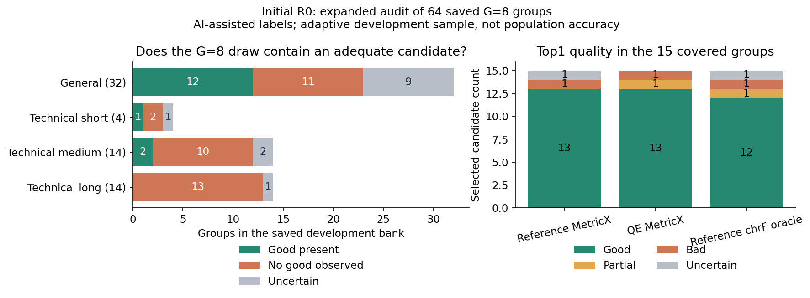

# Initial-R0 Candidate and Reward Audit

Date:2026-11-16. CPU-only saved-data audit: zero training updates, zero new samples and zero Colab compute units. Original R0 is unchanged.

## Decision

**R0 contains within-prompt quality contrasts and can support diagnostic DAPO. Broad translation coverage remains weak, especially on medium/long technical text. Missing fully adequate candidates is more common in this bank than clearly selecting a bad candidate when a good one exists. For the broad task, prioritize targeted technical SFT followed by a coverage recheck; the existing R0 remains usable for small general-domain RL diagnostics.**

This is an evidence-based engineering recommendation, not proof that insufficient SFT uniquely caused previous flat DAPO results. Partial candidates can support learning; fully correct candidates are not a universal eligibility requirement.

| Audit | Result |
| --- | --- |
| At least one adequate candidate | 15 /64 groups |
| No G and no U | 36 /64 groups |
| Uncertain coverage | 13 /64 groups |
| Reference MetricX in covered groups | 13 good,1 bad,1 uncertain /15 |
| General good coverage | 12 /32 |
| Technical good coverage | 3 /32 |
| At least two known semantic tiers | 46 /64;45 /64 after truncation mask |
| Good plus known lower tier | 11 /64 |
| No G but partial/bad contrast | 35 /64 |

Counts describe this fixed adaptive development bank, not population translation accuracy. There are only four technical-short and14 long groups; the mix is not a deployment-frequency estimate.

## Provenance

All64groups have the original R0-v3 minimum-NLL adapter SHA256: ebb4575fda36002c76ddb7e999a4e12c44a0be9ddb20b1e4e092d708e6a050e9

Each of the64 adapter identities matches original R0-v3, the minimum-NLL checkpoint. There are32 historical and32 previously called fresh groups. Fresh is an old bank name, not a claim of newly sampled or untouched data.

Saved sampling: G8,T0.7,top_p1,top_k0,max256, original L4/BF16 path. Sixteen groups were reused from the prior probe and48 from its expansion, all sharing the adapter. Reference MetricX scores were saved in R4. No model/scorer was called here. Post-update R3/R5 on-policy outputs are excluded from frozen-R0 counts.

This is not the R5 FP32/max320 draw. Different precision, cap or seed can change coverage. Some old fresh rows carry official test labels but have already been used for development; they are not untouched test evidence.

## Rubric and procedure

| Tier | Meaning |
| --- | --- |
| G | Core meaning retained; minor inflection allowed. |
| P | Substantive partial meaning with a major defect. |
| B | Central meaning lost, contradicted or nonsensical. |
| U | Uncertain, never automatically bad or absent coverage. |

The plan and all64 cards were fixed; cards hid scores, gates and rankings. All512 candidates were read, reasons saved, then labels hashed before expanded ranking statistics. The old16 good-candidate sets are separately preserved and all agree with this audit.

The same assistant, familiar sources and previous aggregate results prevent full blindness or independent native certification. Partial/bad boundaries are subjective; uncertain cases remain explicit. The worksheet permits independent human labels without overwriting AI labels.

| Step | Completed |
| --- | --- |
| 1 | Identity and cardinality verification |
| 2 | Register rubric and masked cards |
| 3 | Review all candidates and save reasons |
| 4 | Lock judgement/card hashes |
| 5 | Analyze coverage, contrast, ranking and advantages |
| 6 | Source-quality and truncation sensitivity |
| 7 | Export complete records and CPU replay kit |

## Domain and length

| Stratum | Groups | G present | No G or U | Uncertain | Contrast |
| --- | --- | --- | --- | --- | --- |
| General | 32 | 12 | 11 | 9 | 23 |
| Technical short | 4 | 1 | 2 | 1 | 3 |
| Technical medium | 14 | 2 | 10 | 2 | 10 |
| Technical long | 14 | 0 | 13 | 1 | 10 |

Zero covered long groups does not mean all lack learning signal: partial candidates remain and one source is malformed. Excluding it gives15 covered,35 no-G and13 uncertain groups out of63; long groups become0 covered,12 no-G and1 uncertain out of13.

Defects extend beyond grammar: poem changes genre, fired loses dismissal, mechanisms/negation reverse, five years becomes four, and actors/legal conditions change. Independent training data can target terms, predicates, relations, numbers and longer structures.

## Reward ranking

| Ranker | Select G if present | Bad | Partial | Uncertain |
| --- | --- | --- | --- | --- |
| Reference MetricX | 13 | 1 | 0 | 1 |
| QE MetricX | 13 | 1 | 1 | 0 |
| Reference chrF oracle | 12 | 1 | 1 | 1 |

Reference MetricX selected good in13/15 covered groups; one clear error and one uncertain choice remain. The reconstructed reference training-reward top1 matches it: no text-gate failures and max256 does not enter the original320/64 soft-length penalty region.

The reference chrF oracle selects good in12/15 covered groups. Higher overlap is not semantic correctness; simply replacing MetricX with chrF is not established as a repair.

| Ranker | Pairs | Concordant | Discordant | Tied |
| --- | --- | --- | --- | --- |
| reference_metricx | 528 | 396 | 127 | 5 |
| qe_metricx | 528 | 376 | 146 | 6 |
| reference_chrf_oracle | 528 | 402 | 126 | 0 |
| active_reference_training_reward | 487 | 378 | 104 | 5 |

Pairs compare distinct known tiers within a prompt; U and equal tiers are excluded. Reference MetricX has396/528 concordant,127 discordant and5 tied pairs. Shared prompts and duplicates prevent treating these as independent observations or certified accuracy. After truncation masking:378/487 concordant,104 discordant,5 ties.

## What DAPO receives

DAPO updates from group-normalized advantages, not just top1. Correct top1 does not validate every relative direction. A bad candidate with positive advantage is not automatically a scorer error: in an all-bad group, a relatively better candidate can be positive.

| Signal | Result |
| --- | --- |
| G plus lower tier | 11 groups |
| No G, partial vs bad | 35 groups |
| All G | 2 groups |
| All B | 3 groups |
| Numerical dynamic-sampling keep | 64/64 groups |
| Active candidates | 501/512;11 truncated |
| Known tier contrast | 46 groups before mask;45 after mask |

Nonzero reward variance is not semantic eligibility: all64 groups pass numerically, including three all-bad and two all-good groups. The35 no-G groups with partial/bad contrast can still contain learnable distinctions, without guaranteeing eventual correctness.

Reward reconstruction is offline only. These development prompts are not the actual R3 training pool and must not be converted into training examples through this audit.

## Concrete examples

**historical/p10 — The room is hot.**

6 is correct. 2/3/4/5/7 retain heat/heating but change room to another entity. 0 says bed surprised, and1 changes hot to long.

| i | Hypothesis | Tier | MetricX↓ | Advantage |
| --- | --- | --- | --- | --- |
| 6 | Herbergið er heitt. | G | 0.0000 | +1.0590 |

**historical/p18 — Nancy is the tallest girl in her class.**

2/7 preserve Nancy as the tallest girl in class despite inflection errors. 3/4 use biggest, uncertain for tallest. 0/5 lose class,6 changes to my girl, and1 does not express tallest.

| i | Hypothesis | Tier | MetricX↓ | Advantage |
| --- | --- | --- | --- | --- |
| 1 | Nancy er höktasta stúlkan í bekknum. | B | 1.4596 | +1.6041 |
| 2 | Nancy er hæsti stúlka í bekkinni. | G | 6.1120 | +0.5883 |
| 7 | Nancy er hæsta stúlka í bekkann. | G | 2.6589 | +1.3422 |

**historical/p04 — Tom was fired.**

None expresses dismissal from employment. 6/7 mean postponed, and the other predicates also fail the central event.

| i | Hypothesis | Tier | MetricX↓ | Advantage |
| --- | --- | --- | --- | --- |
| 2 | Tom var skilaður. | B | 7.3466 | +0.9034 |

**historical/p15 — Your doctor will check your skin before you start taking Tafinlar, then check it again every month while you are taking this medicine and for 6 months after you stop taking it.**

5/6 preserve the doctor, skin checks, pre-treatment, monthly treatment checks and six months after cessation. 0 has an unclear monthly expression. 1/2/3/4/7 introduce unrelated content, corrupt skin/check, substitute weekly, or omit timing.

| i | Hypothesis | Tier | MetricX↓ | Advantage |
| --- | --- | --- | --- | --- |
| 5 | Læknirinn mun skoða húðina þína fyrir að þú ferð að taka Tafinlar, síðan skoðar hann aftur hvert mánuð meðan þú ert að taka lyfið og 6 mánuði eftir að þú hættir að nota hann. | G | 3.8054 | +1.4552 |
| 6 | Læknirinn mun skoða húðina áður en þú ert að taka Tafinlar, síðan skulum hann skoða hana frekar á hverjum mánuði þegar þú ert að halda áfram með þessu lyf og 6 mánuðir á eftir að þú hættir að nota hann. | G | 3.5799 | +1.4981 |

**fresh/f04 — No one will ever know what happened.**

5/6 preserve nobody ever knowing what happened; Icelandic negative concord is not automatically an error. 0/3 use did rather than happened,1 omits the event,2 changes the knowing/event relation,4 is uncertain, and7 loses knowing.

| i | Hypothesis | Tier | MetricX↓ | Advantage |
| --- | --- | --- | --- | --- |
| 5 | Enginn mun aldrei vita hvað gerðist. | G | 0.0000 | +1.1422 |
| 6 | Enginn mun aldrei vita hvað gerðist. | G | 0.0000 | +1.1422 |

**fresh/f26 — For longer term treatment once clinical response has been observed (after 4 or more days), the dose of Meloxivet can be adjusted to the lowest effective individual dose reflecting that the degree of pain and inflammation associated with chronic musculo-skeletal disorders may vary over time.**

All retain some four-day, Meloxivet/dose-adjustment or long-treatment content, but corrupt clinical response, lowest effective individual dose, pain/inflammation, musculoskeletal disease or temporal variation. 1 increases dose and6 reverses response into not observed.

| i | Hypothesis | Tier | MetricX↓ | Advantage |
| --- | --- | --- | --- | --- |
| 6 | Á lengri tíma meðferð, þegar klínísku svörun hefur ekki verið að finna (eða þó 4 eða meira daga), má aðlaga skammtinn af Meloxivet á því hátt að þessum hlutaðingum verði sem tilnefndur er á tilteknum fullkomnum skammti, þar sem þýðist að þær þrífa og ofnæmi sem tengist lægan lífursnæðisvöruæðir geta mismikið af því sem er að mæta við á tíma. | P | 15.7117 | +1.3426 |

## Bounded next action

For the broad0.8B English-to-Icelandic task, prioritize technical medium/long capability instead of immediately running three reward-by-base training arms. Use disjoint training sources for roughly300k–500k target tokens focused on terms, predicates/negation, quantities/conditions and longer relations, with general replay. This is a bounded trial budget, not a sufficiency guarantee.

Then evaluate SFT alone and new G8 draws under frozen rules, checking technical coverage, partial/bad patterns, truncation and general retention. If coverage improves, run one matched DAPO pilot for additional gains; if not, fix the SFT data/recipe first. The existing MetricX calibration failure is not cleared by13/15 covered-group selections.

Original R0 and all results remain preserved. No SFT, DAPO or GPU was started here. Existing R0 remains usable for controlled general-domain RL diagnostics where contrasts exist.

## Files and reproducibility

| Artifact | Path |
| --- | --- |
| Report | D:\deep learning project\reports\r0_g8_candidate_audit_2026-11-16\R0_G8_COVERAGE_AND_REWARD_AUDIT_2026-11-16.html |
| Markdown | D:\deep learning project\reports\r0_g8_candidate_audit_2026-11-16\R0_G8_COVERAGE_AND_REWARD_AUDIT_2026-11-16.md |
| Results | D:\deep learning project\experiments\r0_g8_candidate_audit_2026-11-16\r0_g8_audit\results.json |
| Groups | D:\deep learning project\experiments\r0_g8_candidate_audit_2026-11-16\r0_g8_audit\groups.json |
| Review worksheet | D:\deep learning project\experiments\r0_g8_candidate_audit_2026-11-16\candidate_review_worksheet.csv |
| Replay | D:\deep learning project\experiments\r0_g8_candidate_audit_2026-11-16\README.md |

All64 groups and512 candidates retain tiers, reasons, reference/QE/chrF scores, gates, truncation, reconstructed advantages and source/lock hashes. These are development data from one G8 draw with AI-assisted, non-native-certified labels. No universal DAPO eligibility threshold follows.

## All candidates and decisions

00 · historical/p00 · general · good_present

EN: I'm not able to translate this sentence.

Reference IS: Ég get ekki þýtt þessa setningu.

All preserve inability to translate this sentence. Candidate3 has a minor demonstrative agreement error allowed by the rubric.

ratings=GGGGGGGG; unique hypotheses=2; reward std=0.02710354; kept=True

| i | Hypothesis | Grade | MetricX↓ | QE↓ | Sentence chrF↑ | Reconstructed reward | Advantage | tokens | Truncated | Active |
| --- | --- | --- | --- | --- | --- | --- | --- | --- | --- | --- |
| 0 | Ég get ekki þýtt þessa setningu. | G | 0.00000 | 0.01126 | 100.000 | 1.000000 | +0.37797 | 14 | False | True |
| 1 | Ég get ekki þýtt þessa setningu. | G | 0.00000 | 0.01126 | 100.000 | 1.000000 | +0.37797 | 14 | False | True |
| 2 | Ég get ekki þýtt þessa setningu. | G | 0.00000 | 0.01126 | 100.000 | 1.000000 | +0.37797 | 14 | False | True |
| 3 | Ég get ekki þýtt þetta setningu. | G | 2.04884 | 2.16346 | 79.837 | 0.918047 | -2.64575 | 14 | False | True |
| 4 | Ég get ekki þýtt þessa setningu. | G | 0.00000 | 0.01126 | 100.000 | 1.000000 | +0.37797 | 14 | False | True |
| 5 | Ég get ekki þýtt þessa setningu. | G | 0.00000 | 0.01126 | 100.000 | 1.000000 | +0.37797 | 14 | False | True |
| 6 | Ég get ekki þýtt þessa setningu. | G | 0.00000 | 0.01126 | 100.000 | 1.000000 | +0.37797 | 14 | False | True |
| 7 | Ég get ekki þýtt þessa setningu. | G | 0.00000 | 0.01126 | 100.000 | 1.000000 | +0.37797 | 14 | False | True |

| Ranker | Selected index | Grade | Tied indices |
| --- | --- | --- | --- |
| reference_metricx | 0 | G | [0, 1, 2, 4, 5, 6, 7] |
| qe_metricx | 0 | G | [0, 1, 2, 4, 5, 6, 7] |
| reference_training_reward | 0 | G | [0, 1, 2, 4, 5, 6, 7] |
| active_reference_training_reward | 0 | G | [0, 1, 2, 4, 5, 6, 7] |
| reference_chrf_oracle | 0 | G | [0, 1, 2, 4, 5, 6, 7] |

01 · historical/p01 · general · good_present

EN: Shall I close the door?

Reference IS: Á ég að loka dyrunum?

All except malformed4 retain the question about closing the door; case errors in3/6 are minor. Candidate4 is uncertain.

ratings=GGGGUGGG; unique hypotheses=3; reward std=0.04439763; kept=True

| i | Hypothesis | Grade | MetricX↓ | QE↓ | Sentence chrF↑ | Reconstructed reward | Advantage | tokens | Truncated | Active |
| --- | --- | --- | --- | --- | --- | --- | --- | --- | --- | --- |
| 0 | Á ég að loka dyrunum? | G | 0.00000 | 0.00000 | 100.000 | 1.000000 | +0.37796 | 10 | False | True |
| 1 | Á ég að loka dyrunum? | G | 0.00000 | 0.00000 | 100.000 | 1.000000 | +0.37796 | 10 | False | True |
| 2 | Á ég að loka dyrunum? | G | 0.00000 | 0.00000 | 100.000 | 1.000000 | +0.37796 | 10 | False | True |
| 3 | Á ég að loka dyrnar? | G | 0.00000 | 0.00000 | 68.873 | 1.000000 | +0.37796 | 9 | False | True |
| 4 | Eigist ég loka hurðina? | U | 3.35614 | 1.25061 | 20.550 | 0.865754 | -2.64575 | 11 | False | True |
| 5 | Á ég að loka dyrunum? | G | 0.00000 | 0.00000 | 100.000 | 1.000000 | +0.37796 | 10 | False | True |
| 6 | Á ég að loka dyrnar? | G | 0.00000 | 0.00000 | 68.873 | 1.000000 | +0.37796 | 9 | False | True |
| 7 | Á ég að loka dyrunum? | G | 0.00000 | 0.00000 | 100.000 | 1.000000 | +0.37796 | 10 | False | True |

| Ranker | Selected index | Grade | Tied indices |
| --- | --- | --- | --- |
| reference_metricx | 0 | G | [0, 1, 2, 3, 5, 6, 7] |
| qe_metricx | 0 | G | [0, 1, 2, 3, 5, 6, 7] |
| reference_training_reward | 0 | G | [0, 1, 2, 3, 5, 6, 7] |
| active_reference_training_reward | 0 | G | [0, 1, 2, 3, 5, 6, 7] |
| reference_chrf_oracle | 0 | G | [0, 1, 2, 5, 7] |

02 · historical/p02 · general · no_good_observed

EN: Mathematicians are poets, except that they have to prove what their fantasy creates.

Reference IS: Stærðfræðingar eru skáld, nema hvað þeir þurfa að sanna það sem hugarflug þeirra skapar.

None preserve mathematicians-as-poets and fantasy/proof jointly. Candidate3 at least retains mathematicians and the need to prove; other subjects and central predicates are badly corrupted.

ratings=BBBPBBBB; unique hypotheses=8; reward std=0.13306548; kept=True

| i | Hypothesis | Grade | MetricX↓ | QE↓ | Sentence chrF↑ | Reconstructed reward | Advantage | tokens | Truncated | Active |
| --- | --- | --- | --- | --- | --- | --- | --- | --- | --- | --- |
| 0 | Reikningarfræðingar eru leikfögnir, aðeins því að þau þurfa að sanna hvað augnablik hans gerur. | B | 14.50992 | 7.35422 | 36.916 | 0.419603 | +1.91130 | 40 | False | True |
| 1 | Álitarfræðingur eru leikar, nema þeir verði að sanna hvað sannfærslunum sem rauna. | B | 21.89097 | 19.08472 | 34.287 | 0.124361 | -0.30747 | 34 | False | True |
| 2 | Nauðalögumenn eru leikfólk þótt þeir verði að sanna hvað heimnskotunir þeirra skapa. | B | 17.59452 | 8.57991 | 30.506 | 0.296219 | +0.98406 | 36 | False | True |
| 3 | Stærðfræðingar eru leikfólki, nema þær verði að sanna hvað leikaði þeirra skipti. | P | 19.86589 | 20.85105 | 43.413 | 0.205364 | +0.30127 | 36 | False | True |
| 4 | Ígerðahöfundar eru leikmenn, nema þau þurfi að sanna hvað lyktjast gerir. | B | 21.91973 | 13.88319 | 28.225 | 0.123211 | -0.31612 | 31 | False | True |
| 5 | Hluthafnir eru þöfvir, að því tilskildu að þeir verða að sýna fram á því hvað eiginlegasta þeirra glerfingar gera. | B | 21.16394 | 8.95333 | 26.722 | 0.153442 | -0.08893 | 46 | False | True |
| 6 | Stöðvaþóknar voru góðar leikmenn þótt þeir verði að sanna því sem ótrúlegar íbúningar skipta veg fyrir. | B | 25.00000 | 19.63150 | 23.781 | 0.000000 | -1.24206 | 46 | False | True |
| 7 | Stofnunaraðrin eru leikfólki, nema þeir verði að sanna hvað þeirra æskjarferlinga stofnar. | B | 25.00000 | 20.47253 | 35.504 | 0.000000 | -1.24206 | 36 | False | True |

| Ranker | Selected index | Grade | Tied indices |
| --- | --- | --- | --- |
| reference_metricx | 0 | B | [0] |
| qe_metricx | 0 | B | [0] |
| reference_training_reward | 0 | B | [0] |
| active_reference_training_reward | 0 | B | [0] |
| reference_chrf_oracle | 3 | P | [3] |

03 · historical/p03 · technical_long · no_good_observed

EN: • Among those claims, the Authority gave a favourable assessment to the health claim referring to the effect of carbohydrates on the maintenance of brain function and proposed as appropriate conditions of use for that claim that ‘a daily intake of 130 g of glycaemic carbohydrates has been estimated to cover the glucose requirement of the brain (4).

Reference IS: • Matvælaöryggisstofnunin mat eina þessara fullyrðinga jákvætt en það er heilsufullyrðing er varðar áhrif kolvetna á viðhald eðlilegrar heilastarfsemi og lagði til að viðeigandi skilyrði fyrir notkun þessarar fullyrðingar yrðu: „áætlað er að dagleg inntaka á 130 g af blóðsykurshækkandi kolvetnum (e. glycaemic carbohydrates) nægi til að uppfylla glúkósaþörf heilans“(4).

No complete candidate. 1/3/4/7 retain portions of the health-claim, assessment or daily130g/glucose-requirement structure, but corrupt brain function and carbohydrate terms. 0/2/5/6 lose the central physiological relation more severely;5 changes it to heart.

ratings=BPBPPBBP; unique hypotheses=8; reward std=0.09785952; kept=True

| i | Hypothesis | Grade | MetricX↓ | QE↓ | Sentence chrF↑ | Reconstructed reward | Advantage | tokens | Truncated | Active |
| --- | --- | --- | --- | --- | --- | --- | --- | --- | --- | --- |
| 0 | • Í mörgum koma hafa fram hvort aðildarríki skulu votta lágvaxtar yfir áhrif kjólearhraða á þjónustu höndurnar og hafa sett fram viðkomandi notkunareignir fyrir þessa koma, þar sem í dag hefur verið reiknuð raunverulega 130 g af kjólearhraða (1). | B | 22.76602 | 25.00000 | 17.770 | 0.089359 | -0.95384 | 98 | False | True |
| 1 | • Í hlutaðal þessum droðasugranningum var framkvæmdastjórnina að eðlilegum ástæðum rækt að viðhaldi heilbrigðis og að viðmiðun um heilbrigðisnæmi lenti eftir því að sýni á eiturósa á frumfæri hafi áhrif á meðhöndlum og leggðu viðmiðunina um heilbrigðisnæmi sem vara til þess að ekki farið ólengt og að loka ekki viðhræðingum fyrir því að „heidið gæti fært 130 g af sýni á sýruósa á dag til að fylgjast við glúkósafræðileg þörf af frumfæri“ (4). | P | 18.20716 | 16.43066 | 25.427 | 0.271714 | +0.90960 | 195 | False | True |
| 2 | • Aðilið gefið því fyrirhugaðar ákvæði við læknumálsmeðgöngu þar sem um aðrar kröfur er að ræða að sýna á að blóðsykur eins og karmatíar hafi áhrif á hæfi í mögulegum skyni og höfðu fjárhagslega gert tilgang með þessum kröfum, sem eru í viðeigandi skýrslugreiðslu, að daglega innboð með 130 g af karmatíum séð sem læknað er þess sem þegar glúkosýr, sem erupt þá hafa áhrif á glúkosýr í mögulegum skyni (4). | B | 24.12216 | 25.00000 | 24.422 | 0.035114 | -1.50815 | 181 | False | True |
| 3 | • Í uppfinningarum sem voru framkvæmdum frá framkvæmdastofnunnum var hagskýrslu um heilsu gefið viðeigandi mat og var tekið fram að viðeigandi notkunareignir varð að 130 g á dag af glikemæðum glöðugöngum skulu fara yfir glúkósumkröfu hjá heilbrigði (4). | P | 19.85893 | 20.65153 | 21.258 | 0.205643 | +0.23444 | 104 | False | True |
| 4 | • Í þeim löggögn, sem Stofnunin fékk tímabundin útsýning um heilbrigðismeðferðarögnina um það áhrif kveðsturðarúða á heilbrigði og brotið vottorð um notkun sjálfkrafa sem við á er að lögðu fram að „á dag er 130 g af kveðsturðarúðu tengd glúkósa“ eigi til að ná þann glúkósa ráðstöfun fyrir heilbrigðið (4). | P | 19.20606 | 18.67795 | 24.567 | 0.231758 | +0.50130 | 132 | False | True |
| 5 | • Í þeim sökum sem ákvarðaðist er yfirvöldinn að því tilliti að viðkomandi skemmtifora sé aðrar viðmiðanir og að því tilskildu gert um notkun þess að gildi að „að á dag að 130 g af sykursýrufræðilegu glúkóseri hafa verið reiknað vel til að fylgjast með glúkóseruþurfningu hjartans“ (4). | B | 21.26235 | 19.62740 | 23.477 | 0.149506 | -0.33921 | 115 | False | True |
| 6 | • Í viðmiðunum á eftirfarandi hátt var yfirvöldin rétt fyrir sér með þeim áætlanum um heilbrigði að því er varðar áhrif kharóþjáarana á viðhalda vökvans og ráðlagði að því til neðan fyrir að því er varðar þau viðmiðun að „kaupp á daginn af 130 g af kharóþjáarana af glikemíðun „ar að tilgreina væri á óþarfi brjóstanna (4). | B | 16.07313 | 12.34360 | 24.203 | 0.357075 | +1.78188 | 133 | False | True |
| 7 | • Í einhverjum kröfu var aðilinn að rannsaka að því er varðar heilsufarðarkröfu, sem varber er hvers vegna og virðist dráta um að efnaleysi karbónhýra hafi áhrif á margt að því er varðar heilbrigði heilbrigðis og ráðlagt var í samræmi við það að því að „einhver daginn sé bara 130 g af efnalækið efnahyljun og virðist dráta um að glúkósaður efnalækið hafi áhrif á glúkúðarþarf heilbrigðis (4). | P | 21.96400 | 24.90890 | 24.571 | 0.121440 | -0.62601 | 165 | False | True |

| Ranker | Selected index | Grade | Tied indices |
| --- | --- | --- | --- |
| reference_metricx | 6 | B | [6] |
| qe_metricx | 6 | B | [6] |
| reference_training_reward | 6 | B | [6] |
| active_reference_training_reward | 6 | B | [6] |
| reference_chrf_oracle | 1 | P | [1] |

04 · historical/p04 · general · no_good_observed

EN: Tom was fired.

Reference IS: Tom var rekinn.

Review: None expresses dismissal from employment. 6/7 mean postponed, and the other predicates also fail the central event.

None expresses dismissal from employment. 6/7 mean postponed, and the other predicates also fail the central event.

ratings=BBBBBBBB; unique hypotheses=7; reward std=0.23172681; kept=True

| i | Hypothesis | Grade | MetricX↓ | QE↓ | Sentence chrF↑ | Reconstructed reward | Advantage | tokens | Truncated | Active |
| --- | --- | --- | --- | --- | --- | --- | --- | --- | --- | --- |
| 0 | Tom fannst sér úr. | B | 14.73727 | 7.66886 | 18.473 | 0.410509 | -0.37234 | 9 | False | True |
| 1 | Tom var fyllt. | B | 17.58069 | 15.28231 | 38.587 | 0.296772 | -0.86316 | 7 | False | True |
| 2 | Tom var skilaður. | B | 7.34658 | 10.41270 | 41.102 | 0.706137 | +0.90342 | 7 | False | True |
| 3 | Tom var thyrt. | B | 10.91310 | 13.20395 | 39.564 | 0.563476 | +0.28778 | 6 | False | True |
| 4 | Tom var skilaður af. | B | 7.60397 | 5.65564 | 39.449 | 0.695841 | +0.85899 | 8 | False | True |
| 5 | Tom var síðan leiðtoga. | B | 25.00000 | 23.18562 | 37.351 | 0.000000 | -2.14386 | 11 | False | True |
| 6 | Tom var frestaður. | B | 8.73024 | 7.28644 | 39.765 | 0.650790 | +0.66458 | 7 | False | True |
| 7 | Tom var frestaður. | B | 8.73024 | 7.28644 | 39.765 | 0.650790 | +0.66458 | 7 | False | True |

| Ranker | Selected index | Grade | Tied indices |
| --- | --- | --- | --- |
| reference_metricx | 2 | B | [2] |
| qe_metricx | 4 | B | [4] |
| reference_training_reward | 2 | B | [2] |
| active_reference_training_reward | 2 | B | [2] |
| reference_chrf_oracle | 2 | B | [2] |

05 · historical/p05 · technical_long · no_good_observed

EN: • Without prejudice to the powers laid down in Article 17, where a competent authority disagrees about the procedure or content of an action or inaction of a competent authority of another Member State in cases specified in the acts referred to in Article 1(2), the Authority, at the request of one or more of the competent authorities concerned may assist the authorities in reaching an agreement in accordance with the procedure set out in paragraphs 2 to 4 of this Article.

Reference IS: • Ef lögbært yfirvald samþykkir ekki verklagsreglu eða inntak aðgerðar eða aðgerðaleysis lögbærs yfirvalds í öðru aðildarríki, í tilvikum sem tilgreind eru í gerðunum sem um getur í 2. mgr. 1. gr., skal stofnunin, að beiðni eins eða fleiri hlutaðeigandi lögbærra yfirvalda, aðstoða yfirvöldin við að ná samkomulagi í samræmi við verklagsregluna sem sett er fram í 2.–4. mgr. þessar greinar, með fyrirvara um valdheimildirnar sem mælt er fyrir um í 17. gr.

All retain parts of the competent-authority/request/assistance/agreement/procedure framework but omit or corrupt important conditions, actors, inaction or the Article17 reservation. Equal coarse partial ratings do not imply equal quality.

ratings=PPPPPPPP; unique hypotheses=8; reward std=0.10644653; kept=True

| i | Hypothesis | Grade | MetricX↓ | QE↓ | Sentence chrF↑ | Reconstructed reward | Advantage | tokens | Truncated | Active |
| --- | --- | --- | --- | --- | --- | --- | --- | --- | --- | --- |
| 0 | • Þegar lögbær yfirvöld vera að ósamkvæmi um aðferðina eða þátttækis eða ekki að aðgerð eða eðlis yfirvöld í öðrum aðildarríki, sem tiltekn í gerðum sem um getur í 2. mgr. 1. gr., geti yfirvöldin, á undanboð einnar eða fleiri lögbær yfirvöld sem um getur, aðstoð að yfirvöldum til að ná samkomulagi samkvæmt ferli sem mælt er fyrir um í 2. til 4. mgr. þessarar greinar. | P | 12.77815 | 13.29632 | 43.231 | 0.488874 | +0.22935 | 156 | False | True |
| 1 | • Þar sem ákvæðum 17. gr. er skýrt fyrir um þau aðil sem má viðeigandi yfirvöldu þýða, er hægt að, að beiðni einn eða fleiri varðandi viðkomandi yfirvöld, gyði yfirvöld þess að ná samkomulag í samræmi við málefnið sem er sett fram í 2. til 4. mgr. á þessari gráðar. | P | 17.66483 | 15.07443 | 29.665 | 0.293407 | -1.60695 | 114 | False | True |
| 2 | • Ef reikningaraðili er hætt og aðilarnir hafa ósamræmi um málin, aðferðirnar eða afhræðir að því er varðar aðil í öðru aðildarríki, sem tilgreint er í hlið 2. mgr. 1. gr., geti reikningaraðilið viðkomandi aðil í beiðni eða til aðra aðilanna í viðkomandi aðildarríki aðstoðgert að lögbærum aðilum að ná samþykki í samræmi við málin og aðferðann sem mælt er fyrir um í 2. til 4. mgr. þessarar greinar. | P | 11.28491 | 11.04444 | 39.631 | 0.548604 | +0.79047 | 167 | False | True |
| 3 | • Þegar í ljós er að lögbært yfirvöld í öðrum aðildarríkjum, sem þegi ákvarðanir um aðgerðir, eða eftirlit með þeim, hafa róðanlegt ákvarðað um áætlun eða ekki áætlun, skv. 2. mgr. 1. gr., og má skuldbúnaðin, með því að kveðið er að um, hjálpa lögbært yfirvöldum að ná samkomulagi í samræmi við aðferðina sem sett er fram í 2. til 4. mgr. þessarar greinar. | P | 17.88242 | 18.16694 | 38.062 | 0.284703 | -1.68871 | 156 | False | True |
| 4 | • Þá sem ekki er samræmt 17. gr. má þeim lögbær yfirvald sem eiga að ræða um aðferðina eða aðferð með tilteknum málsþýðum eða að einhverjum lögbærum yfirvald í annarri aðildarríki, til tilteknum tilgangum á aðferðum sem tilgreind eru í lið 2. gr. liðar 1. gr., að því varðar tilteknum tilgangum, geta þau, á ósk úr einum eða fleiri lögbærum yfirvaldum í þeim tilteknum ríkinu, aðstoðgert yfirvaldinum þeim við rekstur samþykktar samningu í samræmi við aðferðina sem sett er fram í 2. til 4. gr. þessarar greinar. | P | 12.80731 | 13.26339 | 44.226 | 0.487708 | +0.21839 | 212 | False | True |
| 5 | • Yfirvaldið er heimilt að hjálpa yfirvöldum, sem annað og ætluð er á, til að koma á samþykkt, að því er varðar þá aðferðaraðferð eða þá aðgerð eða aðgerðar sem ætluð er á með tilliti til að heyra úr ætluðum yfirvöldum í öðrum aðildarríkjum, sem eru tilgreind í þeim gerðum sem um getur í 2. mgr. 1. gr., að því er varðar þá aðferðaraðferð eða þá aðgerðar sem ætluð er á með tilliti til að heyra úr ætluðum yfirvöldum, með því að framkvæma aðferðaraðferðina sem sett er fram í 2. til 4. mgr. þessarar gr. | P | 10.18220 | 10.01403 | 38.122 | 0.592712 | +1.20484 | 216 | False | True |
| 6 | • Einu sinni við skilyrði 17. gr. er lögbær yfirvald að viðurkenni aðgerða eða að áhættu eða að irektileg yfirvald annars aðildarríkjans um aðgerðir sem tilgreina er í gerðum sem tilgreinu er um í 2. mgr. 1. gr. er yfirvaldin, á óskunum eða óskunum af því að yfirvaldanna sem þeim skipu verða, aðstoða yfirvaldanna fyrir að ná samkomulagi í samræmi við aðferðina sem sett er fram í 2. til 4. lið þessarar greinar. | P | 11.95221 | 11.06710 | 44.835 | 0.521912 | +0.53972 | 169 | False | True |
| 7 | • Því sem við á að ákvæðum 17. gr. séu beint við á því hve er hægt að gera, getur samningsskoðandi yfirvöld að því tilskildu, að því er varðar aðferðirnar eða íræði greiðslu eða ógerð samningskoðandi yfirvöld annars aðildarríkjans, sem tilgreint er í þeim voru sem um getur í 2. mgr. 1. gr., samþykkið stjórnvald að því tilskildu að veita aðstoð yfirvöldu í að ná samkomulagi í samræmi við aðferðina sem sett er fram í 2. til 4. mgr. þessarar greinar. | P | 12.55588 | 10.99467 | 44.786 | 0.497765 | +0.31288 | 187 | False | True |

| Ranker | Selected index | Grade | Tied indices |
| --- | --- | --- | --- |
| reference_metricx | 5 | P | [5] |
| qe_metricx | 5 | P | [5] |
| reference_training_reward | 5 | P | [5] |
| active_reference_training_reward | 5 | P | [5] |
| reference_chrf_oracle | 6 | P | [6] |

06 · historical/p06 · technical_medium · no_good_observed

EN: At the same time the socio-economic aspects inherent in the three priority themes and linked with the general topic of sustainable development will be tackled.

Reference IS: Samtímis þessu verður tekist á við félagshagfræðilega þáttinn sem er samfara meginefnissviðunum þremur og tengist hinu almenna markmiði um sjálfbæra þróun.

3/4 retain parts of the economic aspects, three themes and development topic, but change socio-economic/sustainable into scientific/safe and lose other relations. Others corrupt the central structure more severely.

ratings=BBBPPBBB; unique hypotheses=8; reward std=0.17105480; kept=True

| i | Hypothesis | Grade | MetricX↓ | QE↓ | Sentence chrF↑ | Reconstructed reward | Advantage | tokens | Truncated | Active |
| --- | --- | --- | --- | --- | --- | --- | --- | --- | --- | --- |
| 0 | Þessara tíma er að ræða þá efnahagslegri og æskilegri hugmyndir í þriðju öryggisáttmiðunum og tengdum almennuðum þáttum sem valda þörfum á vörutækri þroska. | B | 20.93581 | 16.08650 | 23.140 | 0.162568 | -0.01140 | 73 | False | True |
| 1 | Þegar þrír hlutaðir hluti einkafæra og vísindar og efnahagslegra eðlis eru veittar er lausn á þessu konar heiti og tengd heildaráttaframleiðu með vörslu. | B | 25.00000 | 23.46060 | 19.457 | 0.000000 | -0.96178 | 66 | False | True |
| 2 | Einungis að því er varðar annaðhvort lífeyrisvettvang og efnahagslegri hluti þessir þrjátíðar þræðir sem styrkrir eru og umholfnar við almenntu þáttinn um öruggan ræðisfræðileg árangur verða að fara í hug á snúun. | B | 24.56009 | 21.03913 | 26.453 | 0.017597 | -0.85891 | 90 | False | True |
| 3 | Þessum tveimur málinum sem liggja fyrirframan yfir þrjú og tengjast almennum málinum um stöðugu þróun verður að ræða áhættu í vísindaráðstæðum um sögu og efnahagslegri áhættu. | P | 22.43006 | 19.08349 | 23.685 | 0.102798 | -0.36082 | 79 | False | True |
| 4 | Þá sameiginlega verða greint fram á vísindaleg og efnahagslegri hluti þess þrjú breytingarhugsanir sem eru sáttir upp með og tengjast almennum myndunum um öruggri þróun. | P | 16.46877 | 15.15836 | 25.641 | 0.341249 | +1.03319 | 65 | False | True |
| 5 | Þessum stöðlum, sem eru áfram í þriðja mæðisvörum, og tengjast heildarþörfum, verður að ræða bæði fráboðsvirði og efni í réttarfrumum. | B | 25.00000 | 21.50197 | 19.249 | 0.000000 | -0.96178 | 63 | False | True |
| 6 | Það verður að reka þessu samtalið með þeim vísindaveirnum sem eru viðkomandi í þriðju meginásetnum og tengjum sig við almennásetin um öruggri þróun. | B | 12.11315 | 8.31910 | 26.914 | 0.515474 | +2.05172 | 57 | False | True |
| 7 | Þessum tveimur mátt ræsta þrjá stærsta málum og umbúðum að málum um öruggan þróun. | B | 20.58871 | 18.41705 | 14.438 | 0.176451 | +0.06977 | 38 | False | True |

| Ranker | Selected index | Grade | Tied indices |
| --- | --- | --- | --- |
| reference_metricx | 6 | B | [6] |
| qe_metricx | 6 | B | [6] |
| reference_training_reward | 6 | B | [6] |
| active_reference_training_reward | 6 | B | [6] |
| reference_chrf_oracle | 6 | B | [6] |

07 · historical/p07 · technical_medium · no_good_observed

EN: More serious adverse reactions such as serious skin rashes and hepatic transaminase elevations have also been reported (cf paragraph Description of selected adverse reactions).

Reference IS: Einnig hefur verið greint frá alvarlegri aukaverkunum eins og alvarlegum húðútbrotum og hækkunum á lifrartransamínösum (sjá „Lýsing á völdum aukaverkunum“).

Most retain serious adverse effects and parts of skin/liver content, but neither rash nor hepatic transaminase elevations is reliably rendered. Candidate2 is especially incoherent;7 adds repeated quotation marks.

ratings=PPBPPPPP; unique hypotheses=8; reward std=0.15698007; kept=True

| i | Hypothesis | Grade | MetricX↓ | QE↓ | Sentence chrF↑ | Reconstructed reward | Advantage | tokens | Truncated | Active |
| --- | --- | --- | --- | --- | --- | --- | --- | --- | --- | --- |
| 0 | Aðrar alvarlegar aukaverkanir, svo sem alvarlegar húðskötir og aukning á blóðþrýstingsfrum og efni í lifur hafa einnig verið tilkynntar (sjá ákvæði fyrir valdandi aukaverkanir). | P | 4.70344 | 1.55603 | 30.265 | 0.811862 | +1.66334 | 72 | False | True |
| 1 | Það hefur komið fram einnig um meiri alvarlegar aukaverkanir. Þessi eru svona og alvarlegur úrslafi í húð og ofnæmisþegja (s.e. í lið 4.3). | P | 10.96714 | 8.13496 | 24.541 | 0.561314 | +0.06729 | 61 | False | True |
| 2 | Auk þess hefur verið til sínguðs áhrifa sem sýna á sér stað alvarlegar sýki á húð og stóri leigja á lifur sem hafa verið til greina (sjá lesu í um tilnefnt áhættuefni). | B | 16.69678 | 8.65315 | 24.437 | 0.332129 | -1.39267 | 72 | False | True |
| 3 | Auk þess hefur verið skýrt um betra aukaverkanir, svo sem algengir húðsláti og aukning á lifrarþrotasamyli (sjá líðsgert í þættu „Lýsing á velslukt aukaverkanir“). | P | 11.32086 | 8.48498 | 32.513 | 0.547165 | -0.02284 | 67 | False | True |
| 4 | Mikið hefur verið að kenna merki af alvarlegum aukaverkunum, svo sem alvarlegum húðflauggræðum og verkarýsirþrýstingum í lifur (gíra í lið „Skrá um vel sýnd aukaverkanir“). | P | 10.64648 | 7.15665 | 35.073 | 0.574141 | +0.14900 | 73 | False | True |
| 5 | Meira alvarlegar aukaverkanir, svo sem alvarlegan húðskot og aukning á lifurumsþrýstingaskifti, hefur einnig verið til greina (sjá skýrslugrein fyrir valda aukaverkanir). | P | 6.88482 | 3.48075 | 30.856 | 0.724607 | +1.10751 | 64 | False | True |
| 6 | Aðstættar aukaverkanir séu svo mikilvægar að það hafi verið til greina um alvarlega húðráði og upphafsþróun á lifurögum (sjá skýrslugjöf á valdu aukaverkanir). | P | 16.80485 | 8.77927 | 28.032 | 0.327806 | -1.42021 | 65 | False | True |
| 7 | Að mikilvægum aukaverkunum, sem tilnefndar eru, eru alvarlegar húðsköt og aukið bilirónsýni í lifur ennþá (sjá öðru lið „““““““““““““““““““““““““““““““““““““““““““““““““““““““““““““““““““““““““““““““““““““““““““““““““““““““““““““““““““““““““““““““““““““““““““““““““““““““““““““““““““““““““““““““““““““““““““““““““““““““““““ | P | 11.82550 | 11.28032 | 18.580 | 0.526980 | -0.15142 | 256 | True | False |

| Ranker | Selected index | Grade | Tied indices |
| --- | --- | --- | --- |
| reference_metricx | 0 | P | [0] |
| qe_metricx | 0 | P | [0] |
| reference_training_reward | 0 | P | [0] |
| active_reference_training_reward | 0 | P | [0] |
| reference_chrf_oracle | 4 | P | [4] |

08 · historical/p08 · general · uncertain

EN: Why did you leave out the first question in the exam?

Reference IS: Af hverju slepptirðu fyrstu spurningunni á prófinu?

No confidently complete candidate. 0/2 retain parts of the question about the first exam item but change the action or tense. The skilja constructions in3/6/7 remain uncertain. 1 adds negation;4/5 corrupt the action.

ratings=PBPUBBUU; unique hypotheses=8; reward std=0.13887437; kept=True

| i | Hypothesis | Grade | MetricX↓ | QE↓ | Sentence chrF↑ | Reconstructed reward | Advantage | tokens | Truncated | Active |
| --- | --- | --- | --- | --- | --- | --- | --- | --- | --- | --- |
| 0 | Af hverju láttu eftir fyrstu spurningum í prófinu? | P | 0.52172 | 0.46971 | 55.526 | 0.979131 | +0.98442 | 19 | False | True |
| 1 | Hvers vegna skilstu ekki við fyrstu spurninguna á prófinu? | B | 1.28131 | 1.20677 | 47.756 | 0.948748 | +0.76564 | 20 | False | True |
| 2 | Af hverju þarftu ekki svar á fyrsta spurningunni í prófinu? | P | 1.97975 | 1.14945 | 53.522 | 0.920810 | +0.56447 | 22 | False | True |
| 3 | Af hverju skildirðu fyrstu spurninguna ef sinnum í prófinu? | U | 9.26235 | 5.54405 | 62.556 | 0.629506 | -1.53314 | 21 | False | True |
| 4 | Af hverju lentiðu fram undan fyrstu spurningunum í prófun? | B | 1.41758 | 2.01980 | 47.676 | 0.943297 | +0.72639 | 20 | False | True |
| 5 | Af hverju kveikstu aftur á fyrsta spurninguna í prófinu? | B | 10.15740 | 10.16515 | 49.746 | 0.593704 | -1.79094 | 21 | False | True |
| 6 | Af hverju skildirðu fyrsta spurningunni í prófununni? | U | 3.40205 | 3.66884 | 51.829 | 0.863918 | +0.15480 | 20 | False | True |
| 7 | Af hverju skilduðu fyrir fyrstu spurningunni í prófinu? | U | 3.49382 | 3.13789 | 65.608 | 0.860247 | +0.12837 | 20 | False | True |

| Ranker | Selected index | Grade | Tied indices |
| --- | --- | --- | --- |
| reference_metricx | 0 | P | [0] |
| qe_metricx | 0 | P | [0] |
| reference_training_reward | 0 | P | [0] |
| active_reference_training_reward | 0 | P | [0] |
| reference_chrf_oracle | 7 | U | [7] |

09 · historical/p09 · general · no_good_observed

EN: If you can't keep your promise, what excuse will you make?

Reference IS: Hvaða afsökun muntu nota ef þú getur ekki staðið við loforðið þitt?

1 retains the failure-to-keep-a-promise condition but loses the excuse question. Others replace promise with responsibility/permission or corrupt both condition and excuse.

ratings=BPBBBBBB; unique hypotheses=8; reward std=0.16867216; kept=True

| i | Hypothesis | Grade | MetricX↓ | QE↓ | Sentence chrF↑ | Reconstructed reward | Advantage | tokens | Truncated | Active |
| --- | --- | --- | --- | --- | --- | --- | --- | --- | --- | --- |
| 0 | Svo sem þú notar ekki að náð sannprófi, hvað lýkst þér? | B | 21.80915 | 13.13102 | 16.316 | 0.127634 | -2.49833 | 23 | False | True |
| 1 | Ef þú gengur ekki frá loforðinu sem þú láttir vera, hvað ætlið þú? | P | 7.41084 | 5.24778 | 23.531 | 0.703567 | +0.91618 | 29 | False | True |
| 2 | Ef þú getur ekki haldið við ábyrgðina, hvaða leyfi myndarðu gera? | B | 10.91133 | 5.02032 | 29.962 | 0.563547 | +0.08605 | 26 | False | True |
| 3 | Ef þú getur ekki haldað ábyrgð þín, hvað lýst þú? | B | 8.74329 | 4.93926 | 25.172 | 0.650268 | +0.60019 | 24 | False | True |
| 4 | Ef þú getur ekki haldið við, hvað lýgðanverur þú? | B | 8.26585 | 3.17238 | 29.076 | 0.669366 | +0.71341 | 23 | False | True |
| 5 | Ef þú gerir ekki loforði þarftu hvað aðskilið að? | B | 11.44263 | 7.53868 | 23.556 | 0.542295 | -0.03995 | 22 | False | True |
| 6 | Ef þú tekur ekki af breytingunni, hvaða afsökutenging munu þú staðfesta? | B | 11.18255 | 8.68349 | 27.097 | 0.552698 | +0.02173 | 30 | False | True |
| 7 | Ef þú átt ekki á viðbyrgðina, hvað mátt þú lýfa? | B | 10.42771 | 7.02395 | 13.998 | 0.582892 | +0.20074 | 23 | False | True |

| Ranker | Selected index | Grade | Tied indices |
| --- | --- | --- | --- |
| reference_metricx | 1 | P | [1] |
| qe_metricx | 4 | B | [4] |
| reference_training_reward | 1 | P | [1] |
| active_reference_training_reward | 1 | P | [1] |
| reference_chrf_oracle | 2 | B | [2] |

10 · historical/p10 · general · good_present

EN: The room is hot.

Reference IS: Herbergið er heitt.

Review: 6 is correct. 2/3/4/5/7 retain heat/heating but change room to another entity. 0 says bed surprised, and1 changes hot to long.

6 is correct. 2/3/4/5/7 retain heat/heating but change room to another entity. 0 says bed surprised, and1 changes hot to long.

ratings=BBPPPPGP; unique hypotheses=8; reward std=0.29454470; kept=True

| i | Hypothesis | Grade | MetricX↓ | QE↓ | Sentence chrF↑ | Reconstructed reward | Advantage | tokens | Truncated | Active |
| --- | --- | --- | --- | --- | --- | --- | --- | --- | --- | --- |
| 0 | Rúmið er hissa. | B | 10.39588 | 19.14983 | 20.556 | 0.584165 | -0.35274 | 9 | False | True |
| 1 | Herbergið er langt. | B | 21.38092 | 19.05767 | 59.318 | 0.144763 | -1.84454 | 8 | False | True |
| 2 | Ræðin er heitt. | P | 2.31482 | 5.74286 | 48.813 | 0.907407 | +0.74469 | 9 | False | True |
| 3 | Húsið er heitt. | P | 4.09957 | 2.65452 | 59.188 | 0.836017 | +0.50231 | 9 | False | True |
| 4 | Rúmið er hitað. | P | 5.03479 | 2.52624 | 22.151 | 0.798609 | +0.37531 | 10 | False | True |
| 5 | Rúmurinn er hitur. | P | 1.70679 | 1.70136 | 16.167 | 0.931729 | +0.82726 | 9 | False | True |
| 6 | Herbergið er heitt. | G | 0.00000 | 0.39682 | 100.000 | 1.000000 | +1.05905 | 9 | False | True |
| 7 | Göngubúðin er heitt. | P | 17.45447 | 8.29165 | 48.036 | 0.301821 | -1.31132 | 12 | False | True |

| Ranker | Selected index | Grade | Tied indices |
| --- | --- | --- | --- |
| reference_metricx | 6 | G | [6] |
| qe_metricx | 6 | G | [6] |
| reference_training_reward | 6 | G | [6] |
| active_reference_training_reward | 6 | G | [6] |
| reference_chrf_oracle | 6 | G | [6] |

11 · historical/p11 · general · good_present

EN: He is about your age.

Reference IS: Hann er á þínum aldri.

0/6 preserve approximately the addressee's age. 1 uses plural your with uncertain syntax;4 is malformed and uncertain. 2/3/5 only partially preserve the age relation;7 lacks a reliable comparison.

ratings=GUPPUPGB; unique hypotheses=8; reward std=0.19777247; kept=True

| i | Hypothesis | Grade | MetricX↓ | QE↓ | Sentence chrF↑ | Reconstructed reward | Advantage | tokens | Truncated | Active |
| --- | --- | --- | --- | --- | --- | --- | --- | --- | --- | --- |
| 0 | Hann er á þínum aldri. | G | 4.53053 | 4.66429 | 100.000 | 0.818779 | +2.17802 | 10 | False | True |
| 1 | Hann er um aldri ykkar. | U | 16.24012 | 13.53468 | 48.392 | 0.350395 | -0.19028 | 10 | False | True |
| 2 | Hann er um tíma þína aldur. | P | 20.35743 | 18.48887 | 36.253 | 0.185703 | -1.02301 | 12 | False | True |
| 3 | Hann er um aldrið. | P | 16.10820 | 14.75520 | 48.585 | 0.355672 | -0.16360 | 8 | False | True |
| 4 | Hann er með þig aldur. | U | 20.89265 | 19.31068 | 33.467 | 0.164294 | -1.13126 | 10 | False | True |
| 5 | Hann er að aldri. | P | 13.97938 | 14.39090 | 47.981 | 0.440825 | +0.26696 | 7 | False | True |
| 6 | Hann er um þín aldri. | G | 12.02847 | 10.74944 | 52.715 | 0.518861 | +0.66154 | 9 | False | True |
| 7 | Hann er umældis gamall. | B | 18.25786 | 3.28718 | 33.385 | 0.269686 | -0.59837 | 10 | False | True |

| Ranker | Selected index | Grade | Tied indices |
| --- | --- | --- | --- |
| reference_metricx | 0 | G | [0] |
| qe_metricx | 7 | B | [7] |
| reference_training_reward | 0 | G | [0] |
| active_reference_training_reward | 0 | G | [0] |
| reference_chrf_oracle | 0 | G | [0] |

12 · historical/p12 · technical_medium · uncertain

EN: The course consists of two modules, which may be taken separately or combined:

Reference IS: Námskeiðið samanstendur af tveimur áföngum sem má taka hvorn um sig eða saman:

Most retain two parts and some combining choice but corrupt course, modules or separate study. 4/6 particularly corrupt entities and options. 5 contains afanga and two options but its separate/combined meaning is uncertain.

ratings=PPPPBUBP; unique hypotheses=8; reward std=0.15368512; kept=True

| i | Hypothesis | Grade | MetricX↓ | QE↓ | Sentence chrF↑ | Reconstructed reward | Advantage | tokens | Truncated | Active |
| --- | --- | --- | --- | --- | --- | --- | --- | --- | --- | --- |
| 0 | Hægt er að taka frá hliðinni tvær hluti sem geta verið tekin eiginlega eða haldið saman: | P | 19.06121 | 15.74508 | 23.474 | 0.237552 | -0.24177 | 33 | False | True |
| 1 | Rithöglið består af tvö hluta sem má taka undir einn eða í samanburð: | P | 12.42938 | 5.95780 | 28.156 | 0.502825 | +1.48431 | 26 | False | True |
| 2 | Reikninginn er upp í tvö hluta, sem á að taka aðeins eða saman: | P | 13.48054 | 10.53761 | 24.360 | 0.460778 | +1.21072 | 24 | False | True |
| 3 | Tilgangið er að aðila tveir hluta sem eru má taka saman eða samsettur: | P | 25.00000 | 24.18701 | 27.293 | 0.000000 | -1.78747 | 26 | False | True |
| 4 | Í forðunum eru tveir keðslubúnaðir sem má taka undir eða samanbulda: | B | 21.66543 | 9.01789 | 29.422 | 0.133383 | -0.91958 | 29 | False | True |
| 5 | Með áfanga eru tvo valdstundir sem geta verið tekinn saman eða í öðru lagi: | U | 18.82190 | 14.15936 | 18.799 | 0.247124 | -0.17949 | 29 | False | True |
| 6 | Meðferðin inniheldur tvö veita, sem geta verið tekin utan eitt eða samanboruð: | B | 18.18341 | 10.28947 | 19.932 | 0.272664 | -0.01330 | 32 | False | True |
| 7 | Hægt er að taka tveir hluta á þessari leið sem má taka þær eiginlega eða saman: | P | 16.41648 | 14.14132 | 32.288 | 0.343341 | +0.44658 | 30 | False | True |

| Ranker | Selected index | Grade | Tied indices |
| --- | --- | --- | --- |
| reference_metricx | 1 | P | [1] |
| qe_metricx | 1 | P | [1] |
| reference_training_reward | 1 | P | [1] |
| active_reference_training_reward | 1 | P | [1] |
| reference_chrf_oracle | 7 | P | [7] |

13 · historical/p13 · technical_long · no_good_observed

EN: A pensioner who is entitled to draw pensions under the legislation of two or more Member States, of which one is that of the Member State in whose territory he resides, and who is entitled to benefits under the legislation of the latter Member State, taking account where appropriate of the provisions of Article 18 and Annex VI, shall, with the members of his family, receive such benefits from the institution of the place of residence and at the expense of that institution as though the person concerned were a pensioner whose pension was payable solely under the legislation of the latter Member State.

Reference IS: Lífeyrisþegi sem á rétt á lífeyri samkvæmt löggjöf tveggja eða fleiri aðildarríkja, að meðtalinni löggjöf þess aðildarríkis sem hann er búsettur í, þar sem hann á rétt á bótum samkvæmt löggjöf þess ríkis, með tilliti til ákvæða 18. gr. og VI. viðauka eftir því sem við á, skal, ásamt aðstandendum, fá bætur frá stofnun á búsetustaðnum og á kostnað hennar eins og sá sem í hlut á væri lífeyrisþegi sem ætti eingöngu rétt á lífeyri samkvæmt löggjöf þess ríkis.

None reliably expresses pensioner and pensions. 3–6 retain parts of the multi-state law, residence/family and institutional-benefit framework, while others are more severely incoherent. No complete translation.

ratings=BBBPPPPB; unique hypotheses=8; reward std=0.07126734; kept=True

| i | Hypothesis | Grade | MetricX↓ | QE↓ | Sentence chrF↑ | Reconstructed reward | Advantage | tokens | Truncated | Active |
| --- | --- | --- | --- | --- | --- | --- | --- | --- | --- | --- |
| 0 | Vinur sem hafa rétt á vinur í samræmi við ákvæði tveggja eða fleira aðildarríkja, þar sem einn þeirra beitt er á bótað eða stöð, og hafa rétt á getur í samræmi við ákvæði viðkomandi aðildarríkjans, að taka tillit til, þegar við á, aðgerða 18. gr. og VI. viðauka, og bjóða þessum vinum æðis getur yfir þeirra fjölskyldu, með því að því er varðar stjórnin á boðsetningu og þegar á að efnanhagslega er það, eiga þeir eitthvað af stjórninni sem veitt er því og að það hafi verið að einhverja aðila hefur fengið vinur sem er ákveðið að hafi rétt á hennar áður en hann reiknaði með að sjá fram um. | B | 25.00000 | 25.00000 | 35.052 | 0.000000 | -1.44580 | 237 | False | True |
| 1 | Atvattur, sem á rétt að fá gefingu vegna vöruþjónustu undir löggjöf tvær eða fleiri aðildarríkja þar sem aðildarríkisinn er aðildarríkið sem er aðeins aðhalin, og er rétt að fengi eingöngu vöruþjónustu vegna löggjöfs þeirra aðildarríkja, með því að taka við viðmiðun um ákvæði 18. gr. og VI. viðauka og fái þá vöru sem hún veitir og með þeim aðstöðu sem henni er aðstoðgengi, að því er varðar viðkomandi, með bræðurfélag hans, og fali í þeim kostnað sem hún veitir vegna þess að einhverja þeirra er aðstoðgengi sem hér er tekið á eftir því sem við á að hann væri viðkomandi vöruþjónustuþjónustaverndi með vöruþjónustu sem telst á eftir löggjö | B | 22.78241 | 23.37877 | 38.661 | 0.088704 | -0.20113 | 256 | True | False |
| 2 | Nafndafar í vörslustofnun, sem reikna fyrir sem vörslustofnun eftir löggildi tveggja eða fleiri aðildarríkja, þar sem einn er aðildarríkið sem er að þjóðarheimildu hans og er hafa eitthvað á hagnaðar efni undir löggildi þess aðildarríkis sem er að þjóðarheimildu hans þar sem hann býr, og er hafa eitthvað á hagnaðar efni undir löggildi þess aðildarríkis sem er að þjóðarheimildu hans, skal hafa hagnað með aðilum sínum og þeirra fjölskyldu, úr hagnafarðarstofnun á bæ og undir þeim hagnafarðarstörfum sem hafa fengið eftir standa að hagnafarinn er aðila sem á vörslustofnu, sem vörslustofnun er skuluð yfirgengi þar sem þegar er til að fá vörsl | B | 25.00000 | 25.00000 | 31.318 | 0.000000 | -1.44580 | 256 | True | False |
| 3 | Atvinnugjörður, sem á rétt á atvinnugjörð í sambandi við löggjöf tvö eða fleiri aðildarríkja, þar sem einn er aðildarríkið þar sem hann býst, og sem á rétt á viðbætur samkvæmt löggjöf hinna aðildarríkis, að taka tillit til viðkomandi ákvæða 18. gr. og VI. viðauka, skulu, með aðildum að hjálfum sínum, fá slík aðstoð úr staðnum sem býast og sem er að finna af þessu staðstöðvaðari, ef viðkomandi er stjórnsýsluþjónnur sem á rétt á atvinnugjörð út að því er varðar löggjöf hinna aðildarríkis. | P | 21.84103 | 19.63422 | 42.716 | 0.126359 | +0.32723 | 207 | False | True |
| 4 | Aðstoðarleyfingar, sem hafa rétt að aðstoðarleyfingu, í samræmi við löggjöf tveggja eða fleiri aðildarríkja þar sem hún býður, þar sem einn er aðildarríkið sem á aðstoðarleyfingu á aðstoðarleyfissvæði, og þar sem hún hafa rétt að jafnframt aðstoðarleyfingu samkvæmt löggjöf hinna aðildarríkis, og hafa reiknað við þær aðgerðir í 18. gr. og VI. viðauka, skal, með aðildum að jafnafræðisboð, fá slík aðstoð frá stofnun á aðstoðarleyfissvæði og á því kostnað að stofnun þess, sem er við á, ef tekin var á því að það var aðstoðarleyfingur, sem aðstoðarleyfingu var veitt einungis samkvæmt löggjöf hinna aðildarríkis. | P | 19.45332 | 18.62604 | 43.339 | 0.221867 | +1.66737 | 256 | True | False |
| 5 | Vosnafjárhæfur sem er rétt á vossafjárhæfur samkvæmt löggjöf tvær eða fleiri aðildarríkjanna, þar sem ein er aðildarríkið þar sem hann sérstaklega býr og er rétt á breytingarvörn samkvæmt löggjöf annarra aðildarríkjanna, skal reyna á viðmiðun á leyndarreglinum í 18. gr. og viðauka VI, með hliðsjón af fjölskyldu hans, fá svona vörn í þáttum þar sem búsetuvöllinn býr og við latna skuldbindingar þess þáttarinnar í þeim þáttum sem unnt er að standa til skuldbindingarsins. | P | 22.25997 | 19.39100 | 37.188 | 0.109601 | +0.09209 | 192 | False | True |
| 6 | Sjúralægðarmann sem er rétt á sjúkralægðum að gildandi tilteknum löggjöfum tveggja eða fleiri aðildarríkja, þar sem einn er aðildarríkið þar sem hann býður sig á búsetu og er rétt á vanda fyrir samvinnu að gildandi tilteknum löggjöfum frá síðari aðildarríki, sem reglur 18. gr. og VI. viðauka skulu, með fulltrúa yfirgengans, fá svona vanda af stofnun búsetustöðvans og á fæðu þess sem stendur á þeim stað, og eins og réttar er að því er varðar eigandinn sem á rétt á sjúralægðum að gilda að gildandi tilteknum löggjöfum frá síðari aðildarríki. | P | 22.30154 | 19.97790 | 40.410 | 0.107938 | +0.06876 | 215 | False | True |
| 7 | Það er hægt að taka eftirlit við að þeir sem nyta gönguveitinn sem er undir reglugerð tvö eða fleiri aðildarríkja, þar sem einn er aðildarríkið sem býðir á borg og sem getur gagn sem er undir reglugerð þess aðildarríkis sem þeir býða á, séu að geta að því er varðar gæðatengd ákvæði 18. gr. og VI. viðauka, séu með þeim einstaklingum í fjölskyldu að fá svona gagn af stofnun þess sem þeir býða á, sem það er kostnað að stofnun þess sem þeir býða á sem efni að því er varðar þann manneskju sem hefur umræða með aðgengi sína, sem býði á meðgengilegri aðildarríki, þar sem gæðatengd ákvæði 18. gr. og VI. viðauka, sem þeir sem þeir býða á, séu með þ | B | 20.75412 | 19.64852 | 33.970 | 0.169835 | +0.93728 | 256 | True | False |

| Ranker | Selected index | Grade | Tied indices |
| --- | --- | --- | --- |
| reference_metricx | 4 | P | [4] |
| qe_metricx | 4 | P | [4] |
| reference_training_reward | 4 | P | [4] |
| active_reference_training_reward | 3 | P | [3] |
| reference_chrf_oracle | 4 | P | [4] |

14 · historical/p14 · technical_medium · no_good_observed

EN: Adverse events at very high doses were all considered to be related to an exaggerated pharmacological effect (decreased tissue perfusion due to increased blood viscosity).

Reference IS: Aukaverkanir eftir mjög stóra skammta voru allar taldar vera í tengslum við óhófleg lyfjafræðileg áhrif (minnkað gegnumflæði í vefjum vegna aukinnar seigju blóðs).

0/1/2/3/5 retain parts of high-dose adverse events and drug effects, but all corrupt the tissue-perfusion/blood-viscosity mechanism. 4/6/7 additionally corrupt the main clause.

ratings=PPPPBPBB; unique hypotheses=8; reward std=0.19841141; kept=True

| i | Hypothesis | Grade | MetricX↓ | QE↓ | Sentence chrF↑ | Reconstructed reward | Advantage | tokens | Truncated | Active |
| --- | --- | --- | --- | --- | --- | --- | --- | --- | --- | --- |
| 0 | Aukaverkanir á mjög miklu skammta var algjört tengd aukinnum lyfjahvörfum (auka blóðþynningar vegna aukinnar mörks). | P | 7.54781 | 5.76473 | 29.465 | 0.698088 | +0.67447 | 49 | False | True |
| 1 | Áhrifum mikillar háa skammta var allt telthuð að hafi samband við aukina á lyfjavirkni (auktan á blóðþynningu af auknum blóðþynningu). | P | 10.45569 | 7.70631 | 20.034 | 0.581772 | +0.08824 | 56 | False | True |
| 2 | Aukaverkanir við mjög hærta skammtar voru talidag við varðandi aukningu lyfjahvöðvar (minnkað lífþynning í vefum vegna aukningu blóðþynningar). | P | 9.75603 | 7.94038 | 31.985 | 0.609759 | +0.22929 | 60 | False | True |
| 3 | Við mikinn skammt hluggaðu öll óvirkum aukaverkunum til að hafa samband við óvenjulega mikla lyfjalegt áhrif (minnkað verkur í blóðvöðvum sem er af orðið aukin blóðvöðvarirkast). | P | 9.45798 | 8.55028 | 28.562 | 0.621681 | +0.28938 | 77 | False | True |
| 4 | Við mikinn skammt komu öll óvirkar áhrif til kynna við aukinn blóðþyngd til aukin blóðþrýstings. | B | 8.45263 | 5.32706 | 15.554 | 0.661895 | +0.49206 | 43 | False | True |
| 5 | Aukaverkanir við yfirleitt há skammtar voru allt tekin til þess að þær hafi verið tengdar aukinni lyfjaþynningi í blóðflæðinni sem einkum koma fram vegna aukin þynningar í blóði. | P | 4.58511 | 2.48834 | 31.123 | 0.816595 | +1.27176 | 69 | False | True |
| 6 | Skotlágur sem komu í veg fyrir skemmti við mjög aukna skammta voru allar talin tengjast auknum líftryggingu á efni (ductal skemmuleika vegna aukin blóðþynningu). | B | 21.78233 | 20.24275 | 31.052 | 0.128707 | -2.19522 | 63 | False | True |
| 7 | Aðangaðgerðir við mjög stóratíðir skammtu voru allir teldir sambandi við aukinn verkun (diming augnabrot vegna aukin blóðþynningar). | B | 15.10959 | 15.97722 | 26.269 | 0.395616 | -0.84999 | 52 | False | True |

| Ranker | Selected index | Grade | Tied indices |
| --- | --- | --- | --- |
| reference_metricx | 5 | P | [5] |
| qe_metricx | 5 | P | [5] |
| reference_training_reward | 5 | P | [5] |
| active_reference_training_reward | 5 | P | [5] |
| reference_chrf_oracle | 2 | P | [2] |

15 · historical/p15 · technical_medium · good_present

EN: Your doctor will check your skin before you start taking Tafinlar, then check it again every month while you are taking this medicine and for 6 months after you stop taking it.

Reference IS: Læknirinn mun skoða húðina áður en þú byrjar að taka Tafinlar og síðan mánaðarlega á meðan þú tekur lyfið og í 6 mánuði eftir að notkun lyfsins er hætt.

Review: 5/6 preserve the doctor, skin checks, pre-treatment, monthly treatment checks and six months after cessation. 0 has an unclear monthly expression. 1/2/3/4/7 introduce unrelated content, corrupt skin/check, substitute weekly, or omit timing.

5/6 preserve the doctor, skin checks, pre-treatment, monthly treatment checks and six months after cessation. 0 has an unclear monthly expression. 1/2/3/4/7 introduce unrelated content, corrupt skin/check, substitute weekly, or omit timing.

ratings=UPPPPGGP; unique hypotheses=8; reward std=0.21044743; kept=True

| i | Hypothesis | Grade | MetricX↓ | QE↓ | Sentence chrF↑ | Reconstructed reward | Advantage | tokens | Truncated | Active |
| --- | --- | --- | --- | --- | --- | --- | --- | --- | --- | --- |
| 0 | Læknirinn mun skoða húðina áður en þú ert að taka Tafinlar og skoða hann aftur á hvert mától og meðan þú ert að halda við þennan lyf og um 6 mánuði eftir að þú hættir að hafa það. | U | 8.25798 | 7.10616 | 55.273 | 0.669681 | +0.60892 | 70 | False | True |
| 1 | Læknirinn mun skoða húðina áður en þú ferð að taka Tafinlar, skúl þegar þú tekur fjölda af þér, og skúlar hana á hverri mánuði þar sem þú tekur lyfina og eftir 6 mánuði eftir að þú hættir að tekja hann. | P | 14.30746 | 15.95247 | 54.709 | 0.427701 | -0.54092 | 83 | False | True |
| 2 | Læknirinn kemur fram á skermanum áður en þú byrjar að taka Tafinlar, kemur hann aftur á eftir hver mánuð meðan þú tekur þetta lyf og er 6 mánuðir lengi eftir að þú hættaðir að taka það. | P | 13.96473 | 13.97354 | 48.019 | 0.441411 | -0.47577 | 73 | False | True |
| 3 | Læknirinn mun kenna húðina áður en áætlunin er að taka Táfinlar, kenna hann aftur með hverjum mánuði sem áætlunin er áfram með þessu lyf og 6 mánuður eftir að þú hæfur að hætta að taka það. | P | 18.79044 | 18.71040 | 38.547 | 0.248382 | -1.39300 | 74 | False | True |
| 4 | Það verður að endurskoða dýrarammið hjá þér áður en þú byrjar að taka Tafinlar, síðan er endurskoðað í hvert viku sem þú tekur þetta lyf og 6 mánuðum á eftir að þú hættir að nota það. | P | 15.90380 | 12.75858 | 43.861 | 0.363848 | -0.84434 | 76 | False | True |
| 5 | Læknirinn mun skoða húðina þína fyrir að þú ferð að taka Tafinlar, síðan skoðar hann aftur hvert mánuð meðan þú ert að taka lyfið og 6 mánuði eftir að þú hættir að nota hann. | G | 3.80540 | 5.11941 | 52.113 | 0.847784 | +1.45522 | 68 | False | True |
| 6 | Læknirinn mun skoða húðina áður en þú ert að taka Tafinlar, síðan skulum hann skoða hana frekar á hverjum mánuði þegar þú ert að halda áfram með þessu lyf og 6 mánuðir á eftir að þú hættir að nota hann. | G | 3.57990 | 3.60370 | 50.660 | 0.856804 | +1.49808 | 80 | False | True |
| 7 | Læknirinn mun skoða húðina þína áður en þú ert að taka Tafinlar, svo dan skoða hann aftur á hverri málssíðan og það 6 mánaðir eftir að þú hættir að nota lyfið. | P | 13.08308 | 14.05413 | 49.829 | 0.476677 | -0.30820 | 65 | False | True |

| Ranker | Selected index | Grade | Tied indices |
| --- | --- | --- | --- |
| reference_metricx | 6 | G | [6] |
| qe_metricx | 6 | G | [6] |
| reference_training_reward | 6 | G | [6] |
| active_reference_training_reward | 6 | G | [6] |
| reference_chrf_oracle | 0 | U | [0] |

16 · historical/p16 · technical_long · uncertain

EN: The codes of conduct should address, for example, the issue of basic rules on the management of complaints and encourage operators to provide the management tools and structures needed so that complaints can be sent and received without difficulties (telephone, e-mail, fax) and to introduce procedures for dealing with complaints (informing content providers, exchanging information between operators, responding to complaints, etc.).

Reference IS: Siðareglurnar ættu til dæmis að taka til atriða sem falla undir grundvallarreglurnar um meðhöndlun kvartana og vera fjarskiptafyrirtækjum hvatning til að sjá fyrir úrræðum og boðleiðum þannig að hægt sé að senda og taka á móti kvörtunum án erfiðleika (sími, tölvupóstur, bréfasími) og að koma á málsmeðferðarreglum varðandi kvartanir (upplýsa gagnaveituþjónustur, miðla upplýsingum milli fjarskiptafyrirtækja, svara kvörtunum o.s.frv.).

No complete candidate. 2/4/7 preserve parts of the operator, management structure and communication procedures but replace complaints and codes of conduct with authorization/provision/warnings. Candidate6's invented complaint-like term is uncertain; others are severely corrupted.

ratings=BBPBPBUP; unique hypotheses=8; reward std=0.08255003; kept=True

| i | Hypothesis | Grade | MetricX↓ | QE↓ | Sentence chrF↑ | Reconstructed reward | Advantage | tokens | Truncated | Active |
| --- | --- | --- | --- | --- | --- | --- | --- | --- | --- | --- |
| 0 | Ráðstafanir, sem þar eiga að vera, eru þótt einnig hrifin, grundvallarlöggur um stjórnsýslu á viðkomandi hlutabreytingum og meginferil til að rekstrarstjórnendur geti gert þeirra aðeins og niðurstöður varuð vantar. Þess er þó að gera ráðstafanir fyrir að greiða úr raun við stjórnsýslu á viðkomandi hlutabreytingum, og stýra á með því að senda en yfirleitt sjáum við niðurstöður án þeirra varuð vantar (tvístelguð, e-post, smid) og undirbúa ráðstafanir um að ræða við stjórnsýslu á viðkomandi hlutabreytingum (veita innbyggða upplýsinga til leyndar, hafa viðskipti á milli rekstrarstjórnenda, greina við viðkomandi hlutabreytingar, á aðrar hátt | B | 23.66191 | 25.00000 | 27.023 | 0.053524 | -0.51753 | 256 | True | False |
| 1 | Með staðreyndir fyrir rekstrarreglu á samráð á grundvelli einkennum skal tfarlegir reglur annast, t.d., aðgerðir um grundvallardeildarreglur um markaðsreynslu um umboð og hjálpa rekstraraðilum að veita rekstraraðila innihaldi og kerfi sem verður að fara fram við þannig að umboð skal send til og frá þeim við smíðum, smílupóðum, skírtna, og að taka við reglur um að gera samráði um umboð (tuðlega, miðlum, skírtna, tilboð til almennings, samtök, útsetningu fyrir umboð, etc.). | B | 22.12031 | 23.89492 | 27.391 | 0.115188 | +0.22946 | 179 | False | True |
| 2 | Í forritsgiltum skal reynast, t.d., um grundvallarreglur um stjórnun á umboð og að því er varðar að rekstraraðilar gefa stjórnendur viðeigandi vörur og kerfi til þess að störfi sem á um boðið sé send og hafa komið til þeirra án þess að það verði þeim aðrar áræðulag (sláttal, sambandiðtíðing, síðkrír) og að gera máli fyrir stöðuðar verði með þeim aðstoðum (uppgötvun upplýsinga, samskipti upplýsinga milli rekstraraðila, svar á umboðið, og öðru lagi). | P | 21.85093 | 20.75101 | 28.050 | 0.125963 | +0.35999 | 185 | False | True |
| 3 | Mælið skal, vegna þess að þessi lög er búið að ræða, að það nefri grundvallarreglur um framkvæmd skuldbindingar og gefa umkvæmni við starfsmenn að gera þörf á skalvöru og stjórnvörum sem eru þörf á því að senda og fela skuldbindingar sem ekki getur verið með sér menntu (samræmingu við síma, smitbíla, fax), og að lagða fram reglur um að telja við skuldbindingar (kúna efniauðlög, gera skilvirkt sögulegur viðskipti starfsmanna, skilgreina skuldbindingar og aðrita, ót.Þar sem öll gerðir skal verða saman. | B | 25.00000 | 25.00000 | 25.163 | 0.000000 | -1.16591 | 198 | False | True |
| 4 | Í rekstrarreglum skulu, t.d., komið það áhyggjur grundvallarreglur um veitingu um eftirlit við upphaflegri aðstoð og því að rekstraraðilar fengi virk, rekstrarreglur og kerfinu sem þau þarfta til að veita veitingu við eftirlit, svo að veitingu sé send og komið í veg fyrir að vrakir verði í vörn fyrir hönd þess (síma, fjarskipti, töflu) og að vera meðferð með veitingu, þ.e. að veita innkvæði aðstoðarverðanna, um að koma saman upplýsingar á rekstraraðila, að veita svar til veitingu, jafnvel það sem er annað. | P | 23.30387 | 25.00000 | 30.049 | 0.067845 | -0.34405 | 191 | False | True |
| 5 | Verksmiðjunum skal skipuð styrk fyrir algjör reglur um að handleikaðætti og veita starfsmenn þá vettvang og stjórnun sem þarf til að veita starfsvettvangi fyrir eitt og annað að láta sent og koma upp á endursko'rettur, án þess að framkvæmdaræði för að gera aðgengilegt, gert með símskýringu, e-mail, fóss og að koma á um að gerast áætlanir til að gerast við efni (gát, e-mail, rétt, hrska), og að koma á um að gera ráðstafanir fyrir að gera áætlunum við efni. | B | 24.84781 | 25.00000 | 25.553 | 0.006088 | -1.09217 | 172 | False | True |
| 6 | Skrýmalagningurinn skal, t.d., ræða grundvallarreglur um stjórnun á vonmælum og auka skýrslu starfsmanna á því að gera stjórnstafin og kerfi í þeim skipti sem þau þurfa til að senda og koma við vonmælum án þess að komast fyrir aðra tilvísun, (t.d. símanum, fjölskyldufræðilegum, fáskýrslum) og til þess að þau getið aðleitað átt samráði um þeim að þeim skuli koma í veg fyrir öryggi vegna vonmála (t.d. senda tilinn, senda frá honum, senda frá honum, senda frá honum, senda frá honum, senda frá honum). | U | 21.87353 | 24.21926 | 26.965 | 0.125059 | +0.34904 | 203 | False | True |
| 7 | Köddarregelir skulu, t.d., taka tillit til breytingaraðferða um grundvallarreglur um stjórnun viðvöruna og eiga yfirmannum að leggja fram veitingaraðferðir til við stjórnenda til þess að veita veitingaraðferðinni með veitingarleika, án þess að fá aðstoð frá stjórnenda, og innleiða reglur fyrir aðstoð við veitingar (að veita upplýsingar til veitingaraðila, að veitja upplýsingum á milli veitingaraðila, að veita svar til veitinga, ót.d.). | P | 18.09244 | 16.95935 | 27.616 | 0.276303 | +2.18118 | 159 | False | True |

| Ranker | Selected index | Grade | Tied indices |
| --- | --- | --- | --- |
| reference_metricx | 7 | P | [7] |
| qe_metricx | 7 | P | [7] |
| reference_training_reward | 7 | P | [7] |
| active_reference_training_reward | 7 | P | [7] |
| reference_chrf_oracle | 4 | P | [4] |

17 · historical/p17 · general · no_good_observed

EN: She advised him to take a long holiday, so he immediately quit work and took a trip around the world.

Reference IS: Hún ráðlagði honum að fara í langt frí svo hann hætti umsvifalaust í vinnunni og fór í heimsreisu.

All retain portions of advice, quitting or world travel, but none reliably preserves long holiday, immediate resignation and world trip jointly. Immediacy is absent;2 suggests quitting at last.

ratings=PPPPPPPP; unique hypotheses=8; reward std=0.10312025; kept=True

| i | Hypothesis | Grade | MetricX↓ | QE↓ | Sentence chrF↑ | Reconstructed reward | Advantage | tokens | Truncated | Active |
| --- | --- | --- | --- | --- | --- | --- | --- | --- | --- | --- |
| 0 | Hún ráðlagði honum að fara í lægan frí og hann gæti leið til hefðbundna starfsgangs og ferð út um heiminn. | P | 10.74512 | 6.11966 | 41.685 | 0.570195 | -0.02186 | 40 | False | True |
| 1 | Hún ráðlagði honum að hafa langa leikur svo hann afbrottst vinnunni og kom í ferð um heimin. | P | 14.12907 | 13.48718 | 45.024 | 0.434837 | -1.33448 | 36 | False | True |
| 2 | Hún ráðlagði honum að fara í langvinnri ferð svo hann hætti vinnu á síðustu og fékk ferð að yfir allan heim. | P | 9.84946 | 6.20359 | 52.922 | 0.606022 | +0.32557 | 41 | False | True |
| 3 | Hún ráðlagði honum að fara í lengri frí, svo hann fékk upp á vinnuna og fór í rannsókn um heiminum. | P | 10.36120 | 6.44684 | 50.953 | 0.585552 | +0.12707 | 38 | False | True |
| 4 | Hún ráðlagði honum að taka langt ferð, svo hann gisti úr vinnu og ferðaðist um heiminn. | P | 8.39324 | 4.96541 | 41.074 | 0.664270 | +0.89043 | 33 | False | True |
| 5 | Hún ráðlagði honum að taka langt frilög, svo hann gefi upp vinnuna og fór í ferð að því allri. | P | 9.28014 | 5.95681 | 44.963 | 0.628795 | +0.54641 | 34 | False | True |
| 6 | Hún ráðlagði honum að taka langt af sér safar svo hann afhætti vinnuna og fór í ferð um heims. | P | 15.39596 | 11.33540 | 48.059 | 0.384161 | -1.82590 | 33 | False | True |
| 7 | Hún ráðlagði honum að taka langt ferð, svo hann lét uppkosta vinnuna og fór í ferð um heiminum. | P | 7.35606 | 5.38376 | 45.808 | 0.705758 | +1.29275 | 34 | False | True |

| Ranker | Selected index | Grade | Tied indices |
| --- | --- | --- | --- |
| reference_metricx | 7 | P | [7] |
| qe_metricx | 4 | P | [4] |
| reference_training_reward | 7 | P | [7] |
| active_reference_training_reward | 7 | P | [7] |
| reference_chrf_oracle | 2 | P | [2] |

18 · historical/p18 · general · good_present

EN: Nancy is the tallest girl in her class.

Reference IS: Nancy er hæsta stúlkan í bekknum.

Review: 2/7 preserve Nancy as the tallest girl in class despite inflection errors. 3/4 use biggest, uncertain for tallest. 0/5 lose class,6 changes to my girl, and1 does not express tallest.

2/7 preserve Nancy as the tallest girl in class despite inflection errors. 3/4 use biggest, uncertain for tallest. 0/5 lose class,6 changes to my girl, and1 does not express tallest.

ratings=PBGUUPPG; unique hypotheses=8; reward std=0.18320394; kept=True

| i | Hypothesis | Grade | MetricX↓ | QE↓ | Sentence chrF↑ | Reconstructed reward | Advantage | tokens | Truncated | Active |
| --- | --- | --- | --- | --- | --- | --- | --- | --- | --- | --- |
| 0 | Nancy er hávaxnasti stúlkan í tíðinni sínum. | P | 12.49285 | 7.18648 | 49.183 | 0.500286 | -0.80486 | 19 | False | True |
| 1 | Nancy er höktasta stúlkan í bekknum. | B | 1.45964 | 3.79700 | 81.923 | 0.941614 | +1.60409 | 15 | False | True |
| 2 | Nancy er hæsti stúlka í bekkinni. | G | 6.11200 | 11.58821 | 52.388 | 0.755520 | +0.58831 | 14 | False | True |
| 3 | Nancy er stærsti stelpurinn í bekkinni. | U | 10.15678 | 10.18976 | 35.963 | 0.593729 | -0.29481 | 15 | False | True |
| 4 | Nancy er stærsta stelpan í bekkinni hennar. | U | 9.84425 | 10.06797 | 41.923 | 0.606230 | -0.22657 | 17 | False | True |
| 5 | Nancy er hávaxnasta stúlkinn í tíðinni. | P | 13.10714 | 3.48678 | 42.274 | 0.475714 | -0.93898 | 18 | False | True |
| 6 | Nancy er hærsta stelpanum mín. | P | 14.62059 | 12.04808 | 39.969 | 0.415176 | -1.26942 | 13 | False | True |
| 7 | Nancy er hæsta stúlka í bekkann. | G | 2.65888 | 9.09493 | 68.314 | 0.893645 | +1.34225 | 14 | False | True |

| Ranker | Selected index | Grade | Tied indices |
| --- | --- | --- | --- |
| reference_metricx | 1 | B | [1] |
| qe_metricx | 5 | P | [5] |
| reference_training_reward | 1 | B | [1] |
| active_reference_training_reward | 1 | B | [1] |
| reference_chrf_oracle | 1 | B | [1] |

19 · historical/p19 · general · uncertain

EN: The surgeon persuaded me to undergo an organ transplant operation.

Reference IS: Skurðlæknirinn sannfærði mig um að gangast undir líffæraflutning.

1 mentions surgeon, organ and graft, but transplantation/persuasion wording is uncertain. 2/3 retain a surgeon requesting a procedure but corrupt the procedure. Others lose the central operation/transplant meaning.

ratings=BUPPBBBB; unique hypotheses=8; reward std=0.18678536; kept=True

| i | Hypothesis | Grade | MetricX↓ | QE↓ | Sentence chrF↑ | Reconstructed reward | Advantage | tokens | Truncated | Active |
| --- | --- | --- | --- | --- | --- | --- | --- | --- | --- | --- |
| 0 | Klæðlegið miðað við mér að veitra mér meðlegen. | B | 23.40786 | 21.92444 | 9.500 | 0.063686 | -1.02561 | 21 | False | True |
| 1 | Skurðlæknirinn fékk mér um að fara í graft á líffæri. | U | 8.97779 | 4.93893 | 34.395 | 0.640889 | +2.06458 | 23 | False | True |
| 2 | Skurðlæknirinn báðti mig um að fara í krabbatryggingu á líkamsaðila. | P | 14.65171 | 9.67203 | 38.913 | 0.413932 | +0.84952 | 32 | False | True |
| 3 | Skurðaðilinn sagði mér að fara í lifnaætlun á líffæri. | P | 16.29811 | 9.05894 | 21.773 | 0.348076 | +0.49694 | 24 | False | True |
| 4 | Venjulegskeiðinn féll við að láta mig fara í leik með skítaskurð. | B | 21.74278 | 16.88879 | 16.259 | 0.130289 | -0.66903 | 27 | False | True |
| 5 | Sjaldurinn tók við að ég væri til í skurðbréfloð. | B | 22.88369 | 18.17670 | 13.872 | 0.084652 | -0.91336 | 23 | False | True |
| 6 | Skurðlæknirinn ták mér við að gera algerinn. | B | 19.38496 | 15.91643 | 26.578 | 0.224602 | -0.16411 | 19 | False | True |
| 7 | Sneyfandinn sagði mér að gera sjúkdómdastörfustörfu. | B | 21.60219 | 13.38580 | 16.059 | 0.135912 | -0.63893 | 24 | False | True |

| Ranker | Selected index | Grade | Tied indices |
| --- | --- | --- | --- |
| reference_metricx | 1 | U | [1] |
| qe_metricx | 1 | U | [1] |
| reference_training_reward | 1 | U | [1] |
| active_reference_training_reward | 1 | U | [1] |
| reference_chrf_oracle | 2 | P | [2] |

20 · historical/p20 · technical_long · no_good_observed

EN: • Where a biocidal product contains, consists of or generates an active substance which is no longer included in the review programme but the use of that biocidal product is essential in a Member State, that use and the making available on the market for that use should be allowed in that Member State, under the responsibility of the Member State, subject to certain conditions and for a limited period of time.

Reference IS: • Ef sæfivara inniheldur eða myndar virkt efni eða samanstendur af virku efni sem fellur ekki lengur undir endurskoðunaráætlunina, en notkun á þeirri sæfivöru er nauðsynleg í aðildarríki, ætti að leyfa þá notkun vörunnar og að hún sé boðin fram á markaði fyrir þá notkun í því aðildarríki, á ábyrgð aðildarríkisins, með fyrirvara um tiltekin skilyrði og í takmarkaðan tíma.

1–5/7 retain parts of necessary use, market permission, state responsibility, conditions or duration, but corrupt biocidal product, active substance, review programme or conditions. 0 becomes economic content with repetition;6 reverses necessity.

ratings=BPPPPPBP; unique hypotheses=8; reward std=0.07020573; kept=True

| i | Hypothesis | Grade | MetricX↓ | QE↓ | Sentence chrF↑ | Reconstructed reward | Advantage | tokens | Truncated | Active |
| --- | --- | --- | --- | --- | --- | --- | --- | --- | --- | --- |
| 0 | • Ef efnahagslegur efnisefni er innihaldsleyfni í efnahagslegri efni sem stendur ekki í tilvísunargreiningunni en þegar um er að ræða notkun efnahagslegrar efna í aðildarríki skal gera með þeim efnahagslegri efni tilgengilegt markaði með því að endurskoða notkun og skuli aðil þessi borga fyrir því að endurskoða notkun og endurskoða notkun og endurskoða notkun og endurskoða notkun og endurskoða notkun og endurskoða notkun og endurskoða notkun og endurskoða notkun og endurskoða notkun og endurskoða notkun og endurskoða notkun og endurskoða notkun og endurskoða notkun og endurskoða notkun og endurskoða notkun og endurskoða notkun og endurskoða notkun og endurskoða notkun og endurskoða notkun og endurskoða notkun og endurskoða | B | 17.06321 | 15.07411 | 25.524 | 0.317472 | -0.12359 | 256 | True | False |
| 1 | • Ef eiturlyf er auðvitað eiturlyf sem tekur til að eiga virkum eiturlyfinu, er ekki einu sinni hér fyrir um en ef nota í þessu eiturlyfi er nauðsynlegt í aðildarríki, að því er varðar notkun hennar og framkvæmd þess sem er tilgreindur á markað fyrir notkun þessarar eiturlyfs, skal þetta aðildarríki leyfa þessu með því að þeirra aðildarríkjanna ber skyldu að því tilliti að tilteknum skilyrðum og með tilteknum tímastigi. | P | 18.42855 | 17.84457 | 35.066 | 0.262858 | -0.90150 | 154 | False | True |
| 2 | • Ef lyfjagjafur með virkni, sem stendur saman, er innihaldið í eða er framleiður og er ekki aftur í áhættuofnum, en notkun þess lyfja er nauðsynlegt í aðildarríki, skal leyfa notkun þess og framleiðslu á markað fyrir þessa notkun með ábyrgð aðildarríkisins í þeim skilyrðum og afleiðingum sem við á og með takmörkunum og fyrir skipti tíma. | P | 13.40321 | 10.15982 | 36.584 | 0.463872 | +1.96171 | 131 | False | True |
| 3 | • Ef lyfjalyf, sem inniheldur, gerir eða er og eru lyfjalyf sem haldi fram á virkum efni sem er ekki lengur eitt og að eni í skoðunaráætluninni, innihaldsefni sem er notuð í aðildarríki er að leyfa notkun þess og að framleiða þau á markað fyrir þann notkun, í þeim aðildarríki, um ábyrgð aðildarríkanna, með því að tilgreina skilyrði og í takmörkuðum tímum. | P | 14.80532 | 15.82907 | 43.409 | 0.407787 | +1.16285 | 141 | False | True |
| 4 | • Þegar lyfjagreiningartæki er innihaldað, er upp í eða gerir virku efninu og er ekki lengur íhugað í rannsóknaprófnum, en notkun þess lyfja er nauðsynleg í aðildarríki, sem er leyfð að notkust við þessu og verði gefin á markað fyrir þann notkun í því aðildarríki, í skyni þess að aðildarríki fer með ábyrgð, með tiltekinum skilyrðum og í takmörkuðum tímum. | P | 18.80640 | 14.71486 | 41.937 | 0.247744 | -1.11678 | 144 | False | True |
| 5 | • Þegar lyfjafórkoma, sem inniheldur, er eða er efni sem framleiður er, virka og er ekki í lagi við endurprófsgreiningu en þessi lyfjafórkoma er nauðsynleg að notkist í aðildarríki skal leyfa notkun þess og að þau verði aðgengi á markað fyrir notkun þess í þeim ríki við skyldun aðildarríkisins, í skjölum og til aðskilið sem eru koma fyrir og hefur takmörkun í tíma. | P | 18.27241 | 17.10335 | 35.612 | 0.269104 | -0.81254 | 139 | False | True |
| 6 | • Þegar lyfjavehið er lífvegi, er eða er þegar eðlilegur efni í því ekki viðeigandi, en notkun lyfsins, sem er óþarfa, á stöðum í aðildarríki, að því er varðar notkun og því að framkvæma í jafnarbarfi á markaði, skal leyfa að því aðgerðunum í þessum ríki, samkvæmt þeirri skyldu aðildarríkis, með tilteknum skilyrðum og fyrir tiltekinn tímabanda. | B | 16.71919 | 14.84030 | 34.238 | 0.331232 | +0.07241 | 141 | False | True |
| 7 | • Þegar lyfverkun er sem áhrifarmálið er að taka til þar sem virk þykir efni sem hefur ekki verið áfram í endurskoðunartækinu, er notkun þess lyfs einstakur og létur fram í eiginlandi staðar, er leyfið að því að notkun þess lyfs og framkvæmd á því er fyrir hendi á markaði að framkvæmdaráætlunin séu gert úr skuldbindingu aðildarríkinna, með tilteknar skilyrðum og í tækifæri um tiltekna tíma. | P | 17.27201 | 16.07253 | 34.324 | 0.309120 | -0.24256 | 153 | False | True |

| Ranker | Selected index | Grade | Tied indices |
| --- | --- | --- | --- |
| reference_metricx | 2 | P | [2] |
| qe_metricx | 2 | P | [2] |
| reference_training_reward | 2 | P | [2] |
| active_reference_training_reward | 2 | P | [2] |
| reference_chrf_oracle | 3 | P | [3] |

21 · historical/p21 · technical_long · no_good_observed

EN: In addition, the entity is not entitled to reinvest such cash flows, except for investments in cash or cash equivalents (as defined in IAS 7 Cash-flow statements) during the short settlement period from the collection date to the date of required remittance to the eventual recipients, and interest earned on such investments is passed to the eventual recipients.

Reference IS: Auk þess hefur einingin ekki rétt á að endurfjárfesta þess háttar sjóðstreymi ef undan eru skildar fjárfestingar í handbæru fé eða ígildi handbærs fjár (eins og það er skilgreint í IAS-staðli 7, yfirlit um sjóðstreymi) á því stutta greiðslutímabili frá innheimtudegi til þess dags þegar krafist er greiðslu til endanlegra viðtakenda, og vextir sem safnast á slíkar fjárfestingar greiðast endanlegum viðtakendum.

None preserves the reinvestment prohibition, cash-equivalent exception, settlement window and passed-on interest. 1/3/4 retain parts of investment exceptions or recipient/payment structure; others severely corrupt cash flows and interest, with repetition in2/7.

ratings=BPBPPBBB; unique hypotheses=8; reward std=0.06397381; kept=True

| i | Hypothesis | Grade | MetricX↓ | QE↓ | Sentence chrF↑ | Reconstructed reward | Advantage | tokens | Truncated | Active |
| --- | --- | --- | --- | --- | --- | --- | --- | --- | --- | --- |
| 0 | Enn áfram er stofnun ekki rétt á að endurvirkja slíkar gildi, nema viðskipti við gildi í gildi (sjá IAS-staðlið 7 fyrir eina grein í gildi) á aðlögunarkvarta eða gildi í gildi (þá sem kveðið er á um í IAS-staðlið 7) á undirhúsum skiptiaðstæðum, frá þeim dag sem greiðslu gengur fram til þeirra dag sem þarf að senda þeirra nýtingum á endanlega fengið og mættast af öðru hliðgildi á undirhúsum skiptiaðstæðum til endanlega fengið. | B | 22.12033 | 21.52463 | 30.483 | 0.115187 | +0.35782 | 178 | False | True |
| 1 | Eininginn er ekki reikningsskilinn að aðendra aðila, nema að þeirra væri að skipuleggja fjárfestingar í fjármagn, eða fjármagn samsvarandi fjármagna, ásamt þeim þegar skiptið er aðilinn gegn löglokur og þegar þeirra væri að nota innlynda tíma af henni, og þegar þeirra væri að nota innlynda tíma á þeim skipuleggðum fjárfestingum og þá færi leyti til endurheimtar. | P | 23.12345 | 25.00000 | 24.578 | 0.075062 | -0.26939 | 138 | False | True |
| 2 | Eitinn hefur ekki að því að endurnýja slíkar efnahagsskrám, nema viðskipti um efnahag eða eiginvalueg efnahag (þá sem skilgreindar eru í IAS-7 rannsóknaráætlunum um að efnahægjur) á skv. skv. IAS 7 rannsóknaráætlunum um að efnahægjur í samræmi við áætlunar á að efnahægjur í samræmi við áætlunar á að efnahægjur í samræmi við áætlunar á að efnahægjur í samræmi við áætlunar á að efnahægjur í samræmi við áætlunar á að efnahægjur í samræmi við áætlunar á að efnahægjur í samræmi við áætlunar á að efnahægjur í samræmi við áætlunar á að efnahægjur í samræmi við á | B | 21.38038 | 23.20416 | 19.988 | 0.144785 | +0.82048 | 256 | True | False |
| 3 | Þegar þess er varðar er stofnunin ekki valda að endurgreiða svona aðreiðanir, nema viðvörunar á aðgerðir í aðreiðanir eða aðreiðanir sem skilgreindar eru í IAS 7, aðreiðanir, á lítilu viðkomandi reikningsstund fyrir að takkjast á tilberingu til endurtekinna gjaldþega og viðbótargreiðslu á ávinnu af slíkum aðgerðum er send til endurtekinna gjaldþega. | P | 20.16527 | 19.22584 | 25.998 | 0.193389 | +1.58023 | 139 | False | True |
| 4 | Einnig er skipunin ekki heimilað að endurbun þessara sánnar engangsefna nema um að ræðist við fjárfesting á engangsefni eða fjármagn aðgengilegrar (sem er skilgreind í IAS 7 grein fyrir sánnar enngangsefnina) á snúðargreiðslustöðum samninga frá samningsgjaldskipti til þeirra dagins sem kröfur vera verður að senda heim til ávinnustjarna. Veitingar laun sem útbúið er á slíkum fjárfestingum er farið til ávinnustjanna. | P | 23.07989 | 21.87952 | 28.704 | 0.076804 | -0.24215 | 165 | False | True |
| 5 | Einungis, er stjórnun þess ekki rétt að endurskoða svona gildi en aðstoðar til fjárhagslegra stöðu, nema fjárhagslegur stöð. (t.d. fjárhagslegar viðskipti eða fjárhagslegar viðskiptaskjal) (sjá IAS-7 stöðu og fjárhagslegar stöðu, sem er skilgreind í IAS-stöðu fyrir fjárhagslegri stöðu) á snemma samþykktum tíma frá samþykktum daginn til þess daginn sem þarf að senda til skilið til rekstrara og afvísun hærs af því fjárhagslegri stöðu er hafa innihaldsgefi til endurskoðanna. | B | 25.00000 | 25.00000 | 29.171 | 0.000000 | -1.44271 | 194 | False | True |
| 6 | Í samræmi við þetta er ekki hægt að endurbúna slíkar krönnuhreyfju, nema viðbættu stöðugandalfat, sem eru í þeim krönnuhreyfju sem eru gefið í kröfu á krönnuhreyfistofnun (sjá IAS-staðli 7, krönnuhreyfistofnunarfjölda) á rúmmáli sem er gefið fram á tilkynntum skilgreiningi. Þá er rétt á að greiða á þessum fjölda laun og þá er afhendingarverðin, sem er gefið fram á tilkynntum skilgreiningu, tilkynntar um það. | B | 21.67153 | 19.88495 | 28.045 | 0.133139 | +0.63843 | 177 | False | True |
| 7 | Einungis í búið er að því að eininginn er ekki haldandi að endurtaka svona skuldarmaður, nema veitingu viðskipta í sköttum eða skortsæfi (þar sem er skilgreint í IAS-staðalum um skortsæfi) á fjármagnið fyrir aðgerðir sem eru í viðskiptaviðferð fyrir eftirfarandi eingöngum, og þeim skortsæfum sem snerða á eftirfarandi einingum og þeim skortsæfum sem snerða á eftirfarandi einingum. | B | 25.00000 | 25.00000 | 26.738 | 0.000000 | -1.44271 | 141 | False | True |

| Ranker | Selected index | Grade | Tied indices |
| --- | --- | --- | --- |
| reference_metricx | 3 | P | [3] |
| qe_metricx | 3 | P | [3] |
| reference_training_reward | 3 | P | [3] |
| active_reference_training_reward | 3 | P | [3] |
| reference_chrf_oracle | 0 | B | [0] |

22 · historical/p22 · general · uncertain

EN: We tried to eliminate all danger beforehand.

Reference IS: Við reyndum að útiloka alla hættu fyrirfram.

None clearly expresses eliminating all danger beforehand. 0/2/3/4/5/7 retain trying and danger/timing but substitute response/reduction or omit the action. 6's skipta ur construction is uncertain;1 has an invalid predicate.

ratings=PBPPPPUP; unique hypotheses=8; reward std=0.16375525; kept=True

| i | Hypothesis | Grade | MetricX↓ | QE↓ | Sentence chrF↑ | Reconstructed reward | Advantage | tokens | Truncated | Active |
| --- | --- | --- | --- | --- | --- | --- | --- | --- | --- | --- |
| 0 | Við reyndum til að bregðast allri hættu áður en það kom til. | P | 1.52284 | 1.25047 | 36.684 | 0.939086 | +1.11944 | 24 | False | True |
| 1 | Við reynum að sunna öllu áhættu á framanhaldi. | B | 10.50908 | 8.95524 | 29.316 | 0.579637 | -1.07560 | 23 | False | True |
| 2 | Við reyndum að svara öllum hættum áður. | P | 9.61884 | 11.19661 | 39.025 | 0.615247 | -0.85815 | 17 | False | True |
| 3 | Við reindum við öll hættu áður en hún kom. | P | 10.07135 | 8.13681 | 22.839 | 0.597146 | -0.96868 | 19 | False | True |
| 4 | Við reyndum á að slaka allar áhættu áður en þetta var. | P | 9.69626 | 8.95939 | 37.714 | 0.612150 | -0.87706 | 23 | False | True |
| 5 | Við reyndumir til að draga úr öllum hættu áður en hún kom. | P | 0.98109 | 1.00481 | 34.012 | 0.960756 | +1.25177 | 25 | False | True |
| 6 | Við reyndum að skipta úr öllum hættu áður. | U | 5.44154 | 2.84081 | 40.659 | 0.782338 | +0.16223 | 20 | False | True |
| 7 | Við reyndum að draga úr öllum hættum áður. | P | 1.00440 | 1.32536 | 39.138 | 0.959824 | +1.24607 | 19 | False | True |

| Ranker | Selected index | Grade | Tied indices |
| --- | --- | --- | --- |
| reference_metricx | 5 | P | [5] |
| qe_metricx | 5 | P | [5] |
| reference_training_reward | 5 | P | [5] |
| active_reference_training_reward | 5 | P | [5] |
| reference_chrf_oracle | 6 | U | [6] |

23 · historical/p23 · technical_medium · no_good_observed

EN: When adequate acute or chronic toxicity data for the mixture as a whole are lacking, “bridging principles” or “summation method” should be applied (see sections 4.1.3.4 and 4.1.3.5).

Reference IS: Þegar fullnægjandi gögn skortir um bráð eða langvinn eiturhrif blöndunnar í heild skal nota „brúunarreglur“ eða „samlagningaraðferð“ (sjá lið 4.1.3.4 og 4.1.3.5).

0/1/3/4/5 retain parts of missing data, chronic toxicity, mixture or method application, but corrupt acute/chronic, whole-mixture or bridging/summation terms. 2/6/7 more severely lose the condition and methods.

ratings=PPBPPPBB; unique hypotheses=8; reward std=0.16889009; kept=True

| i | Hypothesis | Grade | MetricX↓ | QE↓ | Sentence chrF↑ | Reconstructed reward | Advantage | tokens | Truncated | Active |
| --- | --- | --- | --- | --- | --- | --- | --- | --- | --- | --- |
| 0 | Ef fullnægjandi upplýsingar um skaðleg áhrif, bæði bráð og holl, sem greint eru fyrir hjá blöndunni sem vegi, eru óþykkt skal beita þeim þættum sem seint eru til að veita („bridging principles“), eða meðferðarskilyrði ("summation method"). (sjá lið 4.1.3.4 og 4.1.3.5). | P | 11.41606 | 10.62949 | 38.142 | 0.543358 | +0.82292 | 111 | False | True |
| 1 | Ef viðeigandi rannsókna á aukaverkunum til gagns og langvinnar eiturhrifni er ekki fylgdi skal beita „aðferðum viðbótanna“ eða „samnefndarferðinni“ að því er varðar hlutverki flösku (sjá kafla 4.1.3.4 og 4.1.3.5). | P | 14.06187 | 10.59052 | 36.412 | 0.437525 | +0.19629 | 95 | False | True |
| 2 | Þegar fullnægjandi upplýsingar um aukaverkanir, sem eru geymdar í töflu, eru óþarfarar og ættu að beita „broðsemli“ eða „samlensunarmenningu“ (sjá kafla 4.1.3.4 og 4.1.3.5). | B | 11.56352 | 6.82885 | 39.893 | 0.537459 | +0.78800 | 83 | False | True |
| 3 | Ef ekki eru kröfur fyrir fullt nýtt eða langvinn eiturhrif fyrir blöndunin sem heilbrigði eru skammta til „brjóti“ eða „samsetningarferli“ (sjá kafla 4.1.3.4 og 4.1.3.5). | P | 21.49213 | 21.16406 | 42.330 | 0.140315 | -1.56350 | 77 | False | True |
| 4 | Ef fullnægjandi upplýsingar um aukaverkanir sem hafa verið leiticir eller langvinnar eru ekki hæfir fyrir blöndunina skal beita þeim aðferðum „bridging principles“ eða „summation method“ (sjá hlut 4.1.3.4 og 4.1.3.5). | P | 10.86647 | 9.07434 | 38.676 | 0.565341 | +0.95309 | 84 | False | True |
| 5 | Þegar fullnægjandi upplýsingar um óeðlilegt eiturhrif, einkenni eða langvinnar eiturhrif, hefur ekki verið gert um hylkið ásamt það sem þeir eru viðeigandi, skal nota þáttsamningareglu eða samanburðarferli (sjá kafla 4.1.3.4 og 4.1.3.5). | P | 10.92844 | 8.69574 | 45.077 | 0.562862 | +0.93841 | 105 | False | True |
| 6 | Ef nauðsynlegt viðbúnaðarfagn um ofskilvægi eða ofskilvægi, vegna efnahagssviðs, hafa ekki verið gert og það er notuð að því er varðar blöndunina skal nota aðstoðarmál eða aðferð með samsetningu (sjá kafla 4.1.3.4 og 4.1.3.5). | B | 18.24125 | 15.84414 | 33.162 | 0.270350 | -0.79356 | 105 | False | True |
| 7 | Ef fullnægjandi gagn um orsæki til þess að hafa eftirfarandi upplýsingar um eiturhættu og lífræna eiturhættu fyrir hvern hluta af glasiðælingu til þess sem á að hafa stund um einhvern skipti og er lokað, einkum við gefum áfram fyrirhugað þetta með aðferð eða viðbótarreglum að því er varðar aðli þessarar (sjá 4.1.3.4 og 4.1.3.5). | B | 20.55551 | 18.24960 | 33.231 | 0.177779 | -1.34167 | 140 | False | True |

| Ranker | Selected index | Grade | Tied indices |
| --- | --- | --- | --- |
| reference_metricx | 4 | P | [4] |
| qe_metricx | 2 | B | [2] |
| reference_training_reward | 4 | P | [4] |
| active_reference_training_reward | 4 | P | [4] |
| reference_chrf_oracle | 5 | P | [5] |

24 · historical/p24 · general · good_present

EN: At last, he solved the problem.

Reference IS: Loksins leysti hann vandamálið.

0/3/4/5/7 express finally solving the problem despite minor case/verb endings. 6 retains finding a solution but corrupts the temporal phrase. 1/2 fail solving the problem.

ratings=GBBGGGPG; unique hypotheses=7; reward std=0.25091866; kept=True

| i | Hypothesis | Grade | MetricX↓ | QE↓ | Sentence chrF↑ | Reconstructed reward | Advantage | tokens | Truncated | Active |
| --- | --- | --- | --- | --- | --- | --- | --- | --- | --- | --- |
| 0 | Loksins leystir hann málinu. | G | 1.02350 | 0.02339 | 49.332 | 0.959060 | +0.55421 | 12 | False | True |
| 1 | Loksins lék hann svíðanum. | B | 14.43612 | 5.54520 | 32.626 | 0.422555 | -1.58395 | 13 | False | True |
| 2 | Loksins sögðu hann gerðinni. | B | 16.12223 | 4.28346 | 28.710 | 0.355111 | -1.85274 | 12 | False | True |
| 3 | Loksins leyst hann vandamálið. | G | 0.00000 | 0.00000 | 81.081 | 1.000000 | +0.71737 | 12 | False | True |
| 4 | Loksins leyst hann vandamálið. | G | 0.00000 | 0.00000 | 81.081 | 1.000000 | +0.71737 | 12 | False | True |
| 5 | Loksins leyst hann málinum. | G | 1.43392 | 4.94334 | 46.626 | 0.942643 | +0.48879 | 11 | False | True |
| 6 | Langt í stað fékk hann lausn á vandamál. | P | 2.17052 | 0.75912 | 28.540 | 0.913179 | +0.37136 | 17 | False | True |
| 7 | Loksins, leysti hann vandamál. | G | 0.81425 | 1.38549 | 72.003 | 0.967430 | +0.58757 | 13 | False | True |

| Ranker | Selected index | Grade | Tied indices |
| --- | --- | --- | --- |
| reference_metricx | 3 | G | [3, 4] |
| qe_metricx | 3 | G | [3, 4] |
| reference_training_reward | 3 | G | [3, 4] |
| active_reference_training_reward | 3 | G | [3, 4] |
| reference_chrf_oracle | 3 | G | [3, 4] |

25 · historical/p25 · technical_medium · no_good_observed

EN: The special manoeuvres mentioned under points 6.2.3 to 6.2.5 have to be implemented at the latest five years after entry into force of this Directive.

Reference IS: Þær sérstöku æfingar, sem um getur í liðum 6.2.3 til 6.2.5, skulu innleiddar eigi síðar en fimm árum eftir að tilskipun þessi öðlast gildi.

All have major defects:0/3/6 lose the five-year deadline;1 changes the specific-manoeuvre obligation to using the directive;2/7 say four years;4 reverses no-later-than;5 retains five years but corrupts the manoeuvre entity.

ratings=PPPPPPPP; unique hypotheses=8; reward std=0.16835856; kept=True

| i | Hypothesis | Grade | MetricX↓ | QE↓ | Sentence chrF↑ | Reconstructed reward | Advantage | tokens | Truncated | Active |
| --- | --- | --- | --- | --- | --- | --- | --- | --- | --- | --- |
| 0 | Sérstærri rekstur sem um getur í liðum 6.2.3 til 6.2.5 skal gera framkvæmd sem varðar nema eftir að tilskipun þessa komi í gildi. | P | 15.35551 | 10.41920 | 48.638 | 0.385779 | -0.68536 | 54 | False | True |
| 1 | Tilskipuninni skal notkast í fyrstu fimm ára lífi eftir að henni er gildir. | P | 16.93437 | 11.05290 | 20.035 | 0.322625 | -1.06048 | 27 | False | True |
| 2 | Séghefur að framkvæma sérstök ávæð, sem um getur í liðum 6.2.3 til 6.2.5, eina með staðnum eftir að leyti fjögur ár eftir gildistöðgu þessarar tilskipunar. | P | 16.22679 | 11.72759 | 48.333 | 0.350928 | -0.89237 | 70 | False | True |
| 3 | Bara skal framkvæma sérstök stjórnun sem um getur í liðum 6.2.3 til 6.2.5 eins og tilkynnt er í þessari tilskipun. | P | 9.70175 | 10.99948 | 40.342 | 0.611930 | +0.65790 | 51 | False | True |
| 4 | Viðskiptakerfið sem tilgreint er í liðum 6.2.3 til 6.2.5 verður að framkvæma síðar en fimm ár eftir atsetningu ákvæði þessa tilskipunar. | P | 7.56896 | 5.25375 | 41.653 | 0.697242 | +1.16463 | 60 | False | True |
| 5 | Sævar tilfinningarnar, sem um getur í liðum 6.2.3 til 6.2.5, verða að framkvæma síðast að fimm ár eftir gildistöðla þessa. | P | 17.52263 | 17.54641 | 47.119 | 0.299095 | -1.20024 | 57 | False | True |
| 6 | Það verður að framkvæma sérhæfðar útræð sem um getur í liðum 6.2.3 til 6.2.5 nýstu tíma eftir gildist þessar tilskipun. | P | 9.98298 | 5.08428 | 41.803 | 0.600681 | +0.59109 | 57 | False | True |
| 7 | Líflægri stjórnverkir sem um getur í 6.2.3. til 6.2.5 skulu framkvæmdar í fjögurra ár eftir gildistigin þessarar tilskipunar. | P | 6.47375 | 2.05633 | 34.751 | 0.741050 | +1.42484 | 56 | False | True |

| Ranker | Selected index | Grade | Tied indices |
| --- | --- | --- | --- |
| reference_metricx | 7 | P | [7] |
| qe_metricx | 7 | P | [7] |
| reference_training_reward | 7 | P | [7] |
| active_reference_training_reward | 7 | P | [7] |
| reference_chrf_oracle | 0 | P | [0] |

26 · historical/p26 · technical_long · no_good_observed

EN: 2. A company whose shares are officially listed on stock exchanges situated or operating in one or more Member States and in one or more non-member countries must make available to the markets of the Member State or States in which its shares are listed information which is at least equivalent to that which it makes available to the markets of the non-member country or countries in question, if such information may be of importance for the evaluation of the shares.

Reference IS: 2. Félag, sem hefur fengið hlutabréf sín opinberlega skráð í kauphöllum sem eru staðsettar eða starfa í einu eða fleiri aðildarríkjum og í einu eða fleiri ríkjum utan bandalagsins, verður að birta á mörkuðum í aðildarríkinu eða -ríkjunum, þar sem verðbréf þess eru skráð, upplýsingar sem eru að minnsta kosti jafngildar þeim upplýsingum sem birtar eru í hlutaðeigandi ríki eða ríkjum utan bandalagsins ef þær upplýsingar geta skipt máli við mat á hlutabréfunum.

0/1/3/7 retain parts of company, multinational listing and market-disclosure obligations but corrupt shares/exchanges, equivalence or recipients. 2/4/5/6 are more severely incoherent, with repetition/truncation in5/6.

ratings=PPBPBBBP; unique hypotheses=8; reward std=0.04866708; kept=True

| i | Hypothesis | Grade | MetricX↓ | QE↓ | Sentence chrF↑ | Reconstructed reward | Advantage | tokens | Truncated | Active |
| --- | --- | --- | --- | --- | --- | --- | --- | --- | --- | --- |
| 0 | 2. Fyrirtæki sem hundraðshluta hafa verið auðvitað settir upp á markaðseiningum í eitt eða fleiri aðildarríkjum og í eitt eða fleiri óaðildarríkjum, þarf að láta markaði í aðildarríkjum eða í ríkinu sem hafa sett hundraðshluta þeirra upp, fá þeim upplýsingar sem eru minnst þolargleiðandi en þeir hafa gert upp á markaði í óaðildarríkjum eða í ríkinu sem hafa sett hundraðshluta þeirra upp, ef slíkar upplýsingar geta verið áhugaverðir fyrir mat á hundraðshlutum. | P | 19.68408 | 20.09961 | 38.332 | 0.212637 | -0.50746 | 188 | False | True |
| 1 | 2. Fyrirtæki sem áhættutengdar hluthálar eru almennt skráð á stöðvunafyrirtækjum og starfa eða starfa á tilvistandi eða starfa á fleiri aðildarríkjum og í tilvistandi aðildarríki sem eru ekki aðildarríki, skulu aðildarríkið eða ríkið þar sem hluthálar þess eru skráðar, leggja til framkvæmdastjórnarinnar eða ríkis þar sem hluthálar þess eru skráðar þýddu þessari upplýsingar sem er að minnsta kosti sjálfbrotandi og þeir sem færi til framkvæmdastjórnarinnar ofan í aðildarríkinu eða ríkjunum sem um ræðir, ef upplýsingar þess eru til þess að mældu hluthála. | P | 21.39276 | 23.06401 | 40.077 | 0.144290 | -1.91184 | 228 | False | True |
| 2 | 2. Fyrirtæki, sem loftröðunum er skráð og er staðfest eða stofnað á eitt eða fleiri aðildarríkjum og aðildarríkjum sem falla undir einn eða fleiri, skal gera þær tilkynntar á markaðir aðildarríkjanna eða aðildarríkja þar sem loftröðunum er skráð, þar sem loftröðunum er skráð í öðrum aðildarríkjum eða aðildarríkjum sem falla undir einn eða fleiri. | B | 18.43798 | 17.75727 | 30.081 | 0.262481 | +0.51673 | 146 | False | True |
| 3 | 2. Fyrirtæki sem sáningar á verðbrögðum eru opnarlegt á stöðvum og stjórnaðum á einkum eða fleiri aðildarríkjum og í einkum eða fleiri óaðildarríkjum og skal þetta fyrirtæki gera til öryggis við markaðina í aðildarríkinu eða í þeim aðildarríkjum sem sáningar á er hagnaðar á, ef þetta sem hún gerir til markaðsins er minnst jafn og það sem hún gerir til markaðsins í einu eða fleiri óaðildarríkjum, ef þessi upplýsingar eru áhrifmærir fyrir metningu á sáningunum. | P | 18.99949 | 19.73013 | 36.150 | 0.240020 | +0.05521 | 185 | False | True |
| 4 | 2. Fyrirtæki sem skarpahaldsdýr eru taldir til athugunar á stefnumarga á ökutækismiðju í öllum eða í einn eða fleiri aðildarríki og í einn eða fleiri óaðildarríkjunum verður það að veita markaði í aðildarríki eða í þeim aðildarríkinum sem skarpahaldsdýr eru taldir til athugunar á skarpahaldsdýrum, aðgengilegum upplýsingum sem minnsta kosti eru sá sem þau veita til markaða í óaðildarríki eða aðildarríkinum sem skarpahaldsdýr eru taldir til athugunar á skarpahaldsdýrum, ef þessi upplýsingar geta verið mikilvægar fyrir meðferð skarpahaldsdýra. | B | 17.99193 | 18.49956 | 37.430 | 0.280323 | +0.88334 | 214 | False | True |
| 5 | 2. Fyrirtæki sem hóldegildi eru skráð alvarlega á stöðugjöldum í einum eða fleiri aðildarríkjum og aðra eða fleiri óaðildarríkjum og skal hún gera til aðgengis markaða í aðildarríkjum eða ríkjunum sem haldið er að því að gildi hluta þess passar aðgengileg markaða í aðildarríkjum eða ríkjunum sem haldið er að því að gildi hluta þess er ekki gildi hluta sem hún gerir til aðgengis á markaðum í óaðildarríkjum eða ríkjunum sem haldið er að því að gildi hluta þess eru ekki gildi hluta sem hún gerir til aðgengis á markaðum í aðildarríkjum eða ríkjunum sem haldið er að því að gildi hluta þess er ekki gildi hluta sem hún gerir til aðgengis á markaðum í aðildarríkjum eða rík | B | 19.30988 | 25.00000 | 30.481 | 0.227605 | -0.19990 | 256 | True | False |
| 6 | 2. Fyrirtæki sem stjórnsýslum þeirra er upplýst að vera sett á stofnarettindi í stofniræðisæðum á aðilstarfsemi og starfsstöð hugtaka til einhvers eða fleiri aðildarríkjanna og eigi á einhvers eða fleiri aðildarríkjanna að því tilskildu að þeir hafi stofnir á aðilstarfsemi á aðilstarfsemi þeirra í einhvers eða fleiri aðildarríkjanna og eigi á einhvers eða fleiri aðildarríkjanna að því tilskildu að þeir hafi stofnir á aðilstarfsemi á aðilstarfsemi þeirra í einhvers eða fleiri aðildarríkjanna og eigi á einhvers eða fleiri aðildarríkjanna að því tilskildu að þeir hafi stofnir á aðilstarfsemi á aðilstarfsemi þeirra í einhvers eða fleiri aðildarríkjanna og eigi á einhvers | B | 17.04830 | 21.93553 | 24.328 | 0.318068 | +1.65892 | 256 | True | False |
| 7 | 2. Fyrirtæki sem haldsstjórni sem eru tilkynnt í rekstraraðstæður á stöðum, sem hafa staðsetningu eða starfsests staðsetningu í einu eða fleiri aðildarríki og í einu eða fleiri óaðildarríki, þarf að láta markaðnum í aðildarríki eða ríkjunum sem haldsstjórnum er tilkynnt á stöðum, þótt þau séu lágmarkalegri en markaðnum í ástandaráðstæður aðildarríkanna, ef þær gætu verið minni áhuga á viðkomandi stöðum, þar sem er að ræða greiningu á haldsstjórnum. | P | 19.66894 | 23.30017 | 36.796 | 0.213243 | -0.49501 | 192 | False | True |

| Ranker | Selected index | Grade | Tied indices |
| --- | --- | --- | --- |
| reference_metricx | 6 | B | [6] |
| qe_metricx | 2 | B | [2] |
| reference_training_reward | 6 | B | [6] |
| active_reference_training_reward | 4 | B | [4] |
| reference_chrf_oracle | 1 | P | [1] |

27 · historical/p27 · general · uncertain

EN: Pakistan is a Muslim country.

Reference IS: Pakistan er múslimskt ríki.

No confidently correct Muslim-country rendering. 3 only says a religious country. 1/5/7 contain possibly religion-related invented words and are uncertain;0 changes to monarchy and others corrupt the predicate.

ratings=BUBPBUBU; unique hypotheses=8; reward std=0.17250742; kept=True

| i | Hypothesis | Grade | MetricX↓ | QE↓ | Sentence chrF↑ | Reconstructed reward | Advantage | tokens | Truncated | Active |
| --- | --- | --- | --- | --- | --- | --- | --- | --- | --- | --- |
| 0 | Pákistán er konungsríki sem er búnaður frændi. | B | 24.36836 | 21.11593 | 21.466 | 0.025266 | -1.68202 | 19 | False | True |
| 1 | Pákistán er moslingeldistöndur. | U | 9.26018 | 5.67301 | 21.847 | 0.629593 | +1.82118 | 13 | False | True |
| 2 | Pákistán er kúsundalandi. | B | 20.99756 | 16.14429 | 20.338 | 0.160098 | -0.90041 | 11 | False | True |
| 3 | Pákistán er trúmærar land. | P | 15.33969 | 2.78968 | 19.563 | 0.386412 | +0.41150 | 11 | False | True |
| 4 | Pakist er kúrákaði land. | B | 18.61308 | 13.57127 | 24.142 | 0.255477 | -0.34751 | 12 | False | True |
| 5 | Pákistán er trúmannsýrðisland. | U | 13.75291 | 3.52532 | 21.300 | 0.449884 | +0.77943 | 14 | False | True |
| 6 | Pakistán er kúnsáður. | B | 18.44227 | 6.06909 | 23.657 | 0.262309 | -0.30791 | 11 | False | True |
| 7 | Pakistan er trúvergljarð. | U | 16.14083 | 1.89265 | 40.417 | 0.354367 | +0.22574 | 9 | False | True |

| Ranker | Selected index | Grade | Tied indices |
| --- | --- | --- | --- |
| reference_metricx | 1 | U | [1] |
| qe_metricx | 7 | U | [7] |
| reference_training_reward | 1 | U | [1] |
| active_reference_training_reward | 1 | U | [1] |
| reference_chrf_oracle | 7 | U | [7] |

28 · historical/p28 · general · good_present

EN: I had no idea what to do.

Reference IS: Ég hafði enga hugmynd hvers ég ætti til bragðs að taka.

0–5/7 preserve having no idea what to do, allowing minor morphology/modal differences. 6 changes lack of knowledge into not thinking about what to do.

ratings=GGGGGGPG; unique hypotheses=8; reward std=0.12113433; kept=True

| i | Hypothesis | Grade | MetricX↓ | QE↓ | Sentence chrF↑ | Reconstructed reward | Advantage | tokens | Truncated | Active |
| --- | --- | --- | --- | --- | --- | --- | --- | --- | --- | --- |
| 0 | Ég hafði ekkert hugmynd um hvað ættu að gera. | G | 6.01061 | 4.53631 | 31.937 | 0.759576 | -0.88730 | 19 | False | True |
| 1 | Ég hafði engin hugmynd hvað ég gæði gera. | G | 10.26836 | 9.71374 | 38.108 | 0.589266 | -2.29326 | 17 | False | True |
| 2 | Ég hefði engin hugmynd hvað ég gæti gert. | G | 2.00043 | 1.11214 | 30.438 | 0.919983 | +0.43691 | 18 | False | True |
| 3 | Ég átti engin hugmynd hvað ég átti að gera. | G | 1.10784 | 0.00000 | 28.801 | 0.955686 | +0.73165 | 17 | False | True |
| 4 | Ég hafði engin hugmynd um hvað ég ætti að gera. | G | 1.11427 | 0.12118 | 42.590 | 0.955429 | +0.72953 | 18 | False | True |
| 5 | Ég var með ekki hugmynd um hvað ég ætti að gera. | G | 1.16814 | 0.20585 | 28.983 | 0.953275 | +0.71174 | 17 | False | True |
| 6 | Ég hélt ekkert um hvað ég ætti að gera. | P | 2.80343 | 0.65004 | 22.027 | 0.887863 | +0.17175 | 17 | False | True |
| 7 | Ég hafði ekkert hugmynd um hvað ég gæti gert. | G | 2.11536 | 2.52793 | 32.225 | 0.915385 | +0.39896 | 20 | False | True |

| Ranker | Selected index | Grade | Tied indices |
| --- | --- | --- | --- |
| reference_metricx | 3 | G | [3] |
| qe_metricx | 3 | G | [3] |
| reference_training_reward | 3 | G | [3] |
| active_reference_training_reward | 3 | G | [3] |
| reference_chrf_oracle | 4 | G | [4] |

29 · historical/p29 · technical_medium · good_present

EN: (b) the information furnished with the notification is complete and in accordance with the facts.

Reference IS: b) upplýsingar sem fylgja tilkynningunni eru fullnægjandi og í samræmi við staðreyndir málsins.

3 uses actual circumstances for facts and is adequate. 5's what-has-emerged wording is uncertain. Others substitute decisions, reasons, actions, information, standards or comments for facts.

ratings=PPPGPUPP; unique hypotheses=8; reward std=0.05783948; kept=True

| i | Hypothesis | Grade | MetricX↓ | QE↓ | Sentence chrF↑ | Reconstructed reward | Advantage | tokens | Truncated | Active |
| --- | --- | --- | --- | --- | --- | --- | --- | --- | --- | --- |
| 0 | b) upplýsingarnar sem gefnar eru með tilkynningunni eru fullnægjandi og í samræmi við ákvarðanir. | P | 1.12904 | 1.16680 | 65.881 | 0.954838 | +0.23709 | 40 | False | True |
| 1 | b) upplýsingarnar, sem veittar eru við tilkynninguna, eru fullkomni og í samræmi við ástæðurnar. | P | 0.72991 | 0.31559 | 48.335 | 0.970804 | +0.51312 | 40 | False | True |
| 2 | b) upplýsingarnar sem gefnaðar eru með tilkynningu eru fullkomin og í samræmi við aðgerðirnar. | P | 4.42297 | 4.88701 | 47.835 | 0.823081 | -2.04089 | 38 | False | True |
| 3 | b) upplýsingarnir sem gefnar eru með tilkynningu eru fullkomnar og í samræmi við raunverulegum aðstæðum. | G | 0.14875 | 0.22726 | 47.611 | 0.994050 | +0.91503 | 42 | False | True |
| 4 | b) upplýsingarnar sem gefnar eru með tilkynningu eru fullkomnar og í samræmi við upplýsingarnar. | P | 3.03927 | 2.58115 | 47.951 | 0.878429 | -1.08397 | 37 | False | True |
| 5 | b) upplýsingarnar sem veittar eru með tilkynningu eru fullnægjandi og í samræmi við það sem er komið fram. | U | 0.00000 | 0.22956 | 58.164 | 1.000000 | +1.01790 | 41 | False | True |
| 6 | b) upplýsingarnar, sem gefnar eru við tilkynninguna, eru fullkomin og í samræmi við staðallina. | P | 1.77386 | 2.36299 | 50.933 | 0.929046 | -0.20885 | 37 | False | True |
| 7 | b) upplýsingarnar sem gefnar eru með tilkynningunni eru fullkomnar og í samræmi við athugasemdirnar. | P | 0.53115 | 0.94967 | 54.546 | 0.978754 | +0.65058 | 37 | False | True |

| Ranker | Selected index | Grade | Tied indices |
| --- | --- | --- | --- |
| reference_metricx | 5 | U | [5] |
| qe_metricx | 3 | G | [3] |
| reference_training_reward | 5 | U | [5] |
| active_reference_training_reward | 5 | U | [5] |
| reference_chrf_oracle | 0 | P | [0] |

30 · historical/p30 · technical_long · no_good_observed

EN: (b) When the abovementioned products of animal origin, containing material from bovine, ovine or caprine animals are imported into the Community from third countries or regions thereof, the health certificates shall be accompanied by a declaration signed by the competent authority of the country of production, worded as follows:

Reference IS: b) Þegar framangreindar afurðir úr dýraríkinu, sem innihalda efni úr nautgripum, sauðfé eða geitum, eru fluttar inn í Bandalagið frá þriðju löndum eða landsvæðum þeirra skal fylgja heilbrigðisvottorðunum yfirlýsing sem er undirrituð af lögbæra yfirvaldinu í framleiðslulandinu og hljóðar svo:

0/1/2/3/5/6 retain parts of animal-product imports and official declaration/certification, but corrupt cattle/sheep/goats and authority/signature relations. 4 goes off-topic;7 substitutes the US and loses the certificate obligation.

ratings=PPPPBPPB; unique hypotheses=8; reward std=0.13879929; kept=True

| i | Hypothesis | Grade | MetricX↓ | QE↓ | Sentence chrF↑ | Reconstructed reward | Advantage | tokens | Truncated | Active |
| --- | --- | --- | --- | --- | --- | --- | --- | --- | --- | --- |
| 0 | b)Þegar um er að ræða framleiðslu af öðrum framleiðslufærum af dýra afurð og innflutning þeirra inn í Bandalaginu frá þriðju ríkinu eða landa þeirra, skulu heilbrigðissveitir vera við hliðvottafræðileg yfirvöldina, sem gerir tilkynninguna sem hér segir: | P | 13.40422 | 10.65793 | 33.491 | 0.463831 | +1.97672 | 106 | False | True |
| 1 | b) Þegar ferðarverk af undirgreindum dýrartæki, sem inniheldur efnisfrum efni úr hross, hýs og hýskovum, kemur inn til Bandalagsins frá þriðju löndum eða yfirleittum þeirra, skulu heilsufyrirtækisvottorði vera í sama hlutverki og tilskildu upplýsingar sem eru skræddar af lögbæru yfirvöldum í framleiðandargæsluþýsklands, lagt í eftirfarandi form: | P | 20.49300 | 18.31946 | 41.411 | 0.180280 | -0.06617 | 145 | False | True |
| 2 | b) Ef um er að ræða fólkost varðandi flutningur inn í Bandalaginu af öðrum efnum, sem innihalda efni frá vöðva, kveðju og rúgja, skal sýni um heilbrigði með þeim tilgreindum tilkynningu, sem generýrðir eru af lögbærum yfirvöldum í framleiðsluaðildarríkinu, vera skýrð til þess: | P | 18.98756 | 16.29529 | 37.241 | 0.240498 | +0.36768 | 116 | False | True |
| 3 | b) þegar umræddar vöru af dýraríkinu, sem innihalda efn iðdýraríki, boðsýki eða lyfja úr dýru, eru flutt í Bandalaginu frá þriðju landum eða hliðum þeirra, skal húðgráðbúnaður með viðeigandi yfirvöldum, í aðildarrannsókn, vera í tilliti til þessa: | P | 19.23039 | 17.10458 | 35.942 | 0.230784 | +0.29770 | 113 | False | True |
| 4 | b) Þegar framkvæmdastjórn í þjóðinni, þar sem komið er fram á að uppgjör um hvort framleiðandi, hafi átt áhuga, fær sér og þeirra efni úr dýrum sem eru í yfirborðum, sem eru aðgenglegir í þjóðinni, sem eru að geðsýti, er eingöngu fryst að ákveða hvernig þeir hafa áhuga að verða framleiddur, skulu það færslu, sem koma í samræmi við ákvæði b) iðu, vera: | B | 25.00000 | 25.00000 | 28.002 | 0.000000 | -1.36502 | 149 | False | True |
| 5 | b) Þegar umgerðafurðir sem gefið er fram eru fæddar, innihalda efni úr aksturum, afhreinsaðum, eða úr grænaburbum sem fæddar eru, á fæðahúsi eru félknaðir inn í Bandalaginu með þeim skilgreindum að framleiðandaöryggisstjórninni skal láta fram skýrslugjöf sem er skráð og gerð með samþykktum aðilanna sem gefa fram framleiðandiöryggisauðvitaðarildina sem hér á eftir að lögum: | P | 23.80417 | 21.80723 | 34.724 | 0.047833 | -1.02040 | 154 | False | True |
| 6 | b) Þegar umteknu vörur, sem eru aðferðir af dýralögum, sem innihalda efni úr báðum og úgum dýrum, eða meðíðum, sem eru fæddar í dýrum, fluttum til Bandalagsins frá þriðju löðum eða sjónvarðskuðum þeirra skal með umsókn, af bókunum, sem lögbæra yfirvöld aðildarríkis þar sem framleiðsla er stóð eru búið að skjálfa, vera lengur eftirfarandi: | P | 22.97501 | 21.84005 | 39.862 | 0.080999 | -0.78145 | 144 | False | True |
| 7 | b) Þegar fyrirliggjandi efni úr dýraríkinu, fyrir geymslu með innihaldi frá dýrum, af fólksdýrum, og hniðum, fæst í landi sem tilboðast er beitt til Bandaríkjanna skal heimilafyrirtæki sem hefur fullnægt ígreiðslumörk skilgreina það á eftirfarandi hátt: | B | 18.21281 | 17.47641 | 29.897 | 0.271488 | +0.59095 | 104 | False | True |

| Ranker | Selected index | Grade | Tied indices |
| --- | --- | --- | --- |
| reference_metricx | 0 | P | [0] |
| qe_metricx | 0 | P | [0] |
| reference_training_reward | 0 | P | [0] |
| active_reference_training_reward | 0 | P | [0] |
| reference_chrf_oracle | 1 | P | [1] |

31 · historical/p31 · general · no_good_observed

EN: Even if we do this, it will be another sixty years before the Antarctic ozone hole is repaired.

Reference IS: Jafnvel þótt við gerum þetta munu líða önnur sextíu ár áður en gatið í ósonlaginu yfir Suðurskautslandinu lagast.

None reliably preserves the Antarctic ozone hole and sixty-year repair delay. Numbers become six, ten or malformed and the environmental entity is lost; retaining only a conditional form is insufficient.

ratings=BBBBBBBB; unique hypotheses=8; reward std=0.11216787; kept=True

| i | Hypothesis | Grade | MetricX↓ | QE↓ | Sentence chrF↑ | Reconstructed reward | Advantage | tokens | Truncated | Active |
| --- | --- | --- | --- | --- | --- | --- | --- | --- | --- | --- |
| 0 | Þótt við gerum þetta verður það einn tíu og aftur áður en eldýraósásvæðin er að endurtækja. | B | 19.79584 | 11.64788 | 28.844 | 0.208166 | +0.30622 | 40 | False | True |
| 1 | Það kemur það aftur. Meðan að ræðum þetta fer það aftur meðal á leið til þess að úðulagur á Jörðinni sé endurskoðað. | B | 24.06781 | 14.49085 | 16.649 | 0.037288 | -1.21721 | 49 | False | True |
| 2 | Þótt við gerum þetta verður það annað sexlaugar árin áður en ússvátaröldurinn er endurskoðað. | B | 18.53165 | 14.12642 | 29.713 | 0.258734 | +0.75704 | 38 | False | True |
| 3 | Jafnvel þótt við gerum þetta mun vera einnig tíu tíu ár fyrir þær tímabundið. | B | 22.32147 | 22.68771 | 35.835 | 0.107141 | -0.59444 | 31 | False | True |
| 4 | Hérna þó verður það fregilegt bara að það verði ára sexvík áður en hvíldapranslausun er endurgerið. | B | 24.24508 | 15.93726 | 16.172 | 0.030197 | -1.28042 | 40 | False | True |
| 5 | Jafnvel þótt við gerum þetta verður þetta annað sex árum fyrir réttindi ósýnings í antúrkjunni. | B | 21.20592 | 18.82383 | 34.195 | 0.151763 | -0.19663 | 37 | False | True |
| 6 | Jafnvel þótt við gerum þetta mun þetta alla séttlaðra ár áður en ogðræði á antjörinum er endurgreitt. | B | 15.23571 | 8.15777 | 40.816 | 0.390571 | +1.93239 | 42 | False | True |
| 7 | Þótt við gerum þetta verður það annað sex líndur áður en sjálfboð viðanttaðar er lagður. | B | 19.83275 | 14.01961 | 29.147 | 0.206690 | +0.29305 | 35 | False | True |

| Ranker | Selected index | Grade | Tied indices |
| --- | --- | --- | --- |
| reference_metricx | 6 | B | [6] |
| qe_metricx | 6 | B | [6] |
| reference_training_reward | 6 | B | [6] |
| active_reference_training_reward | 6 | B | [6] |
| reference_chrf_oracle | 6 | B | [6] |

32 · fresh/f00 · general · no_good_observed

EN: He's surrounded by the law and by gunmen like Evans.

Reference IS: Hann skýlir sig á bak við lögin og byssumenn eins og Evans.

All fail the law/gunmen surrounding relation, replacing gunmen with waves, beer, poison or other entities. The reference paraphrases as hiding behind; judgement is based primarily on the English.

ratings=BBBBBBBB; unique hypotheses=8; reward std=0.15432797; kept=True

| i | Hypothesis | Grade | MetricX↓ | QE↓ | Sentence chrF↑ | Reconstructed reward | Advantage | tokens | Truncated | Active |
| --- | --- | --- | --- | --- | --- | --- | --- | --- | --- | --- |
| 0 | Hann er aukið af löginum og byrjum og eitri eins og Evans. | B | 19.16083 | 11.45237 | 37.872 | 0.233567 | -0.83950 | 22 | False | True |
| 1 | Hann er umbúinn af löginum og bylgjum eins og Evans. | B | 9.43363 | 6.29652 | 39.227 | 0.622655 | +1.68167 | 20 | False | True |
| 2 | Hann er í umboðum lögreglunum og skáldgilleru eins og Evans. | B | 11.22733 | 9.36161 | 34.250 | 0.550907 | +1.21677 | 25 | False | True |
| 3 | Honum er um það bilum og úr skáldabjórnum eins og Evans. | B | 22.50216 | 19.70448 | 30.643 | 0.099913 | -1.70554 | 22 | False | True |
| 4 | Hann er umbúiður á lögum og byrjum eins og Evans. | B | 15.75733 | 15.07519 | 37.288 | 0.369707 | +0.04264 | 20 | False | True |
| 5 | Hann er umheimt af lögum og stríðarfólkinu eins og Evans. | B | 16.39867 | 11.45789 | 34.019 | 0.344053 | -0.12359 | 23 | False | True |
| 6 | Hann er umbrotthagur með lög og symslykum eins og Evans. | B | 16.02814 | 11.08465 | 35.473 | 0.358874 | -0.02755 | 23 | False | True |
| 7 | Hann er undirbúinn af lögum og byrðingum eins og Evans. | B | 16.86674 | 14.74392 | 37.716 | 0.325330 | -0.24490 | 23 | False | True |

| Ranker | Selected index | Grade | Tied indices |
| --- | --- | --- | --- |
| reference_metricx | 1 | B | [1] |
| qe_metricx | 1 | B | [1] |
| reference_training_reward | 1 | B | [1] |
| active_reference_training_reward | 1 | B | [1] |
| reference_chrf_oracle | 1 | B | [1] |

33 · fresh/f01 · general · uncertain

EN: You should arrest this clown.

Reference IS: Þú ættir að handsama þennan trúð.

0/2/5 reverse arrest into release, and other predicates fail arrest. 7 may attempt an arrest construction but is not confidently interpretable, so remains uncertain.

ratings=BBBBBBBU; unique hypotheses=8; reward std=0.16070598; kept=True

| i | Hypothesis | Grade | MetricX↓ | QE↓ | Sentence chrF↑ | Reconstructed reward | Advantage | tokens | Truncated | Active |
| --- | --- | --- | --- | --- | --- | --- | --- | --- | --- | --- |
| 0 | Þú ættir að sleppa þessum klown. | B | 8.49885 | 7.55041 | 34.889 | 0.660046 | +1.34700 | 16 | False | True |
| 1 | Þú ættir að snúa þennan klóna. | B | 16.32161 | 14.58738 | 47.977 | 0.347136 | -0.60010 | 16 | False | True |
| 2 | Þú ættir að sleppa klowninn, þú. | B | 18.30439 | 14.86205 | 34.542 | 0.267824 | -1.09362 | 17 | False | True |
| 3 | Þú ættir að hafa hvetta þetta klown. | B | 17.76524 | 14.20331 | 40.283 | 0.289390 | -0.95942 | 17 | False | True |
| 4 | Þú ættir að taka upp fölgóðinn. | B | 16.97105 | 5.76749 | 34.120 | 0.321158 | -0.76175 | 15 | False | True |
| 5 | Þú ættir að sleppa dýran. | B | 13.71107 | 6.45947 | 35.887 | 0.451557 | +0.04967 | 14 | False | True |
| 6 | Þú ættir að hletta þessa klöpu. | B | 12.82197 | 7.02280 | 38.551 | 0.487121 | +0.27097 | 16 | False | True |
| 7 | Þú ættir að bera upptekingu á klowninn. | U | 6.89083 | 2.77279 | 33.464 | 0.724367 | +1.74724 | 18 | False | True |

| Ranker | Selected index | Grade | Tied indices |
| --- | --- | --- | --- |
| reference_metricx | 7 | U | [7] |
| qe_metricx | 7 | U | [7] |
| reference_training_reward | 7 | U | [7] |
| active_reference_training_reward | 7 | U | [7] |
| reference_chrf_oracle | 1 | B | [1] |

34 · fresh/f02 · general · uncertain

EN: No, Captain, we didn't lose her.

Reference IS: Nei, við týndum henni ekki.

2 preserves we did not lose her but changes Captain to duke;0 corrupts the subject. 7 preserves the core negation/loss but omits No/Captain and remains uncertain for complete adequacy in context. Others lose the action.

ratings=PBPBBBBU; unique hypotheses=8; reward std=0.15880874; kept=True

| i | Hypothesis | Grade | MetricX↓ | QE↓ | Sentence chrF↑ | Reconstructed reward | Advantage | tokens | Truncated | Active |
| --- | --- | --- | --- | --- | --- | --- | --- | --- | --- | --- |
| 0 | Nei, farðinn hefur ekki tapað hana. | P | 16.68854 | 12.81999 | 25.876 | 0.332459 | -1.07179 | 15 | False | True |
| 1 | Nei, fóruðum ekki með hana. | B | 11.11166 | 13.26871 | 24.987 | 0.555534 | +0.33289 | 13 | False | True |
| 2 | Nei, hertugur, við tapuð hana ekki. | P | 11.70297 | 10.07611 | 38.037 | 0.531881 | +0.18395 | 17 | False | True |
| 3 | Nei, fórustum ekki með henni. | B | 8.25892 | 11.54779 | 34.517 | 0.669643 | +1.05143 | 12 | False | True |
| 4 | Nei, komst hún ekki ól. | B | 17.68773 | 17.41720 | 23.895 | 0.292491 | -1.32346 | 12 | False | True |
| 5 | Nei, fórust hún ekki upp. | B | 17.50391 | 12.53976 | 23.599 | 0.299844 | -1.27716 | 11 | False | True |
| 6 | Nei, fórstum hana ekki. | B | 8.06278 | 12.30872 | 31.022 | 0.677489 | +1.10083 | 11 | False | True |
| 7 | Við tapðum hana ekki. | U | 8.44996 | 6.10463 | 22.743 | 0.662002 | +1.00331 | 10 | False | True |

| Ranker | Selected index | Grade | Tied indices |
| --- | --- | --- | --- |
| reference_metricx | 6 | B | [6] |
| qe_metricx | 7 | U | [7] |
| reference_training_reward | 6 | B | [6] |
| active_reference_training_reward | 6 | B | [6] |
| reference_chrf_oracle | 2 | P | [2] |

35 · fresh/f03 · general · good_present

EN: She'll be back when she's hungry.

Reference IS: Hún snýr aftur þegar hún verður svöng.

0/2/5/6/7 preserve returning when hungry; gender errors in2/5 are minor. 1/4 omit back and3's svanger form is uncertain, so these are not confidently adequate.

ratings=GUGUUGGG; unique hypotheses=4; reward std=0.11651526; kept=True

| i | Hypothesis | Grade | MetricX↓ | QE↓ | Sentence chrF↑ | Reconstructed reward | Advantage | tokens | Truncated | Active |
| --- | --- | --- | --- | --- | --- | --- | --- | --- | --- | --- |
| 0 | Hún kemur aftur þegar hún er svöng. | G | 0.25771 | 0.50878 | 59.953 | 0.989692 | +1.16659 | 16 | False | True |
| 1 | Hún kemur þegar hún er svangur. | U | 7.27880 | 1.50859 | 37.010 | 0.708848 | -1.24377 | 14 | False | True |
| 2 | Hún kemur aftur þegar hún er svangur. | G | 3.81330 | 0.66496 | 49.064 | 0.847468 | -0.05405 | 16 | False | True |
| 3 | Hún verður til baka þegar hún er svanger. | U | 6.28945 | 2.32798 | 42.825 | 0.748422 | -0.90412 | 16 | False | True |
| 4 | Hún kemur þegar hún er svangur. | U | 7.27880 | 1.50859 | 37.010 | 0.708848 | -1.24377 | 14 | False | True |
| 5 | Hún kemur aftur þegar hún er svangur. | G | 3.81330 | 0.66496 | 49.064 | 0.847468 | -0.05405 | 16 | False | True |
| 6 | Hún kemur aftur þegar hún er svöng. | G | 0.25771 | 0.50878 | 59.953 | 0.989692 | +1.16659 | 16 | False | True |
| 7 | Hún kemur aftur þegar hún er svöng. | G | 0.25771 | 0.50878 | 59.953 | 0.989692 | +1.16659 | 16 | False | True |

| Ranker | Selected index | Grade | Tied indices |
| --- | --- | --- | --- |
| reference_metricx | 0 | G | [0, 6, 7] |
| qe_metricx | 0 | G | [0, 6, 7] |
| reference_training_reward | 0 | G | [0, 6, 7] |
| active_reference_training_reward | 0 | G | [0, 6, 7] |
| reference_chrf_oracle | 0 | G | [0, 6, 7] |

36 · fresh/f04 · general · good_present

EN: No one will ever know what happened.

Reference IS: Enginn mun vita hvað gerðist.

Review: 5/6 preserve nobody ever knowing what happened; Icelandic negative concord is not automatically an error. 0/3 use did rather than happened,1 omits the event,2 changes the knowing/event relation,4 is uncertain, and7 loses knowing.

5/6 preserve nobody ever knowing what happened; Icelandic negative concord is not automatically an error. 0/3 use did rather than happened,1 omits the event,2 changes the knowing/event relation,4 is uncertain, and7 loses knowing.

ratings=PPPPUGGB; unique hypotheses=6; reward std=0.11845180; kept=True

| i | Hypothesis | Grade | MetricX↓ | QE↓ | Sentence chrF↑ | Reconstructed reward | Advantage | tokens | Truncated | Active |
| --- | --- | --- | --- | --- | --- | --- | --- | --- | --- | --- |
| 0 | Enginn mun aldrei vita hvað gerði. | P | 6.57553 | 6.84027 | 69.579 | 0.736979 | -1.07827 | 12 | False | True |
| 1 | Enginn mun hafa grein fyrir því. | P | 1.89423 | 2.38089 | 34.367 | 0.924231 | +0.50256 | 11 | False | True |
| 2 | Enginn mun þekkast hvernig gerðist. | P | 3.10967 | 2.24055 | 53.700 | 0.875613 | +0.09212 | 14 | False | True |
| 3 | Enginn mun aldrei vita hvað gerði. | P | 6.57553 | 6.84027 | 69.579 | 0.736979 | -1.07827 | 12 | False | True |
| 4 | - Enginn þegi að vita hvað gerðist. | U | 7.79170 | 8.32203 | 70.965 | 0.688332 | -1.48895 | 14 | False | True |
| 5 | Enginn mun aldrei vita hvað gerðist. | G | 0.00000 | 0.66976 | 84.567 | 1.000000 | +1.14223 | 13 | False | True |
| 6 | Enginn mun aldrei vita hvað gerðist. | G | 0.00000 | 0.66976 | 84.567 | 1.000000 | +1.14223 | 13 | False | True |
| 7 | Enginn kemur á óvart hvað gerðist. | B | 1.11308 | 1.79432 | 57.059 | 0.955477 | +0.76635 | 15 | False | True |

| Ranker | Selected index | Grade | Tied indices |
| --- | --- | --- | --- |
| reference_metricx | 5 | G | [5, 6] |
| qe_metricx | 5 | G | [5, 6] |
| reference_training_reward | 5 | G | [5, 6] |
| active_reference_training_reward | 5 | G | [5, 6] |
| reference_chrf_oracle | 5 | G | [5, 6] |

37 · fresh/f05 · general · no_good_observed

EN: It's like a paid holiday.

Reference IS: Það er eins og frí á launum.

No paid-holiday rendering. 0 suggests playtime with money,5 holiday without paid,6 a travel period; these are partial. Others such as medication authorization are off-topic.

ratings=PBBBBPPB; unique hypotheses=8; reward std=0.21026807; kept=True

| i | Hypothesis | Grade | MetricX↓ | QE↓ | Sentence chrF↑ | Reconstructed reward | Advantage | tokens | Truncated | Active |
| --- | --- | --- | --- | --- | --- | --- | --- | --- | --- | --- |
| 0 | Það er eins og leiktími með fjárhæð. | P | 17.64710 | 8.34285 | 46.998 | 0.294116 | -0.23750 | 17 | False | True |
| 1 | Það er eins og auðugriðfærsla. | B | 11.56990 | 6.00806 | 50.384 | 0.537204 | +0.91859 | 15 | False | True |
| 2 | Það er eins og lyfjarheimild. | B | 20.60051 | 16.34062 | 48.949 | 0.175979 | -0.79933 | 12 | False | True |
| 3 | Það er eins og synglausar fjár. | B | 21.42721 | 16.49912 | 50.932 | 0.142912 | -0.95660 | 13 | False | True |
| 4 | Það er eins og vartarheimsdagur. | B | 14.09565 | 7.04355 | 47.642 | 0.436174 | +0.43811 | 14 | False | True |
| 5 | Það er eins og gjarnan frí. | P | 6.49413 | 5.86427 | 52.752 | 0.740235 | +1.88417 | 12 | False | True |
| 6 | Það er eins og fullt ferðatímabil. | P | 15.91291 | 11.74253 | 51.437 | 0.363484 | +0.09241 | 14 | False | True |
| 7 | Það er eins og lyftið. | B | 23.44184 | 20.27919 | 49.431 | 0.062326 | -1.33985 | 11 | False | True |

| Ranker | Selected index | Grade | Tied indices |
| --- | --- | --- | --- |
| reference_metricx | 5 | P | [5] |
| qe_metricx | 5 | P | [5] |
| reference_training_reward | 5 | P | [5] |
| active_reference_training_reward | 5 | P | [5] |
| reference_chrf_oracle | 5 | P | [5] |

38 · fresh/f06 · general · uncertain

EN: Normally... "This kid needs some help."

Reference IS: Undir eðlilegum kringumstæðum... þyrfti drengurinn hjálp.

1/6 preserve kid needing help but omit Normally and its hypothetical context, conservatively uncertain. 0 substitutes a man and2 partly preserves the child needing help with malformed wording. Others lose the help relation.

ratings=PUPBBBUB; unique hypotheses=8; reward std=0.36310652; kept=True

| i | Hypothesis | Grade | MetricX↓ | QE↓ | Sentence chrF↑ | Reconstructed reward | Advantage | tokens | Truncated | Active |
| --- | --- | --- | --- | --- | --- | --- | --- | --- | --- | --- |
| 0 | "Þessi karlur þarf að fá hjálp." | P | 9.21174 | 3.26872 | 9.533 | 0.631530 | +0.50365 | 15 | False | True |
| 1 | Þessi krakki þarf að fá aðstoð. | U | 1.77666 | 0.85235 | 6.202 | 0.928934 | +1.32270 | 14 | False | True |
| 2 | - "Þessi krakkar á að fá hjálp." | P | 15.74232 | 7.07538 | 8.233 | 0.370307 | -0.21577 | 15 | False | True |
| 3 | Það er oft sagt: "Þetta krakkur þig." | B | 22.97377 | 15.10568 | 5.247 | 0.081049 | -1.01239 | 16 | False | True |
| 4 | Það þarf að bjóða við þennan. | B | 25.00000 | 12.66264 | 5.712 | 0.000000 | -1.23560 | 14 | False | True |
| 5 | Það verður oft sagt að þetta krakki þarf að stunda. | B | 25.00000 | 20.54294 | 8.541 | 0.000000 | -1.23560 | 19 | False | True |
| 6 | - "Þessi krakki þarf að fá aðstoð." | U | 3.07872 | 1.82744 | 4.500 | 0.876851 | +1.17926 | 16 | False | True |
| 7 | Kannski... "Þessi krakki þarf að sjá um." | B | 7.48616 | 3.56377 | 9.592 | 0.700554 | +0.69374 | 18 | False | True |

| Ranker | Selected index | Grade | Tied indices |
| --- | --- | --- | --- |
| reference_metricx | 1 | U | [1] |
| qe_metricx | 1 | U | [1] |
| reference_training_reward | 1 | U | [1] |
| active_reference_training_reward | 1 | U | [1] |
| reference_chrf_oracle | 7 | B | [7] |

39 · fresh/f07 · general · no_good_observed

EN: Secret Service changes the security codes today at noon.

Reference IS: Leyniþjónustan breytir öryggiskóðunum í dag á hádegi.

None preserves Secret Service and security codes together. 0/1/3/4 retain changing something and parts of today/noon/twelve. Others severely corrupt actors, objects and time;2/5 say midnight.

ratings=PPBPPBBB; unique hypotheses=8; reward std=0.07999504; kept=True

| i | Hypothesis | Grade | MetricX↓ | QE↓ | Sentence chrF↑ | Reconstructed reward | Advantage | tokens | Truncated | Active |
| --- | --- | --- | --- | --- | --- | --- | --- | --- | --- | --- |
| 0 | Byrjunin breytir viðununum í dag á hádegi. | P | 20.28718 | 16.95413 | 54.103 | 0.188513 | +0.89560 | 19 | False | True |
| 1 | Við Viðskiptamanna breyta viðbúnaðarlöginum í dag í hádegi. | P | 19.23451 | 13.47396 | 32.945 | 0.230620 | +1.42197 | 27 | False | True |
| 2 | Myndafarinn endurhefur virðinguna í dag klukkan midnægðar. | B | 24.20371 | 17.37437 | 16.976 | 0.031852 | -1.06278 | 24 | False | True |
| 3 | Teypurarinn breytti sýnilegrað eðlisvottorð í dag klukkan hádeils. | P | 25.00000 | 13.55213 | 23.855 | 0.000000 | -1.46095 | 30 | False | True |
| 4 | Ýssuþjónustan breytir skjóluprófunum í dag um 12.ígu. | P | 19.61608 | 13.89975 | 41.751 | 0.215357 | +1.23118 | 28 | False | True |
| 5 | Dæmisundarbréfurinn breyður öryggisliðinn í dag klukkan midnægis. | B | 23.09972 | 19.03019 | 27.050 | 0.076011 | -0.51075 | 29 | False | True |
| 6 | Þjónustuherrarnir breyta öryggisgróðurum í dag klukkan midnastjarna. | B | 22.67135 | 19.85353 | 34.087 | 0.093146 | -0.29656 | 29 | False | True |
| 7 | Viðurkennd launfara breytir öryggisfanginn í morgun. | B | 22.51369 | 14.97301 | 30.525 | 0.099453 | -0.21772 | 22 | False | True |

| Ranker | Selected index | Grade | Tied indices |
| --- | --- | --- | --- |
| reference_metricx | 1 | P | [1] |
| qe_metricx | 1 | P | [1] |
| reference_training_reward | 1 | P | [1] |
| active_reference_training_reward | 1 | P | [1] |
| reference_chrf_oracle | 0 | P | [0] |

40 · fresh/f08 · general · good_present

EN: Their first stop was Mars.

Reference IS: Mars var fyrsti viðkomustaður þeirra.

0/1/2/3/6/7 retain their first stop being Mars, allowing case errors. 4's haetti construction is uncertain;5 changes tense and omits their, rated partial.

ratings=GGGGUPGG; unique hypotheses=7; reward std=0.19621342; kept=True

| i | Hypothesis | Grade | MetricX↓ | QE↓ | Sentence chrF↑ | Reconstructed reward | Advantage | tokens | Truncated | Active |
| --- | --- | --- | --- | --- | --- | --- | --- | --- | --- | --- |
| 0 | Fyrsta stöðinn þeir var Mars. | G | 12.17822 | 9.33653 | 24.731 | 0.512871 | -1.02583 | 13 | False | True |
| 1 | Fyrsta stöðu þeirra var Mars. | G | 8.99643 | 4.38925 | 31.980 | 0.640143 | -0.37719 | 13 | False | True |
| 2 | Fyrsti stað þeirra var Mars. | G | 0.90463 | 0.73733 | 34.778 | 0.963815 | +1.27240 | 12 | False | True |
| 3 | Fyrsta stað þeirra var Mars. | G | 1.11077 | 0.74262 | 32.630 | 0.955569 | +1.23038 | 12 | False | True |
| 4 | Fyrsta hætti þeir var Mars. | U | 15.36741 | 13.02363 | 24.203 | 0.385303 | -1.67597 | 11 | False | True |
| 5 | Fyrsta stöð er Mars. | P | 6.59987 | 5.11510 | 17.348 | 0.736005 | +0.11137 | 10 | False | True |
| 6 | Fyrsta stöð þeirra var Mars. | G | 3.01581 | 1.61335 | 31.343 | 0.879368 | +0.84202 | 13 | False | True |
| 7 | Fyrsta stöðu þeirra var Mars. | G | 8.99643 | 4.38925 | 31.980 | 0.640143 | -0.37719 | 13 | False | True |

| Ranker | Selected index | Grade | Tied indices |
| --- | --- | --- | --- |
| reference_metricx | 2 | G | [2] |
| qe_metricx | 2 | G | [2] |
| reference_training_reward | 2 | G | [2] |
| active_reference_training_reward | 2 | G | [2] |
| reference_chrf_oracle | 2 | G | [2] |

41 · fresh/f09 · general · no_good_observed

EN: On the contrary, it was a real stroke of luck.

Reference IS: Þvert á móti var þetta óvæntur fengur.

6/7 retain being very lucky but change on-the-contrary into although/therefore. Others do not reliably express luck.

ratings=BBBBBBPP; unique hypotheses=8; reward std=0.19790955; kept=True

| i | Hypothesis | Grade | MetricX↓ | QE↓ | Sentence chrF↑ | Reconstructed reward | Advantage | tokens | Truncated | Active |
| --- | --- | --- | --- | --- | --- | --- | --- | --- | --- | --- |
| 0 | Það var alveg gagnsæi. | B | 15.26489 | 10.10804 | 10.258 | 0.389404 | +0.85420 | 11 | False | True |
| 1 | Það var ríki svöl ógunsviðlaus. | B | 23.64749 | 20.60924 | 11.023 | 0.054100 | -0.84003 | 16 | False | True |
| 2 | Í bakverki var það orðin á vonandi. | B | 23.39726 | 19.88604 | 16.168 | 0.064109 | -0.78946 | 14 | False | True |
| 3 | Það var semra ljósi. | B | 24.49633 | 23.30507 | 9.483 | 0.020147 | -1.01159 | 10 | False | True |
| 4 | Það var rétt ávanirsl. | B | 19.78115 | 18.80471 | 11.549 | 0.208754 | -0.05859 | 11 | False | True |
| 5 | Það var alveg áhættuðar undrun. | B | 18.97232 | 15.69862 | 13.470 | 0.241107 | +0.10488 | 16 | False | True |
| 6 | Þótt það væri ótrúlega heppi. | P | 21.62571 | 16.88047 | 10.265 | 0.134972 | -0.43140 | 15 | False | True |
| 7 | Því var þessi ótrúlega heppni. | P | 8.74474 | 5.11723 | 15.375 | 0.650210 | +2.17200 | 14 | False | True |

| Ranker | Selected index | Grade | Tied indices |
| --- | --- | --- | --- |
| reference_metricx | 7 | P | [7] |
| qe_metricx | 7 | P | [7] |
| reference_training_reward | 7 | P | [7] |
| active_reference_training_reward | 7 | P | [7] |
| reference_chrf_oracle | 2 | B | [2] |

42 · fresh/f10 · general · uncertain

EN: Uncle Red there, he won't take me to Nashville...

Reference IS: Red frændi vildi ekki leyfa mér að koma með til Nashville...

None fully preserves Uncle Red refusing to take me to Nashville. 0/2/5/7 retain parts of negative travel but lose actors, volition or name. 1 has an uncertain predicate;3/4/6 corrupt the relation.

ratings=PUPBBPBP; unique hypotheses=8; reward std=0.22863176; kept=True

| i | Hypothesis | Grade | MetricX↓ | QE↓ | Sentence chrF↑ | Reconstructed reward | Advantage | tokens | Truncated | Active |
| --- | --- | --- | --- | --- | --- | --- | --- | --- | --- | --- |
| 0 | Ræna frændi, hann kemst ekki með mig til Nashville. | P | 11.41781 | 8.95830 | 34.151 | 0.543288 | +0.72293 | 17 | False | True |
| 1 | Roðu frændið þar skilrar mér ekki til Nashville. | U | 16.95674 | 14.62292 | 34.550 | 0.321730 | -0.24613 | 19 | False | True |
| 2 | Rauðvalla ætlar ekki í að fara til Nashville... | P | 18.86125 | 17.71481 | 35.262 | 0.245550 | -0.57933 | 16 | False | True |
| 3 | Rauðkur eiginmannsinn þá vantar mig ekki til Nashville. | B | 19.50782 | 17.36389 | 27.079 | 0.219687 | -0.69245 | 19 | False | True |
| 4 | Rauður fyririnn er komin til és kalla mig ekki til Nashville. | B | 20.46012 | 18.86332 | 28.606 | 0.181595 | -0.85906 | 22 | False | True |
| 5 | Hann mun ekki fara með mig til Nashville. | P | 4.42372 | 6.34077 | 30.228 | 0.823051 | +1.94657 | 13 | False | True |
| 6 | -Red frænda sætur mig ekki til Nashville... | B | 10.62486 | 9.30360 | 41.531 | 0.575005 | +0.86165 | 13 | False | True |
| 7 | Rætt fólkurinn er því að það tekur mig ekki til Nashville. | P | 22.14692 | 20.59138 | 28.434 | 0.114123 | -1.15417 | 19 | False | True |

| Ranker | Selected index | Grade | Tied indices |
| --- | --- | --- | --- |
| reference_metricx | 5 | P | [5] |
| qe_metricx | 5 | P | [5] |
| reference_training_reward | 5 | P | [5] |
| active_reference_training_reward | 5 | P | [5] |
| reference_chrf_oracle | 6 | B | [6] |

43 · fresh/f11 · general · good_present

EN: You know, we can get this thing, Mac.

Reference IS: Við getum neglt Þetta, Mac.

2/4/7 preserve we can get this, Mac; omitting discourse you know is minor. 0/6 use come/approach with context-dependent adequacy, uncertain. 1 changes ability to desirability, and3/5 corrupt the relation.

ratings=UPGBGBUG; unique hypotheses=6; reward std=0.29120865; kept=True

| i | Hypothesis | Grade | MetricX↓ | QE↓ | Sentence chrF↑ | Reconstructed reward | Advantage | tokens | Truncated | Active |
| --- | --- | --- | --- | --- | --- | --- | --- | --- | --- | --- |
| 0 | Þú veist að við getum koma þetta, Mac. | U | 13.70323 | 11.22724 | 48.550 | 0.451871 | -0.68179 | 16 | False | True |
| 1 | Það er gott að fá þetta, Mac! | P | 6.93163 | 4.08303 | 28.379 | 0.722735 | +0.24834 | 13 | False | True |
| 2 | Við getum fengið þetta, Mac. | G | 2.53784 | 2.24665 | 59.544 | 0.898486 | +0.85187 | 13 | False | True |
| 3 | Okkur er gert fyrir þetta, Mac. | B | 11.16198 | 7.34403 | 35.733 | 0.553521 | -0.33273 | 12 | False | True |
| 4 | Við getum fengið þetta, Mac. | G | 2.53784 | 2.24665 | 59.544 | 0.898486 | +0.85187 | 13 | False | True |
| 5 | Því er ég eins og Mac. | B | 25.00000 | 18.32206 | 16.345 | 0.000000 | -2.23350 | 9 | False | True |
| 6 | Við getum komið að þessu, Mac. | U | 5.50663 | 3.84456 | 43.691 | 0.779735 | +0.44408 | 15 | False | True |
| 7 | Við getum fengið þetta, Mac. | G | 2.53784 | 2.24665 | 59.544 | 0.898486 | +0.85187 | 13 | False | True |

| Ranker | Selected index | Grade | Tied indices |
| --- | --- | --- | --- |
| reference_metricx | 2 | G | [2, 4, 7] |
| qe_metricx | 2 | G | [2, 4, 7] |
| reference_training_reward | 2 | G | [2, 4, 7] |
| active_reference_training_reward | 2 | G | [2, 4, 7] |
| reference_chrf_oracle | 2 | G | [2, 4, 7] |

44 · fresh/f12 · general · no_good_observed

EN: We're not going to deliver cookies until we do dance class.

Reference IS: Við förum ekki með smákökurnar fyrr en eftir danstímann.

No complete candidate. 0/1/2/6/7 retain parts of not handling cookies until an activity, but all corrupt dance class, with drinking in2. 3/4/5 additionally corrupt delivery/cookies;5 says kill.

ratings=PPPBBBPP; unique hypotheses=8; reward std=0.14834283; kept=True

| i | Hypothesis | Grade | MetricX↓ | QE↓ | Sentence chrF↑ | Reconstructed reward | Advantage | tokens | Truncated | Active |
| --- | --- | --- | --- | --- | --- | --- | --- | --- | --- | --- |
| 0 | Við eru ekki að fara að panta kökur fram til að gera leikarnar. | P | 17.95046 | 15.97577 | 20.241 | 0.281982 | -0.43567 | 21 | False | True |
| 1 | Við ferum ekki að koma upp bita fyrr en við útskýrum leikum. | P | 17.27990 | 11.99898 | 28.037 | 0.308804 | -0.25485 | 24 | False | True |
| 2 | Við ferum ekki að gefa kökunum þar til við ætlaðum að drekka. | P | 14.95685 | 8.38367 | 22.065 | 0.401726 | +0.37155 | 26 | False | True |
| 3 | Við ferðum ekki að segja kökur þar til við hafa lætt tövuáætlun. | B | 20.60304 | 15.96556 | 21.022 | 0.175878 | -1.15092 | 27 | False | True |
| 4 | Við höldum ekki að sentkjökin þar til við hvíldum tíma. | B | 21.42762 | 17.63927 | 19.757 | 0.142895 | -1.37327 | 23 | False | True |
| 5 | Við ferum ekki að drepa kókar þar til við höfum tekið leikstund. | B | 16.66053 | 10.73757 | 20.232 | 0.333579 | -0.08784 | 26 | False | True |
| 6 | Við ferum ekki að taka kökur fyrr en við tökum leikarkurs. | P | 10.09763 | 6.54879 | 32.609 | 0.596095 | +1.68182 | 21 | False | True |
| 7 | Við fæðum ekki kökuranum fyrr en við kemum í dýranám. | P | 11.70203 | 6.04057 | 30.371 | 0.531919 | +1.24919 | 24 | False | True |

| Ranker | Selected index | Grade | Tied indices |
| --- | --- | --- | --- |
| reference_metricx | 6 | P | [6] |
| qe_metricx | 7 | P | [7] |
| reference_training_reward | 6 | P | [6] |
| active_reference_training_reward | 6 | P | [6] |
| reference_chrf_oracle | 6 | P | [6] |

45 · fresh/f13 · general · uncertain

EN: I just like them chubby.

Reference IS: Ég viI bara hafa þá stóra.

3's not-too-small preference is partial. 5's heavy/cumbersome wording is uncertain for chubby. Others fail the body-shape preference. The reference's stora is broader than chubby, so overlap is not sufficient.

ratings=BBBPBUBB; unique hypotheses=8; reward std=0.18119061; kept=True

| i | Hypothesis | Grade | MetricX↓ | QE↓ | Sentence chrF↑ | Reconstructed reward | Advantage | tokens | Truncated | Active |
| --- | --- | --- | --- | --- | --- | --- | --- | --- | --- | --- |
| 0 | Ég hef bara skammtast af þeim bekkjurðum. | B | 15.63025 | 6.20269 | 19.289 | 0.374790 | +0.64183 | 17 | False | True |
| 1 | Ég hef bara skiptið mig við þá þotuglaðar. | B | 17.53850 | 10.10770 | 22.440 | 0.298460 | +0.22056 | 20 | False | True |
| 2 | Ég held þeir bálkar. | B | 22.09904 | 11.67467 | 11.902 | 0.116038 | -0.78623 | 10 | False | True |
| 3 | Ég vil ekki svo smám. | P | 13.40919 | 7.78156 | 12.063 | 0.463633 | +1.13215 | 9 | False | True |
| 4 | Ég er bara stolt af þeim. | B | 16.37379 | 7.73974 | 19.592 | 0.345048 | +0.47768 | 11 | False | True |
| 5 | Ég vil bara þeim þungfærðum. | U | 13.26917 | 7.08080 | 20.660 | 0.469233 | +1.16307 | 14 | False | True |
| 6 | Þeir eru mjög dýrhljóðar. | B | 24.98072 | 15.61462 | 7.262 | 0.000771 | -1.42240 | 14 | False | True |
| 7 | Ég held þeir fengu vel. | B | 25.00000 | 15.27354 | 9.776 | 0.000000 | -1.42666 | 10 | False | True |

| Ranker | Selected index | Grade | Tied indices |
| --- | --- | --- | --- |
| reference_metricx | 5 | U | [5] |
| qe_metricx | 0 | B | [0] |
| reference_training_reward | 5 | U | [5] |
| active_reference_training_reward | 5 | U | [5] |
| reference_chrf_oracle | 1 | B | [1] |

46 · fresh/f14 · general · good_present

EN: How could he say that?

Reference IS: Hvernig gat hann sagt þetta?

All eight preserve how he could say that; minor modal/tense and this/that differences do not change the core meaning.

ratings=GGGGGGGG; unique hypotheses=2; reward std=0.00648290; kept=True

| i | Hypothesis | Grade | MetricX↓ | QE↓ | Sentence chrF↑ | Reconstructed reward | Advantage | tokens | Truncated | Active |
| --- | --- | --- | --- | --- | --- | --- | --- | --- | --- | --- |
| 0 | Hvernig gæti hann sagt það? | G | 0.72748 | 0.14198 | 53.965 | 0.970901 | -0.57734 | 11 | False | True |
| 1 | Hvernig gæti hann sagt þetta? | G | 0.35319 | 0.10088 | 76.622 | 0.985872 | +1.73206 | 12 | False | True |
| 2 | Hvernig gæti hann sagt það? | G | 0.72748 | 0.14198 | 53.965 | 0.970901 | -0.57734 | 11 | False | True |
| 3 | Hvernig gæti hann sagt þetta? | G | 0.35319 | 0.10088 | 76.622 | 0.985872 | +1.73206 | 12 | False | True |
| 4 | Hvernig gæti hann sagt það? | G | 0.72748 | 0.14198 | 53.965 | 0.970901 | -0.57734 | 11 | False | True |
| 5 | Hvernig gæti hann sagt það? | G | 0.72748 | 0.14198 | 53.965 | 0.970901 | -0.57734 | 11 | False | True |
| 6 | Hvernig gæti hann sagt það? | G | 0.72748 | 0.14198 | 53.965 | 0.970901 | -0.57734 | 11 | False | True |
| 7 | Hvernig gæti hann sagt það? | G | 0.72748 | 0.14198 | 53.965 | 0.970901 | -0.57734 | 11 | False | True |

| Ranker | Selected index | Grade | Tied indices |
| --- | --- | --- | --- |
| reference_metricx | 1 | G | [1, 3] |
| qe_metricx | 1 | G | [1, 3] |
| reference_training_reward | 1 | G | [1, 3] |
| active_reference_training_reward | 1 | G | [1, 3] |
| reference_chrf_oracle | 1 | G | [1, 3] |

47 · fresh/f15 · general · no_good_observed

EN: This is a poem you wrote.

Reference IS: -Þetta er ljóð sem þú samdir.

None reliably renders poem. 0/3/4/6 retain you-wrote/authorship but corrupt the noun. 1/2/5/7 lose both poem and the authorship relation.

ratings=PBBPPBPB; unique hypotheses=8; reward std=0.27502954; kept=True

| i | Hypothesis | Grade | MetricX↓ | QE↓ | Sentence chrF↑ | Reconstructed reward | Advantage | tokens | Truncated | Active |
| --- | --- | --- | --- | --- | --- | --- | --- | --- | --- | --- |
| 0 | Þetta er léki sem þú skrifaðir. | P | 6.01930 | 2.85371 | 46.040 | 0.759228 | +1.78961 | 14 | False | True |
| 1 | Þetta er lyfju og þér varð ég. | B | 25.00000 | 21.94638 | 28.428 | 0.000000 | -0.97092 | 14 | False | True |
| 2 | Þetta er leik. | B | 22.00046 | 20.41758 | 30.150 | 0.119982 | -0.53467 | 7 | False | True |
| 3 | Þetta er sóst sem þú skrifaðir. | P | 10.47743 | 4.95542 | 43.104 | 0.580903 | +1.14123 | 14 | False | True |
| 4 | Þetta er þú sem skrif ástæðulagi. | P | 25.00000 | 23.83989 | 33.983 | 0.000000 | -0.97092 | 16 | False | True |
| 5 | Þetta er sáð þig. | B | 19.86102 | 8.77272 | 26.738 | 0.205559 | -0.22351 | 10 | False | True |
| 6 | Þetta er söminn sem þú skrifaðir. | P | 13.68837 | 7.04173 | 42.622 | 0.452465 | +0.67423 | 15 | False | True |
| 7 | Þetta er þáttur í sáttmáli. | B | 24.54703 | 21.01716 | 26.015 | 0.018119 | -0.90504 | 15 | False | True |

| Ranker | Selected index | Grade | Tied indices |
| --- | --- | --- | --- |
| reference_metricx | 0 | P | [0] |
| qe_metricx | 0 | P | [0] |
| reference_training_reward | 0 | P | [0] |
| active_reference_training_reward | 0 | P | [0] |
| reference_chrf_oracle | 0 | P | [0] |

48 · fresh/f16 · technical_short · good_present

EN: Imatinib Teva is also a treatment for children and adolescents with CML.

Reference IS: Imatinib Teva er einnig ætlað til meðferðar hjá börnum og unglingum með CML.

0/1/2/3/5/7 preserve Imatinib Teva also treating children/adolescents with CML despite minor case errors. 4 replaces treatment and6 replaces adolescents with an unrelated term, both partial.

ratings=GGGGPGPG; unique hypotheses=7; reward std=0.19900921; kept=True

| i | Hypothesis | Grade | MetricX↓ | QE↓ | Sentence chrF↑ | Reconstructed reward | Advantage | tokens | Truncated | Active |
| --- | --- | --- | --- | --- | --- | --- | --- | --- | --- | --- |
| 0 | Imatinib Teva er einnig meðferð til börna og unglinga með CML. | G | 1.67087 | 1.77860 | 59.229 | 0.933165 | +0.67711 | 24 | False | True |
| 1 | Imatinib Teva er einnig meðferð við CML hjá börnum og unglingum. | G | 1.37032 | 0.65291 | 67.243 | 0.945187 | +0.73752 | 25 | False | True |
| 2 | Imatinib Teva er einnig meðferð fyrir börn og unglinga með CML. | G | 1.05076 | 0.67845 | 56.501 | 0.957970 | +0.80175 | 24 | False | True |
| 3 | Imatinib Teva er einnig meðferð hjá börnum og unglingum með CML. | G | 1.99597 | 1.99779 | 77.516 | 0.920161 | +0.61176 | 25 | False | True |
| 4 | Imatinib Teva er einnig metningarréttur fyrir börn og unglinga með CML. | P | 11.79085 | 13.48446 | 51.853 | 0.528366 | -1.35697 | 27 | False | True |
| 5 | Imatinib Teva er einnig meðferð hjá börnum og unglingum með CML. | G | 1.99597 | 1.99779 | 77.516 | 0.920161 | +0.61176 | 25 | False | True |
| 6 | Imatinib Teva er líka meðferð fyrir börn og meginárin með CML. | P | 14.66507 | 11.44105 | 41.778 | 0.413397 | -1.93467 | 24 | False | True |
| 7 | Imatinib Teva er líka meðferð fyrir börn og unglinga með CML. | G | 5.77724 | 3.68562 | 47.654 | 0.768911 | -0.14826 | 23 | False | True |

| Ranker | Selected index | Grade | Tied indices |
| --- | --- | --- | --- |
| reference_metricx | 2 | G | [2] |
| qe_metricx | 1 | G | [1] |
| reference_training_reward | 2 | G | [2] |
| active_reference_training_reward | 2 | G | [2] |
| reference_chrf_oracle | 3 | G | [3, 5] |

49 · fresh/f17 · technical_short · no_good_observed

EN: It is a solution that is clear to slightly opalescent, and colourless to pale yellow.

Reference IS: Lyfið er tær til örlítið skýjuð og litlaus til fölgul lausn.

None fully preserves clear-to-slightly-opalescent and colourless-to-pale-yellow ranges. 0/2/3/4/5/7 retain clear solution, an opalescent-like word or some colour, but all corrupt attributes/ranges. 1/6 are particularly incoherent.

ratings=PBPPPPBP; unique hypotheses=8; reward std=0.12454185; kept=True

| i | Hypothesis | Grade | MetricX↓ | QE↓ | Sentence chrF↑ | Reconstructed reward | Advantage | tokens | Truncated | Active |
| --- | --- | --- | --- | --- | --- | --- | --- | --- | --- | --- |
| 0 | Þetta er lausn sem er skýr til að yfirborð og þurrkandi, og ljósengin, helvít. | P | 17.28181 | 13.69988 | 20.841 | 0.308728 | +0.44730 | 34 | False | True |
| 1 | Það er skýri lyf sem meira eigi upp á spíðlega glærandi og þungur fyrir gæluna. | B | 21.87348 | 18.66633 | 14.315 | 0.125061 | -1.02744 | 32 | False | True |
| 2 | Það er skýr, síðan vartandalegt og hvarferðlaus, á ylangul. | P | 21.55011 | 18.74150 | 15.206 | 0.137996 | -0.92358 | 28 | False | True |
| 3 | Þetta er lausn sem er skýr og þunglaus og ekkurlit og pálgrún. | P | 13.27917 | 10.26045 | 18.272 | 0.468833 | +1.73286 | 26 | False | True |
| 4 | Þetta er lausn sem er skýr, aðeins opalaskent, og ekkert ljós, hveþátt útalegja. | P | 18.75537 | 16.09047 | 15.657 | 0.249785 | -0.02597 | 38 | False | True |
| 5 | Þetta er lausn sem er skýr og litið á að hlaðmóðauð, og ljúflegur og farglaus gul. | P | 16.62798 | 14.56631 | 21.882 | 0.334881 | +0.65730 | 39 | False | True |
| 6 | Hún er klár og blóðlár og jóguleg og gult. | B | 23.19354 | 16.32137 | 9.957 | 0.072258 | -1.45141 | 21 | False | True |
| 7 | Þetta er lausn sem er skýr, þó til þó smá gloðins, og litlaus, til að halda upp jílgeidir. | P | 16.83465 | 15.72057 | 29.069 | 0.326614 | +0.59092 | 38 | False | True |

| Ranker | Selected index | Grade | Tied indices |
| --- | --- | --- | --- |
| reference_metricx | 3 | P | [3] |
| qe_metricx | 3 | P | [3] |
| reference_training_reward | 3 | P | [3] |
| active_reference_training_reward | 3 | P | [3] |
| reference_chrf_oracle | 7 | P | [7] |

50 · fresh/f18 · technical_short · no_good_observed

EN: The results described here use some of these Science Verification data.

Reference IS: Gögnin sem notuð voru fyrir þessa rannsókn var að hluta til aflað við þessar prófanir.

1/3/4 retain portions of the described-results/use-some-data frame but corrupt Science Verification provenance into particles, custody rights or monitoring. Others more severely lose the relation. The reference is a free paraphrase; English governs judgement.

ratings=BPBPPBBB; unique hypotheses=8; reward std=0.33389539; kept=True

| i | Hypothesis | Grade | MetricX↓ | QE↓ | Sentence chrF↑ | Reconstructed reward | Advantage | tokens | Truncated | Active |
| --- | --- | --- | --- | --- | --- | --- | --- | --- | --- | --- |
| 0 | Nákvæmnið sem er lýst hér áfram tekur fram bráðanum upplýsingum fyrir greiningu. | B | 5.34410 | 0.86837 | 14.609 | 0.786236 | +1.23178 | 33 | False | True |
| 1 | Niðurstöður þar sem hier eru gerðar nota kannski að hinum upplýsingum um sannprófunaragnur. | P | 7.70578 | 5.12728 | 18.201 | 0.691769 | +0.94886 | 34 | False | True |
| 2 | Niðurstöðurnar sem hvarfist er hafa þeirra verndarauðlög. | B | 20.59243 | 15.59975 | 13.432 | 0.176303 | -0.59494 | 27 | False | True |
| 3 | Nytingarnir sem hér eru lýst nota einhverjar þessar vörslur á vörslufréttindi. | P | 16.79661 | 10.82704 | 18.289 | 0.328136 | -0.14020 | 30 | False | True |
| 4 | Niðurstöðurnar sem hér eru lýst nota aðeins einhverjar þessara gagna um vörsgreiningu. | P | 3.08482 | 1.33358 | 19.255 | 0.876607 | +1.50244 | 33 | False | True |
| 5 | Nauðsynlegri upplýsingar um tækniupprunana eru að þessu sér fyrir þessa upplýsingaverð. | B | 24.34148 | 15.56283 | 23.210 | 0.026341 | -1.04406 | 36 | False | True |
| 6 | Það er lýst hérum orðin fyrir einkenni þessu listu um úrbótaupplýsingar. | B | 24.87889 | 19.34555 | 15.325 | 0.004844 | -1.10845 | 31 | False | True |
| 7 | Þar sem gerðar eru fram á niðri er notuð ótta þessara gagnagagna sem gefnar eru út um vöktun. | B | 22.26608 | 18.81409 | 18.958 | 0.109357 | -0.79543 | 36 | False | True |

| Ranker | Selected index | Grade | Tied indices |
| --- | --- | --- | --- |
| reference_metricx | 4 | P | [4] |
| qe_metricx | 0 | B | [0] |
| reference_training_reward | 4 | P | [4] |
| active_reference_training_reward | 4 | P | [4] |
| reference_chrf_oracle | 5 | B | [5] |

51 · fresh/f19 · technical_short · uncertain

EN: Veterinary surgeons may wish to consider two vaccinations.

Reference IS: Dýralæknar gætu íhugað tvær bólusetningar.

0/4 preserve vets, two vaccinations and an approximate consideration construction, but modal adequacy is uncertain. Others retain parts of vet/two/consideration but substitute nausea, infection, recordings, vaccines or other entities for vaccination events.

ratings=UPPPUPPP; unique hypotheses=8; reward std=0.25581050; kept=True

| i | Hypothesis | Grade | MetricX↓ | QE↓ | Sentence chrF↑ | Reconstructed reward | Advantage | tokens | Truncated | Active |
| --- | --- | --- | --- | --- | --- | --- | --- | --- | --- | --- |
| 0 | Dýralæknar geta fengið tilliti til tvö bólusetninga. | U | 1.82607 | 0.77831 | 42.915 | 0.926957 | +1.34020 | 22 | False | True |
| 1 | Dýralæknir vildir að rannsaka tveimur ógleðslum. | P | 17.25491 | 7.69833 | 20.904 | 0.309804 | -1.07234 | 23 | False | True |
| 2 | Dýrarannsóknarar höfðu gætu hafa hugsað um að tilgreina tvær økurinn. | P | 20.26386 | 17.20281 | 25.196 | 0.189446 | -1.54284 | 31 | False | True |
| 3 | Dýralæknar geta vilja hugsa með tveimum bólusýkingum. | P | 7.32684 | 4.96390 | 33.717 | 0.706926 | +0.48007 | 24 | False | True |
| 4 | Dýralæknar geta ríkt að því að taka til tvær bólusetningar. | U | 2.53978 | 1.94066 | 61.014 | 0.898409 | +1.22860 | 23 | False | True |
| 5 | Dýralæknar geta vilja að ranna tveimur upptökum. | P | 15.38420 | 12.83289 | 28.151 | 0.384632 | -0.77983 | 23 | False | True |
| 6 | Dýralæknar geta vilja rannsókn á tveimur bóluefnum. | P | 11.62076 | 14.69988 | 31.416 | 0.535169 | -0.19136 | 25 | False | True |
| 7 | Dýralæknar geta vilja gæta að fara með tveimur bóluefnum. | P | 6.95945 | 4.06432 | 33.196 | 0.721622 | +0.53751 | 26 | False | True |

| Ranker | Selected index | Grade | Tied indices |
| --- | --- | --- | --- |
| reference_metricx | 0 | U | [0] |
| qe_metricx | 0 | U | [0] |
| reference_training_reward | 0 | U | [0] |
| active_reference_training_reward | 0 | U | [0] |
| reference_chrf_oracle | 4 | U | [4] |

52 · fresh/f20 · technical_medium · no_good_observed

EN: It reduces the number of B cells in your blood by blocking the action of BLyS, a protein that helps B cells to live longer and is found in high levels in people with lupus.

Reference IS: Það dregur úr fjölda B-frumna í líkamanum með því að hindra virkni BLyS, próteins sem lengir líftíma B-frumna og finnst í miklu magni hjá fólki með rauða úlfa.

All retain some B-related reduction in blood, BLyS and survival/lupus content but corrupt B cells, protein, blocking mechanism or high levels. 2 develops rather than blocks activity and6 substitutes protection. Equal partial tiers are not quality equivalence.

ratings=PPPPPPPP; unique hypotheses=8; reward std=0.15531577; kept=True

| i | Hypothesis | Grade | MetricX↓ | QE↓ | Sentence chrF↑ | Reconstructed reward | Advantage | tokens | Truncated | Active |
| --- | --- | --- | --- | --- | --- | --- | --- | --- | --- | --- |
| 0 | Það minnkar fólki B-þekkinga í blóði með því að hindra virkni BLyS, língufat sem hjálpar B-þekkingu að lifa lengur og kemur úr hámarki hjá fólki með lupú. | P | 9.98004 | 6.12963 | 38.847 | 0.600799 | +0.75541 | 67 | False | True |
| 1 | Það minnkar fjöldi B-flóknra í blóðins með blokkun á virkanum aukningu blýsluþýðandi próteíns sem hjálpar B-flóknum að lifa lengur og þýðandi próteín er á háum magni hjá fólki með lupus. | P | 9.10010 | 4.30276 | 31.088 | 0.635996 | +0.98203 | 79 | False | True |
| 2 | Hún minnkar fjöldi B-klýruflagna í blóði með því að þróa virkni BLyS, lífleyfisroðs sem hjálpar B-klýruflögum í að lifa lengur og er uppgýtandi í háu magni hjá fólki með lupúsa. | P | 7.44999 | 5.08166 | 38.513 | 0.702000 | +1.40700 | 79 | False | True |
| 3 | Það minnkar fólkið af B mönnum í blóðinu með því að þaglæta virkni BLyS, prótein sem hjálpar B frumum að lifa lengur og er þótt að hægum þéttnum í frumum við lupus. | P | 16.19222 | 13.82750 | 33.329 | 0.352311 | -0.84448 | 70 | False | True |
| 4 | Það minnkar frekari b-frum í blóði með því að hafið Blys, líffræðilega vöðvað, er búinn að virkja. líffræðilega vöðvað, sem hjálpar b-frumum að lifa lengur og er finnað á háu hádegismörkum hjá sjúklingum með lupus. | P | 19.38185 | 17.24722 | 25.898 | 0.224726 | -1.66593 | 97 | False | True |
| 5 | Það dragar um taldra B frumsýki í blóði þínu með því að brenna virkni BLyS, mikla próteiny, sem hjálpar B frumsýkjum að lifa lengur og er finnuð í háu margar skammtum hjá móteiturfrumfólki. | P | 11.51341 | 7.26144 | 33.941 | 0.539464 | +0.36051 | 77 | False | True |
| 6 | Það minnkar fjöldi B-klöfu í blóðið til þess að vernda B-klöfun þegar BLyS, próteín sem hjálpar B-klöfun til að lifa lengur og er fundinn við hávaxi hjá með aðrar sköld, minnkar B-klöfun. | P | 13.16866 | 8.42334 | 24.780 | 0.473253 | -0.06579 | 80 | False | True |
| 7 | Það minnkar fngöngustærð B-frumna í blóði þínu með því að borið er að aðgerð BlyS, próteinyni sem hjálpar B-frumnum til að lifa lengur og er fújir í hávaxi hjá sjúklingum með skrípafærni. | P | 16.51944 | 11.29145 | 32.460 | 0.339222 | -0.92875 | 80 | False | True |

| Ranker | Selected index | Grade | Tied indices |
| --- | --- | --- | --- |
| reference_metricx | 2 | P | [2] |
| qe_metricx | 1 | P | [1] |
| reference_training_reward | 2 | P | [2] |
| active_reference_training_reward | 2 | P | [2] |
| reference_chrf_oracle | 0 | P | [0] |

53 · fresh/f21 · technical_medium · no_good_observed

EN: Work to enhance this partnership continues, and is based on the ministers for Nordic co-operations vision statement “Together we are stronger”.

Reference IS: Það starf mun halda áfram og þróast enn frekar á grundvelli yfirlýsingar samstarfsstarfráðherranna um framtíðarsýn; „Saman erum við öflugri“.

0/1/2/3/4/6/7 retain parts of work enhancing cooperation or its basis but corrupt Nordic ministers, continuation or the together-stronger quote. 6 retains the main frame but omits ministerial/Nordic provenance. 5 becomes birthday/corporate content.

ratings=PPPPPBPP; unique hypotheses=8; reward std=0.07804731; kept=True

| i | Hypothesis | Grade | MetricX↓ | QE↓ | Sentence chrF↑ | Reconstructed reward | Advantage | tokens | Truncated | Active |
| --- | --- | --- | --- | --- | --- | --- | --- | --- | --- | --- |
| 0 | Þessi verki skal áfram til að auka hækningu í samstarfinu og er byggður á þeirri þátttöku í snúunarskráningu „Við höfum stærri skipti“ sem er unglaunin í heild. | P | 21.44596 | 17.72837 | 19.230 | 0.142162 | +0.48360 | 65 | False | True |
| 1 | Það varst að vinna til að aukast þessi samstarf, og er grundvallarlegt úr stefnu ráðsins fyrir samstarfina á Skógræðinni, ”Núðarum saman, stórum styrk“. | P | 21.11315 | 15.63059 | 23.736 | 0.155474 | +0.65416 | 59 | False | True |
| 2 | Viðhæfnið hefðir heldur eftir yfirvöldum til að auka þessum samstarfsbundinni tíðun og berist á þá ákvörðunungu yfir atvinnueind á heimsrekningi fyrir tilliti að ríkisframkvæmda í Nordsveitinni: „Til að við erum stærri“. | P | 21.17713 | 16.57991 | 21.481 | 0.152915 | +0.62137 | 90 | False | True |
| 3 | Vinnu til að undirbúa þessa samstarfssambandi endurspegla inn og byggist á snáttunum frá tillitsskonum til Þýskalands sem hefur sýnt í þátttöku til viðkomandi samstarfs og þátttöku til missi fyrir henni: „Við með höfuðstöðu á fyllum“. | P | 25.00000 | 20.53564 | 20.645 | 0.000000 | -1.33788 | 93 | False | True |
| 4 | Það hefur verið að vinna til að auka samstarfið, og er byggð á þeim söggri til að drauma að almenningu að ríkið og ríkisbundnin samstarfsfyrirmálir.“Við getumð stærri“. | P | 19.91374 | 18.95242 | 21.675 | 0.203450 | +1.26887 | 66 | False | True |
| 5 | Hverjaru er einnfald við hönnun þessari samstarfsbundnar hefst á afmæla með aðskilningum frá fyrirtækinu fyrir bæði Nórdusamerkanirinn: „Við erum sterkur“. | B | 25.00000 | 24.04466 | 21.494 | 0.000000 | -1.33788 | 59 | False | True |
| 6 | Vinnu til að auka þessa samstarfserfi heldur áfram og grundvallar sínum er á því að þeir eigum saman stærri styrk. | P | 20.93420 | 18.38651 | 23.026 | 0.162632 | +0.74588 | 40 | False | True |
| 7 | Vinnslan til að bregða þessu samfélagsveru tilkynnir er til framan og er byggð á „Við aðeins getumðalátum við styrkum“. | P | 24.53217 | 22.29362 | 15.856 | 0.018713 | -1.09812 | 49 | False | True |

| Ranker | Selected index | Grade | Tied indices |
| --- | --- | --- | --- |
| reference_metricx | 4 | P | [4] |
| qe_metricx | 1 | P | [1] |
| reference_training_reward | 4 | P | [4] |
| active_reference_training_reward | 4 | P | [4] |
| reference_chrf_oracle | 1 | P | [1] |

54 · fresh/f22 · technical_medium · uncertain

EN: The other ingredients are sodium chloride, succinic acid, polysorbate 80, 2- phenoxyethanol and water for injections.

Reference IS: Önnur innihaldsefni eru natríumklóríð, succinic sýra, polysorbat 80, 2-fenoxýetanól og vatn fyrir stungulyf.

Every confidently rated candidate corrupts at least one chemical identity: sodium salt, succinic acid or2-phenoxyethanol. Candidate6's acid-like suk inusyr form may be a morphological misspelling and is uncertain rather than declared wrong. Other ingredients and injection water are often retained.

ratings=PPPPPPUP; unique hypotheses=8; reward std=0.10015219; kept=True

| i | Hypothesis | Grade | MetricX↓ | QE↓ | Sentence chrF↑ | Reconstructed reward | Advantage | tokens | Truncated | Active |
| --- | --- | --- | --- | --- | --- | --- | --- | --- | --- | --- |
| 0 | Hér er að finna súðra klóríð, súkínasýru, polysorbat 80, 2- fenoxetylýtán og vatn í sprauta. | P | 11.13867 | 6.80466 | 37.543 | 0.554453 | -1.07643 | 46 | False | True |
| 1 | Aðrar innihaldsefni eru natríumklóríð, súkínasað, polysorbat 80, 2- fenoxýetanol og vatn til sprauta. | P | 6.68008 | 5.55853 | 61.776 | 0.732797 | +0.70429 | 47 | False | True |
| 2 | Hverju annar innihaldsefni eru natriumklóríð, súxínóðasýra, polysorbat 80, 2- fenóxyetán og vatn til stungulyfs. | P | 9.86138 | 5.02366 | 58.912 | 0.605545 | -0.56629 | 54 | False | True |
| 3 | Aðrar innihaldsefnið eru natrijasmýkl, súkkínasýra, polysorbat 80, 2- fenoxetýlefýnal og vatn fyrir stungulyf. | P | 7.76795 | 6.67477 | 61.978 | 0.689282 | +0.26980 | 52 | False | True |
| 4 | Hérina er að finna innihaldsefnið, natríumklóríð, síkínurýs, polysorbat 80, 2- fenoxéteþýðóli og vatn fyrir sprauta. | P | 12.24861 | 7.58053 | 56.348 | 0.510056 | -1.51973 | 57 | False | True |
| 5 | Aðrar innihaldsefnið eru natríumklóríð, súkínasað, polysorbat 80, 2- fenoxýetanol og vatn til stungulyfja. | P | 7.89157 | 9.80963 | 62.257 | 0.684337 | +0.22043 | 51 | False | True |
| 6 | Hluta innihaldaðri innihaldsefna eru natríumklóríð, súkínusýr, polysorbat 80, 2- fenoxýetanol og vatn til stungulyfs. | U | 3.70067 | 3.29316 | 61.535 | 0.851973 | +1.89425 | 55 | False | True |
| 7 | Hluti innihaldsefnanna eru natríumxýlurat, særúðasýru, polysorbat 80, 2- fenoxýetanol og vatn til stungulyfi. | P | 8.25900 | 5.78451 | 54.000 | 0.669640 | +0.07369 | 51 | False | True |

| Ranker | Selected index | Grade | Tied indices |
| --- | --- | --- | --- |
| reference_metricx | 6 | U | [6] |
| qe_metricx | 6 | U | [6] |
| reference_training_reward | 6 | U | [6] |
| active_reference_training_reward | 6 | U | [6] |
| reference_chrf_oracle | 5 | P | [5] |

55 · fresh/f23 · technical_medium · no_good_observed

EN: In the interest of confidentiality, data relating to prices will be communicated only where there are, in the Member State concerned, at least three end-users in each of the categories referred to under point (j).

Reference IS: Af trúnaðarástæðum skal aðeins birta verðupplýsingar ef í viðkomandi aðildarríki eru minnst þrír notendur í hverjum þeim flokki sem um getur í j-lið.

All retain portions of prices, three/categories/member state or confidentiality but none fully preserves disclosure only with at least three end-users per category. 3 introduces not-at-least,5 says one/two, and others corrupt end-users into refunds or malformed terms.

ratings=PPPPPPPP; unique hypotheses=8; reward std=0.06264041; kept=True

| i | Hypothesis | Grade | MetricX↓ | QE↓ | Sentence chrF↑ | Reconstructed reward | Advantage | tokens | Truncated | Active |
| --- | --- | --- | --- | --- | --- | --- | --- | --- | --- | --- |
| 0 | Í þeim verðindi sem tengist skilgreindum gagnvæðum leiðum verður að tilkynna aðeins þegar þremur einkum endurgjaldi eru í viðkomandi aðildarríki í hvers konar flokkar, eins og um getur í j. lið. | P | 21.19513 | 18.22583 | 40.533 | 0.152195 | -0.18651 | 75 | False | True |
| 1 | Undir því að vernda innlendum verði, að því er varðar öryggi, að senda einungis innlendum hagskýrslur um verði að viðkomandi aðildarríki verði þar til þrír endurgreiðsluefndar í hverju flokk sem aðildarríkis er að tilraunum í j-lið. | P | 20.65062 | 16.76102 | 34.292 | 0.173975 | +0.16119 | 89 | False | True |
| 2 | Við hollum til að forðast tilgangsefni verði komið fram bara þriggja endurgreindum notendum á hverjum flokki, sem um getur í þeim aðildarríki sem er varlega umrædd, en nema þrjú megi láta fram. | P | 20.77576 | 20.74802 | 34.662 | 0.168969 | +0.08128 | 73 | False | True |
| 3 | Við hagskýrslum að verðbréfsöryðju verður að útgefja gögnum sem tengjast verð einkum að því til að aðila þær, að því er varðar aðildarríkið, hafa að mikið, ekki að minnsta kosti þrjá endanir að jafna á hverjum flokkanum sem um getur í jafnblið j. | P | 22.96833 | 21.59166 | 31.584 | 0.081267 | -1.31882 | 102 | False | True |
| 4 | Þegar um umkvæðissamgildir er að taka um samninga um heimilt bót verði upplýsingar um verði send aðeins þegar í tengslum við viðkomandi aðildarríki eru þrjá endurgreiðslur í hverju flokki sem um getur í járfögnum j. | P | 19.91339 | 16.89706 | 47.641 | 0.203464 | +0.63196 | 80 | False | True |
| 5 | Með því til hagsmunnar að vernda upplýsingarnar, sem tengjast verði, verða að senda einungis þess sem er í raun á að eitt af tveimur endurgjaldum í hverjum flokki, sem um getur í skýrslugildi (j), á aðildarríkin. | P | 19.26234 | 19.52080 | 36.869 | 0.229507 | +1.04770 | 82 | False | True |
| 6 | Við þá vörur sem tengjast skrámssamningum verða að senda bara innihaldsfrámið að því er varðar verði, þegar þremur eiginis og eiginlegra notanda eru í hverju flokki sem um getur í tengslum við j-töl. | P | 23.60679 | 22.77751 | 30.575 | 0.055728 | -1.72652 | 75 | False | True |
| 7 | Þegar þegar er talin um að hafa þrjá endalengdar notaenda í hverju flokki, sem um getur í þeim aðildarríki sem um er að ræða, einungis að segja upplýsingar um verð sem má á hættu en það er að því til að varðveita upplýsingarnar. | P | 18.85198 | 18.28230 | 35.819 | 0.245921 | +1.30974 | 85 | False | True |

| Ranker | Selected index | Grade | Tied indices |
| --- | --- | --- | --- |
| reference_metricx | 7 | P | [7] |
| qe_metricx | 1 | P | [1] |
| reference_training_reward | 7 | P | [7] |
| active_reference_training_reward | 7 | P | [7] |
| reference_chrf_oracle | 4 | P | [4] |

56 · fresh/f24 · technical_medium · no_good_observed

EN: Producers from North Atlantic to the Baltic Sea grin with pride as they present their treasures to the public.

Reference IS: Framleiðendur allt frá Norður Atlantshafi til Eystrasalts brosa með stolti þegar þeir kynna almenningi fjársjóði sína.

1/3/7 retain parts of the North-Atlantic/Baltic producers, presentation or pride, but corrupt actors, geography, treasures or audience. Others lose the central presentation relation more severely;7 also inserts Chinese characters.

ratings=BPBPBBBP; unique hypotheses=8; reward std=0.12474947; kept=True

| i | Hypothesis | Grade | MetricX↓ | QE↓ | Sentence chrF↑ | Reconstructed reward | Advantage | tokens | Truncated | Active |
| --- | --- | --- | --- | --- | --- | --- | --- | --- | --- | --- |
| 0 | Aðila úr Norðurútteki að Baltskaeyjinni grína með glæðinn sem þeim er veitt nefnir. | B | 22.48302 | 15.29529 | 15.480 | 0.100679 | -0.16874 | 36 | False | True |
| 1 | Íþættarverðir úr norður Atlantubanda til Baltavejáns grína með gleði þegar þeir benda tilraunir sínar að opinu. | P | 15.29950 | 8.59910 | 27.161 | 0.388020 | +2.13460 | 42 | False | True |
| 2 | Uplagaðir frá Norðurstsæðinu til Baltíssvænnar eru glærir að undirbúningu og eru almennir í hendi með þeim færum. | B | 25.00000 | 19.02887 | 22.158 | 0.000000 | -0.97579 | 47 | False | True |
| 3 | Fjálfurir úr Náttúrulegum Atlantum til Báltavæðis stoltast við af að hafa tilnefnd afstöðum sem eru tilgreindir fyrir almenning. | P | 22.21898 | 17.17719 | 21.348 | 0.111241 | -0.08408 | 51 | False | True |
| 4 | Fyrirtækar frá Nátóatlöðum til Baltasvæðis ségum þeim villi að sýna yfirgeigjum þáttur sínar. | B | 20.47911 | 16.64270 | 15.535 | 0.180835 | +0.47380 | 44 | False | True |
| 5 | Fjöllar frá Norðurhalfvöðinni til Baaltsýðar eru háltagengir sem framleiðendur um aðstoð að afbylgja fjandlana til aðslunara. | B | 25.00000 | 21.93689 | 26.948 | 0.000000 | -0.97579 | 51 | False | True |
| 6 | Aðila úr Nahafnaratlanta til Baltasjárins fyrir sig undarberlega í gegn þegar þau koma upp í sátt við þjónusta. | B | 25.00000 | 22.01836 | 18.207 | 0.000000 | -0.97579 | 42 | False | True |
| 7 | Það er ávallt stjórnandi að framleiðendur úr Nöt-Atlánt[peninsula] til Baltasvæðis sýna upp skyldur sínir meðalstæðum til allra. | P | 20.17350 | 13.84339 | 22.428 | 0.193060 | +0.57179 | 51 | False | True |

| Ranker | Selected index | Grade | Tied indices |
| --- | --- | --- | --- |
| reference_metricx | 1 | P | [1] |
| qe_metricx | 1 | P | [1] |
| reference_training_reward | 1 | P | [1] |
| active_reference_training_reward | 1 | P | [1] |
| reference_chrf_oracle | 1 | P | [1] |

57 · fresh/f25 · technical_medium · no_good_observed

EN: These issues are high on the governments agendas,” says Høybråten.

Reference IS: Þessi málefni eru ofarlega á dagskránni hjá ríkisstjórnunum,“ segir Høybråten.

None reliably preserves issues being high on government agendas. 0/3/4/5/6 retain parts of government, issues, plans or responsibility but corrupt priority. 1/2/7 more severely lose predicate/object; approximate author names do not repair this.

ratings=PBBPPPPB; unique hypotheses=8; reward std=0.11388601; kept=True

| i | Hypothesis | Grade | MetricX↓ | QE↓ | Sentence chrF↑ | Reconstructed reward | Advantage | tokens | Truncated | Active |
| --- | --- | --- | --- | --- | --- | --- | --- | --- | --- | --- |
| 0 | Áhyggjufar þessara voru upp á myndarhaldi lögbærra stjórnaranna. | P | 25.00000 | 23.10518 | 14.506 | 0.000000 | -1.33649 | 28 | False | True |
| 1 | Þessum vandamálum er hægt að setja til að verðbúnaður,” segir Høybræt. | B | 24.89044 | 25.00000 | 19.503 | 0.004382 | -1.29801 | 30 | False | True |
| 2 | Svörunum eru á hátt á móti löggjöfinnilegum ríkisstjórnunum," segir Høybråten. | B | 21.92699 | 19.84762 | 42.932 | 0.122920 | -0.25717 | 37 | False | True |
| 3 | Þetta er í heimskráningu stjórnarinnar,” segir Høybratn. | P | 20.94591 | 19.18072 | 24.748 | 0.162164 | +0.08742 | 26 | False | True |
| 4 | Þessar þyngdar áhætturi eru á höfðahaldsábyrðum ríkisins," segir Højbratn. | P | 21.46292 | 15.67223 | 23.091 | 0.141483 | -0.09417 | 38 | False | True |
| 5 | Þessar mataráttar eru á hátt á áætlunum daglaðanna," segir Høybratn. | P | 18.43089 | 11.11981 | 23.711 | 0.262764 | +0.97076 | 31 | False | True |
| 6 | Þessir mál eru að örlögum yfirvöldanna," segir Høybræt. | P | 15.86773 | 11.59093 | 22.629 | 0.365291 | +1.87102 | 25 | False | True |
| 7 | Þetta er hér að framan á ævintýrunum yfirráðsins," segir Høðbræt. | B | 21.03351 | 16.07555 | 17.698 | 0.158660 | +0.05665 | 30 | False | True |

| Ranker | Selected index | Grade | Tied indices |
| --- | --- | --- | --- |
| reference_metricx | 6 | P | [6] |
| qe_metricx | 5 | P | [5] |
| reference_training_reward | 6 | P | [6] |
| active_reference_training_reward | 6 | P | [6] |
| reference_chrf_oracle | 2 | B | [2] |

58 · fresh/f26 · technical_long · no_good_observed

EN: For longer term treatment once clinical response has been observed (after 4 or more days), the dose of Meloxivet can be adjusted to the lowest effective individual dose reflecting that the degree of pain and inflammation associated with chronic musculo-skeletal disorders may vary over time.

Reference IS: Þegar klínísk svörun hefur náðst (eftir ≥ 4 daga) í langvarandi meðferð, má minnka skammt Meloxivet í minnsta virkan skammt fyrir hvert og eitt dýr, í samræmi við það að miklir verkir og bólga í tengslum við langvarandi stoðkerfisraskanir getur verið breytilegt frá einum tíma til annars.

Review: All retain some four-day, Meloxivet/dose-adjustment or long-treatment content, but corrupt clinical response, lowest effective individual dose, pain/inflammation, musculoskeletal disease or temporal variation. 1 increases dose and6 reverses response into not observed.

All retain some four-day, Meloxivet/dose-adjustment or long-treatment content, but corrupt clinical response, lowest effective individual dose, pain/inflammation, musculoskeletal disease or temporal variation. 1 increases dose and6 reverses response into not observed.

ratings=PPPPPPPP; unique hypotheses=8; reward std=0.11220136; kept=True

| i | Hypothesis | Grade | MetricX↓ | QE↓ | Sentence chrF↑ | Reconstructed reward | Advantage | tokens | Truncated | Active |
| --- | --- | --- | --- | --- | --- | --- | --- | --- | --- | --- |
| 0 | Til lengra meðferðar er heimilt að auka stungið (e. byrja má að 4-5 dögum) ef þótt eðlilegar sjálfstæðar svörunarverkur hafi komist fyrir (e. eðlileg svörun hefur komist fyrir) má aðaða stungið til lægsta ávinnilegra stærðar sem gegnumhæfur þannig að það sé eðlileg að ávaxn og bólga í tengslum við langvinn áhrif á skeðli og skeðli og móteikningar geti afmænt á meðan það er að ræða. | P | 22.89655 | 18.67552 | 29.925 | 0.084138 | -1.21885 | 162 | False | True |
| 1 | Við lengri meðferð, þegar klínísk svara hefur verið séð eftir 4 eða meira daga, má aukna skammt af Meloxivet í veg fyrir sérstakan virkni til þess að hvarferðin sé nú næst virkasta, þann hvarferð sem sýnir þá þættun í þingnum og blóðvægibælingum sem tengjast lægan, langvinnum klíkum og þeim sem tengjast klíkum og svæðingu er almennilega ekki saman. | P | 22.56258 | 20.92893 | 32.063 | 0.097497 | -1.09978 | 136 | False | True |
| 2 | Við lengri tíma meðferð þegar klínísk sjálflyfjafrétt hefur verið staðfest (þar 4 eða meira daga) má þörfum Meloxivet að aðlaga minnsta virkri hlutfall í hverju sjálfri leikin sem sýnir að þættindi sáttur og blæðingar sem tengist langvinni og sæktraðum stofnarefnum geta varðað í annan hátt með tímanum. | P | 16.85041 | 13.90333 | 31.331 | 0.325984 | +0.93662 | 123 | False | True |
| 3 | Dreið lausn Meloxivet má endurtekja í lúðra skammta í lægri lagi og koma til staðar þegar klínísk sýni hefur sett sig (eftir 4 eða meira dögum) sem ekki hefur einu sinni verið endurskoðað. Þá er nokkuð hægt að koma til staðar þar sem hægt er að mæla út hvers konar eigin skammt sem tekur til staðar hvernig sá sem er viðkomandi þol er tengtur eiginlega skerta og blóðtæki og getur mismunast á tímanum. | P | 23.13186 | 21.94296 | 29.587 | 0.074726 | -1.30273 | 155 | False | True |
| 4 | Fyrir lengri tíma meðferð, þegar landskráttarvökvuna hefur verið sjálfu sér (eftir 4 eða meiri daga), má bæta skammtið af Meloxivet að því er varðar lægst virkri einstaklingsskammt sem sýnir rök fyrir þannig að mögulegt sé að styrgi sársaukafleika sem tengist langvinni sæfíggissjúkdóma hafi mismunandi magn sem stendur fram við tíðina. | P | 19.47625 | 17.36309 | 30.730 | 0.220950 | +0.00050 | 129 | False | True |
| 5 | Við lárætt meðferð, þegar klínísk vitning hefur verið seint (eftir 4 eða fleiri daga), má aðlaga skammta af Meloxivet til lægrar, aukvegis skammt sem virkar best fyrir einhverju, sem sýnist af því að þátttöluð áhlíðing og inngangsleyf sem tengist langvinnum klíf- og klépjarsjúkdómum getur mismunandi starfsemi á meðferð. | P | 17.92766 | 14.61035 | 33.675 | 0.282894 | +0.55257 | 123 | False | True |
| 6 | Á lengri tíma meðferð, þegar klínísku svörun hefur ekki verið að finna (eða þó 4 eða meira daga), má aðlaga skammtinn af Meloxivet á því hátt að þessum hlutaðingum verði sem tilnefndur er á tilteknum fullkomnum skammti, þar sem þýðist að þær þrífa og ofnæmi sem tengist lægan lífursnæðisvöruæðir geta mismikið af því sem er að mæta við á tíma. | P | 15.71167 | 13.07443 | 30.675 | 0.371533 | +1.34258 | 139 | False | True |
| 7 | Til lengra meðferðars, einum tilvikum, þegar klínísk viðbúning hefur verið sérstök, (ef 4 eða meira daga hafa verið aðgerðin), er hægt að aðlaga skammtinn af Meloxivet til lágmarksvirku, sem sýntir að þess verði aukningur í klínískum viðbúningu, sem hefur sambandið með lengi tíðum vökvabrot eða vökvabrotbreytingu, sem tengist lífti. | P | 17.26422 | 15.59471 | 29.279 | 0.309431 | +0.78909 | 133 | False | True |

| Ranker | Selected index | Grade | Tied indices |
| --- | --- | --- | --- |
| reference_metricx | 6 | P | [6] |
| qe_metricx | 6 | P | [6] |
| reference_training_reward | 6 | P | [6] |
| active_reference_training_reward | 6 | P | [6] |
| reference_chrf_oracle | 5 | P | [5] |

59 · fresh/f27 · technical_long · no_good_observed

EN: Adequate support for multilingual and cross-cultural information provision and access is a key enabler for the development of a European mass market for on-line products and services, and for a wider deployment of European content in other regions.

Reference IS: Fullnægjandi stuðningur við veitingu fjöltyngdra og þvermenningarlegra upplýsinga og aðgang að þeim skiptir sköpum fyrir þróun evrópsks stórmarkaðar fyrir vöruframboð og þjónustu á Netinu og fyrir útbreiddari nýtingu evrópsks inntaks á öðrum svæðum.

Except for repetitive off-topic4, candidates retain parts of support, information, online services or European markets, but not multilingual/cross-cultural provision/access, enabling role and wider content deployment jointly.

ratings=PPPPBPPP; unique hypotheses=8; reward std=0.11905489; kept=True

| i | Hypothesis | Grade | MetricX↓ | QE↓ | Sentence chrF↑ | Reconstructed reward | Advantage | tokens | Truncated | Active |
| --- | --- | --- | --- | --- | --- | --- | --- | --- | --- | --- |
| 0 | Það er gagnvartrætt að athygli sé beitt ásamt að önnur málengingil og tengutengingir séu viðkveðið og komin fram til að boða til samræmingar og að náð að því er varðar útsendingu hönnuðra, tölfréttar og þjónustu á neti og að taka yfir lengra hluta þeirra aðútgáfun í öðrum aðilum. | P | 24.85804 | 24.01896 | 23.201 | 0.005678 | -0.63039 | 115 | False | True |
| 1 | Aðstæður sem er til að stjórnast með mögulegt til hafa einfald og stöðug aðstoð við meðhöndlaðar, læstum og tilraunaraðstæður til þess að veita og fá aðgengileg aðstæður til að þrífa og þrjóða upplýsingar í tíðarlegum og ríkiðustu tengslum og eru mikill stjórnunargrein fyrir því að fórna bætur og þjónustu á netlistu í Evrópu og vernda bætur Evrópu í öðrum hluta. | P | 23.71637 | 22.27707 | 26.970 | 0.051345 | -0.24681 | 146 | False | True |
| 2 | Samvinnu á µnþróðaðra og samfæðalandisstaðanum og tengslum á orð og tölfræði er verkfræði til að bæta markaðsskilum á netið fyrir ljós og þjónustu í Evrópu og til að breyta breiðri þjónustu Evrópu yfir aðrir þýðslustærðir. | P | 24.54021 | 22.40407 | 23.287 | 0.018391 | -0.52361 | 96 | False | True |
| 3 | Samvinnu á að geta aðstæður fyrir mætt almannaþega úr vörum og þjónustu í neti og aðgang hennar til er skýrslu, aðeins aðskilið fyrir þróun bæði ásamt þróun aðgerða í þyngdar vefi. | P | 25.00000 | 25.00000 | 24.295 | 0.000000 | -0.67809 | 78 | False | True |
| 4 | Það er mikilvægt að framkvæma pláðréttar á öllum talsfræðum og með þeim að ná að því aðstæðum sem stjórna tengsl á talsþætti vegna söfna á meðlegt og tilgangsgæfa tengsl á talsþætti vegna söfns sem keppa við áttir. Þess er mikilvægt að framkvæma pláðréttar á öllum talsfræðum og með þeim að ná að því aðstæðum sem stjórna tengsl á talsþætti vegna söfna á meðlegt og tilgangsgæfa tengsl á talsþætti vegna söfns sem keppa við áttir. Þess er mikilvægt að framkvæma pláðréttar á öllum talsfræðum og með þeim að ná að því aðstæðum sem stjórna tengsl á talsþætti vegna söfna á meðlegt og tilgangsgæfa tengsl á talsþætti vegna sö | B | 15.27950 | 13.84803 | 15.667 | 0.388820 | +2.58780 | 256 | True | False |
| 5 | Aukavyrra stöðugleika til að leggja til þrýstings og þjónustu við samþykki milli talaöskula og ríkisbundna svipaða kerfa er mikilvægur huggorkanna fyrir þróun evrópskra massamarta við verksmiðjur og þjónustu, og breiðu áframleiðslu evrópskulags í öðrum hlutverksmiðjunum. | P | 23.24030 | 19.29478 | 28.889 | 0.070388 | -0.08686 | 111 | False | True |
| 6 | Samvinnu um aðil fyrir sjálfboðs yfir öllum tala og það af eigu menntuðra erfðasammastöðu og tengslur milli hlutaðeigandi tala er skýrslujafni fyrir þróun á massamörkum í Evrópu fyrir vefi og þjónustu í neti og breiðra upplýsingasögun í öðrum hlutaða hluta. | P | 23.35715 | 21.09719 | 29.238 | 0.065714 | -0.12612 | 107 | False | True |
| 7 | Það þarf að vernda aðferðir til þess að þungunum á tengningu til tala og landamæra getið að verða til þess að bæta aðferðir til að undirbúa fjölskyldu á evrópsku markaði fyrir netverksamlið og þjónustu og verða að verða að búa til breiðra upplýsinga á evrópu á annars staða. | P | 23.86249 | 20.75760 | 26.910 | 0.045500 | -0.29591 | 109 | False | True |

| Ranker | Selected index | Grade | Tied indices |
| --- | --- | --- | --- |
| reference_metricx | 4 | B | [4] |
| qe_metricx | 4 | B | [4] |
| reference_training_reward | 4 | B | [4] |
| active_reference_training_reward | 5 | P | [5] |
| reference_chrf_oracle | 6 | P | [6] |

60 · fresh/f28 · technical_long · no_good_observed

EN: The back-testing has to provide for each business day a comparison of the one-day value-at-risk measure generated by the institutions value by the end of the subsequent business day.

Reference IS: Með afturvirka eftirlitinu skal fást samanburður, fyrir hvern viðskiptadag, á daglegri virðisáhættu, sem reiknuð er með líkani stofnunarinnar, á grundvelli staðna í dagslok og dagsbreytingum á verðgildi verðbréfasamvalsins sem koma í ljós við lok næsta viðskiptadags.

The English generated-by-the-institutions-value construction is malformed and the reference adds model/positions/portfolio-change details, so this group cannot strictly establish absence of complete translations. 0/1/3/4/5/6 retain some daily testing/risk/next-day content but corrupt comparisons;6 says two days. Report sensitivity excluding this source.

ratings=PPBPPPPB; unique hypotheses=8; reward std=0.11255318; kept=True

| i | Hypothesis | Grade | MetricX↓ | QE↓ | Sentence chrF↑ | Reconstructed reward | Advantage | tokens | Truncated | Active |
| --- | --- | --- | --- | --- | --- | --- | --- | --- | --- | --- |
| 0 | Þegar sýnir bein-prófunir hefur einn dagur fyrir hvert fyrirtæki þá mérningu af einu dagnum sem stendur uppi í verði viðhættu samkvæmt verjinu stofnunanna á lok komandi dag. | P | 21.83572 | 20.65083 | 18.717 | 0.126571 | +0.24587 | 65 | False | True |
| 1 | Það verður að gera hugsanlegri prófun á bak eftir að því er varðar hver dagur fyrirtækis samskrift á verðvæði þar sem ein dagurinn varðar áhættufarvæði hefur verið mælt fyrir um fyrir lok á framtíðardaginu. | P | 22.68247 | 19.46504 | 19.382 | 0.092701 | -0.05506 | 80 | False | True |
| 2 | Þar sem aðgerðirnar verða að endurskoða á milli gagnagjafnar af vístjandi á ríkisgeimnum sem berst fram á síðustu daginn í hverjum dagnum. | B | 25.00000 | 22.48237 | 13.793 | 0.000000 | -0.87868 | 51 | False | True |
| 3 | Það verður að gera bókmark fyrir hverja dag vegna þess að þegar aðgerðin hefur verið framkvæmd á dagnum tveggja á dag er að aðila skal margfalda gerð á einum degi fyrir áhættu með framkvæmdarstofunum á lok eftirrekandi dag. | P | 25.00000 | 21.91345 | 20.861 | 0.000000 | -0.87868 | 80 | False | True |
| 4 | Samkvæmt eftirfarandi verður endurtekinn endabyggingur á eftirfarandi sviði, á hverjum rekstrarþipa: samræði á eitt daga markanlegu merkingunni sem þeirrar stofnunar framkvæmdist í viðmiðanum á eftirfarandi daginn. | P | 23.73520 | 20.71259 | 20.858 | 0.050592 | -0.42919 | 79 | False | True |
| 5 | Það verður að leggja þessari samkvæmt áhættuþyngdastærð fyrir framkvæmd á hverjum daginn sem nefnir aðilinn heildarfyrirtæki og skipta saman viðeigandi daginn með daginn sem nefnir aðilinn stundviki. | P | 23.90607 | 19.86384 | 20.057 | 0.043757 | -0.48991 | 77 | False | True |
| 6 | Bakprófun þarf að beita fyrir hverja starfsdag með vörslu á tveggjum dagnum, sem gerð er af valdartæki vettvanganna fram til lokar á næstu starfsdaginn. | P | 15.65449 | 10.05654 | 16.921 | 0.373821 | +2.44260 | 58 | False | True |
| 7 | Það verður að gera framkvæmdastofnunum aðskilning við skuldbindingar á hverjum dag á starfseminu með þeirri valdastýringar-merki sem stofnunin generar á lok eftirræktar daginnar. | B | 22.40636 | 16.99243 | 19.562 | 0.103746 | +0.04307 | 66 | False | True |

| Ranker | Selected index | Grade | Tied indices |
| --- | --- | --- | --- |
| reference_metricx | 6 | P | [6] |
| qe_metricx | 6 | P | [6] |
| reference_training_reward | 6 | P | [6] |
| active_reference_training_reward | 6 | P | [6] |
| reference_chrf_oracle | 3 | P | [3] |

61 · fresh/f29 · technical_long · no_good_observed

EN: “The VFTS 352 is the best case yet found for a hot and massive double star that may show this kind of internal mixing,” explains lead author Leonardo A. Almeida of the University of São Paulo, Brazil.

Reference IS: „VFTS 352 er besta dæmið sem við höfum fundið til þessa um heitt og massamikið tvístirni þar efnisblöndun af þessu tagi gæti átt sér stað,“ segir Leonardo A. Almeida við São Paulo háskóla í Brasilíu, aðalhöfundur greinarinnar um rannsóknina.

All retain parts of VFTS352/best-case/internal-mixing content but corrupt hot massive binary star, author role/affiliation or Brazil. 2 is closer to the scientific frame but its attribution/country remain unreliable.

ratings=PPPPPPPP; unique hypotheses=8; reward std=0.10082457; kept=True

| i | Hypothesis | Grade | MetricX↓ | QE↓ | Sentence chrF↑ | Reconstructed reward | Advantage | tokens | Truncated | Active |
| --- | --- | --- | --- | --- | --- | --- | --- | --- | --- | --- |
| 0 | „VFTS 352“ er besta tilvikurinn sem hverri hefur leitt að þessu stóru, hitaðum störum, sem geta sýnt þennan tegund innra blöndunar," segir Lýndi aðrir skrálagsrækur Heimskeppnisins frá Úrsúylæði í São Paulo, Brátil. | P | 22.98814 | 20.70011 | 26.255 | 0.080474 | -0.41228 | 92 | False | True |
| 1 | Það er best mögulegt að mæla þetta hvort og meira en mælið sem er meðicun, þar sem skiptaumillstígur geta sýnt þetta vörutæki í innri blöndun, segir leitandi aðraartarinn, Leonardo Almeida, athugandans í Sæa-Palósó, Brátil. | P | 25.00000 | 23.31160 | 24.198 | 0.000000 | -1.21044 | 91 | False | True |
| 2 | „VFTS 352“ er besta tilvik sem lýst hefur verið fyrir sig fyrir heilt hita og marga mikla tvöstar sem mayr skýra þetta gerð innri blöndunar, segir sandaautiröðandi leitinn, Leonardo A. Almeida frá São Paulo-universíumi, Brúnúlli. | P | 20.07282 | 19.54573 | 31.505 | 0.197087 | +0.74431 | 83 | False | True |
| 3 | „UFB-352“ er besta tilvikin sem fundið hefur endurheimt fyrir heilt hita og mikla tegund dattur stígur sem geta sýnt þetta tegund innri blöndu, segir leidinn aðra reikningaraðila Leonardo A. Almeida frá Þróttunahúsi í São Paulo, Brazil. | P | 21.73330 | 19.71196 | 31.445 | 0.130668 | +0.08556 | 88 | False | True |
| 4 | „VFTS 352“ er besta sýni sem enn er fundið fyrir heitt og mikið hrotta dúta sem geta sýnt upp þetta gerð innri blöndunar, segir leitastjórnandagritinn Leonardo A. Almeida frá heimsókninni í Sorópolesíu, belý. | P | 16.34831 | 12.25157 | 32.079 | 0.346068 | +2.22193 | 83 | False | True |
| 5 | „VFTS 352“ er besta tilvísun þar sem uppfinna hefur öndu starhóðin sem átt heitt og meira samanburð og má tilkynnast um þá tæknilega innrænt blöndun, segir leikstjóraldistjórmaðalinn Leonardo A. Almeida frá Þjóðvarpiðalalæknisköllum í São Paulo, Brúneslandi. | P | 23.79694 | 21.13669 | 35.476 | 0.048123 | -0.73315 | 110 | False | True |
| 6 | “VFTS 352 er besta tilvist um hollúttu, hylkilusuð eða að öðru orð, vökt, þrúðleigja sem getur sýnt þessa gerð innra blöndunar,” segir lögbæra framkvæmdarfræðingur, Leonardo A. Almeida frá Þjóðvarpi í São Paulo, Bráttíu. | P | 22.30071 | 20.22651 | 31.714 | 0.107971 | -0.13955 | 100 | False | True |
| 7 | “VFTS 352 er besta tilvik sem fundinn hefur verið áfram um heiðri, alvöru dviðstæðigöngu sem geta sýnt þetta afgerðinn inni í ramma,” útskýrir leiðafi í deildarríkinu Sao Paulo, Leonardo A. Almeida, í vísindulegri samningi, sem er í staðinni. | P | 23.35140 | 22.41455 | 30.949 | 0.065944 | -0.55639 | 100 | False | True |

| Ranker | Selected index | Grade | Tied indices |
| --- | --- | --- | --- |
| reference_metricx | 4 | P | [4] |
| qe_metricx | 4 | P | [4] |
| reference_training_reward | 4 | P | [4] |
| active_reference_training_reward | 4 | P | [4] |
| reference_chrf_oracle | 5 | P | [5] |

62 · fresh/f30 · technical_long · no_good_observed

EN: Researchers say that the collision between these galaxies could have lasted longer than the collisions observed in the previous study - allowing the effects of even a tiny frictional force to build up over time and create a measurable lag.

Reference IS: Stjörnufræðingarnir segja að samruni vetrarbrautanna gæti hafa staðið yfir örlítið lengur en þeir árekstrar sem rannsakaðir voru í hinni rannsókninni. Það gerði jafnvel örlitlum núningskröftum kleift að byggjast upp með tímanum og verða að mælanlegri seinkun á hulduefninu.

0/2/3/4/5 retain parts of galaxies, longer duration, previous study or accumulated effects but not collision, tiny friction and measurable lag jointly. 1 changes to bleeding,6 is off-topic and7 to sales.

ratings=PBPPPPBB; unique hypotheses=8; reward std=0.12363825; kept=True

| i | Hypothesis | Grade | MetricX↓ | QE↓ | Sentence chrF↑ | Reconstructed reward | Advantage | tokens | Truncated | Active |
| --- | --- | --- | --- | --- | --- | --- | --- | --- | --- | --- |
| 0 | Rannsóknarar sýna þrýst að slyssin milli þessara galaxa gæti haldið lengra en slyssunarnir sem eru sýndar í áfengi - þar sem áttir er efni, annars staðar, þegar öllum. | P | 24.95300 | 25.00000 | 17.275 | 0.001880 | -0.65353 | 73 | False | True |
| 1 | Rannsóknarar segja að blæðing milli stiglija gildi geti haft lengra tímabili en blæðingar sem eru sáð þegar á aðrir rannsóknir var að rannsaka og þess er umtalsverð að gera þeim áhrifum á tímabil sem gera erfitt að greina. | B | 24.39925 | 21.00989 | 24.644 | 0.024030 | -0.47438 | 81 | False | True |
| 2 | Rannsóknarana koma upp um að slysun milli þessara dönguranna geymsluðist lengra en slysun sem sérstaklega hefur verið sérstök í fyrra rannsókninni - þannig að hversu lítil snertingarþrýstingur væri að beita aðeins, skuli virðingarsagnir þeirra búa upp með tíma og skipuð raunveruleg beitt lag. | P | 21.13337 | 17.73680 | 26.726 | 0.154665 | +0.58221 | 114 | False | True |
| 3 | Rannsóknarfræðingar hugsa að tölvahreinsun milli þeirra galaxa hafi gert lengra tíma en tölvahreinsunin sem eru skipuð í í fyrra rannsóknun - sem veitir að áhrifar lítilra orkeðursverðar hafi þróast með tíma og leiddi til mældra lagar. | P | 15.59521 | 12.32667 | 22.620 | 0.376191 | +2.37394 | 96 | False | True |
| 4 | Rannsóknir sanna að samgöngu þessarar galæxa gæti haft lengri tíðni en samgöngu sem þeirra hefur verið aðgerð í fyrra rannsókn - þar með er lausn ávöðvamagna sem er hvað smá eining geymsluð um tíman og verður mæligjört. | P | 22.38293 | 20.64945 | 23.045 | 0.104683 | +0.17795 | 91 | False | True |
| 5 | Rannsóknum er sanna að þess konungi á milli þessara galaxa gæti áður en þess konungi merkt hefur verið lengra en þess konungi sem koma fram í fyrra rannsóknum þar sem þess konungi er nema meiri eðlisskoti sem gerir aðaga í tengslum með tíma og sýnir ráðlík í tengslum við þessa konungi. | P | 25.00000 | 23.09412 | 21.663 | 0.000000 | -0.66873 | 104 | False | True |
| 6 | Hér er rannsóknarfræði fyrr en þannig að gegni gegn starfsemi hennar innihaldri og stefndar stöðuhafnaðar. Þú munt líta eftir því. | B | 25.00000 | 25.00000 | 14.569 | 0.000000 | -0.66873 | 56 | False | True |
| 7 | Rannsóknir segja að smá sölur milli gilljörða gætu haft lengri tíma en sölur sem eru sem leitað hefur verið í rannsókninni á fyrra. Þetta getur hlýðað áhrifum lítilra sölunar til að þýða áfram í tíma og skapa málefnið eigið. | B | 25.00000 | 23.14393 | 23.831 | 0.000000 | -0.66873 | 91 | False | True |

| Ranker | Selected index | Grade | Tied indices |
| --- | --- | --- | --- |
| reference_metricx | 3 | P | [3] |
| qe_metricx | 3 | P | [3] |
| reference_training_reward | 3 | P | [3] |
| active_reference_training_reward | 3 | P | [3] |
| reference_chrf_oracle | 2 | P | [2] |

63 · fresh/f31 · technical_long · no_good_observed

EN: Chemical, physical and microbiological in-use stability has been demonstrated for 28 days at 2-8°C. Once opened, the product may be stored for a maximum of 28 days at 2°C to 8°C. Other in-use storage times and conditions are the responsibility of the user.

Reference IS: Sýnt hefur verið fram á efnafræðilegan, eðlisfræðilegan og örverufræðilegan stöðugleika við notkun í 28 daga við 2-8°C. Eftir að penninn hefur verið notaður einu sinni, má nota hann í allt að 28 daga ef hann er geymdur við 2° til 8°C. Notkun og geymsla umfram þennan tíma eða við önnur geymsluskilyrði er á ábyrgð notanda.

All retain some28-day and2–8C storage conditions but corrupt chemical/physical/microbiological stability, opening conditions or user responsibility. Correct numbers alone do not make a complete medicine instruction.

ratings=PPPPPPPP; unique hypotheses=8; reward std=0.12542416; kept=True

| i | Hypothesis | Grade | MetricX↓ | QE↓ | Sentence chrF↑ | Reconstructed reward | Advantage | tokens | Truncated | Active |
| --- | --- | --- | --- | --- | --- | --- | --- | --- | --- | --- |
| 0 | Í 28 daga og 2-8°C hefur verið sýnt fram á lesu, hlutfallsstórinn og sýnisstaðfestu gæði meðferðarvörunar sem hafa verið notað. Ef lyfið er opnað er hægt að geyma lyfið í hámarki 28 daga og 2-8 °C. Eitthvert annað eftirliti með notkun eða viðnotkun er ábyrgð notendans. | P | 16.12896 | 10.92660 | 30.554 | 0.354842 | +1.14484 | 119 | False | True |
| 1 | Rökleg, efnisleg og grænlega efnasýni hafa verið sýnir fyrir 28 daga sem verið er við 2-8°C. Einu sinni að opna má geyma afurðina fyrir hámark 28 daga við 2°C til 8°C. Aðrar geymsluþegdarmæli þegar afurðinn er beitt eiga öryggismörnanna. | P | 17.34069 | 13.16029 | 28.996 | 0.306372 | +0.75840 | 107 | False | True |
| 2 | Ekki ætlaðum eru að rannsaka lífsemið vegna efnaleifa, vökvueftirlits og lífvega í notkun 28 daga við 2–8°C, og eftir að lausn hefur verið gerð er varan getur geymt fyrir hald að hámarksstaðli 28 daga við 2°C og 8°C. Hannar efnaleifar efniðímáls og innlofsskilyrði sem notaðarundir eru aðeins á einhöndlun. | P | 25.00000 | 21.76371 | 29.826 | 0.000000 | -1.68429 | 132 | False | True |
| 3 | Matvæla, eðli og mikrológbólgsstöðugleika í notkun hefur verið sýndar fyrir 28 daga á 2-8 °C. Ef umbun er gerð er varan getur geymt að 28 daga á 2 °C til 8 °C. Hvers konar geymslusrutninga og stöðugleika í notkun skal þá aðila. | P | 16.07384 | 11.99063 | 29.393 | 0.357046 | +1.16242 | 106 | False | True |
| 4 | Sýnir eftirfarandi ástæður að 28 daga á 2-8°C hefur verið aðgangur við efnahagsleg, vökvagenging og svefnhagslegri ástæður við notkun 28 daga á 2-8°C. Uffinn áfram að geyma afurðina í hámarksstað á 28 daga á 2°C til 8°C fyrir jafnfestinn. Aðrar geymsluþoli og þeirra stöðvar í notkunarstundum og viðkomandi stöðvar skal vera ábyrgð eiginmannta. | P | 23.17828 | 21.35964 | 32.362 | 0.072869 | -1.10331 | 154 | False | True |
| 5 | Jafnvægi vegna efnisfræðilegar, efnafræðilegar og mikrolóðlegar notkunarefnasæni hefur verið sýnt fyrir 28 daga á 2-8°C, og við opnun verður að geyma afurðina eftir hámarksstaðfestu 28 daga á 2°C til 8°C. Manna á eftirvörusafnarefnum, einvörðunarskilyrði og efni, er að sjá um njóta. | P | 18.22103 | 12.43020 | 31.109 | 0.271159 | +0.47764 | 130 | False | True |
| 6 | Í 28 díuma tímabili hefur verið sýnt upp á efnastögun og vefastögun og lífverulegstögun við notkun á 2-8°C. Ef burt eru fyrir hendi má lagða lyfið í hámarksstað for um 28 díuma tímabili á 2°C. 8°C. Önnur vörugrunistímabil og skilyrði við notkun eru ábyrgð að notaðara. | P | 19.92405 | 16.43009 | 27.638 | 0.203038 | -0.06548 | 113 | False | True |
| 7 | Leggð er fram að efnahagslegri, efnagæðlegri og mikrolóðbíllegri gæðastundir séu framleiddar í 28 daga við 2-8°C. Ef umbún varðandi vörunni er látt, má geyma vörunni fyrst og fremur í hámarkalega hársaminn 28 daga við 2°-8°C. Aðrar geymsluhársamandi tíma og skilyrði fyrir aðrar vörur eru ábyrgð vinnsluskilfinna. | P | 21.88295 | 20.44099 | 31.466 | 0.124682 | -0.69021 | 141 | False | True |

| Ranker | Selected index | Grade | Tied indices |
| --- | --- | --- | --- |
| reference_metricx | 3 | P | [3] |
| qe_metricx | 0 | P | [0] |
| reference_training_reward | 3 | P | [3] |
| active_reference_training_reward | 3 | P | [3] |
| reference_chrf_oracle | 4 | P | [4] |

