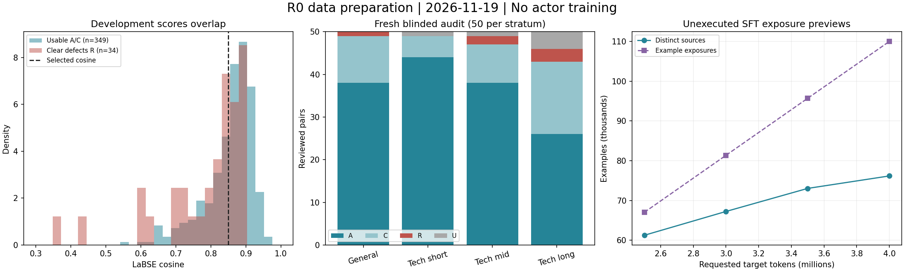

# GPU data filtering and training preparation

2026-11-19 · Europe/Berlin · FILTERING ONLY · 0 ACTOR UPDATES

This phase filters data; it does not train a new R0. The existing Qwen2.5-3B-Instruct A checkpoint is unchanged. Neither SFT nor DAPO was launched. Results are reported before any subsequent training instruction.

| Item | Result |
| --- | --- |
| Status | Ready for SFT preparation |
| Final unique pairs | 100,642 |
| Unique target tokens incl.EOS | 4,748,344 |
| Tokens with source unseen by A | 95.37% |
| Fresh audit | {"A": 146, "C": 42, "R": 6, "U": 6} |
| GPU / Encoder GPU | NVIDIA L4 |
| Allocated GPU minutes | 11.26 |
| Observed CU decrease | 0.2325 |
| Actor updates | 0 |

Data volume can support a meaningful systematic SFT run; it cannot guarantee translation quality or DAPO candidate coverage. A qualified R0 still requires the subsequent fixed independent translation evaluation and G=8 correct-candidate audit.

## Executed steps and scope

| Step | Execution |
| --- | --- |
| 1 | Register a filtering-only protocol and a two-hour allocated-GPU ceiling; no main-model training. |
| 2 | Download the official ParIce21.10 training archive to D, verify MD5 and record SHA256. |
| 3 | Read TMX source/document provenance and repair overbroad document exclusion before GPU allocation, preserving the first version. |
| 4 | Apply encoding, length, number, negation, identifier, drug-name, language and token checks. |
| 5 | Protect true held-out pairs/traceable documents, deduplicate and expand general candidates. |
| 6 | Pin LaBSE, verify the upload bundle and use a separate Colab GPU. |
| 7 | GPU-encode English/Icelandic, record full lengths, reject truncation and compare FP16 with FP32. |
| 8 | Compute bidirectional global exact top4 neighbors/margins and export every pair score. |
| 9 | Calibrate only on the old400dev cases; expansion retains frozen thresholds. |
| 10 | Blind-review200accepted,40rejected and17small-source cases, locking all257labels. |
| 11 | Isolate reviewed cases/documents and clear errors, freeze data and simulate original/revised mixtures separately. |
| 12 | Recount every prompt/target token, verify original A is unchanged and GPUs are released, and save MD/HTML reports. |

The previous P11 two-screen reports and stop decision remain intact. This is a newly authorized GPU filtering phase with new source organization and scoring. No old approval file was fabricated, and the former2% project gate was not treated as a universal SFT law.

## Sources, filtering volume and coverage

The main source is official ParIce21.10 train, using EEA, EMA, ESO, NORDEN, STATISL, TED2020 and Tatoeba, supplemented by existing OpenSubtitles18 general candidates. Official WMT/ParIce dev/test data are not used for training. This is a multi-source training collection, not one official WMT split; no blanket claim about a particular constrained-track resource policy is made.

| Raw source | Records scanned |
| --- | --- |
| eea | 3418465 |
| ema | 405088 |
| eso | 10079 |
| norden | 11441 |
| statisl | 2288 |
| ted2020 | 2392 |
| tatoeba | 9440 |

Additional OpenSubtitles18 raw scan {"UTC": "2026-11-19T11:35:21.822814+00:00", "counts": {"raw": 1569189, "length_ratio": 638890, "known_encoding_OCR": 714183, "sentence_punctuation_mismatch": 38638, "negative_anchor": 1543, "protected_copy_or_group": 15856, "initial_lower": 4513, "metadata": 214, "incomplete_boundary": 7588, "numeric_mismatch_conservative": 2612, "duplicate": 11068, "isolated_letters": 140, "script_control": 13, "LID": 27122, "near_protected": 114}, "rows": 52764, "target_tokens": 937346, "seconds": 77.89938831329346, "sha256": "bb5f0a02e7211802b02e926a1506c210c43cefcf2bdcfd5408b4b245adcd62a9"}

Preparation initially over-excluded documents by treating shared legal boilerplate as document identity evidence. This was repaired before GPU allocation: only uniquely mapped protected sentences trigger full-document exclusion; shared templates still receive pair-level isolation. The initial results and repair record are preserved.

Historical role repair {"UTC": "2026-11-19T11:45:41.639186+00:00", "before_GPU": true, "automatic_pool_sha256": "5a473fbd0adc64c11fbb54a2bd64bdb58dd9a079fbcc7b4e22f4f724da2a12df", "automatic_pool_rows": 17291, "old_holdout_sources": 49367, "new_holdout_sources": 33422, "removed_automatic_only_sources": 17128, "new_extra_review_sources": 1183, "removed_automatic_only_references": 17129, "initial_official_and_legacy_holdout_sources_preserved": 31447, "all_actual_review_cards_preserved": true, "reason": "accepted_pre_review.jsonl is the full automatically filtered candidate pool, not inspected cards or an evaluation set. Confirmed in n8 preparation/post_review scripts; actual32 post_review_cards remain protected. Old P11 reports are preserved, not rewritten."}

accepted_pre_review.jsonl was also identified as a full automatic candidate pool, not actual review cards or an evaluation set. Its historical role was corrected using the producing-code evidence. All prior non-automatic protection entries, official holdouts and actual reviewed cards remain protected. The correction preceded GPU scoring and did not modify old labels or reports.

| Stage | Pairs |
| --- | --- |
| Initial source reservoir, before additional expansion | 177829 |
| Combined candidates, final GPU scoring pass | 220218 |
| Automatic alignment accepted | 108595 |
| Automatic alignment rejected | 111623 |
| Final after audit isolation/document cap | 100642 |

Additional fixed-threshold expansion {"UTC": "2026-11-19T12:01:29.495466+00:00", "added_rows": 65104, "added_target_tokens": 1887305, "added_by_stratum": {"general": 31651, "technical_medium": 8354, "technical_short": 25099}, "combined_rows": 220218, "combined_target_tokens": 8828958, "counts": {"raw_OpenSubtitles18": 1569189, "duplicate_or_protected": 78941, "known_encoding_OCR": 681733, "length_ratio": 109479, "sentence_punctuation_mismatch": 43391, "negative_anchor": 2432, "initial_lower": 13935, "metadata": 480, "incomplete_boundary": 113255, "numeric_mismatch_conservative": 7702, "identifier_guard": 618, "isolated_letters": 2411, "script_control": 764, "raw_eea": 3418465, "glued_word": 65, "missing_legal_citation": 10, "raw_ema": 405088, "drug_anchor": 27, "LID": 48663, "near_protected": 261}, "seconds": 181.12802290916443}

| Stratum | Pairs | Target tokens |
| --- | --- | --- |
| general | 30488 | 523290 |
| technical_short | 23455 | 691395 |
| technical_medium | 41440 | 2760206 |
| technical_long | 5259 | 773453 |

| Subcorpus | Pairs | Target tokens |
| --- | --- | --- |
| OpenSubtitles18 | 26278 | 419248 |
| eea | 9651 | 761600 |
| ema | 59302 | 3384977 |
| eso | 1201 | 78477 |
| statisl | 369 | 19273 |
| tatoeba | 3450 | 68969 |
| ted2020 | 391 | 15800 |

Technical short/mid/long means≤12,13–40,41–120 English words; general is source-classified. EEA/EMA/ESO domain labels are coarse provenance labels and do not prove coverage of every technical field. Target counts use the fixed Qwen tokenizer including EOS, not LaBSE tokens or total input tokens.

Final exclusions: {"reviewed_original_document": 5806, "reviewed_exact_alias": 208, "ambiguous_flattened_scientific_exponent": 43, "explicit_numeric_comparator_disagreement": 15, "explicit_oral_route_unverified": 16, "explicit_intravenous_route_unverified": 3, "clear_target_OCR_token_g\u00f6gning": 1, "clear_target_OCR_token_betta": 6, "document_cap": 0}; source-group types: {"100_adjacent_TMX_records_proxy_NOT_document_ID": 63512, "original_document_ID": 10852, "document_pair": 26278}

## GPU scoring, calibration and limitations

Encoder: sentence-transformers/LaBSE · revision 836121a0533e5664b21c7aacc5d22951f2b8b25b

LaBSE is an auxiliary alignment encoder; the actor remains general-purpose Qwen. Cosine is computed between normalized English/Icelandic embeddings. Ratio margin divides pair similarity by the average of the two directional top4-neighbour means. Search is exact within this scoring candidate/calibration pool, including the paired example; it is not a search over every raw corpus record.

Selected thresholds: {"cosine": 0.85, "margin": 1.02}; fallback=False

Expanded-pool diagnostic with unchanged phase1 thresholds: {"AC_total": 349, "R_total": 34, "AC_retained": 222, "R_retained": 12, "AC_retention": 0.6361031518624641, "R_rejection": 0.6470588235294117, "balanced_accuracy": 0.641580987695938}

Development best grid cell: {"cosine": 0.85, "margin": 1.02, "AC_total": 349, "R_total": 34, "AC_retained": 222, "R_retained": 12, "AC_retention": 0.6361031518624641, "R_rejection": 0.6470588235294117, "balanced_accuracy": 0.641580987695938}

The old400 are development calibration only: A/C usable, R clear defects, U omitted. Selection maximizes balanced accuracy subject to retaining≥60% of A/C. High scores do not guarantee correct numbers, polarity, terminology or completeness; same-topic mistranslations can survive. Fitted development metrics are not independent validation or new-source filtering accuracy.

| Numerical check | Result |
| --- | --- |
| FP16-vs-FP32 max embedding1−cos | 3.5762786865234375e-07 |
| FP16 matrix max absolute error | 0.00030994415283203125 |
| Encoder overlength pairs | 0 |
| Aligned cosine quantiles | [-0.025826962664723396, 0.6129659414291382, 0.8508208394050598, 0.9404279172420501, 0.9906570911407471] |
| Shuffled mismatch cosine quantiles | [-0.01824025623500347, 0.18752069398760796, 0.3513312041759491, 0.5087137222290038, 0.7481249570846558] |
| Peak allocated CUDA GB | 4.607678464 |

## Fresh audit and disposition

Scores were hidden during item review. The accepted pool contributes50 items per stratum,200 total; the rejected pool10 per stratum,40 total, for false-exclusion diagnostics. A=faithful/usable; C=minor wording/style issues with main meaning retained; R=clear mismatch/material omission; U=uncertain. Review is assisted by the same AI assistant, without native-Icelandic expert certification.

| Stratum | n | A/C/R/U |
| --- | --- | --- |
| general | 50 | {"A": 38, "C": 11, "R": 1} |
| technical_short | 50 | {"A": 44, "C": 5, "U": 1} |
| technical_medium | 50 | {"R": 2, "C": 9, "A": 38, "U": 1} |
| technical_long | 50 | {"A": 26, "C": 17, "U": 4, "R": 3} |

Rejected diagnostic40: {"C": 13, "A": 19, "R": 5, "U": 3}

Supplementary small-source coverage audit: {"UTC": "2026-11-19T12:16:26.119997+00:00", "n": 17, "counts": {"C": 7, "A": 7, "R": 3}, "strata": {"general": {"n": 14, "counts": {"C": 4, "A": 7, "R": 3}}, "technical_short": {"n": 0, "counts": {}}, "technical_medium": {"n": 2, "counts": {"C": 2}}, "technical_long": {"n": 1, "counts": {"C": 1}}}, "cards_sha256": "030a50a3ddda23ef4244989c9bdfa85711e81440a0b0e349b9b182c8122eb3c3", "labels_sha256": "6423ca51e4d0f9d7c75283c532d5b259d0e58e0449968a67a13b0f889aabd07a", "scorer_values_hidden_during_review": true, "not_native_certification": true}

This stratified sample is not a simple random sample of the full pool; its unweighted error fraction is not a population noise estimate. Reviewed examples and traceable shared documents are isolated from final training, while original audit errors remain reported. Removing observed defects does not prove zero remaining errors. Good rejected translations are also retained in the audit to show lost useful data.

QA decision: {"UTC": "2026-11-19T12:17:32.862656+00:00", "recommended_for_SFT": true, "excluded_subcorpora": ["norden"], "reason_zh": "Of200new accepted cases,188are A/C, six have clear problems and six need review. A17-case small-source supplement reveals truncated NORDEN titles and merged policy actors. Five NORDEN cases cannot estimate its precise noise rate, but NORDEN is excluded from primary supervision; other sources show no comparable concentration of severe defects. Isolate all reviewed cases/traceable documents plus clear OCR, administration-route, comparator and scientific-notation conflicts. Retain residual-noise and non-native-review limitations.", "reason_en": "Fresh accepted audit:188A/C,6R,6U. Supplementary small-source audit found NORDEN truncated titles and conflation of distinct policy subjects. Its5reviewed items do not estimate a precise source error rate; conservatively leave NORDEN out of primary SFT. No similar concentration of severe defects was established elsewhere. Isolate all reviewed records/traceable documents and quarantine clear OCR, explicit route omissions, comparator conflicts and ambiguous flattened scientific notation. Residual noise and non-native review limits remain.", "postreview_rules_sha256": "26308faf301d8165df9709a00de53ee383ca8b04e45d72b62bb3e8481e5b79a0", "global_quarantine_counts": {"ambiguous_flattened_scientific_exponent": 43, "explicit_numeric_comparator_disagreement": 15, "explicit_oral_route_unverified": 16, "explicit_intravenous_route_unverified": 3, "clear_target_OCR_token_gögning": 1, "clear_target_OCR_token_betta": 6}, "rules_do_not_repair_text": true, "pre_quarantine_audit_labels_unchanged": true, "recommended_exposure_fractions": {"general": 0.25, "technical_short": 0.2, "technical_medium": 0.3, "technical_long": 0.25}, "original_exposure_fractions": {"general": 0.3, "technical_short": 0.15, "technical_medium": 0.3, "technical_long": 0.25}, "mixture_revision_zh": "After removing NORDEN, move five percentage points of general target-token budget to high-quality technical short sentences. General+technical-short remains45%; technical medium/long remains55%. Preserve the original30/15/30/25 preview and disclose its4M-budget shortfall. Recommended25/20/30/25 is an unexecuted training proposal, without relaxed quality thresholds.", "mixture_revision_en": "After excluding NORDEN, shift5percentage points of general target-token exposure to technical short. General+short remains45%, technical mid+long55%. Preserve original30/15/30/25 previews and report their4M gap. Recommended25/20/30/25 is an unexecuted data-availability-driven training proposal, not a relaxed quality threshold.", "evidence_limitations": "Same-assistant AI-assisted review, not native certification. Some R/U technical judgments are contestable. New global rules were motivated by this audit, so this audit is not independent certification of the post-rule pool. Removing known cases cannot establish zero remaining errors."}

Post-review global quarantine {"ambiguous_flattened_scientific_exponent": 43, "explicit_numeric_comparator_disagreement": 15, "explicit_oral_route_unverified": 16, "explicit_intravenous_route_unverified": 3, "clear_target_OCR_token_gögning": 1, "clear_target_OCR_token_betta": 6}

NORDEN is excluded from primary training; clear OCR, explicit route omissions, comparator conflicts and ambiguous scientific notation are separately quarantined without guessed text repair. These rules were motivated by this audit, so the audit is not independent validation of the post-rule pool.

## Is there enough usable training data?

| Mix | Requested | Feasible | Unique sources | Exposures | Repeat | Max source |
| --- | --- | --- | --- | --- | --- | --- |
| Original30/15/30/25 | 2500000 | 2499887 | 57194 | 70580 | 11.9% | 45.2% |
| Original30/15/30/25 | 3000000 | 2999967 | 62280 | 85665 | 17.1% | 45.7% |
| Original30/15/30/25 | 3500000 | 3496527 | 67339 | 100512 | 20.7% | 46.2% |
| Original30/15/30/25 | 4000000 | 3846492 | 72050 | 106153 | 21.9% | 48.2% |
| Recommended25/20/30/25 | 2500000 | 2499917 | 61246 | 67012 | 7.2% | 50.0% |
| Recommended25/20/30/25 | 3000000 | 2999922 | 67236 | 81353 | 12.8% | 50.0% |
| Recommended25/20/30/25 | 3500000 | 3499896 | 73030 | 95691 | 16.9% | 50.0% |
| Recommended25/20/30/25 | 4000000 | 3999856 | 76166 | 109988 | 21.9% | 50.0% |

After excluding NORDEN, the original30/15/30/25 mix lacks general data at4M; that deficit is preserved. The proposal is25%/20%/30%/25%, shifting5percentage points to technical short. General+short remains45%, mid+long55%; at most2visits per pair and about50% per source. This is a pre-training availability revision, without a relaxed quality threshold or any training execution.

Previews distinguish pool size from distinct examples visited. They do not measure training throughput: actual token consumption within8hours still needs training-time measurement. Within-stratum replay can precede traversal of the entire pool; freeze the final schedule before training.

Future SFT should retain A, train a separate branch with target-only CE, select a checkpoint on a fixed development set, and assess DAPO suitability using independent G=8 candidates and key-meaning audits. This phase neither alters the old R0 nor starts training, and it does not repair MetricX reward ranking.

## Isolation, identity and resources

Base: Qwen/Qwen2.5-3B-Instruct · aa8e72537993ba99e69dfaafa59ed015b17504d1; A adapter SHA256: 9acc23c9595ac0b771bf8f21d125d18f3e993c3f449775377262e7ab73020199

Known exact source/reference hashes and retrieved5gram/Jaccard≥.85 protection were reused; recovered original document IDs provide additional isolation. Sources lacking real document IDs, such as EMA/Tatoeba/TED, retain adjacency proxies, not certified document decontamination. Retrieved near-duplicate checks and historical inventories have limitations; complete historical/pretraining decontamination is not claimed.

Resource ledger: {"UTC": "2026-11-19T12:23:47.904649+00:00", "GPU_minutes": 11.262572526931763, "maximum_GPU_hours": 2, "initial_CU": 251.04827779719415, "final_CU": 250.81580857259004, "observed_CU_decrease": 0.23246922460410246, "assigned_runtimes_after": 0, "current_consumption_rate": 0, "actor_updates": 0, "scope": "Filtering only, separately accounted from any later SFT", "all_scores_verified_on_local_and_D": true, "billing_caveat": "Balance decrease is observed account consumption; billing update timing may differ from exact lease time.", "attempts": [{"UTC": "2026-11-19T11:55:01.900108+00:00", "GPU_minutes": 5.10836607615153, "maximum_GPU_hours": 2, "initial_CU": 251.04827779719415, "final_CU": 250.88594847742715, "observed_CU_decrease": 0.1623293197669966, "assigned_runtimes_after": 0, "current_consumption_rate": 0.0, "actor_updates": 0, "scope": "Filtering only, separately accounted from any later SFT", "all_scores_verified_on_local_and_D": true, "billing_caveat": "Balance decrease is observed account consumption; billing update timing may differ from exact lease time."}, {"UTC": "2026-11-19T12:08:52.483543+00:00", "GPU_minutes": 6.154206450780233, "maximum_GPU_hours": 2, "initial_CU": 250.88594847742715, "final_CU": 250.81580857259004, "observed_CU_decrease": 0.07013990483710586, "assigned_runtimes_after": 0, "current_consumption_rate": 0.0, "actor_updates": 0, "scope": "Filtering only, separately accounted from any later SFT", "all_scores_verified_on_local_and_D": true, "billing_caveat": "Balance decrease is observed account consumption; billing update timing may differ from exact lease time."}], "original_GPU_deadline_unchanged": true, "preparation_elapsed_minutes_to_observation": 69.24252685}

Full data verification {"UTC": "2026-11-19T12:24:16.996964+00:00", "checked_unique_rows": 100642, "recomputed_target_tokens": 4748344, "recomputed_prompt_tokens": 6704622, "recomputed_full_tokens": 11452966, "all_pool_source_reference_hashes_recomputed": true, "all_target_and_prompt_token_lengths_recomputed": true, "metadata_repair_did_not_change_text_or_order_or_targets": true, "preview_ids_valid_max_two_visits": true, "parent_A_unchanged": true, "actor_updates": 0, "tokenizer_files_sha256": {"config.json": "eed00b17e22553979d090fa492e587e92885e328914c8e0b0b78f0a0d3576b3b", "merges.txt": "599bab54075088774b1733fde865d5bd747cbcc7a547c5bc12610e874e26f5e3", "tokenizer.json": "c0382117ea329cdf097041132f6d735924b697924d6f6fc3945713e96ce87539", "tokenizer_config.json": "5b5d4f65d0acd3b2d56a35b56d374a36cbc1c8fa5cf3b3febbbfabf22f359583", "vocab.json": "ca10d7e9fb3ed18575dd1e277a2579c16d108e32f27439684afa0e10b1440910"}, "transformers": "5.22.1", "chat_template_sha256": "cd8e9439f0570856fd70470bf8889ebd8b5d1107207f67a5efb46e342330527f"}

Prompt-length metadata repair {"UTC": "2026-11-19T12:21:49.432510+00:00", "cause": "Local Transformers apply_chat_template(tokenize=True) returns BatchEncoding with2keys, not a flat token-ID list; len() counted dictionary keys.", "transformers": "5.22.1", "fix": "Render chat template to text, then explicitly use tokenizer(...)[input_ids]. Recount every candidate prompt; keep source/reference, target lengths, sample order, semantic scores and thresholds unchanged.", "candidate_prompts_recomputed": 220218, "minimum_prompt_tokens": 47, "maximum_prompt_tokens": 268, "actual_length_limit_violations": 0, "patched_producing_code": ["p12_build.py", "p12_build_v2.py", "p12_expand_candidates.py", "p12_expand_general.py", "p12_rebuild_cached.py"], "old_frozen_metadata_preserved": "D:\\deep learning project\\experiments\\r0_gpu_data_filter_2026-11-19\\data\\before_prompt_metadata_API_fix", "actor_updates": 0}

## Artifacts, reproduction and primary sources

| Content | Path |
| --- | --- |
| Protocol | D:\deep learning project\experiments\r0_gpu_data_filter_2026-11-19\protocol.json |
| Final input/source bundle | D:\deep learning project\experiments\r0_gpu_data_filter_2026-11-19\source_bundle_final.zip |
| Encoder pin | D:\deep learning project\experiments\r0_gpu_data_filter_2026-11-19\encoder_pin.json |
| Every final GPU score | D:\deep learning project\runs\r0_gpu_data_filter_2026-11-19\GPU_outputs_final\scores.jsonl |
| Calibration grid | D:\deep learning project\experiments\r0_gpu_data_filter_2026-11-19\calibration.json |
| Frozen train pool | D:\deep learning project\experiments\r0_gpu_data_filter_2026-11-19\data\train_pool.jsonl |
| Exposure previews | D:\deep learning project\experiments\r0_gpu_data_filter_2026-11-19\data\exposure_previews.json |
| QA decisions and all labels | D:\deep learning project\experiments\r0_gpu_data_filter_2026-11-19\QA |
| Frozen manifest | D:\deep learning project\experiments\r0_gpu_data_filter_2026-11-19\data_frozen.json |
| Code | D:\deep learning project\experiments\r0_gpu_data_filter_2026-11-19\execution_tools |
| Original A | D:\deep learning project\runs\r0_3b_overnight_2026-11-18\final_selected_adapter |

Next SFT data handoff: D:\deep learning project\experiments\r0_gpu_data_filter_2026-11-19\NEXT_SFT_DATA_HANDOFF_2026-11-19.md

[Official ParIce21.10 training release](https://repository.clarin.is/repository/xmlui/handle/20.500.12537/145) · CC BY4.0 · Steinþór Steingrímsson and Starkaður Barkarson. Source archive: 160ace03532e5aa5b96f77d27e09de1852ffa9721b71e7fa7d2885bcea75b9dc

[LaBSE official model card](https://huggingface.co/sentence-transformers/LaBSE) and [LaBSE paper](https://aclanthology.org/2022.acl-long.62/) support the auxiliary bilingual encoder choice; [margin-based corpus mining](https://aclanthology.org/P19-1309/) motivates the neighbourhood ratio. These sources do not validate our specific thresholds or guarantee Icelandic factual fidelity.

## Complete item-level audit

fresh200 #0 · A · general · OpenSubtitles18

ID: OpenSubtitles18:759184

English: Now, then, where's the ruby, Rita?

Icelandic reference: Jæja, hvar er rúbíninn, Ríta?

Review

fresh200 #1 · A · general · OpenSubtitles18

ID: OpenSubtitles18:1541787

English: You do realize that.

Icelandic reference: Þú áttar þig á því.

Review

fresh200 #2 · A · general · OpenSubtitles18

ID: OpenSubtitles18:46969

English: You want to give it to me?

Icelandic reference: Viltu láta mig hafa hana?

Review

fresh200 #3 · A · general · OpenSubtitles18

ID: OpenSubtitles18:1256890

English: Schmidt yelled at me earlier.

Icelandic reference: Schmidt öskraði á mig áðan.

Review

fresh200 #4 · A · general · OpenSubtitles18

ID: OpenSubtitles18:1568000

English: You're still in there, aren't you?

Icelandic reference: Þú ert enn þarna inni, er það ekki?

Review

fresh200 #5 · A · general · OpenSubtitles18

ID: OpenSubtitles18:707459

English: Who is she, anyway?

Icelandic reference: Hver er hún eiginlega?

Review

fresh200 #6 · A · general · OpenSubtitles18

ID: OpenSubtitles18:908930

English: - What kind of species?

Icelandic reference: - Hvers konar tegund?

Review

fresh200 #7 · A · general · OpenSubtitles18

ID: OpenSubtitles18:85869

English: Still you're here in Dodson.

Icelandic reference: Samt ertu hér í Dodson.

Review

fresh200 #8 · A · general · OpenSubtitles18

ID: OpenSubtitles18:119235

English: Rich girls don't marry poor boys!

Icelandic reference: Ríkar stelpur giftast ekki fátækum strákum!

Review

fresh200 #9 · C · general · OpenSubtitles18

ID: OpenSubtitles18:868185

English: Well, I'm rooming with her old roommate, Magenta Hart.

Icelandic reference: Ég er hjá gömlum herbergis- félaga hennar, Magentu Hart.

Review

fresh200 #10 · C · general · OpenSubtitles18

ID: OpenSubtitles18:347837

English: Why did you not say before?

Icelandic reference: -Því sagðirðu það ekki fyrr?

Review

fresh200 #11 · A · general · OpenSubtitles18

ID: OpenSubtitles18:1556459

English: It's the only life I know.

Icelandic reference: Það er eina lífið sem ég þekki.

Review

fresh200 #12 · C · general · OpenSubtitles18

ID: OpenSubtitles18:1480883

English: And my dear nephew, Henry Nobley.

Icelandic reference: Og kær frændi minn, Henry Nobley.

Review

fresh200 #13 · A · general · OpenSubtitles18

ID: OpenSubtitles18:1566787

English: You have secured a great victory for your cause today.

Icelandic reference: Þú hefur tryggt málstað þínum mikinn sigur í dag.

Review

fresh200 #14 · A · general · OpenSubtitles18

ID: OpenSubtitles18:213084

English: - Did you see that?

Icelandic reference: - Sástu þetta?

Review

fresh200 #15 · C · general · OpenSubtitles18

ID: OpenSubtitles18:544859

English: -What did I do to your feelings?

Icelandic reference: -Hvað gerði ég tilfinningum þínum?

Review

fresh200 #16 · A · general · OpenSubtitles18

ID: OpenSubtitles18:1445758

English: Who the hell is Daryl Gates?

Icelandic reference: Hver í fjandanum er Daryl Gates?

Review

fresh200 #17 · A · general · OpenSubtitles18

ID: OpenSubtitles18:723408

English: - I don't know what he looks like.

Icelandic reference: Ég veit ekki hvernig hann lítur út.

Review

fresh200 #18 · C · general · OpenSubtitles18

ID: OpenSubtitles18:1255971

English: We're gonna get on the floor.

Icelandic reference: Við ætlum niður á gólf.

Review

fresh200 #19 · A · general · OpenSubtitles18

ID: OpenSubtitles18:365693

English: - You weren't that sick after all.

Icelandic reference: - Svo veikur varstu nú ekki.

Review

fresh200 #20 · A · general · tatoeba

ID: ParIce21:tatoeba:2593

English: Takeshi hopes to go to London to study English.

Icelandic reference: Takeshi vonast til að fara til London til að læra ensku.

Review

fresh200 #21 · A · general · OpenSubtitles18

ID: OpenSubtitles18:778601

English: You ain't gonna talk to me?

Icelandic reference: Ætlarðu ekki að tala við mig?

Review

fresh200 #22 · C · general · OpenSubtitles18

ID: OpenSubtitles18:1243627

English: What about this boyfriend...

Icelandic reference: Hvað um þennan kærasta...

Review

fresh200 #23 · A · general · tatoeba

ID: ParIce21:tatoeba:5398

English: It is no wonder that she was given the prize.

Icelandic reference: Það er engin furða að hún hafi fengið verðlaunin.

Review

fresh200 #24 · A · general · tatoeba

ID: ParIce21:tatoeba:7259

English: I did not know this.

Icelandic reference: Þetta vissi ég ekki.

Review

fresh200 #25 · A · general · OpenSubtitles18

ID: OpenSubtitles18:1259526

English: We must protect the children.

Icelandic reference: Við verðum að vernda börnin.

Review

fresh200 #26 · C · general · OpenSubtitles18

ID: OpenSubtitles18:494884

English: She's the other half of me.

Icelandic reference: Hún er helmingurinn af mér.

Review

fresh200 #27 · A · general · OpenSubtitles18

ID: OpenSubtitles18:637157

English: Why do you believe you must do anything?

Icelandic reference: Því heldurðu að þú þurfir að gera nokkuð?

Review

fresh200 #28 · A · general · OpenSubtitles18

ID: OpenSubtitles18:1261361

English: -No, it is locked.

Icelandic reference: Nei, hún er læst.

Review

fresh200 #29 · A · general · OpenSubtitles18

ID: OpenSubtitles18:1255303

English: - Maybe we should get you out of here.

Icelandic reference: - Kannski ættum við að koma þér héðan.

Review

fresh200 #30 · A · general · OpenSubtitles18

ID: OpenSubtitles18:1254797

English: - I told you to water the plants.

Icelandic reference: Ég sagði þér að vökva plönturnar.

Review

fresh200 #31 · A · general · norden

ID: ParIce21:norden:7324

English: The deadline for nominations is Wednesday 13 May.

Icelandic reference: Tilnefningarfrestur er til miðvikudagsins 13. maí.

Review

fresh200 #32 · C · general · OpenSubtitles18

ID: OpenSubtitles18:1433514

English: These are Rhosgobel rabbits.

Icelandic reference: Þetta eru kanínur Rhosgobel.

Review

fresh200 #33 · A · general · OpenSubtitles18

ID: OpenSubtitles18:996938

English: She is with Eywa now.

Icelandic reference: Nú er hún hjá Eywu.

Review

fresh200 #34 · C · general · OpenSubtitles18

ID: OpenSubtitles18:853595

English: In England, it rains 200 days out of the year.

Icelandic reference: Á Englandi, rignir 200 daga á ári.

Review

fresh200 #35 · A · general · OpenSubtitles18

ID: OpenSubtitles18:413544

English: I'm going away for a while.

Icelandic reference: Ég ætla burtu um hríð.

Review

fresh200 #36 · A · general · OpenSubtitles18

ID: OpenSubtitles18:394279

English: I don't want to take any chances.

Icelandic reference: Ég vil ekki taka neina áhættu.

Review

fresh200 #37 · A · general · OpenSubtitles18

ID: OpenSubtitles18:1568232

English: Getting to hell is easy.

Icelandic reference: Það er auðvelt að komast til helvítis.

Review

fresh200 #38 · A · general · OpenSubtitles18

ID: OpenSubtitles18:42083

English: She's not dead at all.

Icelandic reference: Hún er alls ekki dáin.

Review

fresh200 #39 · A · general · OpenSubtitles18

ID: OpenSubtitles18:660754

English: - Don't listen to Ben.

Icelandic reference: Ekki hlusta á Ben.

Review

fresh200 #40 · A · general · OpenSubtitles18

ID: OpenSubtitles18:872975

English: I signed up on Dettifoss.

Icelandic reference: Ég er búinn að ráða mig á Dettifoss.

Review

fresh200 #41 · R · general · OpenSubtitles18

ID: OpenSubtitles18:139206

English: - It's me, Charles.

Icelandic reference: - Betta er ég, Charles.

Review

fresh200 #42 · A · general · tatoeba

ID: ParIce21:tatoeba:6291

English: He is guilty of theft.

Icelandic reference: Hann er sekur um þjófnað.

Review

fresh200 #43 · C · general · OpenSubtitles18

ID: OpenSubtitles18:214274

English: No, you go with them.

Icelandic reference: Nei, þú verð með þeim.

Review

fresh200 #44 · C · general · OpenSubtitles18

ID: OpenSubtitles18:1543127

English: They don't even want you in the room.

Icelandic reference: Þeir vilja þig ekki inn í salinn.

Review

fresh200 #45 · A · general · OpenSubtitles18

ID: OpenSubtitles18:1269301

English: I need a volunteer.

Icelandic reference: Mig vantar sjálfboðaliða.

Review

fresh200 #46 · A · general · OpenSubtitles18

ID: OpenSubtitles18:365751

English: I don't know what I was thinking.

Icelandic reference: Ég veit ekki hvað ég var að hugsa.

Review

fresh200 #47 · A · general · tatoeba

ID: ParIce21:tatoeba:5417

English: The sound woke her up.

Icelandic reference: Hljóðið vakti hana.

Review

fresh200 #48 · A · general · OpenSubtitles18

ID: OpenSubtitles18:175473

English: The merchants are in the north.

Icelandic reference: Kaupmenn eru fyrir norðan.

Review

fresh200 #49 · A · general · OpenSubtitles18

ID: OpenSubtitles18:1567899

English: What is this, Bernard?

Icelandic reference: Hvað er þetta, Bernard?

Review

fresh200 #50 · A · technical_short · ema

ID: ParIce21:ema:191445

English: Insert the needle into the skin.

Icelandic reference: Stingdu nálinni í húðina.

Review

fresh200 #51 · A · technical_short · ema

ID: ParIce21:ema:374418

English: This medicine contains 0.5 mmol potassium per vial.

Icelandic reference: Lyfið inniheldur 0,5 mmól af kalíum í hverju hettuglasi.

Review

fresh200 #52 · A · technical_short · ema

ID: ParIce21:ema:28879

English: All patients were followed for 24 weeks post-treatment.

Icelandic reference: Öllum sjúklingum var fylgt eftir í 24 vikur eftir að meðferð lauk.

Review

fresh200 #53 · C · technical_short · eea

ID: ParIce21:eea:2949258

English: Unauthorised disclosure can result in disciplinary sanctions, criminal investigations and punishment.

Icelandic reference: Óheimil birting upplýsinga getur leitt til viðurlaga, sakamálarannsókna og refsingar.

Review

fresh200 #54 · A · technical_short · ema

ID: ParIce21:ema:88425

English: Dexamethasone induces CYP3A4 and may decrease saquinavir concentrations.

Icelandic reference: Dexametasón virkjar CYP3A4 og getur dregið úr styrk saquinavír.

Review

fresh200 #55 · A · technical_short · ema

ID: ParIce21:ema:364308

English: These symptoms generally respond to treatment with antihistamines and/or corticosteroids.

Icelandic reference: Þessi einkenni svara yfirleitt meðferð með andhistamínlyfjum og/eða barksterum.

Review

fresh200 #56 · C · technical_short · eea

ID: ParIce21:eea:1092059

English: The heating can always be restarted.

Icelandic reference: Alltaf er hægt a endurræsa hitarann.

Review

fresh200 #57 · A · technical_short · ema

ID: ParIce21:ema:193251

English: Insulin administration may cause anti-insulin antibodies to form.

Icelandic reference: Notkun insúlíns getur valdið því að and-insúlín mótefni myndist.

Review

fresh200 #58 · A · technical_short · eea

ID: ParIce21:eea:524953

English: The Commission shall inform the other Member States of such authorizations.

Icelandic reference: Framkvæmdastjórnin tilkynnir hinum aðildarríkjunum um slíkar leyfisveitingar.

Review

fresh200 #59 · A · technical_short · ema

ID: ParIce21:ema:105730

English: Each film-coated tablet contains 5 mg vortioxetine (as hydrobromide).

Icelandic reference: Hver filmuhúðuð tafla inniheldur 5 mg af vortioxetíni (sem hýdróbrómið).

Review

fresh200 #60 · A · technical_short · ema

ID: ParIce21:ema:383523

English: Treatment with imatinib may then be continued at a reduced daily dose.

Icelandic reference: Þá má halda meðferð með imatinib áfram með minni sólarhringsskömmtum.

Review

fresh200 #61 · A · technical_short · eea

ID: ParIce21:eea:3039220

English: It shall apply from 19 December 2009.

Icelandic reference: Hún kemur til framkvæmda frá og með 19. desember 2009.

Review

fresh200 #62 · A · technical_short · ema

ID: ParIce21:ema:333309

English: The following dosage regimens are given as a guideline.

Icelandic reference: Eftirfarandi skammtaáætlanir eru settar fram til leiðbeiningar.

Review

fresh200 #63 · A · technical_short · ema

ID: ParIce21:ema:193628

English: Insulin Human Winthrop Rapid is administered subcutaneously.

Icelandic reference: Insulin Human Winthrop Rapid er gefið undir húð.

Review

fresh200 #64 · A · technical_short · ema

ID: ParIce21:ema:71098

English: Close the bottle with the plastic screw cap after every usage.

Icelandic reference: Lokið flöskunni með plastskrúftappanum eftir hverja notkun.

Review

fresh200 #65 · A · technical_short · ema

ID: ParIce21:ema:105199

English: Each dose will last for 10 minutes.

Icelandic reference: Hver skammtur endist í 10 mínútur.

Review

fresh200 #66 · A · technical_short · ema

ID: ParIce21:ema:287165

English: Reslizumab has a long half-life (see section 5.2).

Icelandic reference: Reslizumab hefur langan helmingunartíma (sjá kafla 5.2).

Review

fresh200 #67 · A · technical_short · ema

ID: ParIce21:ema:385760

English: Type 2 diabetes is also called non-insulin-dependent diabetes mellitus, or NIDDM.

Icelandic reference: Sykursýki af tegund 2 er einnig kölluð insúlínóháð sykursýki eða NIDDM (non-insulin-dependent diabetes mellitus).

Review

fresh200 #68 · A · technical_short · ema

ID: ParIce21:ema:235123

English: No dose adjustment is recommended.

Icelandic reference: Ekki er mælt með skammtaaðlögun.

Review

fresh200 #69 · A · technical_short · ema

ID: ParIce21:ema:108722

English: Each titration step (dose strength) should be evaluated in several episodes.

Icelandic reference: Hvert skref í stillingu skammts (styrkleika skammts) ætti að meta í nokkrum köstum.

Review

fresh200 #70 · A · technical_short · ema

ID: ParIce21:ema:397724

English: Weight gain has been seen in patients taking Olanzapine Teva.

Icelandic reference: Þyngdaraukning hefur sést hjá sjúklingum sem taka Olanzapine Teva.

Review

fresh200 #71 · A · technical_short · eea

ID: ParIce21:eea:2496882

English: If the answer to 1.9.6 is ‘No’, please state the reasons why.

Icelandic reference: Ef svarið við lið 1.9.6 er „nei“ ber að greina frá ástæðum þess.

Review

fresh200 #72 · A · technical_short · ema

ID: ParIce21:ema:151396

English: Hydrochlorothiazide is not metabolised in man.

Icelandic reference: Hýdróklórtíazíð umbrotnar ekki hjá mönnum.

Review

fresh200 #73 · A · technical_short · ema

ID: ParIce21:ema:363442

English: These medicines are used to treat serious fungal infections.

Icelandic reference: Slík lyf eru notuð til meðferðar við alvarlegum sveppasýkingum.

Review

fresh200 #74 · A · technical_short · ema

ID: ParIce21:ema:396694

English: Wait and take or give the next dose at its regular time.

Icelandic reference: Bíddu og taktu eða gefðu næsta skammt á réttum tíma.

Review

fresh200 #75 · C · technical_short · ema

ID: ParIce21:ema:222319

English: Medicines for Parkinson’s disease (such as levodopa).

Icelandic reference: Lyf við Parkinsons sjúkdómnum (eins og levodópa).

Review

fresh200 #76 · A · technical_short · ema

ID: ParIce21:ema:57890

English: Breast-feeding should be discontinued during treatment with Unituxin.

Icelandic reference: Hætta skal brjóstagjöf meðan á meðferð með Unituxin stendur.

Review

fresh200 #77 · U · technical_short · ema

ID: ParIce21:ema:367341

English: The total plasma clearance after single intravenous administration is about 917 l/min.

Icelandic reference: Heildarplasmaúthreinsun eftir staka gjöf í bláæð er um 917 l/mín.

Review: Source/reference both state917L/min. Alignment is faithful, but the unusually large clearance may reflect shared upstream numeric corruption; the original regulatory source is needed to certify it.

fresh200 #78 · A · technical_short · ema

ID: ParIce21:ema:232710

English: NexGard tablets are chewable and palatable to most dogs.

Icelandic reference: NexGard töflur eru tyggjanlegar og geðjast flestum hundum að bragðinu.

Review

fresh200 #79 · A · technical_short · ema

ID: ParIce21:ema:105280

English: Each film-coated tablet contains 103.3 mg lactose.

Icelandic reference: Hver filmuhúðuð tafla inniheldur 103,3 mg laktósa.

Review

fresh200 #80 · C · technical_short · ema

ID: ParIce21:ema:356576

English: There is no clinical experience with use of Toujeo in pregnant women.

Icelandic reference: Klínísk reynsla af notkun á meðgöngu Toujeo er ekki fyrir hendi.

Review

fresh200 #81 · A · technical_short · ema

ID: ParIce21:ema:142383

English: Hence it reduces the amount of acid in your stomach.

Icelandic reference: Þannig dregur það úr magni sýru í maganum.

Review

fresh200 #82 · A · technical_short · ema

ID: ParIce21:ema:193122

English: In such cases doubling of the daily dose may be necessary.

Icelandic reference: Í þeim tilvikum getur verið nauðsynlegt að tvöfalda dagsskammtinn.

Review

fresh200 #83 · A · technical_short · ema

ID: ParIce21:ema:173204

English: Immediate hypersensitivity reactions have been reported after administration of Enurev Breezhaler.

Icelandic reference: Greint hefur verið frá bráðum ofnæmisviðbrögðum eftir notkun Enurev Breezhaler.

Review

fresh200 #84 · A · technical_short · eea

ID: ParIce21:eea:2489879

English: Implementing Regulation (EU) 2016/329 should therefore be amended accordingly.

Icelandic reference: Því ætti að breyta framkvæmdarreglugerð (ESB) 2016/329 til samræmis við það.

Review

fresh200 #85 · A · technical_short · ema

ID: ParIce21:ema:107062

English: Each pack contains one vial with 10 ml of concentrate.

Icelandic reference: Hver pakkning inniheldur eitt hettuglas með 10 ml af þykkni.

Review

fresh200 #86 · A · technical_short · ema

ID: ParIce21:ema:390697

English: Use within 2 months.

Icelandic reference: Notist innan 2 mánaða.

Review

fresh200 #87 · A · technical_short · ema

ID: ParIce21:ema:244846

English: One mL of emulsion contains 1 mg of ciclosporin.

Icelandic reference: Einn ml af fleyti inniheldur 1 mg af cíklósporíni (ciclosporin).

Review

fresh200 #88 · A · technical_short · ema

ID: ParIce21:ema:132097

English: For storage information, please refer to Section 5 ‘How to store VFEND’.

Icelandic reference: Leiðbeiningar um geymslu, sjá kafla 5 Hvernig geyma á VFEND.

Review

fresh200 #89 · A · technical_short · ema

ID: ParIce21:ema:80378

English: Contraindicated due to an increased bleeding risk (see section 4.3).

Icelandic reference: Má ekki nota vegna aukinnar blæðingarhættu (sjá kafla 4.3).

Review

fresh200 #90 · A · technical_short · ema

ID: ParIce21:ema:327691

English: The corresponding difference at the 1000 mg twice-daily dose was 25%.

Icelandic reference: Samsvarandi mismunur við notkun á 1000 mg tvisvar á dag var 25%.

Review

fresh200 #91 · A · technical_short · ema

ID: ParIce21:ema:309840

English: Survival of foetuses and offspring was reduced.

Icelandic reference: Lífslíkur fósturs og afkvæma minnkuðu.

Review

fresh200 #92 · C · technical_short · ema

ID: ParIce21:ema:344634

English: The other side of the tablet is debossed with the number "7459".

Icelandic reference: Í hina hliðina er grafið númerið „7459“.

Review

fresh200 #93 · A · technical_short · ema

ID: ParIce21:ema:108727

English: Each transdermal patch contains 36 mg of oxybutynin.

Icelandic reference: Hver forðaplástur inniheldur 36 mg oxybutynins.

Review

fresh200 #94 · A · technical_short · ema

ID: ParIce21:ema:387861

English: Under no circumstances should Humalog Mix25 be given intravenously.

Icelandic reference: Humalog Mix25 má ekki undir neinum kringumstæðum sprauta í æð.

Review

fresh200 #95 · A · technical_short · ema

ID: ParIce21:ema:86830

English: Deltyba 50 mg film-coated tablets are round, and yellow.

Icelandic reference: Deltyba 50 mg filmuhúðaðar töflur eru kringlóttar og gular.

Review

fresh200 #96 · A · technical_short · ema

ID: ParIce21:ema:333719

English: The following risk factors are associated with an increased risk of PML.

Icelandic reference: Eftirtaldir áhættuþættir tengjast aukinni hættu á PML-heilabólgu.

Review

fresh200 #97 · A · technical_short · eso

ID: ParIce21:eso:6778

English: This is the most detailed picture of this object ever taken.

Icelandic reference: Þetta er nákvæmasta mynd sem tekin hefur verið af þessu fyrirbæri.

Review

fresh200 #98 · A · technical_short · ema

ID: ParIce21:ema:25848

English: After taking your tablet, wait at least 30 minutes.

Icelandic reference: Eftir að þú hefur tekið töfluna skaltu bíða í að minnsta kosti 30 mínútur.

Review

fresh200 #99 · A · technical_short · ema

ID: ParIce21:ema:262691

English: Peel the paper off of the tray.

Icelandic reference: Fjarlægðu pappírinn af bakkanum.

Review

fresh200 #100 · R · technical_medium · ema

ID: ParIce21:ema:182263

English: Increases of approximately 10% in the QT interval of the ECG were observed in a study on healthy beagle dogs administered 8 mg/kg orally; however, such an increase is unlikely to be of clinical significance.

Icelandic reference: Vart varð við um 10 % aukningu á QT bili á hjartarafriti (ECG) í rannsókn á heilbrigðum hundum af beagle kyni sem fengu 8 mg/kg, en ekki er líklegt að slík aukning hafi klíníska þýðingu.

Review

fresh200 #101 · C · technical_medium · ema

ID: ParIce21:ema:270015

English: Population pharmacokinetic analysis indicated that oral antidiabetics, diuretics, insulin, phenobarbital, tiagabine and topiramate had no clinically significant effect on pregabalin clearance.

Icelandic reference: Þýðisgreining á lyfjahvörfum bentu til þess að sykursýkilyf til inntöku, þvagræsilyf, insúlín, fenóbarbital, tíagabín og tópíramat hefðu engin klínískt marktæk áhrif á úthreinsun pregabalíns.

Review

fresh200 #102 · A · technical_medium · ema

ID: ParIce21:ema:169963

English: If your dose is 100 mg, you will get two 50 mg pre-filled pens and you will need to give yourself two injections.

Icelandic reference: Ef skammturinn sem þú átt að fá er 100 mg, muntu fá tvo 50 mg áfyllta lyfjapenna og þú munt þurfa að gefa þér tvær inndælingar.

Review

fresh200 #103 · A · technical_medium · ema

ID: ParIce21:ema:373023

English: This is to check that you are being given the right amount of this medicine.

Icelandic reference: Þetta er til þess að tryggja að þú sért að fá réttan skammt af lyfinu.

Review

fresh200 #104 · A · technical_medium · ema

ID: ParIce21:ema:349895

English: There are limited data available about the use of Cyramza in patients with severely impaired kidney function.

Icelandic reference: Takmarkaðar upplýsingar liggja fyrir um notkun Cyramza hjá sjúklingum með alvarlega skerta nýrnastarfsemi.

Review

fresh200 #105 · A · technical_medium · eea

ID: ParIce21:eea:111657

English: All main fields and statistical themes of the Community statistical programme 2008 to 2012 shall be considered to be relevant for the EEA statistical cooperation and shall be open for full participation by the EFTA States.

Icelandic reference: Öll meginsvið og hagskýrsluefnissvið í hagskýrsluáætlun bandalagsins 2008 til 2012 teljast skipta máli fyrir hagskýrslusamstarf EES og geta EFTA-ríkin tekið fullan þátt í þeim.

Review

fresh200 #106 · A · technical_medium · ema

ID: ParIce21:ema:332808

English: The first 77 patients were started at 400 mg, the protocol was subsequently amended to allow higher dosing and the remaining 158 patients were started at 600 mg.

Icelandic reference: Fyrstu 77 sjúklingarnir byrjuðu á 400 mg, síðan var rannsóknaráætlun breytt til að leyfa stærri skammta og þeir 158 sjúklingar sem eftir voru byrjuðu á 600 mg.

Review

fresh200 #107 · A · technical_medium · ema

ID: ParIce21:ema:205658

English: It is suggested that the initial administrations of factor IX should, according to the treating physician’s judgment, be performed under medical observation where proper medical care for allergic reactions could be provided.

Icelandic reference: Ráðlagt er að gefa fyrstu skammta af storkuþætti IX undir eftirliti læknis og við aðstæður þar sem hægt er að beita viðeigandi meðferð við ofnæmisviðbrögðum samkvæmt mati þess læknis sem veitir meðferðina.

Review

fresh200 #108 · R · technical_medium · ema

ID: ParIce21:ema:331897

English: The European Medicines Agency has waived the obligation to conduct studies with ZALTRAP in all subsets of the paediatric population in adenocarcinoma of the colon and rectum (see section 4.2 for information on paediatric use).

Icelandic reference: Lyfjastofnun Evrópu hefur fallið frá kröfum um að lagðar verði fram niðurstöður úr rannsóknum á ZALTRAP hjá öllum undirhópum barna með kirtilkrabbamein í ristli og endaþarmi (sjá upplýsingar í kafla 4.2 um notkun handa börnum).

Review

fresh200 #109 · A · technical_medium · ema

ID: ParIce21:ema:359331

English: There were no reports of severe (Grade 3 or 4) AST or ALT elevation.

Icelandic reference: Ekki var greint frá neinum verulegum (3. eða 4. stigs) hækkunum á AST eða ALT.

Review

fresh200 #110 · A · technical_medium · ema

ID: ParIce21:ema:360039

English: The safety and efficacy of Bronchitol in children aged less than 6 years has not been established.

Icelandic reference: Ekki hefur verið sýnt fram á öryggi og verkun Bronchitol hjá börnum yngri en 6 ára.

Review

fresh200 #111 · A · technical_medium · ema

ID: ParIce21:ema:340872

English: The metabolism of valdecoxib may increase when co-administered with enzyme inducers such as rifampicin, phenytoin, carbamazepine or dexamethasone.

Icelandic reference: Vera má að umbrot valdecoxibs aukist við samtímis notkun ensímhvetjandi lyfja, til dæmis rifampicins, phenytoins, carbamazepins og dexamethasons.

Review

fresh200 #112 · A · technical_medium · ema

ID: ParIce21:ema:373073

English: This is unlikely to present a problem with occasional use, but if long-term concurrent treatment with a potent UGT2B7 inhibitor is initiated, a potential for an increase in nalmefene exposure cannot be excluded (see section 4.4).

Icelandic reference: Ólíklegt er að þetta valdi vandræðum við notkun endrum og eins, en þegar langtíma samtímis meðferð með öflugum UGT2B7 hemli er hafin, er ekki hægt að útiloka aukningu á útsetningu fyrir nalmefeni (sjá kafla 4.4).

Review

fresh200 #113 · A · technical_medium · ema

ID: ParIce21:ema:107405

English: Each pre-filled syringe contains 150 micrograms of corifollitropin alfa in 0.5 mL solution for injection.

Icelandic reference: Hver áfyllt sprauta inniheldur 150 míkróg corifollitrópín alfa í 0,5 ml stungulyfi, lausn.

Review

fresh200 #114 · C · technical_medium · ema

ID: ParIce21:ema:166521

English: If you have any questions about how Imatinib Accord works or why this medicine has been prescribed for you, ask your doctor.

Icelandic reference: Ef þú hefur einhverjar spurningar um hvernig Imatinib Accord verkar eða hvers vegna þessu lyfi hefur verið ávísað skal leita til læknisins.

Review

fresh200 #115 · U · technical_medium · eea

ID: ParIce21:eea:3273959

English: Before August 1996, the identification system for cattle in the United Kingdom was insufficient to allow reliable tracing of animals and accurate identification of cohorts of BSE-positive cases.

Icelandic reference: Fyrir ágúst 1996 var auðkenningarkerfi fyrir nautgripi í Breska konungsríkinu ófullnægjandi til að rekja dýr á áreiðanlegan hátt og auðkenna nákvæmlega aldurshópa dýra sem hafa greinst með riðuveiki.

Review

fresh200 #116 · A · technical_medium · ema

ID: ParIce21:ema:311326

English: Syncope and retinopathy have been reported in some patients taking INCIVO and should be considered when assessing a patient’s ability to drive or operate machines.

Icelandic reference: Greint hefur verið frá yfirliði og sjónukvilla hjá sumum sjúklingum á meðferð með INCIVO og það verður að hafa í huga þegar hæfni sjúklings til aksturs og notkunar véla er metin.

Review

fresh200 #117 · A · technical_medium · ema

ID: ParIce21:ema:146436

English: However it is not clear whether these cases were due to the antiretroviral treatment or to the underlying HIV disease.

Icelandic reference: Hins vegar er ekki ljóst hvort þessi tilfelli stöfuðu af retróveirulyfjameðferðinni eða undirliggjandi HIV-sjúkdómi.

Review

fresh200 #118 · A · technical_medium · ema

ID: ParIce21:ema:368570

English: The use of sevoflurane with nondepolarising muscle relaxants has not been evaluated in dogs.

Icelandic reference: Notkun sevoflurans með vöðvaslakandi lyfjum, sem ekki valda afskautun (nondepolarizing), hefur ekki verið metin hjá hundum.

Review

fresh200 #119 · A · technical_medium · ema

ID: ParIce21:ema:155340

English: If Apidra is mixed with NPH human insulin, Apidra should be drawn into the syringe first.

Icelandic reference: Ef blanda á Apidra með NPH mannainsúlíni á að draga Apidra fyrst upp í sprautuna.

Review

fresh200 #120 · A · technical_medium · ema

ID: ParIce21:ema:277517

English: Pull back on the pink safety cover toward the syringe and away from the needle.

Icelandic reference: Togið bleiku öryggishlífina aftur á bak í átt að sprautunni og frá nálinni.

Review

fresh200 #121 · A · technical_medium · eea

ID: ParIce21:eea:31345

English: An EFTA State may request the Authority to issue a scientific opinion on matters falling within its mission.

Icelandic reference: EFTA-ríki er heimilt að fara fram á vísindaálit stofnunarinnar á atriðum sem falla undir starfsvið hennar.

Review

fresh200 #122 · C · technical_medium · ema

ID: ParIce21:ema:169848

English: If your doctor considers treatment with methotrexate absolutely necessary during the lactation period, you must stop breast-feeding.

Icelandic reference: Ef læknirinn telur að meðferð með metótrexati sé nauðsynleg meðan á brjóstagjafartímabilinu stendur, þarft þú að hætta brjóstagjöf.

Review

fresh200 #123 · A · technical_medium · ema

ID: ParIce21:ema:334496

English: The frequency of the clinical trial adverse reactions reported in excess of placebo and other undesirable effects reported during the post-marketing period are listed in the following table.

Icelandic reference: Tíðni aukaverkana sem oftar var greint frá en fyrir lyfleysu í klínískum rannsóknum og aðrar aukaverkanir sem greint hefur verið frá eftir markaðssetningu eru taldar upp í eftirfarandi töflu.

Review

fresh200 #124 · C · technical_medium · ema

ID: ParIce21:ema:88351

English: Development studies in rats and rabbits have shown no evidence of foetal malformations or changes to fertility.

Icelandic reference: Þroskarannsóknir í rottum og kanínum benda ekki til neinna vanskapandi áhrifa eða breytinga á frjósemi.

Review

fresh200 #125 · A · technical_medium · eea

ID: ParIce21:eea:2335718

English: The text of Regulation (EU) No 195/2013 in the Icelandic and Norwegian languages, to be published in the EEA Supplement to the Official Journal of the European Union, shall be authentic.

Icelandic reference: Íslenskur og norskur texti reglugerðar (ESB) 195/2013, sem verður birtur í EES-viðbæti við Stjórnartíðindi Evrópusambandsins, telst fullgiltur.

Review

fresh200 #126 · A · technical_medium · ema

ID: ParIce21:ema:91330

English: Dispose of a used pen after 30 days, even if some medicine remains in the pen.

Icelandic reference: Fargið notuðum lyfjapenna eftir 30 daga, jafnvel þó eitthvert lyf sé eftir í lyfjapennanum.

Review

fresh200 #127 · A · technical_medium · ema

ID: ParIce21:ema:42262

English: A small amount of the ingredients in Triumeq can also pass into your breast milk.

Icelandic reference: Lítið magn af innihaldsefnum Triumeq getur einnig borist í brjóstamjólkina.

Review

fresh200 #128 · A · technical_medium · ema

ID: ParIce21:ema:167942

English: If you have Niemann-Pick type C disease, fats such as glycosphingolipids build up in the cells of your brain.

Icelandic reference: Ef þú ert með Niemann-Pick sjúkdóm af tegund C, safnast fita svo sem glýkóspingólípíð upp í frumum í heilanum.

Review

fresh200 #129 · A · technical_medium · eea

ID: ParIce21:eea:3273296

English: The national provisions are general and apply to the uses of SCCPs regardless of whether the substances are manufactured in the Netherlands or are imported from other Member States.

Icelandic reference: Innlendu ákvæðin eru almenn og gilda um notkun keðjustuttra, klóraðra paraffína hvort sem efnin eru framleidd í Hollandi eða eru innflutt frá öðrum aðildarríkjum.

Review

fresh200 #130 · A · technical_medium · ema

ID: ParIce21:ema:343365

English: The occurrence of these events may be linked to the patients’ disease evolution.

Icelandic reference: Hugsanlega má tengja þessi tilvik við þróun sjúkdómsins hjá sjúklingnum.

Review

fresh200 #131 · A · technical_medium · ema

ID: ParIce21:ema:347051

English: The posology is the same in adults and children, however, shorter dose intervals or higher doses may be necessary for children.

Icelandic reference: Skammtarnir eru þeir sömu hjá fullorðnum og börnum en þó getur verið nauðsynlegt að hafa styttra á milli skammta hjá börnum eða gefa þeim stærri skammta.

Review

fresh200 #132 · C · technical_medium · eea

ID: ParIce21:eea:2758795

English: It should also allow cooperation between national regulatory authorities and the Commission in a transparent manner so as to ensure the consistent appli- cation in all Member States of the regulatory framework for electronic communications networks and services.

Icelandic reference: Hann skal einnig stuðla að gagnsæi í samvinnu innlendra stjórnvalda og framkvæmdastjórnarinnar og tryggja þannig samræmda beitingu reglurammans um rafræn fjarskipti og þjónustu í öllum aðildarríkjunum.

Review

fresh200 #133 · A · technical_medium · ema

ID: ParIce21:ema:269058

English: Please tell your doctor, if you have acute or worsening eye problems such as blurred vision, eye pain, red eyes and/or severe dry eye, if you have had such problems in the past or if you use contact lenses.

Icelandic reference: Láttu lækninn vita ef þú ert með bráðan eða versnandi augnkvilla svo sem þokusýn, augnverk, augnroða og/eða mikinn augnþurrk, ef þú hefur áður átt við slík vandamál að stríða eða ef þú notar augnlinsur.

Review

fresh200 #134 · A · technical_medium · ema

ID: ParIce21:ema:293197

English: See Section 2 for important information about the ingredients: sunset yellow FCF (E110) and allura red AC (E129).

Icelandic reference: Sjá kafla 2 varðandi mikilvægar upplýsingar um innihaldsefni sem nefnast: sólsetursgult FCF (E110) og allúrarautt AC (E129).

Review

fresh200 #135 · A · technical_medium · ema

ID: ParIce21:ema:206024

English: It is unknown whether opicapone or its metabolites are excreted in human milk.

Icelandic reference: Ekki er vitað hvort opicapon eða umbrotsefni þess skiljast út í brjóstamjólk.

Review

fresh200 #136 · C · technical_medium · ema

ID: ParIce21:ema:364420

English: These transitory false-positive results may be due to IgM production in response to the vaccine.

Icelandic reference: Þessi skammvinnu, röngu jákvæðu niðurstöður geta verið vegna IgM-svörunar af völdum bóluefnisins.

Review

fresh200 #137 · A · technical_medium · ema

ID: ParIce21:ema:318558

English: Telbivudine monotherapy is not an option for patients with established lamivudine-resistant hepatitis B virus infection.

Icelandic reference: Meðferð með telbivudini einu sér er ekki valmöguleiki fyrir sjúklinga með staðfesta lamivudinónæma lifrarbólgu B veirusýkingu.

Review

fresh200 #138 · A · technical_medium · ema

ID: ParIce21:ema:346029

English: The pharmacokinetics of a 20 mg single dose of bazedoxifene were evaluated in a study in 26 healthy postmenopausal women.

Icelandic reference: Lyfjahvörf eftir stakan 20 mg skammt af bazedoxífeni voru metin í rannsókn hjá 26 heilbrigðum konum eftir tíðahvörf.

Review

fresh200 #139 · A · technical_medium · ema

ID: ParIce21:ema:145319

English: However a few patients experienced an allergic skin reaction which may affect up to 1 in 10 people (common) such as severe rash or itching.

Icelandic reference: Hins vegar fengu fáeinir sjúklingar ofnæmisviðbrögð í húð, sem geta komið fyrir hjá allt að 1 af hverjum 10 einstaklingum (algeng) á borð við alvarleg útbrot eða kláða.

Review

fresh200 #140 · C · technical_medium · ema

ID: ParIce21:ema:103153

English: During the monotherapy phase, the dose and way you take Temomedac will be different.

Icelandic reference: Meðan á einlyfjafasa stendur er skammturinn og aðferð við lyfjagjöf Temomedac í þessum fasa frábrugðinn.

Review

fresh200 #141 · A · technical_medium · ema

ID: ParIce21:ema:19963

English: A decision must be made whether to discontinue breast-feeding or to discontinue vemurafenib therapy taking into account the benefit of breast-feeding for the child and the benefit of therapy for the woman.

Icelandic reference: Ákveða þarf hvort hætta á brjóstagjöf eða meðferð með vemurafenib, að teknu tilliti til ávinnings af brjóstagjöf fyrir barnið og ávinnings af meðferð fyrir móðurina.

Review

fresh200 #142 · A · technical_medium · ema

ID: ParIce21:ema:69811

English: Clinical experience with patients > 80 years of age is limited and caution should be exercised when treating this population.

Icelandic reference: Klínísk reynsla hjá sjúklingum > 80 ára er takmörkuð og gæta skal varúðar við meðferð þessa hóps.

Review

fresh200 #143 · A · technical_medium · ema

ID: ParIce21:ema:129978

English: For Grade 2 or 3 serum creatinine elevation, nivolumab should be withheld, and corticosteroids should be initiated at a dose of 0.5 to 1 mg/kg/day methylprednisolone equivalents.

Icelandic reference: Við 2. eða 3. stigs hækkun á kreatíníni í sermi ætti að fresta gjöf nivolumabs og hefja meðferð með barksterum í skömmtunum 0,5 til 1 mg/kg/sólarhring af jafngildi metýlprednisólons.

Review

fresh200 #144 · A · technical_medium · ema

ID: ParIce21:ema:121424

English: Exelon should not be given at the same time as metoclopramide (a medicine used to relieve or prevent nausea and vomiting).

Icelandic reference: Exelon á ekki að nota á sama tíma og metoclopramíð (lyf sem notað er til að draga úr eða koma í veg fyrir ógleði og uppköst).

Review

fresh200 #145 · C · technical_medium · ema

ID: ParIce21:ema:260136

English: Patients who develop antibodies to exenatide tend to have more injection site reactions (for example: redness of skin and itching), but otherwise similar rates and types of adverse events as those with no anti- exenatide antibodies.

Icelandic reference: Sjúklingar sem mynda mótefni gegn exenatíði eru líklegri til að fá fleiri aukaverkanir á stungustað (til dæmis: roða í húð og kláða), en að öðru leiti með svipað hlutfall og tegundir aukaverkana og þeir sem höfðu engin mótefni gegn exenatíði.

Review

fresh200 #146 · A · technical_medium · ema

ID: ParIce21:ema:372170

English: This indication is based on safety and efficacy data from two double-blind, placebo-controlled trials in treatment-experienced patients (see section 5.1).

Icelandic reference: Ábendingin er byggð á rannsóknarniðurstöðum, varðandi öryggi og verkun, úr tveimur tvíblindum samanburðarrannsóknum með lyfleysu á meðferðarreyndum sjúklingum (sjá kafla 5.1).

Review

fresh200 #147 · A · technical_medium · ema

ID: ParIce21:ema:211326

English: Lamivudine is an antiviral agent which is active against hepatitis B virus in all cell lines tested and in experimentally infected animals.

Icelandic reference: Lamivúdín er veirulyf sem er virkt gegn lifrarbólgu B veiru í öllum prófuðum frumulínum og í dýrum sem hafa verið sýkt í rannsóknum.

Review

fresh200 #148 · C · technical_medium · ema

ID: ParIce21:ema:42904

English: As tacrolimus is a substance with low clearance, it may take several days after adjustments to the Modigraf dose regimen before steady state is achieved (see below under “Therapeutic drug monitoring” and section 5.2).

Icelandic reference: Þar sem takrólímus er efni með litla úthreinsun getur skammtaaðlögun Modigraf tekið nokkra daga áður en jafnvægi er náð (sjá hér fyrir neðan „Eftirlit með læknismeðferð“ og kafla 5.2).

Review

fresh200 #149 · A · technical_medium · eea

ID: ParIce21:eea:3367282

English: The texts of Decision 2009/739/EC in the Icelandic and Norwegian languages, to be published in the EEA Supplement to the Official Journal of the European Union, shall be authentic.

Icelandic reference: Íslenskur og norskur texti ákvörðunar 2009/739/EB, sem verður birtur í EES-viðbæti við Stjórnartíðindi Evrópusambandsins, telst fullgiltur.

Review

fresh200 #150 · A · technical_long · eea

ID: ParIce21:eea:2522075

English: Landings at each deck level shall not be less than 2 m2 in area and shall increase by 1 m2 for every 10 persons provided for in excess of 20 persons but need not exceed 16 m2, except for those landings servicing public spaces having direct access onto the stairway enclosure.

Icelandic reference: Stigapallar á hverri þilfarshæð skulu ekki vera minni en 2 m2 að flatarmáli og skulu stækkaðir um 1 m2 fyrir hverja 10 menn umfram 20 manns; þeir þurfa þó ekki að vera stærri en 16 m2 nema stigapallar í almennum rýmum þaðan sem gengið er beint að stigaganginum.

Review

fresh200 #151 · C · technical_long · ema

ID: ParIce21:ema:42970

English: A statistically significant improvement in OS favouring treatment with nintedanib plus docetaxel was demonstrated in patients with adenocarcinoma with a 17 % reduction in the risk of death (HR 0.83, p = 0.0359) and a median OS improvement of 2.3 months (10.3 versus 12.6 months, Figure 1).

Icelandic reference: Sýnt var fram á tölfræðilega marktækan árangur á heildarlifun við meðferð með nintedanibi auk docetaxels hjá sjúklingum með kirtilkrabbamein, með 17% lækkun á áhættu á dauða (áhættuhlutfall 0,83, p = 0,0359) og miðgildi árangurs á heildarlifun upp á 2,3 mánuði (10,3 miðað við 12,6 mánuði, mynd 1).

Review

fresh200 #152 · C · technical_long · eea

ID: ParIce21:eea:2583786

English: They shall not prohibit, restrict or impede the registration, sale, entry into service or circulation on the road of vehicles, compo- nents or separate technical units, on grounds related to aspects of their construction and functioning covered by this Directive, if they satisfy the requirements of the latter.

Icelandic reference: Þau skulu ekki banna, takmarka eða hindra að ökutæki, íhlutir eða aðskildar tæknieiningar séu skráðar, seldar, teknar í notkun eða notaðar við akstur á vegum af ástæðum er varða þætti í smíði þeirra og virkni sem þessi tilskipun tekur til ef þau uppfylla kröfur tilskipunarinnar.

Review

fresh200 #153 · A · technical_long · ema

ID: ParIce21:ema:241493

English: Occasionally, an infection in the internal portion of the eye, pain or redness (inflammation), detachment or tear of one of the layers in the back of the eye (retinal detachment or tear and retinal pigment epithelial detachment or tear), or clouding of the lens (cataract) may occur after Lucentis treatment.

Icelandic reference: Einstöku sinnum getur komið fram sýking inni í auganu, verkur eða roði (bólga), los eða rof í einu af lögunum aftast í auganu (sjónulos eða rifur á sjónu og los eða rof á þekjuvef sjónpurpura), eða ský á augasteini (drer) eftir meðferð með Lucentis.

Review

fresh200 #154 · C · technical_long · ema

ID: ParIce21:ema:130998

English: For patients currently on a 30 mg dose (for one or more of the following clinical factors: moderate to severe renal impairment (CrCL 15 50 mL/min), low body weight, or use with certain P-gp inhibitors), administer a Lixiana dose of 15 mg once daily together with an appropriate VKA dose.

Icelandic reference: Sjúklingum sem eru á 30 mg skammti (vegna eins eða fleiri af eftirfarandi klínískum þáttum: miðlungsmikillar eða verulega skertrar nýrnastarfsemi (CrCL 15-50 ml/mín.), lítillar líkamsþyngdar eða notkunar samhliða ákveðnum P-gp hemlum) skal gefa 15 mg skammt af Lixiana einu sinni á sólarhring ásamt viðeigandi skammti af K-vítamínhemli.

Review

fresh200 #155 · A · technical_long · eea

ID: ParIce21:eea:2374991

English: Cultural heritage is central to the European Agenda for Culture (1) and contributes to its objectives, which are the promotion of cultural diversity and intercultural dialogue, the promotion of culture as a catalyst for creativity, and the promotion of culture as a vital element in the Union's international relations.

Icelandic reference: Menningararfleifð er afgerandi þáttur í áætlun Evrópusambandsins í menningarmálum (1) og stuðlar að því að ná markmiðum hennar, sem eru að efla menningarlega fjölbreytni og þvermenningarlega umræðu, að efla menningu sem hvata að skapandi starfi og að efla menningu sem ómissandi þátt í alþjóðasamskiptum Sambandsins.

Review

fresh200 #156 · U · technical_long · eea

ID: ParIce21:eea:2522395

English: Primary deck coverings, if applied within accommodation and service spaces and control stations, shall be of approved material which will not readily ignite, in accordance with the fire test procedures of IMO Resolution A.687 (17) or give rise to toxic or explosive hazards at elevated temperatures.

Icelandic reference: Grunnar á þilförum í vistarverum, þjónusturýmum og stjórnstöðvum skulu vera úr samþykktum efnum, sem hvorki kviknar auðveldlega í, í samræmi við kóðann um brunaprófunaraðferðir sem kveðið er á um í IMO- ályktun A.687 (17) né valda hættu á eiturgasi eða sprengingum við háan hita.

Review

fresh200 #157 · A · technical_long · ema

ID: ParIce21:ema:72919

English: Co-administration of Tybost with medicinal products that induce CYP3A is contraindicated or is not recommended (see sections 4.3 and 4.5) because decreased plasma concentrations of cobicistat could result in plasma levels that are insufficient to achieve adequate pharmacoenhancement of atazanavir or darunavir.

Icelandic reference: Samhliða notkun lyfja sem örva CYP3A er frábending fyrir notkun Tybost eða er ekki ráðlögð (sjá kafla 4.3 og 4.5) vegna þess að minnkuð blóðvökvaþéttni kóbísistats gæti valdið þéttni í blóðvökva sem nægir ekki til að fram komi nægileg örvun lyfjahvarfa atazanavírs eða darunavírs.

Review

fresh200 #158 · C · technical_long · ema

ID: ParIce21:ema:191011

English: In RA study V with early rheumatoid arthritis patients who were methotrexate nave, combination therapy with Humira and methotrexate led to faster and significantly greater ACR responses than methotrexate monotherapy and Humira monotherapy at Week 52 and responses were sustained at Week 104 (see Table 3).

Icelandic reference: Í RA rannsókn V hjá sjúklingum með iktsýki á byrjunarstigi, sem ekki höfðu fengið metotrexat, hafði samsett meðferð með Humira og metotrexati í för með sér hraðari og marktækt meiri ACR svörun en metotrexat eitt sér og Humira eitt sér, eftir 52 vikur, og svörun hélst út viku 104 (sjá töflu 3).

Review

fresh200 #159 · A · technical_long · ema

ID: ParIce21:ema:267972

English: Plasma concentrations of linagliptin decline in a triphasic manner with a long terminal half-life (terminal half-life for linagliptin more than 100 hours), that is mostly related to the saturable, tight binding of linagliptin to DPP-4 and does not contribute to the accumulation of the medicinal product.

Icelandic reference: Plasmaþéttni linagliptins minnkar í þremur stigum með löngum lokahelmingunartíma (lokahelmingunartími fyrir linagliptin er yfir 100 klst.), sem tengist aðallega mettaðri þéttri tengingu linagliptins við DPP-4 og stuðlar ekki að uppsöfnun á lyfinu.

Review

fresh200 #160 · C · technical_long · ema

ID: ParIce21:ema:246861

English: On treatment 2 (22.1 %) patients experienced mild related adverse events (gastrooesophageal reflux / abdominal pain; abdominal discomfort) and 1 (11.1 %) patient experienced a not related serious adverse event (recurrent VTE of the leg) in the post treatment period > 3 days after stop of dabigatran etexilate.

Icelandic reference: Meðan á meðferð stóð fengu 2 (22,1%) vægar meðferðartengdar aukaverkanir (vélindabakflæði / kviðverk; óþægindi í kvið) og 1 (11,1%) sjúklingur fékk alvarlega aukaverkun sem ekki var meðferðartengd (endurtekið bláæðasegarek í fótlegg) eftir að meðferðinni hafði verið hætt > 3 dögum eftir stöðvun meðferðar með dabigatran etexílati.

Review

fresh200 #161 · C · technical_long · ema

ID: ParIce21:ema:157962

English: If renal function declines during maintenance therapy the SIFROL daily dose should be reduced by the same percentage as the decline in creatinine clearance, i.e. if creatinine clearance declines by 30%, then the SIFROL daily dose should be reduced by 30%.

Icelandic reference: Ef dregur úr nýrnastarfsemi meðan á viðhaldsmeðferð stendur á að minnka sólarhringsskammtinn af SIFROL um sama prósentustig og kreatínínlækkunin er, þ.e. ef kreatínínúthreinsun minnkar um 30% þá á að minnka sólarhringsskammt af SIFROL um 30%.

Review

fresh200 #162 · R · technical_long · eea

ID: ParIce21:eea:1408282

English: The programmes shall be reviewed at the end of the second year; this review may lead to a revision of the programmes effective at the beginning of the third year, following the appropriate procedures, and after the Committee referred to in Article 3 has been consulted.

Icelandic reference: Áætlanirnar skulu endurskoðaðar við árslok annars árs; slík endurskoðun kann að leiða til þess að áætlanirnar sem taka gildi við upphaf þriðja árs verði endurskoðaðar eftir að viðeigandi ráðstafanir hafa verið gerðar og samráð hefur verið haft við nefndina sem vitnað er til í 3. gr.

Review: Temporal attachment changes: the revision takes effect at the beginning of year3 in the source, whereas the target describes programs taking effect then.

fresh200 #163 · A · technical_long · ema

ID: ParIce21:ema:162508

English: If you are pregnant or breast-feeding, think you may be pregnant or are planning to have a baby, ask your doctor, pharmacist or nurse for advice before taking Budesonide/Formoterol Teva Pharma B.V. - do NOT use this medicine unless your doctor tells you to.

Icelandic reference: Við meðgöngu, brjóstagjöf, grun um þungun eða ef þungun er fyrirhuguð skal leita ráða hjá lækninum, lyfjafræðingi eða hjúkrunarfræðingnum áður en Budesonide/Formoterol Teva Pharma B.V. er notað - EKKI nota lyfið nema eftir fyrirmælum læknis.

Review

fresh200 #164 · A · technical_long · ema

ID: ParIce21:ema:76785

English: Concomitant prednisone use (40 mg/day for the first 14 days of nevirapine administration) has been shown not to decrease the incidence of nevirapine-associated rash, and may be associated with an increase in incidence and severity of rash during the first 6 weeks of nevirapine therapy.

Icelandic reference: Samtímis gjöf prednisóns (40 mg/sólarhring í fyrstu 14 dagana sem nevírapín er gefið) hefur ekki reynst draga úr tíðni útbrota sem tengjast gjöf nevírapíns og getur tengst aukinni tíðni og alvarleika útbrota fyrstu 6 vikur nevírapín meðferðar.

Review

fresh200 #165 · C · technical_long · eea

ID: ParIce21:eea:2048414

English: The organic production method implies that for seeds and vegetative reproductive material, the mother plant in the case of seeds and the parent plant(s) in the case of vegetative propagating material have been produced in accordance with the provi sions of subparagraphs (a) and (b) of the previous paragraph for at least one generation or, in the case of perennial crops, two growing seasons.

Icelandic reference: Í lífrænu framleiðsluaðferðinni felst að með tilliti til fræja og plöntufjölgunarefna skuli móðurplantan, þegar um er að ræða fræ, og frumplantan eða -plönturnar, þegar um er að ræða plöntufjölgunarefni, hafa verið framleiddar í samræmi við ákvæði a- og b-liðar í málsgreininni hér að framan í að minnsta kosti eina kynslóð eða tvö vaxtartímabil þegar um er að ræða fjölæra uppskeru.

Review

fresh200 #166 · C · technical_long · eea

ID: ParIce21:eea:1125018

English: Efforts will also be made to increase participation by women researchers, by encouraging equal opportunities in all ‘Marie Curie Actions’, by designing the actions to ensure that researchers can achieve an appropriate work/life balance and by facilitating the resumption of a research career after a break.

Icelandic reference: Einnig verður lögð áhersla á að auka þátttöku kvenna meðal rannsakenda með því að hvetja til jafnra tækifæra í öllum „Marie Curie- aðgerðum“ með því að skipuleggja aðgerðirnar þannig að tryggt sé að rannsakendur geti náð hæfilegu jafnvægi milli starfs og einkalífs og með því að greiða fyrir því að hægt sé að halda áfram að þróa starfsframa í vísindum eftir hlé.

Review

fresh200 #167 · A · technical_long · eea

ID: ParIce21:eea:1238044

English: Commission Implementing Decision (EU) 2016/629 of 20 April 2016 authorising Member States to adopt certain derogations pursuant to Directive 2008/68/EC of the European Parliament and of the Council on the inland transport of dangerous goods (1) is to be incorporated into the EEA Agreement.

Icelandic reference: Fella ber inn í EES-samninginn framkvæmdarákvörðun framkvæmdastjórnarinnar (ESB) 2016/629 frá 20. apríl 2016 um að leyfa aðildarríkjum að samþykkja tilteknar undanþágur samkvæmt tilskipun Evrópuþingsins og ráðsins 2008/68/EB um flutning á hættulegum farmi á landi og skipgengum vatnaleiðum (1).

Review

fresh200 #168 · A · technical_long · ema

ID: ParIce21:ema:163092

English: If you are travelling in a remote region where you are unable to contact your doctor or in which you find yourself temporarily unable to receive medical treatment, your doctor can make arrangements to issue, as a preventive measure, a prescription for an antibiotic to counter Neisseria meningitidis that you keep with you.

Icelandic reference: Ef þú stundar ferðalög á fáförnum slóðum, þar sem þú hefur ekki tök á að hafa samband við lækninn eða hefur ekki um tíma tök á því að fá læknishjálp, getur læknirinn gert ráðstafanir til að gefa út, sem forvörn, lyfseðil upp á sýklalyf gegn meningókokkum (Neisseria meningitidis) sem þú getur borið á þér.

Review

fresh200 #169 · A · technical_long · ema

ID: ParIce21:ema:259923

English: Patients were required to discontinue their existing ACE inhibitor or ARB therapy and enter a sequential single-blind run-in period during which they received treatment with enalapril 10 mg twice daily, followed by single-blind treatment with Neparvis 100 mg twice daily, increasing to 200 mg twice daily (see section 4.8 for discontinuations during this period).

Icelandic reference: Sjúklingar þurftu að hætta meðferð með þeim ACE hemli eða angíótensín II viðtakablokka sem þeir notuðu og taka þátt í raðbundnu einblindu innleiðslutímabili þar sem þeir fengu meðferð með enalaprili 10 mg tvisvar sinnum á sólarhring, sem fylgt var eftir með einblindri meðferð með 100 mg af Neparvis tvisvar á sólarhring, sem aukin var í 200 mg af Neparvis tvisvar á sólarhring (sjá kafla 4.8 varðandi þá sem hættu í rannsókninni á þessu tímabili).

Review

fresh200 #170 · A · technical_long · ema

ID: ParIce21:ema:28686

English: All patients, in particular those greater than 60 years of age, patients with a medical history of prolonged immunosuppressant therapy or those with a history of PUVA treatment, should be monitored for the appearance of non-melanoma skin cancer (see section 4.8).

Icelandic reference: Fylgjast ætti með öllum sjúklingum með tilliti til þess hvort húðkrabbamein sem er ekki sortuæxli (non-melanoma) komi fram, sérstaklega þeim sem eru eldri en 60 ára, með sögu um langvarandi ónæmisbælandi meðferð eða sögu um PUVA meðferð (sjá kafla 4.8).

Review

fresh200 #171 · U · technical_long · eea

ID: ParIce21:eea:2520123

English: When partial watertight bulkheads and webs are fitted on the bulkhead deck, above or in the immediate vicinity of main subdivision bulkheads, they shall have watertight shell and bulkhead deck connections so as to restrict the flow of water along the deck when the ship is in a heeled damaged condition.

Icelandic reference: Þegar vatnsþéttum hlutaþiljum og styrkingum er komið fyrir á skilrúmsþilfari, ofan við eða fast við aðalþil til niðurhólfunar, skulu samskeyti við byrðing vera vatnsþétt og tengingar við skilrúmsþilfar til þess að draga úr vatnsflæði eftir þilfarinu þegar slagsíða kemur á skipið vegna leka.

Review

fresh200 #172 · C · technical_long · ema

ID: ParIce21:ema:308432

English: Subjects previously vaccinated with a plain polysaccharide meningococcal vaccine and vaccinated with Nimenrix 30 to 42 months later had lower Geometric Mean Titres (GMTs) measured with rabbit complement serum bactericidal assay (rSBA) than subjects who had not been vaccinated with any meningococcal vaccine in the preceding 10 years (see section 5.1).

Icelandic reference: Einstaklingar sem höfðu áður verið bólusettir með venjulegu fjölsykrungabóluefni gegn meningókokkum og voru bólusettir með Nimenrix 30 til 42 mánuðum síðar, höfðu lægri meðaltalsmótefnastyrk (GMT), mældan með prófi á bakteríudrepandi áhrifum með kanínukomplementi úr sermi (rSBA), en einstaklingar sem höfðu ekki verið bólusettir með neinu meningókokkabóluefni síðastliðin 10 ár (sjá kafla 5.1).

Review

fresh200 #173 · R · technical_long · ema

ID: ParIce21:ema:160833

English: If you are a HCV/HIV co-infected adult patient receiving anti-HIV treatment, the addition of this medicine and peginterferon alfa-2b may increase your risk of worsening liver function highly active anti-retroviral therapy (HAART) and increase your risk of lactic acidosis, liver failure, and blood abnormalities development (reduction in number of red blood cells which carry oxygen, certain white blood cells that fight infection, and blood clotting cells called platelets) (NRTI).

Icelandic reference: Ef þú ert fullorðinn sjúklingur, með samhliða HCV og HIV sýkingu og færð meðferð við HIV og færð þetta lyf og peginterferon alfa-2b til viðbótar, getur þú verið í aukinni hættu á að lifrarstarfsemi versni öflug andretróveirumeðferð (HAART: highly active anti retroviral therapy) og aukinni hættu á að fá mjólkursýrublóðsýringu, lifrarbilun og þróun óeðlilegar blóðmyndar (fækkun rauðra blóðkorna, sem flytja súrefni, fækkun ákveðinna hvítra blóðkorna sem ráðast gegn sýkingum og fækkun blóðstorkufrumna, sem kallaðar eru blóðflögur) núkleósíð bakritahemill (NRTI).

Review: Severe formatting corruption: expanded HAART/NRTI definitions interrupt clinical syntax. Alignment alone does not make a good standalone SFT example.

fresh200 #174 · C · technical_long · eea

ID: ParIce21:eea:1212278

English: The European Council of June 2008 referred again to the sustainability criteria and the development of second- generation biofuels, and underlined the need to assess the possible impacts of biofuel production on agricultural food products and to take action, if necessary, to address short comings.

Icelandic reference: Á fundi sínum í júní 2008 vísaði leiðtogaráðið aftur til viðmiðananna um sjálfbærni og þróunar annarrar kynslóðar lífeldsneytis og undirstrikaði þörfina á því að meta hugsanleg áhrif lífeldsneytisframleiðslu á matvælaframleiðslu í landbúnaði og að grípa til aðgerða ef nauðsyn krefur til að takast á við annmarka.

Review

fresh200 #175 · A · technical_long · eea

ID: ParIce21:eea:879659

English: Existing stocks of the additive, premixtures and compound feed containing the additive, which are in conformity with the provisions applying before the date of entry into force of this Regulation may continue to be placed on the market and used until they are exhausted.

Icelandic reference: Fyrirliggjandi birgðir aukefnis, forblandna og fóðurblöndu sem innihalda aukefnið, sem eru í samræmi við ákvæðin sem giltu fyrir gildistökudag þessarar reglugerðar, má áfram setja á markað og nota þar til þær eru uppurnar.

Review

fresh200 #176 · A · technical_long · ema

ID: ParIce21:ema:179424

English: In cases where more than one vial of the medicinal product IG 10% or recombinant human hyaluronidase is required to obtain the required dose of the infusion, the IG 10% and/or recombinant human hyaluronidase should be prepared separately in appropriate solution containers before administration.

Icelandic reference: Ef þörf er á fleiri en einu hettuglasi af lyfinu, IG 10% eða raðbrigða hýalúrónídasa úr mönnum, til að ná þeim innrennslisskammti sem óskað er, skal undirbúa IG 10% og/eða raðbrigða hýalúrónídasa í sitt hvoru lagi í viðeigandi ílátum fyrir lausnir áður en lyfið er gefið.

Review

fresh200 #177 · A · technical_long · ema

ID: ParIce21:ema:369418

English: The valsartan contained within Neparvis is more bioavailable than the valsartan in other marketed tablet formulations; 26 mg, 51 mg, and 103 mg of valsartan in Neparvis is equivalent to 40 mg, 80 mg and 160 mg of valsartan in other marketed tablet formulations, respectively.

Icelandic reference: Valsartan sem er í Neparvis hefur meira aðgengi en valsartan í öðrum töflum á markaði; 26 mg, 51 mg og 103 mg af valsartani í Neparvis eru jafngild 40 mg, 80 mg og 160 mg af valsartan í öðrum töflum á markaði, í sömu röð.

Review

fresh200 #178 · A · technical_long · eea

ID: ParIce21:eea:1124983

English: Despite many achievements and a high level of performance in a large number of fields, Europe is not making the most of its research potential and resources, and urgently needs a greater capacity to generate knowledge and translate such knowledge into economic and social value and growth.

Icelandic reference: Þrátt fyrir mikinn árangur og mikið starf á mörgum sviðum nýtir Evrópa rannsóknarmöguleika sína og úrræði ekki til fulls og brýna nauðsyn ber til að auka evrópska getu til að skapa þekkingu og yfirfæra slíka þekkingu yfir í efnahagslegt og félagslegt gildi og vöxt.

Review

fresh200 #179 · U · technical_long · eea

ID: ParIce21:eea:1491976

English: The e-Europe Action Plan, agreed by the Feira European Council on 19 and 20 June 2000, recognised that for e-commerce to reach its full potential consumer confidence must be enhanced, in partner- ship with consumer groups, industry and Member States, by promoting access to alternative dispute resolution systems.

Icelandic reference: Í aðgerðaáætlun um rafræna Evrópu, sem samþykkt var á fundi Evrópuráðsins í Feira 19. og 20. júní 2000, kemur það fram að til þess að rafræn viðskipti eigi að nýtast til fulls þurfi að styrkja tiltrú neytenda, í samvinnu við neytendahópa, iðnaðinn og aðildarríkin, með því að stuðla að aðgangi að óhefðbundnum kerfum í úrlausnum deilumála.

Review: European Council is rendered Evroprad, possibly confused with Council of Europe; institutional terminology needs confirmation. The source also has partner- ship OCR splitting.

fresh200 #180 · A · technical_long · ema

ID: ParIce21:ema:352114

English: The recommended dose of MabThera used as a maintenance treatment for patients with previously untreated follicular lymphoma who have responded to induction treatment is: 375 mg/m2 body surface area once every 2 months (starting 2 months after the last dose of induction therapy) until disease progression or for a maximum period of two years.

Icelandic reference: Ráðlagður skammtur af MabThera sem viðhaldsmeðferð hjá sjúklingum með áður ómeðhöndlað hnútótt eitilfrumukrabbamein sem hafa svarað innleiðslumeðferð er: 375 mg/m2 líkamsyfirborðs einu sinni á 2 mánaða fresti (byrjað 2 mánuðum eftir síðasta skammt innleiðslumeðferðar) fram að versnun sjúkdóms eða að hámarki í tvö ár.

Review

fresh200 #181 · C · technical_long · eea

ID: ParIce21:eea:2972

English: When satisfied with the above preparatory work for a candidate product group and with the positive recommenda- tion of the ad hoc working group, the EUEB shall forward the final report together with the proposals concerning the drafting of the mandate to the Commission, and shall request the Commission to initiate the procedure for setting the ecological criteria for the product group in question and to give a mandate to the EUEB that takes into account the abovementioned proposals.

Icelandic reference: Þegar umhverfismerkinganefndin er orðin ánægð með áðurnefnt undirbúningsstarf vegna tiltekins vöruflokks og eftir að hafa fengið jákvæð tilmæli frá sérstaka vinnuhópnum skal hún senda lokaskýrsluna ásamt tillögum, er varða drög að umboðinu, til framkvæmdastjórnarinnar og óska eftir því við framkvæmdastjórnina að hún hefji málsmeðferð með það fyrir augum að setja vistfræðilegar viðmiðanir fyrir viðkomandi vöruflokk og feli umhverfismerkinganefndinni umboð þar sem tekið er tillit til áðurnefndra tillagna.

Review

fresh200 #182 · A · technical_long · ema

ID: ParIce21:ema:287876

English: Results from subgroup analyses in the pivotal clinical study in dialysis patients show that the concomitant use of frequently co-prescribed medications in CKD patients (fluoroquinolones, tetracyclines, proton pump inhibitors, thyroid hormones, sertraline, Vitamin D, warfarin, acetylsalicylic acid) do not affect the efficacy of Fexeric with respect to its ability to lower serum phosphorus.

Icelandic reference: Niðurstöður greiningar á undirhópum í klínísku lykilrannsókninni hjá sjúklingum í skilun sýna fram á að samhliða notkun lyfja sem oft er ávísað sjúklingum með langvinnan nýrnasjúkdóm (flúorkínólóns, tetracýklíns, prótónupumpuhemla, skjaldkirtilshormóns, sertralíns, D-vítamíns, warfaríns, asetýlsalisýlsýru) hefur ekki áhrif á verkun Fexeric með tilliti til getu þess til að lækka gildi fosfórs í sermi.

Review

fresh200 #183 · A · technical_long · eea

ID: ParIce21:eea:1125174

English: The JRC's independence of special interests, whether private or national, combined with its technical expertise enable it to facilitate communication and consensus building between stakeholders (industry associations, environmental action groups, Member States' competent authorities, other research centres etc.) and policy makers, especially at the Community level and notably with the European Parliament.

Icelandic reference: Óhlutdrægni sameiginlegu rannsóknarmiðstöðvarinnar, hvort sem um er að ræða einkahagsmuni eða landsbundna hagsmuni, ásamt tæknilegri sérþekkingu hennar gera rannsóknarmiðstöðinni kleift að greiða fyrir samskiptum og efla samstöðu milli hagsmunaaðila (iðnaðarsamtaka, aðgerðahópa í umhverfismálum, lögbærra yfirvalda aðildarríkjanna, annarra rannsóknamiðstöðva o.s.frv.) og stefnumótenda, sérstaklega á vettvangi Bandalagsins og einkum við Evrópuþingið.

Review

fresh200 #184 · A · technical_long · ema

ID: ParIce21:ema:403184

English: When compared to administration following a standard normal caloric meal, exposure (AUC) decreased by 73% when telaprevir was taken on an empty stomach, by 26% following a low-calorie high-protein meal (9 g fat, 260 kcal), and by 39% following a low-calorie low-fat meal (3.6 g fat, 249 kcal).

Icelandic reference: Samanborið við gjöf eftir staðlaða máltíð með venjulegum hitaeiningafjölda minnkaði útsetning (AUC) um 73% þegar telaprevir var tekið inn á tóman maga, um 26% eftir hitaeiningasnauða, próteinríka máltíð (9 g af fitu, 260 kkal), og um 39% eftir hitaeiningasnauða, fitusnauða máltíð (3,6 g af fitu, 249 kkal).

Review

fresh200 #185 · A · technical_long · ema

ID: ParIce21:ema:30752

English: Although these results indicate that no clinically meaningful increases in exposure are expected when ZYTIGA is combined with medicinal products that are predominantly eliminated by CYP2C8, patients should be monitored for signs of toxicity related to a CYP2C8 substrate with a narrow therapeutic index if used concomitantly.

Icelandic reference: Þótt þessar niðurstöður bendi til að ekki er gert ráð fyrir aukinni útsetningu sem hefur klíníska þýðingu þegar ZYTIGA er gefið ásamt lyfjum sem skiljast aðallega út fyrir tilstilli CYP2C8 á að fylgjast með sjúklingum með tilliti til eiturverkana sem tengjast hvarfefni CYP2C8 sem eru með þröngt verkunarbil, ef þau eru notuð samhliða.

Review

fresh200 #186 · C · technical_long · eso

ID: ParIce21:eso:7755

English: At the closest point this star was at a distance of less than 20 billion kilometres from the black hole and moving at a speed in excess of 25 million kilometres per hour - almost three percent of the speed of light.

Icelandic reference: Stjarnan var í innan við 20 milljarða km fjarlægð frá svartholinu þegar hún var næst því og ferðaðist þá á 25 milljón km hraða á klukkustund – næstum þrjú prósent af hraða ljóssins.

Review

fresh200 #187 · A · technical_long · ema

ID: ParIce21:ema:325585

English: The calculation of the required dose of recombinant factor IX Fc is based on the empirical finding that 1 International Unit (IU) factor IX per kg body weight raises the plasma factor IX activity by 1 % of normal activity (IU/dL).

Icelandic reference: Útreikningur á nauðsynlegum skammti af raðbrigða þætti IX Fc byggist á þeirri reynslu að 1 alþjóðleg eining (IU) af þætti IX á kg líkamsþyngdar hækkar virkni þáttar IX í blóðvökva sem nemur 1% af eðlilegri virkni (IU/dl).

Review

fresh200 #188 · A · technical_long · ema

ID: ParIce21:ema:332081

English: The European Medicines Agency has waived the obligation to submit the results of studies with the reference medicinal product containing sildenafil in all subsets of the paediatric population for the treatment of erectile dysfunction (see section 4.2 for information on paediatric use).

Icelandic reference: Lyfjastofnun Evrópu hefur fallið frá kröfu um að lagðar verði fram niðurstöður úr rannsóknum á viðmiðunarlyfinu sem inniheldur síldenafíl til meðferðar á stinningarvandamálum hjá öllum undirhópum barna (sjá upplýsingar í kafla 4.2 um notkun handa börnum).

Review

fresh200 #189 · R · technical_long · ema

ID: ParIce21:ema:259579

English: Patients treated with Simponi experienced significantly more improvements in health-related quality of life as assessed by ASQoL, EQ-5D, and physical and mental components of SF-36, and experienced significantly more improvements in productivity as assessed by greater reductions in overall work impairment and in activity impairment as assessed by the WPAI questionnaire than patients receiving placebo.

Icelandic reference: Sjúklingar sem fengu meðferð með Simponi fengu marktækt meiri aukningu í heilbrigðistengdum lífsgæðum, metið með ASQoL, EQ-5D og í líkamlegum og huglægum þáttum SF-36 og fengu marktækt meiri bata í afköstum, mælt sem meiri minnkun í heildarskerðingu starfsgetu samkvæmt WPAI spurningalista, en sjúklingar sem fengu lyfleysu.

Review

fresh200 #190 · C · technical_long · ema

ID: ParIce21:ema:37835

English: A positive scan does not independently establish a diagnosis of AD or other cognitive disorder since neuritic plaque deposition in grey matter may be present in asymptomatic elderly patients and some neurodegenerative dementias (Alzheimer’s disease, but also Lewy body dementia and Parkinson’s disease dementia).

Icelandic reference: Jákvæð niðurstaða sneiðmyndunar styður ekki ein og sér greiningu Alzheimer-sjúkdóms eða annarra vitrænna kvilla, þar sem skellur í gráa efni heilavefs geta verið til staðar hjá einkennalausum öldruðum sjúklingum og við tiltekin vitglöp af völdum taugarýrnunar (neurodegenerative dementias) (Alzheimer-sjúkdóm, en einnig Lewy body vitglöp, vitglöp af völdum Parkinson-sjúkdóms).

Review

fresh200 #191 · C · technical_long · ema

ID: ParIce21:ema:43921

English: As with any vaccine, Synflorix may not protect all vaccinated individuals against invasive pneumococcal disease, pneumonia or otitis media caused by the serotypes in the vaccine and the cross-reactive serotype 19A. In addition, as otitis media and pneumonia are caused by many micro- organisms other than the Streptococcus pneumoniae serotypes represented by the vaccine, the overall protection against these diseases is expected to be limited and substantially lower than protection against invasive disease caused by the serotypes in the vaccine and serotype 19A (see section 5.1).

Icelandic reference: Eins og á við um öll bóluefni er ekki víst að Synflorix verndi alla bólusetta einstaklinga gegn ífarandi pneumókokkasýkingum, lungnabólgu eða miðeyrnabólgu af völdum sermisgerðanna í bóluefninu og víxlnæmu sermisgerðarinnar 19A. Auk þess sem miðeyrnabólga og lungnabólga eru af völdum margra annarra örvera, en þeirra sermisgerða Streptococcus pneumoniae sem eru í bóluefninu, er þess að vænta að almenn vernd gegn þessum sjúkdómum sé takmörkuð og talsvert minni en vernd gegn ífarandi sýkingum af völdum sermisgerðanna í bóluefninu og sermisgerðar 19A (sjá kafla 5.1).

Review

fresh200 #192 · A · technical_long · eea

ID: ParIce21:eea:1125112

English: The actions undertaken in this area will enable European regions to strengthen their capacity for investing in RTD and carry out research activities, while maximising their potential for a successful involvement of their operators in European research projects and facilitating the emergence of clusters, thereby promoting regional development in Europe.

Icelandic reference: Aðgerðir á þessu sviði munu gera það að verkum að evrópsk svæði geta aukið getu sína til fjárfestingar í rannsóknum og tækniþróun og unnið að rannsóknarstarfsemi en um leið hámarka þær möguleika þeirra til farsællar þátttöku aðila svæðanna í evrópskum rannsóknarverkefnum og greiða fyrir tilkomu klasa og þar með stuðla að svæðisbundinni þróun í Evrópu.

Review

fresh200 #193 · A · technical_long · eea

ID: ParIce21:eea:2504110

English: Provisions in delegated acts regarding information provided on the label and in the fiche on the consumption of energy and other essential resources during use shall enable end-users to make better informed purchasing decisions and shall enable market surveillance authorities to verify whether products comply with the information provided.

Icelandic reference: Ákvæði í framseldum gerðum varðandi upplýsingar, sem settar eru á merkimiða og upplýsingablað, um notkun orku og annarra mikilvægra aðfanga á meðan á notkun stendur, skulu auðvelda endanlegum notendum að taka upplýstari ákvarðanir um kaup og auðvelda markaðseftirlitsyfirvöldum að sannreyna hvort að vörur séu í samræmi við veittar upplýsingar.

Review

fresh200 #194 · A · technical_long · ema

ID: ParIce21:ema:181209

English: In controlled Phase 3 trials of Humira in patients with polyarticular juvenile idiopathic arthritis who were 4 to 17 years and enthesitis-related arthritis who were 6 to 17 years, ALT elevations ≥ 3 x ULN occurred in 6.1% of Humira-treated patients and 1.3% of control-treated patients.

Icelandic reference: Í 3. stigs samanburðarrannsóknum á Humira hjá sjúklingum á aldrinum 4 til 17 ára með sjálfvakta fjölliðagigt og hjá sjúklingum á aldrinum 6 til 17 ára með festumeinstengda liðagigt, var aukning ALT ≥ 3 föld eðlileg efri mörk hjá 6,1% sjúklinga sem fengu Humira og 1,3% hjá sjúklingum í viðmiðunarhópnum.

Review

fresh200 #195 · C · technical_long · eea

ID: ParIce21:eea:2280006

English: Experience has shown that the criteria set out in Directive 2009/142/EC, that conformity assessment bodies have to fulfil to be notified to the Commission, are not sufficient to ensure a uniformly high level of performance of notified bodies throughout the Union.

Icelandic reference: Reynslan hefur sýnt að þær viðmiðanir sem settar eru fram í tilskipun 2009/142/EB, sem samræmismatsstofur verða að uppfylla áður en þær eru tilkynntir til framkvæmdastjórnarinnar, nægja ekki til að tryggja einsleitan og góðan árangur tilkynntra stofa innan Sambandsins.

Review

fresh200 #196 · A · technical_long · ema

ID: ParIce21:ema:194203

English: Insuman Rapid may also be used for treating hyperglycaemic coma (coma caused by too much blood sugar) and ketoacidosis (build-up of acid in the blood because the body is breaking down fat instead of sugar) as well as for controlling blood sugar before, during and after surgery.

Icelandic reference: Insuman Rapid má einnig nota til meðhöndlunar við dái vegna blóðsykurshækkunar (dá sem orsakast af of miklum blóðsykri) og jafnframt ketónblóðsýringu (uppsöfnun sýru í blóðinu vegna þess að líkaminn brýtur niður fitu í stað sykurs) og til að ná stjórn á blóðsykri fyrir skurðaðgerð, meðan á skurðaðgerð stendur og eftir að skurðaðgerð er lokið.

Review

fresh200 #197 · C · technical_long · ema

ID: ParIce21:ema:177813

English: In a retrospective analysis of pooled clinical studies with Viramune immediate-release tablets, women had a three fold higher risk than men for symptomatic, often rash-associated, hepatic events (5.8 % versus 2.2 %), and treatment- nave patients of either gender with detectable HIV-1 RNA in plasma with higher CD4 counts at initiation of nevirapine therapy were at higher risk for symptomatic hepatic events with nevirapine.

Icelandic reference: Í afturvirkri rannsókn á heildarniðurstöðum klínískra rannsókna á venjulegum Viramune töflum voru konur í þrefalt meiri hættu en karlar að fá einkenni um aukaverkanir á lifur, oft ásamt útbrotum (5,8% á móti 2,2%), og sjúklingar af báðum kynjum, sem ekki hafa áður verið meðhöndlaðir, með greinanlegt HIV-1 RNA í plasma, með háa CD4 frumutalningu við upphaf nevírapín meðferðar voru í aukinni hættu á að fá einkenni um aukaverkanir á lifur vegna nevírapíns.

Review

fresh200 #198 · U · technical_long · ema

ID: ParIce21:ema:188774

English: In patients, children or adults with severe congenital, cyclic, or idiopathic neutropenia with an absolute neutrophil count (ANC) of 0.5 x 109/L, and a history of severe or recurrent infections, long term administration of Grastofil is indicated to increase neutrophil counts and to reduce the incidence and duration of infection-related events.

Icelandic reference: Hjá sjúklingum, börnum eða fullorðnum, með alvarlega meðfædda, lotubundna eða sjálfvakna daufkyrningafæð með heildar daufkyrningafjölda (ANC) sem nemur 0,5 x 109/l og sögu um alvarlegar eða endurteknar sýkingar, er langtíma lyfjagjöf með Grastofil ætluð til þess að auka daufkyrningafjölda og draga úr nýgengi og tímalengd atvika sem tengjast sýkingum.

Review: Both sides have0.5x109/L without a clear exponent/comparator. Alignment agrees, but scientific notation may be corrupted; confirm original formatting before trusting it as technical supervision.

fresh200 #199 · C · technical_long · eea

ID: ParIce21:eea:3401889

English: Commission Implementing Decision 2014/276/EU of 2 May 2014 on amending Decision 2008/411/EC on the harmonisation of the 3 400-3 800 MHz frequency band for terrestrial systems capable of providing electronic communications services in the Community (1) is to be incorporated into the EEA Agreement.

Icelandic reference: Fella ber inn í EES-samninginn framkvæmdarákvörðun framkvæmdastjórnarinnar 2014/276/ESB frá 2. maí 2014 um breytingu á ákvörðun 2008/411/EB um samræmingu á tíðnisviðinu 3 400 - 3 800 MHz fyrir landstöðvakerfi sem eru fær um að veita rafræna fjarskiptaþjónustu innan Bandalagsins(1).

Review

rejected40 #0 · C · general · OpenSubtitles18

ID: OpenSubtitles18:1545799

English: So, yeah, today was about as much fun as a sandpaper dildo.

Icelandic reference: Svo það var álíka gaman og titrari úr sandpappír.

Review

rejected40 #1 · C · general · OpenSubtitles18

ID: OpenSubtitles18:487913

English: - Whatever, back off.

Icelandic reference: - Láttu hann samt vera.

Review

rejected40 #2 · C · general · OpenSubtitles18

ID: OpenSubtitles18:798759

English: I'm a slasher and I must be stopped.

Icelandic reference: Ég er með kutann á lofti og það verður að stöðva mig.

Review

rejected40 #3 · A · general · OpenSubtitles18

ID: OpenSubtitles18:1270207

English: Josh, do me a favor, turn off the heater and cover the pool.

Icelandic reference: Josh, slökktu á hitaranum og breiddu yfir sundlaugina.

Review: Source/reference faithfully retain the main meaning and qualifiers, illustrating useful translations excluded by the automatic alignment threshold.

rejected40 #4 · C · general · OpenSubtitles18

ID: OpenSubtitles18:1557235

English: But I will do everything I can to find it and return it to you.

Icelandic reference: En ég geri allt sem ég get til að finna hana og skila henni.

Review

rejected40 #5 · A · general · OpenSubtitles18

ID: OpenSubtitles18:781950

English: - How old are the X-rays?

Icelandic reference: Hve gamlar eru röntgenmyndirnar?

Review: Source/reference faithfully retain the main meaning and qualifiers, illustrating useful translations excluded by the automatic alignment threshold.

rejected40 #6 · C · general · OpenSubtitles18

ID: OpenSubtitles18:1002086

English: Over the years, this child grew.

Icelandic reference: Árin liðu og drengurinn stækkaði.

Review

rejected40 #7 · R · general · OpenSubtitles18

ID: OpenSubtitles18:1264451

English: It's usually a sign of deep distress... a call for help.

Icelandic reference: Hýpókondría er yfirleitt til marks um djúpa óhamingju. Ákall á hjálp.

Review

rejected40 #8 · A · general · tatoeba

ID: ParIce21:tatoeba:4905

English: How far along are you?

Icelandic reference: Hvað ertu kominn langt?

Review: Source/reference faithfully retain the main meaning and qualifiers, illustrating useful translations excluded by the automatic alignment threshold.

rejected40 #9 · C · general · OpenSubtitles18

ID: OpenSubtitles18:1146505

English: I guess I'll kill two birds with one stone.

Icelandic reference: Ég slæ tvær flugur í einu höggi.

Review

rejected40 #10 · A · technical_short · ema

ID: ParIce21:ema:270259

English: Posaconazole is not removed by haemodialysis.

Icelandic reference: Posakónazól skilst ekki út með blóðskilun.

Review: Source/reference faithfully retain the main meaning and qualifiers, illustrating useful translations excluded by the automatic alignment threshold.

rejected40 #11 · R · technical_short · ema

ID: ParIce21:ema:308882

English: Such conditions should be corrected before the administration of telmisartan.

Icelandic reference: Leiðrétta skal vökva- og/eða natríumskort áður en telmisartan er gefið.

Review

rejected40 #12 · A · technical_short · ema

ID: ParIce21:ema:94341

English: Do not reconstitute BLINCYTO powder for concentrate with the solution (stabiliser).

Icelandic reference: Ekki skal blanda BLINCYTO þykknisstofn með BLINCYTO lausninni (stöðugleikaaukandi).

Review: Source/reference faithfully retain the main meaning and qualifiers, illustrating useful translations excluded by the automatic alignment threshold.

rejected40 #13 · A · technical_short · ema

ID: ParIce21:ema:269852

English: Pomalidomide was removed by haemodialysis.

Icelandic reference: Pómalídómíð var fjarlægt með blóðskilun.

Review: Source/reference faithfully retain the main meaning and qualifiers, illustrating useful translations excluded by the automatic alignment threshold.

rejected40 #14 · A · technical_short · ema

ID: ParIce21:ema:381667

English: TRAVATAN may get into your milk.

Icelandic reference: TRAVATAN getur borist í brjóstamjólk.

Review: Source/reference faithfully retain the main meaning and qualifiers, illustrating useful translations excluded by the automatic alignment threshold.

rejected40 #15 · A · technical_short · ema

ID: ParIce21:ema:163621

English: If you do become pregnant during treatment with Resolor, tell your doctor.

Icelandic reference: Látið lækninn vita ef þungun á sér stað meðan á meðferð með Resolor stendur.

Review: Source/reference faithfully retain the main meaning and qualifiers, illustrating useful translations excluded by the automatic alignment threshold.

rejected40 #16 · U · technical_short · ema

ID: ParIce21:ema:357505

English: There is not a specific antidote for extravasation of pemetrexed.

Icelandic reference: Ekki er til sérstakt mótefni ef pemetrexed lekur úr æð.

Review

rejected40 #17 · C · technical_short · ema

ID: ParIce21:ema:380306

English: To report suspected adverse reactions and pregnancy.

Icelandic reference: Að tilkynna hugsanlegar aukaverkanir og þunganir.

Review

rejected40 #18 · A · technical_short · ema

ID: ParIce21:ema:342137

English: The mouthpiece will still ‘click’ even when your inhaler is empty.

Icelandic reference: Það heyrist áfram smellur í munnstykkinu jafnvel þó innöndunartækið sé tómt.

Review: Source/reference faithfully retain the main meaning and qualifiers, illustrating useful translations excluded by the automatic alignment threshold.

rejected40 #19 · R · technical_short · ema

ID: ParIce21:ema:131943

English: FORSTEO has been evaluated in pharmacodynamic interaction studies with hydrochlorothiazide.

Icelandic reference: Gerðar hafa verið milliverkunarrannsóknir á FORSTEO við hýdróklórtíazíð.

Review

rejected40 #20 · A · technical_medium · ema

ID: ParIce21:ema:64068

English: Caution must be exercised when administering IntronA in combination with other potentially myelosuppressive agents.

Icelandic reference: Aðgát skal höfð þegar IntronA er gefið ásamt lyfjum sem geta valdið beinmergsbælingu.

Review: Source/reference faithfully retain the main meaning and qualifiers, illustrating useful translations excluded by the automatic alignment threshold.

rejected40 #21 · U · technical_medium · ema

ID: ParIce21:ema:21037

English: Administration of Gonazon at other stages of the cycle may induce heat that may be fertile.

Icelandic reference: Gjöf Gonazon á öðrum stigum hringsins getur leitt til framkallaðs lóðarís sem er frjótt.

Review

rejected40 #22 · C · technical_medium · ema

ID: ParIce21:ema:19358

English: Additional doses may need to be considered for persons who do not respond or have a sub-optimal response to a course of vaccinations.

Icelandic reference: Íhuga þarf mögulega aukaskammta fyrir þá einstaklinga sem ekki svara eða veita lélega svörun við bólusetningarmeðferð.

Review

rejected40 #23 · A · technical_medium · ema

ID: ParIce21:ema:64050

English: Caution must be exercised during reconstitution and dilution and the normal procedures for proper handling of cytotoxic medicinal products should be adopted.

Icelandic reference: Gæta skal varúðar við blöndun og þynningu lausnarinnar og nota skal hefðbundnar aðferðir við rétta meðferð frumudrepandi lyfja.

Review: Source/reference faithfully retain the main meaning and qualifiers, illustrating useful translations excluded by the automatic alignment threshold.

rejected40 #24 · A · technical_medium · eea

ID: ParIce21:eea:3210955

English: The consequences of acquiring a cultural object of unlawful origin will only be genuinely dissuasive if the payment of compensation is coupled with an obligation on the possessor to prove the exercise of due care and attention.

Icelandic reference: Afleiðingar þess að eignast menningarminjar sem fengnar eru ólöglega hafa því aðeins raunverulega letjandi áhrif ef auk bótagreiðslna verði handhafa skylt að sanna að tilhlýðileg aðgát og árvekni hafi verið viðhöfð.

Review: Source/reference faithfully retain the main meaning and qualifiers, illustrating useful translations excluded by the automatic alignment threshold.

rejected40 #25 · A · technical_medium · ema

ID: ParIce21:ema:101705

English: Due to the high affinity to a unique epitope on CD38, daratumumab is not anticipated to alter drug-metabolising enzymes.

Icelandic reference: Ekki er búist við að daratumumab, sem hefur mikla sækni í einstakan mótefnavísi á CD38, breyti ensímum sem eiga þátt í lyfjaumbroti.

Review: Source/reference faithfully retain the main meaning and qualifiers, illustrating useful translations excluded by the automatic alignment threshold.

rejected40 #26 · A · technical_medium · eea

ID: ParIce21:eea:3179458

English: For reasons of clarity and accuracy of information, a timetable for the implementation of the summer-time period for the following five years should be published every five years.

Icelandic reference: Til glöggvunar og til að gæta nákvæmni skal gefa út tímaáætlun á fimm ára fresti um framkvæmd sumartíma til næstu fimm ára.

Review: Source/reference faithfully retain the main meaning and qualifiers, illustrating useful translations excluded by the automatic alignment threshold.

rejected40 #27 · C · technical_medium · eea

ID: ParIce21:eea:543717

English: The crop shall have sufficient varietal identity and varietal purity or, in the case of a crop of an inbred line, sufficient identity and purity as regards its characteristics.

Icelandic reference: Plönturnar skulu vera ósviknar og hreinar með tilliti til yrkis eða, ef um er að ræða nytjaplöntur af skyldleikaræktaðri línu, ósviknar og hreinar að því er varðar eiginleika þeirra.

Review

rejected40 #28 · C · technical_medium · eea

ID: ParIce21:eea:2786457

English: For example prepayments and the distribution of payment to traders based upon a regular schedule (instalments).

Icelandic reference: Til dæmis fyrirframgreiðslur og dreifing greiðslna til söluaðila samkvæmt tímaáætlun (afborganir).

Review

rejected40 #29 · U · technical_medium · ema

ID: ParIce21:ema:158115

English: If severe or persistent hypotension occurs, hypovolaemia should be considered and the condition should be managed with appropriate parenteral fluid therapy or other interventions as needed, based upon the clinical judgment of the treating health care professional.

Icelandic reference: Ef alvarlegur eða viðvarandi lágþrýstingur kemur fram skal íhuga blóðþurrð og meðhöndla ástandið með viðeigandi vökvagjöf í æð eða öðrum nauðsynlegum inngripum, samkvæmt klínísku mati meðferðarlæknis.

Review

rejected40 #30 · A · technical_long · ema

ID: ParIce21:ema:332776

English: The final total daily dose of levodopa from Numient is about double that of the final total daily dose of levodopa from immediate release tablets while the final total daily dose of levodopa from Numient is about three times that of the final total daily dose of levodopa from the combination of levodopa/DDC inhibitor/entacapone.

Icelandic reference: Endanlegur heildardagskammtur af levódópa úr Numient er um það bil tvöfalt hærri en endanlegur heildardagskammtur af levódópa úr töflum án forðaverkunar, jafnframt því að endanlegur heildardagskammtur af levódópa úr Numient er um þrefaldur endanlegur heildardagskammtur af levódópa úr samsetningu af levódópa/DDC-hemli/entakapón.

Review: Source/reference faithfully retain the main meaning and qualifiers, illustrating useful translations excluded by the automatic alignment threshold.

rejected40 #31 · A · technical_long · eea

ID: ParIce21:eea:2504307

English: The Member States may entrust the social partners, at their joint request, with the implementation of this Directive, as long as they take all the steps necessary to ensure that they can at all times guarantee the results imposed by this Directive.

Icelandic reference: Aðildarríkin geta falið aðilum vinnumarkaðarins, enda hafi þeir farið sameiginlega fram á það, að koma þessari tilskipun til framkvæmda, svo fremi að þau geri allar nauðsynlegar ráðstafanir til að þau geti ætíð tryggt að þeim árangri, sem þessi tilskipun kveður á um, verði náð.

Review: Source/reference faithfully retain the main meaning and qualifiers, illustrating useful translations excluded by the automatic alignment threshold.

rejected40 #32 · A · technical_long · ema

ID: ParIce21:ema:129754

English: For example, a patient taking one tablet of 200 mg/50 mg of levodopa/carbidopa with one tablet of entacapone 200 mg four times daily can take one 200 mg/50 mg/200 mg Levodopa/Carbidopa/Entacapone Orion tablet four times daily in place of their usual levodopa/carbidopa and entacapone doses.

Icelandic reference: Dæmi: Sjúklingur sem tekur eina 200 mg/50 mg levodopa/carbidopa töflu ásamt einni 200 mg entacapon töflu fjórum sinnum á sólarhring getur notað eina 200 mg/50 mg/200 mg Levodopa/Carbidopa/Entacapone Orion töflu fjórum sinnum á sólarhring í staðinn fyrir venjulega skammta af levodopa/carbidopa og entacaponi.

Review: Source/reference faithfully retain the main meaning and qualifiers, illustrating useful translations excluded by the automatic alignment threshold.

rejected40 #33 · C · technical_long · eea

ID: ParIce21:eea:2280801

English: The manufacturer shall draw up a written EU declaration of conformity for each appliance or fitting model and keep it at the disposal of the national authorities, for 10 years after the appliance or the fitting has been placed on the market.

Icelandic reference: Framleiðandinn skal gera skriflega samræmisyfirlýsingu fyrir hverja gerð tækis eða tengihlutar og varðveita hana þannig að hún sé tiltæk fyrir landsyfirvöld í 10 ár eftir að tækið eða tengihluturinn er settur á markað.

Review

rejected40 #34 · R · technical_long · ema

ID: ParIce21:ema:22763

English: Adverse reactions not observed in clinical studies, but seen in animals at exposure levels similar to clinical exposure levels and with possible relevance to clinical use were as follows: pancreatic islet cell vacuolation, testicular tubular degeneration, gastrointestinal ulceration, bone fractures and calluses, hepatic haematopoiesis, and pulmonary phospholipidosis.

Icelandic reference: Aukaverkanir sem ekki komu fram í klínískum rannsóknum, en sáust hjá dýrum við skammta sem eru svipaðir meðferðarskömmtum og skipta hugsanlega máli við klíníska notkun voru sem hér segir: frymisbólur á briseyjafrumum, hrörnun í eistapíplum, sáramyndanir í maga og þörmum, beinbrot og beinbris (bone calluses), blóðfrumumyndun í lifur og lungna fosfolipidósa.

Review

rejected40 #35 · A · technical_long · ema

ID: ParIce21:ema:191136

English: In rats, oral administration of bosentan for 2 years produced a small, significant increase in the combined incidence of thyroid follicular cell adenomas and carcinomas in males, but not in females, at plasma concentrations about 9 to 14 times the plasma concentrations achieved at the therapeutic dose in humans.

Icelandic reference: Í rottum myndaði bósentan sem gefið var til inntöku í 2 ár litla en marktæka aukningu á sameiginlegri tíðni skjaldbúsfrumukirtilæxla og krabbameina í karlkyns en ekki kvenkyns rottum sem meðhöndlaðar voru þannig að blóðvökvaþéttni næmi 9 til 14 sinnum þeirri blóðvökvaþéttni sem meðferðarskammtur í mönnum hefur í för með sér.

Review: Source/reference faithfully retain the main meaning and qualifiers, illustrating useful translations excluded by the automatic alignment threshold.

rejected40 #36 · C · technical_long · eea

ID: ParIce21:eea:1400346

English: This is the flat-rate fee paid by the undertaking concerned to the Agency for arbitration of disagreements between Member States on the mutual recognition of· a national marketing authorization or of a type II variation to be made to an existing national authorization.

Icelandic reference: Gjald sem er föst fjárhæð og viðkomandi fyrirtæki greiðir Lyfjamálastofnuninni fyrir gerðardómsúrskurð um ágrein- ing milli aðildarríkja um gagnkvæma viðurkenningu á inn- lendu markaðsleyfi eða breytingu af gerð II á gildandi inn- lendu leyfi.

Review

rejected40 #37 · A · technical_long · ema

ID: ParIce21:ema:196852

English: In the mBCC cohort, tumour response was assessed according to the Response Evaluation Criteria in Solid Tumours (RECIST) version 1.0. In the laBCC cohort, tumour response was assessed based on visual assessment of external tumour and ulceration, tumour imaging (where appropriate), and tumour biopsy.

Icelandic reference: Hjá hópnum sem var með grunnfrumukrabbamein með meinvörpum var svörun æxlis metin samkvæmt RECIST kvarðanum (Response Evaluation Criteria in Solid Tumours), útgáfu 1.0. Hjá hópnum sem var með langt gengið staðbundið grunnfrumukrabbamein var svörun æxlis metin með sjónmati útlægra æxla og sára, sneiðmynd af æxlum (þar sem það átti við) og greiningu á sýnum úr æxlum.

Review: Source/reference faithfully retain the main meaning and qualifiers, illustrating useful translations excluded by the automatic alignment threshold.

rejected40 #38 · C · technical_long · ema

ID: ParIce21:ema:354758

English: Therefore the MAH proposed as part of this PSUR to amend the current warning in section 4.4 of the SmPC to reflect that interference with MRI can occur up to 6 months after administration of ferumoxytoll which was agreed by the PRAC.

Icelandic reference: Markaðsleyfishafi lagði því til sem hluta af þessari PSUR að breyta núverandi varnaðarorðum í kafla 4.4 í samantekt á eiginleikum lyfsins, til að leggja áherslu á að truflandi áhrif á segulómskoðun geti komið fram í allt að 6 mánuði eftir gjöf ferumoxytols, sem var samþykkt af PRAC.

Review

rejected40 #39 · R · technical_long · ema

ID: ParIce21:ema:341945

English: The most frequently (seen in ≥ 1 % of patients) reported adverse reactions associated with the use of olanzapine in clinical trials were somnolence, weight gain, eosinophilia, elevated prolactin, cholesterol, glucose and triglyceride levels (see section 4.4), glucosuria, increased appetite, dizziness, akathisia, parkinsonism, leukopenia, neutropenia (see section 4.4), dyskinesia, orthostatic hypotension, anticholinergic effects, transient asymptomatic elevations of hepatic aminotransferases (see section 4.4), rash, asthenia, fatigue, pyrexia, arthralgia, increased alkaline phosphatase, high gamma glutamyltransferase, high uric acid, high creatine phosphokinase and oedema.

Icelandic reference: Algengustu aukaverkanir sem hafa verið tilkynntar (hafa sést í > 1% sjúklinga) og tengjast notkun olanzapins í klínískum rannsóknum eru svefnhöfgi, þyngdaraukning, eósínfíklafjöld, hækkað prólaktín, kólesteról, sykur og þríglýseríðar (sjá kafla 4.4), sykur í þvagi, aukin matarlyst, sundl, hvíldaróþol, parkinsonseinkenni hvítfrumnafæð, daufkyrningafæð (sjá kafla 4.4), hreyfitruflun, réttstöðu þrýstingsfall, andkólínvirkni, tímabundin einkennalaus hækkun á lifrar amínótransferösum (sjá kafla 4.4), útbrot, þróttleysi, þreyta hiti, liðverkir, hækkaður alkalískur fosfatasi, hár gammaglútamýltransferasi, há þvagsýra, hár kreatínfosfókínasi og bjúgur.

Review

coverage #0 · C · technical_medium · eso

ID: ParIce21:eso:5687

English: This dazzling region of newly-forming stars in the Large Magellanic Cloud (LMC) was captured by the Multi Unit Spectroscopic Explorer instrument (MUSE) on ESO’s Very Large Telescope.

Icelandic reference: Multi Unit Spectroscopic Explorer (MUSE) mælitækið á Very Large Telescope ESO tók þessa mynd af glæsilegu a stjörnumyndunarsvæði í Stóra Magellansskýinu.

Review

coverage #1 · C · technical_long · eso

ID: ParIce21:eso:4096

English: For the first time in IMAX® 3D you can now explore ESO's flagship facility, the Very Large Telescope (VLT), on screen, as well as visit the largest astronomical project in existence - the Atacama Large Millimeter/submillimeter Array (ALMA, an international astronomy facility supported by Europe, North America and East Asia in cooperation with the Republic of Chile) in the film Hidden Universe.

Icelandic reference: Í fyrsta sinn í IMAX® 3D getur þú nú skoðað Very Large Telescope (VLT), flaggskip ESO, á hvíta tjaldinu og heimsótt stærstu alþjóðlegu stjörnustöð heims - Atacama Large Millimeter/submillimeter Array (ALMA, alþjóðleg stjörnustöð á vegum Evrópu, Norður Ameríku og austur Asíu í samvinnu við Chile) í myndinni Hidden Universe.

Review

coverage #2 · C · technical_medium · eso

ID: ParIce21:eso:229

English: The new contract with Safran Reosc is the second-largest contract for the ELT construction and the third-largest contract ESO has ever signed.

Icelandic reference: Samingurinn við Safran Reosc er næst stærsti samningurinn sem tengist smíði ELT og þriðji stærsti samningurinn sem ESO hefur undirritað.

Review

coverage #3 · C · general · norden

ID: ParIce21:norden:7076

English: Last spring, the Nordic Council of Ministers published the statistical pocket guide “Nordic Gender Equality in Figures” for the first time.

Icelandic reference: Á vordögum gaf Norræna ráðherranefndin út fyrstu tölfræðihandbókina í vasabroti um norrænt jafnrétti, „Nordic Gender Equality in Figures“.

Review

coverage #4 · A · general · norden

ID: ParIce21:norden:8996

English: Parliamentarians are encouraged to work closer together across borders and take political decisions that support the technological development necessary for the transformation.

Icelandic reference: Þingmenn eru hvattir til þess að vinna nánar saman þvert á landamæri og taka pólitískar ákvarðanir sem styðja við þær tækniframfarir sem nauðsynlegar eru vegna umskiptanna.

Review

coverage #5 · R · general · norden

ID: ParIce21:norden:1542

English: Read the report at “Possible elements of a new global agreement to prevent plas...

Icelandic reference: Hér má lesa skýrsluna „Possible elements of a new global agreement to prevent p...

Review

coverage #6 · R · general · norden

ID: ParIce21:norden:1198

English: Investments must be reasonable, and subsidies should fall within sensible limits,” said Tetzschner.

Icelandic reference: Fjarfestingarnar verða að vera skynsamlegar og innan sanngjarnra marka,“ sagði Michael Tetzchner.

Review

coverage #7 · A · general · statisl

ID: ParIce21:statisl:937

English: Total financial assets and liabilities of non-financial corporations registered a decrease of 7% and 4% between 2014 and 2015.

Icelandic reference: Fjáreignir og -skuldbindingar fyrirtækja annarra en fjármálafyrirtækja lækkuðu um 7% og 4% á árunum 2014 og 2015.

Review

coverage #8 · A · general · statisl

ID: ParIce21:statisl:904

English: The press releases are sent to subscribers and the media.

Icelandic reference: Fréttatilkynningar eru sendar út til áskrifenda og fjölmiðla.

Review

coverage #9 · A · general · statisl

ID: ParIce21:statisl:566

English: In addition, employees who only work for a short time during the school year are not always included in the data collection.

Icelandic reference: Einnig lenda starfsmenn, sem starfa aðeins stuttan tíma á skólaárinu ekki alltaf inni í gagnasöfnuninni.

Review

coverage #10 · A · general · statisl

ID: ParIce21:statisl:1556

English: Only students with an Icelandic ID number are counted.

Icelandic reference: Aðeins eru teknir með nemendur sem hafa íslenska kennitölu.

Review

coverage #11 · A · general · statisl

ID: ParIce21:statisl:1979

English: However, comparison of individual goods is not possible in all instances as changes have been made on the customs tariff numbers, usually yearly.

Icelandic reference: Samanburður á einstökum vörum er samt ekki mögulegur í öllum tilvikum þar sem breytingar eru gerðar á tollskrárnúmerum, yfirleitt árlega.

Review

coverage #12 · C · general · ted2020

ID: ParIce21:ted2020:921

English: Or, if you had to choose between the last two, which one would you choose?

Icelandic reference: Eða, ef þú þyrftir að velja á milli þessara tveggja, hvort myndirðu velja?

Review

coverage #13 · A · general · ted2020

ID: ParIce21:ted2020:48

English: Math is a much broader subject than calculating.

Icelandic reference: Stærðfræði er mun yfirgripsmeira fag en útreikningur.

Review

coverage #14 · R · general · ted2020

ID: ParIce21:ted2020:2206

English: But these aren't the data. I made these up!

Icelandic reference: En þetta eru ekki gögning. Ég bjó þessi til!

Review

coverage #15 · C · general · ted2020

ID: ParIce21:ted2020:1715

English: But what I'm saying from my very practical experience: If civil society does it right and joins the other actors -- in particular, governments, governments and their international institutions, but also large international actors, in particular those which have committed themselves to corporate social responsibility -- then in this magical triangle between civil society, government and private sector, there is a tremendous chance for all of us to create a better world.

Icelandic reference: En það sem ég segi af eigin reynslu: ef borgarasamfélagið stendur sig vel og vinnur með öðrum aðilum - sér í lagi ríkisstjórnum, og alþjóðlegum stofnunum þeirra, og einnig stórum alþjóðlegum aðilum, sérstaklega þeim sem hafa sett sér reglur um samfélagslega ábyrgð fyrirtækja - þá er í þessum töfraþríhyrningi milli borgarasamfélagsins, ríkisstjórnar og einkageirans, gífurlegt tækifæri fyrir okkur öll til að skapa betri heim.

Review

coverage #16 · C · general · ted2020

ID: ParIce21:ted2020:2190

English: Human beings have this marvelous adaptation that they can actually have experiences in their heads before they try them out in real life.

Icelandic reference: Manneskjur hafa þessa stórkostlegu aðlögun að þeir geta raunverulega upplifað reynslu í hausnum á sér áður en þær reyna þær í alvöru heiminum.

Review

