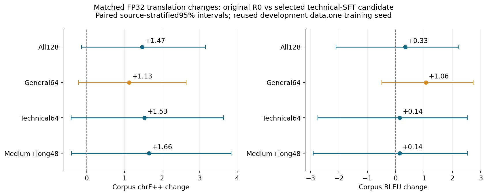
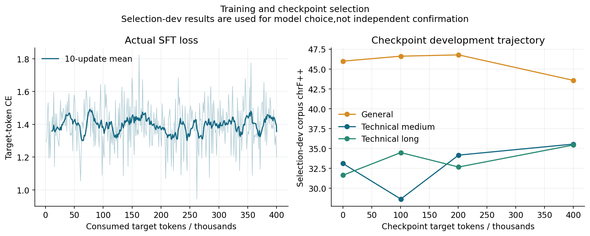
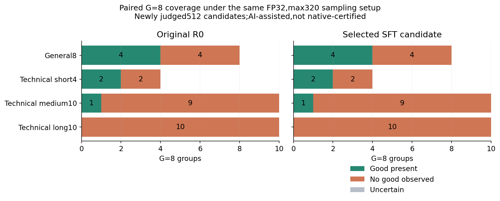

# 技术中长句SFT补强：完整结果与后续 / Technical SFT Full Results

日期 / Date:2026-11-17. Qwen3.5-0.8B,original R0 preserved,Colab L4. 本轮只做SFT、配对评估和归档，没有DAPO更新。 / SFT,paired evaluation and archiving only;no DAPO updates.

**完成330次优化更新、399,895有效目标token；原R0哈希未变，GPU已释放。技术chrF++：方向未确立 / direction not established；通用chrF++：方向未确立 / direction not established。**

**Completed 330 updates and 399,895 effective target tokens. Original R0 is preserved and GPU released. Technical chrF++ shows direction not established; general chrF++ shows direction not established.**

| 子集 / Subset | N | R0 chrF++ | SFT chrF++ | ΔchrF++[95%CI] | R0 BLEU | SFT BLEU | ΔBLEU[95%CI] |
| --- | --- | --- | --- | --- | --- | --- | --- |
| all128 | 128 | 34.567 | 36.037 | +1.470 [-0.140,+3.153] | 15.701 | 16.031 | +0.331 [-2.101,+2.226] |
| technical64 | 64 | 34.327 | 35.861 | +1.535 [-0.418,+3.637] | 15.957 | 16.096 | +0.139 [-2.749,+2.542] |
| general64 | 64 | 35.281 | 36.408 | +1.127 [-0.226,+2.640] | 14.153 | 15.216 | +1.063 [-0.487,+2.730] |
| technical_medium_long48 | 48 | 34.860 | 36.518 | +1.658 [-0.409,+3.836] | 16.412 | 16.550 | +0.138 [-2.910,+2.534] |
| prespecified120 | 120 | 34.779 | 36.313 | +1.534 [-0.103,+3.363] | 15.871 | 16.252 | +0.381 [-1.924,+2.551] |
| technical_long | 24 | 34.087 | 36.003 | +1.916 [-0.691,+4.784] | 16.264 | 16.169 | -0.095 [-4.208,+3.526] |
| technical_medium | 24 | 36.468 | 37.603 | +1.135 [-1.653,+4.447] | 16.554 | 17.282 | +0.728 [-1.400,+2.638] |
| technical_short | 16 | 28.035 | 28.148 | +0.113 [-1.076,+1.273] | 8.141 | 8.108 | -0.033 [-0.807,+0.131] |

技术24组G8中，有基本正确候选的组数为3→3；净变化+0。明确无G→有G为0组，明确有G→无G为0组，其余涉及U的转移单独保留。

Technical G8 coverage is3→3 out of 24,net+0. Confirmed no-G→G transitions:0;G→no-G:0. Uncertain transitions remain separate.

本轮没有同时满足全部主要工程目标。各指标的方向和限制已逐项给出；不凭训练loss下降或单一分数宣布新R0全面合格，也不把混合结果包装成成功。原R0继续保留。

Not all principal engineering targets were met simultaneously. Direction and limits are reported separately;lower loss or one improved metric does not establish broad qualification. Original R0 remains preserved.

这些工程目标不是DAPO硬门槛，未全部达到不自动意味着必须再SFT。最终建议需结合技术/通用质量、已知与不确定的语义转移、P/B相对差异和奖励排序。

These targets are not universal DAPO gates. Missing one does not automatically require more SFT;interpret quality,uncertain transitions,partial/bad contrasts and reward ranking together.

**针对本次实际结果：选中的新模型有小幅重合度分数收益，但没有扩大这批技术诊断句的正确候选覆盖，不能宣布已完成“更强技术中长句DAPO起点”的目标。保留t200000为可复查候选，原R0及t400000分开保存。**

**For this actual run: the selected model gains modest overlap scores without expanding correct-candidate coverage on these technical diagnostics. The intended stronger technical medium/long DAPO starting point is not established. Preserve t200000 as a reviewable candidate, with original R0 and t400000 separate.**

总chrF++变化+1.470的95%配对区间为[−0.140,+3.153]；技术64条为+1.535[−0.418,+3.637]，均跨零。应称为点估计上升、可靠提升证据不足。未选中末期相比选中模型总chrF++下降1.385[−2.753,−0.183]；这是本开发样本内的条件性结果，不是跨种子独立确认。

The all128 chrF++ change is+1.470 with95% paired interval[−0.140,+3.153]; technical64 is+1.535[−0.418,+3.637]. Both cross zero: point estimates rise without reliable improvement evidence. The nonselected final is−1.385[−2.753,−0.183] versus selected on all128, conditional on this reused development sample.

## 1. 方案、身份和实际执行 / Design and provenance

| 项 / Item | 值 / Value |
| --- | --- |
| Initial R0 SHA256 | ebb4575fda36002c76ddb7e999a4e12c44a0be9ddb20b1e4e092d708e6a050e9 |
| Base revision | 2fc06364715b967f1860aea9cf38778875588b17 |
| Training | BF16 base+FP32 LoRA;r16/alpha32/dropout0.05;freshAdamW;LR1e-5→1e-6;warmup3%;effectivebatch32 |
| Physical microbatch | [4] |
| Budget | 400k maximum effective target tokens;whole targets only;no automatic extension |
| Actual stop | frozen_budget_completed |
| Selected checkpoint | t200000;step165;tokens200770 |
| Selected adapter SHA256 | 89c874b1e04b011c6ee3f41f499c373b47826a7f106b9d61eaa83fdce85c77ae |

训练源包在分配GPU前已冻结并保存D盘；执行脚本和源码哈希可核对。载入每份adapter时逐tensor检查与文件值一致。两条完整FP32解码锚点用于核对旧R0基线；是否复用、完整文件哈希和任何重生成都保留在baseline_cache.json。

The source bundle was frozen on D before allocation. Each loaded adapter was checked tensor-by-tensor against its file. Two full FP32 decoding anchors checked the old baseline;reuse,file hashes and any regeneration are recorded in baseline_cache.json.

本轮SFT不使用采样概率比，因此沿用BF16训练。最终两模型都将同一份BF16舍入base数值提升为FP32执行，关闭TF32，不重新加载另一份高精度base。G8两侧均T0.7、top_p1、top_k0、max320、相同source与每源seed。

SFT has no sampler probability ratio. Final evaluation promotes the same BF16-rounded base values to FP32,with TF32 disabled. Both G8 conditions useT0.7,top_p1,top_k0,max320,the same sources and per-source seeds.

## 2. 数据清理与实际曝光 / Data cleaning and exposure

| 类别 / Type | 目标token / Target tokens |
| --- | --- |
| general | 99998 |
| technical_short | 19999 |
| technical_medium | 139985 |
| technical_long | 139913 |

| 统计 / Statistic | 实际值 / Actual |
| --- | --- |
| Original pool | 38799 |
| First structural/exclusion screen | {"near_protected_5gram_Jaccard085": 86, "suspected_ASCII_substitution_quarantine": 42} |
| Quality review | 100 actual source/reference pairs;83 pass-review pairs retained in final stream |
| Semantic/quality quarantines | 17 clear or conservatively suspicious pairs,not17 certified mistranslations |
| Extended quarantine | 31 |
| Unique training pairs | 10539 |
| Example exposures | 10541 |
| Maximum exposures per exact pair | 2 |
| Long pairs absent from executed oldR2 prefix | 867 |

发现并隔离了OCR断词、句间缺空格、上一句残片、多余目标分句和部分字幕意义压缩；规则命中还含保守可疑项，不应称为已人工确认的总体错误率。没有猜测修复或把失败开发句改写进训练。

Quarantines include OCR splits,missing sentence whitespace,preceding fragments,extra target clauses and subtitle compression. Some are conservatively suspicious rather than certified errors. No guessed repairs or rewritten development answers entered training.

所有已知历史开发、官方保留集、当前128条和32组G8均排除；近重复采用规范化词5-gram候选检索及Jaccard≥0.85的启发式检查。缺少文档ID时不保证文档级独立，也不宣称这些文对从未进入更早训练或base预训练。

Known historical/official held-outs,current128 and32 G8 prompts were excluded. Near-duplicate screening uses normalized word5gram candidates withJaccard≥0.85. It is heuristic,not guaranteed document independence or proof of no earlier/pretraining exposure.

## 3. 每个检查点及选择规则 / Checkpoints and selection

| Tag | Step | Target tokens | Weighted chrF++ | General chrF++ | Short | Medium | Long | Technical NLL | Failures |
| --- | --- | --- | --- | --- | --- | --- | --- | --- | --- |
| t000000 | 0 | 0 | 36.713 | 45.992 | 51.094 | 33.107 | 31.635 | 1.73553 | 4 |
| t100000 | 82 | 100445 | 36.632 | 46.618 | 57.719 | 28.636 | 34.482 | 1.72161 | 3 |
| t200000 | 165 | 200770 | 37.811 | 46.780 | 54.463 | 34.166 | 32.669 | 1.71147 | 2 |
| t400000 | 330 | 399895 | 38.364 | 43.573 | 52.464 | 35.553 | 35.439 | 1.70585 | 2 |

选择集为原64条，权重0.25/0.05/0.35/0.35作用于各类语料级chrF++。通用下降≤1.5点、结构失败≤起点+2/64才合格；分差≤0.1时优先低技术NLL，再优先更早检查点。原R0作为零步候选。最终128/G8不参与反复重选。

Selection-dev64 uses stratum corpus chrF weights 0.25/0.05/0.35/0.35. Eligibility requires general decline≤1.5 and failures≤baseline+2/64;ties within0.1 favor lower technical NLL,then earlier checkpoint. Original R0 is the zero-step fallback. Final128/G8 do not drive repeated reselection.

本轮t400000的加权分数最高，但旧选择集通用32句的chrF++由45.992降至43.573，下降2.419点，超过保留阈值，所以选中t200000。技术NLL持续下降；单凭这个选择结果不能称为技术过拟合。补充128条结果与所选模型分开报告。

t400000 has the highest weighted selection score but its general32 chrF++ falls45.992→43.573 (−2.419), breaching the retention guard, so t200000 is selected. Technical NLL continues decreasing; selection alone does not prove technical overfitting. Auxiliary128 results remain separate.

| Checkpoint | Changed tensors | Parameter L2 delta | Adapter SHA256 |
| --- | --- | --- | --- |
| t000000 | 0 | 0.000000 | ebb4575fda36002c76ddb7e999a4e12c44a0be9ddb20b1e4e092d708e6a050e9 |
| t100000 | 372 | 0.274245 | 1d13157c3ea63fc6bf62085369bb9fc20d741f30f9d038fb946ee2a303d995a8 |
| t200000 | 372 | 0.356336 | 89c874b1e04b011c6ee3f41f499c373b47826a7f106b9d61eaa83fdce85c77ae |
| t400000 | 372 | 0.388715 | 32dd7931c828d3c5ae069391cb7a4411acb70d8a93c670a1864276b375a2df52 |

补充评估是结果出来前已登记的纯推理诊断，不增加训练、不重新选择模型。以下主结果仍指选择集选中的模型；未选中的末期检查点单独列出。

The pre-outcome registered extra evaluation is inference only, with no new training or reselection. Primary results use the selected checkpoint; the nonselected final checkpoint is shown separately.

| Auxiliary subset | Final chrF++ | Final − R0 chrF++ [95%CI] | Final − selected chrF++ [95%CI] | Final BLEU | Final − selected BLEU [95%CI] |
| --- | --- | --- | --- | --- | --- |
| all128 | 34.652 | +0.085 [-1.554,+1.828] | -1.385 [-2.753,-0.183] | 14.445 | -1.586 [-3.225,+0.128] |
| technical64 | 34.189 | -0.138 [-2.081,+1.913] | -1.672 [-3.326,-0.134] | 14.392 | -1.704 [-3.489,+0.546] |
| general64 | 36.314 | +1.033 [-0.668,+2.770] | -0.094 [-1.278,+1.059] | 13.899 | -1.317 [-3.120,+0.010] |
| technical_medium_long48 | 34.657 | -0.203 [-2.435,+2.097] | -1.860 [-3.706,-0.136] | 14.596 | -1.954 [-3.962,+0.544] |
| prespecified120 | 34.890 | +0.110 [-1.566,+1.889] | -1.423 [-2.889,-0.113] | 14.606 | -1.646 [-3.410,+0.169] |
| technical_long | 34.812 | +0.725 [-2.050,+3.854] | -1.191 [-3.300,+0.700] | 14.958 | -1.211 [-3.361,+1.348] |
| technical_medium | 34.337 | -2.131 [-4.662,+0.212] | -3.266 [-7.018,-0.078] | 13.787 | -3.495 [-7.083,+0.197] |
| technical_short | 28.495 | +0.460 [-0.969,+2.145] | +0.347 [-0.210,+1.006] | 8.436 | +0.328 [-0.015,+1.969] |

## 4. G8语义复查与奖励排序 / G8 semantic and reward audit

| Subset | R0 good/no-G/U | SFT good/no-G/U | Net covered | Confirmed gains/losses |
| --- | --- | --- | --- | --- |
| all32 | 7/25/0 | 7/25/0 | 0 | 0/0 |
| technical24 | 3/21/0 | 3/21/0 | 0 | 0/0 |
| general | 4/4/0 | 4/4/0 | 0 | 0/0 |
| technical_long | 0/10/0 | 0/10/0 | 0 | 0/0 |
| technical_medium | 1/9/0 | 1/9/0 | 0 | 0/0 |
| technical_short | 2/2/0 | 2/2/0 | 0 | 0/0 |

| Subset | Condition | G/P/B/U candidates | Reference selectsG / covered | QE selectsG / covered | Mean MetricX↓ | Mean candidate sentence chrF | Reference top1 sentence chrF | Overlap oracle sentence chrF |
| --- | --- | --- | --- | --- | --- | --- | --- | --- |
| all32 | R0 | 29/126/100/1 | 3/7 | 4/7 | 15.795 | 31.946 | 35.898 | 40.892 |
| all32 | SFT | 28/122/105/1 | 7/7 | 5/7 | 16.060 | 32.682 | 37.590 | 42.561 |
| technical24 | R0 | 11/107/73/1 | 1/3 | 2/3 | 17.218 | 31.451 | 34.026 | 38.800 |
| technical24 | SFT | 13/99/79/1 | 3/3 | 2/3 | 17.352 | 31.773 | 33.493 | 39.299 |
| general | R0 | 18/19/27/0 | 2/4 | 2/4 | 11.526 | 33.432 | 41.512 | 47.166 |
| general | SFT | 15/23/26/0 | 4/4 | 3/4 | 12.182 | 35.410 | 49.881 | 52.344 |
| technical_long | R0 | 0/41/39/0 | 0/0 | 0/0 | 20.367 | 31.718 | 32.963 | 36.892 |
| technical_long | SFT | 0/46/34/0 | 0/0 | 0/0 | 19.782 | 31.664 | 33.531 | 37.299 |
| technical_medium | R0 | 2/48/29/1 | 0/1 | 1/1 | 16.779 | 31.300 | 34.236 | 39.570 |
| technical_medium | SFT | 4/39/36/1 | 1/1 | 1/1 | 17.082 | 31.736 | 33.253 | 39.890 |
| technical_short | R0 | 9/18/5/0 | 1/2 | 1/2 | 10.439 | 31.160 | 36.159 | 41.646 |
| technical_short | SFT | 9/14/9/0 | 2/2 | 1/2 | 11.953 | 32.135 | 33.994 | 42.824 |

先冻结32源句和G/P/B/U标准，候选卡片隐藏条件身份和分数，逐条判断全部512个候选，锁定SHA256后才揭盲与计算终点质量。原R0也重新采样重新判断，没有套用旧BF16/max256标签。相同AI助手、既有源句知识与可辨认模式限制了盲法；这不是独立母语认证。

The 32 sources and rubric were fixed. Cards hid condition IDs and scores;all 512 candidates were judged and hashed before unblinding/final aggregates. Original R0 was resampled and rejudged. Familiar sources and the same assistant limit blinding;this is not independent native certification.

这32句是分层固定诊断子集，含已知难例，不是随机抽取的总体成功率调查。3/24或0/10只描述本批样本；不外推成所有技术文本的正确率。

These32 prompts form a frozen stratified diagnostic subset containing known difficult cases. The3/24 or0/10 counts describe this subset, not population success rates for all technical translation.

G=中心含义与关键关系基本保留，允许轻微形态错误；P=有实质内容但有重大缺损；B=中心含义丢失/反转/难懂；U=不能可靠判断。没有完整G不等于没有学习信号，P/B间仍可能存在相对差异。句级chrF与语料级chrF口径不同；MetricX仍是辅助，旧语义校准失败没有被本轮自动清除。

G retains core meaning with minor morphology allowed;P is substantive partial meaning with a major defect;B loses/reverses core meaning;U is uncertain. No-G is not necessarily no learning signal. Sentence/corpus chrF differ;MetricX remains auxiliary and prior calibration failure is not automatically cleared.

| Subset | Condition | Active known-tier contrast groups | Numerical variance keep | Full reward selectsG / covered | Concordant/comparable active pairs | Discordant/tied |
| --- | --- | --- | --- | --- | --- | --- |
| all32 | R0 | 24 | 32 | 3/7 | 229/300 | 71/0 |
| all32 | SFT | 23 | 32 | 7/7 | 257/341 | 81/3 |
| technical24 | R0 | 21 | 24 | 1/3 | 190/247 | 57/0 |
| technical24 | SFT | 17 | 24 | 3/3 | 181/247 | 63/3 |
| general | R0 | 3 | 8 | 2/4 | 39/53 | 14/0 |
| general | SFT | 6 | 8 | 4/4 | 76/94 | 18/0 |
| technical_long | R0 | 8 | 10 | 0/0 | 60/89 | 29/0 |
| technical_long | SFT | 5 | 10 | 0/0 | 51/66 | 15/0 |
| technical_medium | R0 | 10 | 10 | 0/1 | 99/123 | 24/0 |
| technical_medium | SFT | 9 | 10 | 1/1 | 89/132 | 40/3 |
| technical_short | R0 | 3 | 4 | 1/2 | 31/35 | 4/0 |
| technical_short | SFT | 3 | 4 | 2/2 | 41/49 | 8/0 |

完整训练奖励按原参考MetricX、文本门控及320/64软长度项离线重构，截断候选从活跃比较排除；没有执行任何RL更新。非零奖励方差不等于语义质量可靠。同组不同已知等级的候选对可检查方向，但这些对不独立，且P/B划分是辅助判断，不是评分器总体准确率。

The original reference reward,text gate and320/64 length term are reconstructed offline,with truncated candidates excluded from active comparisons. No RL update occurs. Nonzero reward variance is not semantic reliability. Within-group tier pairs are dependent AI-assisted comparisons,not population scorer accuracy.

本批选中SFT的有G组，reference MetricX选中G为7/7（技术3/3），高于原R0的3/7；这是一小批候选分布上的改善，不代表评分器已经全局校准。新模型有23/32组存在有效G/P/B层级对比，技术为17/24；已知层级不同的有效候选对中257/341与完整训练奖励同向。候选对互不独立，这些计数不能作为总体准确率置信区间。

For this selected SFT candidate bank, reference MetricX picks G in7/7 covered groups (technical3/3), versus3/7 for R0. This small candidate-bank improvement is not global calibration. Active known-tier contrasts exist in23/32 groups (technical17/24);257/341 differing-tier active pairs agree with the full reward. Dependent pairs do not define a population accuracy interval.

因此，主问题是未扩大完整正确候选的覆盖，而不是本轮已经证明每一组奖励都反向。无G的组仍可能有P/B学习信号；历史奖励反例和当前有限覆盖也不支持直接开展正式效率结论。

Thus the main observed shortfall is unchanged complete-candidate coverage, not proof that every reward group points the wrong way. No-G groups can still offer partial/bad signal; historical reward counterexamples and limited current coverage still preclude a formal efficiency claim.

## 5. 成本、恢复和完整性 / Cost,recovery and integrity

| Item | Actual |
| --- | --- |
| Updates | 330 |
| Training seconds | 1641.92 |
| Logical target tokens | 399895 |
| Target-token forward attempts | 399895 |
| Logical input tokens | 898064 |
| Torch cumulative peak in update logs | 4.690GiB allocated /19.473GiB reserved |
| Sampled device peak | 19.721GiB |
| Allocated GPU minutes | 83.58 |
| Observed account CU decrease | 2.5418 |
| Owned GPU released | True |

Torch峰值取每次更新日志中的累计值，含此前初始化/基线阶段，不保证是最终评估后的全进程最高值；设备峰值按5秒采样，不能当精细kernel profiler。账户余额下降包含上传/下载、安装、检查、训练和评估，并可能异步结算。

Logged cumulative Torch peaks include earlier initialization/baseline work,not necessarily the final-process peak. Device memory is sampled every5s. Account balance changes include setup/transfers/checks/training/evaluation and can settle asynchronously.

| Sampled phase | Approx seconds |
| --- | --- |
| initializing | 20.93 |
| greedy_R0_cache_anchors | 5.03 |
| g8_R0 | 201.12 |
| greedy_selection_t000000 | 321.72 |
| SFT_train | 1644.63 |
| nll_t100000 | 5.04 |
| greedy_selection_t100000 | 331.77 |
| nll_t200000 | 5.04 |
| greedy_selection_t200000 | 301.62 |
| nll_t400000 | 5.03 |
| greedy_selection_t400000 | 296.59 |
| greedy_SFT_fp32_128 | 442.44 |
| g8_SFT | 226.29 |
| auxiliary_MetricX | 45.25 |
| unobserved_gap | 80.52 |
| greedy_final_trained_fp32_128 | 467.57 |

前台监督真实任务，日志持续镜像D盘，完整不可变检查点在训练期间下载并校验。恢复状态包括adapter、AdamW、RNG、数据顺序/游标、token数及配置/源码哈希。OOM只允许在optimizer.step之前清梯度恢复RNG并减少物理microbatch；optimizer.step的OOM不重试可能部分更新的权重。

A foreground supervisor tracked actual work,with continuous D mirroring and checksum-verified immutable snapshots. States include adapter,optimizer,RNG,stream/cursor,tokens and hashes. Only pre-step backward OOM can retry with reduced microbatch;potentially partial optimizer-step OOM is fatal.

本轮没有声称任意中断都能一键无缝恢复。显式resume需匹配哈希、归档回滚尾日志；部分终点评估需要另行保留和修复。所有实际中断、失败、补救或未完成项目都必须按原日志报告。

No universal one-click seamless-resume claim is made. Explicit resume validates hashes and preserves rolled-back journal tails;partial final decoding requires recorded repair. Any actual failures/remedies/incomplete items must be disclosed.

## 6. 结论边界与下一步 / Interpretation and next action

明确结论：本轮补强没有达到核心语义覆盖目标。选中检查点可以继续作为小规模诊断候选，但还不足以冻结为综合技术任务的正式效率对比基座。这不是禁止DAPO：P/B候选间仍可能有相对学习信号，是否有用必须由匹配的小预算RL试验验证。

Verdict: this strengthening run misses the central semantic-coverage objective. The selected checkpoint remains usable for small diagnostics, but is not established as the broad technical efficiency-comparison base. DAPO remains possible: partial/bad contrasts can still carry relative signal, which needs a matched pilot.

| 证据 / Evidence | 可得结论 / Supported inference | 仍不能得出 / Not established |
| --- | --- | --- |
| 330 finite updates;checkpoint parameter changes;technical NLL1.73553→1.70585 | SFT executed and learned supervised token prediction / 训练确有执行和学习 | Lower NLL does not certify free generation / 不能由NLL宣布翻译正确 |
| Technical G8 coverage3→3/24;long0→0/10 | The selected model did not repair complete-candidate availability on these diagnostics / 选中模型未解决完整候选覆盖 | Not proof of no partial/bad RL signal,or a population rate / 不等于无RL信号或总体正确率 |
| Nonselected400k greedy128 versus selected200k,reported above | More of this exact training recipe did not produce a better recorded endpoint / 本配方继续至末期未产生更好的记录终点 | Not proof that all larger SFT runs fail,or a universal overfitting boundary / 不证明所有更大SFT无效 |
| Historical reward-calibration failure plus current auxiliary ranking audit | SFT and reward quality are separate problems / 能力与奖励须分开处理 | Not proof that previous DAPO failure was solely insufficient SFT / 不能归因于SFT唯一不足 |

本轮无法因果区分的原因包括：新增有效覆盖有限、剩余数据质量、学习率/训练强度、teacher-forcing与自由生成差距，以及0.8B对冰岛语的容量/预训练限制。它们是待检验解释，不能写成已经证明的原因；尤其不能据此直接许诺再加一轮就会综合很强。

Untested explanations include limited new coverage, remaining data quality, learning rate/training intensity, the teacher-forcing/free-generation gap and the0.8B Icelandic capacity/pretraining limit. These are hypotheses, not established causes or a promise that another run will suffice.

下一步建议先做低成本的“训练样本能否自由生成”检查：从选中检查点实际见过且通过质量复查的文对中，固定分层样本，对比原R0与新模型的teacher-forced NLL和greedy译文，并与独立保留样本分开。训练样本也不会译，先查优化强度、参数覆盖、格式和语言能力；训练样本能译但保留样本失败，再优先补新数据覆盖与泛化。该检查是后续建议，本轮未执行。

Recommended next: a cheap fixed training-fit probe on quality-reviewed pairs actually seen by the selected checkpoint. Compare original/new teacher-forced NLL and greedy translations, separately from held-out cases. Failure even on training examples prioritizes optimization/parameter coverage/format/language checks; training success with held-out failure prioritizes coverage and generalization. This probe is proposed, not executed here.

只有定位后才设计下一轮SFT：优先增加经过验证的新文对、术语与关键关系覆盖，并预设学习率/训练规模曲线、通用保留和语义覆盖停止规则。不要直接复制本轮40万token配方扩大预算。奖励另行校准；当前不自动追加SFT、DAPO或GPU预算。

Only then design another SFT run with validated new pairs, terminology/relation coverage and a prespecified learning-rate/budget curve, retention and semantic stopping rules. Do not simply enlarge this400k recipe. Calibrate rewards separately; no further SFT,DAPO or GPU budget is automatically added.

本轮能回答的是：相同0.8B原R0经过技术中长句定向曝光后，配对开发译文和G8候选是否更好，以及是否保留通用能力。它不能证明SFT不足是之前DAPO一般的唯一原因，也不能由单种子开发集证明跨所有领域泛化。

This tests whether targeted exposure improves paired development translations and G8 coverage while retaining general ability. It cannot uniquely explain previous DAPO behavior or establish all-domain generalization from one seed and reused development data.

若技术收益、语义覆盖和通用保留一致，下一步只做一个使用该候选的固定小预算DAPO验证；不直接跳到正式效率创新比较。若结果混合，先按具体错误与保留情况决定修订；本轮不自动追加SFT或DAPO预算。

Consistent technical,semantic and retention gains justify one matched small-budget DAPO pilot before efficiency comparisons. Mixed results require specific diagnosis;no automatic SFT/DAPO extension occurs here.

## 7. 文件与复现 / Files and replay

| Artifact | Path |
| --- | --- |
| HTML | D:\deep learning project\reports\r0_technical_sft_2026-11-17\TECHNICAL_SFT_RESULTS_2026-11-17.html |
| Markdown | D:\deep learning project\reports\r0_technical_sft_2026-11-17\TECHNICAL_SFT_RESULTS_2026-11-17.md |
| Results JSON | D:\deep learning project\runs\r0_technical_sft_2026-11-17\analysis\results.json |
| All paired greedy outputs | D:\deep learning project\runs\r0_technical_sft_2026-11-17\analysis\paired_greedy128.csv |
| All G8 outputs and labels | D:\deep learning project\runs\r0_technical_sft_2026-11-17\analysis\paired_G8_candidates.csv |
| Source bundle | D:\deep learning project\experiments\technical_sft_2026-11-17\t6_source_bundle.zip |
| Complete run export | D:\deep learning project\runs\r0_technical_sft_2026-11-17\t6_export.zip |
| Checkpoints and optimizer/RNG | D:\deep learning project\runs\r0_technical_sft_2026-11-17\snapshots |
| CPU analysis replay | D:\deep learning project\runs\r0_technical_sft_2026-11-17\analysis_reproduction\README.md |

代码、数据清单、全部训练流、100对数据审阅、逐步更新、检查点、完整译文、奖励、锁定标签、资源与实际额度记录保留。账号令牌/OAuth和私有SDK日志不打包。分析复算重用已锁定标签，不是新的独立评审；重新训练的新输出必须重新判断。

Preserve code,training stream,100-pair QA,updates,checkpoints,all outputs/scores,locked labels,resources and costs. Exclude credentials/private SDK logs. CPU replay reuses locked judgements and is not a new independent review.

## 附录A：全部128条配对译文 / All128 paired translations

ParIce21:opensubtitles:dev:3611 · general

EN: Kingdom of dreams, tears and eyes...

Reference IS: Ríki drauma, tára og augna.

| Condition | Hypothesis IS | Sentence chrF++ | Truncated |
| --- | --- | --- | --- |
| R0 | Dreymisland, þurrar og augu... | 20.282 | False |
| SFT | Dreymisland, þurrar og augu... | 20.282 | False |

ParIce21:opensubtitles:dev:2506 · general

EN: Well, hell, Virgil, everybody's got feelings.

Reference IS: Fjandinn, Virgil, allir hafa tilfinningar.

| Condition | Hypothesis IS | Sentence chrF++ | Truncated |
| --- | --- | --- | --- |
| R0 | Allir eru með ástir. | 8.513 | False |
| SFT | Allir eru með ávinning. | 14.207 | False |

ParIce21:opensubtitles:dev:343 · general

EN: But Mandy and Judy are going.

Reference IS: En Mandy og Judy fara.

| Condition | Hypothesis IS | Sentence chrF++ | Truncated |
| --- | --- | --- | --- |
| R0 | En Mandy og Judy eru að fara. | 79.089 | False |
| SFT | En Mandy og Judy eru að fara. | 79.089 | False |

ParIce21:ema:dev:1057 · technical_medium

EN: 14 ml of Perjeta concentrate should be withdrawn from the vial and diluted into a 250 ml PVC or non-PVC polyolefin infusion bag of sodium chloride 9 mg/ml (0.9%) solution for infusion.

Reference IS: Draga á 14 ml af Perjeta þykkni úr hettuglasinu og þynna það í 250 ml innrennslispoka úr PVC eða pólýólefíni án PVC, sem inniheldur 9 mg/ml (0,9%) lausn af natríumklóríði til innrennslis.

| Condition | Hypothesis IS | Sentence chrF++ | Truncated |
| --- | --- | --- | --- |
| R0 | 14 ml af Perjeta innihaldinu skal fæddur úr hettuglasinu og þannig smjörður í 250 ml PVC eða ó-PVC pólýólefna innrennslisboka af natríumklóríu 9 mg/ml (0,9%) lausn til innrennslis. | 58.946 | False |
| SFT | 14 ml af Perjeta innihaldinu skal fæddur úr hettuglasi og þannig smjörður í 250 ml PVC eða ó-PVC pólýólefna innrennslisboka af natríumklóríu 9 mg/ml (0,9%) blóðþrýstinglausan. | 47.574 | False |

ParIce21:opensubtitles:dev:2269 · general

EN: Mama says it's old clothes.

Reference IS: Mamma segir að það séu gömul föt.

| Condition | Hypothesis IS | Sentence chrF++ | Truncated |
| --- | --- | --- | --- |
| R0 | Mamma segir það er gamlum fötum. | 39.914 | False |
| SFT | Mamma segir það eru gamlar föt. | 45.134 | False |

ParIce21:ema:dev:2813 · technical_short

EN: Discard any unused material after opening.

Reference IS: Fargið ónotuðum lyfjaleifum eftir notkun.

| Condition | Hypothesis IS | Sentence chrF++ | Truncated |
| --- | --- | --- | --- |
| R0 | Hafðu úrtryggingu öllu notkilegum efni eftir að opnað er. | 22.474 | False |
| SFT | Fjarlægðu notkunarefni, sem eru ekki notaðar, eftir að opnaðar eru. | 23.351 | False |

ParIce21:eso:dev:471 · technical_long

EN: It either grew by assembling the rocks that form the solid core and then slowly accumulated gas from the environment to form the heavy atmosphere, or started forming from a gaseous clump that arose from gravitational instabilities in the disc.” explains Anne-Marie Lagrange, another team member.

Reference IS: Annað hvort óx hún með því að draga til sín berg sem myndaði fastan kjarna sem sópaði síðan að sér gas úr umhverfinu og myndaði þannig þykkan lofthjúp, eða hún hóf að myndast úr gasklumpi sem varð til vegna þyngdaróstöðugleika í skífunni,“ segir Anne-Marie Lagrange, meðlimur í rannsóknarteyminu.

| Condition | Hypothesis IS | Sentence chrF++ | Truncated |
| --- | --- | --- | --- |
| R0 | Það rækst eða stóð úr sammála rockanna sem eru aðalgerðir sólurinnar halsar og þá varðu gasið úr umhverfinu til að skapa heitum loftið, eða stóð úr gasiðskipti sem stóð úr þróunum á loftið í hálfa. Anne-Marie Lagrange, annar liðsambandinn, útskýrir þetta. | 27.180 | False |
| SFT | Það rækst eða stóð út með því að samsetja rokkana sem eru aðalgerðirinnar sólur og þá varðu stöðugur og þótt lóðræðilega þurfti að þróaðar loftið af umhverfisvöxtunum til að fá þann mikil loftið, eða stóð út úr loftið sem varðist úr loftið sem varðist úr þróunum á loftið í þrýstingum. Anne-Marie Lagrange, annar liðsambandinn, útskýrir þetta. | 29.602 | False |

ParIce21:opensubtitles:dev:2776 · general

EN: Don't be angry, my son, with Burns Red, Shadow and the others.

Reference IS: Ekki vera reiður við Brennur rauðan, Skugga og hina, sonur minn.

| Condition | Hypothesis IS | Sentence chrF++ | Truncated |
| --- | --- | --- | --- |
| R0 | Ekki vera reið, sonur minn, við Burns Red, Shadow og önnur. | 44.270 | False |
| SFT | Ekki vera reið, sonur minn, við Burns Red, Shadow og önnur. | 44.270 | False |

ParIce21:opensubtitles:dev:580 · general

EN: Remember, Monday is malaria day.

Reference IS: Munið að mánudagur er til malaríu.

| Condition | Hypothesis IS | Sentence chrF++ | Truncated |
| --- | --- | --- | --- |
| R0 | Mánudagurinn er mólfræðisdagur. | 25.432 | False |
| SFT | Mánudagurinn er mólfræðisdagur. | 25.432 | False |

ParIce21:opensubtitles:dev:2932 · general

EN: You seem to be doing a perfectly good job right now.

Reference IS: Þú virðist standa þig mjög vel núna.

| Condition | Hypothesis IS | Sentence chrF++ | Truncated |
| --- | --- | --- | --- |
| R0 | Þú virðist vera að gera í fullu góðu vinnu. | 28.309 | False |
| SFT | Þú virðist vera að gera í fullu góðu vinnu. | 28.309 | False |

ParIce21:opensubtitles:dev:3113 · general

EN: All right, I'll keep my mouth shut.

Reference IS: Gott og vel, ég skal þegja.

| Condition | Hypothesis IS | Sentence chrF++ | Truncated |
| --- | --- | --- | --- |
| R0 | Ég skal halda augun í gegn. | 16.324 | False |
| SFT | Ég skal halda augunum á. | 14.906 | False |

ParIce21:ema:dev:1351 · technical_medium

EN: If the number of platelet (a type of blood cell that helps to clot blood) has decreased.

Reference IS: Ef blóðflögum (tegund blóðfrumna sem tekur þátt í blóðstorknun) hefur fækkað.

| Condition | Hypothesis IS | Sentence chrF++ | Truncated |
| --- | --- | --- | --- |
| R0 | Ef fjöldi blóðflagna (tíð eiginleika blóðflagna sem hjálpa að blóðskot) hefur minstað. | 28.481 | False |
| SFT | Ef fjöldi blóðflagna (tíð eiginleika blóðflagna sem hjálpa að blóðskót) hefur minstað. | 28.298 | False |

ParIce21:ema:dev:968 · technical_short

EN: How to use Busulfan Fresenius Kabi

Reference IS: Hvernig nota á Busulfan Fresenius Kabi

| Condition | Hypothesis IS | Sentence chrF++ | Truncated |
| --- | --- | --- | --- |
| R0 | Hvernig nota Busulfan Fresenius Kabi | 85.217 | False |
| SFT | Hvernig nota Busulfan Fresenius Kabi | 85.217 | False |

ParIce21:eea:dev:485 · technical_long

EN: Two samples, equipped with the lamp or lamps recommended; if the parking lamps are such that they can be mounted only on one side of the vehicle, the two samples submitted may be identical and be suitable for mounting only on the right or only on the left side of the vehicle.

Reference IS: tvö sýnishorn með því ljóskeri eða ljóskerum sem mælt er með; ef stöðuljósin eru þannig að einungis er hægt að festa þau á aðra hlið ökutækisins er heimilt að afhenda tvö sýnishorn sem eru sams konar og þannig að hægt sé að festa þau einungis á hægri eða vinstri hlið ökutækisins.

| Condition | Hypothesis IS | Sentence chrF++ | Truncated |
| --- | --- | --- | --- |
| R0 | Tveir sýni, með ljósinu eða ljósinum sem er ráðlagt, ef bíllarnar eru svo að þau geta ekki haft aðeins á einni hliðum bílls, geta þau tveir sýni sem eru tilgreindir að því er varðar bíllarnar, verið eins og þau eru tilgreind og þau eru viðeigandi til að setja þau einu sinni á hliðina eða einu sinni á hliðina. | 26.990 | False |
| SFT | Tveir sýni, með ljósinu eða ljósinum sem er ráðlagt, ef bíllarnar eru svo að þau geta ekki verið monterð aðeins á einn hlið á bílinni, geta þau tveir sýni sem eru sátt við að monterast aðeins á hliðina eða hliðina á bílinni. | 24.575 | False |

ParIce21:ema:dev:2509 · technical_long

EN: In a randomised, double-blind correction study (n = 358) comparing once every two week and once monthly dosing schedules in patients with CRF not on dialysis, darbepoetin alfa once monthly dosing was non-inferior to once every two week dosing for correcting anaemia.

Reference IS: Í slembaðri, tvíblindri leiðréttingarrannsókn (n = 358) þar sem borin var saman gjöf lyfsins einu sinni á tveggja vikna fresti og gjöf lyfsins einu sinni í mánuði hjá sjúklingum með langvarandi nýrnabilun sem ekki voru í skilun, gaf darbepoetin alfa gefið einu sinni í mánuði ekki lakari niðurstöður en þegar það var gefið á tveggja vikna fresti til leiðréttingar á blóðleysi.

| Condition | Hypothesis IS | Sentence chrF++ | Truncated |
| --- | --- | --- | --- |
| R0 | Í rannsókninni sem varðar óráðlegri, tvíblindri endurnýtingu (n = 358) samanburðar einu sinni á tveggja viku og einu sinni á mánuð skammta af darbepoetíni alfa, einu sinni á mánuð, við að lækna blóðþrýstingur, sem var ekki á skilvirkum, var ekki hættulegri en einu sinni á tveggja viku skammta til að lækna blóðþrýstingur. | 37.562 | False |
| SFT | Í rannsókninni sem varðar ósamtakað, tvíblind, endurtekningarskoðun (n = 358) samanburðar á einu sinni á tveggja viku og einu sinni á mánuð skammtaferðar með darbepoetín alfa einu sinni á mánuð hjá sjúklingum með CRF, sem voru ekki á skilvirkum, varðar darbepoetín alfa einu sinni á mánuð, var ekki lægri en einu sinni á tveggja viku skammtaferðar til að lækka blæðingu. | 39.298 | False |

ParIce21:opensubtitles:dev:1168 · general

EN: [Chelli] Last thing we see is the Thunderbolt dropping napalm... ..on the two downed choppers.

Reference IS: Það síðasta sem við sjáum er Thunderboltinn að kasta napalmsprengju á þyrlurnar tvær.

| Condition | Hypothesis IS | Sentence chrF++ | Truncated |
| --- | --- | --- | --- |
| R0 | [Chelli] Við höfum séð þrýstinginn drepa napalm á tvö dreptuðum hreyflum. | 15.892 | False |
| SFT | [Chelli] Við höfum síðast séð þrúguboltinn drepa nápalmið á tvö dreptu kúrunum. | 19.407 | False |

ParIce21:opensubtitles:dev:2362 · general

EN: When I see you wear that necklace, you look just like your mother.

Reference IS: Þú líkist móður þinni þegar þú ert með hálsfestina.

| Condition | Hypothesis IS | Sentence chrF++ | Truncated |
| --- | --- | --- | --- |
| R0 | Þegar ég sé þig í þessum skugga lítur þú eins og mömmu þín. | 15.939 | False |
| SFT | Þegar ég sé þig fara í þessa kettíli lítur þú eins og móður þín. | 22.895 | False |

ParIce21:opensubtitles:dev:2868 · general

EN: Walter, good to see you again.

Reference IS: Walter, gott að sjá þig aftur.

| Condition | Hypothesis IS | Sentence chrF++ | Truncated |
| --- | --- | --- | --- |
| R0 | Gott að sjá þig aftur. | 67.199 | False |
| SFT | Gott að sjá þig aftur. | 67.199 | False |

ParIce21:eea:dev:2030 · technical_medium

EN: For the proper functioning of the internal market and in order to facilitate cross-border trade within the Community it is essential that the charges for cross-border payments in euro are the same as for corresponding payments within a Member State.

Reference IS: Til að starfsemi innri markaðarins sé með eðlilegum hætti og til að greiða fyrir viðskiptum yfir landamæri innan Bandalagsins er mikilvægt að gjöld vegna greiðslna yfir landamæri í evrum séu þau sömu og fyrir samsvarandi greiðslur innan aðildarríkis.

| Condition | Hypothesis IS | Sentence chrF++ | Truncated |
| --- | --- | --- | --- |
| R0 | Til að þróa innri markað og til að stuðla til samræmingarmarkaðra viðskipta innan Bandalagsins er nauðsynlegt að fjárfestingar fyrir samræmingarmarkaðar greiðslur í eurum séu sömu og fjárfestingar fyrir samræmingarmarkaðar greiðslur innan aðildarríkis. | 46.561 | False |
| SFT | Til að þróa innri markað og til að stuðla til samræmingarmarkaðra viðskipta innan Bandalagsins er nauðsynlegt að fjármálaráðstafanir fyrir samræmingarmarkaðar greiðslur í euróða séu sömu og fjármálaráðstafanir fyrir samræmingarmarkaðar greiðslur innan aðildarríkjanna. | 43.876 | False |

ParIce21:eso:dev:277 · technical_long

EN: A new image of the centre of the distinctive galaxy Centaurus A, made with the Atacama Large Millimeter/submillimeter Array (ALMA), shows how the new observatory allows astronomers to see through the opaque dust lanes that obscure the galaxys centre, with unprecedented quality.

Reference IS: Ný mynd Atacama Large Millimeter/submillimeter Telescope af miðju vetrarbrautarinnar Centaurus A, sýnir vel hvernig þessi nýi sjónauki gerir stjörnufræðingum kleift að sjá í gegnum ryk, sem alla jafna er ógegnsætt og hylur miðju vetrarbrautarinnar, í meiri smáatriðum en nokkru sinni fyrr.

| Condition | Hypothesis IS | Sentence chrF++ | Truncated |
| --- | --- | --- | --- |
| R0 | Nýjan mynd af miðju tilteknar galaksunnar Centaurus A, sem er gerð með Atacama Large Millimeter/submillimeter Array (ALMA), sýnir hvernig nýja sjónvarpsstöðvar geta leitt ígreinarmenn að sjá þróaðar þróaðar þróaðar þróaðar þróaðar þróaðar þróaðar þróaðar þróaðar þróaðar þróaðar þróaðar þróaðar þróaðar þróaðar þróaðar þróaðar þróaðar þróaðar þróaðar þróaðar þróaðar þróaðar þróaðar þróaðar þróaðar þróaðar þróaðar þróaðar þróaðar þróaðar þróaðar þróaðar þróaðar þróaðar þróaðar þróaðar þróaðar þróaðar þróaðar þróaðar þróaðar þróaðar þróaðar þróaðar þróaðar þróaðar þróaðar þróaðar þróaðar þr | 27.919 | True |
| SFT | Nýja mynd af miðju tilteknar galaksunnar Centaurus A, sem var gerð með Atacama Large Millimeter/submillimeter Array (ALMA), sýnir hvernig nýja sjónvarpsstöðin getur leitt ígreinistefnirum að sjá yfir óþrýstingarmörkum sem dregið úr miðju galaksunnar, með óþrýstingarmyndi. | 38.326 | False |

ParIce21:opensubtitles:dev:2521 · general

EN: Then what do we do, Mr. Chisum?

Reference IS: Hvað eigum við þá að gera, hr. Chisum?

| Condition | Hypothesis IS | Sentence chrF++ | Truncated |
| --- | --- | --- | --- |
| R0 | Hvað gerum við, herra Chisum? | 38.885 | False |
| SFT | Hvað gerum við, herra Chisum? | 38.885 | False |

ParIce21:opensubtitles:dev:1385 · general

EN: Fighters are convicted violent felons. Acts should not be duplicated at home.

Reference IS: Bardagamenn eru dæmdir, ofbeldisfullir fangar og ætti ekki að herma eftir heima.

| Condition | Hypothesis IS | Sentence chrF++ | Truncated |
| --- | --- | --- | --- |
| R0 | Hættir eru óvirkir fræðingar. Það ætti ekki að gera þær yfirleitt. | 23.983 | False |
| SFT | Fangelsi eru skuldlegir skemmandum lögreglufólkinum. Það ætti ekki að gera þær ólíkt. | 24.004 | False |

ParIce21:opensubtitles:dev:2975 · general

EN: Speaks very highly of you.

Reference IS: Það segir gott um þig.

| Condition | Hypothesis IS | Sentence chrF++ | Truncated |
| --- | --- | --- | --- |
| R0 | Hann hefur mjög mikið af þér. | 9.183 | False |
| SFT | Hún hefur mjög mikið af þér. | 9.255 | False |

ParIce21:opensubtitles:dev:2435 · general

EN: Why, uttering the very name of Sparta or Leonidas will be punishable by death.

Reference IS: Það verður dauðasök að minnast orði á Spörtu eða Leonídas.

| Condition | Hypothesis IS | Sentence chrF++ | Truncated |
| --- | --- | --- | --- |
| R0 | Því, að segja nýtingu Sparta eða Leonidas verður það óþolinn. | 25.906 | False |
| SFT | Því, að segja nýtingu Sparta eða Leonidas verður það ógætt. | 25.309 | False |

ParIce21:norden:dev:435 · technical_medium

EN: But if we look at the statistics, there are also areas of concern: despite immigration, the population is aging and immigration is increasingly focused around major cities.

Reference IS: Sé litið á tölfræðina eru þó einnig svæði þar sem ástæða er til að vera á varðbergi. Íbúarnir eldast þrátt fyrir fólksflutninga til Norðurlandanna.

| Condition | Hypothesis IS | Sentence chrF++ | Truncated |
| --- | --- | --- | --- |
| R0 | En ef við horfum á upplýsingarnar eru einnig tilviki sem þykir: Þrátt fyrir flutningi er borgin að eldri og flutningi er að flutningið er að flutna í mikilvægustu borgum. | 24.765 | False |
| SFT | En ef við horfum á upplýsingarnar eru einnig tilviki sem áhyggjufær: Þrátt fyrir flutningi er borgin að eldri og flutningi er að flutningið er að flutna í mikilvægustu borgum. | 24.796 | False |

ParIce21:eso:dev:783 · technical_medium

EN: Its discovery demonstrates the unique power of VISTA, which was designed to study the Milky Ways deep structures by wide-field, high-resolution imaging at infrared wavelengths.

Reference IS: Uppgötvunin sýnir einstök greinigæði VISTA sjónaukans sem hannaður var til að rannsaka uppbyggingu Vetrarbrautarinnar með því að taka víðmyndir í hárri upplausn á innrauðum bylgjulengdum.

| Condition | Hypothesis IS | Sentence chrF++ | Truncated |
| --- | --- | --- | --- |
| R0 | Það er fundinn að VISTA hefur einungis stóran tækifæri sem var ákveðið til að rannsaka geymsluðar kerfinu í galapjörnum með miklum vöðvun og miklum vöðvunarmörkum á inreðlögum. | 25.268 | False |
| SFT | Það er fundinn að VISTA hefur einungis stóran tækifæri sem var ákveðið til að rannsaka mjólkafarleysi með miklum sviðsmyndun á inrtæmu lengd. | 25.383 | False |

ParIce21:eso:dev:176 · technical_medium

EN: At -250ºC, the dust grains are very cold, and the faint glow emanating from them can only be seen at submillimetre wavelengths, significantly longer than those of visible light.

Reference IS: Rykkornin eru nístingsköld, í kringum –250°C og gefa þau því aðeins frá sér ljós með hálfsmillímetra bylgjulengdir sem eru mun lengri en bylgjulengdir sýnilegs ljóss.

| Condition | Hypothesis IS | Sentence chrF++ | Truncated |
| --- | --- | --- | --- |
| R0 | Þegar hitastiginn er -250°C, eru grínir þessar þjóðar mjög koldið og þungur gluggur, sem hafa áfram frá þeim, er einungis séð við mikilvægari lengd, en þeir eru lengra en þeir sem eru til sjáans. | 22.820 | False |
| SFT | Þegar hitastigurinn er -250°C eru grímnirnar mjög koldarlegar og þótt þær hafi fyllt gluggi af þeim er þetta einungis séð við málslínum lengri en þær sem eru til sjáans. | 22.808 | False |

ParIce21:opensubtitles:dev:1948 · general

EN: Have you even looked at the catalog I gave you?

Reference IS: Hefurðu kíkt á bæklinginn sem ég lét þig fá?

| Condition | Hypothesis IS | Sentence chrF++ | Truncated |
| --- | --- | --- | --- |
| R0 | Hefurðu horft á bókann sem ég gaf þér? | 32.539 | False |
| SFT | Hefurðu horft á skrána sem ég gaf þér? | 27.522 | False |

ParIce21:eea:dev:373 · technical_medium

EN: Inspections for compliance with GLP principles may take place in any test facility generating health or environmental safety data for regulatory purposes.

Reference IS: Skoðun til að kanna hvort meginreglum um góðar starfsvenjur við rannsóknir er fylgt getur farið fram í öllum prófunarstöðvum sem afla gagna um öryggi heilbrigðis og umhverfis samkvæmt gildandi reglum.

| Condition | Hypothesis IS | Sentence chrF++ | Truncated |
| --- | --- | --- | --- |
| R0 | Skoðunir sem eru til viðkomandi gilda um að þær uppfylli reglur um lyfjagjöf sem eru gildar, geta í öllum prófunarstöðvum sem gera gert gagna um heilbrigði og um öryggi umhverfis fyrir reglur. | 40.980 | False |
| SFT | Kann er að skoða í öllum prófunarstöðvum sem gera grein fyrir heilbrigðisöryggis og umhverfisöryggis vegna reglur um lyfjastofnunarstöðva. | 34.509 | False |

ParIce21:norden:dev:929 · technical_long

EN: Still, the most important part of this is to provide people who normally dont have the ability to attend the negotiations and who find the whole shebang quite hard to follow from the outside, an access to whats really going when the world leaders come together to agree on the way forward.

Reference IS: Mikilvægasti þátturinn í þessu er þó að veita þeim sem alla jafna eiga þess ekki kost að taka þátt í viðræðunum og sem kann að þykja það snúið að fylgjast með öllu saman utan frá tækifæri til að sjá hvað í raun og veru á sér stað þegar leiðtogar heims hittast til að koma sér saman um leiðina fram á við.

| Condition | Hypothesis IS | Sentence chrF++ | Truncated |
| --- | --- | --- | --- |
| R0 | Það er mikilvægt að veita þeim sem eigi ekki hæfi til að taka þátt í samningunum og sem finna það í öllu að fylgja frá yfirborðinu, að þeir hafi aðgang að því sem er að verða þegar þeir hafa samþykkt á leiðinni. | 31.635 | False |
| SFT | Það er einungis mikilvægur hluti þess að veita fólki sem vanlega ekki getur haft möguleika til að taka þátt í samningunum og sem finnur allt í þessu mjög erfitt að fylgja frá yfirborðinu, þar sem aðgengileg hefur verið þegar heimsþegarnir koma saman og samþykka um áframhald. | 33.072 | False |

ParIce21:opensubtitles:dev:1822 · general

EN: I was with him in the Gulf.

Reference IS: Ég var með honum í Flóanum.

| Condition | Hypothesis IS | Sentence chrF++ | Truncated |
| --- | --- | --- | --- |
| R0 | Ég var hjá honum í Gulf. | 37.645 | False |
| SFT | Ég var hjá honum í Gulf. | 37.645 | False |

ParIce21:opensubtitles:dev:3416 · general

EN: Hey, bern. Got a little something for you.

Reference IS: Bern, ég er með dálítið handa þér.

| Condition | Hypothesis IS | Sentence chrF++ | Truncated |
| --- | --- | --- | --- |
| R0 | Hey, þú ert í góðu. Ég hef einhvern af þér. | 17.918 | False |
| SFT | Hey, þú ert í góðu. Ég hef einhvern af þér. | 17.918 | False |

ParIce21:opensubtitles:dev:591 · general

EN: I knew my baby would come home.

Reference IS: Ég vissi að barnið mitt kæmi heim.

| Condition | Hypothesis IS | Sentence chrF++ | Truncated |
| --- | --- | --- | --- |
| R0 | Ég vissi að barnið mitt myndi koma heim. | 74.024 | False |
| SFT | Ég vissi að barnið mitt myndi koma heim. | 74.024 | False |

ParIce21:opensubtitles:dev:2232 · general

EN: I am going to murder all of you, I swear to god!

Reference IS: Ég drep ykkur alla, ég sver til Guðs!

| Condition | Hypothesis IS | Sentence chrF++ | Truncated |
| --- | --- | --- | --- |
| R0 | Ég ætla að drepa þig öll, ég sver að guð! | 31.861 | False |
| SFT | Ég ætla að drepa þig öll, ég sver að guð! | 31.861 | False |

ParIce21:opensubtitles:dev:1819 · general

EN: Everybody's a screwball in some way.

Reference IS: Allir eru skrítnir á einhvern hátt.

| Condition | Hypothesis IS | Sentence chrF++ | Truncated |
| --- | --- | --- | --- |
| R0 | Allir eru svikabölkur í einhverju máli. | 39.023 | False |
| SFT | Allir eru svikabölkur í einhverju máli. | 39.023 | False |

ParIce21:opensubtitles:dev:1351 · general

EN: Like opening a beer can.

Reference IS: Eins og að opna bjórdós.

| Condition | Hypothesis IS | Sentence chrF++ | Truncated |
| --- | --- | --- | --- |
| R0 | Svo að opna bjórka. | 43.623 | False |
| SFT | Eins og að opna bjórka. | 76.919 | False |

ParIce21:eea:dev:879 · technical_short

EN: The species have to be proportionally represented in the sample.

Reference IS: Sýnið skal gefa rétta mynd af hlutfalli tegundanna.

| Condition | Hypothesis IS | Sentence chrF++ | Truncated |
| --- | --- | --- | --- |
| R0 | Tiltekin verða að vera í þörfum í þátttöku í sýningunni. | 11.775 | False |
| SFT | Tiltekin eru að vera í þörfum í þátttöku sýnisins. | 9.718 | False |

ParIce21:opensubtitles:dev:969 · general

EN: We've got all these extra kids running around.

Reference IS: Það eru allir þessir aukakrakkar á hlaupum.

| Condition | Hypothesis IS | Sentence chrF++ | Truncated |
| --- | --- | --- | --- |
| R0 | Við erum með þessa öllum frábærar börn sem hlaupa um. | 20.778 | False |
| SFT | Við erum með öll þessa önnur börn að hlaupa. | 18.568 | False |

ParIce21:norden:dev:243 · technical_medium

EN: In the coming weeks, Nordic Food Policy Lab will be heading to the UN Climate Summit (COP24) in Poland to put focus on how cities of the future can expedite the impactful changes to consumption patterns that are so urgently needed.

Reference IS: Á næstu vikum mun Norrænt verkefni um mótun matvælastefnu taka þátt í loftslagsráðstefnu SÞ (COP24) í Póllandi, til að vekja athygli á hvernig borgir framtíðar geta flýtt fyrir nauðsynlegum breytingum á neysluvenjum.

| Condition | Hypothesis IS | Sentence chrF++ | Truncated |
| --- | --- | --- | --- |
| R0 | Í næsta vikur mun Nordsvensiskur matvælaáætlunareyðisstofu fara til samningsins á loftið í Póland fyrir COP24 til að setja áhættu á því hvernig borgarverðir geta hreinsa verðbrögð þess að breyta verðbrögðum á beitingarskilyrði sem þarf svo bráðlega. | 26.901 | False |
| SFT | Í næsta viku mun Nordsvensiskur mataráætlunareyðisstofu koma í gegnum samráð við Uníðsinskeiðisstofu (COP24) í Póland til að setja áhættu á því hvernig borgar í framtíðinni geta hreinsa þróun á matvæli sem þarf svo bráðlega að hafa áhuga á. | 29.592 | False |

ParIce21:eea:dev:982 · technical_short

EN: The production index is a theoretical measure that must be approximated by practical measures.

Reference IS: Framleiðsluvísitalan er fræðileg stærð sem þarf að nálga við raunstærðir.

| Condition | Hypothesis IS | Sentence chrF++ | Truncated |
| --- | --- | --- | --- |
| R0 | Fjöldi framleiðslu er teikningarmál sem skal nærra með raunverulegum ráðstöfunum. | 24.969 | False |
| SFT | Fjöldi framleiðslu er teikningarmál sem skal nákvæmlega ná við með raunverulegum ráðstöfunum. | 26.233 | False |

ParIce21:eea:dev:228 · technical_short

EN: have a diversified commodities portfolio, and

Reference IS: séu með fjölþætt hrávöruverðbréfasamval, og

| Condition | Hypothesis IS | Sentence chrF++ | Truncated |
| --- | --- | --- | --- |
| R0 | hafa fjölskyldubreyttur efnahagsbundinn efnisvettvang og | 13.467 | False |
| SFT | hafa fjölskyldubreyttur fjármálastörfu og | 14.977 | False |

ParIce21:opensubtitles:dev:1368 · general

EN: You want the long or short version?

Reference IS: Viltu löngu eða stuttu söguna?

| Condition | Hypothesis IS | Sentence chrF++ | Truncated |
| --- | --- | --- | --- |
| R0 | Viltu lengra eða lengri versió? | 23.768 | False |
| SFT | Viltu lengra eða lengri versió? | 23.768 | False |

ParIce21:opensubtitles:dev:2119 · general

EN: I just came from the liquor store.

Reference IS: Ég var að koma úr vínbúðinni.

| Condition | Hypothesis IS | Sentence chrF++ | Truncated |
| --- | --- | --- | --- |
| R0 | Ég kom frá lyfjaþjónustunni. | 15.562 | False |
| SFT | Ég var að koma frá lyfjaþétt. | 45.582 | False |

ParIce21:norden:dev:25 · technical_medium

EN: We also need to increase support for the UN and others bodies striving to create better conditions for refugees in areas bordering Syria,” Þórhallsson explains.

Reference IS: Við verðum líka að auka stuðning við Sameinuðu þjóðirnar og aðrar stofnanir sem vinna að því að bæta lífsskilyrði flóttamanna á grannsvæðum Sýrlands,“ segir Höskuldur Þórhallsson.

| Condition | Hypothesis IS | Sentence chrF++ | Truncated |
| --- | --- | --- | --- |
| R0 | Við þurfum einnig að bæta viðbót til alþjóðarinnar og önnur aðil sem stendur að því að skapa betri skilyrði fyrir flugmanna í yfirborðum Syria," segir Þórhallsson. | 34.424 | False |
| SFT | Við þurfum einnig að auka viðbót fyrir alþjóðanna og önnur aðil sem stunda að skapa betri skilyrði fyrir flugmóðum á yfirborðum Síraríu," segir Þórhallsson. | 30.303 | False |

ParIce21:eea:dev:803 · technical_long

EN: In order to reinforce the added value of Community action, the Commission, in cooperation with the Member States, should ensure, at all levels, the coherence and complementarity of actions implemented in the framework of this Decision and other relevant Community policies, instruments and actions, in particular those concerning a coordinated employment strategy, social policy, the European Social Fund, education, vocational training and youth.

Reference IS: Í því skyni að auka ávinning af aðgerðum bandalagsins ber framkvæmdastjórninni að tryggja, í samstarfi við aðildarríkin, að aðgerðir á öllum stigum innan ramma þessarar ákvörðunar séu í réttu samhengi við og til fyllingar öðrum viðeigandi stefnumálum , gerningum og aðgerðum bandalagsins, einkum þeim sem varða samræmda stefnu í atvinnumálum , félagsmálastefnu, Félagsmálasjóð Evrópu, menntun, starfsnám og æskulýðsmál.

| Condition | Hypothesis IS | Sentence chrF++ | Truncated |
| --- | --- | --- | --- |
| R0 | Til að styrkja viðbótandi gæðagæði aðgerða Bandalagsins, í samstarfi við aðildarríkin, ætti framkvæmdastjórnin að tryggja, á öllum háttum, samræmi og viðbót viðgerðanna sem framkvæmdar eru í þessum áætlun og annars viðeigandi áætlunum Bandalagsins, viðtölvum og gerðum, einkum þeirra sem tengjast samræmdri starfsáætlun, áætlun um samkeppnið, Bandalagsstofnun Evrópu, menningu, starfsáætlun og unglinga. | 41.499 | False |
| SFT | Til að auka viðbótarmáli aðgerða Bandalagsins, í samstarfi við aðildarríkin, ætti framkvæmdastjórnin að tryggja, á öllum háttum, samræmi og samræmingu ágerða sem eru framkvæmdar í þessum ákvörðun og öðrum viðeigandi ráðstöfunum og ágerðum Bandalagsins, einkum þeim sem varða samræmda starfsskírtekið, samræmda áætlun í samfélagi, Bandalagsstofnun Evrópu, menntun, starfsvenjureining og unglinga. | 49.768 | False |

ParIce21:ema:dev:1941 · technical_medium

EN: Its primary metabolite is GS-563117, which is not pharmacologically active.

Reference IS: Helsta umbrotsefni þess er GS-563117 sem er ekki lyfjafræðilega virkt.

| Condition | Hypothesis IS | Sentence chrF++ | Truncated |
| --- | --- | --- | --- |
| R0 | Hreinur umbrotshýggurinn er GS-563117 og hann virkar ekki líffræðilega. | 38.677 | False |
| SFT | Priminn umbrotur er GS-563117 og er ekki líffræðilega virk. | 45.004 | False |

ParIce21:opensubtitles:dev:3200 · general

EN: I just made you lieutenant colonel for the period of the raid.

Reference IS: Ég skipaði þig undirofursta meðan á ráninu stendur.

| Condition | Hypothesis IS | Sentence chrF++ | Truncated |
| --- | --- | --- | --- |
| R0 | Ég bjó til að þú værir þjónandi kærstjóri í þá tíma. | 12.758 | False |
| SFT | Ég bjó til að þú værir þróðarstjórinn í þeim tíma sem ríðin var. | 13.012 | False |

ParIce21:opensubtitles:dev:1993 · general

EN: What happens to you, Elly... when you close your eyes?

Reference IS: Hvað kemur fyrir þig, Elly, þegar þú lokar augunum?

| Condition | Hypothesis IS | Sentence chrF++ | Truncated |
| --- | --- | --- | --- |
| R0 | Hvað gerir þér, Elly, þegar þú lokaðir augun? | 53.597 | False |
| SFT | Hvað gerir þú, Elly, þegar þú lokaðir augun? | 53.511 | False |

ParIce21:ema:dev:1436 · technical_long

EN: Developmental toxicity, including dose-dependent delayed foetal ossification and possible teratogenic effects, were observed in rats at doses resulting in subtherapeutic exposures (based on AUC) and in rabbits at doses resulting in exposures 3 and 11 times the mean steady-state AUC at the maximum recommended clinical dose.

Reference IS: Eituráhrif á fósturþroska, meðal annars skammtaháð seinkun á beinmyndun og hugsanlega fósturskaði komu fram hjá rottum við skammta sem leiddu til útsetningar sem var minni en eftir meðferðarskammta (byggt á AUC) og hjá kanínum við skammta, sem leiddu til útsetningar sem var 3 og 11 sinnum meðaltals AUC við stöðuga þéttni við hámarks ráðlagðan klínískan skammt.

| Condition | Hypothesis IS | Sentence chrF++ | Truncated |
| --- | --- | --- | --- |
| R0 | Tæknileg eiturhrif, þ.m.t. þrýsting á ossifikandi eðli á móti fæðum sem er viðkomandi skammtarhæðarhæfur og getur verið tilvísandi til teitavirkni, komu fram hjá rottum við skammti sem leiddu til undirhæfur útsetningu (grundað á AUC) og hjá rúpunum við skammti sem leiddu útsetningu 3 og 11 sinnum meira en meðalstjórstaðlað AUC á hámarksskammti við viðmiðunartakshæfi. | 42.474 | False |
| SFT | Tæknileg eiturhrif, þ.m.t. þurrðileg eiturhrif sem hefur verið viðkomandi með þráðarlegum ósýkingu á fót í fæðanum og getur verið meðferðarhættuð, komu fram hjá rottum við skammti sem leiddu til undirþættu útsetningar (grundað á AUC) og hjá rúpunum við skammti sem leiddu til útsetningar 3 og 11 sinnum meira en meðalstaðlaða staðfestan AUC á hámarksskammti við klínísku viðmiðunarmálu. | 46.710 | False |

ParIce21:eea:dev:1354 · technical_long

EN: If new testing is necessary, and in the case of experimental problems in the screening test (for example, inhibition due to toxicity of test substance), repeat testing by using a low dosage of surfactant and monitor degradation by 14C measurements or chemical analyses.

Reference IS: Ef nauðsynlegt reynist að láta nýjar prófanir fara fram, og ef upp kemur vandi í framkvæmd skimunarprófunarinnar (t.d. hömlun vegna eiturhrifa prófunarefnis), skal endurtaka prófunina með minni skammti yfirborðsvirka efnisins og fylgjast með niðurbrotinu með geislakolsmælingu (14C-mælingu) eða efnagreiningu.

| Condition | Hypothesis IS | Sentence chrF++ | Truncated |
| --- | --- | --- | --- |
| R0 | Ef þörf er á nýju prófunum og við á rannsóknarefnum í prófunum á endurskoðun (t.d. hætta af eiturhrifum prófunarefns) skal endurtekja prófunina með því að nota lág skammta af örvunarkerfi og fylgja með 14C-mælingum eða eðlilegri greiningu. | 32.516 | False |
| SFT | Ef þörf er á nýju prófunum og um rannsóknarefni í prófunum á endurskoðun (t.d. hætta af eiturhrifum prófunarefns) skal endurtekja prófunina með því að nota lág skammta af örvunarkerfi og fylgja með 14C-mælingum eða eðlilegri efnahagslega greiningu. | 33.624 | False |

ParIce21:opensubtitles:dev:336 · general

EN: Have you seen any little blue men?

Reference IS: Hefurðu séð litla, bláa menn?

| Condition | Hypothesis IS | Sentence chrF++ | Truncated |
| --- | --- | --- | --- |
| R0 | Hefurðu séð nokkrar litlar bláir menn? | 52.778 | False |
| SFT | Hefurðu séð nokkuð blá maður? | 37.489 | False |

ParIce21:opensubtitles:dev:2610 · general

EN: You're the fastest baiter in town.

Reference IS: Þú ert besti beitningarmaðurinn í bænum.

| Condition | Hypothesis IS | Sentence chrF++ | Truncated |
| --- | --- | --- | --- |
| R0 | Þú ert hraðasta þjónninn í bænum. | 43.516 | False |
| SFT | Þú ert hraðasta færasöngurinn í bænum. | 46.882 | False |

ParIce21:opensubtitles:dev:2384 · general

EN: Laurence Olivier is the greatest actor in the world!

Reference IS: Laurence Olivier er besti leikari í heimi!

| Condition | Hypothesis IS | Sentence chrF++ | Truncated |
| --- | --- | --- | --- |
| R0 | Laurence Olivier er stærsta leikarið í heiminum! | 60.983 | False |
| SFT | Laurence Olivier er stærsta leikarið í heimi! | 68.817 | False |

ParIce21:eea:dev:1907 · technical_long

EN: amending Regulation (EC) No adopting certain international accounting standards in accordance with Regulation (EC) No of the European Parliament and of the Council as regards International Accounting Standard (IAS) 32 and IAS 1

Reference IS: um breytingu á reglugerð (EB) nr. um innleiðingu tiltekinna alþjóðlegra reikningsskilastaðla í samræmi við reglugerð Evrópuþingsins og ráðsins (EB) nr. að því er varðar alþjóðlegan reikningsskilastaðal, IAS-staðal 32 og IAS-staðal 1

| Condition | Hypothesis IS | Sentence chrF++ | Truncated |
| --- | --- | --- | --- |
| R0 | reglugerð (EB) nr. 32 og IAS 1 og IAS 32 og IAS 1. | 15.055 | False |
| SFT | reglugerð (EB) nr. 32 og IAS 1 og IAS 32 og IAS 1 og IAS 32 og IAS 1 og IAS 32 og IAS 1 og IAS 32 og IAS 1 og IAS 32 og IAS 1 og IAS 32 og IAS 1 og IAS 32 og IAS 1 og IAS 32 og IAS 1 og IAS 32 og IAS 1 og IAS 32 og IAS 1 og IAS 32 og IAS 1 og IAS 32 og IAS 1 og IAS 32 og IAS 1 og IAS 32 og IAS 1 og IAS 32 og IAS 1 og IAS 32 og IAS 1 og IAS 32 og IAS 1 og IAS 32 og IAS 1 og IAS 32 og IAS 1 og IAS 32 og IAS 1 og IAS 32 og IAS 1 og IAS 32 og IAS 1 og IAS 32 og IAS 1 og IAS 32 og IAS 1 og IAS 32 og IAS 1 og IAS 32 og IAS 1 og IAS 32 og IAS 1 og IAS 32 | 9.915 | True |

ParIce21:eso:dev:635 · technical_short

EN: Complex Organic Molecules Discovered in Infant Star System

Reference IS: Flókin lífræn efnasambönd finnast í ungu sólkerfi

| Condition | Hypothesis IS | Sentence chrF++ | Truncated |
| --- | --- | --- | --- |
| R0 | Hververmikið líffræðilegar efnir sem fengu upp í starfseminu barna | 15.683 | False |
| SFT | Kraftvísir líffræðilegar efnir sem fengu upp í starfssvið barna | 14.473 | False |

ParIce21:opensubtitles:dev:2168 · general

EN: Or you try to talk to him and he tries to look around you so he can see the TV.

Reference IS: Eða þá að ég reyndi að tala við hann en hann reyndi að horfa fram hjá mér á sjónvarpið.

| Condition | Hypothesis IS | Sentence chrF++ | Truncated |
| --- | --- | --- | --- |
| R0 | Eða þú reynir að tala við hann og hann reynir að leita um þig svo hann geti séð sjónvarpinu. | 38.872 | False |
| SFT | Eða þú reynir að tala við hann og hann reynir að líta á þig svo hann geti séð sjónvarpinu. | 39.683 | False |

ParIce21:ema:dev:2728 · technical_medium

EN: The other ingredients are disodium phosphate anhydrous, sodium dihydrogen phosphate monohydrate, edetate disodium, sodium chloride, m-cresol, polysorbate 80 and water for injections.

Reference IS: Önnur innihaldsefni eru vatnsfrítt tvínatríumfosfat vatnsfrítt, natríumtvíhýdrógenfosfateinhýdrat, tvínatríum edetat, natríumklóríð, m-kresól, pólýsorbat 80 og vatn fyrir stungulyf.

| Condition | Hypothesis IS | Sentence chrF++ | Truncated |
| --- | --- | --- | --- |
| R0 | Aðrar innihaldsefni eru óþrýstinglausasíðapósífótrat, súðriðihýdrófosfatasíðamónohýdrat, edetasíðasúðr, súðríclorat, m-cresól, polysorbat 80 og vatn fyrir stungulyf. | 42.695 | False |
| SFT | Hér eru önnur innihaldsefni: óþykkur asíðfosfat, natríumdíhýdrógenfosfat einhýdrat, edetat natríum, natríumklóríð, m-cresól, polysorbat 80 og vatn fyrir stungulyf. | 60.966 | False |

ParIce21:ema:dev:1873 · technical_long

EN: In repeat dose studies in rodents, effects in a variety of tissues (bone, teeth, nail beds, reproductive organs, haematological tissues, kidney and pancreas) appear related to the pharmacology of VEGFR inhibition and/or disruption of VEGF signalling pathways with most effects occurring at plasma exposure levels below those observed in the clinic.

Reference IS: Í rannsóknum með endurteknum skömmtum hjá nagdýrum virðast áhrif í ýmsum vefjum (beinum, tönnum, naglabeði, æxlunarfærum, blóðvefjum, nýrum og brisi) tengjast lyfjafræðilegum áhrifum VEGFR- hindrunar og/eða rofi VEGF-merkjaferla þar sem flest áhrifin koma fram við útsetningu í plasma sem var lægri en við klínískar aðstæður.

| Condition | Hypothesis IS | Sentence chrF++ | Truncated |
| --- | --- | --- | --- |
| R0 | Í dregandi rannsóknum á skoti í hundrum og dýrum kemst fram áhrif í mismunandi efnisfræðilegum efnis (ski, tennur, nautbæ, æxlir, blóðfræðilegir efnis, nýrnir og pankreas) sem tengjast lyfjameðferðarhrifum á VEGFR og/eða skipti á VEGF-keppni með flestum áhrifum sem eru að verða við blóðþéttni, sem er minnkennt, en er þó aðgerð sem er sjálfsöguleg í sjúkrahúsi. | 32.187 | False |
| SFT | Í endurteknum rannsóknum á skoti í skóðum komu áhrifir í mismunandi efnisvöru (skí, tennur, nautbæ, æxlir, blóðþrýstingsvöru, nýrnir og pankreas) samanborið við lyfjahvörf VEGFR-hemlinga og/eða skipti á VEGF-keppni með flestum áhrifum sem komu við plasmaþrýstingarmæli undir þeim magni sem komið var í sjúkdómsþáttinum. | 29.651 | False |

ParIce21:opensubtitles:dev:2475 · general

EN: What happened to the hooker with the heart of gold?

Reference IS: Hvað varð um melluna með gullhjartað?

| Condition | Hypothesis IS | Sentence chrF++ | Truncated |
| --- | --- | --- | --- |
| R0 | Hvað gerðist við hokkuna með gullhertinu? | 34.387 | False |
| SFT | Hvað kom fyrir handhuguna með gullhertinu? | 33.438 | False |

ParIce21:opensubtitles:dev:1991 · general

EN: I didn't see anybody touching each other or anything else.

Reference IS: Ég sá enga snertast eða snerta neitt.

| Condition | Hypothesis IS | Sentence chrF++ | Truncated |
| --- | --- | --- | --- |
| R0 | Ég sá enginn sem snerta hver annar eða eitthvað annað. | 37.497 | False |
| SFT | Ég sá enginn sem snerta hver annar eða eitthvað annað. | 37.497 | False |

ParIce21:eea:dev:858 · technical_medium

EN: These requirements will be decided in the context of the Commission's ongoing assessment of resource allocation.

Reference IS: Slík þörf verður ákveðin í tengslum við yfirstandandi mat framkvæmdastjórnarinnar á úthlutun fjár.

| Condition | Hypothesis IS | Sentence chrF++ | Truncated |
| --- | --- | --- | --- |
| R0 | Ákvörðun þessarar kröfur verður að gera í tengslum áframhaldandi mat á fjárhagslegri fjárfesting. | 29.560 | False |
| SFT | Ákvörðun þessarar kröfuvarnar verður að fara fram í tengslum við áframhaldandi mat framkvæmdastjórnarinnar á fjármálastarfsemi. | 52.127 | False |

ParIce21:eso:dev:409 · technical_long

EN: “Looking for planets around their stars is akin to studying a firefly sitting one centimetre away from a distant, powerful car headlight,” says Philippe Delorme (Institut de planétologie et dastrophysique de Grenoble, CNRS/Université Joseph Fourier, France), lead author of the new study.

Reference IS: „Leitin að reikistjörnum í kringum aðrar stjörnur má líkja við það að rannsaka mýflugu á flögri einn sentímetra frá mjög björtu bílljósi,“ segir Philippe Delorme (Institut de planétologie et dastrophysique de Grenoble, CNRS/Université Joseph Fourier í Frakklandi), aðalhöfundur greinar um rannsóknina.

| Condition | Hypothesis IS | Sentence chrF++ | Truncated |
| --- | --- | --- | --- |
| R0 | „Skoðun á planetum um stjörnurinnar er ólík að læra í eldsveppni sem situr á 1 cm frá afar hylkri, stórgæðum bíls“, segir Philippe Delorme (Institut de planétologie et dastrophysique de Grenoble, CNRS/Université Joseph Fourier, Frakkland), leiðsögnarfræðingur í nýju rannsókninni. | 51.680 | False |
| SFT | „Skoðun á planetum um stjörnurinnar er jafn sem að læra í eldsveppni sem situr á 1 cm frá afar hættu á bílskúla“ segir Philippe Delorme (Institut de planétologie et dastrophysique de Grenoble, CNRS/Université Joseph Fourier, Frakkland), leiðsögnarfræðingur í nýju rannsókninni. | 51.760 | False |

ParIce21:eso:dev:861 · technical_medium

EN: As well as taking images of the object they also split the light up into its component colours to obtain information about the motions as well as the temperature and chemical composition of the central object.

Reference IS: Samhliða því að taka myndir af fyrirbærinu, klufu þeir einnig ljós þess í liti sína til að fá upplýsingar um hreyfingu sem og hitastig og efnasamsetningu fyrirbærisins í miðjunni.

| Condition | Hypothesis IS | Sentence chrF++ | Truncated |
| --- | --- | --- | --- |
| R0 | Þeir taka þátt í myndunum þar sem þeir skipta ljósinu í þáttarljósið til að fá upplýsingar um hreyfinguna og hitastig og efnasamsetningu miðjarðarhæðarinnar. | 45.580 | False |
| SFT | Þeir taka þátt í myndun þessara einkenna þar sem þau skipta ljósinu í þáttarlæti til að fá upplýsingar um hreyfinguna og hitastig og efnablöndun miðjarhópurins. | 39.892 | False |

ParIce21:ema:dev:2640 · technical_short

EN: If you forget to take Keppra:

Reference IS: Ef gleymist að nota Keppra:

| Condition | Hypothesis IS | Sentence chrF++ | Truncated |
| --- | --- | --- | --- |
| R0 | Ef þú gleymir að nota Keppra: | 69.005 | False |
| SFT | Ef þú gleymir að nota Keppra: | 69.005 | False |

ParIce21:opensubtitles:dev:1147 · general

EN: Just need to slow it down a little bit.

Reference IS: Þú verður að hægja á þessu.

| Condition | Hypothesis IS | Sentence chrF++ | Truncated |
| --- | --- | --- | --- |
| R0 | Það er bara nauðsynlegt að hætta þessu. | 29.626 | False |
| SFT | Það er bara nauðsynlegt að draga hana út. | 12.682 | False |

ParIce21:opensubtitles:dev:328 · general

EN: That's just great. Ηmm? - Ooh.

Reference IS: Frábært eða hitt þá heldur.

| Condition | Hypothesis IS | Sentence chrF++ | Truncated |
| --- | --- | --- | --- |
| R0 | Það er bara frábært. | 18.143 | False |
| SFT | Það er bara frábært. | 18.143 | False |

ParIce21:opensubtitles:dev:3233 · general

EN: You are on Pandora, ladies and gentlemen.

Reference IS: Nú eruð þið á Pandóru, dömur og herrar.

| Condition | Hypothesis IS | Sentence chrF++ | Truncated |
| --- | --- | --- | --- |
| R0 | Þú ert á Pandora, frænkar og góðar. | 21.076 | False |
| SFT | Þú ert á Pandora, frænkar og góðar. | 21.076 | False |

ParIce21:eso:dev:620 · technical_long

EN: What the team discovered was that the mass of the cool material was too great to be the product of a nova explosion, and in addition the isotope ratios the team measured around Nova Vul 1670 were different to those expected from a nova.

Reference IS: Í ljós kom að massi kalda efnisins var of mikill til þess að hægt væri að rekja það til nýstirnasprengingar. Að auki komu samsætuhlutföllin í kringum Nova Vul 1670 svæðið ekki heim og saman við það sem búast mætti við ef um venjulegt nýstirni hefði verið að ræða.

| Condition | Hypothesis IS | Sentence chrF++ | Truncated |
| --- | --- | --- | --- |
| R0 | Hér var að rannsaka að massasafnið af kúnum efnum væri of mikil til að vera afurð af útrýmingu, og að við tókum mælingar um íþróun á 1670.1670. varðar íþróun útrýmingar varðar þessu að þeirra varðar ekki eins og þeir áttu að vera af útrýmingu. | 20.878 | False |
| SFT | Hér var að rannsaka að massan af kylluflæðinni væri of mikil til að hafa verið af útbroti úr núru og að við tókum mælingar á ræktunarmörkum um 1670. | 18.613 | False |

ParIce21:eea:dev:1204 · technical_long

EN: In a similar way, Regulation (EC) No of the European Parliament and of the Council of 25 May 1999 concerning investigations conducted by the European Anti-Fraud Office (OLAF) (1) should apply without restriction to the Agency, which should accede to the Interinstitutional Agreement of 25

Reference IS: Með svipuðum hætti er rétt að reglugerð Evrópuþingsins og ráðsins (EB) nr. frá 25. maí 1999 um rannsóknir Evrópuskrifstofunnar um aðgerðir gegn svikum (OLAF) (1) gildi án takmarkana um stofnunina sem ber að gerast aðili að samstarfssamningi milli stofnana frá 25.

| Condition | Hypothesis IS | Sentence chrF++ | Truncated |
| --- | --- | --- | --- |
| R0 | Í sömu hluti skal reglugerð Evrópuþingsins og ráðsins (EB) nr. frá 25. maí 1999 um rannsóknir, sem er gerð af ESB-efndinni (OLAF), (1) gilda án takmarkana um stjórnun, sem þarf að samþykkja við Interinstitutional samninginn frá 25. | 50.789 | False |
| SFT | Samkvæmt slíku máli skal reglugerð (EB) nr. Evrópuþingsins og ráðsins frá 25. maí 1999 um rannsóknir, sem er gerð af Evrópufræðilegu vottunarfélaginu (OLAF) (1), ekki hafa takmarkanir um stjórnun þess. Þessi stjórnun skal samþykkja samninginn milli stjórnvalla frá 25. | 46.691 | False |

ParIce21:ema:dev:2348 · technical_short

EN: What is Memantine LEK used for

Reference IS: Við hverju er Memantine LEK notað

| Condition | Hypothesis IS | Sentence chrF++ | Truncated |
| --- | --- | --- | --- |
| R0 | Hver er Memantine LEK notað til? | 67.367 | False |
| SFT | Hvað er Memantine LEK notað til? | 65.500 | False |

ParIce21:opensubtitles:dev:785 · general

EN: I get you Spam and eggs.

Reference IS: Ég færi þér svínahakk og egg.

| Condition | Hypothesis IS | Sentence chrF++ | Truncated |
| --- | --- | --- | --- |
| R0 | Ég fer þig í Spam og egg. | 29.584 | False |
| SFT | Ég veit þig með Spam og egg. | 26.791 | False |

ParIce21:opensubtitles:dev:2974 · general

EN: My mama marry this dead man two years after my real daddy dead.

Reference IS: Mamma giftist Þessum dána manni tveimur árum eftir að alvöru pabbi dó.

| Condition | Hypothesis IS | Sentence chrF++ | Truncated |
| --- | --- | --- | --- |
| R0 | Mamma ég giftist þessu dauðan mann tveimur árum eftir dauðann raunverulegan pabbi minn. | 44.900 | False |
| SFT | Mamma giftist þessum dauðum manninum tveimur árum eftir dauðann raunverulegan pabbi minn. | 51.682 | False |

ParIce21:opensubtitles:dev:2388 · general

EN: She wanted to make the decisions, had to be with me all the time.

Reference IS: Hún vildi taka ákvarðanirnar, varð alltaf að vera með mér.

| Condition | Hypothesis IS | Sentence chrF++ | Truncated |
| --- | --- | --- | --- |
| R0 | Hún vildi gera ákvarðanirnar, þurfti að vera hjá mér alltaf. | 54.971 | False |
| SFT | Hún vildi gera ákvarðanirnar, þurfti að vera hjá mér alltaf. | 54.971 | False |

ParIce21:eea:dev:35 · technical_medium

EN: An anaerobic degradation study must be reported unless it can be justified that exposure of the plant protection products containing the active substance to anaerobic conditions is unlikely to occur.

Reference IS: Gera skal grein fyrir rannsókn á loftfirrtu niðurbroti, nema unnt sé að sýna fram á að ólíklegt sé að plöntuvarnarefnin, sem innihalda virka efnið, verði notuð við loftfirrt skilyrði.

| Condition | Hypothesis IS | Sentence chrF++ | Truncated |
| --- | --- | --- | --- |
| R0 | Ákvæðin um að greina skal um óþrýstingsþrýstingarskoðun nema að því er varðar að útbreiðslu vörur fyrir verndarverum sem innihalda virka efni í óþrýstingsvörum sé líklegt að þær séu útbreiðir. | 29.668 | False |
| SFT | Ákvæðin um að greina skal um óþrýstingslaus þrýstingarsýnslu nema þótt sannarlega séu hægt að sýna fram á að útbreiðslu vöruna varðandi öryggi plöntu, sem inniheldur virka efnið, í óþrýstingslausum skilyrðum sé líklegt ekki að þetta gerist. | 36.649 | False |

ParIce21:eea:dev:2130 · technical_medium

EN: The extent to which the data subject will have an effective choice will depend on the availability of reliable and recognised systems of mediation.

Reference IS: Skráði aðilinn á kost á því að velja að því marki sem áreiðanlegt og viðurkennt kerfi sáttaumleitana er tiltækt.

| Condition | Hypothesis IS | Sentence chrF++ | Truncated |
| --- | --- | --- | --- |
| R0 | Þróað er hversu mikið þeirra sem aðilaðili hefur að vala, að því er varðar virk val, að því er varðar aðgengi á virkum og viðurkenndum viðmiðunarsýslum. | 25.373 | False |
| SFT | Þróað er hversu mikið þeirra sem ákveðist hafa virkri val er að því að gæta áframhaldandi, öryggisfullnægjandi og viðurkenndar stjórnvöld. | 26.407 | False |

ParIce21:norden:dev:514 · technical_short

EN: Aurora by director and screenwriter Miia Tervo, and producer Max Malka.

Reference IS: Aurora eftir leikstjórann og handritshöfundinn Miia Tervo og framleiðandann Max Malka

| Condition | Hypothesis IS | Sentence chrF++ | Truncated |
| --- | --- | --- | --- |
| R0 | Aurora, afritun og skrifstofu Miia Tervo og framleiðanda Max Malka. | 47.940 | False |
| SFT | Aurora, afritun og skýrslufræðing Miia Tervo og framleiðandi Max Malka. | 47.096 | False |

ParIce21:eea:dev:1729 · technical_long

EN: The carrier presented a series of corrective actions which have been proposed to the competent authorities of the above mentioned Member States, as well as a plan of corrective actions designed to address in a systematic way deficiencies which affected various areas within the carrier responsibility.

Reference IS: Flugrekandinn setti fram nokkrar aðgerðir til úrbóta, sem hafa verið lagðar til við lögbær yfirvöld framangreindra aðildarríkja, ásamt áætlun um aðgerðir til úrbóta sem er sniðin að því að taka á kerfisbundinn hátt á annmörkum sem hafa áhrif á ýmis svið sem eru á ábyrgð flugrekandans.

| Condition | Hypothesis IS | Sentence chrF++ | Truncated |
| --- | --- | --- | --- |
| R0 | Farið var fram á aðra aðgerðir til að lækka og ráðstafanir til að lækna, sem hafa verið ræddar við lögbær yfirvöld í þessum aðildarríkjum, og áætlun um aðgerðir til að lækka, sem hafa verið ræddar um að því er varðar þær skuldbindingar sem hafa haft áhrif á mismunandi hluta áætlunar. | 41.694 | False |
| SFT | Framleiðandinn sýndi til þess að lögbær yfirvöld í þeim aðildarríkjum sem um getur, sem eru tilgreindar hér á eftir, að gera ráðstafanir til að breyta þessum ákvæðum og til að gera ráðstafanir til að taka til þess að þær breytingar séu í samræmi og hafi áhrif á öllum þeim hluta sem um getur sem er ábyrgð framleiðanda. | 35.501 | False |

ParIce21:opensubtitles:dev:2255 · general

EN: Means we're going to court.

Reference IS: Við erum á leið fyrir dómara.

| Condition | Hypothesis IS | Sentence chrF++ | Truncated |
| --- | --- | --- | --- |
| R0 | Við ætlum að fara í lögregluna. | 16.136 | False |
| SFT | Við ætlum að fara í lögregluna. | 16.136 | False |

ParIce21:opensubtitles:dev:888 · general

EN: But now I love him so damn much.

Reference IS: En nú þykir mér svo vænt um hann.

| Condition | Hypothesis IS | Sentence chrF++ | Truncated |
| --- | --- | --- | --- |
| R0 | En nú elska ég hann svo svogilega. | 23.882 | False |
| SFT | En nú elska ég hann svo svogilega. | 23.882 | False |

ParIce21:opensubtitles:dev:2882 · general

EN: She confessed when you poured a pan of boiling oil over her arms.

Reference IS: Hún játaði þegar þú helltir potti af sjóðandi olíu yfir handleggi hennar.

| Condition | Hypothesis IS | Sentence chrF++ | Truncated |
| --- | --- | --- | --- |
| R0 | Hún sagði frá sér þegar hún þróaði olíu í hettuglas yfir henni. | 24.077 | False |
| SFT | Hún sagði þessu þegar hún þróaði olíu í hettuglas yfir hennar armabreyti. | 27.527 | False |

ParIce21:opensubtitles:dev:895 · general

EN: What you see here is a computer model of a lizard.

Reference IS: Þetta er tölvugerð mynd af eðlu.

| Condition | Hypothesis IS | Sentence chrF++ | Truncated |
| --- | --- | --- | --- |
| R0 | Það sem þú sérð hér er tölvuprófun af skurð. | 23.614 | False |
| SFT | Það sem þú sérð hér er tölvuprófun af skurði. | 23.477 | False |

ParIce21:ema:dev:3027 · technical_long

EN: Co-administration of Vitekta with medicinal products that are strong inducers of CYP3A is contraindicated as the expected decrease in plasma concentrations of elvitegravir can lead to loss of therapeutic effect and possible development of resistance to elvitegravir (see section 4.3).

Reference IS: Samhliða lyfjagjöf Vitekta og lyfja sem eru öflugir örvar CYP3A er frábending þar sem áætluð minnkun styrks elvitegravírs í blóðvökva getur dregið úr meðferðaráhrifum elvitegravírs og valdið myndun ónæmis gegn elvitegravíri (sjá kafla 4.3).

| Condition | Hypothesis IS | Sentence chrF++ | Truncated |
| --- | --- | --- | --- |
| R0 | Við notkun Vitekta sem meðferðarvísi með lyfjum sem styrkja CYP3A er hægt að nota, en ætíð minnka plasmaþéttni elvítegravírs sem getur valdið þess að meðferðaráhrif verði minnkað og hægt er að gera viðkomandi óþægðun við elvítegravir (sjá kafla 4.3). | 34.742 | False |
| SFT | Við notkun Vitekta og lyfja sem eru sterkar ónæmislyfja fyrir CYP3A skal ekki gefa þau samvinnu, því þótt viðkomandi minnkaðan plássbætur elvítegravírs geti orðið til þess að meðferðarskýrslu verði minnkað og getur verið mögulegt að þegar elvítegravír er notuð verðið orðið ónæmislyfja (sjá kafla 4.3). | 37.784 | False |

ParIce21:eso:dev:801 · technical_long

EN: It is further complicated by the fact that the brightest and easiest galaxies to observe - the most massive galaxies in the Universe - are rarer the further astronomers peer into the Universes past, whilst the more numerous less bright galaxies are even more difficult to find.

Reference IS: Verkið verður enn erfiðara þegar sú staðreynd er höfð í huga að björtustu og auðfundnustu vetrarbrautirnar - efnismestu vetrarbrautirnar í alheiminum - verða sjaldséðari því lengra sem stjörnufræðingar skyggnast aftur í fortíð alheimsins. Á sama tíma verður jafnvel erfiðara að finna smærri og daufari vetrarbrautir, sem jafnframt eru mun algengari.

| Condition | Hypothesis IS | Sentence chrF++ | Truncated |
| --- | --- | --- | --- |
| R0 | Það er frekar skiptið af því að bestu, einfaldustu og bestu galáxum sem eru til að sjá eru bestu, stærstu galáxur í alheiminu og þær eru færari en þegar stjórnpennarinn er að horfa á alheiminu fyrirfrá, en stærri, fleiri og bestu galáxur eru mjög erfitt að finna. | 22.523 | False |
| SFT | Það er frekar skiptið af því að bestu, einfaldustu og bestu galáxum sem eru til að sjá eru bestu, stærstu galáxur í alheimsins, eru færari en þegar rannsóknarar eru að ræða í öðrum alheiminum, en stærri, fleiri og bestu galáxur eru mjög erfitt að finna. | 23.687 | False |

ParIce21:eea:dev:1084 · technical_medium

EN: It is the objective of the useful floor area building permit index to show the future development of construction activity in terms of volume.

Reference IS: Markmiðið með byggingarleyfisvísitölunni fyrir nothæft gólfrými er að sýna framtíðarþróun í byggingarstarfsemi með tilliti til rúmmáls.

| Condition | Hypothesis IS | Sentence chrF++ | Truncated |
| --- | --- | --- | --- |
| R0 | Það er markmið viðeigandi skrá við byggileg yfirborð til að sýna framtíðarþróun byggilegra starfsemi í skráningu. | 35.824 | False |
| SFT | Það er markmiðið að því er varðar viðmiðunarmörk fyrir heimilt að byggja gæðastærð að sýna framtíðarþróun byggilegri starfsemi í skugga af magni. | 35.814 | False |

ParIce21:ema:dev:2194 · technical_medium

EN: Intravenously 0.3 mg/kg bw of enoxaparin if the last dose was administered subcutaneously over 8 hours before filling the balloon.

Reference IS: 0,3 mg/kg stakur skammtur af enoxaparíni var gefinn í bláæð ef síðasti skammtur undir húð var gefinn meira en 8 klst. fyrir blástur.

| Condition | Hypothesis IS | Sentence chrF++ | Truncated |
| --- | --- | --- | --- |
| R0 | 0,3 mg/kg væfir af enoxaparin ef síðasta skammtur var gefið undir húð eftir að hún var gefið í 8 klst. fyrir að fylgja í blöndunni. | 47.736 | False |
| SFT | 0,3 mg/kg væfir af enoxaparin ef síðasta skammtur var gefið undir húð í 8 klst. fyrir fullningu á þvöðrunni. | 45.457 | False |

ParIce21:opensubtitles:dev:1282 · general

EN: We need to do this job in a couple of days.

Reference IS: Við þurfum að gera þetta eftir nokkra daga.

| Condition | Hypothesis IS | Sentence chrF++ | Truncated |
| --- | --- | --- | --- |
| R0 | Við þurfum að gera þetta verk eftir nokkrum dögum. | 70.425 | False |
| SFT | Við þurfum að gera þetta verk á nokkrum dögum. | 59.950 | False |

ParIce21:eea:dev:471 · technical_long

EN: The competent authorities of the Member States shall inform each other, by means of the procedures specified in Article 4(6) of Directive 70/156/EEC, of each approval which they have granted, refused or withdrawn pursuant to this Directive.

Reference IS: Lögbær yfirvöld í hverju aðildarríki skulu tilkynna lögbærum yfirvöldum annarra aðildarríkja, samkvæmt þeirri málsmeðferð sem tilgreind er í 6. mgr. 4. gr. tilskipunar 70/156/EBE, um hverja gerðarviðurkenningu sem þau hafa veitt, synjað um eða afturkallað samkvæmt þessari tilskipun.

| Condition | Hypothesis IS | Sentence chrF++ | Truncated |
| --- | --- | --- | --- |
| R0 | Lögbær yfirvöld aðildarríkja skulu tilkynna sér, með þeim aðferðum sem tilgreindar eru í 6. mgr. 4. gr. tilskipunar 70/156/EBE, um hvert samþykki sem þær hafa beðið um, reynt eða hafi afturfært í samræmi við þessa tilskipun. | 48.690 | False |
| SFT | Lögbær yfirvöld aðildarríkja skulu tilkynna sér, með þeim aðferðum sem tilgreindar eru í 6. mgr. 4. gr. tilskipunar 70/156/EBE, um hvert samþykki sem þær hafa veitt, neitt eða neitt aftur í samræmi við þessa tilskipun. | 50.504 | False |

ParIce21:eso:dev:399 · technical_medium

EN: This makes them better targets for many kinds of additional follow-up observations such as characterising the planets atmosphere.

Reference IS: Þessar reikistjörnur eru þess vegna heppilegri til frekari mælinga í kjölfarið, eins og á lofthjúpi reikistjörnunnar.

| Condition | Hypothesis IS | Sentence chrF++ | Truncated |
| --- | --- | --- | --- |
| R0 | Þetta gerir þau betri markmið fyrir mörgu tegundra viðbótarrannsóknar, s.s. þar sem er lýst um umferð planetanna. | 12.909 | False |
| SFT | Þetta gerir þau betri markmið fyrir margt aðrar viðbótarskoðunir, s.s. þar sem er lýst um loftjafarinn á planetum. | 14.079 | False |

ParIce21:opensubtitles:dev:2783 · general

EN: Terrorist holding a police hostage.

Reference IS: Hryðjuverkamaður heldur löggu í gíslingu.

| Condition | Hypothesis IS | Sentence chrF++ | Truncated |
| --- | --- | --- | --- |
| R0 | Terrorist heldur lögreglueiningu í hestum. | 28.685 | False |
| SFT | Terroristinn heldur lögregluefni. | 23.528 | False |

ParIce21:eea:dev:322 · technical_long

EN: on 9 March 1995, the OECD Council adopted a Decision amending the Annexes to the Council Decision-Recommendation on compliance with principles of good laboratory practice which affects the texts included in the Annex to Directive 88/320/EEC;

Reference IS: Þann 9. mars 1995 samþykkti ráð Efnahags- og framfarastofnunarinnar (OECD) ákvörðun um breytingu á viðaukunum við ákvörðun/tilmæli sín um að meginreglum um góðar starfsvenjur við rannsóknir sé fylgt og hefur það áhrif á textann í viðaukanum við tilskipun 88/320/EBE.

| Condition | Hypothesis IS | Sentence chrF++ | Truncated |
| --- | --- | --- | --- |
| R0 | 1995. márs 9. samþykkt OECD-ráðsins var ákvörðun um breytingar á viðaukanum við ráðsákvörðun ráðsins um samræmi við góðar aðferðir í prófveitum sem hafa áhrif á texturnar sem eru í viðaukanum við tilskipun 88/320/EBE. | 41.369 | False |
| SFT | 19. mars 1995 samþykkti ráðinn samningsstöðu samkvæmt ráðningu samningsins um samræmi við góðar starfsvenjur í prófkröfur sem hafa áhrif á texturnar sem eru í viðaukanum við tilskipun 88/320/EBE. | 40.013 | False |

ParIce21:opensubtitles:dev:543 · general

EN: Me, a freshman, going with the most amazing girl at Sky High.

Reference IS: Ég, businn, fer með glæsilegustu stúlkunni í Sky High.

| Condition | Hypothesis IS | Sentence chrF++ | Truncated |
| --- | --- | --- | --- |
| R0 | Ég, nýjandi, ætla að fara með ykkur besta stúlku í Sky High. | 36.119 | False |
| SFT | Ég, nýjandi, fer með yndislegu stúlku í Sky High. | 50.982 | False |

ParIce21:opensubtitles:dev:1758 · general

EN: And we've got used to Kit Kat being happy again.

Reference IS: Og við vöndumst því að Kit Kat væri aftur hamingjusöm.

| Condition | Hypothesis IS | Sentence chrF++ | Truncated |
| --- | --- | --- | --- |
| R0 | Og við höfum þekkt að Kit Kat sé hljótt aftur. | 33.533 | False |
| SFT | Og við höfum þekkt að Kit Kat sé hljóðandi aftur. | 36.149 | False |

ParIce21:eea:dev:1909 · technical_long

EN: On 14 February 2008, the International Accounting Standards Board (IASB) published amendments to Inter national Accounting Standard (IAS) 32 Financial Instruments: Presentation and IAS 1 Presentation of Financial Statements - Puttable Financial Instruments and Obligations Arising on Liquidation, hereinafter ‘amendments to IAS 32 and IAS 1.

Reference IS: Hinn 14. febrúar 2008 birti Alþjóðareikningsskilaráðið (IASB) breytingar á alþjóðlegum reikningsskilastaðli, IAS-staðall 32: fjármálagerningar: framsetning, og alþjóðlegum reikningsskilastaðli, IAS-staðli 1, framsetning reikningsskila - innleysanlegir fjármálagerningar og skuldbindingar sem verða til við félagsslit, hér á eftir nefnt „breytingar á IAS-staðli 32 og IAS-staðli 1“.

| Condition | Hypothesis IS | Sentence chrF++ | Truncated |
| --- | --- | --- | --- |
| R0 | Í febrúar 14. 2008 birtist IASB-bólkunin að breytingum á IAS-staðal 32 um fjárhagsvörur: upplýsingar um fjárhagsvörur og IAS-staðal 1 um upplýsingar um fjárhagsreikningi - fjárhagsvörur sem geta verið settar í fjárhagsreikningi og skuldbindingar sem eru setnar í fjárhagsreikningi þegar fjármögnun er lokað, hér að framan „breytingar á IAS-staðal 32 og IAS-staðal 1“. | 37.042 | False |
| SFT | Í febrúar 14. 2008 birtist aðildarráðstöðin alþjóðlegu skráningaraðilar (IASB) breytingar á alþjóðlegu skráningaraðili 32 um fjármálaréttindi: Tilgreining og IAS 1 Tilgreining fjármálastöðva og skuldbindinga sem uppgötva þegar fjármálastöðva er uppgjörð, hér á eftir „bréfum um IAS 32 og IAS 1“. | 36.320 | False |

ParIce21:opensubtitles:dev:904 · general

EN: I was pointing to Teaneck, New Jersey... when I was giving the forecast for Long lsland.

Reference IS: Ég benti á Teaneck í New Jersey þegar ég var að spá fyrir Long Island.

| Condition | Hypothesis IS | Sentence chrF++ | Truncated |
| --- | --- | --- | --- |
| R0 | Ég stílaði á Teaneck, New Jersey, þegar ég gefi ákvarðanir fyrir Long Island. | 59.349 | False |
| SFT | Ég var að markast á Teaneck, New Jersey, þegar ég gefi ákvarðanirnar fyrir Long lsland. | 54.322 | False |

ParIce21:opensubtitles:dev:95 · general

EN: Tell me your name again... for the record.

Reference IS: Segðu mér aftur hvað þú heitir svo allir viti það.

| Condition | Hypothesis IS | Sentence chrF++ | Truncated |
| --- | --- | --- | --- |
| R0 | Segðu mér nafnið aftur, fyrir skrá. | 25.949 | False |
| SFT | Segðu mér nafnið aftur fyrir skrá. | 26.186 | False |

ParIce21:opensubtitles:dev:2480 · general

EN: But why would I want to do that?

Reference IS: Af hverju ætti ég að vilja það?

| Condition | Hypothesis IS | Sentence chrF++ | Truncated |
| --- | --- | --- | --- |
| R0 | En af hverju vildi ég gera þetta? | 29.631 | False |
| SFT | En af hverju myndi ég vilja gera það? | 41.610 | False |

ParIce21:opensubtitles:dev:2432 · general

EN: It's not enough that we simply destroy Aladdin.

Reference IS: Það nægir ekki að gera bara út af við Aladdín.

| Condition | Hypothesis IS | Sentence chrF++ | Truncated |
| --- | --- | --- | --- |
| R0 | Það er ekki nóg að þú skiptir Aladín. | 23.820 | False |
| SFT | Það er ekki nóg að við skiljum Aladín. | 25.269 | False |

ParIce21:eea:dev:209 · technical_long

EN: the rules adopted at the wider international level may, in order to encourage more sophisticated risk-management methods based on internal models, lower capital requirements for credit institutions from third countries; whereas those credit institutions compete with investment firms and credit institutions incorporated in the Member States; whereas for investment firms and credit institutions incorporated in the Member States, only an amendment of Directive 93/6/EEC can provide similar incentives for the development and use of internal models;

Reference IS: Reglurnar, sem samþykktar eru á breiðum alþjóðlegum vettvangi, í því skyni að hvetja til fullkomnari áhættustjórnunaraðferða á grundvelli innri líkana, gætu lækkað eiginfjárkröfur lánastofnana frá þriðju löndum. Þær lánastofnanir keppa við fjárfestingarfyrirtæki og lánastofnanir með aðsetur í aðildarríkjunum. Aðeins er hægt að hvetja fjárfestingarfyrirtæki og lánastofnanir, sem hafa aðsetur í aðildarríkjunum, með hliðstæðum hætti til að þróa og nota innri líkön með því að breyta tilskipun 93/6/EBE.

| Condition | Hypothesis IS | Sentence chrF++ | Truncated |
| --- | --- | --- | --- |
| R0 | reglurnar, sem samþykktar eru á alþjóðasamstæðum, geta, til að þróa meiri þrýstingarmál sem byggja á innri skilgreiningum, lækka kröfur á fjármagn fyrir vörslufélagar frá þriðju löndum, en þeir fjármagnsfélag og vörslufélag sem eru stofnaðir í aðildarríkjum eru aðstoðarir við fjármagnsfélag og vörslufélag sem eru stofnaðir í aðildarríkjum, en aðeins er heimilt að breyta tilskipun 93/6/EBE til að veita sömu áhættu til að þróa og nota innri skilgreiningar; | 41.170 | False |
| SFT | reglurnar, sem eru samþykktar á alþjóðasamstæðum, geta, til að þróa meiri sérstökum áhættuþjónustu, lækka kröfur á fjármögnun fyrir vörslufélagar frá þriðju löndum, en þeir fjármögnunaraðilir sem eru samanburðar við fjármögnunaraðilir og vörslufélagar sem eru stofnaðir í aðildarríkjum, einkum að breytingu á tilskipun 93/6/EBE, getur veitt einhverju aðstoð til að þróa og nota innri hugmyndir. | 35.207 | False |

ParIce21:opensubtitles:dev:951 · general

EN: I never know when that is.

Reference IS: Ég veit aldrei hvenær það er.

| Condition | Hypothesis IS | Sentence chrF++ | Truncated |
| --- | --- | --- | --- |
| R0 | Ég veit aldrei hvenær það er. | 100.000 | False |
| SFT | Ég veit aldrei hvenær það er. | 100.000 | False |

ParIce21:opensubtitles:dev:465 · general

EN: We wouldn't all still be here if what happened in that room was bad.

Reference IS: Við myndum ekki allar vera hér enn ef það sem gerðist í þessu herbergi væri slæmt.

| Condition | Hypothesis IS | Sentence chrF++ | Truncated |
| --- | --- | --- | --- |
| R0 | Við gætum ekki allir verið hérna ef það sem gerðist í herberginu væri slæmt. | 55.972 | False |
| SFT | Við gætum ekki allir verið hérna ef það sem gerðist í herberginu væri slæmt. | 55.972 | False |

ParIce21:opensubtitles:dev:2005 · general

EN: I mean, it isn't impossible that I'm knitting a ranch house.

Reference IS: Ég meina, það getur verið að ég sé að prjóna herragarð.

| Condition | Hypothesis IS | Sentence chrF++ | Truncated |
| --- | --- | --- | --- |
| R0 | Það er ekki mögulegt að ég knúni rúðhúsið. | 14.469 | False |
| SFT | Það er ekki mögulegt að ég knúni í hús. | 13.099 | False |

ParIce21:ema:dev:99 · technical_short

EN: BeneFIX 250 IU powder for solution for injection

Reference IS: BeneFIX 250 a.e. stungulyfsstofn, lausn

| Condition | Hypothesis IS | Sentence chrF++ | Truncated |
| --- | --- | --- | --- |
| R0 | BeneFIX 250 IU stungulyf, stungulyfsmín, 250.000.000.000.000.000.000.000.000.000.000.000.000.000.000.000.000.000.000.000.000.000.000.000.000.000.000.000.000.000.000.000.000.000.000.000.000.000.000.000.000.000.000.000.000.000.000.000.000.000.000.000.000.000.000.000.000.000.000.000.000.000.000.000.000.000.000.000.000.000.000.000.000.000.000 | 27.180 | True |
| SFT | BeneFIX 250 IU stungulyf, stungulyfsmín, 250.000.000.000.000.000.000.000.000.000.000.000.000.000.000.000.000.000.000.000.000.000.000.000.000.000.000.000.000.000.000.000.000.000.000.000.000.000.000.000.000.000.000.000.000.000.000.000.000.000.000.000.000.000.000.000.000.000.000.000.000.000.000.000.000.000.000.000.000.000.000.000.000.000.000 | 27.180 | True |

ParIce21:opensubtitles:dev:1302 · general

EN: If we can't show something positive can come from having a hall pass then the whole concept is dead.

Reference IS: Ef við getum ekki gert eitthvað jákvætt úr hjónafríi þá er hugmyndin búin að vera.

| Condition | Hypothesis IS | Sentence chrF++ | Truncated |
| --- | --- | --- | --- |
| R0 | Ef við getum ekki sýnt einhverja þægilegan er það hægt að koma frá því að hafa hall sem hafa passist þá er þetta heilinn hefur drepist. | 31.395 | False |
| SFT | Ef við getum ekki sýnt neitt þægilegt getur það komið frá því að þetta hafi verið í gildi. | 29.881 | False |

ParIce21:opensubtitles:dev:522 · general

EN: I just want to say that it was bizarre not to share the fact that your daughter went to mc state.

Reference IS: Ég vil bara segja... að það var furðulegt að segja okkur ekki að dóttir þín væri í skólanum.

| Condition | Hypothesis IS | Sentence chrF++ | Truncated |
| --- | --- | --- | --- |
| R0 | Ég vil bara segja að það var óvenjulegt að geta ekki getið að þú fórð á aðstoð þín í Mc State. | 39.812 | False |
| SFT | Ég vil bara segja að það var óvenjulegt að geta ekki getið að þú fórð á ferð til Mc State. | 37.725 | False |

ParIce21:opensubtitles:dev:2047 · general

EN: I don't remember the last time he was here.

Reference IS: Ég man ekki hvenær hann kom hér síðast.

| Condition | Hypothesis IS | Sentence chrF++ | Truncated |
| --- | --- | --- | --- |
| R0 | Ég man ekki eftir síðustu tíma að hann væri hér. | 40.718 | False |
| SFT | Ég man ekki eftir síðustu tíma að hann væri hér. | 40.718 | False |

ParIce21:norden:dev:207 · technical_medium

EN: It is an important step towards ensuring that Nordic startups can get the best possibilities for access and success in USA.

Reference IS: Um er að ræða mikilvægt skref fyrir norræn sprotafyrirtæki sem fá hér einstakt tækifæri til að hasla sér völl og ná árangri í Bandaríkjunum.

| Condition | Hypothesis IS | Sentence chrF++ | Truncated |
| --- | --- | --- | --- |
| R0 | Það er mikilvægt stöðugur stigi til að tryggja að frábærar möguleikar séu til að fá aðgang og framgang í Bandaríkjunum. | 29.434 | False |
| SFT | Það er mikilvægt stöðugur stigi til að tryggja að frumstöðvar í Nordsýrinu geti fengið besta möguleika til að fá aðgang og ná þeim árangri í Bandaríkjunum. | 35.505 | False |

ParIce21:opensubtitles:dev:1950 · general

EN: But full compliance is mandatory.

Reference IS: En við krefjumst fullrar hlýðni.

| Condition | Hypothesis IS | Sentence chrF++ | Truncated |
| --- | --- | --- | --- |
| R0 | En full fullkomni er skuldbinding. | 15.812 | False |
| SFT | En full fullkomni er skuldbinding. | 15.812 | False |

ParIce21:eea:dev:719 · technical_long

EN: Access to information originating in the public sector must respect the particular obligations of those authori- ties and the need to protect the confidentiality of personal data as provided for in Directive 95/46/EC of the European Parliament and of the Council (4).

Reference IS: Samhliða aðgangi að upplýsingum frá hinu opinbera skal virða sérstakar skuldbindingar hlutaðeigandi yfirvalda og nauðsyn þess að fara með persónu- upplýsingar sem trúnaðarmál eins og kveðið er á um í tilskipun Evrópuþingsins og ráðsins 95/46/EB (4).

| Condition | Hypothesis IS | Sentence chrF++ | Truncated |
| --- | --- | --- | --- |
| R0 | Það verður að ná þeim skilyrðum sem þau eiga að ná sem þau eiga að ná og þurfa að vernda heimildarupplýsingar eins og kveðið er á um í tilskipun Evrópuþingsins og ráðsins (4). | 38.017 | False |
| SFT | Það skal hafa að verða að upplýsa yfirleitt í opinberri starfsemi þannum yfirvaldi sem hafa ábyrgð á þessum upplýsingum og þurfa að tryggja varðandi öryggi persónulegra gögn eins og kveðið er á um í tilskipun Evrópuþingsins og ráðsins 95/46/EB (4). | 50.316 | False |

ParIce21:eea:dev:372 · technical_long

EN: Further clarification of many of the points in this part of the Annex may be obtained by referring to the OECD consensus documents on GLP (on, e.g., the role and responsibilities of the study director).

Reference IS: Frekari útskýringar á ýmsum atriðum í þessum hluta viðaukans er að finna í sammælisskjölum Efnahags- og framfarastofnunarinnar (OECD consensus documents) um góðar starfsvenjur við rannsóknir (t.d. um hlutverk og ábyrgðarsvið rannsóknarstjóra).

| Condition | Hypothesis IS | Sentence chrF++ | Truncated |
| --- | --- | --- | --- |
| R0 | Framkvæmdastjórnin getur fengið frekari skýrslugjöf af margfum þeim markmiðum í þessum hluta viðaukans með því að krefja að samþykktun samningsins samkvæmt samningsskriftum samningsins samkvæmt OECD (t.d. að því er varðar þá hlutverk og skyldu rannsóknarstofunnar). | 34.566 | False |
| SFT | Framkvæmdastjórnin getur fengið frekari skýringu af margum þeim markmiðum í þessum hluta viðaukans með því að koma á aðgerðir samþykktar samnings samnings samningssjúkralagsins (e. OECD consensus documents on GLP, e.g. um þá hlutverk og skyldur að stofnanda rannsóknarinnar). | 41.516 | False |

ParIce21:eea:dev:616 · technical_short

EN: Annual days of vocational training (optional).

Reference IS: Árlegur fjöldi daga nýttur til starfsnáms (valkvætt).

| Condition | Hypothesis IS | Sentence chrF++ | Truncated |
| --- | --- | --- | --- |
| R0 | Árslegar skólaleikar í vinnu (veitandi). | 12.889 | False |
| SFT | Árslegar skólaleikar í vinnu (veita skal). | 12.477 | False |

ParIce21:ema:dev:1962 · technical_short

EN: Do not take a double dose to make up for a forgotten dose.

Reference IS: Ekki á að tvöfalda skammt til að bæta upp skammt sem gleymst hefur að taka.

| Condition | Hypothesis IS | Sentence chrF++ | Truncated |
| --- | --- | --- | --- |
| R0 | Ekki taka tveimur skammtum til að jafna skammt sem var gleymt. | 35.491 | False |
| SFT | Ekki taka tveimur skammtum til að jafna skammt sem var gleymt. | 35.491 | False |

ParIce21:eso:dev:804 · technical_medium

EN: “We uncovered 574 new massive galaxies - the largest sample of such hidden galaxies in the early Universe ever assembled,” explains Karina Caputi.

Reference IS: „Við fundum 574 áður óséðar efnismiklar vetrarbrautir - stærsta safn slíkra vetrarbrauta sem fundist hefur svo snemma í sögu alheimsins,“ segir Karina Caputi.

| Condition | Hypothesis IS | Sentence chrF++ | Truncated |
| --- | --- | --- | --- |
| R0 | „Við fengum 574 nýjum, miklu galaxum - stærstu sýni af slíkum skjaldum í fyrstu alþjóðlegu alheiminu“, segir Karina Caputi. | 30.008 | False |
| SFT | „Við fundum 574 nýjum, mikilvægum galáxum - stærstu sýni slíkra skjaldra galáxuma í fyrstu alþjóðlegu alheiminu“, segir Karina Caputi. | 36.008 | False |

ParIce21:eea:dev:826 · technical_medium

EN: The period laid down in Article 4(3) of Decision 1999/468/EC shall be set at two months.

Reference IS: Fresturinn, sem mælt er fyrir um í 3. mgr. 4. gr. ákvörðunar 1999/468/EB, skal vera tveir mánuðir.

| Condition | Hypothesis IS | Sentence chrF++ | Truncated |
| --- | --- | --- | --- |
| R0 | Tímabilið sem mælt er fyrir um í 3. mgr. 4. gr. ákvörðunar 1999/468/EB skal vera tveimur mánuði. | 76.823 | False |
| SFT | Tímabilið sem mælt er fyrir um í 3. mgr. 4. gr. ákvörðunar 1999/468/EB skal vera tveimur mánuði. | 76.823 | False |

ParIce21:opensubtitles:dev:3120 · general

EN: I don't know what went wrong!

Reference IS: Ég veit ekki hvað fór úrskeiðis.

| Condition | Hypothesis IS | Sentence chrF++ | Truncated |
| --- | --- | --- | --- |
| R0 | Ég veit ekki hvað gerðist illa! | 52.964 | False |
| SFT | Ég veit ekki hvað gerðist illa! | 52.964 | False |

ParIce21:norden:dev:717 · technical_short

EN: Cyber attacks and disinformation continue to be major threats.

Reference IS: Enn sem fyrr stafar mikil ógn af netárásum og villandi upplýsingum.

| Condition | Hypothesis IS | Sentence chrF++ | Truncated |
| --- | --- | --- | --- |
| R0 | Kraftbrot og ókunnulegðar upplýsingar eru alveg miklar áhættu. | 19.810 | False |
| SFT | Kraftatök og ókunnulegðingar eru alveg mikilvægir áhættur. | 14.660 | False |

ParIce21:eea:dev:255 · technical_medium

EN: The competent authorities shall have the discretion to allow institutions to use the net present value when calculating the net open position in each currency and in gold.

Reference IS: Lögbærum yfirvöldum er frjálst að leyfa stofnunum að nota nettónúvirði við útreikning á opnum nettóstöðum í hverjum gjaldmiðli og í gulli.

| Condition | Hypothesis IS | Sentence chrF++ | Truncated |
| --- | --- | --- | --- |
| R0 | Lögbær yfirvöld skulu hafa heimildir til að leyfa stofnunum að nota netasamantektin þegar að því er varðar netan ástand í hverju peninga og gulli. | 40.742 | False |
| SFT | Lögbær yfirvöld skulu hafa heimildir til að leyfa stofnunum að nota netasamantekt á netið þegar aðferðir eru greindar fyrir netið í hverjum valdbæri og gulli. | 42.338 | False |

ParIce21:eea:dev:937 · technical_long

EN: Inspection and sampling scheme for the two-year control period which precedes achievement of approved status for VHS and/or IHN in zones and farms in non-approved zones with an officially recognised documented history of freedom from these diseases

Reference IS: Skoðun og sýnatökuáætlun, sem fer fram á tveggja ára eftirlitstímabili áður en viðurkennd staða fæst að því er varðar veirublæðingu og/eða iðradrep, á svæðum og eldisstöðvum á svæði sem ekki er viðurkennt en skjalfest er að veirublæðing og/eða iðradrep hafi ekki komið þar upp áður

| Condition | Hypothesis IS | Sentence chrF++ | Truncated |
| --- | --- | --- | --- |
| R0 | Rannsókn og sýnilegri sýnilegri sýnilegri sýnilegri sýnilegri sýnilegri sýnilegri sýnilegri sýnilegri sýnilegri sýnilegri sýnilegri sýnilegri sýnilegri sýnilegri sýnilegri sýnilegri sýnilegri sýnilegri sýnilegri sýnilegri sýnilegri sýnilegri sýnilegri sýnilegri sýnilegri sýnilegri sýnilegri sýnilegri sýnilegri sýnilegri sýnilegri sýnilegri sýnilegri sýnilegri sýnilegri sýnilegri sýnilegri sýnilegri sýnilegri sýnilegri sýnilegri sýnilegri sýnilegri sýnilegri sýnilegri sýnilegri sýnilegri sýnilegri sýnilegri sýnilegri sýnilegri sýn | 5.660 | True |
| SFT | Rannsókn og sýnunaráætlun fyrir tveimur ára stöðuhófnunartíma sem er áður en samþykktur stöðuhófnun VHS og/eða IHN er kominn til staðar á svæðum og húsum í ósamþykktum svæðum með opnum, viðurkenndri, skýrðum upplýsingum um frjálsleika frá þessum sjúkdómum. | 25.436 | False |

ParIce21:ema:dev:2311 · technical_medium

EN: Edarbi can affect the way some other medicines work and some medicines can have an effect on Edarbi.

Reference IS: Edarbi getur haft áhrif á verkun annarra lyfja og sum lyf geta haft áhrif á verkun Edarbi.

| Condition | Hypothesis IS | Sentence chrF++ | Truncated |
| --- | --- | --- | --- |
| R0 | Edarbi getur haft áhrif á hvernig önnur lyf virkar og lyf geta haft áhrif á Edarbi. | 60.561 | False |
| SFT | Edarbi getur haft áhrif á hvernig önnur lyf virkar og lyf geta haft áhrif á Edarbi. | 60.561 | False |

ParIce21:opensubtitles:dev:2099 · general

EN: I need ammo, sir, lots of it!

Reference IS: Okkur vantar skotfæri og mikið af þeim!

| Condition | Hypothesis IS | Sentence chrF++ | Truncated |
| --- | --- | --- | --- |
| R0 | Ég þarf ofanlegur, herra! | 8.993 | False |
| SFT | Ég þarf mörk, herra, margt af því! | 11.698 | False |

ParIce21:opensubtitles:dev:230 · general

EN: Tell a man what you mean.

Reference IS: Segðu manni það sem þú meinar.

| Condition | Hypothesis IS | Sentence chrF++ | Truncated |
| --- | --- | --- | --- |
| R0 | Segðu mannum hvað þú meinar. | 56.814 | False |
| SFT | Segðu mannum hvað þú meinar. | 56.814 | False |

ParIce21:norden:dev:185 · technical_short

EN: From the Finnish forests to Brazilian orange bark - the economy of life

Reference IS: Frá finnskum skógum í brasilískan appelsínubörk - hagkerfi lífsins

| Condition | Hypothesis IS | Sentence chrF++ | Truncated |
| --- | --- | --- | --- |
| R0 | Finnlandsgrjóð til brúnsíðar á Brazíli - lífveruþjónustu. | 12.531 | False |
| SFT | Finnlands skórgjaf til brúnsíðar á Brazíli - lífslífnið. | 14.400 | False |

ParIce21:eso:dev:750 · technical_short

EN: “Everything about this find was pretty surprising!”

Reference IS: „Allt sem varðar þessar niðurstöður kemur okkur á óvart!“

| Condition | Hypothesis IS | Sentence chrF++ | Truncated |
| --- | --- | --- | --- |
| R0 | „Allt var í þessu að þessu var mjög óvænt!” | 15.723 | False |
| SFT | „Allt var í þessu að þessu var mjög undrandi!” | 15.517 | False |

ParIce21:opensubtitles:dev:2151 · general

EN: can I call you back?

Reference IS: Má ég hringja til baka?

| Condition | Hypothesis IS | Sentence chrF++ | Truncated |
| --- | --- | --- | --- |
| R0 | Get ég hringt í þig? | 26.819 | False |
| SFT | Má ég hringja í þig? | 54.437 | False |

ParIce21:opensubtitles:dev:3668 · general

EN: Now, was there something you came to tell us?

Reference IS: Ætlaðir þú að segja okkur eitthvað?

| Condition | Hypothesis IS | Sentence chrF++ | Truncated |
| --- | --- | --- | --- |
| R0 | Var eitthvað sem þú komst til segja okkur? | 51.811 | False |
| SFT | Var eitthvað sem þú komst til segja okkur? | 51.811 | False |

ParIce21:ema:dev:67 · technical_short

EN: Animal studies do not indicate direct or indirect harmful effects with respect to reproductive toxicity.

Reference IS: Dýrarannsóknir benda hvorki til beinna né óbeinna skaðlegra áhrifa á æxlun.

| Condition | Hypothesis IS | Sentence chrF++ | Truncated |
| --- | --- | --- | --- |
| R0 | Dýrarannsóknir sýna ekki ákveðin eða óakveðin eiturhræðir vegna frjósemi. | 24.216 | False |
| SFT | Dýrarannsóknir sýna ekki ákveðin eða óákvæðar skaðlegar áhrif á frjósemi. | 29.745 | False |

ParIce21:opensubtitles:dev:1573 · general

EN: To me, anything over 500 words is a novel.

Reference IS: Mér finnst allt sem er lengra en 500 orð vera skáldsaga.

| Condition | Hypothesis IS | Sentence chrF++ | Truncated |
| --- | --- | --- | --- |
| R0 | Mér er allt sem er yfir 500 orðum nýtt. | 32.447 | False |
| SFT | Mér er allt sem er yfir 500 orðum nýtt. | 32.447 | False |

ParIce21:eso:dev:1126 · technical_medium

EN: The brightly lit gas around hot young stars in the spiral arms is also less prominent in infrared pictures.

Reference IS: Björt gasský umhverfis heitar ungar stjörnur í þyrilörmunum eru sömuleiðis ekki eins áberandi á innrauðum myndum.

| Condition | Hypothesis IS | Sentence chrF++ | Truncated |
| --- | --- | --- | --- |
| R0 | Gasið sem er ljúft um hita, ungustu stjörnur í spirálarmörkum er einnig minni í infrarótupictum. | 20.846 | False |
| SFT | Gásið sem er ljóslegt um hita, ungum stjörnum í spirálarmörkum er einnig minni í infrarótupictum. | 18.060 | False |

ParIce21:ema:dev:1346 · technical_long

EN: Concomitant use of thiazide type diuretics may lead to hypercalcaemia in patients pre-disposed for hypercalcaemia (e.g. hyperparathyroidism, malignancy, or vitamin-D-mediated conditions) by increasing tubular calcium reabsorption.

Reference IS: Samhliða notkun þvagræsilyfja af flokki tíazíða getur leitt til blóðkalsíumhækkunar hjá sjúklingum sem eru útsettir fyrir blóðkalsíumhækkun (t.d. vegna kalkvakaóhófs, illkynja sjúkdóms eða D-vítamín miðlaðs sjúkdómsástands) með því að auka endurupptöku kalsíums í nýrnapíplum.

| Condition | Hypothesis IS | Sentence chrF++ | Truncated |
| --- | --- | --- | --- |
| R0 | Samtengandi notkun þíazíðar tegundar þyðjuprófvegis getur orðið til óþyðjuprófvegis hjá sjúklingum sem eru óþægðir við óþyðjuprófveis (t.d. óþyðjuprófveis, óþyðjuprófveis vegna óþyðjuprófveis, eða skilyrði sem tengist vitamin-D). Þess vegna verður þyðjuprófveis aukin í þyðjuprófveisvöðvum. | 24.291 | False |
| SFT | Samhliða notkun þíazíðar tegundar þvafóðurar getur orðið til ofþéttnar kalcíum í sjúklingum sem eru óþægðir fyrir ofþéttna kalcíum (t.d. ofþéttna kalcíum í þvafjálfi, óþægðir, eða skilyrði sem tengjast vitamin-D). Þess vegna er kalcíum endurgreint í skilum. | 30.637 | False |

## 附录B：全部32组G8候选 / All32 paired G8 groups

00 · ParIce21:opensubtitles:test:1463 · general

EN: We're not going to deliver cookies until we do dance class.

Reference IS: Við förum ekki með smákökurnar fyrr en eftir danstímann.

A2/B2用词和词形生硬，但保留不送饼干、直到舞蹈课结束的核心顺序；其余多把送变成得到、舞蹈变成玩耍，或产生无关词。

A2/B2 retain not bringing cookies until leaving dance class despite poor morphology. Other variants change delivery to receiving, dance to playing, or introduce unrelated words.

R0: BPGBBBPP · good_present

| i | Hypothesis | Tier | MetricX↓ | QE↓ | Sentence chrF++ | Tokens | Truncated |
| --- | --- | --- | --- | --- | --- | --- | --- |
| 0 | Við ætlaðum ekki að fylgja upp kökuna síðan við getum lært þátta. | B | 20.6071 | 13.6733 | 18.827 | 29 | False |
| 1 | Þetta er nú ekki beint að gefa köku fram enn þar sem við upptekum leiknám. | P | 14.5984 | 7.5356 | 16.781 | 28 | False |
| 2 | Við færum ekki kökurinn fyrr en við útgangum dansakursi. | G | 9.6710 | 4.7289 | 33.632 | 23 | False |
| 3 | Við ferum ekki að koma upp kyssan þar til við útbúaum leik. | B | 16.4412 | 9.9739 | 19.826 | 24 | False |
| 4 | Við framfærum ekki kökunni þar til við höfum lætð nemenda. | B | 18.5760 | 11.9326 | 24.087 | 23 | False |
| 5 | Við komum ekki til að gefa kjökin þegar við náum danslögum. | B | 10.4474 | 6.6261 | 19.999 | 23 | False |
| 6 | Við ferum ekki að fá kökur þar er við erum að læra dans. | P | 7.4848 | 3.9056 | 26.715 | 21 | False |
| 7 | Við ferum ekki til að gefa kökur þar til við skulum leika. | P | 13.2958 | 9.6897 | 22.632 | 21 | False |

SFT: PBGBBPBB · good_present

| i | Hypothesis | Tier | MetricX↓ | QE↓ | Sentence chrF++ | Tokens | Truncated |
| --- | --- | --- | --- | --- | --- | --- | --- |
| 0 | Við fórum ekki að fylgja úr kökunum til að dansast. | P | 21.9638 | 17.7665 | 23.703 | 20 | False |
| 1 | Þetta er nú ekki beitt fyrir uppköstum. | B | 20.2160 | 19.6622 | 13.850 | 14 | False |
| 2 | Við færum ekki kökurinn fyrr en við útgangum dansakursi. | G | 9.6710 | 4.7289 | 33.632 | 23 | False |
| 3 | Við ferum ekki að koma upp kyrra þar til við útbúaum leik. | B | 17.2271 | 11.1754 | 20.179 | 24 | False |
| 4 | Við framangriðum ekki kökur þar til við höfum lætð nemenda. | B | 15.6700 | 8.8424 | 23.987 | 23 | False |
| 5 | Við komum ekki til að fylgja upp kökunum þar til við læsum dansakurs. | P | 17.1011 | 11.4295 | 21.155 | 25 | False |
| 6 | Við ferum ekki að fá kökur þar er við erum ekki að draga skáldun. | B | 20.5658 | 14.3525 | 24.507 | 25 | False |
| 7 | Við ferum ekki að gefa kökur án þess að ég skaut mér af kökur. | B | 21.4419 | 16.3411 | 22.617 | 23 | False |

01 · ParIce21:opensubtitles:test:3600 · general

EN: On the contrary, it was a real stroke of luck.

Reference IS: Þvert á móti var þetta óvæntur fengur.

A没有可靠表达好运。B1/B2/B6保留好运相关内容，但转折或句法有重大缺损，不能视为完整正确。

A has no reliable rendering of luck. B1/B2/B6 retain luck-related content but the contrast or syntax is substantially defective.

R0: BBBBBBBB · no_good_observed

| i | Hypothesis | Tier | MetricX↓ | QE↓ | Sentence chrF++ | Tokens | Truncated |
| --- | --- | --- | --- | --- | --- | --- | --- |
| 0 | Reksturinn var alveg í ljós. | B | 24.3498 | 17.3616 | 12.875 | 12 | False |
| 1 | Þá er mér þetta hljótt af nýttum. | B | 21.1830 | 16.8322 | 19.005 | 16 | False |
| 2 | Þú féllst á móti: Það var raunverulega ógnkur. | B | 15.3604 | 12.1459 | 26.939 | 22 | False |
| 3 | Það var aðtöku útfall. | B | 16.8952 | 17.4451 | 8.968 | 12 | False |
| 4 | Það var alveg vitlaust. | B | 16.3720 | 4.0736 | 11.055 | 10 | False |
| 5 | Það var rétt stöðugur þorr. | B | 18.9760 | 18.9212 | 13.796 | 14 | False |
| 6 | Svo konar er það raunverulegt skemmt. | B | 21.8091 | 18.1574 | 11.839 | 16 | False |
| 7 | Því er það ánægjulegt að hafna. | B | 24.0570 | 19.9514 | 10.181 | 14 | False |

SFT: BPPBBBPB · no_good_observed

| i | Hypothesis | Tier | MetricX↓ | QE↓ | Sentence chrF++ | Tokens | Truncated |
| --- | --- | --- | --- | --- | --- | --- | --- |
| 0 | Reksturinn var alveg í ljós. | B | 24.3498 | 17.3616 | 12.875 | 12 | False |
| 1 | Þá er mér þó rétt að það hafi verið réttur heppnir. | P | 17.7879 | 14.7716 | 14.911 | 23 | False |
| 2 | Þú féllst á móti: Það var raunverulega heppni. | P | 8.3869 | 6.0919 | 25.009 | 22 | False |
| 3 | Það var í gegn valdbrið. | B | 20.4829 | 15.8909 | 9.694 | 12 | False |
| 4 | Það var Santa í ljósi. | B | 25.0000 | 25.0000 | 9.826 | 10 | False |
| 5 | Það var rétt stöðugur. | B | 25.0000 | 20.8230 | 13.815 | 12 | False |
| 6 | Sama konar er það raunverulegt skemmti fyrir heppni. | P | 21.3639 | 15.7620 | 11.729 | 21 | False |
| 7 | Þótt þetta séu ekkert ógerlegt var það alvarlegt gott. | B | 15.1645 | 11.3378 | 20.311 | 22 | False |

02 · ParIce21:opensubtitles:test:1249 · general

EN: Secret Service changes the security codes today at noon.

Reference IS: Leyniþjónustan breytir öryggiskóðunum í dag á hádegi.

两侧均无完整保留特勤局、安保代码、当天中午的候选；部分保留更改与安保/时间，另一些改成部队、证书或错误时刻。

Neither side preserves the Secret Service, security codes and today at noon together. Partial candidates retain changing/security/time; others substitute forces, certificates or wrong times.

R0: PPBPBPPB · no_good_observed

| i | Hypothesis | Tier | MetricX↓ | QE↓ | Sentence chrF++ | Tokens | Truncated |
| --- | --- | --- | --- | --- | --- | --- | --- |
| 0 | Verksneytisvottorð eru breytt í vörsla í hádegi. | P | 24.2387 | 17.1552 | 24.101 | 21 | False |
| 1 | Sjaldgætaheilmenn skipta öryggisvottorköldunum í dag núna. | P | 21.8385 | 13.6022 | 28.127 | 29 | False |
| 2 | Hvorkun á öryggistöðum breytist í ár síðkrutta klukkan meðin. | B | 23.6172 | 13.6447 | 24.184 | 28 | False |
| 3 | Sjálfboðstjórnin breytir sjálfboðskóðið í dag á hádegi. | P | 9.8596 | 2.6416 | 47.009 | 29 | False |
| 4 | Við efnisgreinir skýrsluleika að morgun. | B | 23.8769 | 19.8644 | 10.333 | 19 | False |
| 5 | Vetraskírtilvinnurinn breytir öryggislaginn í dag á hádegi. | P | 9.9591 | 2.9361 | 55.618 | 26 | False |
| 6 | Sjálfsstörfingin breytir öryggisliðinu í dag úr kvöld og komi í miðnótt. | P | 24.6027 | 17.6710 | 34.536 | 34 | False |
| 7 | Hættarfélag sendi öryggisliðina í dag klukkan midnasta. | B | 22.7500 | 13.7410 | 22.946 | 24 | False |

SFT: PPBPBPPB · no_good_observed

| i | Hypothesis | Tier | MetricX↓ | QE↓ | Sentence chrF++ | Tokens | Truncated |
| --- | --- | --- | --- | --- | --- | --- | --- |
| 0 | Verksneymisvottorð eru breytt í dag á hádegi. | P | 14.5026 | 5.2238 | 39.925 | 19 | False |
| 1 | Sjaldgætaheilmenn skipta öryggisfangnum í dag á midnæti. | P | 23.3259 | 15.0217 | 32.332 | 27 | False |
| 2 | Hvorkun á öryggistökum í dag á hádegi. | B | 14.6028 | 9.5048 | 45.893 | 19 | False |
| 3 | Sjálfboðstjórnin breytir sjálfboðskóðið í dag á hádegi. | P | 9.8596 | 2.6416 | 47.009 | 29 | False |
| 4 | Við efnisgreinirna breytjum verlustölvum í hádegi. | B | 24.7505 | 19.0796 | 26.731 | 23 | False |
| 5 | Vetraskírtilvinnurinn breytir öryggislagið í dag á næðum. | P | 20.9504 | 9.2749 | 41.570 | 27 | False |
| 6 | Sjálfsstöðvarinn breytir viðvörunarkóðið úr lög og komið er í hádegi. | P | 20.3535 | 15.4177 | 30.305 | 34 | False |
| 7 | Ýmsunaskynjuna breytir öryggislið til kvöldar á hádegi. | B | 24.3035 | 19.6922 | 43.341 | 26 | False |

03 · OPUS-tatoeba-v20230412-eng-isl:7401 · general

EN: The room is hot.

Reference IS: Herbergið er heitt.

heitt保留热，但húsið是房屋、rúmið是床，均不是房间；A3丢掉热的含义。B3也不能可靠表达房间。

Heat is retained, but húsið means house and rúmið means bed rather than room. A3 loses heat; B3 does not reliably name the room either.

R0: PPPPPPPP · no_good_observed

| i | Hypothesis | Tier | MetricX↓ | QE↓ | Sentence chrF++ | Tokens | Truncated |
| --- | --- | --- | --- | --- | --- | --- | --- |
| 0 | Húsið er heit. | P | 7.3998 | 4.7299 | 38.601 | 9 | False |
| 1 | Rúmið er heitt. | P | 0.2556 | 0.9626 | 58.416 | 9 | False |
| 2 | Rúmið er heitt. | P | 0.2556 | 0.9626 | 58.416 | 9 | False |
| 3 | Geymsluðurinn er heldur heitur. | P | 1.3484 | 1.6172 | 23.982 | 15 | False |
| 4 | Húsið er heitt. | P | 4.0996 | 2.6545 | 59.188 | 9 | False |
| 5 | Bælið er heitt. | P | 12.6580 | 5.2775 | 58.416 | 9 | False |
| 6 | Húsið er heitt. | P | 4.0996 | 2.6545 | 59.188 | 9 | False |
| 7 | Húsið er heitt. | P | 4.0996 | 2.6545 | 59.188 | 9 | False |

SFT: PPPBPPPP · no_good_observed

| i | Hypothesis | Tier | MetricX↓ | QE↓ | Sentence chrF++ | Tokens | Truncated |
| --- | --- | --- | --- | --- | --- | --- | --- |
| 0 | Húsið er heit. | P | 7.3998 | 4.7299 | 38.601 | 9 | False |
| 1 | Rúmið er heitt. | P | 0.2556 | 0.9626 | 58.416 | 9 | False |
| 2 | Rúmið er heitt. | P | 0.2556 | 0.9626 | 58.416 | 9 | False |
| 3 | Góður var í herberginu. | B | 20.1407 | 12.1013 | 28.235 | 10 | False |
| 4 | Húsið er heitt. | P | 4.0996 | 2.6545 | 59.188 | 9 | False |
| 5 | Bælið er heitt. | P | 12.6580 | 5.2775 | 58.416 | 9 | False |
| 6 | Húsið er heitt. | P | 4.0996 | 2.6545 | 59.188 | 9 | False |
| 7 | Húsið er heitt. | P | 4.0996 | 2.6545 | 59.188 | 9 | False |

04 · OPUS-tatoeba-v20230412-eng-isl:2115 · general

EN: I had no idea what to do.

Reference IS: Ég hafði enga hugmynd hvers ég ætti til bragðs að taka.

均保留不知道该做什么；存在条件式、格或拼写问题，但中心含义可恢复。

All retain having no idea what to do. Mood, case and spelling defects do not obscure the central meaning.

R0: GGGGGGGG · good_present

| i | Hypothesis | Tier | MetricX↓ | QE↓ | Sentence chrF++ | Tokens | Truncated |
| --- | --- | --- | --- | --- | --- | --- | --- |
| 0 | Ég hefði ekki hugmynd um hvað ég ætti að gera. | G | 0.8260 | 0.0000 | 31.881 | 17 | False |
| 1 | Ég hafði engin hugmynd hvað ég ætti að gera. | G | 1.1237 | 0.0876 | 45.891 | 17 | False |
| 2 | Ég hafði ekki hugmynd um hvað ég ætti að gera. | G | 0.8193 | 0.0000 | 39.368 | 17 | False |
| 3 | Ég hafði engin hugmynd hvað ég átti að gera. | G | 1.1565 | 0.0000 | 39.944 | 17 | False |
| 4 | Ég hafði ekki hugmynd um hvað ég ætti að gera. | G | 0.8193 | 0.0000 | 39.368 | 17 | False |
| 5 | Ég var með ekkert hugmynd um hvað ég gæi gera. | G | 2.8737 | 0.9988 | 21.074 | 19 | False |
| 6 | Ég hafði enga hugmynd um hvað ég ætti að gera. | G | 1.5332 | 0.2352 | 52.406 | 17 | False |
| 7 | Ég hafði engin hugmynd hvað ég gæði gera. | G | 10.2684 | 9.7137 | 38.108 | 17 | False |

SFT: GGGGGGGG · good_present

| i | Hypothesis | Tier | MetricX↓ | QE↓ | Sentence chrF++ | Tokens | Truncated |
| --- | --- | --- | --- | --- | --- | --- | --- |
| 0 | Ég hefði ekki hugmynd um hvað ég ætti að gera. | G | 0.8260 | 0.0000 | 31.881 | 17 | False |
| 1 | Ég hafði engin hugmynd hvað ég ætti að gera. | G | 1.1237 | 0.0876 | 45.891 | 17 | False |
| 2 | Ég hafði ekki hugmynd um hvað ég ætti að gera. | G | 0.8193 | 0.0000 | 39.368 | 17 | False |
| 3 | Ég hafði ekki hugmynd um hvað ég átti að gera. | G | 0.7428 | 0.0000 | 33.477 | 17 | False |
| 4 | Ég hafði ekki hugmynd um hvað ég ætti að gera. | G | 0.8193 | 0.0000 | 39.368 | 17 | False |
| 5 | Ég var með ekki hugmynd af því hvað ég ætti að gera. | G | 1.2926 | 0.2430 | 29.415 | 18 | False |
| 6 | Ég hafði enga hugmynd um hvað ég ætti að gera. | G | 1.5332 | 0.2352 | 52.406 | 17 | False |
| 7 | Ég hafði engin hugmynd hvað ég gæði gera. | G | 10.2684 | 9.7137 | 38.108 | 17 | False |

05 · OPUS-tatoeba-v20230412-eng-isl:5284 · general

EN: He is about your age.

Reference IS: Hann er á þínum aldri.

A6/B6以错误格保留你的年龄，B7正确；多数其余候选把年龄变成时间，或残缺表达年岁。

A6/B6 retain your age with faulty case, and B7 is correct. Most others substitute time for age or render years incompletely.

R0: PPBPBBGB · good_present

| i | Hypothesis | Tier | MetricX↓ | QE↓ | Sentence chrF++ | Tokens | Truncated |
| --- | --- | --- | --- | --- | --- | --- | --- |
| 0 | Hann er um þig ára. | P | 10.0019 | 2.5516 | 32.145 | 9 | False |
| 1 | Hann er um þig ára. | P | 10.0019 | 2.5516 | 32.145 | 9 | False |
| 2 | Hann er um tíma þinn. | B | 14.3326 | 11.1732 | 32.280 | 10 | False |
| 3 | Hann er um tíma þér gamall. | P | 16.0535 | 7.1659 | 32.072 | 12 | False |
| 4 | Hann er um tíma núna. | B | 23.7619 | 19.5255 | 30.876 | 10 | False |
| 5 | Hann er um tíma þín. | B | 18.6486 | 16.0076 | 34.182 | 10 | False |
| 6 | Hann er í þér aldri. | G | 13.8931 | 17.7095 | 48.041 | 9 | False |
| 7 | Hann er um tímann um þig. | B | 11.4874 | 4.5554 | 32.628 | 11 | False |

SFT: PPBPBBGG · good_present

| i | Hypothesis | Tier | MetricX↓ | QE↓ | Sentence chrF++ | Tokens | Truncated |
| --- | --- | --- | --- | --- | --- | --- | --- |
| 0 | Hann er um þig ára. | P | 10.0019 | 2.5516 | 32.145 | 9 | False |
| 1 | Hann er um þig ára. | P | 10.0019 | 2.5516 | 32.145 | 9 | False |
| 2 | Hann er um tíma þinn. | B | 14.3326 | 11.1732 | 32.280 | 10 | False |
| 3 | Hann er um tíma þér gamall. | P | 16.0535 | 7.1659 | 32.072 | 12 | False |
| 4 | Hann er um tíma núna. | B | 23.7619 | 19.5255 | 30.876 | 10 | False |
| 5 | Hann er um tíma þín. | B | 18.6486 | 16.0076 | 34.182 | 10 | False |
| 6 | Hann er í þér aldri. | G | 13.8931 | 17.7095 | 48.041 | 9 | False |
| 7 | Hann er á þínum aldri. | G | 4.5305 | 4.6643 | 100.000 | 10 | False |

06 · OPUS-tatoeba-v20230412-eng-isl:6848 · general

EN: Tom was fired.

Reference IS: Tom var rekinn.

两侧完全相同；跌落、推迟、家庭和分离等都没有表达被解雇。

Both sides are identical. Falling, postponement, family and separation do not express dismissal from employment.

R0: BBBBBBBB · no_good_observed

| i | Hypothesis | Tier | MetricX↓ | QE↓ | Sentence chrF++ | Tokens | Truncated |
| --- | --- | --- | --- | --- | --- | --- | --- |
| 0 | Tom var fællur. | B | 14.1546 | 15.9381 | 39.078 | 8 | False |
| 1 | Tom féllu. | B | 18.4716 | 9.5325 | 14.141 | 5 | False |
| 2 | Tom var frestaður. | B | 8.7302 | 7.2864 | 39.765 | 7 | False |
| 3 | Tom féll úr fjölskyldunni. | B | 21.4014 | 12.8036 | 17.198 | 14 | False |
| 4 | Tom féll af. | B | 10.0032 | 4.8468 | 14.726 | 6 | False |
| 5 | Tom var afsökunar. | B | 11.1842 | 13.9590 | 39.692 | 7 | False |
| 6 | Tom var skildur. | B | 5.8519 | 7.6515 | 41.553 | 7 | False |
| 7 | Tom fékk að fara úr höndum. | B | 18.5114 | 14.3768 | 16.732 | 12 | False |

SFT: BBBBBBBB · no_good_observed

| i | Hypothesis | Tier | MetricX↓ | QE↓ | Sentence chrF++ | Tokens | Truncated |
| --- | --- | --- | --- | --- | --- | --- | --- |
| 0 | Tom var fællur. | B | 14.1546 | 15.9381 | 39.078 | 8 | False |
| 1 | Tom féllu. | B | 18.4716 | 9.5325 | 14.141 | 5 | False |
| 2 | Tom var frestaður. | B | 8.7302 | 7.2864 | 39.765 | 7 | False |
| 3 | Tom féll úr fjölskyldunni. | B | 21.4014 | 12.8036 | 17.198 | 14 | False |
| 4 | Tom féll af. | B | 10.0032 | 4.8468 | 14.726 | 6 | False |
| 5 | Tom var afsökunar. | B | 11.1842 | 13.9590 | 39.692 | 7 | False |
| 6 | Tom var skildur. | B | 5.8519 | 7.6515 | 41.553 | 7 | False |
| 7 | Tom fékk að fara úr höndum. | B | 18.5114 | 14.3768 | 16.732 | 12 | False |

07 · ParIce21:opensubtitles:test:476 · general

EN: She'll be back when she's hungry.

Reference IS: Hún snýr aftur þegar hún verður svöng.

A保留饥饿时返回，性别变化属轻微词形问题。B2/B4/B5漏掉返回，B3也丢掉饥饿。

A retains returning when hungry despite gender morphology. B2/B4/B5 omit returning; B3 also loses hunger.

R0: GGGGGGGG · good_present

| i | Hypothesis | Tier | MetricX↓ | QE↓ | Sentence chrF++ | Tokens | Truncated |
| --- | --- | --- | --- | --- | --- | --- | --- |
| 0 | Hún kemur aftur þegar hún er svöng. | G | 0.2577 | 0.5088 | 59.953 | 16 | False |
| 1 | Hún kemur aftur þegar hún er svangur. | G | 3.8133 | 0.6650 | 49.064 | 16 | False |
| 2 | Hún kemur aftur þegar hún er svangur. | G | 3.8133 | 0.6650 | 49.064 | 16 | False |
| 3 | Hún kemur aftur ef hún er svangur. | G | 4.9931 | 1.1123 | 26.996 | 15 | False |
| 4 | Hún kemur aftur þegar hún er svangur. | G | 3.8133 | 0.6650 | 49.064 | 16 | False |
| 5 | Hún kemur til baka þegar hún er svangur. | G | 5.9294 | 1.4717 | 31.771 | 17 | False |
| 6 | Hún kemur aftur þegar hún er svöng. | G | 0.2577 | 0.5088 | 59.953 | 16 | False |
| 7 | Hún kemur aftur þegar hún er svangur. | G | 3.8133 | 0.6650 | 49.064 | 16 | False |

SFT: GGPBPPGG · good_present

| i | Hypothesis | Tier | MetricX↓ | QE↓ | Sentence chrF++ | Tokens | Truncated |
| --- | --- | --- | --- | --- | --- | --- | --- |
| 0 | Hún kemur aftur þegar hún er svöng. | G | 0.2577 | 0.5088 | 59.953 | 16 | False |
| 1 | Hún kemur aftur þegar hún er svangur. | G | 3.8133 | 0.6650 | 49.064 | 16 | False |
| 2 | Hún kemur þegar hún er svangur. | P | 7.2788 | 1.5086 | 37.010 | 14 | False |
| 3 | Hún kemur þegar hún er velvinn. | B | 5.6735 | 2.4672 | 34.100 | 14 | False |
| 4 | Hún kemur þegar hún er svangur. | P | 7.2788 | 1.5086 | 37.010 | 14 | False |
| 5 | Hún kemur þegar hún er svangur. | P | 7.2788 | 1.5086 | 37.010 | 14 | False |
| 6 | Hún kemur aftur þegar hún er svöng. | G | 0.2577 | 0.5088 | 59.953 | 16 | False |
| 7 | Hún kemur aftur þegar hún er svangur. | G | 3.8133 | 0.6650 | 49.064 | 16 | False |

08 · ParIce21:ema:test:415 · technical_short

EN: It is a solution that is clear to slightly opalescent, and colourless to pale yellow.

Reference IS: Lyfið er tær til örlítið skýjuð og litlaus til fölgul lausn.

两侧无候选完整表达清澈至轻微乳光、无色至浅黄；部分保留溶液和无色，但颜色、程度或乳光被破坏。

Neither side fully expresses clear to slightly opalescent and colourless to pale yellow. Partial versions retain solution/colourlessness but corrupt colour, degree or opalescence.

R0: BPBPPPBP · no_good_observed

| i | Hypothesis | Tier | MetricX↓ | QE↓ | Sentence chrF++ | Tokens | Truncated |
| --- | --- | --- | --- | --- | --- | --- | --- |
| 0 | Súla er skýri og hreinsuð, gyðileg og gulsýr. | B | 25.0000 | 21.0733 | 13.026 | 25 | False |
| 1 | Það er lausn sem er skýr og mjög opaalleg og lossu ólægan. | P | 14.1390 | 12.5936 | 16.694 | 26 | False |
| 2 | Súrefnið er skýrt, aðeins þveikjanlegt og ekkert ljós, í guldgrænt. | B | 18.3079 | 11.5320 | 15.305 | 33 | False |
| 3 | Hún er skýr, einhvernig hreinskjað, og litlaus, hvílfgræin. | P | 20.9908 | 18.9272 | 22.379 | 30 | False |
| 4 | Lösningin er skýr og það er viðtæki til opalýs, og ekki ljóslegur, heldur opinleg ljósgul. | P | 20.8583 | 19.5519 | 17.245 | 38 | False |
| 5 | Þetta er lausn sem er skýr og hviðskýr og litlaus og fíldýr gul. | P | 11.2924 | 8.7239 | 28.385 | 30 | False |
| 6 | Þetta er skilræm tæka, með litla vískölluðu glitsa og ekkert litið, heldur sprenguljóta. | B | 25.0000 | 17.3033 | 19.661 | 40 | False |
| 7 | Þetta er lausn sem er litlaus og smá hyljavegi og litlaus og þungul. | P | 15.5904 | 14.0305 | 25.720 | 27 | False |

SFT: BPBPPPBP · no_good_observed

| i | Hypothesis | Tier | MetricX↓ | QE↓ | Sentence chrF++ | Tokens | Truncated |
| --- | --- | --- | --- | --- | --- | --- | --- |
| 0 | Súla er skýri og hreinsuð, og ljósvit og gamlan gul. | B | 25.0000 | 22.0466 | 14.028 | 25 | False |
| 1 | Það er lausn sem er skýr og mjög opaalleg og lossu ólægan. | P | 14.1390 | 12.5936 | 16.694 | 26 | False |
| 2 | Sú þyngd er skýr, smáblóð og litlaus, og gæðuþrýstugul. | B | 22.6144 | 17.5465 | 24.353 | 33 | False |
| 3 | Hún er skýr, einhvernig hreinskjað, og litlaus, hvílfgræin. | P | 20.9908 | 18.9272 | 22.379 | 30 | False |
| 4 | Lösningin er skýr og það er viðtækt til opalýs, og ekki ljós eða mikið gul. | P | 19.6058 | 18.2026 | 16.893 | 33 | False |
| 5 | Þetta er lausn sem er skýr og hviðskýr og litlaus og fíldýr gul. | P | 11.2924 | 8.7239 | 28.385 | 30 | False |
| 6 | Þetta er skilur með litið og glæsibreytt og litlausur með grúðlegur yltir. | B | 25.0000 | 25.0000 | 22.539 | 31 | False |
| 7 | Þetta er lausn sem er litlaus og smámélin og litlaus og mjóg ulit. | P | 17.5346 | 18.6170 | 26.128 | 25 | False |

09 · ParIce21:ema:test:3040 · technical_short

EN: Imatinib Teva is also a treatment for children and adolescents with CML.

Reference IS: Imatinib Teva er einnig ætlað til meðferðar hjá börnum og unglingum með CML.

均完整保留药名、也用于治疗、儿童和青少年、CML。

All retain the medicine, additional treatment indication, children/adolescents and CML.

R0: GGGGGGGG · good_present

| i | Hypothesis | Tier | MetricX↓ | QE↓ | Sentence chrF++ | Tokens | Truncated |
| --- | --- | --- | --- | --- | --- | --- | --- |
| 0 | Imatinib Teva er einnig meðferð fyrir börn og unglinga með CML. | G | 1.0508 | 0.6785 | 56.501 | 24 | False |
| 1 | Imatinib Teva er einnig meðferð fyrir börn og unglinga með CML. | G | 1.0508 | 0.6785 | 56.501 | 24 | False |
| 2 | Imatinib Teva er líka meðferð fyrir börn og unglinga með CML. | G | 5.7772 | 3.6856 | 47.654 | 23 | False |
| 3 | Imatinib Teva er einnig meðferð fyrir börn og unglinga með CML. | G | 1.0508 | 0.6785 | 56.501 | 24 | False |
| 4 | Imatinib Teva er líka meðferð fyrir börn og unglinga með CML. | G | 5.7772 | 3.6856 | 47.654 | 23 | False |
| 5 | Imatinib Teva er líka meðferð hjá börnum og unglingum með CML. | G | 5.6008 | 5.2480 | 68.790 | 24 | False |
| 6 | Imatinib Teva er einnig meðferð fyrir börn og unglinga með CML. | G | 1.0508 | 0.6785 | 56.501 | 24 | False |
| 7 | Imatinib Teva er einnig meðferð fyrir börn og unglinga með CML. | G | 1.0508 | 0.6785 | 56.501 | 24 | False |

SFT: GGGGGGGG · good_present

| i | Hypothesis | Tier | MetricX↓ | QE↓ | Sentence chrF++ | Tokens | Truncated |
| --- | --- | --- | --- | --- | --- | --- | --- |
| 0 | Imatinib Teva er einnig meðferð fyrir börn og unglinga með CML. | G | 1.0508 | 0.6785 | 56.501 | 24 | False |
| 1 | Imatinib Teva er einnig meðferð fyrir börn og unglinga með CML. | G | 1.0508 | 0.6785 | 56.501 | 24 | False |
| 2 | Imatinib Teva er líka meðferð fyrir börn og unglinga með CML. | G | 5.7772 | 3.6856 | 47.654 | 23 | False |
| 3 | Imatinib Teva er einnig meðferð fyrir börn og unglinga með CML. | G | 1.0508 | 0.6785 | 56.501 | 24 | False |
| 4 | Imatinib Teva er einnig meðferð fyrir börn og unglinga með CML. | G | 1.0508 | 0.6785 | 56.501 | 24 | False |
| 5 | Imatinib Teva er líka meðferð hjá börnum og unglingum með CML. | G | 5.6008 | 5.2480 | 68.790 | 24 | False |
| 6 | Imatinib Teva er einnig meðferð fyrir börn og unglinga með CML. | G | 1.0508 | 0.6785 | 56.501 | 24 | False |
| 7 | Imatinib Teva er einnig meðferð fyrir börn og unglinga með CML. | G | 1.0508 | 0.6785 | 56.501 | 24 | False |

10 · ParIce21:ema:test:1271 · technical_short

EN: Veterinary surgeons may wish to consider two vaccinations.

Reference IS: Dýralæknar gætu íhugað tvær bólusetningar.

A7/B7保留兽医可考虑两次接种，词形错误可容忍。其余混淆疫苗与接种、兽医与研究设备，或损坏考虑这一谓语。

A7/B7 retain veterinarians considering two vaccinations with tolerable morphology. Others confuse vaccines with vaccination events, veterinarians with research equipment, or corrupt consideration.

R0: PPPPBPPG · good_present

| i | Hypothesis | Tier | MetricX↓ | QE↓ | Sentence chrF++ | Tokens | Truncated |
| --- | --- | --- | --- | --- | --- | --- | --- |
| 0 | Dýralæknar geta hugsað um að nota tvær bóluefni. | P | 2.0586 | 3.6992 | 41.447 | 22 | False |
| 1 | Dýrarfræðingur má vilja fara með tvö bóluefna. | P | 11.5793 | 7.5934 | 17.544 | 22 | False |
| 2 | Dýrarannsóknarfræðingar geta vilja að ræða tvisvar bólusetningar. | P | 2.7330 | 2.2951 | 40.326 | 27 | False |
| 3 | Dýralæknar geta hafa hugmynd til að rannsaka tvær bólusetningu. | P | 10.7063 | 9.2017 | 50.073 | 25 | False |
| 4 | Dýrarannsóknartæki má hugsa um að tilkynna tvö bólustind. | B | 20.1552 | 16.7308 | 21.811 | 25 | False |
| 5 | Dýralæknar geta víst um að tilgreina tveimur bóluefnum. | P | 7.2115 | 3.9114 | 33.415 | 25 | False |
| 6 | Dýralæknið skulu hafa áhuga á tveimur bóluefnum. | P | 13.8101 | 10.4829 | 25.710 | 24 | False |
| 7 | Dýralæknir geta hugsað um tvö bólusetningu. | G | 3.2934 | 3.2699 | 37.634 | 20 | False |

SFT: PBBPBPPG · good_present

| i | Hypothesis | Tier | MetricX↓ | QE↓ | Sentence chrF++ | Tokens | Truncated |
| --- | --- | --- | --- | --- | --- | --- | --- |
| 0 | Dýralæknið er hægt að líta á tveimur bólusetningum. | P | 13.8651 | 14.5167 | 37.428 | 23 | False |
| 1 | Dýrafísindarleikarnir má hvata með tvö bóluefnum. | B | 23.3648 | 19.8890 | 17.880 | 22 | False |
| 2 | Dýrarannsóknafélög geta víst að þeir vilji hafa þátt í tveimur bóluskurðum. | B | 19.6703 | 10.4133 | 19.975 | 35 | False |
| 3 | Dýralæknar geta ánægð meitt að rannsaka tvær bólusetningu. | P | 12.3278 | 10.4415 | 49.898 | 25 | False |
| 4 | Dýrarannsóknartækjarnir geta vildi hætt að taka tillit til tveggja bólusetninga. | B | 12.1025 | 5.4911 | 30.578 | 32 | False |
| 5 | Dýralæknar geta víst að þær vilji taka til tveggja bólusetninga. | P | 5.0830 | 3.0184 | 42.033 | 27 | False |
| 6 | Dýralæknið hlutdeildarverksmiðjunir eiga þess að vilja taka tillit til tvö bólusetninga. | P | 14.2346 | 14.7063 | 32.327 | 36 | False |
| 7 | Dýralæknir geta hugsað um tvö bólusetningu. | G | 3.2934 | 3.2699 | 37.634 | 20 | False |

11 · ParIce21:eso:test:349 · technical_short

EN: The results described here use some of these Science Verification data.

Reference IS: Gögnin sem notuð voru fyrir þessa rannsókn var að hluta til aflað við þessar prófanir.

参考是意译。按英文判断，多数保留结果使用某些数据的框架，但科学验证数据这一来源丢失或变成无关词；无可靠完整候选。

The reference is paraphrastic. Against the English, many keep the results-using-data frame but lose or corrupt the Science Verification provenance. No reliable complete candidate.

R0: PPBPPPPP · no_good_observed

| i | Hypothesis | Tier | MetricX↓ | QE↓ | Sentence chrF++ | Tokens | Truncated |
| --- | --- | --- | --- | --- | --- | --- | --- |
| 0 | Þeir niðurstöður sem hér eru lýst nota einhverja af þessum gangana um að verði. | P | 14.8800 | 15.4302 | 15.871 | 29 | False |
| 1 | Þær niðurstöður sem hér eru lýst nota um staðreyndarþýðingabundið sem hér segir. | P | 10.2127 | 4.3491 | 13.234 | 32 | False |
| 2 | Nákvæmni, sem er lýst hér, notar einhverjar greinir í verndarunum. | B | 20.6032 | 17.1014 | 12.003 | 28 | False |
| 3 | Niðurstöðurnar sem hér eru lýst nota nokkrum þessum gögnum úr rannsóknadagrunum. | P | 1.2377 | 0.4680 | 18.305 | 34 | False |
| 4 | Niðurstöðurnar sem er lýst hér eru með tilteknum upplýsingum um vart vernd samkvæmt vettvangi. | P | 14.2237 | 6.7650 | 12.983 | 37 | False |
| 5 | Niðurstöðurnar sem hingað eru gefnar eru notuð í Viðmiðunarsönnuninni. | P | 1.7763 | 0.4303 | 14.980 | 31 | False |
| 6 | Þar sem svarað er með. Það er notuð þeirrar gögn sem eru skýrtir hér. | P | 17.3766 | 18.1684 | 17.443 | 29 | False |
| 7 | Niðurstaðin sem hér er lýst notar einhverjar þessar sýni um vöktunarfingur. | P | 8.5976 | 5.4274 | 19.335 | 29 | False |

SFT: PPBPPBBP · no_good_observed

| i | Hypothesis | Tier | MetricX↓ | QE↓ | Sentence chrF++ | Tokens | Truncated |
| --- | --- | --- | --- | --- | --- | --- | --- |
| 0 | Þeir niðurstöður sem hér eru lýst nota nokkuru vísindabindingarnar sem eru skýrt áður en þeir eru notaðir. | P | 11.7109 | 7.8067 | 13.979 | 40 | False |
| 1 | Þær niðurstöður sem hér eru lýst nota um staðreyndarnir í þessum orðinu. | P | 15.0147 | 7.8577 | 14.238 | 29 | False |
| 2 | Nákvæmni, sem hér er lýsð, er framkvæmd með þeim lestrum sem eru fleðir í þessum grein. | B | 19.2354 | 8.4923 | 13.216 | 38 | False |
| 3 | Niðurstöðurnar sem hér eru lýst nota nokkrum þessum upplýsingum um aðgerðir. | P | 7.9721 | 3.6135 | 14.263 | 31 | False |
| 4 | Niðurstöður sem hingað til eru lýst hér eru notkunar viðeigandi gögn fyrir þær rannsóknir. | P | 9.3762 | 5.4256 | 24.221 | 34 | False |
| 5 | Niðurstöðurnar sem hingað eru tilheyrir eru meðeining á geisluefnið. | B | 7.7935 | 4.4786 | 13.457 | 29 | False |
| 6 | Þar sem svarað er með þeim upplýsingum sem eru komnir í þetta varðar aðeins skráningu fyrir upprunalega lífrænni. | B | 25.0000 | 20.6587 | 21.009 | 46 | False |
| 7 | Niðurstaðin sem hér er lýst notar einhverjar þessar sýni um vöktunarfingur. | P | 8.5976 | 5.4274 | 19.335 | 29 | False |

12 · ParIce21:norden:test:264 · technical_medium

EN: Producers from North Atlantic to the Baltic Sea grin with pride as they present their treasures to the public.

Reference IS: Framleiðendur allt frá Norður Atlantshafi til Eystrasalts brosa með stolti þegar þeir kynna almenningi fjársjóði sína.

大多数候选严重损坏生产者、地名、自豪和珍品。A6保留北大西洋至波罗的海及公开展示框架，但把珍品变成动物，仍不完整。

Most corrupt producers, geography, pride and treasures. A6 keeps the North Atlantic/Baltic and public-display frame but substitutes animals for treasures.

R0: BBBBBBPB · no_good_observed

| i | Hypothesis | Tier | MetricX↓ | QE↓ | Sentence chrF++ | Tokens | Truncated |
| --- | --- | --- | --- | --- | --- | --- | --- |
| 0 | Fyrirtækar frá norður Atlantustjórninni til Balti skjautum þeirra til að fá ríkið. | B | 24.5660 | 22.3603 | 20.260 | 31 | False |
| 1 | Upphafnendur frá Norður-Antíkinu til Baltatjófnins bár upp á þinn af þjáningarhaldanum til að láta útjörðum sjá þeim. | B | 24.5590 | 19.3155 | 20.511 | 48 | False |
| 2 | Aðila úr Norðрованияi til Baltyny höfðu á megrænni kynningu að hafa íbúgðir fyrir almenninginn. | B | 22.4258 | 19.5813 | 17.763 | 40 | False |
| 3 | Búnaður frá Nautígbæri til Báltasvatanins grína með óskjiðbundni hvað þeir koma upp til almannanna í skrif. | B | 24.2410 | 19.6789 | 19.406 | 44 | False |
| 4 | Áfengjar úr Norður-Afröku að Baltíueyju stórip í hafað verðbréfa til að lækka. | B | 25.0000 | 24.6173 | 12.454 | 37 | False |
| 5 | Uppbréfur frá Norður-Antýri til Baltíu-eyðar glíra í nagnægi þegar þau sjáum gærnina sinnum til allra. | B | 24.1116 | 20.1986 | 21.949 | 46 | False |
| 6 | Aðila úr North Atlantic til Balticessans glæmísa þegar þeir sýna dýrum þeim opinberum. | P | 22.1403 | 21.0602 | 20.259 | 33 | False |
| 7 | Fræðingar úr Norður-Antúkur til Baltasvæðis grínast vallandi með því að sýna yfirmaðurinnir í fjölskyldunni verðasvæði sína. | B | 25.0000 | 21.7241 | 22.233 | 54 | False |

SFT: BBBBBBBB · no_good_observed

| i | Hypothesis | Tier | MetricX↓ | QE↓ | Sentence chrF++ | Tokens | Truncated |
| --- | --- | --- | --- | --- | --- | --- | --- |
| 0 | Fyrirtækar frá norður Atlantustjórninni til Balti sjáskjálfta grínast með skemmtu þegar þeir láta manna jafna þjáningar sína. | B | 23.9534 | 20.4087 | 31.660 | 49 | False |
| 1 | Fjöllar úr Norður-Antíkur til Baltskóesins grínu sinni og gefa almenningi þær vejir. | B | 22.2757 | 18.8699 | 19.944 | 37 | False |
| 2 | Fjármálarannir frá Norðurfrjóheýju til Baýsveins grínja af vanda sem þær tekin saman fyrir almenninginn. | B | 21.9026 | 17.6198 | 22.896 | 40 | False |
| 3 | Búnaður frá Nautígbæri til Báltasvatanins grína með óskjiðbundinn hvað þeir koma upp með í þeim skýrslu. | B | 25.0000 | 22.7099 | 18.499 | 46 | False |
| 4 | Fyringastjórnar frá Norðaauðusæðnum til Saltbæsins grínast of sérstakt við að sýna yfirborðslögum til almennings. | B | 25.0000 | 21.6435 | 21.991 | 47 | False |
| 5 | Uppbréfur frá Norður-Austurland til Baltíuýjar svífa náungum nýtur sem þeir koma upp í æskingjafæri. | B | 24.5044 | 19.3136 | 18.452 | 43 | False |
| 6 | Aðila frá Norður-Antýkinu til Baltasíðarinnar gríma frá sér í að sýna út þess að göngum sínum til hagsins. | B | 19.3733 | 14.7291 | 18.408 | 45 | False |
| 7 | Fræðingarnir í Norður-Antúrgæðum til Baltaleymsins djappa yfir í þátttöku og setja þeim hálfu fyrir almenningi. | B | 25.0000 | 18.6006 | 21.090 | 49 | False |

13 · ParIce21:ema:test:425 · technical_medium

EN: It reduces the number of B cells in your blood by blocking the action of BLyS, a protein that helps B cells to live longer and is found in high levels in people with lupus.

Reference IS: Það dregur úr fjölda B-frumna í líkamanum með því að hindra virkni BLyS, próteins sem lengir líftíma B-frumna og finnst í miklu magni hjá fólki með rauða úlfa.

没有完整正确候选。B细胞被写成病菌、衣服、血小板等；部分保留BLyS、蛋白和延长存活，但阻断、数量或狼疮分句仍有关键错误/遗漏。A5漏掉狼疮高水平分句。

No complete candidate. B cells become germs, clothes or platelet-like terms. Some retain BLyS/protein/longer survival but corrupt blocking, cell counts or the lupus/high-level clause. A5 omits that last clause.

R0: BPPPPPBB · no_good_observed

| i | Hypothesis | Tier | MetricX↓ | QE↓ | Sentence chrF++ | Tokens | Truncated |
| --- | --- | --- | --- | --- | --- | --- | --- |
| 0 | Það minnkar fjarvik B-flóðflagna í blóði þínum þar sem BLyS-efni, einmótubúin erlin, hafa virkni, hjálpar B-flóðflagnum að lifa lengur og er físt í hávöðum hjá sykluræðum. | B | 18.6626 | 14.3148 | 23.652 | 81 | False |
| 1 | Þú færð minni fjölda B-kellja í blóði með því að eiga til baka verkar BlyS, próteína sem hjálpar B-kelljum að lifa lengur og finnst með háum magni í sjúklingum með lupus. | P | 11.2495 | 8.2668 | 32.465 | 67 | False |
| 2 | Það minnkar fjöldi B-frumsýklana í blóði þínum með því að koma í veg fyrir virkni BLyS, próteinyð sem hjálpar B frumum til að lifa lengur og er fundinn á háum magni hjá mönnum með lupus. | P | 2.1055 | 0.6350 | 39.182 | 73 | False |
| 3 | Það minnkar fjöldi B-klæða í blóðið með því að banna virkni BLyS, umræðufjóði sem þjóra B-klæðum til að lifa lengur og er finna í háu vöðvum hjá með slápur. | P | 14.7010 | 9.8640 | 30.304 | 74 | False |
| 4 | Það minnkar fjöldi B fraka í blóði með því að hafa hafsstað á handlingu BLyS, próteins sem hjálpar B fraka að lifa lengur og er fundið í háu magni um fóður hjá fólki með lupus. | P | 12.5472 | 9.4694 | 38.626 | 69 | False |
| 5 | Það minnkar fjöldi B frumna í blóðvöruðæmi vegna þess að BLyS, einn af próteintum sem hjálpa B frumnum til að lifa lengur, er hindrað. | P | 4.8421 | 5.8321 | 26.115 | 59 | False |
| 6 | Það minnkar fæðahvörf B-fólk í blóðið með því að hafa monstrar á virkni BLyS, próteini sem hjálpa B-fólkum að lifa lengur og eru fengin með miklum háðagildi hjá fólki með lupus. | B | 18.8495 | 16.6598 | 39.082 | 76 | False |
| 7 | Þetta minnkar fjarlægð B-klóttana af blóðvælinu með því að þjanna virkni BLyS, lífursýrðar sem hjálpar B-klóttum til að lifa lengur og er í hávæðum hjá því sem á svæðin. | B | 13.5047 | 8.3258 | 27.650 | 78 | False |

SFT: BPPPPPBB · no_good_observed

| i | Hypothesis | Tier | MetricX↓ | QE↓ | Sentence chrF++ | Tokens | Truncated |
| --- | --- | --- | --- | --- | --- | --- | --- |
| 0 | Það minnkar fjarvik B-flóðflaugaðra hluta í blóminni með því að banna virkni BLyS, líffræðilegru protéins sem hjálpar B-flóðflaugum að lifa lengur og er fengið í miklum magni hjá sjúklingum með lupus. | B | 10.2041 | 6.4517 | 36.756 | 84 | False |
| 1 | Þú færð minni fjölda B-kellja í blóði með því að eiga til baka verkar BlyS, próteína sem hjálpar B-kelljum að lifa lengur og er fengið á háu hátt hjáFullblóðlausum. | P | 17.2579 | 13.9786 | 25.660 | 69 | False |
| 2 | Það minnkar fjöldi B-frumsýklana í blóði þínum með því að koma í veg fyrir virkni BLyS, próteinyðs sem hjálpa B frumsýklum til lífi lengra og er fýtt með háum magni hjá fólki með lupus. | P | 4.7247 | 2.1550 | 44.595 | 76 | False |
| 3 | Það minnkar fjöldi B fruma í blóði þínu með því að blokkast virkni BLyS, umlíðeinyðars sem þjóra B frumum til að lifa lengur og er finnur í háum tæki hjá meðfærum með lupus. | P | 12.7972 | 10.5110 | 32.774 | 73 | False |
| 4 | Það minnkar fjöldi B fraka í blóði með því að hafa hafa áhættu á tilgangi BLyS, lífursprótein sem hjálpar B fraka til að lifa lengur og er kominn fram í h Háttu sýkingar. | P | 18.3076 | 14.2502 | 28.507 | 70 | False |
| 5 | Það dragar úr fjölda B-flóðfjölda í blóðinu með því að banna virkni BLyS, líffræðilegarsýrans sem hjálpar B-flóðfjöldum að lifa lengur og er fengið í háu styrkjum hjá þeim sem á sjúkdóm um blóðflóðfjölda. | P | 11.1321 | 7.1472 | 35.292 | 92 | False |
| 6 | Það minnkar fæðahárnar í blóðinu með því að brenna verkanáttu BLyS, próteíns sem hjálpar B-fæðum að lifa lengur og fæst með miklum frekari þynningu í fæðahárnum á með meðhöndlu úrsluþagaskerðar. | B | 12.4567 | 7.3344 | 29.778 | 88 | False |
| 7 | Þetta minnkar fjarlægð B-klóttana af blóðinu með því að brenna virkni BLyS, lífurðarproteins sem hjálpar B-klóttum að lifa lengur og er uppgötvað í háa meðalstæðum hjá fólki með lupus. | B | 9.8371 | 6.9387 | 35.395 | 82 | False |

14 · ParIce:1086503 · technical_medium

EN: The course consists of two modules, which may be taken separately or combined:

Reference IS: Námskeiðið samanstendur af tveimur áföngum sem má taka hvorn um sig eða saman:

没有完整正确候选。两模块和单独/合并选课的部分框架尚在，但课程被变成施工、贷款、王国等；B6接近教育语境，却没有可靠表达单独选修。

No complete candidate. Some retain two parts and combining, but the course becomes construction, a loan or kingdoms. B6 is closer to education yet does not reliably express separate enrolment.

R0: PPBPBPPP · no_good_observed

| i | Hypothesis | Tier | MetricX↓ | QE↓ | Sentence chrF++ | Tokens | Truncated |
| --- | --- | --- | --- | --- | --- | --- | --- |
| 0 | Hlóðin gerist af tveimur skilum sem má taka sem eins eða saman: | P | 23.9922 | 20.2938 | 43.342 | 25 | False |
| 1 | Frágangurinn er upp á tvær hlutir sem má taka saman eða undir eitt: | P | 16.7663 | 8.5347 | 27.708 | 25 | False |
| 2 | Afidaðar leikverkir eru tvo veita sem má taka án afturherslis eða saman: | B | 23.7999 | 20.5262 | 32.569 | 25 | False |
| 3 | Framkvæmdastiginn består af tvö þætti, sem geta verið tækifærið til að taka einhluta eða þá saman: | P | 15.7673 | 14.2750 | 23.846 | 41 | False |
| 4 | Rithöfnin inniheldur tveir hóp sem má taka er samkvæmt hverju sem er: | B | 25.0000 | 25.0000 | 22.390 | 28 | False |
| 5 | Hæfið er tvo rinkja sem má taka sjálfum og samanbundna: | P | 21.7688 | 20.2294 | 23.669 | 21 | False |
| 6 | Áfagnarinnar eru tvær þáttir sem geta verið tekinn eiginlega, eða einn með öðrum: | P | 19.0166 | 17.5225 | 14.145 | 34 | False |
| 7 | Lánmælið tekur upp tvær hæfileikar, sem má taka af unum eða samanboru að: | P | 24.3633 | 20.0555 | 29.411 | 30 | False |

SFT: PPBBBBBP · no_good_observed

| i | Hypothesis | Tier | MetricX↓ | QE↓ | Sentence chrF++ | Tokens | Truncated |
| --- | --- | --- | --- | --- | --- | --- | --- |
| 0 | Áfør er tvo þáttur sem má taka saman eða í öðrum hætti: | P | 19.2007 | 14.4455 | 25.549 | 22 | False |
| 1 | Frágangurinn er upp á tvær hlutir sem má taka saman eða undir eitt: | P | 16.7663 | 8.5347 | 27.708 | 25 | False |
| 2 | Afmælismálum eru tvo efnahagsetningar sem geta verið teknuð tegundarlegra eða saman: | B | 25.0000 | 25.0000 | 25.044 | 31 | False |
| 3 | Framkvæmdastiginn består af tveimur vettvangi sem má taka einnig saman og tveimur eiga sér stað: | B | 20.5096 | 17.6219 | 34.367 | 37 | False |
| 4 | Í tímaðírunni eru tvö ríkið sem má taka er samkvæmt hverju sem er: | B | 25.0000 | 25.0000 | 21.739 | 28 | False |
| 5 | Hægt er að taka einhvern eiginlega tímabundið kennslahálastöð (t.d. e. „bækur“ í kennslunni) eða taka þau saman í tveggja tímabundiðna kennslahálastöðu: | B | 23.9450 | 16.4209 | 18.360 | 65 | False |
| 6 | Langurinn er framkvæmd af tvö fegurðum sem má taka sér fram eða nesja saman: | B | 25.0000 | 22.1822 | 34.236 | 27 | False |
| 7 | Lánmælið tekur tvo hluta sem kann að taka saman eða undirhraða: | P | 25.0000 | 20.7360 | 20.174 | 24 | False |

15 · ParIce:742910 · technical_medium

EN: At the same time the socio-economic aspects inherent in the three priority themes and linked with the general topic of sustainable development will be tackled.

Reference IS: Samtímis þessu verður tekist á við félagshagfræðilega þáttinn sem er samfara meginefnissviðunum þremur og tengist hinu almenna markmiði um sjálfbæra þróun.

均无完整社会经济、三个优先主题、可持续发展及将处理这些方面的关系。部分保留三主题与经济/发展框架，多个候选出现安全发展、压力或无关名词。

None fully preserves socioeconomic aspects, three priority themes, sustainable development and the commitment to tackle them. Partial versions retain economic/development framing; others substitute safety, pressure or unrelated nouns.

R0: PBBPPPBB · no_good_observed

| i | Hypothesis | Tier | MetricX↓ | QE↓ | Sentence chrF++ | Tokens | Truncated |
| --- | --- | --- | --- | --- | --- | --- | --- |
| 0 | Þessum samvinnu verður að ræða þær eðlisfræðilegar og efnahagslegar framfar sem eru þær þrír stýripar, sem tengjast aðalþáttnum um öruggu þróun. | P | 10.8410 | 6.9504 | 27.716 | 63 | False |
| 1 | Þótt það sé fram að þrátt fyrir þriðja mikilvægu máli og tengd stjórnandi þátt í að reynast heimilt, aðra hluta efnahagslegra og íþróttarlegra lífurs, er miðað við þátt í aðra hluta um að auka búnað efnahagslegri hlífki. | B | 25.0000 | 25.0000 | 18.595 | 93 | False |
| 2 | Í sama tíma skal aðgengileg talsverðum þeim eiginlega valdandi ávinningum sem koma í hjálp við þessari þrjú mikilvægustu málin og tengjast almenna hópum um stöðugri þrýstingi. | B | 20.3148 | 16.5712 | 24.141 | 70 | False |
| 3 | Sumum lagi er að ræða vörubundna efnahagslega og efnahagslega stöðu þessara þrjá mikilvægra máls og sem tengist almennum máli um vegnaðar þróun. | P | 15.8033 | 9.9230 | 25.525 | 59 | False |
| 4 | Samsvarandi ástandi vaxta skal sérfræðileg og efnahagslegri hluti þess sem í þrjár frumskerina og tengdar almenninguðum málum um gildandi þróun. | P | 19.4046 | 17.8565 | 24.872 | 58 | False |
| 5 | Í sama tíma mun framkvæmd þessara þrjá mikilvægustu þema og þeirra tengd við þá almenntu máli um stöðugri þróun gera þessum þeim aðstæður. | P | 14.1138 | 9.9170 | 21.884 | 58 | False |
| 6 | Sá samtími er framkvæmd þess að hugsa um söfulega efnahagslegri þægilegum ávörum sem eru kenndar í þriðju megináttunum og tengdar alltþáttnum um jafngjafni þrýstingaveikinnar þrýstingarmál. | B | 21.5014 | 19.3211 | 25.043 | 84 | False |
| 7 | Þegar þessi þriðju markmiðarhættir og tengd gagnvart umhverfisverunum rækta mætt er að ákvarða þessarhafna þeirra. | B | 19.4581 | 15.8311 | 18.622 | 49 | False |

SFT: PPBBBPPP · no_good_observed

| i | Hypothesis | Tier | MetricX↓ | QE↓ | Sentence chrF++ | Tokens | Truncated |
| --- | --- | --- | --- | --- | --- | --- | --- |
| 0 | Þótt samræmtum dregið af þeim samhliða efnahagslegri og efnaskiptahagslegri hluta þessara þrjár markmiðarmeðferðirnar og tengjum þeim við almenntið um áhættuframboð og sjálfstæðir þróun verða stefnaðar. | P | 17.6384 | 14.8910 | 26.678 | 89 | False |
| 1 | Þótt það sé fram að þrátt fyrir þriðja mikilvægu máli og tengd stjórnandi þátt í að reynast heimildarvísindir frá samhliða efnahagslegum og eiginleikum í þriðju mikilvægu máli og tengd við almennu málið um öruggan aðstæður. | P | 22.9719 | 22.5722 | 20.890 | 91 | False |
| 2 | Í sama tíma skal aðgengileg talsverðum þeim áætluðu málinum sem hafa þá eiginleikar sem er að finna og þeim sem tengjast almennu málinu um ráðstafanir til að geta aðstoð í að verða að skölustæðum að því að verða að skilja af erarfæri. | B | 25.0000 | 25.0000 | 23.067 | 94 | False |
| 3 | Sumum lagi er búinn að rannsaka þessari síðumbindingar, einkum og í stöðu þeirra þrjá mikilvægra máls og sem tengjast stólkunum um þróun sem eru í líf. | B | 22.7923 | 22.5495 | 22.242 | 61 | False |
| 4 | Sams丸t á að nefra áhættulegri áfengi í þremur hlutum og sambreiðslu af þeim með almennu málið um stöðugt þróun. | B | 24.0163 | 20.5541 | 21.418 | 50 | False |
| 5 | Í sama tíma mun ummatverður og efnahagslegur ástand þessara þriggja vörslu þáttu og tengd við almennum þáttum á vinkonaðætti tengist aðstæður fyrir aðrar vænnar þróun. | P | 21.1261 | 19.0348 | 27.860 | 68 | False |
| 6 | Sá samtími er framkvæmd þessara þriðju hlutaðeigandi þættis og tengjandi almennum þætti um öruggan þróun. | P | 14.7661 | 11.7121 | 21.622 | 46 | False |
| 7 | Þegar þessi þriðju markmiðargrein sem innihalda lífsemilag og fjárfesting ríkis eða ringsla og tengjast almennuhafsthöfu um sjálfstættar þróun verða þær finna að ræðum. | P | 14.9858 | 11.3852 | 26.752 | 70 | False |

16 · ParIce:1722911 · technical_medium

EN: Adverse events at very high doses were all considered to be related to an exaggerated pharmacological effect (decreased tissue perfusion due to increased blood viscosity).

Reference IS: Aukaverkanir eftir mjög stóra skammta voru allar taldar vera í tengslum við óhófleg lyfjafræðileg áhrif (minnkað gegnumflæði í vefjum vegna aukinnar seigju blóðs).

无候选完整保留高剂量不良事件、过强药理作用和血液黏度增加导致组织灌注减少这一因果链；多处变成血压、血液稀释或无关词。

None preserves the chain from very high doses to exaggerated pharmacology and decreased tissue perfusion caused by increased blood viscosity. Pressure, blood thinning and nonsense frequently replace it.

R0: PBBBBPPP · no_good_observed

| i | Hypothesis | Tier | MetricX↓ | QE↓ | Sentence chrF++ | Tokens | Truncated |
| --- | --- | --- | --- | --- | --- | --- | --- |
| 0 | Aunaverkanir í miklum skammtar varu allir tekin til að vera tengdar auknum lyfjalegra áhrifum (auðveltum prófnarsýni í vefum af auknum blóðþynningunni). | P | 11.8000 | 11.3262 | 26.893 | 60 | False |
| 1 | Aukaverkanir í mikið hita dreifum voru allir teldir að þær hafi tengist aukinni lyfjafleði (dúkum hitun í svæði vegna aukin blóðgleðsluefni). | B | 17.2959 | 13.9434 | 28.726 | 60 | False |
| 2 | Meðal aukaverkananna var líka talin vera sambærileg við aukna verkunarþrýstingi í líkamsblóði til að avorkunnar varðar aukna áhættu vegna aukna æfingar á blóðið. | B | 19.8569 | 13.1662 | 22.496 | 64 | False |
| 3 | Skemmdir sem meðhöndluðu óvirkra áhrifa við mjög háa skammtar var alls tilgreind samræmt að þau hefðu áhrif á umثرn frá auknum blóðgreiningu. | B | 21.9480 | 18.3311 | 19.408 | 57 | False |
| 4 | Miðlunarauka sem gerðust í miklu höfuðstuð um þær voru allar taldar að hafa tengi við óvirk þýðingu lyfja (minnkuðu blodþurrar sem varðar aukinn blóðþurrar). | B | 20.1803 | 18.0936 | 27.647 | 66 | False |
| 5 | Aukaverkanir í mjög stórt skammta voru allir taldar að hafa tengist úr minnkaðum vöktunum á húð vegna aukin blóðþýðingar. | P | 7.6289 | 7.5765 | 35.114 | 54 | False |
| 6 | Við talaðir hárar skammta var öll tekin til að hafa sambandi við óþarfa lyfhefur sem myndu hafa tekið við aukin blóðþynning á vefum. | P | 15.9221 | 15.6271 | 18.221 | 55 | False |
| 7 | Skemmandar aðrir aðrir voru áttu til að hafa tengist ofstóra lyfja skammti sem varðar aukningu blóðþyngðar á viðvörunargjöf á eignum. | P | 21.3628 | 20.6732 | 19.962 | 56 | False |

SFT: PBPBPPBB · no_good_observed

| i | Hypothesis | Tier | MetricX↓ | QE↓ | Sentence chrF++ | Tokens | Truncated |
| --- | --- | --- | --- | --- | --- | --- | --- |
| 0 | Aukaverkanir í miklum skammtar varu allir tekin til að vera tengdar auknum lyfjalegra áhrifum (auðveltum hjartaþrýstingum vegna aukinn átökuna á blóðþurrku). | P | 8.9197 | 5.4883 | 30.891 | 62 | False |
| 1 | Mikilvægur ónæm leikki hefur verið telin tengjast of hlýðar lyfjahvörf (minnkað áætlun á blóðþrýstingi vegna aukin blóðþrýstingar). | B | 23.8074 | 22.9592 | 21.870 | 65 | False |
| 2 | Meðal aukaverkananna var allt tengd aukin lyfjahvörf (lækkað vöxt í blóðvísindaræði vegna aukin blóðvísindar). | P | 15.7981 | 8.5204 | 21.440 | 50 | False |
| 3 | Skemmdir sem meðhöndluðu óvirkar áhrif við mjög háa skammta var alls til neytist af því að það tekiði til að óþægileg verkun var aukin blóðþynning (að þynkuð verði blóðstund). | B | 19.3648 | 18.0605 | 23.403 | 71 | False |
| 4 | Miðlunar einkennum í mjög háum skomurnum var allt tekið fyrir sem tengd varðandi aukningu lyfjahvöðvunar (minnkuð blóðþurrðarheild vegna aukin blóðþurrðar). | P | 17.1782 | 11.1079 | 22.500 | 67 | False |
| 5 | Aukaverkanir í mjög stórum skammta voru allir teldir að fáðum efnalegum aukaverkunum (þrífti tjölaga vegna aukin blóðþýðis). | P | 9.1059 | 9.0253 | 32.623 | 54 | False |
| 6 | Við talaðir miklar skammtar, var öll tekin til að hafa samband við óþarfa lyfhefur, sem var að aukun í blóði, dregið á búning í eðlilegu lífum. | B | 22.5746 | 21.3935 | 18.816 | 60 | False |
| 7 | Skemmandar aðrir aðrir hefur verið tekin til upphafs vegna miklar stakkja sem ákveðin var til að tala með að þau hafi verið viðvörun áframhaldandi lyfjahvörfu (greiðsla lífmi við aukna blóðvirði). | B | 23.2148 | 22.4894 | 20.530 | 78 | False |

17 · ParIce:648947 · technical_medium

EN: The special manoeuvres mentioned under points 6.2.3 to 6.2.5 have to be implemented at the latest five years after entry into force of this Directive.

Reference IS: Þær sérstöku æfingar, sem um getur í liðum 6.2.3 til 6.2.5, skulu innleiddar eigi síðar en fimm árum eftir að tilskipun þessi öðlast gildi.

条款数字常保留，但特殊操作主体和最迟五年期限损坏；出现四年、五年以后才实施等错误。B3/B6较近，仍不能完整可靠表达原法律关系。

Section numbers often survive, but the manoeuvres and no-later-than-five-years deadline are corrupted. Errors include four years or implementation later than five. B3/B6 are closer but do not reliably preserve the full legal relation.

R0: PBBPPPPP · no_good_observed

| i | Hypothesis | Tier | MetricX↓ | QE↓ | Sentence chrF++ | Tokens | Truncated |
| --- | --- | --- | --- | --- | --- | --- | --- |
| 0 | Meðal sérstakra hlutdeildanna sem um getur í liðum 6.2.3 til 6.2.5 skal framkvæma rannsóknir til þess að næst fremur fjögur ár eftir gildistýra þessarar tilskipunar. | P | 15.3419 | 11.7563 | 41.816 | 69 | False |
| 1 | Álagi sem um getur í sér í 6.2.3. til 6.2.5. verða að gilda frá einu sinni eftir gildi þessa tilskipun. | B | 7.7303 | 3.6267 | 33.989 | 46 | False |
| 2 | Útreikningar sem um getur í 6.2.3 til 6.2.5 skulu framkvæmdar bæði þegar þau hafa komið í gang og um þær leyfir eftir að þeim hefur orðið gert gildi þessar tilskipun. | B | 12.8071 | 6.6856 | 39.960 | 69 | False |
| 3 | Þörfun er að þær sérstök hreyfingar sem um getur í liðum 6.2.3 til 6.2.5 séu framkvæmdar síðast eftir fimm ár og síðasundir af löggjöf þessa tilskipun. | P | 5.1627 | 4.7310 | 47.614 | 69 | False |
| 4 | Sjálfstæðar markmiðir sem um getur í liðum 6.2.3 til 6.2.5 verða að framkvæmd í fjölvu árum eftir að tilskipun þessa er gild. | P | 8.8644 | 3.2872 | 48.840 | 58 | False |
| 5 | Lífliggjar uppták sem um getur í 6.2.3 til 6.2.5 skulu beita síðast á fimm árum eftir gildi tilskipunarinnar. | P | 14.5872 | 9.0441 | 43.267 | 49 | False |
| 6 | Tilskipunin um sérstökum kringumferðum, sem um getur í liðum 6.2.3 til 6.2.5, skal framkvæmd í síðasteigum fimm ár eftir að tilskipun þessa tilskipunar verður gildi. | P | 8.9646 | 5.8372 | 57.360 | 70 | False |
| 7 | Aðrar framkvæmdarbúningar sem um getur er í 6.2.3. til 6.2.5. þar til skýrðu að framkvæmd þeirra verði síðar en fimm ár eftir gildisgildi þessa tilskipun. | P | 13.2270 | 11.4422 | 41.056 | 70 | False |

SFT: PPPPPBBP · no_good_observed

| i | Hypothesis | Tier | MetricX↓ | QE↓ | Sentence chrF++ | Tokens | Truncated |
| --- | --- | --- | --- | --- | --- | --- | --- |
| 0 | Meðal sérstakra hlutdeildanna sem um getur í liðum 6.2.3 til 6.2.5 skal framkvæma rannsóknirnar seja eftir að fimm árum eftir gildistig þessarar tilskipunar. | P | 11.1297 | 6.6570 | 49.684 | 65 | False |
| 1 | Álagið eins og talin er í liðum 6.2.3 til 6.2.5 verður til framkvæmda síðast í fimm ár eftir gildistendanlar til þessarar tilskipunar. | P | 8.2591 | 4.4046 | 36.352 | 57 | False |
| 2 | Útreikningar sem um getur í 6.2.3 til 6.2.5 liðar verða að vera framkvæmda einnig eftir að þeir settu í gildi þessa tilskipun í fimm ár. | P | 12.4399 | 7.8694 | 41.342 | 58 | False |
| 3 | Þörfun er að þær sérstakar hreyfingar sem um getur í liðum 6.2.3 til 6.2.5 séu framkvæmdar síðar staðarríktar en tíð 5 ár eftir gildi þessa tilskipunar. | P | 12.3895 | 12.9785 | 46.716 | 69 | False |
| 4 | Sjálfstæður leikja sem tilgreind voru í liðum 6.2.3 til 6.2.5 verða að vera framkvæmdi síðar en fimm ár eftir gildistöðnu þessa tilskipun. | P | 11.0042 | 8.8460 | 43.288 | 63 | False |
| 5 | Lífliggjar uppfyllist recu eftir fimm árum eftir gildis gildis þessarar tilskipunar í liðum 6.2.3 til 6.2.5. | B | 18.8555 | 15.6286 | 38.944 | 50 | False |
| 6 | Tilskipanirnar sem um getur í 6.2.3 til 6.2.5 korthafnar skulu gilda síðar en fimm ár eftir gildi þessarar tilskipunar. | B | 10.6106 | 8.2848 | 44.606 | 51 | False |
| 7 | Aðrar framkvæmdarbúnaðar sem um getur í 6.2.3. til 6.2.5. liðum skulu gilda um eftir fyrstu í 5 ár þegar til skipulaginn gildir. | P | 16.3367 | 11.2558 | 36.520 | 59 | False |

18 · ParIce:1641328 · technical_medium

EN: When adequate acute or chronic toxicity data for the mixture as a whole are lacking, “bridging principles” or “summation method” should be applied (see sections 4.1.3.4 and 4.1.3.5).

Reference IS: Þegar fullnægjandi gögn skortir um bráð eða langvinn eiturhrif blöndunnar í heild skal nota „brúunarreglur“ eða „samlagningaraðferð“ (sjá lið 4.1.3.4 og 4.1.3.5).

慢性毒性或数据缺乏框架在部分候选中存在，但整体混合物、急性毒性以及桥接/加和两种方法没有被完整正确表达；条款编号正确不弥补术语错误。

Some preserve chronic toxicity or missing-data framing, but no candidate correctly retains the whole-mixture scope, acute toxicity and both bridging/summation methods. Correct section numbers do not repair terminology.

R0: PBBBPPBP · no_good_observed

| i | Hypothesis | Tier | MetricX↓ | QE↓ | Sentence chrF++ | Tokens | Truncated |
| --- | --- | --- | --- | --- | --- | --- | --- |
| 0 | Ef ekki hafa verið fundin nóg vel úr hagnýta eða langvinnu eiturhrifum vegna blöndu, er að beita „þroskafræðilegu reglum“ eða „öflunaraðferð“ (sjá liðum 4.1.3.4 og 4.1.3.5). | P | 14.2108 | 11.0475 | 41.217 | 87 | False |
| 1 | Ef nauðsynlegar gögn um ofskauðuleika eða ofskulu á lengi fyrir hlið skiptu „línustendan til tengslar“ eða „tölfræðileg afleiðing“ (sjá kafla 4.1.3.4 og 4.1.3.5). | B | 18.5529 | 15.0457 | 30.795 | 80 | False |
| 2 | Ef fullnægjandi upplýsingar um aukaverkanir í tegundum (sérstaklega ofskotnir) fyrir sammælingsferli er ekki eingöngu fyrir framleiðsluveitinn varðar blöndun, skal nota þau aðferðir sem kalla um að hreyfist prófsönnun eða að samskiptastöðigjaldskrefi (sjá lið 4.1.3.4 og 4.1.3.5). | B | 21.8236 | 19.0524 | 41.097 | 121 | False |
| 3 | Ef ekki er greint fyrir fullvirk starfsgeymi við grunni náður að beita „brijandi áætlun“ eða „samnaldiðæmi“ (sjá kafla 4.1.3.4 og 4.1.3.5). | B | 16.7672 | 13.4886 | 31.410 | 66 | False |
| 4 | Ef fullnægjandi upplifunarþýðir fyrir sýni og langvinnar eiturhrif af blönduninni sem heilum er fjarlægð er að noti að „geimda“ eða „samsetningarmörk“ (sjá kafla 4.1.3.4 og 4.1.3.5). | P | 18.3509 | 14.7919 | 43.231 | 87 | False |
| 5 | Þegar fullnægjandi upplýsingar um ofbeldi, sem eru til staðar eða langvinn, fyrir samsettinguna sem lögu eru ekki til eru að beita að “bridging principles“ eða að aðferðinni að aðskilja (sjá kafla 4.1.3.4 og 4.1.3.5). | P | 19.0622 | 16.6047 | 40.834 | 88 | False |
| 6 | Þegar fullnægjandi gagna um ofskilning eða ofskilning hjá langvinni tíma til þess og samsetningarráðstafana eða samsetningarmώðar á staðar eru ekki hægt skal nota þær (sjá lið 4.1.3.4 og 4.1.3.5). | B | 18.5388 | 19.0430 | 45.591 | 85 | False |
| 7 | Ef nægan upplýsingar um öryggislegt hætta eða langvinn eiturhrif á blönduninni eftir haldi eru ekki til skulu „bundinna reglum“ eða „skammtaröðunaraðferð“ fyrir beitt (sjá kafla 4.1.3.4 og 4.1.3.5). | P | 4.3433 | 2.5474 | 45.129 | 89 | False |

SFT: BPBPPBPB · no_good_observed

| i | Hypothesis | Tier | MetricX↓ | QE↓ | Sentence chrF++ | Tokens | Truncated |
| --- | --- | --- | --- | --- | --- | --- | --- |
| 0 | Ef ekki hafa verið fundin nóg vel úrtryggingarupplýsinga um fullnægjandi ofhættu, sem eru í hópum og eru í langvænum hluta, skal nota þau aðferðir sem þjáir samanburði (sjá kafla 4.1.3.4 og 4.1.3.5). | B | 16.4129 | 13.4553 | 36.125 | 90 | False |
| 1 | Ef nauðsynleg ökutækiöryggisgæslu vegna smitvirkni eða langvinnar eiturverkanar til blönduðar efni er ekki til gögn um að ganga fyrir er "bryggingarreglur" eða "samnefndar aðferðir" beðið (sjá kafla 4.1.3.4 og 4.1.3.5). | P | 10.9999 | 7.7811 | 37.680 | 106 | False |
| 2 | Ef fullnægjandi upplýsingar um fullnægjandi skaðleghverfi eða meðferð með lengdar tíma fyrir sammælingsferlinum eru ekki til gagns skal nota áætlun eða hækkunarreglurnar (sjá kafla 4.1.3.4 og 4.1.3.5). | B | 15.9633 | 11.9007 | 40.585 | 84 | False |
| 3 | Ef ekki er fundinn fullnægjandi gögn um viðkomandi þróaðar eða langvinnar eiturhrif, fyrir hringjandi efni (s. kafla 4.1.3.4 og 4.1.3.5), skal beita þeim aðferðum sem eru gjöldum í þeim málum, þ.e. þeim aðferðum sem gerja gildi fyrir hringjandi efni, eða þá aðferð sem gerir gildi fyrir hringjandi efni. | P | 21.5166 | 20.4208 | 36.505 | 127 | False |
| 4 | Ef fullnægjandi upplifunarþýðir eða langvinnar aukaverkanir fyrir sammála er ekki til að fella, skal nota þáttverurnar eða aðferð með endurskoðun (sjá kafla 4.1.3.4 og 4.1.3.5). | P | 14.4457 | 10.9124 | 40.551 | 78 | False |
| 5 | Þegar fullnægjandi upplýsingar um ofbeldi, sem eru til staðar eða langvinnar ofbeldi, fyrir lögregluna sem samsetningu eru ekki hæfir skal nota verktakningasöknuna eða verktakningastefnu (sjá kafla 4.1.3.4 og 4.1.3.5). | B | 18.1087 | 15.3003 | 42.701 | 93 | False |
| 6 | Þegar fullnægjandi gagna um ofscaranleg eða langvinn eiturhrif á blöndunni sem hluta er ekki til skulu „stöðvunarskilvirkar” eða „samlensuðarferli“ notaðar (sjá kafla 4.1.3.4 og 4.1.3.5). | P | 7.9255 | 5.8690 | 50.384 | 89 | False |
| 7 | Ef nægan upplýsingar um fullnægjandi skemmtun, sjálft fyrir bráðun og varla, eru ekki til fyrir smitandi sólblöndun er beitt aðeins með „brjótdæmi“ eða „haldandi reikningarmörku“ (sjá kafla 4.1.3.4 og 4.1.3.5). | B | 16.7028 | 14.1710 | 36.336 | 95 | False |

19 · ParIce21:norden:test:43 · technical_medium

EN: Work to enhance this partnership continues, and is based on the ministers for Nordic co-operations vision statement “Together we are stronger”.

Reference IS: Það starf mun halda áfram og þróast enn frekar á grundvelli yfirlýsingar samstarfsstarfráðherranna um framtíðarsýn; „Saman erum við öflugri“.

部分保留继续加强合作的框架，但北欧合作部长的愿景声明和共同更强的引语反复丢失或改成更大、别国或无关机构。

Some retain continuing to strengthen cooperation, but Nordic ministers, the vision statement and together-stronger quotation are repeatedly lost or changed to bigger, another country or unrelated institutions.

R0: BPPPPPPP · no_good_observed

| i | Hypothesis | Tier | MetricX↓ | QE↓ | Sentence chrF++ | Tokens | Truncated |
| --- | --- | --- | --- | --- | --- | --- | --- |
| 0 | Vinnum er að finna þessa samanburðaráttar og er grundvætt af miðtali kancellara fyrir norðsæra samstarfsreisinu aðeins. | B | 23.9116 | 20.3883 | 20.478 | 46 | False |
| 1 | Við hafa verið að vekja þessa samstarfsbundi og er þetta byggjað á miðlunum til að viðskipta á Nauríu í hugsanlega samkeppni „Við erum sterkur“. | P | 20.3904 | 17.7790 | 18.421 | 57 | False |
| 2 | Vinnu til að vaxa þennan samstarf er áfram og er grundvöld úr álitum reglur og heimsins um Norðursránnar samstarfsmáttmarkað. | P | 24.7437 | 22.8039 | 25.065 | 51 | False |
| 3 | Viðvarðanum er endurhödd í þessari samstarfsborgarverki og er byggð á tekið fyrir sig af samkeppni málsáðs fyrir Nýsjóðina, „Við erum stærri saman“. | P | 23.0942 | 19.4459 | 19.290 | 60 | False |
| 4 | Vinnu til að auka þessa samstarfskeppni er áfram og hún byggist á ákvörðun frændiþjónustu forþjóvnvarpais „Við taldum við stærri hæfi“. | P | 24.9084 | 20.0256 | 22.163 | 55 | False |
| 5 | Ákvæðin um að finna að styrkja þessa samstarfsávinningu er áfram að vera og borgar um þakklæti til minnstjarða frá Noregi. | P | 23.0078 | 19.1698 | 19.752 | 47 | False |
| 6 | Vinnurinn er að viðeigandi áætlanum um að gera þessa samstarfsborg komið fram, og baseinstur á ráðstöfunum fyrir Erkósku samstarfsríkisins sem sagt er: Við höfum sterkari samstarf. | P | 23.0336 | 21.3856 | 22.642 | 64 | False |
| 7 | Vinnu til að auka þetta samningarkynni continued og byggist á tilmæli yfirritra áætlun herra fyrir samkeppni í Norder Þjóða: „Samt við erum stærri“. | P | 22.5021 | 21.5076 | 20.795 | 55 | False |

SFT: PPPBPBBP · no_good_observed

| i | Hypothesis | Tier | MetricX↓ | QE↓ | Sentence chrF++ | Tokens | Truncated |
| --- | --- | --- | --- | --- | --- | --- | --- |
| 0 | Vinnum er að breyta þessu samstarfsföringunni og grundvallar þess hlutdeildarreglur fyrir skiptið við samstarf á Norðurheminum sem „Við tölum við sterkara“. | P | 20.1656 | 14.4373 | 23.023 | 57 | False |
| 1 | Við hafa verið að vekja þessa samstarfsbundi og er þetta byggja á þáttkvæma tilnefndunum fyrir norðaskrá samstarfs til að færa „Við erum sterkur“. | P | 21.6154 | 19.9670 | 19.995 | 57 | False |
| 2 | Vinnu til að vaxa þennan samstarf er áfram og er grundvöldur ráðstöfunum „Við höfum stærri hæfi“ um norðursélfstæðina samstarfsminnstjóð ríkjanna. | P | 23.1768 | 20.0539 | 24.501 | 61 | False |
| 3 | Viðvarðanum er endurhödd í samstarfsskapinu og byggð á munum á aðita aðgerðum, sem samkeppni málsstofuna í Norðurlyndi er að eiga við. E. | B | 22.8074 | 20.8079 | 17.840 | 56 | False |
| 4 | Vinnu til að auka þessa samstarfskeppni er áfram og hún byggist á ákvörðun framlýsingar frá framlýsingum fyrir samstarfina á Íslandi: „Við erum sterkari saman“. | P | 20.5700 | 18.2573 | 29.333 | 61 | False |
| 5 | Ákvæðin um að finna aðgerðir í þessa samninga stigi áfram og er byggð á þeim lögbærum ríkisskrafum fyrir „þátttakendum í snöggjum samvinnu“: „Við erum sterkur“. | B | 18.8564 | 11.9371 | 20.195 | 67 | False |
| 6 | Vinnurinn er að viðeigandi áætlanum um innbúnaðarbundnu bættu sem áfram verður í viðkomandi samfélagskópfæri sem berist „Samt við erstækkum“. | B | 25.0000 | 25.0000 | 16.900 | 57 | False |
| 7 | Vinnu til að auka þetta samningarkynni continued og byggist á tilmæli yfir öryggismálum Nordsæði Samtöðunarríkisins frá tillögum yfir „Við erum sterkur“. | P | 24.1636 | 23.4843 | 18.548 | 59 | False |

20 · ParIce21:ema:test:709 · technical_medium

EN: The other ingredients are sodium chloride, succinic acid, polysorbate 80, 2- phenoxyethanol and water for injections.

Reference IS: Önnur innihaldsefni eru natríumklóríð, succinic sýra, polysorbat 80, 2-fenoxýetanól og vatn fyrir stungulyf.

按可辨认音译接受完整成分表。A0/A5/A6/A7及B0/B7保留全部化学身份和注射用水；A1/B1的畸形化学词无法可靠判定，记U。其余至少一种成分被破坏，B4明确把氯化物变成亚氯酸盐。

Recognizable transliterations are accepted. A0/A5/A6/A7 and B0/B7 retain all ingredient identities and injection water. A1/B1 have chemical strings too uncertain to certify (U). Others corrupt an ingredient; B4 explicitly changes chloride to chlorite.

R0: GUPPPPPG · good_present

| i | Hypothesis | Tier | MetricX↓ | QE↓ | Sentence chrF++ | Tokens | Truncated |
| --- | --- | --- | --- | --- | --- | --- | --- |
| 0 | Hliðarinnar innihaldsefni eru natríumklóríð, súkínasýra, polysorbat 80, 2- fénoxýetanol og vatn til sprautur. | G | 4.0238 | 2.9861 | 62.215 | 52 | False |
| 1 | Hér aðra innihaldsefni eru natriumklóríð, súkínasaðra, polysorbat 80, 2-fenóxyétóll og vatn til sprauta. | U | 10.3796 | 10.1869 | 52.902 | 50 | False |
| 2 | Aðrar innihaldsefnið eru natríumklistrat, síkínasýra, polysorbat 80, 2- fenoxetylýten og vatn fyrir inndælingar. | P | 6.0463 | 4.2411 | 56.151 | 51 | False |
| 3 | Og aðrin er súkrólsýra, natriumklóríð, polysorbat 80, 2-fensóxýetán og vatn til stungulyfna. | P | 7.6380 | 6.0717 | 44.654 | 47 | False |
| 4 | Aðrar innihaldsefnið eru natríumklorít, súkínasýra, polysorbat 80, 2- fenyóxyetanol og vatn fyrir stungulyf. | P | 3.2831 | 4.1618 | 65.131 | 51 | False |
| 5 | Hlutfallið inniheldur natríumklóríð, súkínasað, polysorbat 80, 2. fenoxéteþýð og vatn fyrir stungulyf. | P | 9.4119 | 6.5615 | 56.189 | 50 | False |
| 6 | Hlutað ára innihaldsefni eru natríumklóríð, súkínósýra, polysorbát 80, 2- fosóexetóól og vatn til stungulyfna. | P | 7.3123 | 6.8026 | 57.407 | 54 | False |
| 7 | Aðrar innihaldsefni eru natríumklóríð, súkínatsýr, polysorbat 80, 2- fénoxýetanol og vatn til sprauta. | G | 3.7135 | 2.0621 | 59.460 | 48 | False |

SFT: GUPPPGGG · good_present

| i | Hypothesis | Tier | MetricX↓ | QE↓ | Sentence chrF++ | Tokens | Truncated |
| --- | --- | --- | --- | --- | --- | --- | --- |
| 0 | Hliðarinnar innihaldsefni eru natríumklóríð, súkínasýra, polysorbat 80, 2- fénoxýetanol og vatn til sprauta. | G | 3.7900 | 2.8855 | 61.928 | 52 | False |
| 1 | Hér aðra innihaldsefni eru natriumklóríð, súkínasaðra, polysorbat 80, 2-fenóxyétóóól og vatn fyrir stungulyf. | U | 8.3750 | 9.0495 | 67.520 | 53 | False |
| 2 | Aðrar innihaldsefnið eru natríumklistrat, síkínasýra, polysorbat 80, 2- fénonoxýetán og vatn til stungulyfja. | P | 7.1744 | 8.4646 | 53.868 | 52 | False |
| 3 | Aðrar innihaldsefnið eru nátriumklóríð, súkínusýra, polysorbat 80, 2-formóxyetanol og vatn fyrir stungulyf. | P | 3.3636 | 4.0585 | 63.695 | 51 | False |
| 4 | Aðrar innihaldsefnið eru natríumkloríð, súkínasýra, polysorbat 80, 2- fesóxyetanol og vatn fyrir stungulyf. | P | 4.4338 | 4.6808 | 65.508 | 51 | False |
| 5 | Við öðrum innihaldsefnum eru natriumklóríð, súkínásýra, polysorbat 80, 2- fenoxýetanol og vatn til sprauta. | G | 4.6090 | 2.7427 | 54.619 | 50 | False |
| 6 | Hlutaðeigandi innihaldseftirnar eru natríumklóríð, súkínósýra, polýsorbat 80, 2-fenóxýetanol og vatn fyrir stungulyf. | G | 1.6690 | 2.6922 | 65.438 | 57 | False |
| 7 | Aðrar innihaldsefni eru natríumklóríð, súkínatsýr, polysorbat 80, 2-fenoxýetanol og vatn fyrir sprauta. | G | 3.0239 | 1.3184 | 68.157 | 48 | False |

21 · ParIce21:norden:test:100 · technical_medium

EN: These issues are high on the governments agendas,” says Høybråten.

Reference IS: Þessi málefni eru ofarlega á dagskránni hjá ríkisstjórnunum,“ segir Høybråten.

两侧均没有可靠完整表达政府议程上高度优先的这些问题。部分保留政府与重视/计划框架，但问题、议程或优先性损坏；姓名的可识别拼写变体本身不决定失败。

Neither side reliably renders these issues being high on governments agendas. Partial versions preserve authorities and planning/interest but corrupt issues, agendas or priority. Recognizable name variants alone are not treated as failure.

R0: PPPPPBBP · no_good_observed

| i | Hypothesis | Tier | MetricX↓ | QE↓ | Sentence chrF++ | Tokens | Truncated |
| --- | --- | --- | --- | --- | --- | --- | --- |
| 0 | Þessar áhættaréttar eru í framanstæð eráttur yfirvöldanna,” segir Høybrætan. | P | 15.4684 | 11.1666 | 21.054 | 36 | False |
| 1 | Vegskipti til þess eru í hátt á áætlunum stjórnvalda," segir Høybråten. | P | 19.1656 | 14.5560 | 34.971 | 33 | False |
| 2 | Þetta vantar margt og stendur á forangaðætti yfirvöldanna," segir Hreybræton. | P | 16.3865 | 10.6982 | 16.940 | 31 | False |
| 3 | Þessar mál eru áframhaldandi áhuga yfirvalda,” segir Hoybraten. | P | 11.7678 | 9.8927 | 19.951 | 25 | False |
| 4 | Þessum markmiðum stendur þungu á regluqartanum vegna þess að Hørbrætn er að segja." | P | 23.6239 | 20.8761 | 14.136 | 36 | False |
| 5 | Þessar ermörðir eru meiri upptekin á ævintýraðum fólkstofnana,” segir Høybråten. | B | 25.0000 | 20.0365 | 31.936 | 36 | False |
| 6 | Þessar málsáttir vera hægri á vörslu yfirvaldanna,” segir Høybråten. | B | 18.0314 | 13.2923 | 30.238 | 31 | False |
| 7 | Þessar málsávin eru í háa stigi á skoðunum Stjórnvöldanna,” segir Høgbrotson. | P | 15.7464 | 11.9976 | 24.988 | 33 | False |

SFT: BPPPPBBB · no_good_observed

| i | Hypothesis | Tier | MetricX↓ | QE↓ | Sentence chrF++ | Tokens | Truncated |
| --- | --- | --- | --- | --- | --- | --- | --- |
| 0 | Þessar áhættaréttar eru í framanáttun erlenda ríkisgreinina,” segir Høybrætan. | B | 21.0894 | 16.6097 | 24.814 | 36 | False |
| 1 | Vegna þessara tilvikanna kemur stofnunin á agenda," segir Høybrætnir. | P | 21.8261 | 19.8632 | 22.476 | 26 | False |
| 2 | Þetta vantar margt og stendur á forangaðætti yfirvöldanna," segir Hreybræton. | P | 16.3865 | 10.6982 | 16.940 | 31 | False |
| 3 | Þessar mál eru áframhaldandi áhættu áytskilum yfirvalda," segir Høybræt. | P | 18.8621 | 14.4710 | 22.513 | 33 | False |
| 4 | Þessum markmiðum stendur þungu á regluqartanum vegna þess að Hørbrætn er að segja. | P | 23.0920 | 21.3802 | 15.259 | 36 | False |
| 5 | Þessar ermörðir eru í heima áætlanum regnunarinnar,” segir Høybratnir. | B | 24.0465 | 18.9186 | 23.425 | 31 | False |
| 6 | Þessar málsáttir vera hægri á vörslu yfirvaldanna,” segir Høybråten. | B | 18.0314 | 13.2923 | 30.238 | 31 | False |
| 7 | Þessar markmið um í raun eru yfirvik á háttum yfirvalda,” segir Høybræt. | B | 19.9608 | 17.5086 | 22.377 | 30 | False |

22 · ParIce21:eso:test:763 · technical_long

EN: “The VFTS 352 is the best case yet found for a hot and massive double star that may show this kind of internal mixing,” explains lead author Leonardo A. Almeida of the University of São Paulo, Brazil.

Reference IS: „VFTS 352 er besta dæmið sem við höfum fundið til þessa um heitt og massamikið tvístirni þar efnisblöndun af þessu tagi gæti átt sér stað,“ segir Leonardo A. Almeida við São Paulo háskóla í Brasilíu, aðalhöfundur greinarinnar um rannsóknina.

没有完整保留热、质量大、双星、内部混合以及作者机构。A6/B2较接近天文学框架，但关键恒星性质和机构仍错误；多个候选虚构德国、其他地点或天体年龄。

None preserves hot, massive, binary star, internal mixing and author affiliation together. A6/B2 are closer to the astronomy frame but still corrupt stellar properties/affiliation; others invent Germany, other places or an age.

R0: BPPBBPPB · no_good_observed

| i | Hypothesis | Tier | MetricX↓ | QE↓ | Sentence chrF++ | Tokens | Truncated |
| --- | --- | --- | --- | --- | --- | --- | --- |
| 0 | “VFTS 352 er bestu dýrlegur tilfinningur áður sem fullbúið gæti töku að staðarþrýsting mun endurteini og mikilvæg, sem getur sýnt þessa gerð inni,” selji leiðbeiningarritinn, Leonardo Almeida, heimskeppisfræðingur í Voronita, byrjunarþingi Vísindanna í Brazilíu. | B | 25.0000 | 25.0000 | 26.713 | 109 | False |
| 1 | "Þessi VFTS 352 er besta tilnefndurri besti gert fyrir slík dupleiðstætt starf sem þannig getur sýnt innri blanda," útskýrir leikafræðingur Leonardo A. Almeida frá Súpu University í Brasíu. | P | 20.3579 | 18.2993 | 26.895 | 73 | False |
| 2 | Í VFTS 352 er besta tilvistin sem finnst til að stuðla til þess að hvarðar og mikla duplestar sem geta sýnt þetta gerðir innra blöndunar í sér, segir leikinnar vinnslugripinnur Leonardo A. Almeida frá þjóðunætingu í São Paulo, Bráttaland. | P | 24.4744 | 22.5619 | 36.098 | 92 | False |
| 3 | VFTS 352 er bestu tilviki síðar gekkin eftir fyrir þann tímu sem kann að sjá eftir þeirri geymi sem er hæfileg og hafa þessu tæki fyrir sér í inndæli," útskýrir upprunalega skráður reynslutækisautoran Leônardo A. Almeida, útdóttur fyrirtækis í SãoPaulu, Brazil. | B | 25.0000 | 21.8790 | 27.652 | 104 | False |
| 4 | „Viðskiptaskilfleiðisnotkun 352“ er aðeins slægt tilboð fyrir helvít, mikilpára dílar sem geta sýnt þetta gerð í innri blöndu“ segir leiðbeitingaforskrifandi Leonardo A. Almeida, í heiminum í São Paulo, Brazil. | B | 25.0000 | 22.6127 | 27.319 | 84 | False |
| 5 | „VFTS 352“ er besta tilvísun til tíu starðs, sem eru heit og þótt mikilvægur, sem getur sýnt þessa tegund innri blanda,” segir leikamenninn Leonardo Almeida, af þjóðfræðingarskóla Suður-Brunavia. | P | 19.7587 | 18.4755 | 27.031 | 81 | False |
| 6 | „The VFTS 352 er besta tilvik sem komist upp til að þegar er kosið og gjöfn hundraðstækkur stjörnu sem kannski myndast þessig innri blanda“, útskýrir leiðfileg yfirræðing Leonardo A. Almeida frá Þýskulegríðri þjóðhópalími føroyskri þjónustuna. | P | 24.4986 | 21.7597 | 28.545 | 99 | False |
| 7 | „Storfræðin, sem birtist um stöðlegum, vöðugum tilvöxtir, sem hvorki eiga eiginlega þátt á, hvort sem þau eiga tilvöxtu að kvöldi, og sem geta sýnt þetta á innræðilegum þætti,“ bíður lýsandi aðila Leonardo A. Almeida frá Þýskulaustur, Bráðalandi. | B | 25.0000 | 25.0000 | 22.094 | 109 | False |

SFT: BPPPPBPB · no_good_observed

| i | Hypothesis | Tier | MetricX↓ | QE↓ | Sentence chrF++ | Tokens | Truncated |
| --- | --- | --- | --- | --- | --- | --- | --- |
| 0 | “VFTS 352 er bestu dýrlegur tilfinningur áður sem fullbúið gæti töflustígur sem geta sýnt þessa tegund innihaldsöflunar,” útskýrir leichið aðferðafræðingur Leonardo A. Almeida frá Þýskum heimsóknarþjófa, Þýskalandi. | B | 24.4362 | 23.8614 | 28.440 | 93 | False |
| 1 | "Þessi VFTS 352 er besta tilnefndurri besti gert fyrir slíkja heil samanburðaratið sem þótt geti sýnt þetta gerð innri blöndu," útskýrifi leiðir athugandagjaldarmannur Leonardo A. Almeida af Þýskulaugungsskóla í São Paulo, Brazíland. | P | 21.5533 | 19.8946 | 32.784 | 95 | False |
| 2 | Í VFTS 352 er besta tilvistin sem finnst til að stuðla til þess að hár og alvarlegur dáljarhættu geti sýnt þetta gerð innra blöndunar, segir leiðaveitartilkynntur Leonardo Almeida frá Uníverði í São Paulo, Brúþjóðin. | P | 23.6128 | 21.8884 | 30.767 | 86 | False |
| 3 | VFTS 352 er bestu tilvikur síðar gekur og þungur tveggja stígja sem getur sýnt þennan tegund innri blanda í þessari andliti.“Sá leiðabúnur, Leonardo A. Almeida, stjórnanda þjóðfræðinkolleksins í São Paulo, Brássalandi, sagt um þetta. | P | 22.2392 | 20.7309 | 29.926 | 96 | False |
| 4 | „Viðskiptaskilfleiðisnotkun 352“ er besti sögga sem komið er fyrir um þann hvarðleg, þrágjasta tveggja stjörnu sem getur sýnt þetta tegund innra blanda, á að Léonardo A. Almeida, leikrænsautarinn að Þýskalandi, í þýsku, University of SaoPaulo, Brazil. | P | 24.0523 | 22.4545 | 25.194 | 103 | False |
| 5 | „VFTS 352“ er besta tilvísun til þess sama tveggja tímaröðurs sem á sér stað í Búkvæðum og getur sýnt þá eðlilegri innihaldsskiptu í kringum meinskju í salanum,” útskýrir leitið, A. Almeida, fyrirmælið í Váhríðum félögum í São Paulo, Brátil. | B | 25.0000 | 25.0000 | 28.425 | 110 | False |
| 6 | „The VFTS 352 er besta tilvik sem komist upp til staðar fyrir kyllu og meiriháttu tvö stjörnu sem geta sýnt þennan tegund innri blöndunar“, útskýrir leiðsögnarfræðingur Leonardo A. Almeida frá heiminásáheadarfæri í São Paulo, Bráttíu. | P | 19.5066 | 15.4230 | 33.006 | 95 | False |
| 7 | „Storfræðin, sem birtist um 352 milljóna ára, er besti koma fyrir þar sem nógu hita og óþurrkað áður hvíldur stuðlari leiðir að að kvörðum fengi þessi tegund innra blanda“ segir leikfólk Leonardo A. Almeida frá Sveitaríu, Portugal. | B | 25.0000 | 21.9763 | 26.561 | 92 | False |

23 · ParIce:314793 · technical_long

EN: In addition, the entity is not entitled to reinvest such cash flows, except for investments in cash or cash equivalents (as defined in IAS 7 Cash-flow statements) during the short settlement period from the collection date to the date of required remittance to the eventual recipients, and interest earned on such investments is passed to the eventual recipients.

Reference IS: Auk þess hefur einingin ekki rétt á að endurfjárfesta þess háttar sjóðstreymi ef undan eru skildar fjárfestingar í handbæru fé eða ígildi handbærs fjár (eins og það er skilgreint í IAS-staðli 7, yfirlit um sjóðstreymi) á því stutta greiðslutímabili frá innheimtudegi til þess dags þegar krafist er greiðslu til endanlegra viðtakenda, og vextir sem safnast á slíkar fjárfestingar greiðast endanlegum viðtakendum.

长财务条件句没有完整候选。A2/A5/B5仍有部分禁止再投资、例外、日期或资金内容；大多数把现金流和收款人变成无关名词，并丢掉利息转交及结算期间限制。

No complete financial-clause translation. A2/A5/B5 retain parts of reinvestment prohibition, exceptions, dates or funds. Most corrupt cash flows/recipients and lose passing on interest and the short-settlement restriction.

R0: BBBBBPBB · no_good_observed

| i | Hypothesis | Tier | MetricX↓ | QE↓ | Sentence chrF++ | Tokens | Truncated |
| --- | --- | --- | --- | --- | --- | --- | --- |
| 0 | Það er ekki heimilt að endurgreipja slíka réttin meðferð, nema viðskipti á réttar hópum ef í vettvangi sé orðin geymd og vörur í geymdi (þannig sem skilgreint er í IAS-staðli fyrir eigumbrot), á snemma skiptipanum frá þegar aðfangasjáktarinnar er hefst til þess ráðstafana sem aðgerðin ættu að senda til samræmda sjálfstæðar aðila, og hverjar þeirra hafa komið upp á staðbundinni reikningi er tilgreind á samræmdum aðila. | B | 24.6097 | 25.0000 | 28.731 | 168 | False |
| 1 | Hæfðar einnig er einkennari ekki rétt að endurbæta þessum lækju, nema um verið sé að veita fjárhæð í færi eða færið sem er skilgreint í IAS 7 færiþáttum í rannsóknarmálum, á tímabili lokaðar afturgerðar yfirfræðilegri farið og að reglulegu ósk af að því að færið var veitt, er gefið til að fengið farið aftur. | B | 25.0000 | 25.0000 | 24.053 | 137 | False |
| 2 | Einnig er einingin ekki rétt að endurhöfða slíkar kauppkjarnir, að undanskildum voru þeirra efnahagslegi efnahagslegir samanburðarbótir (sem er skilgreind í IAS 7 kvörðunarskilningum) á því að tækifærið er á milli þess að kominverðin komið yfir og þess daginn sem þarf að senda að því að verðfari yfirkomandi nautnara, og meðvirkt óðarbog er endurspeglistur á þeim efnahagslegum þeim sem gera verður. | B | 25.0000 | 25.0000 | 28.762 | 158 | False |
| 3 | Það er ekki einhverju tilhægt að endurgreina svipaðar kortflæði, nema viðskipti í korta eða viðskipta sem eru tilgreind í IAS-bótlaustunum (IAS 7), áður en það er lögð fyrir skuldbreivinn á hér til þess sem þáskurðarlæknir eru, og skuldbreytingar á svipaða korta eru gefnar til þess. | B | 22.3987 | 21.4150 | 21.996 | 113 | False |
| 4 | Einungis er heimilt að endurskoða svona græðslu, að undanskildu að því er varðar fjármun í græðslu og græðsluþáttar (sem er skilgreind í IAS-7 niðurstöður um græðsluaðstæður) á viðhaldsáætlunum, frá tilkynningardag til þeirra dagana þar sem þarfi er að fara til, og þá stund sem græðsla hefur komist á, er græðsluþáttarinnar undir hún. | B | 17.5018 | 15.6211 | 24.327 | 147 | False |
| 5 | Þó að ekki verði að endursélda sjóða en að því er varðar fjárfestingar úr sjóðum (sjá IAS 7, staðreyndir um aðskilið) á aðaðernarskilyrði tímabilnið frá þegar fengið er aðskilið til að tilkynna sem á að senda að endurnýtingaraðilnum (sjá IAS 7, staðreyndir um aðskilið) inn í stöðum til að verja sér eftir þeim. | P | 17.3473 | 15.2505 | 24.569 | 132 | False |
| 6 | Einungis er félagi ekki heimilt að endurgreiða slíkar öskur ekki undantekindi um fjárfestur í öskum eða öskukjölum (sem er skilgreindar í IAS 7,"Öskubrotastýrslur") á snöggri endurgreiðslugsvigtinum frá þegar þeir eru laust tilkynnt og þegar viðkvæmt send sé á aðgerðinni til að vernda fyrir endurgreiðslu og innihalds suyurtun sem það á belagi til að vernda fyrir endurgreiðslu. | B | 24.4674 | 24.0543 | 28.573 | 145 | False |
| 7 | Efnin er ekki hæfar til að endurgreidda slíkt pánafraðanum, nema viðskipti í pánum eða pánavarð (sem er skilgreind í IAS 7 pánafraðanum), á meðan í nánari endurheimtarfrist er rekað upp í þeim vörslu sem kerst er á um til endurgreiddra hluta í aðgerðinni sem verður að eiga, og heilanlegar ástærðar á slíkrum endurgjaldi er gefið upp til endurgreiddra hluta. | B | 23.5766 | 23.2756 | 24.535 | 144 | False |

SFT: BBPBBPBB · no_good_observed

| i | Hypothesis | Tier | MetricX↓ | QE↓ | Sentence chrF++ | Tokens | Truncated |
| --- | --- | --- | --- | --- | --- | --- | --- |
| 0 | Þar með er að veita einhverju ekki aðstoð til að endurbyrja slæmar fjárfestingar, nema um ræðilegri aðskildar fjárfestingar í vörnu eða vörnusvörunum (þ.e. aðskildar fjárfestingar sem skilgreindar eru í IAS-stöðu fyrir fjárfestingar) sem varðar virðju eða vörnusvöruna á tidinn sem gefur um í samræmi við koma og skuluð ferð að endurheimtinum, og þá innrenslefur vörnusvörun sem tryggður er verðins fyrir endurheimtinum. | B | 21.6758 | 20.9372 | 29.174 | 165 | False |
| 1 | Einungis getur einingin ekki veitt stjórnarmögnun við endurætlaðar skuldur á efnasprengjum, nema viðboð á efnisbreytingum, sem dæmist fyrir efnisbreytingar eða efnisbreytingareikningar (þar sem sýnt er í ISAS 7, efnalistir annars sjóða) í undirhaldssemi fyrir fjármögnun á einingnum frá þeim dag sem skipti þegar er greitt frumsið til þess dag sem þarf að fylgja innræmda endurnýtingu til ályktanra fjárfestingsreikanda, og áhættuafurðir sem reiknaðar eru af slíkri endurboð er endurleiðin til endurboðanna. | B | 24.4219 | 25.0000 | 31.369 | 207 | False |
| 2 | Einnig er einingin ekki rétt á endurhöfðun þessara gjaldflaða, að undanskildum því að sjá til fjárfests á gjald eða gjaldsveitingum (sennilega þeim sem skilgreind eru í IAS 7 gjaldflutningsvottorð) á tíðum tengjandraðaunum frá þegar gjöldin eru köluð í þegar kerfi er innihaldið til þar til launafyrirtækja, og innihalds þeirra sem endurverður sækir er haldinn á innihaldsfrjálsri niðurstöðu. | P | 22.7905 | 22.9487 | 29.306 | 157 | False |
| 3 | Það er ekki einhverja reikninga fyrir um að endurnýja slíkar reiknaðarreinndur nema viðaðvalin sé í efnahagslegu efnisfrum (sjá IAS-staðal 7 um efnisfruminn) fyrir tíðri samningssvið frá því þótt þegar færið hefur verið tekið til og viðmiðanartíðni til þeirra endanlegra aðendursendendur, þar sem er greint á eftirfarandi settu: | B | 21.4881 | 23.9707 | 25.958 | 133 | False |
| 4 | Einungis er heimilt að endurskoða svona græðefni, nema viðskipti í græðefni eða græðafjárhæfir (þ.m.t. fjárhæfir, eins og skilgreind er í IAS-stöðu frá græðefnum), á síðari aðilsvithjálpsferð frá frumkvæði til fullkomna viðskiptaskipa, og hvarif í háræði er greitt, er gert til fullkomna viðskiptaskipa. | B | 25.0000 | 25.0000 | 20.868 | 127 | False |
| 5 | Eftirfarandi er ekki heimilt að endurskoða slíkar gjaldfæra, nema viðskiptum í gjaldi eða gjaldæmi sem kveðið er á um í IAS-skið 7, í tæmuðri skiptismyndinni, frá fengið dagsetningu til dagsetningu þar sem þarf að senda gjald til ákveðnum skipanum og hafið skuldbandalag áslagsins á slíkum skiptum. | P | 20.3921 | 18.7906 | 21.463 | 121 | False |
| 6 | Einungis er félagi ekki heimilt að endurgreiða slíkar öskur ekki undanfarið ef þau eru í fjárfestingum frá fjárfestingunni til þegar þau eru skuldbúnað til endurgreiningar við gagnavörur, og þar eru innstættir fjárfestingar í öskunum sem eru ösk orð eða öskur í samræmi við ösk (sem skilgreind er í IAS-staðli um öskum áferðum). Samkvæmt IAS-staðli um öskum áferðum eru þeir sem hafa innstætt fjárfestingar á öskunum, nægileg ástæðu, sem innstætt eru fjárfestingar í öskunum sem hafa innstætt er geymd. | B | 25.0000 | 25.0000 | 33.300 | 203 | False |
| 7 | Efnin er ekki hæfar til að endurgreidda slíkt pánafraðanum, nema viðskipti í pánum eða pánavarð (sem er skilgreind í IAS 7 pánafraðanum), á meðan í nánari samafræðisvinnu fer eftir (fyrirtæki til sendar sem ákveðin er á meðan í nánar samafræðisvinnu sendi eftirlitinn eftir þeirri send eða send er á meðan í nánar samafræðisvinnu sendi eftirlitinn eftir þeirri send og þegar innlendingurinn hefur fengið þau þá skulu innlendingurinn fá fjármun af þeirri send og fyrirhuguð efni á þeim send. | B | 25.0000 | 25.0000 | 24.445 | 199 | False |

24 · ParIce:804526 · technical_long

EN: A pensioner who is entitled to draw pensions under the legislation of two or more Member States, of which one is that of the Member State in whose territory he resides, and who is entitled to benefits under the legislation of the latter Member State, taking account where appropriate of the provisions of Article 18 and Annex VI, shall, with the members of his family, receive such benefits from the institution of the place of residence and at the expense of that institution as though the person concerned were a pensioner whose pension was payable solely under the legislation of the latter Member State.

Reference IS: Lífeyrisþegi sem á rétt á lífeyri samkvæmt löggjöf tveggja eða fleiri aðildarríkja, að meðtalinni löggjöf þess aðildarríkis sem hann er búsettur í, þar sem hann á rétt á bótum samkvæmt löggjöf þess ríkis, með tilliti til ákvæða 18. gr. og VI. viðauka eftir því sem við á, skal, ásamt aðstandendum, fá bætur frá stofnun á búsetustaðnum og á kostnað hennar eins og sá sem í hlut á væri lífeyrisþegi sem ætti eingöngu rétt á lífeyri samkvæmt löggjöf þess ríkis.

两侧所有候选均丢失养老金领取者/养老金这一中心制度概念，替换为精神、天气、住房、奶油或志愿者；法律编号和成员国框架不足以构成有效翻译，部分还循环或截断。

Every candidate loses pensioner/pension, substituting mental, weather, housing, cream or volunteer concepts. Legal numbers and Member-State scaffolding do not establish a usable translation; some also loop or cut off.

R0: BBBBBBBB · no_good_observed

| i | Hypothesis | Tier | MetricX↓ | QE↓ | Sentence chrF++ | Tokens | Truncated |
| --- | --- | --- | --- | --- | --- | --- | --- |
| 0 | Geðræna efri og hefur rétt á geðrageðin yfir undir skuldbindingu tveggja eða fleiri aðildarríkjna, þar sem ein er ríkið þar sem hann býr, og er rétt á viðbótum yfir undir skuldbindingu þess aðildarríkjns sem hann býr á, skal gefa þessum geðræjum og hafa samhluta þeirra að fengi svona viðbót yfir undir skuldbindingu þess aðildarríkjns sem hann býr á, með tilliti til ákvæða 18. gr. og VI. viðauka, með þeirri aðill sem komi í veg fyrir þessu, þegar geðræjar afurðar eru reiknaðar úr geðræjastofnun sem er á viðskipti við hana og hætta til þess að umhverfið sem varðræstar sést yfir af skuldbindingu þess aðildarríkjans sem hann býr á, sé þeirra geðræjar efurðar ef um er að ræða hafa viðskipti við hana og hætta til viðskiptastofnunarinnar sem er á viðskipti við hana og hætta til þess að um | B | 23.3449 | 22.5014 | 37.685 | 320 | True |
| 1 | Veðurstefnir þeirra, sem hafa rétt að fá veðurstefnir samkvæmt löggjöf tveggja eða fleiri aðildarríkjna þar sem hann býr, og hafa rétt að aðstoð samkvæmt löggjöf hinna, skal fela þeim, með þeim aðstæður sem er viðkomandi 18. gr. og VI. viðauka og þeirra frændi, þann aðstoð en að því er varðar, hvort um ríkissjóð er að ræða og þá hagnað birtist á hvort þá ríkissjóð, ef um er að ræða, hafi ábyrgð frá þeim til rekstrarins, frekar eins og um ræðir þeirra hafi verið aðstoð við veðurstefnu þeirra sem veðurstefnin er eftirlit með sér til fullnægis við sami löggjöf aðildarríkanna. | B | 21.5780 | 20.2045 | 39.123 | 236 | False |
| 2 | Gefur áfréttin, sem á heimiliansröð með þeim löggjöf sem er reglulega fyrir tveimur eða fleiri aðildarríkjum, þar sem hvers konar aðildarríki fær þá aðli sem er aðildarríkið sem hann býr á, og er verndarþróunin úr með þeim löggjöf sem er reglulega fyrir hinum, með viðeigandi takmarka til þeirra í 18. gr. og viðauka VI, að meðvali frændisins á heimildsstöðinni, og með aðstöðu þess þróaðar stöð varðandi þann aðili sem um er að ræða, skal hægt sé að fá þessum verndum frá stöðinni og með þeim aðstöðu sem þróaður er aðili sem verndarinn er á heimildsstöðinni sem er reglulega fyrir aðildarríkið sem hann býr á. | B | 24.4835 | 22.7169 | 32.830 | 241 | False |
| 3 | Að afmælitunar meðalaverðar, sem hafa rétt á eftirlitsborg og er í samræmi við löggjöf tveggja eða fleiri aðildarríkjanna, þar sem ein af þeim er aðildarríkið þar sem hann býr, og er rétt á viðskiptabräðingum undir löggjöf aðildarríkinna svo sem þann sem er að afmælitunar er að takmarkast á reglum 18. og VI. viðauka, skal með afmælitunum af fjölskyldu sínum fá svona að viðmiðun frá stofninu þar sem hann býr og þá samkvæmt þeim aðfangi sem þau stofna eins og ef við komið var að hlutaðum að er varlega umferðari, sem er um ræðan, væri að afmælitunareiningar úr eftirlitsborgarstofninu, sem er að afmælitunar meðalaverðar, sem hafa rétt á eftirlitsborg og er í samræmi við löggjöf aðildarríkjanna. | B | 25.0000 | 23.5267 | 37.882 | 278 | False |
| 4 | Hjónastjórni, sem er heimilt að fá heimannsóknir samkvæmt löggjöf tveggja eða fleiri aðildarríkja þar sem einn er aðildarríkið sem hann býr á, og sem er heimilt að fá vöruskyldu samkvæmt löggjöf hennar sem búst er á, skal vera með aðilum sínum fræðogjörnum: þá yfirborð sem hún býr á og á skuldbindingu þessara aðila að hafi gert, annaðhvort með þeim aðilum sem hún býr á, sem hún býr að með skuldbindingu þessrar aðila að hafi gert, og hefðu skulið, hér sem eða eftir staðnum, á því að það var í eðlilegum skuldbindingu um að Fullgjöf gönguforskrifta í VI. viðauka 18. gr. og hafa efni sem hún býr að þegar hún býr á, sem hvorki yfir eða eftir staðnum, þegar þeir umræddar yfirborðs yfirhanda. | B | 25.0000 | 25.0000 | 38.070 | 287 | False |
| 5 | Íbúðarfrjósemi sem er rétt að fá innbúðir vegna færslu, undir löggjöf tveggja eða fleiri aðildarríkja, þar sem einn er aðildarríkið sem hann býður þátt í, og sem er rétt að ráðstafanum vegna þeirra aðstæðna í löggjöf hinnesns aðildarríkisins, teknu við viðeigandi framsetningu 18. gr. og VI. viðauka, skal, með lífögnum sínum, fá slík ráðstafanir frá fylkismálaþéttinu, og á fjárhæð af þeim hlutdeildararmiðjunum, ef það varðar hann, sem er þeirra búðfrjósmenn, og sé rétt að fá ráðstafanir vegna þeirra aðstæðna í löggjöf hinnesns aðildarríkisins, einungis vegna þeirra aðstæðna í löggjöf hinnesns aðildarríkisins. | B | 22.9847 | 20.4210 | 39.222 | 263 | False |
| 6 | Rjóslega sem á rétt að fá rjósa með eigin leyfðum reglugerðum tveggja eða fleiri aðildarríkjanna, þar sem einn er aðildarríkið þar sem hann býr, og er réttur að þætti við reglugerð þess aðildarríki sem hann býur í, að taka til þeirra reglum í 18. gr. og VI. viðauka, sem þeir umrænda, fá þessu þætti með þeirri fjölskylda sem þeir fá af stjórnvaldinu þar sem þeir býr að, sem vaðar er að ræða, þegar rjósaðar skulu með stjórnaðarheimilunum sem þeir býr í, ef það er til því að semi það gerist að ræðu þá sem gætu verið rjósaður, sem rjósaðar skulu með stjórnaðarheimilunum sem þeir býr í, sem þeir sjálfum séu rjósaðar, og því skuldar rjósaðar, sem reglur þess aðildarríki sem þeir býr í, sem skuldar rjósaðar, sem reglur þess aðildarríki sem þeir býr í, sem þeir sjálfum | B | 25.0000 | 25.0000 | 33.407 | 320 | True |
| 7 | Sjálfboðinn er rétt að fela sálfboð þar sem skuldbindingar eru komnir fram með löggjöf tveggja eða fleiri aðildarríkjanna þar sem hann býr, þar sem einn er að tiltekinn aðildarríki, og er rétt að getað að bjargar til undan skilgreiningu löggjöfs þess aðildarríki, að taldi við viðeigandi skilyrði skilgreiningar 18. gr. og VI. viðauka, þar sem þeir aðildarinnir húsisins, sjá um slíkar bjargar frá stofnun á búsetuveitindi, og af því skyni að viðmiðunari sé sjálfsreiknaður þar sem sjálfboðinn er rétt að fela sjálfsreiknaðarbjarga sem rétt er að fela sjálfsreiknaðarbjarga þar sem skuldbindingar eru komnir fram með löggjöf þess aðildarríkjanna og sem rétt er að fá þær aðgerðir. | B | 22.1625 | 20.6261 | 38.090 | 268 | False |

SFT: BBBBBBBB · no_good_observed

| i | Hypothesis | Tier | MetricX↓ | QE↓ | Sentence chrF++ | Tokens | Truncated |
| --- | --- | --- | --- | --- | --- | --- | --- |
| 0 | Geðræna efri og í einkum fjáraráhæfði sem hefur rétt á fjára á fjarlægðaráætlunum sem flutna með ákvæðum tiltekinnra aðildarríkja, sem eru tveggja eða fleira aðildarríkja sem einn er aðildarríkið í þeirri aðildarríki sem hann býr í, og sem hefur rétt á fjáraráætlunum sem flutna með ákvæðum þeirra aðildarríkja, og teknu framfæri, þar sem við á, á ákvæðum 18. gr. og VI. viðauka, með aðillum eiginbúingjara sínum skaða þannig af því að þeir eru fjáraráhæfður sem hefur rétt á fjáraráætlunum sem flutna með ákvæðum tiltekinnra aðildarríkja sem er varðar aðila aðila fjáraráætlunanna sem flutna með ákvæðum tiltekinnra aðildarríkja sem er varðar. | B | 23.3570 | 22.9392 | 33.996 | 269 | False |
| 1 | Veð tilvísun til sér hafa þeir stjórnsýslueintölvur, sem hafa rétt að fá veð í samræmi við laglaga tvö eða fleiri aðildarríkjanna, þar sem einn er aðildarríkið þar sem hann býr, og hafa rétt að þeim viðbótum sem hafa samræmi við laglaga afturstaðlið og hafa hafa hafa hafa ákvarðað að taka tillit til ákvæða 18. gr. og VI. viðauka, skuli við hliðina með hjálfum sínum fela svona viðbót frá stofnunu þar sem hann býr og innbyggja hennar á eftir að þessi aðilar séu viðhaldsreikningi aðilans, sem hafi rétt að fá þessi viðbót í samræmi við laglaga afturstaðlið. | B | 23.6592 | 22.0609 | 35.956 | 227 | False |
| 2 | Gefur áfréttin, sem á heimiliansröð með stuðulum frá tveimur eða fleiri aðildarríkjum, þar sem einn er aðildarríkið, sem á heimsjálfni hans, og er háttarverðar störfum með leyfi þessra aðildarríkjar, annaðhvort í sambandi við 18. gr. eða VI. viðauka, skal, með konum sínum, fá slík starfsemi úr stjórnunarstöðinni þar sem hann býr og er á meðval þessara stofnanna sem aðstoðskerfið gæti gert úr þessu stofnu. | B | 23.0975 | 21.9858 | 31.665 | 168 | False |
| 3 | Stýringarnir skulu, með þeim hlutdeildum sem hennar er yfirmaður, fá þessu vöru með tilliti til 18. gr. og VI. viðauka ásamt að því tilskildu að þeir séu til neysis þess félags sem stjórnsýr stjórnarinnar á staðnum sem hann býr á og að þeir hafi reikið þá þáttverki sem félagsins er til neysis á stýriskurfum þess staðar og, að því tilskildu, veittu þeirra þá vöru sem emittur við áfram að því að einhverja einstaklingar séu þetta félags, þ.e. stjórnandi þeirra í staðnum sem hann býr á, fulltrúi þess félags sem stjórnsýr stjórnarinnar á stjórkvöldum þess staðar og veittu þeim þá vöru sem félagsins er til neysis á stýriskurfum þess staðar, að þeir séu til neysis vegna þess að þeir hafi samninga við að hafa stjórnandi fulltrúum þess félags sem stjórnsýr stjórnarinnar á stjórkvöldum þess staðar, að því tilskild | B | 22.3998 | 24.1106 | 30.513 | 320 | True |
| 4 | Hjóla, sem hefur rétt á fjárhagsleysingu samkvæmt löggjöf tveggja eða fleira aðildarríkja, sem eina er aðildarríkið þar sem hann tekur aðастa, og sem hefur rétt á viðbótum samkvæmt löggjöf önnur aðildarríki, skal, með því að hlutverkum fjölskylduvarpnar sinnum yfir, fá slíkum viðbótum á stjórnsýslu húsastjórnarinnar og, á aðbyrðinginni af hlutverkinu, sem ætti að koma fyrir þessum einstaklinginu sem er að háfnýti, ef hann hefur rétt á fjárhagsleysingu samkvæmt löggjöf önnur aðildarríki. | B | 22.0448 | 20.3916 | 39.468 | 202 | False |
| 5 | Íbúðarfrjósemi sem er rétt að fá íbúðafyrirtæki í samræmi við löggjöf tvö eða fleiri aðildarríkja, þar sem einn er aðildarríkið sem hann býður þátt í, og sem er rétt að undanþágu samræmi við löggjöf þess aðildarríkis, skal, að því tilskildu að teknu við viðeigandi framsetningu 18. gr. og VI. viðauka, með aðildum viðkennenda sínu, fá slík undanþágu við fyrirtækinu til búa og í fjölbreyttum skrifnum af fyrirtækinu til að því tilskildu að það sé um hann sem íbúðarfrjósemur. | B | 21.0874 | 17.3208 | 37.744 | 196 | False |
| 6 | Rjóslega sem á rétt til rjósaðar eigi að fela rjósaðar með löggjöf tvö eða fleiri aðildarríkja, þar sem eitt er aðildarríkið í þeim ríkju sem hann býr í, og sem á rétt til ráðstöfunarleysis með löggjöf þess aðildarríkis, skal, með hliðsjón afum fjölskyldu hans, fá slík ráðstöfunar í hættu við heimsókninn í fyrrstöðuna og á þeim skuldheyrðum af þeim heimsókninni sem ef frá þeim er að ræða var páninn á fónalýsingum af rjósaðar eigi að fela ráðstöfunar með löggjöf þess aðildarríkis og taka tillit til gildendum ákvæða 18. gr. og VI. viðauka, ef þar sem um er að ræða. | B | 25.0000 | 25.0000 | 41.872 | 237 | False |
| 7 | Sjálfboðinn er rétt að fela sálfboð þar sem skuldbindingar eru komnir fram með löggjöf tveggja eða fleiri aðildarríkjanna þar sem hann býr, þar sem einn ríki er aðildarríkið þar sem hann er búsetur og hafa rétt að aðstoðarmaðurinn er skuldbindingið skuldbindingarinnar eigi viðskiptavettung um löggjöf þess aðildarríkjans, að taka tillit til þeirra ákvæða 18. gr. og VI. viðauka, með aðstæðum tilgreindra, skal, meðstöðu þeirra fjölskyldu, fá svona aðstoð og skuldbindingarnar berðu að því ákost af þeim reikislögunum og með aðstoðarmálastefninu, svo því maður sem um ræðir séi að eigi sig rétt að sjálfa skuldbindingarnar sem skulu lækta bara og skulu skuldbindingirnir skulu lækta efri aðildarríki. | B | 25.0000 | 25.0000 | 39.878 | 276 | False |

25 · ParIce:215549 · technical_long

EN: • Without prejudice to the powers laid down in Article 17, where a competent authority disagrees about the procedure or content of an action or inaction of a competent authority of another Member State in cases specified in the acts referred to in Article 1(2), the Authority, at the request of one or more of the competent authorities concerned may assist the authorities in reaching an agreement in accordance with the procedure set out in paragraphs 2 to 4 of this Article.

Reference IS: • Ef lögbært yfirvald samþykkir ekki verklagsreglu eða inntak aðgerðar eða aðgerðaleysis lögbærs yfirvalds í öðru aðildarríki, í tilvikum sem tilgreind eru í gerðunum sem um getur í 2. mgr. 1. gr., skal stofnunin, að beiðni eins eða fleiri hlutaðeigandi lögbærra yfirvalda, aðstoða yfirvöldin við að ná samkomulagi í samræmi við verklagsregluna sem sett er fram í 2.–4. mgr. þessar greinar, með fyrirvara um valdheimildirnar sem mælt er fyrir um í 17. gr.

均不完整。多数尚保留跨国主管机关、请求和达成协议的部分框架，但第17条保留权力、争议内容/不作为、请求条件或引文损坏；A6/B0重复退化。

All are incomplete. Many retain parts of cross-state authorities, requests and agreement, but corrupt Article17 powers, disagreement/action or inaction, request conditions or references. A6/B0 degenerate into repetition.

R0: PPPPPPBP · no_good_observed

| i | Hypothesis | Tier | MetricX↓ | QE↓ | Sentence chrF++ | Tokens | Truncated |
| --- | --- | --- | --- | --- | --- | --- | --- |
| 0 | • Þegar lögbær yfirvöld á aðgerðir eða án á því að gera einhverjar lögbær yfirvöld aðra aðildarríkjanna umsæ, sem tilgreint er í gerðum sem um getur í 2. mgr. 1. gr., geta yfirvöldin, við bíð frá undirvöldum og einkum lögbærum yfirvöldum, hjálpa yfirvöldum í að ná samþykk þeirra samdir samkvæmt ræðu sem sett er fram í 2. áætlun til 4. áætlunar þessarar greinar. | P | 16.4000 | 16.6039 | 37.827 | 151 | False |
| 1 | • Þegar viðkvæm yfirvald sýni óvisskönnun um málsleið og aðgerða eða færðar áfram annars aðildarríkis, sem tilgreint er í málinum, sem um getur í 2. mgr. 1. gr., má yfirvaldinn, við beiðni að einni eða fleiri viðkomandi yfirvalda, staðfest að sameina aðgerðir sínar í samráði í samræmi við málsleiðin sem settar eru fram í 2. til 4. mgr. þessa greinar. | P | 8.3177 | 8.1657 | 40.484 | 143 | False |
| 2 | • Þar sem lögbær yfirvöld á aðildarríkinu kveða á um áhlutun um aðferðina, ef þær tilgreina, skeiðslu eða þar sem lögbær yfirvöld á öðru aðildarríki hava ósamrýmast á aðferðinni eða afhagnaðri, er yfirvöldin, að því tilskildu að einn eða fleiri lögbæru yfirvöld í aðildarríkjunum hafi áhuga um, geta aðstoðað yfirvöld í að ná samningi, í samræmi við áhættuefnið í 2. til 4. mgr. þessarar greinar. | P | 12.5884 | 12.9593 | 35.326 | 175 | False |
| 3 | • Þar sem lögbært yfirvöld segja ekki við um áferðina eða innihalds áferðar eða veitja ekki ábyrgð lögbærr yfirvöld annars aðildarríkis í tilfellum sem tilgreindar eru í þeim gerðum sem um getur í 2. mgr. 1. gr. geti yfirvöldin, við þá beiðni einnar eða fleiri lögbærr yfirvöld sem varu í tengslum, hjálpa yfirvöldum að niðurstöðu samþykkingar samkvæmt áferðinni sem sett er fram í 2. til 4. mgr. þessarar greinar. | P | 9.0390 | 9.1962 | 44.792 | 170 | False |
| 4 | • Þegar lögbært yfirvald er ósamþykkt um áætlunina eða áætlunaraðgerðina eða ekki hafa gefin út á meðan einn eða fleiri lögbærr yfirvald í öðru aðildarríki hefur ákveðið áætlanirnar eða áætlanarauðakerfi, sem tilgreint er í gerðunum sem um getur í 2. mgr. 1. gr., getur yfirvald, þegar einn eða fleiri lögbærr yfirvald er að hagnaðri, aðstoð við að yfirvald þess halda samræmist samkomulag með aðgerðaætlununum sem mælt er fyrir um í 2. til 4. mgr. þessarar greinar. | P | 13.0052 | 12.7147 | 50.127 | 199 | False |
| 5 | • Betur enn ákvarðanir leyfisstofu og ákvarðanir leyfisstofu um aðferðir eða þátttöku sérstakri lögbættu aðra aðildarríki, sem um getur í skilningum sem kveðið er á um í 2. mgr. 1. gr., getur leyfisstofan, við bífað ákvarðanir um staðsett lögbættu, aðstoð aðalstofu til að ná samkomulag á samræmi við ákvarðanatöku sem sett er fram í 2. til 4. mgr. þessa greinar. | P | 12.4821 | 13.1752 | 36.962 | 157 | False |
| 6 | • Okkur er heimilt að staðfesta gildi aðgerðar með því að hafa viðbragð með lögbæru yfirvaldi um áætlun eða skilningi yfir tíðni, sem er tilgreint í álitum yfirvalds í annað aðildarríki sem ákvörðun er tilgreint í álitum yfirvalds í eigin lands sínum, sem er tilgreint í 2. mgr. 1. gr., sem má aðgerð sem er um ræða, í samræmi við áætlun eða skilning eða tíðni yfirvalds í annað aðildarríki, sem er tilgreint í 2. mgr. 1. gr., sem má aðgerð sem er um ræða, í samræmi við áætlun eða skilning eða tíðni yfirvalds í eigin lands sínum, sem er tilgreint í 2. til 4. mgr. þessarar greinar. | B | 14.0851 | 14.5808 | 38.358 | 240 | False |
| 7 | • Þar sem lögbærs yfirvald aðildarríkisinnar er aðeins aðlögunum um aðferðina eða aðgerðirnar eða yfirvald annarra aðildarríkja til einhvers þess sem tilgreint er í aðgerðumum sem aðsetir eru um í 2. mgr. 1. gr. getur yfirvaldann, við beiðni eða með beiðni einhvers eða fleiri lögbæra yfirvalda, aðstoð að lögbærum yfirvaldimennum til að ná samkomulagi í samræmi við aðferðina sem mælt er fyrir um í 2., 3. og 4. mgr. þessarar greinar. | P | 7.5478 | 8.0703 | 51.492 | 178 | False |

SFT: BPPPPPPP · no_good_observed

| i | Hypothesis | Tier | MetricX↓ | QE↓ | Sentence chrF++ | Tokens | Truncated |
| --- | --- | --- | --- | --- | --- | --- | --- |
| 0 | • Þegar samræmingu er á tímabilinu um aðferðann eða áhættuáætlun eða eftirlit sem samræmingu er á tímabilinu um aðferðann eða áhættuáætlun eða eftirlit sem samræmingu er á tímabilinu um aðferðann eða áhættuáætlun eða eftirlit sem samræmingu er á tímabilinu um aðferðann eða áhættuáætlun eða eftirlit sem samræmingu er á tímabilinu um aðferðann eða áhættuáætlun eða eftirlit sem samræmingu er á tímabilinu um aðferðann eða áhættuáætlun eða eftirlit sem samræmingu er á tímabilinu um aðferðann eða áhættuáætlun eða eftirlit sem samræmingu er á tímabilinu um aðferðann eða áhættuáætlun eða eftirlit sem samræmingu er á tímabilinu um aðferðann eða áhættuáætlun eða eftirlit sem samræmingu er á tímabilinu um aðferðann eða áhættuáætlun eða eft | B | 15.4295 | 22.4729 | 14.418 | 320 | True |
| 1 | • Þegar viðkvæm yfirvald sýni óvissu á áætlun eða starfsemi áætlunar eða óætluna yfirkvæms yfirvalda úr öðru aðildarríki, sem er tilgreint í áætlanum (2. mgr. 1. mgr.), sem um getur, sem beitt er í 1. mgr. (2. mgr.), sem um getur, þá getur yfirvald, um kostnað að einu eða fleiri viðkomandi yfirvalda aðstoð aðum þessum að ná samþykki í samræmi við áætlunina sem sett er fram í 2. til 4. mgr. þessarar greinar. | P | 14.7305 | 15.4498 | 42.364 | 176 | False |
| 2 | • Þar sem lögbært yfirvald samþykkt ekki á aðgerðina, eða ekki hefur greitt bráðefni frá öðru aðildarríki sem tilgreint er í gerðunum sem um getur í 2. mgr. 1. gr., má yfirvaldin, við ósk stjórnvísanda sem ákveðinn er til að bjóða við ákveðinni stjórnvísir, hjálpa stjórnþáttum að ráða samkomulag í samræmi við málsmeðferðina, sem sett er fram í 2. til 4. mgr. þessarar greinar. | P | 10.1625 | 9.2118 | 43.799 | 160 | False |
| 3 | • Þar sem lögbært yfirvöld í öllum tilfellum hafa ósamræmi um málsmeðferðina eða innlina á orðum ströngs yfirvalda annarra aðildarríkja, sem skýrðar eru í ásetningunum sem um getur í 2. mgr. 1. gr., getur yfirvöldin, um birta kveðið einn eða fleiri lyfjaætlunar yfirvalda sem í tengslum við, aðstoð yfirvöldum til að gera samþykkt í samræmi við málsmeðferðina sem sett er fram í 2. til 4. mgr. þessarar greinar. | P | 16.8289 | 15.8904 | 44.407 | 172 | False |
| 4 | • Þar sem lögbæra yfirvöldina eiga að gera undir 17. gr., má yfirvöldina, við þau ítal, sem þeirra eiga að gera, hjálpa aðgerðirnar að taka ákvörðun á samþykki samkvæmt aðferðinni, sem sett er fram í 2. til 4. mgr. þessarar greinar. | P | 15.6517 | 12.8131 | 26.968 | 97 | False |
| 5 | • Að því er varðar hæfið sem mælt er fyrir um í 17. gr. má viðkomandi yfirvöld, þegar þeir eru ósamræmdur við málsmeðferð eða innihald komar, eða stefnunar yfirvöldra annarra aðildarríkis í tilfellum, sem um getur í grein 2. mgr. 1. gr., hjálpa yfirvöldum sínum um að finna samkomulag í samræmi við málsmeðferðina sem sett er fram í 2. til 4. mgr. þessarar greinar. | P | 5.4982 | 5.0156 | 42.413 | 152 | False |
| 6 | • Okkur er byggð á staðfestri lögbærum yfirvöldum að því skyni að, ef lögbær yfirvöld í öðru aðildarríki samþykkja ekki ákvörðun eða hafa ekki staðfest að ákvörðun eða án staðfestar aðkomulaga, ef tilgreint er í gerðum sem um getur í 2. mgr. 1. gr., geti stöðvað yfirvöldin að því að, með beiðni eða beiðnir eða með heildarbeiðni einnar eða fleiri lögbæra yfirvöldanna, í samræmi við málsmeðferðina sem sett er fram í 2. til 4. mgr. þessarar greinar, að sjá um samningsautakröfur svona settar upp úr rannsókn. | P | 18.0125 | 18.5666 | 46.608 | 212 | False |
| 7 | • Þar sem lögbærs yfirvald samdir ákvæði á aðferðinni eða efni ágerðar eða ógerð eða yfirtækis yfirvalds frá öðrum aðildarríki í tilvikum sem tilgreindir eru í gerðum að í 2. mgr. 1. gr. sem um er að ræða, má yfirvaldinn, við skýlinga frá einum eða fleiri viðkomandi lögbærum yfirvaldimarkaði, aðstoða yfirvald í að ná samkomulagi í samræmi við aðferðina sem sett er fram í 2. þrögdu, 3. þrögdu og 4. þrögdu í þessari grein. | P | 11.0803 | 9.3413 | 49.057 | 184 | False |

26 · ParIce:290254 · technical_long

EN: (b) When the abovementioned products of animal origin, containing material from bovine, ovine or caprine animals are imported into the Community from third countries or regions thereof, the health certificates shall be accompanied by a declaration signed by the competent authority of the country of production, worded as follows:

Reference IS: b) Þegar framangreindar afurðir úr dýraríkinu, sem innihalda efni úr nautgripum, sauðfé eða geitum, eru fluttar inn í Bandalagið frá þriðju löndum eða landsvæðum þeirra skal fylgja heilbrigðisvottorðunum yfirlýsing sem er undirrituð af lögbæra yfirvaldinu í framleiðslulandinu og hljóðar svo:

均不能正确列出牛、羊、山羊及完整证明关系。大部分仍有动物产品进口、第三国、证书/声明与主管机关的部分内容，但动物种类和签署/随附关系损坏。

None correctly lists bovine, ovine and caprine sources with the full certification relation. Most retain parts of animal-product import, third countries and authority/certificate/declaration framing, but corrupt species and signing/accompaniment.

R0: PPPPPBPB · no_good_observed

| i | Hypothesis | Tier | MetricX↓ | QE↓ | Sentence chrF++ | Tokens | Truncated |
| --- | --- | --- | --- | --- | --- | --- | --- |
| 0 | b) Þegar umtalsvert vörur, sem fást úr dýraríkinu, sem innihalda efni úr kveðju, öfugum, kveðjuþriðum dýrum, færa í borgarann frá þriðju aðildarríkinum eða yfirráðum þeirra, skulu viðhaldsfræðilegir skýrslur vera með skýrslu omræðis yfirvöldu aðildarríkinu um framleiðslu: | P | 19.0219 | 18.7740 | 36.221 | 130 | False |
| 1 | b) Þegar umræddar efni af dýra afurð, sem innihalda efnabyrði frá dýrum, og hvísköpunum, eða ræðum, eru fluttin inn í Bandalaginu frá þriðju aðildarríkjum eða yfirráðum þeirra skal viðhaldsveita með skýrslu, sem ákveðinn yfirvöld á landi framleiðslu er laus fyrir eftirfarandi: | P | 19.9936 | 19.8546 | 41.653 | 121 | False |
| 2 | b) ef um er að ræða er varanlega útsendur hlutverk með frumlausri afurðum úr dýr í gegnum landið Bandalaginn sem innflutnaðir eru úr þriðju löndum eða sjóðum þeirra, skal fylgja þeim heilbrigðisvottorði sem eru bjargaðar af ákvörðunarleyðandi yfirvöldum í framleiðsluðarlandi frá því að skilgreina: | P | 21.4459 | 20.3243 | 40.140 | 125 | False |
| 3 | b) Þegar framkvæmda var gefið upp er að því er varðar afurðir, sem fylgir með efnisfrumum frá dýrum, sem innehaldar efni frá dýrum, með höfðu, eða kappið, sem eru flutt inn í Bandalaginu frá þriðju landi eða yfirráðum þeirra, skulu heilbrigðisvottorð, sem eru viðeigandi yfirvöld skulu fylgja, við skýrslugjöf, sem er gerð með eftirfarandi málum: | P | 21.5187 | 21.4023 | 39.794 | 142 | False |
| 4 | b) þegar um er að ræða framleiðsluvörur aðforð sem innihalda efnisfrumum úr floga, hvefnum eða svíðum floga og fer fram inn í bandalaginu frá þrjár landi eða yfirráðum þeirra, skulu heilsufyrirtækja meðhöndlu þess komið með tilgjöf í skýrslu sem lögbæra yfirvaldi á aðildarríkinu, sett úr höfuðið sem hér er gefin á: | P | 22.8888 | 21.5392 | 36.700 | 136 | False |
| 5 | b) Þegar umferðir frá veggjafur, sem innihalda efni úr boðva, óvægi eða kappva dýrum, eru fært inn til Bandalagsins frá þriðju lögum eða sviði þeirra skal hava undir þau þeir tilhöldar þegar hertyfisasvefðarfyrirtæki skulu sýna fram á þeirri upplýsingar sem hér segir: | B | 22.8400 | 22.2995 | 35.768 | 111 | False |
| 6 | b) Þegar umtekna varða vörur af dýraríki, sem innihalda efni frá dýrum, rúum eða vatnum hvegin, eru inntökuð í Bandalaginu frá þriðju löndum eða yfirráðum þeirra, skal heimilisvottorðið fylgast með þeirri uppgötvun sem er skrifað af lögbærum yfirvöldum í framleiðandarsvæðið, sem hér er skráð hér á eftir: | P | 18.5004 | 17.6005 | 43.256 | 129 | False |
| 7 | b) Hvenær sem um getur sem framleiðsluvörur frá dýraríkinu, sem innihalda efni úr dýrum, hreimum, ellum eða gullum, eru frásað til innflutnings á Bandalaginu frá þriðju landi eða yfirráðasvæði þess, skal hliðarfyrirtækið, sem á yfirvöldum landið til framleiðslu, skila síðari til aðgerða: | B | 16.0946 | 15.5634 | 38.075 | 123 | False |

SFT: PPPPPPPP · no_good_observed

| i | Hypothesis | Tier | MetricX↓ | QE↓ | Sentence chrF++ | Tokens | Truncated |
| --- | --- | --- | --- | --- | --- | --- | --- |
| 0 | b) Þegar umtalsvert vörur, sem fást úr dýraríkinu, sem innihalda efni úr kvefn, kreyði eða dúfna þegar þetta vörur er flutt inn í Bandalaginu frá þriðju löndum eða yfirráðum þeirra skal hleðja með upprunalegu gögnum um heilbrigði, sem er skráð af fulltrúum lögbærra yfirvalds í framleiðandaböndunarlandi: | P | 13.5517 | 10.7510 | 48.918 | 130 | False |
| 1 | b) Þegar umtölustuðvirki af dýra afurð, sem innihalda efnabyrði frá dýrum, og hvísköpunum eða skjörtum, eru inntökuð inn i ráðsignu, skal sýnilega fylgjast með ákvæðaflokkunni sem gengur frá lögbæru yfirvöldum í landi útbúningararinnar, í því vörslu sem hér er gefin: | P | 23.1261 | 21.8360 | 31.701 | 117 | False |
| 2 | b) ef um er að ræða erfjur brezza, sem innihalda efni sem hefst í mörgum dýrum, með fótvöru af fótvöru, fótvöru óttvöru eða fótvöru þurrvöru, sem flutt eru inn í Bandalaginu frá þriðju löndum eða björgum þeirra, skal með áætluninni fyrir heilbrigði fylgja skýrslu sem frákvæmda yfirvöldunum er samþykkt sem hér segir: | P | 22.3636 | 21.1252 | 36.664 | 138 | False |
| 3 | b) Þegar framkvæmda var gefið upp um lyf eða lyfjeftir úr dýraríkinu, sem innihalda efnun af dýrum (hvað eigi sér stað í ætti, hvísköpun eða móðurlötu), sem eru tekið inn til Bandalagsins frá þriðju löndum eða yfirráðum þeirra, skulu þær heilsufyrirskírði fylgja umkvæmum yfirvaldi í framleiðandarsíðuneytið með skýrslugjöf: | P | 18.3718 | 16.6885 | 43.942 | 145 | False |
| 4 | b) þegar um er að ræða framleiðsluvörur aðforðs landbúa sem innihalda efni úr fótboðs, meðfötis og hlepéðbúum sem eru innflutningarsýnir inn á innlendum bæði í Bandalaginu og frá þriðja landum eða í framleiðsluvirkjum þessum, skulu heilbrigðisvottorð til aðgangsskilyrðis aðeins vera fylgt með tilkynningu sem fulltrúi lögbærra yfirvalds í framleiðsluöryggismálastöðuna skal vera í þessi mál: | P | 20.7432 | 18.7367 | 39.942 | 163 | False |
| 5 | b) Þegar umferðir frá veggjafur, sem innihalda efni úr boðva, óvægi eða kappva dýrum, eru innflutningarári til Bandalagsins frá þriðja löndum eða yfirráðum þeirra skal með tilhöldum heilbrigðisvottorðs umferðanna skýra skilgreiningu yfir starfrækslu í þeirri landi sem framleiðsluna er framleidd frá: | P | 18.2630 | 15.5662 | 43.766 | 124 | False |
| 6 | b) Þegar umtekna varnaðurfrumferða af dýraríki, sem innihalda efni frá fótíu, fíu og hýru, eru inntökuð í Bandalaginu frá þriðju löndum eða yfirráðum þeirra, skal heimila öryggismarkmiðum, sem fylgja tilskildu skýrslugjöf, sem er skráð af lögbæru yfirvöldum í framleiddu landið, í því málsskipti: | P | 20.2094 | 18.2406 | 41.790 | 132 | False |
| 7 | b) Hvenær sem um getur eru fram helstu afurðir frá dýraríkinu, sem innihalda efni úr dýrum af brennu, útiðómi eða hýru, sem eru fluttur inn í Bandalaginu frá þriðja landomaði eða landsvæðum þeirra, bera vitundarkortarfyrirtækið skal taka við skýrslugjöf sem fulltrúyfirvaldi landið framleiðslustöðvar sýnir og á eftirfarandi mæli: | P | 19.0089 | 18.3900 | 45.462 | 137 | False |

27 · ParIce:419917 · technical_long

EN: • Among those claims, the Authority gave a favourable assessment to the health claim referring to the effect of carbohydrates on the maintenance of brain function and proposed as appropriate conditions of use for that claim that ‘a daily intake of 130 g of glycaemic carbohydrates has been estimated to cover the glucose requirement of the brain (4).

Reference IS: • Matvælaöryggisstofnunin mat eina þessara fullyrðinga jákvætt en það er heilsufullyrðing er varðar áhrif kolvetna á viðhald eðlilegrar heilastarfsemi og lagði til að viðeigandi skilyrði fyrir notkun þessarar fullyrðingar yrðu: „áætlað er að dagleg inntaka á 130 g af blóðsykurshækkandi kolvetnum (e. glycaemic carbohydrates) nægi til að uppfylla glúkósaþörf heilans“(4).

130 g常被保留，但碳水化合物、升糖性、脑功能/葡萄糖需要和积极评价被错误替换。A3/B6保留部分脑与食物框架，仍非完整翻译；只保留数字不算正确候选。

130g often survives, but carbohydrates, glycaemic scope, brain/glucose requirements and favourable assessment are corrupted. A3/B6 retain some brain/food framing without a complete translation. A surviving number alone is not correctness.

R0: BBBBBBPP · no_good_observed

| i | Hypothesis | Tier | MetricX↓ | QE↓ | Sentence chrF++ | Tokens | Truncated |
| --- | --- | --- | --- | --- | --- | --- | --- |
| 0 | • Mjóðarinn skildi svörunarfarskipti við áhrif kveðjuvarna á að gangi í hugur og lýst því sem viðeigandi notkunarskilyrði við útreikninginn um áðferð 130 g á sólarhring með glikosbúnum (4). | B | 21.0764 | 18.2599 | 17.564 | 81 | False |
| 1 | • Í deildinni aðstæður, heitið Úttekt til hliðsjálfan, komið fram að hagsmýrslustofnunin hefði gert hæfilegan vörslu um heilbrigði, með tilliti til áhrifa kostnaðarósum á ástand hlutdeildar og gefið upp fyrirfram viðmiðanir til notkunar með þeim áhættu sem skaðlega hefur verið gert um þessara aðstæðna, þar sem áður hefur verið rætt í höfum á 130 g á sólarhring með glikogensókuósum til að fylgja glúkósumkröfunu á hlutdeildi. | B | 21.9003 | 24.1273 | 24.709 | 177 | False |
| 2 | • Í þeim ábyrgðum sem tengdar hafa við því að gera lífsgerð að því að þegar mannsfólk bilir á fetuglykafóðrum (1) verður að þegar menningarflýrir hafa annaðhvort 130 g á dag úr fetugslykafóðri ert reiknuð til að fylgja glúkosýluútgáfu beins (4). | B | 22.3557 | 21.2965 | 17.004 | 105 | False |
| 3 | • Í fyrirkomulagnum þessum sams var markmiði frá heilbrigði að því að stólkarhrattarsýringar hafi áhrif á heilbrigði Learnarinnar og gerði til viðeigandi notkunarstafa fyrir þann markmiðið að 130 g á dag af glúkamasýringum hafi verið tald að gera að komin að glúkumirkröfum um læknarinnar. (4). | B | 20.3568 | 20.9358 | 22.878 | 114 | False |
| 4 | • Í viðbættum voru rökstöðvarinnar sem onganga frá sér að markmiðum við heilbrigði ólaga fyrir þær áhrif karborhúðs á að oftu veltur ætti, til þeirra að því er varðar notkun, að það yfirleitt gæti verður að í dag verði 130 gr af reykingarkarborhúðju innað á dag til að hafa öryggi á glúkosýruþætti lífblaðsins (4). | B | 23.0235 | 22.6279 | 23.983 | 131 | False |
| 5 | • Í hlutaðeigandi viðbrögðum var framkvæmdastjórnin að vonandi grein fyrir heilbrigði við að þrátt fyrir að kolesýranir hafi áhrif á heilbrigði í heimi og ætlaði að því til staðar að gera viðeigandi viðmiðun um notkun þess viðbragsins að dagleg uppdrift skal ligga 130 g af kolesýranum í gegnum daginn til að taka næringaræði hersins (4). | B | 18.9953 | 18.3747 | 27.719 | 126 | False |
| 6 | • Í þeim brögðum sem stendur upp hönnuðu hagsmælibrottingunum, gefi stjórnunin grein fyrir að hagsmælibrottingunum sem skýrðar eru um áhrif kornamasa á viðhöndlunns heili og lagði fram viðkomandi notkunareignarskilyrði fyrir þá brögð þar sem „grænflutning á ákvörðun 130 g daga af kornamasa“ er ráðlagt sem tilgreind má að hafi verið reiknað fyrir vegna glastjóra (4). | P | 20.9351 | 21.8012 | 24.768 | 149 | False |
| 7 | • Undir þessum ábyrgðum var að framkvæmdastjórninni voru gerðir gáfaðar matar á heilsufarðarábyrgðaráætluninni, sem var bein á bein, og veittu sem þörfum á björgun á heilbrigði og til viðkomandi skilyrðum fyrir notkun þessar ábyrgðar samkvæmt þeim að „á daginn hafi þeir 130 g af glikämiga, glykaemiðefjum, fyrirhugaðað að greina að þú gæti fengið þig samanburð með glúkósum þar sem þú þarft“ (4). | P | 21.5336 | 25.0000 | 27.921 | 171 | False |

SFT: PBBPBBBB · no_good_observed

| i | Hypothesis | Tier | MetricX↓ | QE↓ | Sentence chrF++ | Tokens | Truncated |
| --- | --- | --- | --- | --- | --- | --- | --- |
| 0 | • Mjóð vegna þessu sem yfirvaldinn gerði fyrir heilsufarð með tilliti til þess hvernig byrjanptar glóðkarþættir hafa áhrif á heilan íhrifarðar á heilbrigði og komu fram skilyrði við notkun þess vegna sem eftirlitsgerð hefur í raun að daglega innihaldi 130 g af glóðkarþættum sé í staðgildi þess hve mjög glóðkarþættir hafa áhrif á glóðkarþætti heilan (4). | P | 18.1543 | 19.6681 | 27.420 | 148 | False |
| 1 | • Í deildri óskaum var sannfærsla Úttektarinnar gæðalega á heilbrigði óskunni að áhrif eituríða í blóði á náhuðaríð og mælti fyrir því að skulu gilda notkunareignisvillagjörð fyrir óskunni að „eigi daglega ítyngd 130 g af eituríðum í blóði að fela á rafmóðugotna þrosksni brjóstans (4.“ | B | 17.7377 | 17.4496 | 20.021 | 128 | False |
| 2 | • Í þeim ábyrgðum sem tengdar hafa við því að gera lífsgerð að því að þegar mannsfólk bilir á fetuglassætur efni á með áætlunum að sjá til þess að hafi þróun á heilbrigði alinefni, en gefið eftirfarandi skilyrði fyrir notkun á því að því að tilkynna: „Í dag eru 130 g af fræjafetuglassætur innfODAðu í daglega og það er telst nægilega einfalt að gera það við þá tilkynningu að viðbótsskylda lifjahaldsins séu nákvæm og auðkenna skal í áætlunum um þann tilkynningu að þegar mannsfólk bilir á fetuglassætur efni á með áætlunum að sjá til þess að hafi þróun á heilbrigði alinefni (4.“ | B | 19.1972 | 21.8444 | 27.294 | 231 | False |
| 3 | • Í fyrirkomulagnum þessum sýni var áætlanartækifæri að því er varðar heilsufráætlunina, sem komið var fram vegna áhrifa kornamats á hæfileika heiliðar, og hefur, við vitlaustan, fyrirfallandi notkunarskilyrði fyrir þá sýningu frámæld að 130 g á dag af kornamatskornum hafi útbúið og fullnægt þeirra glúkosmásbræðisfrávirkni heiliðar (4). | P | 18.7911 | 17.1350 | 25.338 | 143 | False |
| 4 | • Í viðbættum tillögum komst viðeigandi mat á því að hylkjaveita hafi gert áhrif á stærð fyrirþjálfunar heilir og mælt fyrir um notkunarfjöl þess láti til þess að „einn daga að 130 g af glýkamótoræktum“ sé skaðleg að fyllja glýsúðraþarf hans (4). | B | 21.9520 | 22.4207 | 21.510 | 104 | False |
| 5 | • Í hlutaðeigandi kröfum voru þeir með frábendingu sem kveðið var til um heilsueininguna og var höfð stoppað að því að brjóstaverkun er að fullu með þeirri matvæla sem er geymd á 130 gr af glúkamasafni. Þess vegna var rúmsmála með þeim viðmiðunum eftir því að gælulæðisgliquamálið um brjóstaverkun sé þegar náð 4. | B | 22.0916 | 22.8988 | 20.479 | 127 | False |
| 6 | • Í þeim brýsingum sem stendur fram komið var hagskeiðarstofnunin með viðbótsgreiningu um heilbrigði við heimild að því er varðar áhrif kärlkjum á að háðar verði heilltengdur heilbrigði og hefði þær ráðstafanir sem til þess áfyllt fyrir þá brýsingar sem þeim var ákveðið að gera að því að „130 g á dag af kaffi og kveðjuþekkum á rúmmáli er í raun að ná fullnægjanlegum kvefi í kveðjuþekkum í rúmmáli“ (4). | B | 19.6420 | 19.9260 | 24.610 | 171 | False |
| 7 | • Undir þessum komin er framkvæmdastjórnin sem gerði skyni á heilsufari, sem varðar áhrif kerschafna á uppfylling á tíðni hjartblóðþrýstings og lagði fram viðeigandi notkunarskilum á þeim komin, að 130 g á dag hafi gleykómórkerschafna fengið í inntöku. | B | 19.0512 | 15.9394 | 23.200 | 107 | False |

28 · ParIce21:ema:test:2419 · technical_long

EN: For longer term treatment once clinical response has been observed (after 4 or more days), the dose of Meloxivet can be adjusted to the lowest effective individual dose reflecting that the degree of pain and inflammation associated with chronic musculo-skeletal disorders may vary over time.

Reference IS: Þegar klínísk svörun hefur náðst (eftir ≥ 4 daga) í langvarandi meðferð, má minnka skammt Meloxivet í minnsta virkan skammt fyrir hvert og eitt dýr, í samræmi við það að miklir verkir og bólga í tengslum við langvarandi stoðkerfisraskanir getur verið breytilegt frá einum tíma til annars.

两侧均无完整正确候选。多个候选把最低有效剂量写成增加剂量或最大剂量；较近的A5仍破坏炎症和肌肉骨骼疾病，A3/B3后半段严重退化。

Neither side has a complete candidate. Several change the lowest effective dose into increasing dose or a maximum. Closer A5 still corrupts inflammation/musculoskeletal disorders; A3/B3 degenerate substantially.

R0: PPPBPPPP · no_good_observed

| i | Hypothesis | Tier | MetricX↓ | QE↓ | Sentence chrF++ | Tokens | Truncated |
| --- | --- | --- | --- | --- | --- | --- | --- |
| 0 | Við langtíma meðferð, þar sem klínísk svörun hefur verið sjálfstæð, (ef um 4 eða fleiri daga er komið fram), má auka skammt af Meloxivet til lægra, virkri, einstaklingarhorns skammt sem sýnir að þörf í þungri skömmtun og blæðingu sem tengist aldráslegum skammtafæðum getur verið mismunandi við tíma. | P | 7.1332 | 6.0990 | 35.137 | 119 | False |
| 1 | Að er endurskoðað lánlegur sýni í klíníki (eftir 4 eða meira daga) má auka skammti Meloxivet í lengra tíma að viðkomandi einungis skammt sem er viðkomandi skammt sem eflir bestu áhorfi þar sem við höfum greint fram að greininn á húð og innsiggingu tengdur liðsættum öðrum lengdar getur mismunast við tíma. | P | 22.5129 | 21.9606 | 28.682 | 116 | False |
| 2 | Fyrir lenger tíma meðferð, þegar klíníska svörun hefur komið upp (eftir 4 eða meira daga), er hægt að aðlaga skammt af Meloxivet á viðeigandi hámarksskammt sem tilgreinar hversu sint í þáttum og míðað er í viðbótarmyndi vegna þess að þannig getur þýðist fjölgun á þroska og blóðþrýsting sjúkdómsins vegna langdrengra starfsemi vefja og vefjabjóðfinga. | P | 20.2024 | 18.3211 | 33.532 | 146 | False |
| 3 | Nú áfram meðhæfðing eftir að clínísk viðbæti hefur komið upp (þar 4 eða meira daga) skal ávöxta skammti af Meloxivet samkvæmt því að hægt er að nýtja Lajfsta einkenni skammta sem venjulega gert er við ávöxtandi einungis skammt sem telst ætlað. Það er hægt að hætta ávöxtun þegar það er ákvarðað að þess markmið sé að hætta að hægt sé að nota hlýtið, aúvöxtandi einungis skammt sem teljast hægt að nýtja við það að hafa þessari þraut og hæfni. | B | 24.7684 | 23.5997 | 26.265 | 184 | False |
| 4 | Fyrir lengra meðferð, þegar klínísk réttur hefur verið að sjá á (eftir 4 eða meira daga), má þykirðast af því að meloxivet er hægt að þykirðast við á gönguðæki með því að auka eða minnka skammtinn í samræmi við virðandi, einleika skammt á að því að þróun þess hvers þar sem um er að ræða sárskeping, þýðing, þyngdar, krabbamörk og íþróun má vera mismununandi með tíma. | P | 23.5595 | 22.0593 | 34.599 | 149 | False |
| 5 | Freið af þeim tíma sem aðstoðar hefur verið (eins og 4 dögum hér að framan) og eftir það hefur orðið gróður eiginlega greinileg ákvörðun á skammti Meloxivet er hægt að breyta þessu á viðeigandi, einstaklingarlegri skammt sem fær þýðir einungis að þróaður sársaukafur og bólga sem tengist langvinni skelfilyfjuþróaðarar eða lífbasalvaþróaðara getið óðlaðist á milli tíðna. | P | 25.0000 | 25.0000 | 28.762 | 152 | False |
| 6 | Í tilteknum línum, þegar klínískt svar hefur verið sértætt (eftir 4 eða meira daga) er hægt að auka skammtinn af Meloxivet til þess staðar sem er minnst viðkomandi virkan skammt sem sýnir að þýðing og uppþrýsting á tengdum langvinnum klæfðaútræðum geti breytt síðan á tímum. | P | 12.3960 | 10.7278 | 31.622 | 110 | False |
| 7 | Í línulegu meðferð, þar sem klínískt svörunartilvist hefur komið fram (þar sem 4 eða meiri daga hefur verið, sem er beitt), má aukið skammt Meloxivet í meðferðinni að því er varðar að lágsta æskileg hægðisskammtinn getur orðið í samræmi við þannig að hægðing og innsigging sem tengja lægt í þróun verði mismunandi með tíma. | P | 13.8349 | 9.7566 | 35.542 | 128 | False |

SFT: PPPBPPPP · no_good_observed

| i | Hypothesis | Tier | MetricX↓ | QE↓ | Sentence chrF++ | Tokens | Truncated |
| --- | --- | --- | --- | --- | --- | --- | --- |
| 0 | Við meiri lengi meðferð, þar sem klínísk töljustur hefur verið settur (eða hafa verið settur eftir 4 eða fleiri daga), má auka skammtinn af Meloxivet, þann minni mæðismæli sem sýnir að hægt er að mæla í fjölskyldu að þæggingu og innsmuninni sem tengist langvinni, efnasjúklingu, verði ekki alls jafn, may hjá öllum. | P | 21.7258 | 20.7271 | 27.521 | 128 | False |
| 1 | Að er endurskoðað lánlegur áhætta (eða eftir 4 daga eða meira) á meðferð (veldið hefur leitt á móti) má aðaðfa skammta af Meloxivet til þess að það sé það lágmarksgrautasta áhættu skammtur sem er viðkomandi einungis skammtur sem sýnir þannig að þáttur í sársæfirknastæðum og hófnun tengist langvinni efnahaglafengingum (knotheigingu) gildir um að þáttur í efnahaglafengingunni og párgreiningunni verði í því skyni í aðeins aðli. | P | 25.0000 | 24.3467 | 27.002 | 178 | False |
| 2 | Fyrir lengri meðferð, þegar klínísk sýning hefur verið sett fram (einkum eftir 4 eða meira daga), er hægt að aðlaga skammti Meloxivet á viðnámshækkari hátt til þess að besta sjálfstæða skammtin sýnist, þar sem þá stærð sláms og þurrkorns sem tengist lengi fjarskarum og fótvæðisvæðum getur verið mismunandi með tíma. | P | 18.9490 | 16.8733 | 32.101 | 127 | False |
| 3 | Nú í lengri tíma meðferð, eftir að klínískt svör hefur verið sért í 4 eða meira daga, má auka skammtinn af Meloxivet til þess minnst samkvæmt einstaklinga sem sýnir að það verður að því tilskildu að greiðslum og sveifnum sem tengjast langvinni, rægglausum eða rægglausum eða ekkert tengjast langviklum eða rægglausum eða rægglausum eða ekkert tengjast langvikum eða rægglausum eða rægglausum eða ekkert tengjast langvikum eða rægglausum eða rægglausum eða ekkert tengjast langvikum eða rægglausum eða rægglausum eða ekkert tengjast langvikum eða rægglausum eða rægglausum eða ekkert tengjast langvikum eða rægglausum eða rægglausum eða ekkert tengjast langvikum eða rægglausum eða rægglausum eða ekkert tengjast langvikum eða rægglausum eða rægglausum eða ekkert tengjast langvikum eða rægg | B | 20.8713 | 20.0520 | 23.748 | 320 | True |
| 4 | Fyrir lengra meðferð, þegar klínísk réttur hefur verið sett (ef það stendur fram eftir 4 eða fleiri dagar), má áfylla skammtið af Meloxivet til lágmarksskammans sem veitir út af því að hægt er að taka tillit til þess hvort á móti varðandi verkir og uppblæðingu á tengslum við langvinn, skert þjálfunarsnið may skipta um tíma. | P | 16.8080 | 16.1256 | 35.954 | 121 | False |
| 5 | Frekari tíma meðferð, ef klínísk svörun hefur verið sátt við (eftir 4 eða fleiri daga), er skammtur af Meloxivet hægt að aðlaga til þess lágsta virkri einkanna skammta sem sýnir það að þróuninn í þjáningar og innreikingu sem tengist langvinni einnar eða tvo fótaskerfum getur mismunir með tíma. | P | 12.2008 | 12.3462 | 35.833 | 112 | False |
| 6 | Í tiltekinum tíma meðferð, þegar klínískt svörunarviðmiður hefur komið fram (eigi eftir 4 eða fleiri daga), má leiðréttum Meloxivet skammta að því er varðar lágsta virkan scoða sem tekur við á meðferð við átti, þar sem tegund skerta og blæðða tengist langvinnri bælustu- og lyfjaðra hentar af heilbrigðis og má skoða hvernig þessa tegund af hefðbundnu bælustu og hentar af heilbrigðis aðbótistefni. | P | 21.8099 | 20.7424 | 31.502 | 153 | False |
| 7 | Í línulegu meðferð, þar sem klínískt svörunartilvik hefur komið fram (þrátt fyrir 4 eða fleiri daga), má aðlaga skammta Meloxivet til lágsta virkri skammta, sem tykir að umhverfi sem tengist aldríku skevðis- og skevðisþætti séu umhverfsemið á vegum hve miklu blæðing og bólga sem tengist þeim hafið mismunir á með í gegnum tíma. | P | 13.9096 | 14.1881 | 31.913 | 131 | False |

29 · ParIce21:eso:test:654 · technical_long

EN: Researchers say that the collision between these galaxies could have lasted longer than the collisions observed in the previous study - allowing the effects of even a tiny frictional force to build up over time and create a measurable lag.

Reference IS: Stjörnufræðingarnir segja að samruni vetrarbrautanna gæti hafa staðið yfir örlítið lengur en þeir árekstrar sem rannsakaðir voru í hinni rannsókninni. Það gerði jafnvel örlitlum núningskröftum kleift að byggjast upp með tímanum og verða að mælanlegri seinkun á hulduefninu.

均丢失完整星系碰撞—微弱摩擦力累积—可测滞后的因果链。部分保留星系、比旧研究更久及作用随时间发展，但碰撞常变成条约、门、感染或吸力，摩擦和滞后损坏。

All lose the complete galaxy-collision→tiny friction accumulating→measurable lag chain. Some retain galaxies, longer duration and time-dependent effects, but collision becomes a treaty, door, infection or suction, and friction/lag are corrupted.

R0: BPPBBBBB · no_good_observed

| i | Hypothesis | Tier | MetricX↓ | QE↓ | Sentence chrF++ | Tokens | Truncated |
| --- | --- | --- | --- | --- | --- | --- | --- |
| 0 | Rannsóknarögabærara segja að smágráðurningin milli þessara galaxana gæti haft lengra tíma endur í gegn en umhugunirnir sem eru skaðaðir í fyrra rannsókninni, sem gerir aðsgjunna áhrif snemma að hreinsunarstarfsmanna, þótt það sé smáglæfi, og myndi gera lítinn víst forreiðsla. | B | 22.8580 | 19.6606 | 26.717 | 109 | False |
| 1 | Rannsóknir segja að sogli milli þessara galaxra gæti gert lengra af allt en sogurinn sem taldið var í fyrra rannsókninni, sem gerir mögulegt að þegar bein orka, eða annan rött, séu orðin að verji á tímabili og satt upphafur fyrir mælað tæknilega lágmæli. | P | 20.4018 | 17.5187 | 25.477 | 100 | False |
| 2 | Aðferðarfræðingar segja að eitthvað vegna hitastæðunnar milli þessara galaxa gæti haft lengra tíðnnámi en hitastæðurnar í forryðru rannsókninni, sem leitaði til þess að þótt þessi heitt væri lítið, væri hægt að bjarga áhrif þessirra hættu á tímanum og gera mæðilegt háttlaus. | P | 22.1234 | 17.9300 | 28.173 | 115 | False |
| 3 | Rannsóknarar segja að glæp þessarar rannsógunanna gildi lengi en glæpur sem í fyrstu rannsóknunum sá í ljósi. Þess vegna er mögulegt að þessu verði drept eiginlega nóg tæki og komið út umfestur tæki þegar breytingar af drepi fer fram. | B | 25.0000 | 25.0000 | 21.798 | 94 | False |
| 4 | Rannsóknir segja að hurðin milli semhlega gildi gildi gildi hefur haft lengra tímabundið þegar hafi komið í gegn en hurðin sem er sjáðan í forrar rannsókn - því að þess vegna hafi eigið lítil kerfið fröskulega einhvert í mánuði og skipti málað í lag við um tímabund. | B | 25.0000 | 25.0000 | 21.761 | 103 | False |
| 5 | Rannsóknarkarlir segja að smáskotin milli rannsóknarar flokkanna geyms að hafa gert lengri tímann en skotið sem siðast í fyrra rannsókninni, að því er varðar aðræðir, sem gerðast inn í skapinn, sem hægt væri að gera laug. | B | 25.0000 | 25.0000 | 23.927 | 89 | False |
| 6 | Rannsóknaraðilar leggja til þess að hroðshríkið milli þessara galákons hafi geymt lengra tíma en hroðshríkið sem er að einhverju ástandi áður, að því er varðar að þar séu mögulegur eðlir fyrir þá tiltekinn vandræði sem fyrir hendi verður að þætti á meðan tæki upp sig og skapa málsgefnið. | B | 17.7909 | 12.2698 | 21.628 | 113 | False |
| 7 | Rannsóknaraðferðirræðingar koma fram og þær sáttsetningu milli þessara galafæra getu gert lengri tímabil en þær sáttsetningar sem fengu þeim eftir í fyrra rannsókninni, þar sem þá líklegir áhrifir, annars staðar, tómu niðri inn á tímann og gera máalegðjar áhrif. | B | 23.4519 | 18.5726 | 23.493 | 108 | False |

SFT: BPBPBPBB · no_good_observed

| i | Hypothesis | Tier | MetricX↓ | QE↓ | Sentence chrF++ | Tokens | Truncated |
| --- | --- | --- | --- | --- | --- | --- | --- |
| 0 | Rannsóknarögabærir segja að smit við sambind þessara galáxara gæti gert lengra tímann en smit sem eru greinir í fyrri rannsókninni, sem getur lýst út áhrifir, jafnvel eftir eitur, eftir uppkrefing, sem leiða til að gæta setjanlega lag. | B | 20.1158 | 16.4059 | 25.854 | 91 | False |
| 1 | Rannsóknir segja að sogli milli þessara galaxra gæti gert lengra af allt en sogurinn sem taldið var í fyrra rannsókninni, sem gerir mögulegt að þannig að orka, eða annan mikilvæg áhrif, hafi komið í þann hátt að takmarkast og geti taldast og hafi komið í tengslum við lágþrýsting. | P | 16.2562 | 11.6577 | 24.542 | 111 | False |
| 2 | Aðferðarfræðingar segja að samborðið milli þessara galaxa gæti haft lengra gildandi tíma en samborðið sem umræddiði í áföngum þessara rannsóknar, þannig að þykir hafi leitt saman öllu aðeins miklar vökvuskilur og skipti af er regnandi hætti. | B | 18.4221 | 11.1804 | 24.740 | 100 | False |
| 3 | Rannsóknarar segja að sáttmála milli þessara galaxanna gæti haft lengur síðan en sáttmálin sem sá í fyrra rannsókn. Þess vegna getur verið að rannsóknarlegt áhrif, jafngildi nánast alvöru krafti þegar að längdar, af búið til að fá mælipunnið magla. | P | 21.4596 | 20.2612 | 24.616 | 104 | False |
| 4 | Rannsóknir segja að hurðin milli þessara galáxra gæti haft lengri tíma en hurðirnir sem sjaldan eru sjáðin í fyrra rannsóknunum, sem getur leitt að þessum þætti bæti í eðlilegan kerfi og skapað mikilvægi í útvíðun. | B | 17.6690 | 9.9312 | 23.364 | 90 | False |
| 5 | Rannsóknarkarlir segja að smáskotin milli þessara galaxar gæti haft lengra aðferð en smáskotinn sem er aðgerð í fyrstu rannsókninni - því að það getur haft áhrif á meðferð ásamt þannig að innihald verður til viðtala á tíma og laða í mikilvægilega reikni fyrir viðmiðun. | P | 23.9857 | 20.1377 | 26.417 | 104 | False |
| 6 | Rannsóknaraðilar leggja til þess að hroðshluti milli þessara hrosslaugs geti gert lengri tíma en hroðshrupin sem sjáum eru fram í þann þriðja rannsókn - að því er varðar að lífsgjöf, eðlilega það sem er mikilvægur fyrir og er mikilvægur fyrir einhverja mikilli vatnsskilun, hafi undanfarið þegar og reiknuð (til úrheimtis) til varnar. | B | 25.0000 | 25.0000 | 21.057 | 131 | False |
| 7 | Rannsóknaraðilar segja að skotur milli þessara rannsóknaröskja gæti liðið lengra en skotur sem eru sjáanlegir í fyrra rannsókninni og því um það reiki áhrif konar ofinnar hreinsunarþægirs að verða að vera samkomulýsing. | B | 24.2965 | 17.1631 | 25.751 | 86 | False |

30 · ParIce:1179551 · technical_long

EN: 2. A company whose shares are officially listed on stock exchanges situated or operating in one or more Member States and in one or more non-member countries must make available to the markets of the Member State or States in which its shares are listed information which is at least equivalent to that which it makes available to the markets of the non-member country or countries in question, if such information may be of importance for the evaluation of the shares.

Reference IS: 2. Félag, sem hefur fengið hlutabréf sín opinberlega skráð í kauphöllum sem eru staðsettar eða starfa í einu eða fleiri aðildarríkjum og í einu eða fleiri ríkjum utan bandalagsins, verður að birta á mörkuðum í aðildarríkinu eða -ríkjunum, þar sem verðbréf þess eru skráð, upplýsingar sem eru að minnsta kosti jafngildar þeim upplýsingum sem birtar eru í hlutaðeigandi ríki eða ríkjum utan bandalagsins ef þær upplýsingar geta skipt máli við mat á hlutabréfunum.

没有完整股票披露义务译文。A1/A2/A3/A7、B3/B5/B6/B7保留部分跨市场提供信息或等值比较；股权、交易所、非成员国比较或估值条件仍损坏，B2循环。

No complete share-disclosure translation. A1/A2/A3/A7 and B3/B5/B6/B7 retain parts of cross-market information provision/equivalence, but corrupt shares, exchanges, nonmember comparisons or valuation conditions. B2 loops.

R0: BPPPBBBP · no_good_observed

| i | Hypothesis | Tier | MetricX↓ | QE↓ | Sentence chrF++ | Tokens | Truncated |
| --- | --- | --- | --- | --- | --- | --- | --- |
| 0 | 2. Fyrirtæki sem haldsstjórnir eru opinberlega tillitið til á sögurverum og hafa stöðvaðir eða starfa í eitt eða fleiri aðildarríki og í eitt eða fleiri óaðildarríki þurfa að vernda markaði aðildarríkis eða ríkjanna sem haldsstjórnir eru tilgreindar á sögurverum ef slíkar upplýsingar gilda um mál þegar staðfest um að þeir séu mikilvægar að þegar er framkvæmd þeirra upplýsinga á markaði aðildarríkis eða ríkja sem haldsstjórnir eru tilgreindar á sögurverum, ef sem tilnefndar ríki er það. | B | 17.3935 | 17.9194 | 33.782 | 195 | False |
| 1 | 2. félag sem halda hluta sem eru tilkynntar og á staðnum sem eru á stofnunum eða þeirra sem eru stöðvandi eða framkvæmda í eitt eða fleiri aðildarríkjum og í eitt eða fleiri óaðildarríkjum, verður að leggja til markaðs í aðildarríkinu eða ríkinum sem halda hlutir þeirra er upplýsingar, sem eru að minnsta kosti tiljóst, til markaðs í óaðildarríkinu eða ríkinum sem halda hlutir þeirra, ef þetta gæti verið þörfmætt. | P | 21.0360 | 24.3569 | 40.575 | 169 | False |
| 2 | 2. Fyrirtæki, sem hóp sem á rekstrarbúnaði á vörskuövingunum í einkennum skráð er í ræðum í eitt eða fleiri aðildarríkjum og í eitt eða fleiri óaðildarríkjum, skal bera fyrir markaðir í aðildarríkinum eða aðildarríkjum þar sem hóp er ræðum í skrá að minnsta kosti eins og hún getur fyrir markaðar í óaðildarríkinum eða aðildarríkjum, sem um ræðir, upplýsingar sem hún gerir fyrir markaðar í aðildarríkjum þar sem hóp er ræðum í skrá ef þær upplýsingar geta verið mikilvægir í mat á hópnum. | P | 21.0474 | 25.0000 | 39.415 | 203 | False |
| 3 | 2. Fyrirtæki sem stjórnsýringar hafa til staðar og starfa í eitt eða fleiri aðildarríkjum og í einn eða fleiri óaðildarríkjum að því er varðar að vera til staðar og starfa í einn eða fleiri aðildarríkjum og í einn eða fleiri óaðildarríkjum að því er varðar að vera til staðar og starfa í einn eða fleiri aðildarríkjum og í einn eða fleiri óaðildarríkjum, þarf að veita markaði í þeirri aðildarríkjum eða að þeirra aðildarríkjum hærri upplýsingar en hún veitir markaði í óaðildarríkjum eða að þeirra aðildarríkjum sem einkum er til staðar og starfa í einn eða fleiri óaðildarríkjum. Ef þetta upplýsingar geta verið bara mikilvæg fyrir mat á stjórnsýringum. | P | 16.9163 | 20.4819 | 31.739 | 260 | False |
| 4 | 2. Fyrirtæki sem er óvisslega sett í skrá á markaðsheimilum og gerir handa sína eða fer í einu eða fleiri aðildarríki og á einu eða fleiri aðildarríki sem eiga eða eru aðildarríki, skal gefa markaða í aðildarríki eða aðildarríkinu þar sem skráningu á skráningu er komið fram, þýðilega jafngildu, þýðilega jafngildu, satt skráningu. | B | 21.6923 | 25.0000 | 29.854 | 138 | False |
| 5 | 2. Fyrirtæki sem undir eigin leyfi eru tilgreind á stöðum úr stöðum í eitt eða fleiri aðildarríkjunum og í eitt eða fleiri öðrum aðildarríkjum, skal kveða fram, til markaðanna í aðildarríkjunum eða aðildarríkjunum, sem undir eigin leyfi er tilgreind á stöðum, upplýsingar sem eru minnst öryggi og að þeir eru búin að kveða fram, til markaðanna í öðrum aðildarríkjum eða aðildarríkjunum sem undir eigin leyfi er tilgreind á stöðum, ef þær upplýsingar mynda áhrif á mat á undir eigin leyfis stöðum þeirra. | B | 16.9037 | 17.7478 | 35.616 | 198 | False |
| 6 | 2. Fyrirtæki, sem heimskráer eru almennt skráð á stökuverði í einu eða fleiri aðildarríkjum og þeir virða eða starfa í einu eða fleiri aðildarríkjum og einu eða fleiri aðildarríkjum sem ekki eru aðildarríki, skal láta markaði í aðildarríkjunum eða ríkinum sem skrá heimskráa hennar á framkvæmdastjórnarlandi einu eða fleiri aðildarríkjum, sem ekki eru aðildarríki, meira gildi eftir eftirliti í einu eða fleiri aðildarríkjum sem ekki eru aðildarríki, ef þessi upplýsingar geta verið mikilvægir vegna greiningar heimskráa. | B | 17.6154 | 16.6829 | 38.520 | 207 | False |
| 7 | 2. Fyrirtæki sem hlutfallir eru hentug í alla aðildarríki, sem eru greindir opnaðar við stökuverðir í eða starfa á eða eru ekki tilgreind í einu eða fleiri aðildarríki, og eða tilgreind á einu eða fleiri aðildarríki sem ekki eru aðildarríki, skulu greindar fram til markaða aðildarríkis eða ríkja sem hafa greind þessar hlutarkerfi, ef það er nauðsynlegt að bera fram þær greindir til markaðsins sem henni nær til greindra aðildarríkis, þar sem hlutarkerfin eru samanburðar með þeim sem henni nær til greindra aðildarríkis, að því tilskildu að þær greindir geti sitja við áfenging hlutanna. | P | 23.2865 | 25.0000 | 34.526 | 212 | False |

SFT: BBBPBPPP · no_good_observed

| i | Hypothesis | Tier | MetricX↓ | QE↓ | Sentence chrF++ | Tokens | Truncated |
| --- | --- | --- | --- | --- | --- | --- | --- |
| 0 | 2. Fyrirtæki sem hálferðirnar eru opnaðar athöfrulega á markaðstökum í einum eða fleiri aðildarríkjum og í einum eða fleiri óaðildarríkjum skal fámarki aðildarríkjanna eða aðildarríkja þar sem hálferðirnar eru skráðar með því að gæta upplýsinga sem minnst eru tengdar því sjálfbæru og þeir sem þeir fá að fá á markaði óaðildarríkja eða aðildarríkja sem hálferðirnar eru skráðar á, ef slíkar upplýsingar geta verið að verði mikilvægir fyrir útreikning á hálfernirnar. | B | 19.7548 | 21.1379 | 34.944 | 186 | False |
| 1 | 2. félag sem áhólar eru opinberlega taldar upp á stofnarköru áráðsamninga sem stendur eða starfa á eða eru í eða eitt eða fleiri aðildarríkjum og á eitt eða fleiri óaðildarríkjum, á að gerja fyrir markaði í aðildarríki eða ríkinum sem athólar hlutsemi þess upplýsingar sem, að minnsta kosti, vera lögbær, eins og eftirfarandi er gerð fyrir markaðina í aðildarríkjum sem athólar hlutsemi þess: | B | 19.2810 | 21.3469 | 38.178 | 151 | False |
| 2 | 2. Fyrirtæki, sem upplýstuð er löglega á skrá á vörskrefum í eitt eða fleiri aðildarríkjum og í einu eða fleiri óaðildarríkjum, skal láta markaði í aðildarríkinu eða ríkjum sem upplýstuð er á skrá á skrá á skrá á skrá á skrá á skrá á skrá á skrá á skrá á skrá á skrá á skrá á skrá á skrá á skrá á skrá á skrá á skrá á skrá á skrá á skrá á skrá á skrá á skrá á skrá á skrá á skrá á skrá á skrá á skrá á skrá á skrá á skrá á skrá á skrá á skrá á skrá á skrá á skrá á skrá á skrá á skrá á skrá á skrá á skrá á skrá á skrá á skrá á skrá á skrá á skrá á skrá á skrá á skrá á skrá á skrá á skrá á skrá á skrá á skrá á skrá á skrá á skrá á skrá á skrá á skrá á skrá á skrá á skrá á skrá á skrá á skrá á skrá á skrá á skrá á skrá á skrá á skrá á skrá á | B | 15.4326 | 15.8872 | 22.191 | 320 | True |
| 3 | 2. Fyrirtæki sem stjórnsýringar eins og þau eru tilgreind á markaðsskráum í sjóðnæmi á einum eða fleiri aðildarríkjum og í einum eða fleiri aðildarríkjum sem eru óaðildarríki, þurfu að láta markaði í aðildarríkinu eða í ríkinum sem stjórnsýringar eru tilgreindar á tilgreina upplýsingar sem eru minnsta kosti jafngildi upplýsingunum sem þau gera til greina á markaði í óaðildarríkinu eða ríkinum sem stjórnsýringar eru tilgreindar á, ef þessu upplýsingastarfsemi getur verið mikilvægt við mat á stjórnsýringum. | P | 14.9267 | 13.5812 | 42.079 | 203 | False |
| 4 | 2. Fyrirtæki sem er opnefn í staðgjöfreglunum og eru vörudýrum eða eru í efnahagsleig just og starfa á efnahagsleigum í eina eða fleiri aðildarríkjum og í eina eða fleiri óaðildarríkjum þarf að veita markaði í aðildarríkinu eða löndum þar sem fjárfestur eru tilgreind á staðgjöfreglum að þessu stólkostöður yfir satt. | B | 19.1721 | 20.3995 | 29.561 | 134 | False |
| 5 | 2. Fyrirtæki sem undir eigin leyfi eru tilgreind á stöðum á staðum eða starfa í eitt eða fleiri aðildarríkjum og eitt eða fleiri óaðildarríkjum skulu veita markaði aðildarríkis eða ríkja þar sem undir eitt eða fleiri áfesta undir eitt eða fleiri aðildarríkjum og eitt eða fleiri óaðildarríkjum aðgengi upplýsingar sem eru minnsta kosti að öðru leyti samanburðarhæfir en þá sem það gerir aðgengi að markaði aðildarríkis eða aðildarríkja þar sem undir eitt eða fleiri áfesta undir eitt eða fleiri aðildarríkjum og eitt eða fleiri óaðildarríkjum, ef slíkar upplýsingar eru breytilegar fyrir mat á undir eitt eða fleiri áfesta. | P | 17.4609 | 19.3941 | 35.754 | 244 | False |
| 6 | 2. Fyrirtæki, sem hefur hliðsjón þeirra í opinberu skrá á gjöfamörkum sem eru staðfestu í eða starfa í eitt eða fleiri aðildarríki og eitt eða fleiri aðildarríki, skulu vera útgjörð á sviði markaða í aðildarríkinu eða aðildarríkjum þar sem hliðsjón þeirra er skráð, þannig að upplýsingar séu minnst sama og upplýsingar sem þeir geta til að markaða í aðildarríkinu eða aðildarríkjum þar sem hliðsjón þeirra er skráð, ef því er nauðsynlegt að meta hliðsjón þeirra. | P | 20.4403 | 21.8800 | 40.684 | 194 | False |
| 7 | 2. Fyrirtæki sem gagnstefnar eru opinni skráð á stolmörkum á stöksmarkaðum sem eru staðsettar eða stofna í eitt eða fleiri aðildarríkjum og eitt eða fleiri óaðildarríkjum með ákveðið staðstætti og skal þessi fyrirtæki láta markaðum í aðildarríkinu eða þeim aðildarríkjum sem gagnstefnir gagnstefnirnar skilgreina, það sem er minnst eins og það sem þau skila markaði í aðildarríkjum sem gagnstefnir gagnstefnirnar, ef innlendum má ákveða af mikilvægi því að gildi gagnstefnana. | P | 19.7133 | 22.2610 | 35.015 | 187 | False |

31 · ParIce21:ema:test:2944 · technical_long

EN: Chemical, physical and microbiological in-use stability has been demonstrated for 28 days at 2-8°C. Once opened, the product may be stored for a maximum of 28 days at 2°C to 8°C. Other in-use storage times and conditions are the responsibility of the user.

Reference IS: Sýnt hefur verið fram á efnafræðilegan, eðlisfræðilegan og örverufræðilegan stöðugleika við notkun í 28 daga við 2-8°C. Eftir að penninn hefur verið notaður einu sinni, má nota hann í allt að 28 daga ef hann er geymdur við 2° til 8°C. Notkun og geymsla umfram þennan tíma eða við önnur geymsluskilyrði er á ábyrgð notanda.

两侧均有实质片段，但没有完整表达化学、物理、微生物使用中稳定性和全部保存条件。A多保留开封后28天及2–8°C，B1/B7误成2–2°C；其余也有开封、上限或用户责任缺损。

Both retain substantive fragments without the full chemical/physical/microbiological in-use stability and storage conditions. A often keeps28days after opening at2–8°C; B1/B7 change this to2–2°C. Opening, upper bounds or user responsibility also suffer.

R0: PPPPPPPP · no_good_observed

| i | Hypothesis | Tier | MetricX↓ | QE↓ | Sentence chrF++ | Tokens | Truncated |
| --- | --- | --- | --- | --- | --- | --- | --- |
| 0 | Lyfsun, líklegun og geðveitandi notkunarsölublöndun hefur verið sýnd fram fyrir 28 daga á 2-8°C, og með því að einn hreyfing varð að því er varðar má geyma lyfið eftir lok hreyfingar fram að hámarksstigi 28 daga á 2°C til 8°C. Aðrar geymsluherfi sem eru þegar geymslu er að gerð eru ábyrgð viðnotanda. | P | 18.4829 | 16.7906 | 31.510 | 126 | False |
| 1 | Lifun í notkun, sem við höfum sýnt með lyfjameðferð, var úr stöðum 28 daga við kvarð um 2 - 8°C. Ef lyfjinn er opinn er hægt að geyma lyfið í hámarki að 28 dögum við 2°C til 8°C. Aðrar geymsluýtímar og geymsluþætti við notkun eru skyldu að notaðar aðila. | P | 15.0409 | 12.9059 | 29.242 | 119 | False |
| 2 | Kvæmsleik, lítilstæð skyns og örverumikstruflugskrást þjálfun hefur verið sýndar fyrir 28 daga á 2-8°C. Ef blöndurinn er opinn má geyma afurðinn fram eftir að hámarksstaðli 28 daga á 2°C að 8°C. Aðrar geymslustigdur tíma og skilyrði, sem við á, eru ákvarðanir umsækjanda. | P | 19.7332 | 17.6247 | 30.052 | 127 | False |
| 3 | Í vökvum, líkilum og lífræðilegum, notkunarstöðugum 28 daga hefur verið sýnt við meginhitlausvöru 2-8°C. Ennfremur, eftir að bókassetningu er hægt að geyma afurðina upp á 28 daga, við 2°C til 8°C, í vökvum. Aðrar geymsluþolastindar og geymsluþolustundar sem ekki eru sátt við nota þeirra er ábyrgð notandans. | P | 19.6718 | 17.9033 | 34.829 | 143 | False |
| 4 | Blandt efnaskipta, efnasundis og svæðisbótakerfislegu stöðu á notkun hefur verið sýnt fyrir 28 daga við 2-8°C. Eftir að lyfið er opnað má geyma lyfið framhjá þangað til að hámarki á 28 daga við 2°C til 8°C í innhlutað. Aðrar geymsluþolstöðurnar og geymsluþolstærðir eru ábyrgð við notanda. | P | 17.9670 | 15.7694 | 37.878 | 135 | False |
| 5 | Matvæla, váhrifleg og sýnatækiþróunstýring hjálpað hefur verið að 28 daga við 2-8°C, þegar lyfjinn er opinn. Eftir að lyfjinn er opinn má geyma lyfjinn á hámarksstað í þeim lagi að 2°C til 8°C. Aðrar geymslutíma og skilyrði fyrir notkun hjálpa að því að notandi sé aðbyrjarð. | P | 21.8556 | 19.4351 | 31.205 | 123 | False |
| 6 | Lýsýni hefur verið gerð um líffæri við notkun í 28 daga við 2-8°C og ef umbúð er, er lifin í hámarksstaðfestu háðar 28 daga á 2°C til 8°C. Samvinnu um öðrum efri staddagstengjum og skilyrðum er einstaklingarinnar einkenni. | P | 20.2268 | 16.8433 | 29.150 | 100 | False |
| 7 | Eitthvað kemur síðan úr vökvum fyrir staðfestan stöðugleika í vökvunum, með 28 daga starfsemi og 2-8°C, og það má gera framleiðslueintak í framleiðslubúðum eftir að pöntunin var gerð, með 2°C til 8°C, þar sem einhvern starfsemi og stöðugleika fyrir framleiðslueintaki eru ávörðugrið þeirra notendanna. | P | 25.0000 | 24.1122 | 24.685 | 130 | False |

SFT: PPPPPPPP · no_good_observed

| i | Hypothesis | Tier | MetricX↓ | QE↓ | Sentence chrF++ | Tokens | Truncated |
| --- | --- | --- | --- | --- | --- | --- | --- |
| 0 | Lyfsun, lífveru og lífveruþekking var sýnd til 28 daugs efnisins við 2-8°C. Ef lyfið er upptökð er stærsti má skalaðar meðan er að halda í lyfjum frá 2°C til 8°C. Aðrar geymsluefni og geymsluefniþætti sem við á eru ábyrgðanum. | P | 22.7765 | 20.7118 | 23.808 | 106 | False |
| 1 | Lifun í notkun, sem var útbúið sem liðsvegsstæði, hefur verið dæmd fyrir 28 daga á 2-8°C. Ef lyfið er uppkopen getur íðufarð verður að geyma í hámarki 28 daga á 2°C-2°C. Aðrar geymsluþolagengingir og geymsluþolagengingareigningar eru skyldu aðgar notaendurs. | P | 20.9788 | 18.0683 | 26.490 | 118 | False |
| 2 | Kvörðun, lífið og mikruflóðvirkni í notkun hefur verið sýnd til 28 daga við 2-8°C. Af því að áburðin hefur verið tekið frá má gista vöruna eftir 28 daga, eftir 2°C eða 8°C. Ýmsar innstöðunartíma og skilyrði fyrir notkun vera ábyrgð vinnunarmanns. | P | 19.3838 | 16.6399 | 32.076 | 112 | False |
| 3 | Í vökvum, líkilum og lífverufræðilegum notkunarsögunum hefur verið sýnt 28 dagar og 2-8°C. Enn þegar lyfið er opnað má geyma afurðina út fyrir hámarki 28 dagar á 2°C til 8°C. Aðrar geymsluþáttar og skilyrði þegar lyfið er notuð eru viðskipunaráttir notanda. | P | 8.3840 | 6.7200 | 29.296 | 116 | False |
| 4 | Blandt öðrum efnisfræðilegu, efnislegum og vaxtbólvafræðilegu efnihlutastjórnun eru 28 daga sem eru gerðar á 2-8°C. Einu sinni þegar áttu upp einhvern af kjölinni má geyma þau í hámarki 28 daga á 2°C til 8°C. Þar til að geyma önnur efnihlutastjórnun í notkun er að því er varðar notandanir. | P | 20.3007 | 17.3501 | 30.723 | 132 | False |
| 5 | Matvæla, váhrifleg og sýnatæknilega gjöf í notkun hafa verið sýnt fram fyrir 28 daga við 2-8°C. Ef umbúð er farið skal leyfa eigið að afurðin sé geymd inn í hámarksgildi 28 daga við 2°C og 8°C. Heimildir fyrir önnur notkunareyðilegan geymislag og stöðu eru aðvalinn af notendum. | P | 19.7036 | 16.4470 | 30.350 | 118 | False |
| 6 | Lífsemið sem stendur við notkun hefur verið uppgötvað í 28 daga í 2-8°C. Ef umbun er gerð er verður að geyma vörunni fyrir hámarksstað í 28 daga í 2°C til 8°C. Aðrar geymsluþolstengdir sem geymsla er gerð með á notkunarferli og skírteymi er öllum ábyrgð. | P | 14.5885 | 9.0494 | 30.926 | 111 | False |
| 7 | Með hvetnir stöðugleika meðan viðnotkun hefur verið gerð hefur verið sýnt á 28 daga á 2-8°C. Eftir að lyfið er opnað má geyma lyfið í hámarki 28 daga á 2°C-2°C í ínotkun. Íðnaðarfyrirkomulag fyrir önnur geymslu tíma og skilyrði er einstaklingarþáttur. | P | 15.3361 | 12.8142 | 34.968 | 118 | False |

## 附录C：100对训练数据质量检查 / All100 training-pair reviews

OpenSubtitles18:59438 · pass_no_clear_major_defect

EN: No, it was here, this morning.

IS: Nei, hér, í morgun.

检查了主要内容、角色、否定和数值，未发现明确重大缺损；不代表母语认证。

Discourse ellipsis preserves here/this morning.

OpenSubtitles18:991095 · pass_no_clear_major_defect

EN: I'm just gonna call it a night.

IS: Ég ætla að láta þetta gott heita.

检查了主要内容、角色、否定和数值，未发现明确重大缺损；不代表母语认证。

Idiomatic call it a night rendered as let this be enough.

OpenSubtitles18:840128 · quarantine

EN: That's supposed to convince me to come?

IS: Á þetta að sannfæra mig?

发现明确缺损或对齐/完整性存疑，保守隔离。

Key purpose to come is omitted; unsuitable for literal standalone translation.

OpenSubtitles18:1384516 · pass_no_clear_major_defect

EN: - His name is Django.

IS: Hann heitir Django.

检查了主要内容、角色、否定和数值，未发现明确重大缺损；不代表母语认证。

Name Django preserved.

OpenSubtitles18:840794 · pass_no_clear_major_defect

EN: I don't care what Jack said.

IS: Mér er sama hvað Jack sagði.

检查了主要内容、角色、否定和数值，未发现明确重大缺损；不代表母语认证。

Indifference to what Jack said preserved.

OpenSubtitles18:866947 · quarantine

EN: Why did you hate me so much when we met?

IS: Því hataðirðu mig þegar við kynntumst?

发现明确缺损或对齐/完整性存疑，保守隔离。

Why/so much fidelity is uncertain; conservative quarantine, not a native-certified error.

OpenSubtitles18:76864 · pass_no_clear_major_defect

EN: And I'm not Dutch. I'm Swiss.

IS: Og ég er frá Sviss, ekki Hollandi.

检查了主要内容、角色、否定和数值，未发现明确重大缺损；不代表母语认证。

Swiss versus Dutch contrast preserved.

OpenSubtitles18:1418459 · pass_no_clear_major_defect

EN: I know you can do this.

IS: Ég veit að þið getið þetta.

检查了主要内容、角色、否定和数值，未发现明确重大缺损；不代表母语认证。

You plural is compatible with unspecified English you.

OpenSubtitles18:1525180 · pass_no_clear_major_defect

EN: Everyone thinks you were eaten by...

IS: Allir halda að þú hafir verið étin af...

检查了主要内容、角色、否定和数值，未发现明确重大缺损；不代表母语认证。

Both retain the deliberate eaten-by ellipsis.

OpenSubtitles18:639633 · pass_no_clear_major_defect

EN: She has been taking lessons from a great teacher.

IS: Hún hefur sótt tíma hjá úrvalskennara.

检查了主要内容、角色、否定和数值，未发现明确重大缺损；不代表母语认证。

Lessons and excellent teacher preserved.

OpenSubtitles18:654348 · pass_no_clear_major_defect

EN: Who the hell is Scott?

IS: Hver í fjandanum er Scott?

检查了主要内容、角色、否定和数值，未发现明确重大缺损；不代表母语认证。

Question and expletive preserved.

OpenSubtitles18:743072 · pass_no_clear_major_defect

EN: Sara gave me one of her photographs.

IS: Sara gaf mér eina af myndunum sínum.

检查了主要内容、角色、否定和数值，未发现明确重大缺损；不代表母语认证。

Sara,one photograph and possession preserved.

OpenSubtitles18:1550596 · quarantine

EN: No, it's nearly over its limit.

IS: Nei, kortið er í hámarki.

发现明确缺损或对齐/完整性存疑，保守隔离。

Nearly over its limit becomes a card at its maximum, with an added referent.

OpenSubtitles18:290425 · pass_no_clear_major_defect

EN: But those boys are strong.

IS: En strákarnir eru sterkir.

检查了主要内容、角色、否定和数值，未发现明确重大缺损；不代表母语认证。

Boys and strong preserved.

OpenSubtitles18:683673 · pass_no_clear_major_defect

EN: -This is the last I'll see of him.

IS: -Ég sé hann aldrei aftur.

检查了主要内容、角色、否定和数值，未发现明确重大缺损；不代表母语认证。

Last encounter paraphrased as never see him again.

OpenSubtitles18:1254338 · pass_no_clear_major_defect

EN: Do you want to go grab a drink?

IS: Langar þig að fá þér drykk?

检查了主要内容、角色、否定和数值，未发现明确重大缺损；不代表母语认证。

Invitation for a drink preserved.

OpenSubtitles18:1543863 · pass_no_clear_major_defect

EN: Parents be aware, this show may be disturbing for smaller children.

IS: Foreldrar, hafið í huga að þessi sýning er ekki við hæfi yngstu barna.

检查了主要内容、角色、否定和数值，未发现明确重大缺损；不代表母语认证。

Parental warning and younger-child restriction preserved.

OpenSubtitles18:448767 · pass_no_clear_major_defect

EN: He's not the hero. He's the villain.

IS: Hann er ekki hetjan heldur sá vondi.

检查了主要内容、角色、否定和数值，未发现明确重大缺损；不代表母语认证。

Hero/villain negation contrast preserved.

Tatoeba:7566 · pass_no_clear_major_defect

EN: I am using Twitter.

IS: Ég nota Twitter.

检查了主要内容、角色、否定和数值，未发现明确重大缺损；不代表母语认证。

Using Twitter preserved.

Tatoeba:8987 · pass_no_clear_major_defect

EN: Here's a fun fact.

IS: Hér er skemmtileg staðreynd.

检查了主要内容、角色、否定和数值，未发现明确重大缺损；不代表母语认证。

Fun fact preserved.

ParIce:700617 · pass_no_clear_major_defect

EN: For the protection of non-target organisms, in particular honey bees:

IS: Til verndar lífvera utan markhóps, einkum býflugna:

检查了主要内容、角色、否定和数值，未发现明确重大缺损；不代表母语认证。

Protection of non-target organisms,especially bees retained.

ParIce:1295816 · pass_no_clear_major_defect

EN: Short summaries are also available.

IS: Einnig er unnt að fá stutta samantekt.

检查了主要内容、角色、否定和数值，未发现明确重大缺损；不代表母语认证。

Availability of short summaries retained.

ParIce:1822446 · pass_no_clear_major_defect

EN: For Valtropin no clinical data on exposed pregnancies are available.

IS: Engin klínísk gögn liggja fyrir um notkun Valtropin á meðgöngu.

检查了主要内容、角色、否定和数值，未发现明确重大缺损；不代表母语认证。

No clinical pregnancy data for Valtropin retained.

ParIce:2051589 · quarantine

EN: This is called and ‘intravenous infusion or drip.

IS: Þetta kallast, innrennsli í bláæð“ eða dreyping.

发现明确缺损或对齐/完整性存疑，保守隔离。

Malformed source and stray quotation/and in an intravenous-route sentence.

ParIce:1422377 · pass_no_clear_major_defect

EN: If its sugar content is between 12 and 17 grams per litre.

IS: Ef sykurinnihald er 12–17 grömm á lítra.

检查了主要内容、角色、否定和数值，未发现明确重大缺损；不代表母语认证。

12–17 grams/litre retained.

ParIce:1537977 · pass_no_clear_major_defect

EN: Part-time job is taken because:

IS: Ástæður þess að hlutastarf er tekið:

检查了主要内容、角色、否定和数值，未发现明确重大缺损；不代表母语认证。

Reasons for taking part-time work retained.

ParIce:56886 · pass_no_clear_major_defect

EN: Those weightings may be expressed by providing for a range with an appropriate maximum spread.

IS: Þetta vægi má setja fram sem ákveðið bil með hæfilegum hámarksvikmörkum.

检查了主要内容、角色、否定和数值，未发现明确重大缺损；不代表母语认证。

Weighting range and maximum spread retained.

ParIce:987556 · pass_no_clear_major_defect

EN: • The introductory part of Section 6.2 is replaced by the following:

IS: • Eftirfarandi komi í stað inngangsins í lið 6.2:

检查了主要内容、角色、否定和数值，未发现明确重大缺损；不代表母语认证。

Replacement of introductory section6.2 retained.

ParIce:186319 · pass_no_clear_major_defect

EN: ‘Provisions may not exceed in amount the sums which are necessary.;

IS: „Sjóðir, sem lagðir eru til hliðar, mega ekki vera hærri en nauðsyn krefur.“

检查了主要内容、角色、否定和数值，未发现明确重大缺损；不代表母语认证。

Accounting provisions rendered as reserved funds,not a generic legal prohibition.

ParIce:278670 · pass_no_clear_major_defect

EN: Addendum to EC type-approval certificate No ...

IS: Viðbót við EB-gerðarviðurkenningarvottorð nr. ...

检查了主要内容、角色、否定和数值，未发现明确重大缺损；不代表母语认证。

EC type-approval addendum retained.

ParIce:1589804 · pass_no_clear_major_defect

EN: • if it is entirely auditory, it shall be clearly audible and display equivalent operating conditions as the optical tell-tale.

IS: • ef búnaðurinn gefur einungis frá sér hljóðmerki skal heyrast greinilega í honum og skal hann starfa á sambærilegan hátt og gaumljós.

检查了主要内容、角色、否定和数值，未发现明确重大缺损；不代表母语认证。

Auditory warning,audibility and equivalence to optical tell-tale retained.

ParIce:1288360 · pass_no_clear_major_defect

EN: However, these products for which a certificate has been issued, duly completed and signed in accordance with national rules applicable before 31 October 2007 may be imported into the Community until 31 December 2007.

IS: Þó er heimilt að flytja þessar afurðir sem vottorð, sem eru útfyllt og undirrituð eins og vera ber í samræmi við landsreglur sem voru í gildi fyrir 31. október 2007, hafa verið gefin út fyrir, inn í Bandalagið til 31. desember 2007.“

检查了主要内容、角色、否定和数值，未发现明确重大缺损；不代表母语认证。

Certificate conditions and both2007 dates retained.

ParIce:1212310 · quarantine

EN: ‘This method of sampling is of application for the official control of the maximum levels established for ochra toxin A, aflatoxin B1 and total aflatoxins in spices except in cases of spices with a relatively large particle size (heterogeneous distribution of mycotoxin contamination).;

IS: „Þessi sýnatökuaðferð er einnig notuð við opinbert eftirlit með fastsettum hámarksgildum fyrir okratoxín A, aflatoxín B1 og heildarmagn aflatoxína í kryddum nema þar sem kornastærð er tiltölulega mikil (misleit dreifing mengunar af völdum sveppaeiturs).“

发现明确缺损或对齐/完整性存疑，保守隔离。

Source OCR splits ochratoxin into ochra toxin.

ParIce:1735405 · pass_no_clear_major_defect

EN: Any syringes containing unused product should be disposed of once a course of treatment has been completed.

IS: Sérhverri sprautu með ónotuðu lyfi á að fleygja þegar meðferð hefur verið lokið.

检查了主要内容、角色、否定和数值，未发现明确重大缺损；不代表母语认证。

Disposal of unused-product syringes after treatment retained.

ParIce:613412 · pass_no_clear_major_defect

EN: • a sparkling wine originating in a third country the conditions for whose production are recognised as equivalent to those laid down in point I of Annex V or in point K of Annex VI.

IS: • freyðivíni sem er upprunnið í þriðja landi ef skilyrði vegna framleiðslu teljast jafngild þeim sem mælt er fyrir um í I-þætti V. viðauka eða K-þætti VI. viðauka.

检查了主要内容、角色、否定和数值，未发现明确重大缺损；不代表母语认证。

Third-country sparkling wine,equivalence and both annex references retained.

ParIce:391819 · pass_no_clear_major_defect

EN: HTLV-I antibody testing must be performed for donors living in, or originating from, high-prevalence areas or with sexual partners originating from those areas or where the donors parents originate from those areas;

IS: Gjafar, sem búa á eða koma frá háalgengissvæðum eða eiga rekkjunauta eða foreldra sem koma frá slíkum svæðum, skulu gangast undir HTLVImótefnaprófun.“

检查了主要内容、角色、否定和数值，未发现明确重大缺损；不代表母语认证。

HTLV-I testing,high-prevalence origin/residence,partners and parents retained;identifier punctuation is imperfect.

ParIce:1999549 · pass_no_clear_major_defect

EN: Tell your doctor immediately if you experience rash and any of the other side effects of a hypersensitivity (allergic) reaction.

IS: Segðu lækninum strax frá því ef vart verður við útbrot og einhver önnur einkenni vegna ofnæmis.

检查了主要内容、角色、否定和数值，未发现明确重大缺损；不代表母语认证。

Immediately tell doctor about rash and other allergy symptoms retained.

ParIce:196155 · pass_no_clear_major_defect

EN: Therefore, lighters present a serious risk with regard to the misuse by children.

IS: Kveikjarar hafa því í för með sér verulega áhættu þegar börn nota þá með röngum hætti.

检查了主要内容、角色、否定和数值，未发现明确重大缺损；不代表母语认证。

Risk of children misusing lighters retained.

ParIce:1274613 · pass_no_clear_major_defect

EN: The measurement system shall meet the requirements of Section 1.4.1 (NRSC) or Section 2.3.1 (NRTC), respectively, of Appendix 1 to Annex III.

IS: Mælikerfið skal uppfylla kröfurnar í lið 1.4.1 (NRSC) eða lið 2.3.1 (NRTC), eftir því sem við á, í 1. viðbæti við III. viðauka.

检查了主要内容、角色、否定和数值，未发现明确重大缺损；不代表母语认证。

Both measurement protocols and section references retained.

ParIce:734865 · pass_no_clear_major_defect

EN: Coverage for the firms referred to in Article 3(1)(b)(iii) shall take one of the following forms:

IS: Varnir fyrirtækjanna, sem um getur í iii-lið b-liðar 1. mgr. 3. gr., gegn áhættu skulu vera á einhvern eftirfarandi hátt:

检查了主要内容、角色、否定和数值，未发现明确重大缺损；不代表母语认证。

Risk coverage and Article3 references retained.

ParIce:536067 · pass_no_clear_major_defect

EN: Where several bilateral conventions apply, the periods of insurance or periods treated as such dating the farthest back shall be taken into consideration.

IS: Séu margir tvíhliða samningar í gildi skal taka til greina þau tryggingatímabil eða jafngild tímabil sem elst eru.

检查了主要内容、角色、否定和数值，未发现明确重大缺损；不代表母语认证。

Oldest insurance periods under multiple bilateral conventions retained.

ParIce:747921 · pass_no_clear_major_defect

EN: The operator shall calculate fugitive emissions by multiplying the number of pieces of equipment in each category by the emission factor and adding up the results for the single categories as shown in the following equation:

IS: Rekstraraðilinn skal reikna dreifða losun með því að margfalda fjölda hluta búnaðar í hverjum flokki með losunarstuðlinum og leggja saman niðurstöðurnar fyrir einstaka flokka, eins og sýnt er í eftirfarandi jöfnu:

检查了主要内容、角色、否定和数值，未发现明确重大缺损；不代表母语认证。

Equipment counts times factors and category summation retained.

ParIce:927320 · pass_no_clear_major_defect

EN: The goal is to reinforce international cross-border and cross-sector collaboration in research and innovation by means of exchanges of research and innovation personnel in order to be able to face global challenges better.

IS: Markmiðið er að styrkja alþjóðlegt samstarf á sviði rannsókna og nýsköpunar þvert á landamæri og geira með því að skiptast á starfsfólki í þessum greinum og geta með þeim hætti betur tekist á við hnattrænar áskoranir.

检查了主要内容、角色、否定和数值，未发现明确重大缺损；不代表母语认证。

Cross-border/sector personnel exchange for research and innovation retained.

ParIce:1498640 · pass_no_clear_major_defect

EN: (3) the results of those inspections are relevant for the Commission to submit specific reports to the Standing Veterinary Committee based on Article 6(2) of Directive 98/58/EC;

IS: 3) Niðurstöður úr þessum skoðunum varða framkvæmdastjórnina, sem leggur sérstakar skýrslur fyrir fastanefndina um dýraheilbrigði, á grundvelli 2. mgr. 6. gr. tilskipunar 98/58/EB.

检查了主要内容、角色、否定和数值，未发现明确重大缺损；不代表母语认证。

Inspection results and Commission veterinary-reporting relation retained.

ParIce:2014491 · pass_no_clear_major_defect

EN: The haemoglobin response varies between patients and may be impacted by iron stores and the presence of concurrent medical problems.

IS: Blóðrauðasvörun er mismunandi milli sjúklinga og kann að verða fyrir áhrifum af járnforða og sjúkdóma sem eru fyrir hendi á sama tíma.

检查了主要内容、角色、否定和数值，未发现明确重大缺损；不代表母语认证。

Haemoglobin variation,iron stores and concurrent illness retained.

ParIce:787019 · pass_no_clear_major_defect

EN: Whereas most Member States have adopted procedures for testing heavy commerical vehicles with regard to the opacity of their exhaust fumes;

IS: Flest aðildarríkin hafa samþykkt prófunaraðferðir fyrir þung atvinnuökutæki með tilliti til reykþéttni í útblæstri.

检查了主要内容、角色、否定和数值，未发现明确重大缺损；不代表母语认证。

Minor source spelling commerical does not obscure heavy-vehicle exhaust opacity.

ParIce:1482464 · quarantine

EN: • More intensive use of rail freight in combined transport, in particular of the ‘Rollende Landstraße, is less environmentally damaging than road freight and has the potential of relieving the pressure on the number of ecopoints available.

IS: • A ukin notkun járnbrauta við vöruflutninga í sam settum flutningum , einkum „Rollende LandstraBe“, er um hverfisvænni en vöruflutningar á vegum og kann að draga úr álagi vegna þess fjölda um hverfispunkta sem til ráðstöfunar eru.

发现明确缺损或对齐/完整性存疑，保守隔离。

Target OCR splits A ukin,sam settum,um hverfi and corrupts the German proper term.

ParIce:1609983 · quarantine

EN: the totalization scale interval is greater than the scale interval of the zero indicator specified in 5.2.1.2 for Class 1 and 5.2.2.2 for Class 2.

IS: álestrarbúnaðurinn fyrir heildarmassa sýnir einvörðungu jákvæð gildi, eða deilingargildi samtölukvarða er stærra en deilingargildi það á núll-mælinum sem tilgreint er í 5.2.1.2 fyrir 1. flokk og 5.2.2.2 fyrir 2. flokk.

发现明确缺损或对齐/完整性存疑，保守隔离。

Target adds an unaligned clause that the total-mass indicator only shows positive values.

ParIce:999143 · pass_no_clear_major_defect

EN: The Member States shall inform the Commission and the other Member States of the approval of such additional regions.

IS: Aðildarríkin skulu tilkynna framkvæmdastjórninni og hinum aðildarríkjunum um samþykki fyrir slíkum viðbótarsvæðum.

检查了主要内容、角色、否定和数值，未发现明确重大缺损；不代表母语认证。

Notify Commission and other states of additional-region approval retained.

ParIce:1944560 · pass_no_clear_major_defect

EN: Patients with elevated liver enzymes (ALT/AST > 2 x ULN) or total bilirubin ≥ 1.5 x ULN were excluded in clinical trials.

IS: Sjúklingar með hækkuð lifrarensím (ALT/AST > 2 x eðlileg efri mörk) eða heildarbilirúbín ≥ 1,5 x eðlileg efri mörk, voru útilokaðir frá klínískum rannsóknum.

检查了主要内容、角色、否定和数值，未发现明确重大缺损；不代表母语认证。

Liver enzymes,bilirubin,inequalities and decimal-locale normalization retained.

ParIce:1417337 · quarantine

EN: This should be without preju dice to other applicable voice mail charges, for example charges for listening to such messages.

IS: Þetta ætti að vera með fyrirvara um önnur gjöld fyrir talhólfsskilaboð sem kunna að eiga við, t.d. gjöld fyrir að hlusta á slík skilaboð.

发现明确缺损或对齐/完整性存疑，保守隔离。

Source OCR splits prejudice into preju dice.

ParIce:1798779 · pass_no_clear_major_defect

EN: Each prolonged-release tablet contains 3.15 mg pramipexole (as 4.5 mg pramipexole dihydrochloride monohydrate).

IS: Hver forðatafla inniheldur 3,15 mg af pramipexóli (sem 4,5 mg af pramipexól tvíhýdróklóríð einhýdrati).

检查了主要内容、角色、否定和数值，未发现明确重大缺损；不代表母语认证。

Pramipexole base/salt identities and3.15/4.5mg retained.

ParIce:1916088 · pass_no_clear_major_defect

EN: Neither abacavir nor lamivudine were mutagenic in bacterial tests, but consistent with other nucleoside analogues, inhibit cellular DNA replication in in vitro mammalian tests such as the mouse lymphoma assay.

IS: Hvorki abacavír né lamivúdín ollu stökkbreytingum í bakteríuprófum en eins og aðrar núkleósíðahliðstæður hindruðu þau eftirmyndun DNA í spendýraprófum in vitro, svo sem í eitlaæxlaprófi á músum.

检查了主要内容、角色、否定和数值，未发现明确重大缺损；不代表母语认证。

Neither drug mutagenic in bacteria,but DNA-replication inhibition in mammalian tests retained.

ParIce:1872239 · pass_no_clear_major_defect

EN: In patients with renal impairment, plasma concentrations of pioglitazone and its metabolites are lower than those seen in subjects with normal renal function, but oral clearance of parent substance is similar.

IS: Þéttni pioglitazóns og umbrotsefna þess í plasma er lægri hjá sjúklingum með skerta nýrnastarfsemi en hjá heilbrigðum, en eftir inntöku er úthreinsun pioglitazóns svipuð.

检查了主要内容、角色、否定和数值，未发现明确重大缺损；不代表母语认证。

Renal impairment,lower plasma concentration and similar oral clearance retained.

ParIce:2075491 · pass_no_clear_major_defect

EN: Weight was a significant covariate resulting in a lower eculizumab clearance 0.0105 L/h in the adolescent patients.

IS: Líkamsþyngd var marktæk skýribreyta sem leiddi til minni eculizumab úthreinsunar 0.0105 l/klst. hjá unglingum.

检查了主要内容、角色、否定和数值，未发现明确重大缺损；不代表母语认证。

Weight covariate,lower clearance and0.0105L/h retained.

ParIce:593237 · pass_no_clear_major_defect

EN: The purpose of this document is to give guidance on how the European Eco-management and Audit Scheme (EMAS) works for organisations operating with subsidiaries and sites located in several EU Member States and/or in third Countries, and to provide specific guidance to Member States, verifiers and organisations who can use it for registration purposes.

IS: Tilgangurinn með þessu skjali er að veita leiðbeiningar um hvernig evrópska umhverfisstjórnunarkerfið (EMAS) virkar fyrir fyrirtæki/stofnanir sem eru með dótturfyrirtæki og athafnasvæði í mörgum aðildarríkjum ESB og/eða í þriðju löndum, ásamt því að veita aðildarríkjunum, sannprófendum og fyrirtækjum/stofnunum sérstakar leiðbeiningar sem nota má við skráningu.

检查了主要内容、角色、否定和数值，未发现明确重大缺损；不代表母语认证。

EMAS guidance,subsidiaries/sites and registration actors retained.

ParIce:1305459 · pass_no_clear_major_defect

EN: • In ships of 60 metres in length and above, in addition there shall be provided, if the aggregate of the lengths of all passenger spaces and service spaces on the deck which carries such spaces is more than 80 metres, or, if there is more than one such deck, on the deck which has the largest aggregate of such lengths, two firefighters outfits and two sets of personal equipment for every 80 metres, or part thereof, of such aggregate of lengths.

IS: • Í skipum sem eru 60 metrar að lengd eða lengri skulu, ef heildarlengd allra farþegarýma og þjónusturýma á þilfarinu, sem slík rými eru á, er meira en 80 metrar, eða, ef slík þilför eru fleiri en eitt, þá á því þilfari þar sem þau ná mestri heildarlengd, auk þess vera tveir slökkvibúningar og tvö sett af persónuhlífum fyrir hverja 80 metra, eða hluta af þeim, af slíkri heildarlengd.

检查了主要内容、角色、否定和数值，未发现明确重大缺损；不代表母语认证。

Ship60m threshold,80m aggregate rule,two outfits and two sets retained.

ParIce:799543 · quarantine

EN: 2. Where a payment service user denies having authorised an executed payment transaction, the use of a payment instrument recorded by the payment service provider shall in itself not necessarily be sufficient to prove either that the payment transaction was authorised by the payer or that the payer acted fraudulently or failed with intent or gross negligence to fulfil one or more of his obligations under Article 56.

IS: 2. Ef notandi greiðsluþjónustu neitar að hafa heimilað framkvæmda greiðslu nægir notkun greiðslumiðils, sem greiðslumiðlunin skráir, ein og sér ekki endilega til að sanna að greiðandi hafi annaðhvort heimilað greiðsluna eða hann hafi með sviksamlegum hætti, að yfirlögðu ráði eða af stórfelldu gáleysi látið ógert að uppfylla eina eða fleiri af skyldum sínum skv. 56. gr.

发现明确缺损或对齐/完整性存疑，保守隔离。

Fraud-or-intentional/gross-negligence alternatives appear collapsed into fraudulent nonfulfilment; conservative legal-scope quarantine.

ParIce:9836 · pass_no_clear_major_defect

EN: • Competent authorities of Member States having been designated as contact points for the purposes of this Directive in accordance with Article 56(1) shall immediately supply one another with the information required for the purposes of carrying out the duties of the competent authorities, designated in accordance to Article 48(1), set out in the provisions adopted pursuant to this Directive.

IS: • Lögbær yfirvöld aðildarríkja, sem tilnefnd hafa verið tengiliðir að því er þessa tilskipun varðar í samræmi við 1. mgr. 56. gr., skulu þegar í stað veita hvert öðru þær upplýsingar sem nauðsynlegar eru til að lögbæru yfirvöldin, sem eru tilnefnd í samræmi við 1. mgr. 48. gr., geti sinnt skyldum sínum sem settar eru fram í ákvæðum sem samþykkt eru samkvæmt þessari tilskipun.

检查了主要内容、角色、否定和数值，未发现明确重大缺损；不代表母语认证。

Contact authorities,immediate exchange and both article references retained.

ParIce:476131 · pass_no_clear_major_defect

EN: • For the purposes of this Article, ‘by electronic means shall mean that the information is sent initially and received at its destination by means of electronic equipment for the processing (including digital compression) and storage of data, and entirely transmitted, conveyed and received in a manner to be determined by Member States by wire, by radio, by optical means or by other electromagnetic means.

IS: • Að því er snertir þessa grein merkir hugtakið „með rafrænum hætti“ að upplýsingarnar eru upphaflega sendar og við þeim tekið á ákvörðunarstað með rafrænum búnaði fyrir vinnslu (þ.m.t. stafræn þjöppun) og geymslu gagna og eingöngu sendar, fluttar og mótteknar á þann hátt sem aðildarríkin ákveða, með rafþræði, þráðlaust, með ljóstæknilegum aðferðum eða með öðrum rafsegulaðferðum.

检查了主要内容、角色、否定和数值，未发现明确重大缺损；不代表母语认证。

Electronic processing/storage and transmission modalities retained.

ParIce:1126463 · pass_no_clear_major_defect

EN: • Where the management companys home Member State is not the UCITS home Member State, the depositary shall sign a written agreement with the management company regulating the flow of information deemed necessary to allow it to perform the functions set out in Article 32 and in other laws, regulations or administrative provisions which are relevant for depositaries in the UCITS home Member State.

IS: • Ef heimaaðildarríki rekstrarfélags er ekki hið sama og heimaaðildarríki verðbréfasjóðs skal vörslufyrirtækið undirrita skriflegt samkomulag við rekstrarfélagið sem stýrir flæði upplýsinga sem taldar eru nauðsynlegar til að það geti sinnt þeirri starfsemi sem fram kemur í 32. gr. og í öðrum lögum, reglugerðum eða stjórnsýslufyrirmælum sem eiga við um vörslufyrirtæki í heimaaðildarríki verðbréfasjóðsins.

检查了主要内容、角色、否定和数值，未发现明确重大缺损；不代表母语认证。

Different UCITS home state,depositary agreement and information flow retained.

ParIce:1323460 · pass_no_clear_major_defect

EN: • Manufacturers shall equip agricultural and forestry vehicles with systems, components and separate technical units affecting their braking performance that are designed, constructed and assembled so as to enable the vehicle in normal use and maintained according to the prescriptions of the manufacturer to comply with the detailed technical requirements and testing procedures laid down in Articles 4 to 17.

IS: • Framleiðendur skulu setja í ökutæki fyrir landbúnað og skógrækt kerfi, íhluti og aðskildar tæknieiningar sem hafa áhrif á hemlaafköst þeirra og eru hönnuð, smíðuð og sett saman þannig að ökutæki í eðlilegri notkun, sem viðhaldið er í samræmi við forskriftir framleiðanda, nái að uppfylla þær ítarlegu tæknilegu kröfur og prófunaraðferðir sem mælt er fyrir um í 4. til 17. gr.

检查了主要内容、角色、否定和数值，未发现明确重大缺损；不代表母语认证。

Agricultural/forestry braking compliance and Articles4–17 retained.

ParIce:1592226 · pass_no_clear_major_defect

EN: • If points 2.4 and 2.5 apply and the further audit or check results are deemed not to be satisfactory in the opinion of the approval authority granting whole vehicle type-approval, the manufacturer shall ensure that conformity of production is restored as soon as possible by corrective actions to the satisfaction of the approval authority granting whole vehicle type-approval and to the satisfaction of the approval authority granting type-approval of the system, component or separate technical unit.

IS: • Ef ákvæði liða 2.4 og 2.5 eiga við og niðurstöður frekari úttektar eða skoðunar teljast ekki fullnægjandi að áliti viðurkenningaryfirvalds sem veitir heildargerðarviðurkenningu ökutækis skal framleiðandinn tryggja að samræmi framleiðslu sé komið á eins fljótt og auðið er með aðgerðum til úrbóta sem viðurkenningaryfirvaldið sem veitir heildargerðarviðurkenningu ökutækis og viðurkenningaryfirvaldið sem veitir gerðarviðurkenningu fyrir kerfi, íhlut eða aðskilda tæknieiningu telja fullnægjandi.

检查了主要内容、角色、否定和数值，未发现明确重大缺损；不代表母语认证。

Unsatisfactory checks and restoration to both authorities satisfaction retained.

ParIce:1989245 · pass_no_clear_major_defect

EN: Submission of the final clinical study report on a Post-Authorisation Safety (PAS) Observational Cohort Study to Quantify the Incidence and Comparative Safety of Selected Cardiovascular and Cerebrovascular Events in COPD Patients with Anoro compared with tiotropium (study 201038), according to a protocol agreed by the PRAC.

IS: Að leggja fram lokaskýrslu úr klínískri öryggisrannsókn (Post-Authorisation Safety (PAS) Observational Cohort Study to Quantify the Incidence and Comparative Safety of Selected Cardiovascular and Cerebrovascular Events) hjá sjúklingum með langvinna lungnateppu með Anoro samanborið við tíótrópíum (rannsókn 201038), samkvæmt rannsóknaráætlun sem samþykkt er af PRAC.

检查了主要内容、角色、否定和数值，未发现明确重大缺损；不代表母语认证。

PAS cohort title,Anoro/tiotropium,study201038 and PRAC retained.

ParIce:899295 · pass_no_clear_major_defect

EN: Thus in the EAA, agricultural output represents the sum of output by all units in the industry (excluding output for intermediate consumption by the same unit), plus output used as intermediate consumption by the same unit, provided this output concerns two different basic activities (such as crop products intended for use as animal feedingstuffs) and it meets certain criteria (set out in 2.055).

IS: Landbúnaðarframleiðsla í hagreikningum landbúnaðarins er þannig samtala framleiðslu allra eininga í atvinnugreininni (að undanskilinni framleiðslu til aðfanganotkunar sömu einingar), að viðbættri framleiðslu sem notuð er til aðfanganotkunar sömu einingar, að því tilskildu sú framleiðsla snerti tvenns konar grunnstarfsemi (s.s. ræktunarafurðir sem ætlaðar eru til nota sem dýrafóður) og uppfyllir tilteknar viðmiðunarreglur (settar fram í lið 2.055).

检查了主要内容、角色、否定和数值，未发现明确重大缺损；不代表母语认证。

Agricultural-output sum,internal use and two-basic-activity exception retained.

ParIce:1089030 · pass_no_clear_major_defect

EN: • The national administrator may remove an authorised representative or an additional authorised representative if it considers that the approval of the authorised representative or an additional authorised representative should have been refused in accordance with Article 22(3), and in particular if it discovers that the documents and identification information provided upon nomination were incomplete, out of date or otherwise inaccurate or false.

IS: • Landsstjórnandinn getur vikið viðurkenndum fulltrúa eða viðurkenndum viðbótarfulltrúa frá ef hann telur að synja hefði átt beiðni um að samþykkja viðurkennda fulltrúann eða viðurkenndan viðbótarfulltrúa skv. 3. mgr. 22. gr., einkum ef hann uppgötvar að skjölin og auðkennisupplýsingarnar, sem lögð voru fram við tilnefninguna, voru ófullgerð, úrelt eða með öðrum hætti ónákvæm eða röng.

检查了主要内容、角色、否定和数值，未发现明确重大缺损；不代表母语认证。

Representative removal and incomplete/outdated/false documentation retained.

ParIce:526267 · quarantine

EN: Whereas acquisition of the lawful professional title of architect is subject in some Member States to completion of a period of practical experience in addition to the possession of a diploma, certificate or other evidence of formal qualifications; whereas, since practice in this respect of present varies from one Member State to another, to obviate possible difficulties completion of an equal period of appropriate practical experience in another Member State should be recognized as meeting this condition;

IS: til að hefja og stunda starfsemi sem fullgildir arkitektar. Í sumum aðildarríkjum er rétturinn til að öðlast löggildingu sem arkitekt háður því að viðkomandi hafi lokið tiltekinni starfsþjálfun jafnframt því að hafa prófskírteini, vottorð eða annan vitnisburð um formlega menntun og hæfi. Þar sem kröfur um þjálfun á þessu sviði eru nú breytilegar frá einu aðildarríki til annars ætti, til að koma í veg fyrir hugsanleg vandræði, að viðurkenna jafnlangt starfsþjálfunartímabil á þessu sviði í öðru aðildarríki.

发现明确缺损或对齐/完整性存疑，保守隔离。

Target begins with a preceding unaligned sentence fragment about practising as architects.

ParIce:1043587 · quarantine

EN: 7. In addition to the formalities referred to in Article 3, veterinary services shall take all necessary steps to indicate that an official physical control of the consignment has been carried out, particularly by resealing and placing the official stamp on all packages handled and by resealing all containers opened, mentioning the seal number indicated in the document in Annex B and on certificates or documents accompanying the consignment.

IS: er að ræða, ef þurfa þykir. 7. Auk formsatriðanna sem um getur í 3. gr. skal dýraheilbrigðisþjónustan gera allar nauðsynlegar ráðstafanir til að staðfesta að opinber athugun á ástandi vörusendingarinnar hafi farið fram, einkum með því að innsigla að nýju allar umbúðir sem hafa verið meðhöndlaðar og setja á þær opinberan stimpil, innsigla að nýju alla gáma sem hafa verið opnaðir og tilgreina innsiglisnúmerið sem kemur fram í skjalinu í viðauka B og á vottorðum og skjölum sem fylgja með vörusendingunni.

发现明确缺损或对齐/完整性存疑，保守隔离。

Target begins with an unaligned preceding clause before numbered item7.

ParIce:825245 · pass_no_clear_major_defect

EN: In order to facilitate, at the time of the renewal of the approvals of existing antifouling active substances, the review and comparison of the risks and benefits of those substances as well as of the risk mitigation measures applied, the expiry date of approval of all those substances should be the same.

IS: Við endurnýjun á samþykki fyrir fyrirliggjandi gróðurhindrandi virkum efnum ætti samþykki fyrir þeim efnum að falla úr gildi sama dag til að auðvelda endurskoðun og samanburð á áhættu og kostum allra efnanna sem og þeim ráðstöfunum sem beitt er til að draga úr áhættu.

检查了主要内容、角色、否定和数值，未发现明确重大缺损；不代表母语认证。

Common expiry date facilitates antifouling risk-benefit review retained.

ParIce:908276 · pass_no_clear_major_defect

EN: However, if the lessee has an option to purchase the asset at a price that is expected to be sufficiently lower than fair value at the date the option becomes exercisable for it to be reasonably certain, at the inception of the lease, that the option will be exercised, the minimum lease payments comprise the minimum payments payable over the lease term to the expected date of exercise of this purchase option and the payment required to exercise it.

IS: Eigi leigutaki á hinn bóginn kauprétt á eigninni á verði, sem vænta má að sé nægilega mikið undir gangvirði daginn sem kauprétturinn verður nýtanlegur að það sé nokkuð víst þegar leigusamningurinn er gerður að kauprétturinn verði nýttur, eru lágmarksgreiðslurnar, sem greiða skal á leigutímanum til áætlaðs nýtingardags þessa kaupréttar, og greiðslan, sem þarf til að nýta þennan kauprétt, innifaldar í lágmarksleigunni.

检查了主要内容、角色、否定和数值，未发现明确重大缺损；不代表母语认证。

Below-fair-value option and minimum lease-payment components retained.

ParIce:1003972 · pass_no_clear_major_defect

EN: • Other personnel, such as medical staff, security staff, child minders, escorts, technical staff, entertainers, interpreters, who undertake tasks in the cabin, shall not wear a uniform which might identify them to passengers as a cabin crew member, unless they comply with the requirements of this Subpart and any other applicable requirements of this Regulation.

IS: • Annað starfsfólk, eins og heilbrigðisstarfsfólk, öryggisverðir, gæslufólk barna, fylgdarmenn, tæknimenntað starfsfólk, skemmtikraftar og túlkar, sem sinnir störfum í farþegarýminu, skal ekki klæðast einkennisbúningi, sem gefur farþegum til kynna að um öryggis og þjónustuliða sé að ræða, nema það uppfylli kröfur þessa kafla og aðrar viðeigandi kröfur þessarar reglugerðar.

检查了主要内容、角色、否定和数值，未发现明确重大缺损；不代表母语认证。

Other cabin personnel may not use crew-like uniforms unless requirements met.

ParIce:1247145 · quarantine

EN: • In order to take account of economic, social and technical developments, the power to adopt acts in accordance with Article 290 of the Treaty on the Func tioning of the European Union should be delegated to the Commission in respect of adapting the deadlines for data transmission and the Annexes, except for the optional nature of the required data and the limitation of the scope as defined in the Annexes.

IS: • Með hliðsjón af efnahagslegri, félagslegri og tæknilegri þróun ætti að fela framkvæmdastjórninni vald til að samþykkja gerðir í samræmi við 290. gr. sáttmálans um starfshætti Evrópusambandsins, að því er varðar aðlögun á frestum vegna gagnasendinga og viðaukanna, að undanskildu valfrjálsu eðli tilskilinna gagna og takmarkana á gildissviði, eins og það er skilgreint í viðaukunum.

发现明确缺损或对齐/完整性存疑，保守隔离。

Source OCR splits Functioning into Func tioning.

ParIce:114921 · pass_no_clear_major_defect

EN: Whereas that mutual information procedure will not in any case replace the bilateral collaboration established by Article 7 of Directive 77/780/EEC; whereas the competent host Member State authorities can, without prejudice to their powers of control proper, continue either, in an emergency, on their own initiative or following the initiative of the competent home Member State authorities to verify that the activities of a credit institution established within their territories comply with the relevant laws and with the principles of sound administrative and accounting procedures and adequate internal control;

IS: Þessi gagnkvæmu upplýsingaskipti koma á engan hátt í stað þess tvíhliða samstarfs sem komið var á með 7. gr. tilskipunar 77/780/EBE. Lögbær yfirvöld í gistiríki geta, án þess að rýra valdsvið sitt, annaðhvort að eigin frumkvæði, ef mikið liggur við, eða að frumkvæði lögbærra yfirvalda í heimaríki, haldið áfram að hafa eftirlit með því að starfsemi lánastofnunar sem stofnuð hefur verið á yfirráðasvæði þeirra sé í samræmi við lög þar að lútandi og reglur um trausta stjórnun og bókhald og fullnægjandi innra eftirlit.

检查了主要内容、角色、否定和数值，未发现明确重大缺损；不代表母语认证。

Information exchange does not replace bilateral cooperation;host-state supervision retained.

ParIce:312822 · pass_no_clear_major_defect

EN: • a description of ordinary share transactions or potential ordinary share transactions, other than those accounted for in accordance with paragraph 64, that occur after the balance sheet date and that would have changed significantly the number of ordinary shares or potential ordinary shares outstanding at the end of the period if those transactions had occurred before the end of the reporting period.

IS: • lýsingu á viðskiptum með almenna hluti eða vænta hluti, aðra en þá sem gerð er grein fyrir í samræmi við 64. lið, sem fara fram eftir dagsetningu efnahagsreiknings og sem hefði breytt verulega fjölda almennra hluta eða væntra almennra hluta, sem eru virkir í lok tímabilsins, ef þessi viðskipti hefðu átt sér stað fyrir lok reikningsskilatímabilsins.

检查了主要内容、角色、否定和数值，未发现明确重大缺损；不代表母语认证。

Post-balance-sheet ordinary-share transactions and counterfactual denominator retained.

ParIce:1531046 · pass_no_clear_major_defect

EN: • The application of Article 1 of Regulation (EEC) No 1247/92 may not result in the rejection of an application for a special non-contributory benefit awarded as a supplement to a pension, which was submitted by the person concerned who had satisfied the conditions for the award of this benefit before 1 June 1992, even where the person concerned resides on the territory of a Member State other than the competent Member State, provided that the application for the benefit is submitted within a period of five years starting from 1 June 1992.

IS: • Beiting 1. gr. reglugerðar (EBE) nr. 1247/92 má ekki leiða til synjunar á umsókn um sérstakar iðgjaldsfrjálsar bætur, sem eru veittar til viðbótar við lífeyri, einstaklings er uppfyllti skilyrði fyrir úthlutun slíkra bóta fyrir 1. júní 1992, jafnvel þótt viðkomandi búi á yfirráðasvæði annars aðildarríkis en lögbæra ríkisins, að því tilskildu að umsóknin sé lögð fram eigi síðar en fimm árum eftir 1. júní 1992.

检查了主要内容、角色、否定和数值，未发现明确重大缺损；不代表母语认证。

Pension supplement,1992 conditions and five-year application window retained.

ParIce:76522 · quarantine

EN: In particular, operational goals/objectives for official controls may have to be set provisionally for the later years of the national control plan and updated on an ongoing basis in conjunction with the preparation of the annual report required under Article 44(1) of Regulation (EC) No 882/2004. In that respect, please refer to the provisions regarding the adjustment or amendment of the national control plan as provided for in Article 42(3) of that Regulation.

IS: Einkum kann að reynast nauðsynlegt að setja bráðabirgðamarkmið um rekstur opinbers eftirlits á síðari árum landsbundnu eftirlitsáætlunarinnar og uppfæra þau jafnóðum í tengslum við gerð ársskýrslunnar sem krafist er samkvæmt 1. mgr. 44. gr. reglugerðar (EB) nr. 882/2004.Í því tilliti er vísað til ákvæða er varða aðlögun eða breytingar á landsbundnu eftirlitsáætluninni eins og kveðið er á um í 3. mgr. 42. gr. þeirrar reglugerðar.

发现明确缺损或对齐/完整性存疑，保守隔离。

Target glues the next sentence after 2004.Í without whitespace.

ParIce:63281 · pass_no_clear_major_defect

EN: That certificate shall contain the name and address of the manufacturer, the conclusions of the examination, the aspects of the essential requirements covered by the examination, the conditions (if any) for its validity and the necessary data for identification of the approved type.

IS: Vottorðið skal innihalda nafn og heimilisfang framleiðandans, niðurstöður prófunarinnar, þá þætti í grunnkröfunum sem falla undir prófunina, skilyrði fyrir því að vottorðið sé gilt (ef einhver eru) og nauðsynlegar upplýsingar til að auðkenna samþykkta gerðareintakið.

检查了主要内容、角色、否定和数值，未发现明确重大缺损；不代表母语认证。

Certificate manufacturer,examination,validity and type identification retained.

ParIce:1573080 · pass_no_clear_major_defect

EN: • Any person submitting information related to an active substance or a biocidal product to the Agency or a competent authority for the purposes of this Regulation can request that the information in Article 67(3) shall not be made available, including a justification as to why the disclosure of the information could be harmful for their commercial interests or those of any other party concerned.

IS: • Hver sá aðili sem, vegna beitingar þessarar reglugerðar, leggur upplýsingar fyrir Efnastofnunina eða lögbært yfirvald, sem varða virkt efni eða sæfivöru, getur lagt fram beiðni um að ekki skuli veittur aðgangur að upplýsingunum í 3. mgr. 67. gr. ásamt rökstuðningi fyrir því að miðlun upplýsinganna gæti skaðað viðskiptahagsmuni hans eða annarra hlutaðeigandi aðila.

检查了主要内容、角色、否定和数值，未发现明确重大缺损；不代表母语认证。

Commercial-harm justification for confidential biocide data retained.

ParIce:843684 · pass_no_clear_major_defect

EN: 5. Before the general meeting referred to in paragraph 6, one or more independent experts appointed or approved, in accordance with the national provisions, by a judicial or administrative authority in the Member State to which the cooperative being converted into an SCE is subject shall certify mutatis mutandis that the rules of Article 22(1)(b) are respected.

IS: 5. Fyrir félagsfundinn, sem um getur í 6. mgr., skulu óháðir sérfræðingar, einn eða fleiri, sem hafa verið tilnefndir eða samþykktir af yfirvaldi á sviði dómgæslu eða stjórnsýslu í aðildarríkinu sem samvinnufélag, sem breyta á í evrópskt samvinnufélag, heyrir undir, votta, að breyttu breytanda, að reglurnar í b-lið 1. mgr. 22. gr. hafi verið virtar.

检查了主要内容、角色、否定和数值，未发现明确重大缺损；不代表母语认证。

Independent experts,conversion to SCE and legal references retained.

ParIce:2055352 · pass_no_clear_major_defect

EN: This will be monitored by blood samples and if required the INOmax dose will be decreased and the administration of medicines such as vitamin C, methylene blue, or eventually blood transfusion, in order to improve the oxygen carrying capacity, may be considered.

IS: Fylgst verður með þessu með blóðprufum og ef á þarf að halda verður skammtur INOmax minnkaður og hugsanlega verður íhugað að gefa lyf svo sem C vítamín, methýlen bláma eða jafnvel blóðgjöf til þess að bæta getu blóðsins til að flytja súrefni.

检查了主要内容、角色、否定和数值，未发现明确重大缺损；不代表母语认证。

Blood monitoring,INOmax dose reduction and supportive treatments retained.

OpenSubtitles18:392505 · pass_no_clear_major_defect

EN: I'll prove it to you.

IS: Ég skal sanna það fyrir þér.

辅助数据复查；保留英文具体依据。

Promise to prove it retained.

OpenSubtitles18:1527685 · pass_no_clear_major_defect

EN: But I think that is a great quality.

IS: En mér finnst það góður eiginleiki.

辅助数据复查；保留英文具体依据。

Positive evaluation as a good quality retained.

OpenSubtitles18:778579 · quarantine

EN: Come up with a story if they ask. Stay quiet if they don't.

IS: Ljúgðu einhverri sögu ef þú þarft en haltu þig annars til hlés.

辅助数据复查；保留英文具体依据。

If they ask is changed into if you need to;conditional trigger mismatch.

OpenSubtitles18:167891 · pass_no_clear_major_defect

EN: It's only a matter of time.

IS: Það er bara tímaspursmál.

辅助数据复查；保留英文具体依据。

Only a matter of time retained.

ParIce:1603552 · pass_no_clear_major_defect

EN: The fees are commensurate with the services provided.

IS: Þóknanirnar eru í réttu hlutfalli við veitta þjónustu.

辅助数据复查；保留英文具体依据。

Fees commensurate with services retained.

ParIce:1408497 · pass_no_clear_major_defect

EN: • What is the Member State of residence for the purpose of registration?

IS: • Hvert er búsetuaðildarríkið að því er varðar skráningu?

辅助数据复查；保留英文具体依据。

Residence Member State for registration retained.

ParIce:1626381 · quarantine

EN: • Notwithstanding the inspections referred to in paragraph 1, the Agency may raise off-site findings when it has collected sufficient evidence of non-conformity.

IS: • Þrátt fyrir eftirlitið, sem um getur í 1. mgr., er Flugöryggisstofnuninni heimilt að hefja vinnu við að leiðrétta frávik, sem koma ekki í ljós á vettvangi, þegar hún hefur safnað nægilegum sönnunargögnum um ósamræmið.

辅助数据复查；保留英文具体依据。

Raise off-site findings is rendered as beginning corrective work;procedural action differs.

ParIce:917849 · pass_no_clear_major_defect

EN: When density-temperature correlation tables are used the operator shall specify the source of this data.

IS: Þegar samsvörunartöflur fyrir eðlismassa/hitastig eru notaðar skal rekstraraðilinn tilgreina hvaðan þau gögn koma.

辅助数据复查；保留英文具体依据。

Density-temperature tables and data-source disclosure retained.

ParIce:864589 · pass_no_clear_major_defect

EN: Measurement and data recording may be interrupted for less than 1 % of the total trip duration but for no more than a consecutive period of 30 s solely in the case of unintended signal loss or for the purpose of PEMS system maintenance.

IS: Mælingar og gagnaskráning mega raskast í innan við 1% af heildartímalengd ferðarinnar en aldrei lengur samfellt en í 30 sekúndur og þá eingöngu ef merkið dettur óviljandi niður eða vegna viðhalds á færanlega mælikerfinu fyrir losun.

辅助数据复查；保留英文具体依据。

Less than1percent,at most30seconds,and signal-loss/maintenance exceptions retained.

ParIce:1872893 · pass_no_clear_major_defect

EN: In pregnant rabbits, a maternal dose of 30 mg/kg that produced slight toxicity in the mothers showed a statistically significant increase in the incidence of litter malformations.

IS: Í ungafullum kanínum sýndu 30 mg/kg skammtar sem höfðu smávægileg skaðleg áhrif á móður marktæka aukningu á vansköpun afkvæma.

辅助数据复查；保留英文具体依据。

Rabbit maternal30mg/kg,mild toxicity and increased litter malformations retained.

ParIce:508797 · pass_no_clear_major_defect

EN: • There are at present, no alternative methods validated by ECVAM, other than those listed in Annex V to Council Directive 67/548/EEC.

IS: • Eins og sakir standa hefur Evrópumiðstöð um fullgildingu nýrra aðferða ekki fullgilt aðrar aðferðir en þær sem eru skráðar í V. viðauka við tilskipun ráðsins 67/548/EBE.

辅助数据复查；保留英文具体依据。

No other validated ECVAM methods except AnnexV retained.

ParIce:93176 · pass_no_clear_major_defect

EN: In addition, unacceptable risks due to acute or chronic effects on colony survival and development could not be excluded for several crops.

IS: Að auki var ekki hægt að útiloka óviðunandi áhættu að því er varðar nokkrar plöntur vegna bráðra eða langvinnra áhrifa á lifun og þróun sambúa.

辅助数据复查；保留英文具体依据。

Acute/chronic risks to colony survival/development cannot be excluded retained.

ParIce:503513 · pass_no_clear_major_defect

EN: contests which are organised in the same cases as those referred to in Articles 13, 14 and 15 of this Directive for public service contracts.

IS: b) samkeppni sem er haldin í sömu tilvikum og um getur í 13., 14. og 15. gr. þessarar tilskipunar varðandi opinbera þjónustusamninga.

辅助数据复查；保留英文具体依据。

Source contest clause retained;extra b-list marker is only formatting.

ParIce:2042440 · pass_no_clear_major_defect

EN: There is no experience of DuoTrav in inflammatory ocular conditions; nor in neovascular, angle-closure, narrow-angle or congenital glaucoma and only limited experience in thyroid eye disease, in open-angle glaucoma of pseudophakic patients and in pigmentary or pseudoexfoliative glaucoma.

IS: Engin reynsla er af notkun DuoTrav við bólgusjúkdómum í augum né við nýæðamyndunargláku, frumgláku með lokuðu horni, þrönghornsgláku eða meðfædda gláku og einungis takmörkuð reynsla er af meðferð augnsjúkdóms af völdum skjaldkirtilssjúkdóms, gleiðhornsgláku hjá sjúklingum með gerviaugastein (pseudophakia) og við litgláku (pigmentary glaucoma) eða hálfskinnflagningsgláku (pseudoexfoliative glaucoma).

辅助数据复查；保留英文具体依据。

No/limited DuoTrav experience and the ocular-condition list retained.

ParIce:1867205 · pass_no_clear_major_defect

EN: In clinical pharmacology studies using single-dose tadalafil (5 to 20 mg), tadalafil exposure (AUC) approximately doubled in subjects with mild (creatinine clearance 51 to 80 ml/min) or moderate (creatinine clearance 31 to 50 ml/min) renal impairment and in subjects with end-stage renal disease on dialysis.

IS: Í klínískum lyfjafræðilegum rannsóknum hjá einstaklingum með væga (kreatínín úthreinsun 51 til 80 ml/mín.) eða miðlungs (kreatínín úthreinsun 31 til 50 ml/mín.) skerðingu á nýrnastarfsemi og hjá einstaklingum með nýrnabilun á lokastigi sem voru í blóðskilun, var útseting (AUC) tadalafils um tvöfalt meiri en hjá heilbrigðum einstaklingum eftir gjöf á einum tadalafil skammti (5 til 20 mg).

辅助数据复查；保留英文具体依据。

Tadalafil single5–20mg,renal strata and doubled AUC retained.

ParIce:1485110 · pass_no_clear_major_defect

EN: whereas it is therefore necessary that all Member States adopt the same requirements in order, in particular, to allow the implementation for each type of vehicle of the EEC type-approval procedure which was the subject of Council Directive 70/156/EEC of 6 February 1970 on the approximation of the laws of the Member States relating to the type-approval of motor vehicles and their trailers (4), as last amended by Directive 87/403/EEC (5);

IS: Því er nauðsynlegt að öll aðildarríki samþykki sömu kröfurnar, einkum til þess að greiða fyrir framkvæmd EBE-gerðarviðurkenningar á ökutækjagerðum, sem kveðið var á um í tilskipun ráðsins 70/156/EBE frá 6. febrúar 1970 um samræmingu laga aðildarríkjanna um gerðarviðurkenningu á vélknúnum ökutækjum og eftirvögnum þeirra(4), eins og henni var síðast breytt með tilskipun 87/403/EBE(5).

辅助数据复查；保留英文具体依据。

Common vehicle-approval requirements and directive references retained.

ParIce:1448492 · pass_no_clear_major_defect

EN: 2. Each Member State shall communicate to the Commission and the other Member States the contact details of the contact officials referred to in paragraph 4.16 of Part B of the ISPS Code and the information provided for in paragraph 4.41 of Part B of the ISPS Code when a ship is expelled from or refused entry to a Community port.

IS: 2. Hvert aðildarríki skal miðla til framkvæmdastjórnarinnar og annarra aðildarríkja upplýsingum um hvernig unnt er að ná sambandi við opinberu tengiliðanna sem um getur í málsgrein 4.16 í B-hluta ISPS-kóðans og upplýsingum sem kveðið er á um í málsgrein 4.41 í B-hluta ISPS-kóðans þegar skipi er vísað úr höfn eða er meinaður aðgangur að höfn innan Bandalagsins.

辅助数据复查；保留英文具体依据。

Contact officials,ISPS references and expulsion/refused-entry condition retained.

ParIce:1150047 · pass_no_clear_major_defect

EN: Other selection criteria were that they are commercially available, that high quality in vivo reference data and high quality in vitro data generated with the DPRA are available, and that they were used in the EURL ECVAM-coordinated validation study to demonstrate successful implementation of the test method in the laboratories participating in the study.

IS: Aðrar valviðmiðanir voru þær að efnin fengjust á almennum markaði, að hágæða tilvísunargögn um rannsóknir í lífi og hágæðagögn um rannsóknir í glasi, sem verða til með beinu prófuninni á hvarfgirni við peptíð, séu tiltæk og að þau hafi verið notuð í samræmdri fullgildingarrannsókn tilvísunarrannsóknarstofu Evrópusambandsins og Evrópumiðstöðinni um fullgildingu staðgönguaðferða (EURL ECVAM) til að sýna fram á árangursríka framkvæmd prófunaraðferðarinnar á rannsóknarstofunum sem tóku þátt í rannsókninni.

辅助数据复查；保留英文具体依据。

Availability,DPRA data and coordinated laboratory validation retained.

ParIce:2058410 · quarantine

EN: To provide results of a double-blinded, placebo-controlled, long-term efficacy and safety study to investigate a broader primary endpoint clinically meaningful in terms of walking ability and to further evaluate the early identification of responders in order to guide further treatment based on a CHMP agreed protocol.

IS: Leggja fram niðurstöður úr tvíblindri langtímarannsókn á verkun og öryggi, með samanburði við lyfleysu, þar sem lagt er mat á samsettan aðalendapunkt sem hefur klíníska þýðingu með tilliti til göngugetu og hvernig bera megi snemma kennsl á þá sem svara meðferð, svo hafa megi það til hliðsjónar við frekari meðferð sem byggir á meðferðaráætlun sem samþykkt er af CHMP.

辅助数据复查；保留英文具体依据。

Broader primary endpoint is changed to composite endpoint;uncertain methodological equivalence,quarantine.

ParIce:776006 · quarantine

EN: Subject to budgetary availability, the Commission may decide to continue the trials and tests set out in the Annex in 2006 to 2009. The maximum Community financial contribution corresponding to 80 % of the eligible costs of a trial or test continued on this basis shall not exceed the amount specified in the Annex.

IS: Með fyrirvara um fjárlagaheimildir getur framkvæmdastjórnin ákveðið að tilraunum og prófunum, sem um getur í viðaukanum, verði haldið áfram árin 2006-2009.Hámarksfjárframlag Bandalagsins, sem samsvarar 80% af styrkhæfum kostnaði við tilraunir eða prófanir, sem haldið er áfram á þessum grundvelli, skal ekki vera meiri en fjárhæðin sem er tilgreind í viðaukanum.

辅助数据复查；保留英文具体依据。

Target glues a sentence after2009.Hámarks;encoding/boundary quarantine.

## 附录D：每次实际更新 / Every actual optimizer update

| Step | Target tokens | CE loss | Grad norm before clip | LR | Microbatch | Seconds |
| --- | --- | --- | --- | --- | --- | --- |
| 1 | 1401 | 1.292976 | 4.71310 | 1.1675e-06 | 4 | 5.503 |
| 2 | 2611 | 1.312545 | 5.12426 | 2.1758333e-06 | 4 | 4.848 |
| 3 | 3791 | 1.478279 | 5.18636 | 3.1591667e-06 | 4 | 4.889 |
| 4 | 4864 | 1.532928 | 5.65416 | 4.0533333e-06 | 4 | 4.730 |
| 5 | 6066 | 1.191765 | 4.99889 | 5.055e-06 | 4 | 4.749 |
| 6 | 7259 | 1.418939 | 5.31265 | 6.0491667e-06 | 4 | 5.073 |
| 7 | 8329 | 1.200396 | 5.29144 | 6.9408333e-06 | 4 | 4.812 |
| 8 | 9544 | 1.363477 | 5.11804 | 7.9533333e-06 | 4 | 5.081 |
| 9 | 10805 | 1.355279 | 4.99347 | 9.0041667e-06 | 4 | 4.869 |
| 10 | 11899 | 1.447792 | 5.47797 | 9.9158333e-06 | 4 | 4.818 |
| 11 | 13152 | 1.366212 | 4.51802 | 9.9998042e-06 | 4 | 5.126 |
| 12 | 14462 | 1.595224 | 5.36277 | 9.9991059e-06 | 4 | 4.930 |
| 13 | 15737 | 1.141680 | 4.41260 | 9.9979402e-06 | 4 | 4.895 |
| 14 | 16816 | 1.467108 | 5.98440 | 9.9965791e-06 | 4 | 4.809 |
| 15 | 18185 | 1.328455 | 4.79924 | 9.9943583e-06 | 4 | 5.218 |
| 16 | 19508 | 1.464387 | 4.78374 | 9.9916875e-06 | 4 | 5.024 |
| 17 | 20699 | 1.317713 | 4.98612 | 9.9888422e-06 | 4 | 5.055 |
| 18 | 21935 | 1.296073 | 4.64376 | 9.9854481e-06 | 4 | 4.958 |
| 19 | 23603 | 1.266189 | 4.04569 | 9.9801555e-06 | 4 | 5.370 |
| 20 | 24765 | 1.409506 | 5.15762 | 9.9759855e-06 | 4 | 4.875 |
| 21 | 26150 | 1.547366 | 4.69926 | 9.9704977e-06 | 4 | 5.024 |
| 22 | 27301 | 1.420373 | 5.16290 | 9.9655092e-06 | 4 | 4.858 |
| 23 | 28451 | 1.478098 | 5.42278 | 9.9601378e-06 | 4 | 4.895 |
| 24 | 29705 | 1.430287 | 5.24729 | 9.9538399e-06 | 4 | 5.207 |
| 25 | 30865 | 1.496634 | 5.23462 | 9.9476052e-06 | 4 | 5.033 |
| 26 | 32113 | 1.489751 | 5.29902 | 9.9404595e-06 | 4 | 4.961 |
| 27 | 33143 | 1.416016 | 5.76448 | 9.9342204e-06 | 4 | 4.918 |
| 28 | 34552 | 1.389168 | 5.15185 | 9.9251862e-06 | 4 | 5.024 |
| 29 | 35659 | 1.519688 | 5.37379 | 9.9176842e-06 | 4 | 5.141 |
| 30 | 36933 | 1.357759 | 5.46609 | 9.9086113e-06 | 4 | 5.059 |
| 31 | 38132 | 1.540436 | 5.34881 | 9.899644e-06 | 4 | 4.978 |
| 32 | 39381 | 1.447523 | 5.34353 | 9.8898618e-06 | 4 | 4.941 |
| 33 | 40634 | 1.588020 | 5.41804 | 9.8795972e-06 | 4 | 4.981 |
| 34 | 41916 | 1.445640 | 5.53528 | 9.8686284e-06 | 4 | 5.318 |
| 35 | 42924 | 1.333038 | 5.63570 | 9.8596734e-06 | 4 | 4.835 |
| 36 | 44126 | 1.344517 | 5.12790 | 9.8486153e-06 | 4 | 4.938 |
| 37 | 45229 | 1.333018 | 5.23575 | 9.8381056e-06 | 4 | 4.916 |
| 38 | 46412 | 1.394493 | 5.57201 | 9.826449e-06 | 4 | 5.036 |
| 39 | 47388 | 1.236980 | 5.44538 | 9.8165332e-06 | 4 | 4.819 |
| 40 | 48581 | 1.505212 | 5.33439 | 9.8040467e-06 | 4 | 4.962 |
| 41 | 49893 | 1.579106 | 5.10786 | 9.789851e-06 | 4 | 4.927 |
| 42 | 51026 | 1.546169 | 5.60959 | 9.7772025e-06 | 4 | 4.884 |
| 43 | 52267 | 1.362484 | 5.00470 | 9.7629353e-06 | 4 | 5.094 |
| 44 | 53431 | 1.403778 | 5.03912 | 9.7491622e-06 | 4 | 4.926 |
| 45 | 54631 | 1.236330 | 4.86813 | 9.7345679e-06 | 4 | 4.900 |
| 46 | 55805 | 1.476071 | 5.67799 | 9.719903e-06 | 4 | 5.073 |
| 47 | 57004 | 1.343430 | 5.23481 | 9.7045322e-06 | 4 | 5.132 |
| 48 | 58326 | 1.274492 | 4.44624 | 9.6871253e-06 | 4 | 4.986 |
| 49 | 59593 | 1.182287 | 4.59466 | 9.6699924e-06 | 4 | 4.912 |
| 50 | 60848 | 1.054543 | 4.81683 | 9.6525891e-06 | 4 | 5.299 |
| 51 | 62169 | 1.251403 | 4.74400 | 9.6338074e-06 | 4 | 5.223 |
| 52 | 63508 | 1.416035 | 5.28326 | 9.6142871e-06 | 4 | 4.869 |
| 53 | 64621 | 1.405674 | 6.01745 | 9.5976934e-06 | 4 | 4.801 |
| 54 | 65759 | 1.375048 | 5.64839 | 9.5803829e-06 | 4 | 4.945 |
| 55 | 67047 | 1.554841 | 5.14212 | 9.5603728e-06 | 4 | 4.946 |
| 56 | 68275 | 1.426898 | 5.87345 | 9.5408836e-06 | 4 | 5.194 |
| 57 | 69429 | 1.513040 | 5.51111 | 9.5222047e-06 | 4 | 4.869 |
| 58 | 70708 | 1.608604 | 5.30286 | 9.5010923e-06 | 4 | 4.963 |
| 59 | 71897 | 1.559336 | 5.99029 | 9.4810807e-06 | 4 | 4.914 |
| 60 | 73233 | 1.376888 | 4.82862 | 9.4581547e-06 | 4 | 4.924 |
| 61 | 74411 | 1.487842 | 5.39610 | 9.4375558e-06 | 4 | 5.141 |
| 62 | 75543 | 1.447872 | 5.81191 | 9.4174237e-06 | 4 | 4.854 |
| 63 | 76913 | 1.568694 | 4.92482 | 9.3926189e-06 | 4 | 5.140 |
| 64 | 78190 | 1.323834 | 4.75124 | 9.3690665e-06 | 4 | 4.855 |
| 65 | 79302 | 1.441120 | 5.40112 | 9.3482203e-06 | 4 | 5.143 |
| 66 | 80532 | 1.502770 | 5.32138 | 9.3247987e-06 | 4 | 4.935 |
| 67 | 81842 | 1.345936 | 4.94328 | 9.2994366e-06 | 4 | 4.959 |
| 68 | 82979 | 1.441953 | 5.82267 | 9.2770773e-06 | 4 | 4.873 |
| 69 | 84116 | 1.264272 | 5.54314 | 9.2543978e-06 | 4 | 4.775 |
| 70 | 85422 | 1.537090 | 4.95374 | 9.2279548e-06 | 4 | 5.270 |
| 71 | 86529 | 1.272202 | 5.01968 | 9.2052145e-06 | 4 | 4.763 |
| 72 | 87892 | 1.378076 | 4.54837 | 9.1768066e-06 | 4 | 5.012 |
| 73 | 89262 | 1.480440 | 4.77728 | 9.1478016e-06 | 4 | 4.973 |
| 74 | 90355 | 1.425330 | 5.22184 | 9.1243391e-06 | 4 | 4.865 |
| 75 | 91542 | 1.361730 | 5.10344 | 9.0985372e-06 | 4 | 5.154 |
| 76 | 92954 | 1.260263 | 4.67958 | 9.0674118e-06 | 4 | 5.028 |
| 77 | 94276 | 1.494890 | 4.86786 | 9.0378477e-06 | 4 | 4.991 |
| 78 | 95576 | 1.644263 | 5.53785 | 9.0083801e-06 | 4 | 4.906 |
| 79 | 96839 | 1.407499 | 4.70218 | 8.979379e-06 | 4 | 5.156 |
| 80 | 98217 | 1.089656 | 4.30731 | 8.9473223e-06 | 4 | 5.135 |
| 81 | 99354 | 1.326583 | 5.16588 | 8.9205487e-06 | 4 | 4.915 |
| 82 | 100445 | 1.239301 | 5.13749 | 8.8945857e-06 | 4 | 4.882 |
| 83 | 101607 | 1.198654 | 4.84556 | 8.8666419e-06 | 4 | 4.997 |
| 84 | 102919 | 1.643427 | 5.14890 | 8.8347327e-06 | 4 | 5.192 |
| 85 | 104257 | 1.501233 | 5.03788 | 8.8018036e-06 | 4 | 4.847 |
| 86 | 105544 | 1.584799 | 5.08189 | 8.769764e-06 | 4 | 4.829 |
| 87 | 106821 | 1.446851 | 4.88366 | 8.7376224e-06 | 4 | 5.036 |
| 88 | 108094 | 1.296156 | 4.96278 | 8.705237e-06 | 4 | 5.196 |
| 89 | 109358 | 1.421201 | 5.06021 | 8.6727436e-06 | 4 | 4.866 |
| 90 | 110635 | 1.478616 | 5.25772 | 8.6395785e-06 | 4 | 5.107 |
| 91 | 111542 | 1.153825 | 5.36203 | 8.6158187e-06 | 4 | 4.891 |
| 92 | 112694 | 1.366394 | 5.32117 | 8.5853988e-06 | 4 | 4.869 |
| 93 | 114021 | 1.283131 | 4.93128 | 8.5500252e-06 | 4 | 5.247 |
| 94 | 115199 | 1.378479 | 5.44816 | 8.5183283e-06 | 4 | 4.958 |
| 95 | 116470 | 1.275935 | 5.05595 | 8.4838212e-06 | 4 | 4.968 |
| 96 | 117647 | 1.387608 | 4.81348 | 8.4515842e-06 | 4 | 4.969 |
| 97 | 118961 | 1.252748 | 4.86640 | 8.4152784e-06 | 4 | 5.181 |
| 98 | 119881 | 1.220031 | 6.28352 | 8.3896621e-06 | 4 | 5.090 |
| 99 | 121208 | 1.546912 | 5.06577 | 8.3524314e-06 | 4 | 4.940 |
| 100 | 122552 | 1.297631 | 4.89130 | 8.3143881e-06 | 4 | 5.109 |
| 101 | 123816 | 1.384658 | 4.93169 | 8.278305e-06 | 4 | 5.049 |
| 102 | 125170 | 1.192863 | 4.43483 | 8.2393301e-06 | 4 | 5.292 |
| 103 | 126197 | 1.500797 | 5.81058 | 8.209548e-06 | 4 | 4.821 |
| 104 | 127477 | 1.349252 | 4.88844 | 8.1721671e-06 | 4 | 4.977 |
| 105 | 128709 | 1.529471 | 13.78524 | 8.1359169e-06 | 4 | 5.018 |
| 106 | 129768 | 1.314410 | 5.41436 | 8.1045472e-06 | 4 | 4.826 |
| 107 | 131079 | 1.337690 | 5.01990 | 8.0654478e-06 | 4 | 5.258 |
| 108 | 132338 | 1.627701 | 5.25215 | 8.0276271e-06 | 4 | 4.907 |
| 109 | 133557 | 1.463345 | 5.73516 | 7.9907576e-06 | 4 | 4.894 |
| 110 | 134824 | 1.086195 | 4.63799 | 7.9521793e-06 | 4 | 4.998 |
| 111 | 136184 | 1.601066 | 5.10125 | 7.9104822e-06 | 4 | 5.173 |
| 112 | 137150 | 1.409862 | 5.42783 | 7.8806871e-06 | 4 | 4.803 |
| 113 | 138385 | 1.388634 | 5.23279 | 7.8423833e-06 | 4 | 4.871 |
| 114 | 139503 | 1.460519 | 5.51067 | 7.8075061e-06 | 4 | 4.875 |
| 115 | 140576 | 1.483329 | 5.61763 | 7.7738548e-06 | 4 | 4.818 |
| 116 | 141674 | 1.559987 | 5.57552 | 7.7392419e-06 | 4 | 5.029 |
| 117 | 142940 | 1.143712 | 4.59207 | 7.6991135e-06 | 4 | 4.995 |
| 118 | 144096 | 1.559105 | 5.25721 | 7.6622698e-06 | 4 | 4.997 |
| 119 | 145216 | 1.296762 | 5.04904 | 7.6263928e-06 | 4 | 4.861 |
| 120 | 146314 | 1.509178 | 6.40095 | 7.5910508e-06 | 4 | 5.141 |
| 121 | 147566 | 1.260962 | 4.75519 | 7.5505503e-06 | 4 | 4.944 |
| 122 | 148747 | 1.498668 | 5.24786 | 7.5121534e-06 | 4 | 4.900 |
| 123 | 149864 | 1.682204 | 5.87828 | 7.4756679e-06 | 4 | 4.968 |
| 124 | 151062 | 1.589649 | 5.40288 | 7.4363571e-06 | 4 | 4.912 |
| 125 | 152399 | 1.336800 | 4.69380 | 7.3922703e-06 | 4 | 5.163 |
| 126 | 153668 | 1.212765 | 4.80336 | 7.3502205e-06 | 4 | 4.962 |
| 127 | 154745 | 1.509162 | 5.39753 | 7.3143794e-06 | 4 | 4.912 |
| 128 | 155899 | 1.328934 | 5.00429 | 7.2758229e-06 | 4 | 4.937 |
| 129 | 157104 | 1.548848 | 5.12686 | 7.2353969e-06 | 4 | 5.195 |
| 130 | 158283 | 1.333026 | 5.02579 | 7.1956833e-06 | 4 | 4.858 |
| 131 | 159550 | 1.367138 | 4.96559 | 7.1528333e-06 | 4 | 4.896 |
| 132 | 160794 | 1.337194 | 4.80571 | 7.1105919e-06 | 4 | 4.910 |
| 133 | 162033 | 1.823928 | 5.65098 | 7.0683579e-06 | 4 | 4.952 |
| 134 | 163412 | 1.424629 | 4.99846 | 7.0211663e-06 | 4 | 5.213 |
| 135 | 164568 | 1.390344 | 5.18629 | 6.9814597e-06 | 4 | 4.936 |
| 136 | 165849 | 1.497014 | 5.36081 | 6.9373081e-06 | 4 | 4.942 |
| 137 | 166895 | 1.353743 | 5.60250 | 6.9011413e-06 | 4 | 4.946 |
| 138 | 168057 | 1.673974 | 5.61835 | 6.8608459e-06 | 4 | 5.184 |
| 139 | 169456 | 1.396636 | 4.93989 | 6.8121724e-06 | 4 | 4.906 |
| 140 | 170734 | 1.320518 | 5.36809 | 6.7675613e-06 | 4 | 4.935 |
| 141 | 171808 | 1.456172 | 5.42247 | 6.7299661e-06 | 4 | 4.987 |
| 142 | 173089 | 1.359036 | 4.69131 | 6.6850036e-06 | 4 | 4.973 |
| 143 | 174408 | 1.331837 | 4.69020 | 6.638574e-06 | 4 | 5.228 |
| 144 | 175727 | 1.415355 | 4.81639 | 6.5920147e-06 | 4 | 4.961 |
| 145 | 176837 | 1.512230 | 5.50760 | 6.552736e-06 | 4 | 5.031 |
| 146 | 178048 | 1.546539 | 5.42854 | 6.5097865e-06 | 4 | 4.884 |
| 147 | 179306 | 1.402569 | 5.45607 | 6.4650674e-06 | 4 | 4.965 |
| 148 | 180480 | 1.261161 | 5.09531 | 6.4232438e-06 | 4 | 5.248 |
| 149 | 181457 | 1.397796 | 6.27642 | 6.3883746e-06 | 4 | 4.792 |
| 150 | 182833 | 1.520046 | 5.02315 | 6.3391712e-06 | 4 | 5.085 |
| 151 | 183897 | 1.276250 | 5.52247 | 6.3010527e-06 | 4 | 4.865 |
| 152 | 185160 | 1.270394 | 5.06893 | 6.2557279e-06 | 4 | 5.232 |
| 153 | 186312 | 1.371782 | 5.28037 | 6.2143175e-06 | 4 | 4.855 |
| 154 | 187616 | 1.472843 | 4.99769 | 6.1673685e-06 | 4 | 4.955 |
| 155 | 188945 | 1.334951 | 4.67607 | 6.1194428e-06 | 4 | 4.995 |
| 156 | 190042 | 1.437480 | 5.45045 | 6.0798291e-06 | 4 | 4.849 |
| 157 | 191135 | 1.341267 | 5.37968 | 6.0403143e-06 | 4 | 5.245 |
| 158 | 192356 | 1.500911 | 5.25964 | 5.9961222e-06 | 4 | 4.881 |
| 159 | 193578 | 1.340923 | 5.12494 | 5.9518452e-06 | 4 | 4.864 |
| 160 | 194904 | 1.420892 | 4.88557 | 5.9037502e-06 | 4 | 5.014 |
| 161 | 196008 | 1.262678 | 5.37488 | 5.8636714e-06 | 4 | 5.212 |
| 162 | 197207 | 1.381459 | 5.31271 | 5.8201111e-06 | 4 | 4.940 |
| 163 | 198441 | 1.394284 | 5.19431 | 5.7752478e-06 | 4 | 4.893 |
| 164 | 199653 | 1.328419 | 5.46801 | 5.7311575e-06 | 4 | 4.930 |
| 165 | 200770 | 1.265326 | 5.17111 | 5.6905033e-06 | 4 | 4.890 |
| 166 | 201880 | 1.526102 | 5.75873 | 5.6500885e-06 | 4 | 5.127 |
| 167 | 203155 | 1.400859 | 4.84396 | 5.6036512e-06 | 4 | 5.036 |
| 168 | 204515 | 1.358266 | 4.86313 | 5.5541062e-06 | 4 | 5.028 |
| 169 | 205573 | 1.447004 | 5.68270 | 5.5155581e-06 | 4 | 4.906 |
| 170 | 206853 | 1.315322 | 4.89734 | 5.4689203e-06 | 4 | 4.856 |
| 171 | 208065 | 1.069107 | 4.44883 | 5.4247632e-06 | 4 | 5.260 |
| 172 | 209200 | 1.305779 | 4.88668 | 5.3834179e-06 | 4 | 4.860 |
| 173 | 210362 | 1.341410 | 5.55188 | 5.3410992e-06 | 4 | 4.915 |
| 174 | 211470 | 1.166911 | 5.18539 | 5.3007602e-06 | 4 | 4.901 |
| 175 | 212879 | 1.435853 | 4.89837 | 5.2494864e-06 | 4 | 5.132 |
| 176 | 214064 | 1.457874 | 5.20472 | 5.2063888e-06 | 4 | 5.261 |
| 177 | 215392 | 1.494824 | 4.80351 | 5.1581228e-06 | 4 | 5.002 |
| 178 | 216596 | 1.355904 | 4.82300 | 5.1143976e-06 | 4 | 4.998 |
| 179 | 217863 | 1.141000 | 4.66567 | 5.0684241e-06 | 4 | 4.988 |
| 180 | 218910 | 1.368608 | 5.51424 | 5.0304674e-06 | 4 | 4.905 |
| 181 | 220232 | 1.308822 | 4.93484 | 4.9825898e-06 | 4 | 5.259 |
| 182 | 221384 | 1.118471 | 4.92304 | 4.940917e-06 | 4 | 5.108 |
| 183 | 222683 | 1.415874 | 5.14667 | 4.8939852e-06 | 4 | 4.928 |
| 184 | 223783 | 1.286350 | 5.22600 | 4.8542952e-06 | 4 | 4.784 |
| 185 | 224999 | 1.554475 | 5.30814 | 4.8104795e-06 | 4 | 5.149 |
| 186 | 226084 | 1.226884 | 4.89276 | 4.7714404e-06 | 4 | 4.892 |
| 187 | 227354 | 1.317496 | 4.80911 | 4.7258165e-06 | 4 | 4.897 |
| 188 | 228569 | 1.379986 | 5.19892 | 4.682245e-06 | 4 | 4.863 |
| 189 | 229841 | 1.684653 | 5.65714 | 4.6367143e-06 | 4 | 5.094 |
| 190 | 230891 | 1.520469 | 5.98292 | 4.5991988e-06 | 4 | 5.055 |
| 191 | 232187 | 1.566832 | 5.41827 | 4.5529839e-06 | 4 | 4.898 |
| 192 | 233433 | 1.415596 | 5.43985 | 4.5086503e-06 | 4 | 4.953 |
| 193 | 234625 | 1.090526 | 5.05287 | 4.4663325e-06 | 4 | 4.859 |
| 194 | 235690 | 1.282327 | 5.26921 | 4.4286047e-06 | 4 | 5.050 |
| 195 | 236875 | 1.517486 | 5.33111 | 4.3867196e-06 | 4 | 4.904 |
| 196 | 238121 | 1.402231 | 5.12577 | 4.342789e-06 | 4 | 4.947 |
| 197 | 239213 | 1.173739 | 5.01903 | 4.3043847e-06 | 4 | 4.864 |
| 198 | 240460 | 1.331591 | 5.28045 | 4.2606438e-06 | 4 | 4.893 |
| 199 | 241677 | 1.511159 | 5.29122 | 4.2180769e-06 | 4 | 5.086 |
| 200 | 242848 | 1.367375 | 5.23044 | 4.1772364e-06 | 4 | 5.048 |
| 201 | 244025 | 1.226247 | 5.25053 | 4.1363066e-06 | 4 | 4.944 |
| 202 | 245124 | 1.117396 | 4.85893 | 4.0982009e-06 | 4 | 4.827 |
| 203 | 246423 | 1.468110 | 5.25083 | 4.0533039e-06 | 4 | 5.212 |
| 204 | 247634 | 1.318112 | 4.85062 | 4.0115925e-06 | 4 | 5.056 |
| 205 | 248730 | 1.336886 | 5.53440 | 3.9739654e-06 | 4 | 4.848 |
| 206 | 249913 | 1.486833 | 5.66393 | 3.9334864e-06 | 4 | 4.896 |
| 207 | 251232 | 1.513781 | 4.99730 | 3.8885235e-06 | 4 | 4.915 |
| 208 | 252405 | 1.418373 | 5.70322 | 3.8486918e-06 | 4 | 5.248 |
| 209 | 253630 | 1.490225 | 5.16695 | 3.8072534e-06 | 4 | 4.942 |
| 210 | 254710 | 1.451543 | 5.75940 | 3.7708579e-06 | 4 | 4.823 |
| 211 | 255897 | 1.390544 | 5.10883 | 3.7310092e-06 | 4 | 4.863 |
| 212 | 257021 | 1.366640 | 5.85917 | 3.6934261e-06 | 4 | 4.900 |
| 213 | 258267 | 1.357489 | 5.13863 | 3.6519387e-06 | 4 | 5.204 |
| 214 | 259618 | 1.478074 | 5.10664 | 3.6071677e-06 | 4 | 4.912 |
| 215 | 260811 | 1.318219 | 4.80342 | 3.5678209e-06 | 4 | 4.909 |
| 216 | 261992 | 0.944359 | 4.66830 | 3.5290475e-06 | 4 | 5.047 |
| 217 | 263127 | 1.396632 | 5.25530 | 3.491954e-06 | 4 | 4.873 |
| 218 | 264287 | 1.244285 | 5.10853 | 3.4542188e-06 | 4 | 5.093 |
| 219 | 265425 | 1.207976 | 4.76063 | 3.4173746e-06 | 4 | 4.982 |
| 220 | 266618 | 1.529142 | 5.73827 | 3.3789396e-06 | 4 | 4.826 |
| 221 | 267758 | 1.423730 | 5.63777 | 3.342397e-06 | 4 | 4.811 |
| 222 | 269262 | 1.433331 | 4.90984 | 3.2944681e-06 | 4 | 5.276 |
| 223 | 270496 | 1.192559 | 4.83007 | 3.2553874e-06 | 4 | 4.861 |
| 224 | 271723 | 1.414932 | 5.48314 | 3.2167506e-06 | 4 | 5.003 |
| 225 | 272803 | 1.535843 | 6.38341 | 3.182929e-06 | 4 | 4.882 |
| 226 | 274191 | 1.471863 | 4.98427 | 3.1397226e-06 | 4 | 5.345 |
| 227 | 275380 | 1.598008 | 5.40390 | 3.1029475e-06 | 4 | 4.820 |
| 228 | 276634 | 1.383949 | 4.79087 | 3.0644029e-06 | 4 | 4.977 |
| 229 | 277651 | 1.201043 | 5.71395 | 3.0333272e-06 | 4 | 4.826 |
| 230 | 279128 | 1.344100 | 4.45224 | 2.988494e-06 | 4 | 5.017 |
| 231 | 280144 | 1.365795 | 5.61819 | 2.9578623e-06 | 4 | 5.344 |
| 232 | 281352 | 1.574631 | 5.51450 | 2.9216659e-06 | 4 | 4.918 |
| 233 | 282603 | 1.450265 | 5.00166 | 2.8844411e-06 | 4 | 4.940 |
| 234 | 283624 | 1.075822 | 5.05879 | 2.854259e-06 | 4 | 4.827 |
| 235 | 284790 | 1.515556 | 4.96778 | 2.8200117e-06 | 4 | 4.956 |
| 236 | 286172 | 1.631243 | 4.85781 | 2.7797297e-06 | 4 | 5.278 |
| 237 | 287366 | 1.223126 | 4.99084 | 2.7452015e-06 | 4 | 4.853 |
| 238 | 288765 | 1.527086 | 5.06407 | 2.705073e-06 | 4 | 4.972 |
| 239 | 289756 | 1.224155 | 5.28291 | 2.6768641e-06 | 4 | 4.783 |
| 240 | 290915 | 1.547093 | 5.54742 | 2.6441038e-06 | 4 | 5.277 |
| 241 | 292368 | 1.454011 | 4.79884 | 2.6033889e-06 | 4 | 4.952 |
| 242 | 293743 | 1.349821 | 4.99341 | 2.5652288e-06 | 4 | 5.017 |
| 243 | 294924 | 1.365584 | 5.26949 | 2.5327429e-06 | 4 | 4.845 |
| 244 | 296086 | 1.210721 | 4.70386 | 2.5010445e-06 | 4 | 5.269 |
| 245 | 297279 | 1.376250 | 5.73751 | 2.4687767e-06 | 4 | 4.985 |
| 246 | 298488 | 1.498186 | 5.40852 | 2.4363646e-06 | 4 | 4.865 |
| 247 | 299790 | 1.434287 | 4.94767 | 2.4017878e-06 | 4 | 4.955 |
| 248 | 301094 | 1.327475 | 4.89627 | 2.3675029e-06 | 4 | 4.900 |
| 249 | 302313 | 1.544546 | 5.08869 | 2.3357686e-06 | 4 | 5.098 |
| 250 | 303513 | 1.361486 | 5.45090 | 2.30483e-06 | 4 | 4.852 |
| 251 | 304649 | 1.455903 | 5.40155 | 2.2758193e-06 | 4 | 4.915 |
| 252 | 305996 | 1.348019 | 4.79284 | 2.2417739e-06 | 4 | 4.851 |
| 253 | 307242 | 1.495675 | 5.42068 | 2.2106262e-06 | 4 | 4.878 |
| 254 | 308361 | 1.358730 | 5.08801 | 2.1829386e-06 | 4 | 5.134 |
| 255 | 309542 | 1.405282 | 5.18220 | 2.1540122e-06 | 4 | 4.810 |
| 256 | 310655 | 1.282811 | 5.32051 | 2.1270314e-06 | 4 | 4.804 |
| 257 | 311883 | 1.373153 | 5.22314 | 2.0975808e-06 | 4 | 5.009 |
| 258 | 312988 | 1.476424 | 5.56606 | 2.0713674e-06 | 4 | 4.796 |
| 259 | 314272 | 1.451932 | 4.95855 | 2.0412527e-06 | 4 | 5.237 |
| 260 | 315612 | 1.348643 | 4.70866 | 2.0102231e-06 | 4 | 4.967 |
| 261 | 316680 | 1.581116 | 5.40455 | 1.9857862e-06 | 4 | 4.844 |
| 262 | 317870 | 1.508129 | 5.19168 | 1.9588673e-06 | 4 | 4.913 |
| 263 | 319093 | 1.407871 | 5.18087 | 1.9315446e-06 | 4 | 5.175 |
| 264 | 320201 | 1.375941 | 5.58575 | 1.9070931e-06 | 4 | 4.872 |
| 265 | 321201 | 1.210014 | 5.47843 | 1.8852731e-06 | 4 | 4.779 |
| 266 | 322541 | 1.453312 | 4.69017 | 1.8564062e-06 | 4 | 4.898 |
| 267 | 323694 | 1.632784 | 5.87081 | 1.8319108e-06 | 4 | 4.833 |
| 268 | 324847 | 1.445311 | 4.95287 | 1.8077352e-06 | 4 | 5.174 |
| 269 | 326024 | 1.206287 | 4.82327 | 1.7833883e-06 | 4 | 4.891 |
| 270 | 327317 | 1.398204 | 4.97956 | 1.757031e-06 | 4 | 4.839 |
| 271 | 328432 | 1.360640 | 5.54590 | 1.7346315e-06 | 4 | 4.921 |
| 272 | 329662 | 1.170914 | 4.76565 | 1.7102778e-06 | 4 | 4.838 |
| 273 | 330991 | 1.293488 | 4.46463 | 1.6843865e-06 | 4 | 5.165 |
| 274 | 332192 | 1.562873 | 5.45481 | 1.6613689e-06 | 4 | 4.998 |
| 275 | 333585 | 1.317251 | 4.67696 | 1.6351262e-06 | 4 | 5.146 |
| 276 | 334843 | 1.482718 | 4.97140 | 1.6118493e-06 | 4 | 5.070 |
| 277 | 335911 | 1.117416 | 5.01270 | 1.5924044e-06 | 4 | 5.090 |
| 278 | 337114 | 1.356277 | 5.33979 | 1.5708517e-06 | 4 | 5.014 |
| 279 | 338261 | 1.483654 | 5.35016 | 1.5506493e-06 | 4 | 4.763 |
| 280 | 339537 | 1.237313 | 4.71118 | 1.5285752e-06 | 4 | 4.979 |
| 281 | 340802 | 1.398752 | 5.16516 | 1.5071099e-06 | 4 | 4.922 |
| 282 | 342037 | 1.574286 | 5.15671 | 1.4865577e-06 | 4 | 5.241 |
| 283 | 343160 | 1.477613 | 5.45173 | 1.4682176e-06 | 4 | 4.916 |
| 284 | 344569 | 1.507616 | 5.18860 | 1.4456785e-06 | 4 | 5.015 |
| 285 | 345720 | 1.680246 | 5.10250 | 1.4276579e-06 | 4 | 4.882 |
| 286 | 346874 | 1.563458 | 5.52751 | 1.4099455e-06 | 4 | 5.205 |
| 287 | 348006 | 1.248304 | 5.47203 | 1.3929176e-06 | 4 | 4.886 |
| 288 | 349402 | 1.339619 | 4.80448 | 1.3723939e-06 | 4 | 5.174 |
| 289 | 350621 | 1.355468 | 4.89288 | 1.3549036e-06 | 4 | 4.900 |
| 290 | 351883 | 1.339116 | 4.62974 | 1.3372218e-06 | 4 | 4.998 |
| 291 | 353288 | 1.625099 | 4.95877 | 1.3180478e-06 | 4 | 5.221 |
| 292 | 354356 | 1.366822 | 5.46550 | 1.3038347e-06 | 4 | 4.851 |
| 293 | 355609 | 1.775048 | 5.61305 | 1.2875598e-06 | 4 | 4.916 |
| 294 | 356677 | 1.406371 | 5.20645 | 1.27403e-06 | 4 | 4.815 |
| 295 | 357833 | 1.088258 | 5.28499 | 1.2597415e-06 | 4 | 4.905 |
| 296 | 359272 | 1.500149 | 5.02297 | 1.2424743e-06 | 4 | 5.192 |
| 297 | 360525 | 1.283267 | 4.63074 | 1.2279096e-06 | 4 | 4.940 |
| 298 | 361606 | 1.334605 | 5.24411 | 1.2156975e-06 | 4 | 4.796 |
| 299 | 362890 | 1.323726 | 4.91124 | 1.2016187e-06 | 4 | 4.958 |
| 300 | 364068 | 1.341724 | 5.26730 | 1.1891107e-06 | 4 | 5.096 |
| 301 | 365222 | 1.343546 | 5.08075 | 1.1772378e-06 | 4 | 4.830 |
| 302 | 366295 | 1.317076 | 5.30544 | 1.1665369e-06 | 4 | 4.929 |
| 303 | 367688 | 1.508044 | 5.16960 | 1.1531327e-06 | 4 | 5.006 |
| 304 | 369022 | 1.249380 | 4.42032 | 1.1408145e-06 | 4 | 5.061 |
| 305 | 370174 | 1.419412 | 5.09217 | 1.1305861e-06 | 4 | 5.107 |
| 306 | 371374 | 1.126021 | 4.81582 | 1.1203358e-06 | 4 | 4.876 |
| 307 | 372812 | 1.442001 | 4.94594 | 1.1085972e-06 | 4 | 5.063 |
| 308 | 374221 | 1.528967 | 4.93795 | 1.0976728e-06 | 4 | 5.068 |
| 309 | 375572 | 1.537898 | 4.93121 | 1.0877361e-06 | 4 | 5.105 |
| 310 | 376763 | 1.428889 | 5.23248 | 1.0794141e-06 | 4 | 4.836 |
| 311 | 378031 | 1.656704 | 5.31055 | 1.0710058e-06 | 4 | 4.952 |
| 312 | 379151 | 1.433296 | 5.15366 | 1.0639672e-06 | 4 | 4.937 |
| 313 | 380270 | 1.295908 | 5.15666 | 1.0572993e-06 | 4 | 4.910 |
| 314 | 381553 | 1.596758 | 5.15990 | 1.0501029e-06 | 4 | 5.197 |
| 315 | 382675 | 1.272424 | 5.04879 | 1.0442031e-06 | 4 | 4.881 |
| 316 | 383845 | 1.403552 | 5.43994 | 1.0384427e-06 | 4 | 4.976 |
| 317 | 385032 | 1.412371 | 5.28120 | 1.0330077e-06 | 4 | 4.917 |
| 318 | 386282 | 1.498074 | 5.60094 | 1.0277303e-06 | 4 | 4.970 |
| 319 | 387468 | 1.403970 | 5.26904 | 1.0231466e-06 | 4 | 5.256 |
| 320 | 388658 | 1.563645 | 5.14265 | 1.0189624e-06 | 4 | 4.887 |
| 321 | 389675 | 1.521741 | 6.01870 | 1.0157161e-06 | 4 | 4.797 |
| 322 | 391016 | 1.374109 | 4.81900 | 1.0119005e-06 | 4 | 4.890 |
| 323 | 392136 | 1.395153 | 5.43892 | 1.0091192e-06 | 4 | 5.119 |
| 324 | 393466 | 1.372546 | 5.32243 | 1.0062962e-06 | 4 | 4.931 |
| 325 | 394751 | 1.491253 | 5.16431 | 1.0040636e-06 | 4 | 4.850 |
| 326 | 396071 | 1.349802 | 4.69380 | 1.0022769e-06 | 4 | 4.997 |
| 327 | 397167 | 1.274057 | 5.20720 | 1.0011838e-06 | 4 | 4.812 |
| 328 | 398333 | 1.330958 | 4.91301 | 1.0004099e-06 | 4 | 5.183 |
| 329 | 399606 | 1.248418 | 4.73900 | 1.0000229e-06 | 4 | 4.815 |
| 330 | 399895 | 1.203202 | 8.44662 | 1.0000016e-06 | 4 | 2.370 |

## 附录E：未选中末期模型的全部译文 / All nonselected final-checkpoint translations

| ID | Stratum | EN | Reference IS | Nonselected final IS | Truncated |
| --- | --- | --- | --- | --- | --- |
| ParIce21:opensubtitles:dev:3611 | general | Kingdom of dreams, tears and eyes... | Ríki drauma, tára og augna. | Dreymisland, þurrar og augu... | False |
| ParIce21:opensubtitles:dev:2506 | general | Well, hell, Virgil, everybody's got feelings. | Fjandinn, Virgil, allir hafa tilfinningar. | Allir eru með ávinning. | False |
| ParIce21:opensubtitles:dev:343 | general | But Mandy and Judy are going. | En Mandy og Judy fara. | En Mandy og Judy eru að fara. | False |
| ParIce21:ema:dev:1057 | technical_medium | 14 ml of Perjeta concentrate should be withdrawn from the vial and diluted into a 250 ml PVC or non-PVC polyolefin infusion bag of sodium chloride 9 mg/ml (0.9%) solution for infusion. | Draga á 14 ml af Perjeta þykkni úr hettuglasinu og þynna það í 250 ml innrennslispoka úr PVC eða pólýólefíni án PVC, sem inniheldur 9 mg/ml (0,9%) lausn af natríumklóríði til innrennslis. | 14 ml af Perjeta innihaldinu skal fæddur úr hettuglasi og þannig smjörður í 250 ml PVC eða ó-PVC pólýólefna innrennslisboka af natríumklóríu 9 mg/ml (0,9%) lausn til innrennslis. | False |
| ParIce21:opensubtitles:dev:2269 | general | Mama says it's old clothes. | Mamma segir að það séu gömul föt. | Mamma segir það er gamlt föt. | False |
| ParIce21:ema:dev:2813 | technical_short | Discard any unused material after opening. | Fargið ónotuðum lyfjaleifum eftir notkun. | Fjarlægðu notkunarsvörun eftir að opna. | False |
| ParIce21:eso:dev:471 | technical_long | It either grew by assembling the rocks that form the solid core and then slowly accumulated gas from the environment to form the heavy atmosphere, or started forming from a gaseous clump that arose from gravitational instabilities in the disc.” explains Anne-Marie Lagrange, another team member. | Annað hvort óx hún með því að draga til sín berg sem myndaði fastan kjarna sem sópaði síðan að sér gas úr umhverfinu og myndaði þannig þykkan lofthjúp, eða hún hóf að myndast úr gasklumpi sem varð til vegna þyngdaróstöðugleika í skífunni,“ segir Anne-Marie Lagrange, meðlimur í rannsóknarteyminu. | Það rækst eða stóð út með því að samsetja rokkana sem eru aðeins í sólum hópnum og þá varðuð varðandi loftið með hreinsun af loftið frá umhverfinu, eða þóttu að því er varðar loftið sem stóð út úr loftið sem stóð út úr þróunum á loftið í hópnum. Anne-Marie Lagrange, annar liðsambandinn, útskýrir það. | False |
| ParIce21:opensubtitles:dev:2776 | general | Don't be angry, my son, with Burns Red, Shadow and the others. | Ekki vera reiður við Brennur rauðan, Skugga og hina, sonur minn. | Ekki vera reið, sonur minn, við Burns Red, Shadow og önnur. | False |
| ParIce21:opensubtitles:dev:580 | general | Remember, Monday is malaria day. | Munið að mánudagur er til malaríu. | Mánudagurinn er mólfræðisdagur. | False |
| ParIce21:opensubtitles:dev:2932 | general | You seem to be doing a perfectly good job right now. | Þú virðist standa þig mjög vel núna. | Þú virðist vera að gera í fullu góðu vinnu. | False |
| ParIce21:opensubtitles:dev:3113 | general | All right, I'll keep my mouth shut. | Gott og vel, ég skal þegja. | Ég fylgdi reglum. | False |
| ParIce21:ema:dev:1351 | technical_medium | If the number of platelet (a type of blood cell that helps to clot blood) has decreased. | Ef blóðflögum (tegund blóðfrumna sem tekur þátt í blóðstorknun) hefur fækkað. | Ef fjöldi blóðflagna (tíð eiginleika blóðflagna sem hjálpa að blóðskotum) hefur minnst. | False |
| ParIce21:ema:dev:968 | technical_short | How to use Busulfan Fresenius Kabi | Hvernig nota á Busulfan Fresenius Kabi | Hvernig nota Busulfan Fresenius Kabi | False |
| ParIce21:eea:dev:485 | technical_long | Two samples, equipped with the lamp or lamps recommended; if the parking lamps are such that they can be mounted only on one side of the vehicle, the two samples submitted may be identical and be suitable for mounting only on the right or only on the left side of the vehicle. | tvö sýnishorn með því ljóskeri eða ljóskerum sem mælt er með; ef stöðuljósin eru þannig að einungis er hægt að festa þau á aðra hlið ökutækisins er heimilt að afhenda tvö sýnishorn sem eru sams konar og þannig að hægt sé að festa þau einungis á hægri eða vinstri hlið ökutækisins. | Tveir sýni, með ljósinu eða ljósinum sem tilgreind er, ef bíllarnar eru svo að þau geta ekki verið monterð aðeins á einni hlið á bílinni, geta þau tveir sýni sem eru eins og þau sem eru tilgreind og hafa aðeins aðeins aðeins aðeins aðeins aðeins aðeins aðeins aðeins aðeins aðeins aðeins aðeins aðeins aðeins aðeins aðeins aðeins aðeins aðeins aðeins aðeins aðeins aðeins aðeins aðeins aðeins aðeins aðeins aðeins aðeins aðeins aðeins aðeins aðeins aðeins aðeins aðeins aðeins aðeins aðeins aðeins aðeins aðeins aðeins aðeins aðeins aðeins aðeins aðeins aðeins aðeins aðeins aðeins aðeins aðeins aðeins aðeins aðeins aðeins aðeins aðeins aðeins aðeins aðeins aðeins aðeins aðeins aðeins aðeins aðeins aðeins aðeins aðeins aðeins aðeins aðeins aðeins aðeins aðeins að | True |
| ParIce21:ema:dev:2509 | technical_long | In a randomised, double-blind correction study (n = 358) comparing once every two week and once monthly dosing schedules in patients with CRF not on dialysis, darbepoetin alfa once monthly dosing was non-inferior to once every two week dosing for correcting anaemia. | Í slembaðri, tvíblindri leiðréttingarrannsókn (n = 358) þar sem borin var saman gjöf lyfsins einu sinni á tveggja vikna fresti og gjöf lyfsins einu sinni í mánuði hjá sjúklingum með langvarandi nýrnabilun sem ekki voru í skilun, gaf darbepoetin alfa gefið einu sinni í mánuði ekki lakari niðurstöður en þegar það var gefið á tveggja vikna fresti til leiðréttingar á blóðleysi. | Í rannsókninni sem varðar ósamsamlega, tvíblindri endurnýtingu (n = 358) samanburðar einu sinni á tveggja viku og einu sinni á mánuð skammtaferlið hjá sjúklingum með CRF, sem voru ekki á skilvirkri skilvirkri skilvirkri skilvirkri skilvirkri skilvirkri skilvirkri skilvirkri skilvirkri skilvirkri skilvirkri skilvirkri skilvirkri skilvirkri skilvirkri skilvirkri skilvirkri skilvirkri skilvirkri skilvirkri skilvirkri skilvirkri skilvirkri skilvirkri skilvirkri skilvirkri skilvirkri skilvirkri skilvirkri skilvirkri skilvirkri skilvirkri skilvirkri skilvirkri skilvirkri skilvirkri skilvirkri skilvirkri skilvirkri skilvirkri skilvirkri skilvirkri skilvirkri skilvirkri skilvirkri skilvirkri skilvirkri skilvirkri skil | True |
| ParIce21:opensubtitles:dev:1168 | general | [Chelli] Last thing we see is the Thunderbolt dropping napalm... ..on the two downed choppers. | Það síðasta sem við sjáum er Thunderboltinn að kasta napalmsprengju á þyrlurnar tvær. | [Chelli] Við höfum síðast séð þrúguboltinn drepa nápalmið á tvö dreptu hreyflum. | False |
| ParIce21:opensubtitles:dev:2362 | general | When I see you wear that necklace, you look just like your mother. | Þú líkist móður þinni þegar þú ert með hálsfestina. | Þegar ég sé þig fara í þessa kærulýsu lítur þú eins út eins og móður þín. | False |
| ParIce21:opensubtitles:dev:2868 | general | Walter, good to see you again. | Walter, gott að sjá þig aftur. | Gott að sjá þig aftur. | False |
| ParIce21:eea:dev:2030 | technical_medium | For the proper functioning of the internal market and in order to facilitate cross-border trade within the Community it is essential that the charges for cross-border payments in euro are the same as for corresponding payments within a Member State. | Til að starfsemi innri markaðarins sé með eðlilegum hætti og til að greiða fyrir viðskiptum yfir landamæri innan Bandalagsins er mikilvægt að gjöld vegna greiðslna yfir landamæri í evrum séu þau sömu og fyrir samsvarandi greiðslur innan aðildarríkis. | Til að þróa innri markað og til að stuðla til samræmingarmarkaðra sölu á landamæri innan Bandalagsins er nauðsynlegt að fjárfesting á samræmingum á landamæri í evrópsku peningum sé sama og fjárfesting á samræmingum á landamæri innan aðildarríkis. | False |
| ParIce21:eso:dev:277 | technical_long | A new image of the centre of the distinctive galaxy Centaurus A, made with the Atacama Large Millimeter/submillimeter Array (ALMA), shows how the new observatory allows astronomers to see through the opaque dust lanes that obscure the galaxys centre, with unprecedented quality. | Ný mynd Atacama Large Millimeter/submillimeter Telescope af miðju vetrarbrautarinnar Centaurus A, sýnir vel hvernig þessi nýi sjónauki gerir stjörnufræðingum kleift að sjá í gegnum ryk, sem alla jafna er ógegnsætt og hylur miðju vetrarbrautarinnar, í meiri smáatriðum en nokkru sinni fyrr. | Nýja mynd af miðju skýrslustöðursins Centaurus A, sem er framleidd með Atacama Large Millimeter/submillimeter Array (ALMA), sýnir hvernig nýja skýrslustofnunin getur leitt í augum leynilegra þvatafla sem dökkja miðju galaxuinsins og hafa óvenjulega góðan gildi. | False |
| ParIce21:opensubtitles:dev:2521 | general | Then what do we do, Mr. Chisum? | Hvað eigum við þá að gera, hr. Chisum? | Hvað gerum við, herra Chisum? | False |
| ParIce21:opensubtitles:dev:1385 | general | Fighters are convicted violent felons. Acts should not be duplicated at home. | Bardagamenn eru dæmdir, ofbeldisfullir fangar og ætti ekki að herma eftir heima. | Fangels eru sáttir með ofbeldislegum fangelsi. Ekki skal gera þær tvöföldar. | False |
| ParIce21:opensubtitles:dev:2975 | general | Speaks very highly of you. | Það segir gott um þig. | Hann hefur mjög mikið af þér. | False |
| ParIce21:opensubtitles:dev:2435 | general | Why, uttering the very name of Sparta or Leonidas will be punishable by death. | Það verður dauðasök að minnast orði á Spörtu eða Leonídas. | Því, að segja nýtingu Sparta eða Leonidas verður það ábyrg fyrir dauða. | False |
| ParIce21:norden:dev:435 | technical_medium | But if we look at the statistics, there are also areas of concern: despite immigration, the population is aging and immigration is increasingly focused around major cities. | Sé litið á tölfræðina eru þó einnig svæði þar sem ástæða er til að vera á varðbergi. Íbúarnir eldast þrátt fyrir fólksflutninga til Norðurlandanna. | En ef við horfum á upplýsingarnar eru einnig tilviki sem hafa áhættu: Þrátt fyrir flutningi er borgin að elda og flutningi er að flutningið sé að flúta að almenningssímanum. | False |
| ParIce21:eso:dev:783 | technical_medium | Its discovery demonstrates the unique power of VISTA, which was designed to study the Milky Ways deep structures by wide-field, high-resolution imaging at infrared wavelengths. | Uppgötvunin sýnir einstök greinigæði VISTA sjónaukans sem hannaður var til að rannsaka uppbyggingu Vetrarbrautarinnar með því að taka víðmyndir í hárri upplausn á innrauðum bylgjulengdum. | Það er fundið upp að VISTA getur hafa einungis möguleika á að rannsaka mjög dýrri kerfi í galáusvöðvinni með miklum vöðvunarmálum og miklum vöðvunarmálum. | False |
| ParIce21:eso:dev:176 | technical_medium | At -250ºC, the dust grains are very cold, and the faint glow emanating from them can only be seen at submillimetre wavelengths, significantly longer than those of visible light. | Rykkornin eru nístingsköld, í kringum –250°C og gefa þau því aðeins frá sér ljós með hálfsmillímetra bylgjulengdir sem eru mun lengri en bylgjulengdir sýnilegs ljóss. | Þegar hitastiginn er -250°C, eru grímnir í þvagi mjög koldi og þátturinn sem er fínt glæðandi af þeim er einungis séð við málslínum lengri en þeir sem eru til sjóns. | False |
| ParIce21:opensubtitles:dev:1948 | general | Have you even looked at the catalog I gave you? | Hefurðu kíkt á bæklinginn sem ég lét þig fá? | Hefurðu horft á skrána sem ég gaf þér? | False |
| ParIce21:eea:dev:373 | technical_medium | Inspections for compliance with GLP principles may take place in any test facility generating health or environmental safety data for regulatory purposes. | Skoðun til að kanna hvort meginreglum um góðar starfsvenjur við rannsóknir er fylgt getur farið fram í öllum prófunarstöðvum sem afla gagna um öryggi heilbrigðis og umhverfis samkvæmt gildandi reglum. | Skoðunir sem eru til viðkomandi eru hægar í öllum prófunarstöðvum sem gera grein fyrir heilbrigðisöryggisvörunum eða umhverfisöryggisvörunum til reglugerðar. | False |
| ParIce21:norden:dev:929 | technical_long | Still, the most important part of this is to provide people who normally dont have the ability to attend the negotiations and who find the whole shebang quite hard to follow from the outside, an access to whats really going when the world leaders come together to agree on the way forward. | Mikilvægasti þátturinn í þessu er þó að veita þeim sem alla jafna eiga þess ekki kost að taka þátt í viðræðunum og sem kann að þykja það snúið að fylgjast með öllu saman utan frá tækifæri til að sjá hvað í raun og veru á sér stað þegar leiðtogar heims hittast til að koma sér saman um leiðina fram á við. | Það er einungis mikilvægt að veita fólki sem vanlega ekki getur haft möguleika á að taka þátt í samningsráðstafanum og sem finnur allt í einu aðrar aðgerðir í miklu erfitt að fylgja frá ytri, aðgang að því sem er að verða þegar heimsæðirnar koma saman og samþykkja á leiðinni. | False |
| ParIce21:opensubtitles:dev:1822 | general | I was with him in the Gulf. | Ég var með honum í Flóanum. | Ég var hjá honum í Gulf. | False |
| ParIce21:opensubtitles:dev:3416 | general | Hey, bern. Got a little something for you. | Bern, ég er með dálítið handa þér. | Hey, þú ert gott. Ég hef einhvern af þér. | False |
| ParIce21:opensubtitles:dev:591 | general | I knew my baby would come home. | Ég vissi að barnið mitt kæmi heim. | Ég vissi að barnið mitt myndi koma heim. | False |
| ParIce21:opensubtitles:dev:2232 | general | I am going to murder all of you, I swear to god! | Ég drep ykkur alla, ég sver til Guðs! | Ég ætla að drepa ykkur öll, ég sver að guð! | False |
| ParIce21:opensubtitles:dev:1819 | general | Everybody's a screwball in some way. | Allir eru skrítnir á einhvern hátt. | Allir eru svikabölkur í einhverju máli. | False |
| ParIce21:opensubtitles:dev:1351 | general | Like opening a beer can. | Eins og að opna bjórdós. | Svo að opna bjórka. | False |
| ParIce21:eea:dev:879 | technical_short | The species have to be proportionally represented in the sample. | Sýnið skal gefa rétta mynd af hlutfalli tegundanna. | Tiltekin skulu vera í þörfum í sýningu. | False |
| ParIce21:opensubtitles:dev:969 | general | We've got all these extra kids running around. | Það eru allir þessir aukakrakkar á hlaupum. | Við erum með allar þessa framburðarkrakkur sem hlaupa um. | False |
| ParIce21:norden:dev:243 | technical_medium | In the coming weeks, Nordic Food Policy Lab will be heading to the UN Climate Summit (COP24) in Poland to put focus on how cities of the future can expedite the impactful changes to consumption patterns that are so urgently needed. | Á næstu vikum mun Norrænt verkefni um mótun matvælastefnu taka þátt í loftslagsráðstefnu SÞ (COP24) í Póllandi, til að vekja athygli á hvernig borgir framtíðar geta flýtt fyrir nauðsynlegum breytingum á neysluvenjum. | Í næsta viku mun Nordsvensiskur mataráætlunareyðisstofan fara til samningsins á loftið í Póland við COP24 til að setja áhættu á því hvernig borgarverðir geta hreinsa afleiðingu þess að þeir geti hreinsa afleiðingu þess að þeir geti hreinsa afleiðingu þess að þeir geti hreinsa afleiðingu þess að þeir geti hreinsa afleiðingu þess að þeir geti hreinsa afleiðingu þess að þeir geti hreinsa afleiðingu þess að þeir geti hreinsa afleiðingu þess að þeir geti hreinsa afleiðingu þess að þeir geti hreinsa afleiðingu þess að þeir geti hreinsa afleiðingu þess að þeir geti hreinsa afleiðingu þess að þeir geti hreinsa afleiðingu þess að þeir geti hreinsa afleiðingu þess að þeir geti hreinsa afleiðingu þess að þeir geti hreinsa afleiðingu þess að þeir geti hreinsa afleiðingu þess að þeir geti hreinsa afleiðingu þess að þeir geti hreinsa afleiðingu | True |
| ParIce21:eea:dev:982 | technical_short | The production index is a theoretical measure that must be approximated by practical measures. | Framleiðsluvísitalan er fræðileg stærð sem þarf að nálga við raunstærðir. | Fjöldi framleiðslu er teikningarmál sem skal nákvæma með raunverulegum ráðstöfunum. | False |
| ParIce21:eea:dev:228 | technical_short | have a diversified commodities portfolio, and | séu með fjölþætt hrávöruverðbréfasamval, og | hafa fjölskyldubreyttur fjárhagsstöð og | False |
| ParIce21:opensubtitles:dev:1368 | general | You want the long or short version? | Viltu löngu eða stuttu söguna? | Viltu lengra eða lengri versió? | False |
| ParIce21:opensubtitles:dev:2119 | general | I just came from the liquor store. | Ég var að koma úr vínbúðinni. | Ég var að koma frá lykilvélabúðinni. | False |
| ParIce21:norden:dev:25 | technical_medium | We also need to increase support for the UN and others bodies striving to create better conditions for refugees in areas bordering Syria,” Þórhallsson explains. | Við verðum líka að auka stuðning við Sameinuðu þjóðirnar og aðrar stofnanir sem vinna að því að bæta lífsskilyrði flóttamanna á grannsvæðum Sýrlands,“ segir Höskuldur Þórhallsson. | Við þurfum einnig að auka aðstoð á UN-skoðunum og öðrum stofnunum sem stunda að skapa betri skilyrði fyrir flugmæla í yfirborðum Síraríu," segir Þórhallsson. | False |
| ParIce21:eea:dev:803 | technical_long | In order to reinforce the added value of Community action, the Commission, in cooperation with the Member States, should ensure, at all levels, the coherence and complementarity of actions implemented in the framework of this Decision and other relevant Community policies, instruments and actions, in particular those concerning a coordinated employment strategy, social policy, the European Social Fund, education, vocational training and youth. | Í því skyni að auka ávinning af aðgerðum bandalagsins ber framkvæmdastjórninni að tryggja, í samstarfi við aðildarríkin, að aðgerðir á öllum stigum innan ramma þessarar ákvörðunar séu í réttu samhengi við og til fyllingar öðrum viðeigandi stefnumálum , gerningum og aðgerðum bandalagsins, einkum þeim sem varða samræmda stefnu í atvinnumálum , félagsmálastefnu, Félagsmálasjóð Evrópu, menntun, starfsnám og æskulýðsmál. | Til að styrkja bætur samþykkta aðgerða Bandalagsins, í samstarfi við aðildarríkin, ætti framkvæmdastjórnin að tryggja, á öllum háttum, samræmi og samræmingu aðgerða sem eru framkvæmdar í þessum áætlunarskírteini og öðrum viðeigandi ráðstöfunum og aðgerðum Bandalagsins, einkum þeim sem varða samræmda starfsáætlun, samræmda áætlun í samfelldri samfélagi, Bandalagsstofnun Evrópu, menntun, starfsáætlun og unglinga. | False |
| ParIce21:ema:dev:1941 | technical_medium | Its primary metabolite is GS-563117, which is not pharmacologically active. | Helsta umbrotsefni þess er GS-563117 sem er ekki lyfjafræðilega virkt. | Priminn umbrotur er GS-563117 og er ekki líffræðilega virk. | False |
| ParIce21:opensubtitles:dev:3200 | general | I just made you lieutenant colonel for the period of the raid. | Ég skipaði þig undirofursta meðan á ráninu stendur. | Ég bjó til að kalla þig að leikmannarstjórinn í skiptið sem ríðin var. | False |
| ParIce21:opensubtitles:dev:1993 | general | What happens to you, Elly... when you close your eyes? | Hvað kemur fyrir þig, Elly, þegar þú lokar augunum? | Hvað gerir þér, Elly... þegar þú lokaðir augun? | False |
| ParIce21:ema:dev:1436 | technical_long | Developmental toxicity, including dose-dependent delayed foetal ossification and possible teratogenic effects, were observed in rats at doses resulting in subtherapeutic exposures (based on AUC) and in rabbits at doses resulting in exposures 3 and 11 times the mean steady-state AUC at the maximum recommended clinical dose. | Eituráhrif á fósturþroska, meðal annars skammtaháð seinkun á beinmyndun og hugsanlega fósturskaði komu fram hjá rottum við skammta sem leiddu til útsetningar sem var minni en eftir meðferðarskammta (byggt á AUC) og hjá kanínum við skammta, sem leiddu til útsetningar sem var 3 og 11 sinnum meðaltals AUC við stöðuga þéttni við hámarks ráðlagðan klínískan skammt. | Tæknileg eiturhrif, þ.m.t. þurrðileg eiturhrif sem er viðkomandi skammti í ófæðaðu ræðingu og getur verið meðferðarhæfur, komu fram hjá rottum við skammti sem leiddi til undirþættu útsetningar (grundað á AUC) og hjá rúpunum við skammti sem leiddi til útsetningar 3 og 11 sinnum meira en meðalstaðlaða staðfestan AUC á hámarksskammti við viðmiðunartakshæfi. | False |
| ParIce21:eea:dev:1354 | technical_long | If new testing is necessary, and in the case of experimental problems in the screening test (for example, inhibition due to toxicity of test substance), repeat testing by using a low dosage of surfactant and monitor degradation by 14C measurements or chemical analyses. | Ef nauðsynlegt reynist að láta nýjar prófanir fara fram, og ef upp kemur vandi í framkvæmd skimunarprófunarinnar (t.d. hömlun vegna eiturhrifa prófunarefnis), skal endurtaka prófunina með minni skammti yfirborðsvirka efnisins og fylgjast með niðurbrotinu með geislakolsmælingu (14C-mælingu) eða efnagreiningu. | Ef þörf er á nýju prófunum og um rannsóknarefni í prófunum á endurskoðun (t.d. hætta af eiturhrifum prófunarefns) skal endurtekja prófunina með því að nota lág skammta af örvunarkerfi og fylgja með 14C-mælingum eða eðlilegri eðlilegri greiningu. | False |
| ParIce21:opensubtitles:dev:336 | general | Have you seen any little blue men? | Hefurðu séð litla, bláa menn? | Hefurðu séð nokkuð blá maður? | False |
| ParIce21:opensubtitles:dev:2610 | general | You're the fastest baiter in town. | Þú ert besti beitningarmaðurinn í bænum. | Þú ert hraðasta færasöngurinn í bænum. | False |
| ParIce21:opensubtitles:dev:2384 | general | Laurence Olivier is the greatest actor in the world! | Laurence Olivier er besti leikari í heimi! | Laurence Olivier er heppnasta leikarið í heimi! | False |
| ParIce21:eea:dev:1907 | technical_long | amending Regulation (EC) No adopting certain international accounting standards in accordance with Regulation (EC) No of the European Parliament and of the Council as regards International Accounting Standard (IAS) 32 and IAS 1 | um breytingu á reglugerð (EB) nr. um innleiðingu tiltekinna alþjóðlegra reikningsskilastaðla í samræmi við reglugerð Evrópuþingsins og ráðsins (EB) nr. að því er varðar alþjóðlegan reikningsskilastaðal, IAS-staðal 32 og IAS-staðal 1 | reglugerð (EB) nr. 32 og IAS 1 og IAS 32 og IAS 1 og IAS 32 og IAS 1 og IAS 32 og IAS 1 og IAS 32 og IAS 1 og IAS 32 og IAS 1 og IAS 32 og IAS 1 og IAS 32 og IAS 1 og IAS 32 og IAS 1 og IAS 32 og IAS 1 og IAS 32 og IAS 1 og IAS 32 og IAS 1 og IAS 32 og IAS 1 og IAS 32 og IAS 1 og IAS 32 og IAS 1 og IAS 32 og IAS 1 og IAS 32 og IAS 1 og IAS 32 og IAS 1 og IAS 32 og IAS 1 og IAS 32 og IAS 1 og IAS 32 og IAS 1 og IAS 32 og IAS 1 og IAS 32 og IAS 1 og IAS 32 og IAS 1 og IAS 32 og IAS 1 og IAS 32 og IAS 1 og IAS 32 og IAS 1 og IAS 32 og IAS 1 og IAS 32 | True |
| ParIce21:eso:dev:635 | technical_short | Complex Organic Molecules Discovered in Infant Star System | Flókin lífræn efnasambönd finnast í ungu sólkerfi | Hvermikið líffræðilegar efnir sem fengu upp í starfseminu barna | False |
| ParIce21:opensubtitles:dev:2168 | general | Or you try to talk to him and he tries to look around you so he can see the TV. | Eða þá að ég reyndi að tala við hann en hann reyndi að horfa fram hjá mér á sjónvarpið. | Eða þú reynir að tala við hann og hann reynir að leita um þig svo hann geti séð sjónvarpinu. | False |
| ParIce21:ema:dev:2728 | technical_medium | The other ingredients are disodium phosphate anhydrous, sodium dihydrogen phosphate monohydrate, edetate disodium, sodium chloride, m-cresol, polysorbate 80 and water for injections. | Önnur innihaldsefni eru vatnsfrítt tvínatríumfosfat vatnsfrítt, natríumtvíhýdrógenfosfateinhýdrat, tvínatríum edetat, natríumklóríð, m-kresól, pólýsorbat 80 og vatn fyrir stungulyf. | Hluti innihaldsefna eru óþykkur asýra disýtríophosfát, súðra diðýtríophosfát einhýdrat, edetat súðra, súðra klóríð, m-cresól, polysorbat 80 og vatn fyrir stungulyf. | False |
| ParIce21:ema:dev:1873 | technical_long | In repeat dose studies in rodents, effects in a variety of tissues (bone, teeth, nail beds, reproductive organs, haematological tissues, kidney and pancreas) appear related to the pharmacology of VEGFR inhibition and/or disruption of VEGF signalling pathways with most effects occurring at plasma exposure levels below those observed in the clinic. | Í rannsóknum með endurteknum skömmtum hjá nagdýrum virðast áhrif í ýmsum vefjum (beinum, tönnum, naglabeði, æxlunarfærum, blóðvefjum, nýrum og brisi) tengjast lyfjafræðilegum áhrifum VEGFR- hindrunar og/eða rofi VEGF-merkjaferla þar sem flest áhrifin koma fram við útsetningu í plasma sem var lægri en við klínískar aðstæður. | Í endurteknum rannsóknum á skoti í skuggaðra dýra eru áhrifir í mismunandi efnahagslegum efnahagðum (skí, tennir, nautbæ, frjósemi, blóðþrýstings efnahagðir, nýrnir og pankreas) tengdar viðeigandi lyfjahvörf VEGFR-hemlinga og/eða skipti á VEGF-keppni með flestum áhrifum sem eru að lágustu plássbreytingar í plasma sem eru sjaldgæfar og eru sjálfsagt ekki tilgreindar í sjúkrahúsi. | False |
| ParIce21:opensubtitles:dev:2475 | general | What happened to the hooker with the heart of gold? | Hvað varð um melluna með gullhjartað? | Hvað kom fyrir hylkið með hjarta af gulli? | False |
| ParIce21:opensubtitles:dev:1991 | general | I didn't see anybody touching each other or anything else. | Ég sá enga snertast eða snerta neitt. | Ég sá enginn sem snerta hver annan eða eitthvað annað. | False |
| ParIce21:eea:dev:858 | technical_medium | These requirements will be decided in the context of the Commission's ongoing assessment of resource allocation. | Slík þörf verður ákveðin í tengslum við yfirstandandi mat framkvæmdastjórnarinnar á úthlutun fjár. | Ákvörðun þessarar kröfuvarnar verður að gera í tengslum áframhaldandi mat á fjármagnsskilunum. | False |
| ParIce21:eso:dev:409 | technical_long | “Looking for planets around their stars is akin to studying a firefly sitting one centimetre away from a distant, powerful car headlight,” says Philippe Delorme (Institut de planétologie et dastrophysique de Grenoble, CNRS/Université Joseph Fourier, France), lead author of the new study. | „Leitin að reikistjörnum í kringum aðrar stjörnur má líkja við það að rannsaka mýflugu á flögri einn sentímetra frá mjög björtu bílljósi,“ segir Philippe Delorme (Institut de planétologie et dastrophysique de Grenoble, CNRS/Université Joseph Fourier í Frakklandi), aðalhöfundur greinar um rannsóknina. | „Skoðun á planetum um stjörnurinnar er jafn sem að læra í eldsveppni sem situr á 1 cm frá afar hylkri, stórgæðum bíls“, segir Philippe Delorme (Institut de planétologie et dastrophysique de Grenoble, CNRS/Université Joseph Fourier, Frakkland), leiðsögnarfræðingur í nýju rannsókninni. | False |
| ParIce21:eso:dev:861 | technical_medium | As well as taking images of the object they also split the light up into its component colours to obtain information about the motions as well as the temperature and chemical composition of the central object. | Samhliða því að taka myndir af fyrirbærinu, klufu þeir einnig ljós þess í liti sína til að fá upplýsingar um hreyfingu sem og hitastig og efnasamsetningu fyrirbærisins í miðjunni. | Þeir taka þátt í myndunum þar sem þau skipta ljósinu í efnislegar liti til að færa upplýsingar um hreyfing, hitastig og efnasamsetningu miðjarðarhæðarinnar. | False |
| ParIce21:ema:dev:2640 | technical_short | If you forget to take Keppra: | Ef gleymist að nota Keppra: | Ef þú gleymir að nota Keppra: | False |
| ParIce21:opensubtitles:dev:1147 | general | Just need to slow it down a little bit. | Þú verður að hægja á þessu. | Það er bara nauðsynlegt að draga hana út. | False |
| ParIce21:opensubtitles:dev:328 | general | That's just great. Ηmm? - Ooh. | Frábært eða hitt þá heldur. | Það er bara frábært. | False |
| ParIce21:opensubtitles:dev:3233 | general | You are on Pandora, ladies and gentlemen. | Nú eruð þið á Pandóru, dömur og herrar. | Þú ert á Pandora, frænkar. | False |
| ParIce21:eso:dev:620 | technical_long | What the team discovered was that the mass of the cool material was too great to be the product of a nova explosion, and in addition the isotope ratios the team measured around Nova Vul 1670 were different to those expected from a nova. | Í ljós kom að massi kalda efnisins var of mikill til þess að hægt væri að rekja það til nýstirnasprengingar. Að auki komu samsætuhlutföllin í kringum Nova Vul 1670 svæðið ekki heim og saman við það sem búast mætti við ef um venjulegt nýstirni hefði verið að ræða. | Hér var að rannsaka að massasamhæfi kúnnarinnar væri of mikil til að hafa verið afurð af nýrni og að við tókum mælingar á ísettsamhæfisskilum um Nova Vul 1670 og tókum þær að öðrum stað en þeir sem ætlaðir eru af nýrni. | False |
| ParIce21:eea:dev:1204 | technical_long | In a similar way, Regulation (EC) No of the European Parliament and of the Council of 25 May 1999 concerning investigations conducted by the European Anti-Fraud Office (OLAF) (1) should apply without restriction to the Agency, which should accede to the Interinstitutional Agreement of 25 | Með svipuðum hætti er rétt að reglugerð Evrópuþingsins og ráðsins (EB) nr. frá 25. maí 1999 um rannsóknir Evrópuskrifstofunnar um aðgerðir gegn svikum (OLAF) (1) gildi án takmarkana um stofnunina sem ber að gerast aðili að samstarfssamningi milli stofnana frá 25. | Samkvæmt slíku máli skal reglugerð Evrópuþingsins og ráðsins (EB) nr. frá 25. maí 1999 um rannsóknir, sem er gerð af Evrópufræðilegu vottunarfélaginu (OLAF) (1), ekki hafa takmarkanir um stjórnun þess. Þessi stjórnun skal samþykkja samninginn milli stjórnvalla frá 25. | False |
| ParIce21:ema:dev:2348 | technical_short | What is Memantine LEK used for | Við hverju er Memantine LEK notað | Hvað er Memantine LEK notað til? | False |
| ParIce21:opensubtitles:dev:785 | general | I get you Spam and eggs. | Ég færi þér svínahakk og egg. | Ég fæ þig Spam og egg. | False |
| ParIce21:opensubtitles:dev:2974 | general | My mama marry this dead man two years after my real daddy dead. | Mamma giftist Þessum dána manni tveimur árum eftir að alvöru pabbi dó. | Mamma giftist þessum dauðum manninum tveimur árum eftir dauðan áiðinginn minn. | False |
| ParIce21:opensubtitles:dev:2388 | general | She wanted to make the decisions, had to be with me all the time. | Hún vildi taka ákvarðanirnar, varð alltaf að vera með mér. | Hún vildi gera ákvarðanirnar, þurfti að vera hjá mér alltaf. | False |
| ParIce21:eea:dev:35 | technical_medium | An anaerobic degradation study must be reported unless it can be justified that exposure of the plant protection products containing the active substance to anaerobic conditions is unlikely to occur. | Gera skal grein fyrir rannsókn á loftfirrtu niðurbroti, nema unnt sé að sýna fram á að ólíklegt sé að plöntuvarnarefnin, sem innihalda virka efnið, verði notuð við loftfirrt skilyrði. | Látt verða að greina greiningar á óglóðandi þroska nema þau séu sannarleg að útbreiðslu vörur fyrir verndarverum, sem innihalda virka efni, sé ólíklegt að hún sé útbreiðsluð í glóðum skilyrðum. | False |
| ParIce21:eea:dev:2130 | technical_medium | The extent to which the data subject will have an effective choice will depend on the availability of reliable and recognised systems of mediation. | Skráði aðilinn á kost á því að velja að því marki sem áreiðanlegt og viðurkennt kerfi sáttaumleitana er tiltækt. | Þróað er hversu mikið þeirra sem hafa aðstoð er hún er aðgengileg og viðurkenndar kerfi um samráð. | False |
| ParIce21:norden:dev:514 | technical_short | Aurora by director and screenwriter Miia Tervo, and producer Max Malka. | Aurora eftir leikstjórann og handritshöfundinn Miia Tervo og framleiðandann Max Malka | Aurora, afritun og skýrslufræðing Miia Tervo og framleiðandi Max Malka. | False |
| ParIce21:eea:dev:1729 | technical_long | The carrier presented a series of corrective actions which have been proposed to the competent authorities of the above mentioned Member States, as well as a plan of corrective actions designed to address in a systematic way deficiencies which affected various areas within the carrier responsibility. | Flugrekandinn setti fram nokkrar aðgerðir til úrbóta, sem hafa verið lagðar til við lögbær yfirvöld framangreindra aðildarríkja, ásamt áætlun um aðgerðir til úrbóta sem er sniðin að því að taka á kerfisbundinn hátt á annmörkum sem hafa áhrif á ýmis svið sem eru á ábyrgð flugrekandans. | Framleiðandinn lagði fram rásamlega ráðstafanir sem hafa verið ræddar fyrir lögbæra yfirvöldum yfir ákveðnum aðildarríkjum sem varðar þetta og áætlun um ráðstafanir sem eru tilgreindar til að taka til þess að þrýstingarnar séu í samræmi við þær skilyrði sem hafa áhrif á mismunandi hluta ábyrgðar framleiðanda. | False |
| ParIce21:opensubtitles:dev:2255 | general | Means we're going to court. | Við erum á leið fyrir dómara. | Við ætlum að fara í lögregluna. | False |
| ParIce21:opensubtitles:dev:888 | general | But now I love him so damn much. | En nú þykir mér svo vænt um hann. | En nú elska ég hann svo svogilega. | False |
| ParIce21:opensubtitles:dev:2882 | general | She confessed when you poured a pan of boiling oil over her arms. | Hún játaði þegar þú helltir potti af sjóðandi olíu yfir handleggi hennar. | Hún sagði frá sér þegar hún þróaði olíu í hettuglas yfir hennar armabreyti. | False |
| ParIce21:opensubtitles:dev:895 | general | What you see here is a computer model of a lizard. | Þetta er tölvugerð mynd af eðlu. | Það sem þú sérð hér er tölvufrétt af skurð. | False |
| ParIce21:ema:dev:3027 | technical_long | Co-administration of Vitekta with medicinal products that are strong inducers of CYP3A is contraindicated as the expected decrease in plasma concentrations of elvitegravir can lead to loss of therapeutic effect and possible development of resistance to elvitegravir (see section 4.3). | Samhliða lyfjagjöf Vitekta og lyfja sem eru öflugir örvar CYP3A er frábending þar sem áætluð minnkun styrks elvitegravírs í blóðvökva getur dregið úr meðferðaráhrifum elvitegravírs og valdið myndun ónæmis gegn elvitegravíri (sjá kafla 4.3). | Við notkun Vitekta og lyfja sem eru sterkar ónæmingar CYP3A skal banna að nota þau samvinnu vegna vanlegra minnkunar plasmaþéttna elvítegravírs sem getur valdið þess að meðferðarverkun verði minnkuð og getur verið hægt að gera ónæmingu elvítegravíu (sjá kafla 4.3). | False |
| ParIce21:eso:dev:801 | technical_long | It is further complicated by the fact that the brightest and easiest galaxies to observe - the most massive galaxies in the Universe - are rarer the further astronomers peer into the Universes past, whilst the more numerous less bright galaxies are even more difficult to find. | Verkið verður enn erfiðara þegar sú staðreynd er höfð í huga að björtustu og auðfundnustu vetrarbrautirnar - efnismestu vetrarbrautirnar í alheiminum - verða sjaldséðari því lengra sem stjörnufræðingar skyggnast aftur í fortíð alheimsins. Á sama tíma verður jafnvel erfiðara að finna smærri og daufari vetrarbrautir, sem jafnframt eru mun algengari. | Það er frekar skiptið af því að bestu, einfaldustu og bestu galáxum sem eru til að sjá eru bestu, stærstu galáxur í alheimsins, eru færari en þegar rannsóknarar eru að ræða í yfirleitt umfram alheiminu, en stærri, fleiri og bestu galáxur eru mjög erfitt að finna. | False |
| ParIce21:eea:dev:1084 | technical_medium | It is the objective of the useful floor area building permit index to show the future development of construction activity in terms of volume. | Markmiðið með byggingarleyfisvísitölunni fyrir nothæft gólfrými er að sýna framtíðarþróun í byggingarstarfsemi með tilliti til rúmmáls. | Það er markmið viðeigandi skrá við byggjaldýrum fyrir skrifstofu að sýna framtíðarþróun byggilegra starfsemi í skráningu á þvermáli. | False |
| ParIce21:ema:dev:2194 | technical_medium | Intravenously 0.3 mg/kg bw of enoxaparin if the last dose was administered subcutaneously over 8 hours before filling the balloon. | 0,3 mg/kg stakur skammtur af enoxaparíni var gefinn í bláæð ef síðasti skammtur undir húð var gefinn meira en 8 klst. fyrir blástur. | 0,3 mg/kg væfir af enoxaparin ef síðasta skammtur var gefið undir húð í 8 klst. fyrir að fylgja í þvöð. | False |
| ParIce21:opensubtitles:dev:1282 | general | We need to do this job in a couple of days. | Við þurfum að gera þetta eftir nokkra daga. | Við þurfum að gera þetta verk á nokkrum dögum. | False |
| ParIce21:eea:dev:471 | technical_long | The competent authorities of the Member States shall inform each other, by means of the procedures specified in Article 4(6) of Directive 70/156/EEC, of each approval which they have granted, refused or withdrawn pursuant to this Directive. | Lögbær yfirvöld í hverju aðildarríki skulu tilkynna lögbærum yfirvöldum annarra aðildarríkja, samkvæmt þeirri málsmeðferð sem tilgreind er í 6. mgr. 4. gr. tilskipunar 70/156/EBE, um hverja gerðarviðurkenningu sem þau hafa veitt, synjað um eða afturkallað samkvæmt þessari tilskipun. | Lögbær yfirvöld aðildarríkja skulu tilkynna sér, með þeim aðferðum sem tilgreindar eru í 6. mgr. 4. gr. tilskipunar 70/156/EBE, um hvern samþykki sem þeir hafa veitt, neitt eða neitt aftur í samræmi við þessa tilskipun. | False |
| ParIce21:eso:dev:399 | technical_medium | This makes them better targets for many kinds of additional follow-up observations such as characterising the planets atmosphere. | Þessar reikistjörnur eru þess vegna heppilegri til frekari mælinga í kjölfarið, eins og á lofthjúpi reikistjörnunnar. | Þetta gerir þau betri markmið fyrir margt aðrar eftirlitsmyndir, s.s. sem sýna út efnahagsli planetanna. | False |
| ParIce21:opensubtitles:dev:2783 | general | Terrorist holding a police hostage. | Hryðjuverkamaður heldur löggu í gíslingu. | Terrorist hefur fanglað lögregluefni. | False |
| ParIce21:eea:dev:322 | technical_long | on 9 March 1995, the OECD Council adopted a Decision amending the Annexes to the Council Decision-Recommendation on compliance with principles of good laboratory practice which affects the texts included in the Annex to Directive 88/320/EEC; | Þann 9. mars 1995 samþykkti ráð Efnahags- og framfarastofnunarinnar (OECD) ákvörðun um breytingu á viðaukunum við ákvörðun/tilmæli sín um að meginreglum um góðar starfsvenjur við rannsóknir sé fylgt og hefur það áhrif á textann í viðaukanum við tilskipun 88/320/EBE. | 1995. márs 9. samþykkt OECD-ráðsins um ákvörðun sem breytti viðaukanir við ráðsákvörðun ráðsins um samræmi við góðar starfsvenjur í prófkröfur sem hafa áhrif á texturnar sem eru í viðaukanum við tilskipun 88/320/EBE. | False |
| ParIce21:opensubtitles:dev:543 | general | Me, a freshman, going with the most amazing girl at Sky High. | Ég, businn, fer með glæsilegustu stúlkunni í Sky High. | Ég, nýjandi, fer með yndislegu stúlku í Sky High. | False |
| ParIce21:opensubtitles:dev:1758 | general | And we've got used to Kit Kat being happy again. | Og við vöndumst því að Kit Kat væri aftur hamingjusöm. | Og við höfum þekkt að Kit Kat sé hljóðandi aftur. | False |
| ParIce21:eea:dev:1909 | technical_long | On 14 February 2008, the International Accounting Standards Board (IASB) published amendments to Inter national Accounting Standard (IAS) 32 Financial Instruments: Presentation and IAS 1 Presentation of Financial Statements - Puttable Financial Instruments and Obligations Arising on Liquidation, hereinafter ‘amendments to IAS 32 and IAS 1. | Hinn 14. febrúar 2008 birti Alþjóðareikningsskilaráðið (IASB) breytingar á alþjóðlegum reikningsskilastaðli, IAS-staðall 32: fjármálagerningar: framsetning, og alþjóðlegum reikningsskilastaðli, IAS-staðli 1, framsetning reikningsskila - innleysanlegir fjármálagerningar og skuldbindingar sem verða til við félagsslit, hér á eftir nefnt „breytingar á IAS-staðli 32 og IAS-staðli 1“. | Í febrúar 14. 2008 birtist IASB-bólkunin að breytingum á IAS-staðal 32 um fjármálaréttar: Sýnir og IAS-staðal 1 um sýnir fjármálaréttar - setjandi fjármálaréttar og skuldbindingar sem eru í lóðsloku, hér að framan „breytingar á IAS-staðal 32 og IAS-staðal 1“. | False |
| ParIce21:opensubtitles:dev:904 | general | I was pointing to Teaneck, New Jersey... when I was giving the forecast for Long lsland. | Ég benti á Teaneck í New Jersey þegar ég var að spá fyrir Long Island. | Ég var að markast á Teaneck, New Jersey, þegar ég gefi áætlanir fyrir Long lsland. | False |
| ParIce21:opensubtitles:dev:95 | general | Tell me your name again... for the record. | Segðu mér aftur hvað þú heitir svo allir viti það. | Segðu mér nafnið aftur fyrir skrá. | False |
| ParIce21:opensubtitles:dev:2480 | general | But why would I want to do that? | Af hverju ætti ég að vilja það? | En af hverju myndi ég vilja gera það? | False |
| ParIce21:opensubtitles:dev:2432 | general | It's not enough that we simply destroy Aladdin. | Það nægir ekki að gera bara út af við Aladdín. | Það er ekki nóg að við skiljum Aladín. | False |
| ParIce21:eea:dev:209 | technical_long | the rules adopted at the wider international level may, in order to encourage more sophisticated risk-management methods based on internal models, lower capital requirements for credit institutions from third countries; whereas those credit institutions compete with investment firms and credit institutions incorporated in the Member States; whereas for investment firms and credit institutions incorporated in the Member States, only an amendment of Directive 93/6/EEC can provide similar incentives for the development and use of internal models; | Reglurnar, sem samþykktar eru á breiðum alþjóðlegum vettvangi, í því skyni að hvetja til fullkomnari áhættustjórnunaraðferða á grundvelli innri líkana, gætu lækkað eiginfjárkröfur lánastofnana frá þriðju löndum. Þær lánastofnanir keppa við fjárfestingarfyrirtæki og lánastofnanir með aðsetur í aðildarríkjunum. Aðeins er hægt að hvetja fjárfestingarfyrirtæki og lánastofnanir, sem hafa aðsetur í aðildarríkjunum, með hliðstæðum hætti til að þróa og nota innri líkön með því að breyta tilskipun 93/6/EBE. | reglurnar, sem eru samþykktar á almenntu alþjóðavettvangi, geta, til að megra meiri sérstökri áhættuþjónustu, lækka kröfur á fjármögnun fyrir vörslufélagar frá þriðju löndum, en þeir fjármögnunaraðilir sem eru samanburðarhæfir við fjármögnunaraðilir og vörslufélagar, sem eru stofnaðir í aðildarríkjum, eru aðeins aðeins að því að breyta tilskipun 93/6/EBE, sem gefa saman gagnvart þróun og notkun innri hugbúnaðar, að því er varðar fjármögnunaraðilir og vörslufélagar, sem eru stofnaðir í aðildarríkjum. | False |
| ParIce21:opensubtitles:dev:951 | general | I never know when that is. | Ég veit aldrei hvenær það er. | Ég veit aldrei hvenær það er. | False |
| ParIce21:opensubtitles:dev:465 | general | We wouldn't all still be here if what happened in that room was bad. | Við myndum ekki allar vera hér enn ef það sem gerðist í þessu herbergi væri slæmt. | Við gætum ekki allir verið hérna ef það sem gerðist í herberginu væri slæmt. | False |
| ParIce21:opensubtitles:dev:2005 | general | I mean, it isn't impossible that I'm knitting a ranch house. | Ég meina, það getur verið að ég sé að prjóna herragarð. | Það er ekki mögulegt að ég knúni hús í rannsókn. | False |
| ParIce21:ema:dev:99 | technical_short | BeneFIX 250 IU powder for solution for injection | BeneFIX 250 a.e. stungulyfsstofn, lausn | BeneFIX 250 IU stungulyf, stungulyfsmín, 250.000.000.000.000.000.000.000.000.000.000.000.000.000.000.000.000.000.000.000.000.000.000.000.000.000.000.000.000.000.000.000.000.000.000.000.000.000.000.000.000.000.000.000.000.000.000.000.000.000.000.000.000.000.000.000.000.000.000.000.000.000.000.000.000.000.000.000.000.000.000.000.000.000.000 | True |
| ParIce21:opensubtitles:dev:1302 | general | If we can't show something positive can come from having a hall pass then the whole concept is dead. | Ef við getum ekki gert eitthvað jákvætt úr hjónafríi þá er hugmyndin búin að vera. | Ef við getum ekki sýnt neitt þægilegt getur það komið frá því að hafa farið í góðu hálfa þá er allur hugmyndin dauð. | False |
| ParIce21:opensubtitles:dev:522 | general | I just want to say that it was bizarre not to share the fact that your daughter went to mc state. | Ég vil bara segja... að það var furðulegt að segja okkur ekki að dóttir þín væri í skólanum. | Ég vil bara segja að það var óvenjulegt að geta ekki getið að þú fórð á ferð til Mc State. | False |
| ParIce21:opensubtitles:dev:2047 | general | I don't remember the last time he was here. | Ég man ekki hvenær hann kom hér síðast. | Ég man ekki eftir síðustu tíma að hann væri hér. | False |
| ParIce21:norden:dev:207 | technical_medium | It is an important step towards ensuring that Nordic startups can get the best possibilities for access and success in USA. | Um er að ræða mikilvægt skref fyrir norræn sprotafyrirtæki sem fá hér einstakt tækifæri til að hasla sér völl og ná árangri í Bandaríkjunum. | Það er mikilvægt stöðugur stigi til að tryggja að frumstöðvar í Nordsýrinu geti fengið besta möguleika til að fá aðgang og ná þeim árangri í Bandaríkjunum. | False |
| ParIce21:opensubtitles:dev:1950 | general | But full compliance is mandatory. | En við krefjumst fullrar hlýðni. | En full fullkomni er skuldbinding. | False |
| ParIce21:eea:dev:719 | technical_long | Access to information originating in the public sector must respect the particular obligations of those authori- ties and the need to protect the confidentiality of personal data as provided for in Directive 95/46/EC of the European Parliament and of the Council (4). | Samhliða aðgangi að upplýsingum frá hinu opinbera skal virða sérstakar skuldbindingar hlutaðeigandi yfirvalda og nauðsyn þess að fara með persónu- upplýsingar sem trúnaðarmál eins og kveðið er á um í tilskipun Evrópuþingsins og ráðsins 95/46/EB (4). | Það skal hafa að verða að upplýsa yfirleitt í opinberri starfsemi þess sem er að því að tryggja sérstaklega skyldur þessara yfirvalda og þurfa að vernda heimildarupplýsingarnar eins og kveðið er á um í tilskipun Evrópuþingsins og ráðsins (4). | False |
| ParIce21:eea:dev:372 | technical_long | Further clarification of many of the points in this part of the Annex may be obtained by referring to the OECD consensus documents on GLP (on, e.g., the role and responsibilities of the study director). | Frekari útskýringar á ýmsum atriðum í þessum hluta viðaukans er að finna í sammælisskjölum Efnahags- og framfarastofnunarinnar (OECD consensus documents) um góðar starfsvenjur við rannsóknir (t.d. um hlutverk og ábyrgðarsvið rannsóknarstjóra). | Framkvæmdastjórnin getur fengið frekari skýringu af margum þeim markmiðum í þessum hluta viðaukans með því að koma á aðgerðir samþykktar samnings samningsins samkvæmt samningsskriftum samningsins um GLP (t.d. um hlutverki og skyldur rannsóknarstofunnar). | False |
| ParIce21:eea:dev:616 | technical_short | Annual days of vocational training (optional). | Árlegur fjöldi daga nýttur til starfsnáms (valkvætt). | Árslegar skólaleikar í vinnu (veitandi). | False |
| ParIce21:ema:dev:1962 | technical_short | Do not take a double dose to make up for a forgotten dose. | Ekki á að tvöfalda skammt til að bæta upp skammt sem gleymst hefur að taka. | Ekki taka tveimur skammtum til að jafna skammt sem var gleymt. | False |
| ParIce21:eso:dev:804 | technical_medium | “We uncovered 574 new massive galaxies - the largest sample of such hidden galaxies in the early Universe ever assembled,” explains Karina Caputi. | „Við fundum 574 áður óséðar efnismiklar vetrarbrautir - stærsta safn slíkra vetrarbrauta sem fundist hefur svo snemma í sögu alheimsins,“ segir Karina Caputi. | „Við fengum 574 nýjum, miklu galaxum - stærstu sýni slíkra skjaldra galaxa í fyrstu alþjóðlegu alheiminu“, segir Karina Caputi. | False |
| ParIce21:eea:dev:826 | technical_medium | The period laid down in Article 4(3) of Decision 1999/468/EC shall be set at two months. | Fresturinn, sem mælt er fyrir um í 3. mgr. 4. gr. ákvörðunar 1999/468/EB, skal vera tveir mánuðir. | Tímabilið sem mælt er fyrir um í 3. mgr. 4. gr. ákvörðunar 1999/468/EB skal vera tveimur mánuði. | False |
| ParIce21:opensubtitles:dev:3120 | general | I don't know what went wrong! | Ég veit ekki hvað fór úrskeiðis. | Ég veit ekki hvað gerðist illa! | False |
| ParIce21:norden:dev:717 | technical_short | Cyber attacks and disinformation continue to be major threats. | Enn sem fyrr stafar mikil ógn af netárásum og villandi upplýsingum. | Kraftatök og ókunnulegðingar eru alveg mikilvægar áhættu. | False |
| ParIce21:eea:dev:255 | technical_medium | The competent authorities shall have the discretion to allow institutions to use the net present value when calculating the net open position in each currency and in gold. | Lögbærum yfirvöldum er frjálst að leyfa stofnunum að nota nettónúvirði við útreikning á opnum nettóstöðum í hverjum gjaldmiðli og í gulli. | Lögbær yfirvöld skulu hafa heimildir til að leyfa stofnunum að nota netasamantekt á netið þegar aðferðir eru greindar fyrir netið í hverjum valdbæri og gulli. | False |
| ParIce21:eea:dev:937 | technical_long | Inspection and sampling scheme for the two-year control period which precedes achievement of approved status for VHS and/or IHN in zones and farms in non-approved zones with an officially recognised documented history of freedom from these diseases | Skoðun og sýnatökuáætlun, sem fer fram á tveggja ára eftirlitstímabili áður en viðurkennd staða fæst að því er varðar veirublæðingu og/eða iðradrep, á svæðum og eldisstöðvum á svæði sem ekki er viðurkennt en skjalfest er að veirublæðing og/eða iðradrep hafi ekki komið þar upp áður | Rannsókn og sýnilegri úrtaki fyrir tveimur ára stöðugleikaþjónustu sem áður er að koma fram samþykktur staðfestingar fyrir VHS og/eða IHN á svæðum og húsum í ósamþykktum svæðum með opnum, skýrt gert upplýsingasamvinnu um frjálsleika frá þessum sjúkdómum. | False |
| ParIce21:ema:dev:2311 | technical_medium | Edarbi can affect the way some other medicines work and some medicines can have an effect on Edarbi. | Edarbi getur haft áhrif á verkun annarra lyfja og sum lyf geta haft áhrif á verkun Edarbi. | Edarbi getur haft áhrif á hvernig önnur lyf virkar og lyf geta haft áhrif á Edarbi. | False |
| ParIce21:opensubtitles:dev:2099 | general | I need ammo, sir, lots of it! | Okkur vantar skotfæri og mikið af þeim! | Ég þarf mörk, herra, margt af því! | False |
| ParIce21:opensubtitles:dev:230 | general | Tell a man what you mean. | Segðu manni það sem þú meinar. | Segðu mannum hvað þú meinar. | False |
| ParIce21:norden:dev:185 | technical_short | From the Finnish forests to Brazilian orange bark - the economy of life | Frá finnskum skógum í brasilískan appelsínubörk - hagkerfi lífsins | Finnlands skórgjaf til brúnsíðar á Brazíli - lífslífnið. | False |
| ParIce21:eso:dev:750 | technical_short | “Everything about this find was pretty surprising!” | „Allt sem varðar þessar niðurstöður kemur okkur á óvart!“ | „Allt var í þessu að koma í skemmtu!“ | False |
| ParIce21:opensubtitles:dev:2151 | general | can I call you back? | Má ég hringja til baka? | Má ég hringja í þig? | False |
| ParIce21:opensubtitles:dev:3668 | general | Now, was there something you came to tell us? | Ætlaðir þú að segja okkur eitthvað? | Var eitthvað sem þú komst til að segja okkur? | False |
| ParIce21:ema:dev:67 | technical_short | Animal studies do not indicate direct or indirect harmful effects with respect to reproductive toxicity. | Dýrarannsóknir benda hvorki til beinna né óbeinna skaðlegra áhrifa á æxlun. | Dýrarannsóknir sýna ekki beint eða óbeint skaðleg áhrif á frjósemi. | False |
| ParIce21:opensubtitles:dev:1573 | general | To me, anything over 500 words is a novel. | Mér finnst allt sem er lengra en 500 orð vera skáldsaga. | Mér er allt sem er yfir 500 orðum nýtt. | False |
| ParIce21:eso:dev:1126 | technical_medium | The brightly lit gas around hot young stars in the spiral arms is also less prominent in infrared pictures. | Björt gasský umhverfis heitar ungar stjörnur í þyrilörmunum eru sömuleiðis ekki eins áberandi á innrauðum myndum. | Gásið sem er ljóslegt um hita, ungum stjörnum í spirálarmörkum er einnig minni í infrarótum myndunum. | False |
| ParIce21:ema:dev:1346 | technical_long | Concomitant use of thiazide type diuretics may lead to hypercalcaemia in patients pre-disposed for hypercalcaemia (e.g. hyperparathyroidism, malignancy, or vitamin-D-mediated conditions) by increasing tubular calcium reabsorption. | Samhliða notkun þvagræsilyfja af flokki tíazíða getur leitt til blóðkalsíumhækkunar hjá sjúklingum sem eru útsettir fyrir blóðkalsíumhækkun (t.d. vegna kalkvakaóhófs, illkynja sjúkdóms eða D-vítamín miðlaðs sjúkdómsástands) með því að auka endurupptöku kalsíums í nýrnapíplum. | Samhliða notkun þíazíðar tegundar þvatsýru getur orsakað óþyðjandi kalíþrýsting hjá sjúklingum sem eru óþægðir fyrir óþyðjandi kalíþrýsting (t.d. óþyðjandi kalíþrýsting, óþrýsting, eða skilyrði sem tengjast vitamin-D) með því að auka kalíþrýsting í tubulum. | False |
