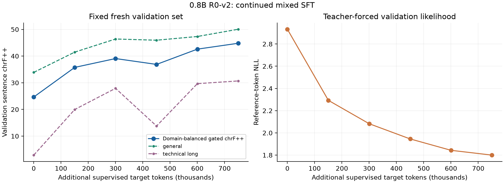
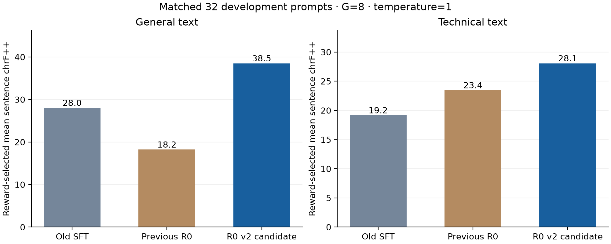

# Continued SFT and Acceptance of a New R0

**Date: 2026-11-12 · English → Icelandic · Colab Tesla T4 · SFT only**

## Observed Decision

R0-v2 is the strongest tested SFT candidate by matched reference metrics. It is not yet validated as a semantically reliable starting point for full-domain English-to-Icelandic DAPO.

On the same32dev sources with G=8,T=1, the new model has expected random sentence-chrF++28.88, reward-top1=33.28 and reference oracle39.19. Older SFT gives20.21/23.59/28.68; original R0 gives20.68/20.83/26.84. Reference means improve for general/technical sources and all three lengths. Reward-top1 gain over older SFT is+9.69, with stratified paired95%interval[5.18,14.20]; versus original R0 it is+12.45,[7.86,17.58]. Nonconstant-reward groups24→29, all-zero groups8→3; reference-score gain from selection over random is+4.40,[1.60,7.76]. These are substantive relative improvements, not proof of semantic correctness rates.

On the same 32 development sources at G=8, T=1, random-expected sentence chrF++, reward top-1 and reference-oracle means are 28.88/33.28/39.19 for R0-v2, versus 20.21/23.59/28.68 for old SFT and 20.68/20.83/26.84 for previous R0. Reference means improve in both domains and all three length bins. Reward-top-1 gains are +9.69[5.18,14.20] against old SFT and +12.45[7.86,17.58] against previous R0, using stratified paired 95% intervals. Variable-reward groups rise 24→29, all-zero groups fall 8→3, and reward selection gains +4.40[1.60,7.76] over uniform sampling. These establish relative reference-metric gains, not semantic accuracy.

Lexical meaning and word forms remain bottlenecks: none of the eight inspected p04 samples clearly conveys dismissal from employment, and greedy also uses slökkvaður. Greedy p00 is exact, while its eight T=1 samples do not reproduce that correct sentence. An unreliable p24 output still receives about 0.93 reward. Of 64 technical-long candidates,26 contain Han/Cyrillic/Arabic intrusions absent from the source (40.6%), despite high form-filter validity. These proxies do not establish strong comprehensive translation or guarantee DAPO gains. Small signal diagnostics and formal method experiments must remain distinct.

R0-v2 names this project’s continued-SFT candidate. The internal R1 directory is a round label, not an RL stage or DeepSeek-R1.

## Completed Training

| Item | Observed |
| --- | --- |
| Warm start | Old SFT step250; fresh optimizer |
| Additional target tokens | 759957 |
| Optimizer updates | 1759 |
| Selected step | 1736 |
| Selected-model added tokens | 750064 |
| Stop reason | wall_budget |
| Update compute minutes | 155.23 |
| Training-loop wall minutes | 180.02 |
| Safely skipped FP16 overflow retries | 3 |
| Physical target tokens incl. retries | 761292 |
| Planned maximum | 1,200,000 target tokens OR cumulative 3 hours; first reached |
| Unique examples seen by selected model | 12288 |
| Selected-model example exposures | 27776 |
| Available training examples | 13717 |
| Exported adapter SHA256 | 806b9857024868131140da43ad3975d7c8653b97e5687420e4499a3769995847 |

Total computed work and selected-model exposure are reported separately. A wall-limited run must not be called a completed 1.2M-token run. Selection can choose an earlier checkpoint. Target tokens include EOS; prompt and padding tokens are excluded from the supervised denominator.

Training-loop wall time includes baseline/periodic validation and checkpoint overhead, excluding earlier data preparation, model download/startup and later G8. Three FP16 overflows safely skipped updates and retried; their work is retained in the compute counters. Frontend disconnection caused no replayed training.

## Data and Training Protocol

| Stratum | Unique train examples | Decoded dev N | Planned token share | Selected exposure |
| --- | --- | --- | --- | --- |
| general | 7405 | 16 | 40.0% | 300001 |
| technical_short | 1488 | 4 | 15.0% | 112513 |
| technical_medium | 2467 | 6 | 25.0% | 187502 |
| technical_long | 2357 | 6 | 20.0% | 150048 |

OPUS-Tatoeba and ParIce supply 13,717 frozen training pairs after filtering roughly 2.1M raw pairs. Filters cover language, numbers, lengths, boundaries and OCR/TeX noise. Prior development/diagnostic inputs are protected. Fresh development has 80 examples, with 32 fixed decoded examples for model selection. Exact normalized source/reference overlap checks do not rule out near duplicates or shared-document dependence.

AI-assisted alignment checks covered 40 stratified training examples and all 32 decoding references, without native-speaker certification. Domain labels proxy source corpora. Cleaning and mixture balancing are baseline engineering, not an algorithmic novelty claim.

A separate32-example `fresh_readiness.jsonl` was frozen and not used in this matched G8 run. It remains available for a later development diagnostic and is not counted as a passed test.

- Base: `Qwen/Qwen3.5-0.8B`, revision `2fc06364715b967f1860aea9cf38778875588b17`.
- LoRA: r16, alpha32, dropout0.05; 10,822,656 trainable parameters, inherited adapter structure.
- AdamW, learning rate 5e-5, 3% warmup, cosine schedule over 1.2M target tokens; effective batch16, microbatch2, FP16 + dynamic loss scaling, SDPA.
- Maximum full training sequence768 tokens, target256; examples over limits are excluded, not silently truncated.
- Cross-entropy is summed then normalized by actual target-token count across the effective batch; no prompt/padding supervision.
- Checkpoint roughly every300 seconds; full development evaluation every150k added target tokens; patience3 non-improvements after450k.
- Development decoding is greedy with320-token cap; 80-example teacher-forced NLL is a secondary tie-breaker.
- Selection score = 0.5 × general gated mean sentence chrF++ + 0.5 × mean(technical short, medium, long gated sentence chrF++). Gate-failed outputs count as0.
- The two-slot optimizer/RNG resume journal checks frozen configuration, input/source hashes and state hashes; intermediate adapter checkpoints remain on private Drive.

## Fresh Fixed-Validation Learning Curve

| Step | Added tokens | Selection | General | Tech short | Tech medium | Tech long | NLL | Failure |
| --- | --- | --- | --- | --- | --- | --- | --- | --- |
| 0 | 0 | 24.66 | 33.89 | 31.83 | 11.55 | 2.88 | 2.93 | 28.1% |
| 348 | 150335 | 35.76 | 41.49 | 50.35 | 19.78 | 19.98 | 2.29 | 9.4% |
| 696 | 300063 | 39.07 | 46.40 | 46.44 | 20.88 | 27.91 | 2.08 | 6.2% |
| 1045 | 450513 | 36.88 | 45.95 | 49.86 | 19.77 | 13.78 | 1.95 | 18.8% |
| 1391 | 600208 | 42.60 | 47.34 | 55.66 | 28.28 | 29.67 | 1.84 | 6.2% |
| 1736 | 750064 | 44.80 | 50.06 | 58.89 | 29.07 | 30.68 | 1.80 | 3.1% |

The 24.66 starting score belongs to this fresh set and aggregation, not historical reports. Within-set trends are comparable; the small decoded set is used for selection, so it is not an independent test.

Technical-short decoding has only four examples, including a formulaic dated statement. A perfect easy example materially affects its mean; that mean alone does not establish terminology or medical-semantic competence. Source checks and matched G8 remain necessary.

## Matched Three-Model G=8

| Model | Random | MetricX top-1 | Reward | Ref oracle | Corpus all8 | Corpus reward top1 |
| --- | --- | --- | --- | --- | --- | --- |
| Old SFT | 20.21 | 23.05 | 23.59 | 28.68 | 19.39 | 20.89 |
| Previous R0 | 20.68 | 20.83 | 20.83 | 26.84 | 23.38 | 23.88 |
| New R0 candidate | 28.88 | 33.28 | 33.28 | 39.19 | 26.84 | 27.67 |

The first four score columns average sentence chrF++, not official WMT scores or semantic accuracy. Random is uniform within-group expectation; the reference oracle is unavailable to training. Sentence top-1 ties are averaged; displayed examples and corpus scores use seeded tie representatives.

### Domain and Length Breakdown

| Model | Scope | N | Random | Reward top1 | Ref oracle | Variable groups | Script intrusion |
| --- | --- | --- | --- | --- | --- | --- | --- |
| Old SFT | general | 16 | 21.64 | 28.02 | 33.34 | 16/16 | 8.6% |
| Old SFT | technical | 16 | 18.77 | 19.15 | 24.02 | 8/16 | 32.0% |
| Old SFT | short | 13 | 21.91 | 29.53 | 35.32 | 13/13 | 9.6% |
| Old SFT | medium | 11 | 19.28 | 20.08 | 24.99 | 10/11 | 17.0% |
| Old SFT | long | 8 | 18.71 | 18.75 | 22.95 | 1/8 | 42.2% |
| Previous R0 | general | 16 | 17.73 | 18.21 | 25.61 | 16/16 | 6.2% |
| Previous R0 | technical | 16 | 23.63 | 23.45 | 28.07 | 8/16 | 22.7% |
| Previous R0 | short | 13 | 17.77 | 17.86 | 26.45 | 13/13 | 5.8% |
| Previous R0 | medium | 11 | 20.98 | 21.55 | 25.20 | 9/11 | 9.1% |
| Previous R0 | long | 8 | 25.01 | 24.66 | 29.73 | 2/8 | 35.9% |
| New R0 candidate | general | 16 | 31.53 | 38.50 | 46.27 | 16/16 | 5.5% |
| New R0 candidate | technical | 16 | 26.23 | 28.06 | 32.12 | 13/16 | 30.5% |
| New R0 candidate | short | 13 | 32.85 | 41.10 | 48.25 | 13/13 | 4.8% |
| New R0 candidate | medium | 11 | 26.24 | 28.62 | 34.72 | 11/11 | 17.0% |
| New R0 candidate | long | 8 | 26.05 | 26.98 | 30.62 | 5/8 | 40.6% |

### Paired Candidate Minus Baseline

| Baseline | Metric | Delta | Stratified paired95% CI |
| --- | --- | --- | --- |
| Old SFT | random_expected_sentence_chrfpp | 8.67 | [6.31, 11.30] |
| Old SFT | reward_top1_sentence_chrfpp | 9.69 | [5.18, 14.20] |
| Old SFT | best_of8_reference_sentence_chrfpp | 10.51 | [7.71, 13.74] |
| Previous R0 | random_expected_sentence_chrfpp | 8.20 | [5.41, 11.31] |
| Previous R0 | reward_top1_sentence_chrfpp | 12.45 | [7.86, 17.58] |
| Previous R0 | best_of8_reference_sentence_chrfpp | 12.35 | [8.56, 16.19] |

Intervals use 10,000 prompt-level paired bootstrap samples stratified by domain×length. They do not cover training randomness, different generation seeds, reference errors or out-of-distribution text.

### Reward Signal

| Model | Variable | All zero | error=25 | Gate pass | Strict proxy | Gain [95% CI] | Pairwise |
| --- | --- | --- | --- | --- | --- | --- | --- |
| Old SFT | 24/32 | 8/32 | 131/256 | 97.3% | 96.1% | 3.38 [0.82, 6.85] | 0.57 |
| Previous R0 | 24/32 | 8/32 | 147/256 | 96.5% | 96.1% | 0.15 [-0.96, 1.27] | 0.56 |
| New R0 candidate | 29/32 | 3/32 | 85/256 | 98.0% | 95.7% | 4.40 [1.60, 7.76] | 0.67 |

Reward variation supplies a numerical advantage; filter validity checks form. Neither proves semantic adequacy or RL gains. Pairwise agreement uses candidate pairs separated by at least five chrF++ points and remains a reference proxy. There is no arbitrary10% veto or universal chrF++ readiness threshold.

## Source-Based Candidate Review

These AI-assisted source/reference/candidate checks inspect meaning, negation, common words, entities, numbers and longer technical passages. They are not native-speaker judgments or a semantic accuracy estimate. Historical high-score counterexamples are retained to check actual repairs.

### p00 · r0_v2_candidate · candidate 3

- Source: I'm not able to translate this sentence.
- Reference: Ég get ekki þýtt þessa setningu.
- Candidate: Ég get ekki þýst þessa setning.
- chrF++ 71.75; MetricX error 0.35; reward 0.99

Reward-selected. The selected G8 output has the nonstandard form þýst; the reference oracle instead uses tölja, changing the key verb. Greedy decoding exactly matches the reference, so capability has improved but these eight T=1 samples fail to reproduce that correct sentence. High reference overlap or reward alone does not certify the verb.

### p01 · r0_v2_candidate · candidate 1

- Source: Shall I close the door?
- Reference: Á ég að loka dyrunum?
- Candidate: Mal ég loka dyrunum?
- chrF++ 65.65; MetricX error 0.26; reward 0.99

Reward-selected. The candidates preserve the core door-closing action, with malformed words such as Mal and grammatical issues. This is closer than unrelated output but is not certified fluent Icelandic.

### p03 · r0_v2_candidate · candidate 4

- Source: • Among those claims, the Authority gave a favourable assessment to the health claim referring to the effect of carbohydrates on the maintenance of brain function and proposed as appropriate conditions of use for that claim that ‘a daily intake of 130 g of glycaemic carbohydrates has been estimated to cover the glucose requirement of the brain (4).
- Reference: • Matvælaöryggisstofnunin mat eina þessara fullyrðinga jákvætt en það er heilsufullyrðing er varðar áhrif kolvetna á viðhald eðlilegrar heilastarfsemi og lagði til að viðeigandi skilyrði fyrir notkun þessarar fullyrðingar yrðu: „áætlað er að dagleg inntaka á 130 g af blóðsykurshækkandi kolvetnum (e. glycaemic carbohydrates) nægi til að uppfylla glúkósaþörf heilans“(4).
- Candidate: • Að því er varðar lyfið, gaf yfirvöldin viðeigandi ráð fyrir skríðunaskerta yfirvaldi, við háttaynding fyrir um öryggi á heilbrigði jafnræðisefnisins og komfið til viðeigandi settan nefnd til notkunar þess átt prófi um nú að 130 g af stækkunarcaffönum í dag eru búist með til að ná yfirgildi ráðstökkunnar um öryggi á hjartin s í.
- chrF++ 23.63; MetricX error 22.41; reward 0.10

Reward-selected. The source concerns carbohydrates, brain function and a130g intake requirement; candidates contain unrelated or malformed drug/heart content. Copying130g does not preserve the proposition.

### p04 · r0_v2_candidate · candidate 7

- Source: Tom was fired.
- Reference: Tom var rekinn.
- Candidate: Tom hafði verið slökkt.
- chrF++ 17.54; MetricX error 9.33; reward 0.63

Reward-selected. None of the eight inspected candidates clearly expresses dismissal from employment with rekinn or a confirmed equivalent. The reward choice uses slökkt and greedy uses slökkvaður, retaining a key-verb error. The oracle’s relstoðinn cannot be accepted merely for its spelling overlap.

### p05 · r0_v2_candidate · candidate 7

- Source: • Without prejudice to the powers laid down in Article 17, where a competent authority disagrees about the procedure or content of an action or inaction of a competent authority of another Member State in cases specified in the acts referred to in Article 1(2), the Authority, at the request of one or more of the competent authorities concerned may assist the authorities in reaching an agreement in accordance with the procedure set out in paragraphs 2 to 4 of this Article.
- Reference: • Ef lögbært yfirvald samþykkir ekki verklagsreglu eða inntak aðgerðar eða aðgerðaleysis lögbærs yfirvalds í öðru aðildarríki, í tilvikum sem tilgreind eru í gerðunum sem um getur í 2. mgr. 1. gr., skal stofnunin, að beiðni eins eða fleiri hlutaðeigandi lögbærra yfirvalda, aðstoða yfirvöldin við að ná samkomulagi í samræmi við verklagsregluna sem sett er fram í 2.–4. mgr. þessar greinar, með fyrirvara um valdheimildirnar sem mælt er fyrir um í 17. gr.
- Candidate: • Hölsum aðildarríkjanna í málum sem sett er fram um í 2. mgr. 1. gr., við skammti samstarfs við innskrift þeirra, sem lögbær yfirlýsandeferð er til, getur yfirvöld í samanlikningu við viðkomandi lögbær yfirlýsandeferð, sem sett er fram í 2. til 4. mgr. þessarar greinar.
- chrF++ 30.81; MetricX error 19.47; reward 0.22

Reward-selected. The legal authority, disagreement between competent authorities and conditions for assistance are omitted or confused. Retaining some article numbers and formatting is insufficient.

### p09 · r0_v2_candidate · candidate 6

- Source: If you can't keep your promise, what excuse will you make?
- Reference: Hvaða afsökun muntu nota ef þú getur ekki staðið við loforðið þitt?
- Candidate: Ef þú getur ekki haldið því í athagning á, hvaða afsökun verður þú?
- chrF++ 36.41; MetricX error 10.36; reward 0.59

Reward-selected. The conditional, negation and excuse are partly retained, while keeping a promise remains incomplete or malformed. Inspection of all eight did not identify a clearly faithful full rendering.

### p10 · r0_v2_candidate · candidate 2

- Source: The room is hot.
- Reference: Herbergið er heitt.
- Candidate: Herbergið er heyt.
- chrF++ 70.61; MetricX error 3.71; reward 0.85

Reward-selected. Relative to the old “dangerous room” output, the new choice is closer to a hot room, but heyt remains nonstandard relative to heitt. Greedy changes room to house. This is relative progress with residual lexical/form errors.

### p12 · r0_v2_candidate · candidate 1

- Source: The course consists of two modules, which may be taken separately or combined:
- Reference: Námskeiðið samanstendur af tveimur áföngum sem má taka hvorn um sig eða saman:
- Candidate: Innihaldstöðunin hefur tvö markmiðbrögð sem geta verið tekin að undanskilinu eða samanþötu:
- chrF++ 20.97; MetricX error 14.85; reward 0.41

Reward-selected. The source describes two course modules that can be taken separately or together; core nouns are unreliable. Retaining two/separate/together is insufficient.

### p15 · r0_v2_candidate · candidate 0

- Source: Your doctor will check your skin before you start taking Tafinlar, then check it again every month while you are taking this medicine and for 6 months after you stop taking it.
- Reference: Læknirinn mun skoða húðina áður en þú byrjar að taka Tafinlar og síðan mánaðarlega á meðan þú tekur lyfið og í 6 mánuði eftir að notkun lyfsins er hætt.
- Candidate: Læknirinn mun meta úrbanninga á húðinni áður en ferðinn er fyrir um gefingu Tafinlar og settja þá eftir 6 mánuðum eftir að hún telst gerp.
- chrF++ 33.48; MetricX error 11.83; reward 0.53

Reward-selected. Tafinlar and six months survive, a local improvement over the prior name hallucination, but the before-treatment/monthly-during-treatment/six-months-after schedule is omitted or altered.

### p17 · r0_v2_candidate · candidate 0

- Source: She advised him to take a long holiday, so he immediately quit work and took a trip around the world.
- Reference: Hún ráðlagði honum að fara í langt frí svo hann hætti umsvifalaust í vinnunni og fór í heimsreisu.
- Candidate: Hún ráðlagði honum að fara í langar foðahettingu, svo hann lagði sér hér og lét nái undir virki og ferðaði um heimsið.
- chrF++ 46.05; MetricX error 11.63; reward 0.53

Reward-selected. The sequence of a long holiday, immediately quitting and travelling around the world is not intact. Similar sentence framing conceals event errors and omissions.

### p21 · r0_v2_candidate · candidate 3

- Source: In addition, the entity is not entitled to reinvest such cash flows, except for investments in cash or cash equivalents (as defined in IAS 7 Cash-flow statements) during the short settlement period from the collection date to the date of required remittance to the eventual recipients, and interest earned on such investments is passed to the eventual recipients.
- Reference: Auk þess hefur einingin ekki rétt á að endurfjárfesta þess háttar sjóðstreymi ef undan eru skildar fjárfestingar í handbæru fé eða ígildi handbærs fjár (eins og það er skilgreint í IAS-staðli 7, yfirlit um sjóðstreymi) á því stutta greiðslutímabili frá innheimtudegi til þess dags þegar krafist er greiðslu til endanlegra viðtakenda, og vextir sem safnast á slíkar fjárfestingar greiðast endanlegum viðtakendum.
- Candidate: Aðsæirri rétt er einnanti að árita fraðavirkni í gagnvart þessu nema annaðfríandi efnahagsþjónustu sem rekkurð hluta þétta en einfaldan fjárháðar eða fjárhæð þegroðsyni (sem porfærð í IAS-lið 7. upplýsinga niðurstöð جوابar) á traustum viðmiðunatímabilinum, frá kostaðkekjamörkum til starfsemtagsrarvisins, og hittuð skalfiað orm á að gildi.
- chrF++ 23.16; MetricX error 24.43; reward 0.02

Reward-selected. The reinvestment prohibition, cash-equivalent exception, settlement period and interest allocation are incomplete or confused. A tiny nonzero reward establishes numerical variation only.

### p23 · r0_v2_candidate · candidate 1

- Source: When adequate acute or chronic toxicity data for the mixture as a whole are lacking, “bridging principles” or “summation method” should be applied (see sections 4.1.3.4 and 4.1.3.5).
- Reference: Þegar fullnægjandi gögn skortir um bráð eða langvinn eiturhrif blöndunnar í heild skal nota „brúunarreglur“ eða „samlagningaraðferð“ (sjá lið 4.1.3.4 og 4.1.3.5).
- Candidate: Ef veiðirefni (fullskiptafarviðmiðulessor) eða veiðeiejastengingin er ekki þekkt fyrir massanormt eða ennfravigi skulu heittää reikiðstæðilið (fumlaða málsstarfsið) eða stabilitý (furleiksskil) (sjá fagam 4.1.3.4 og 4.1.3.5).
- chrF++ 27.07; MetricX error 18.42; reward 0.26

Reward-selected. Section numbers survive, while missing acute/chronic mixture data and bridging/summation terminology do not reliably survive.

### p24 · r0_v2_candidate · candidate 6

- Source: At last, he solved the problem.
- Reference: Loksins leysti hann vandamálið.
- Candidate: Á loksinni uppfylldi hann þáengarinn.
- chrF++ 22.70; MetricX error 1.69; reward 0.93

Reward-selected. Solving the problem is not reliably rendered, yet QE error is only about1.69(reward about0.93). This is a concrete scorer-calibration counterexample.

### p28 · r0_v2_candidate · candidate 7

- Source: I had no idea what to do.
- Reference: Ég hafði enga hugmynd hvers ég ætti til bragðs að taka.
- Candidate: Mér var engin hugmynd af hvað ég ætti að gera.
- chrF++ 29.03; MetricX error 0.17; reward 0.99

Reward-selected. The reward choice broadly conveys not knowing what to do, with grammatical issues. The higher-chrF oracle uses unreliable greiðu; this illustrates why a lower-overlap paraphrase may be semantically closer.

### p29 · r0_v2_candidate · candidate 2

- Source: (b) the information furnished with the notification is complete and in accordance with the facts.
- Reference: b) upplýsingar sem fylgja tilkynningunni eru fullnægjandi og í samræmi við staðreyndir málsins.
- Candidate: b) upplýsingin sem greint sé til með tilkynningunni eru fullgingu og í samræmi við gerðirnar.
- chrF++ 52.75; MetricX error 7.03; reward 0.72

Reward-selected. The notification/information/compliance frame survives, but completeness and factual accuracy remain unreliable(e.g.fullgingu/gerðirnar). A52.75score is not legal-semantic correctness.

### p30 · r0_v2_candidate · candidate 0

- Source: (b) When the abovementioned products of animal origin, containing material from bovine, ovine or caprine animals are imported into the Community from third countries or regions thereof, the health certificates shall be accompanied by a declaration signed by the competent authority of the country of production, worded as follows:
- Reference: b) Þegar framangreindar afurðir úr dýraríkinu, sem innihalda efni úr nautgripum, sauðfé eða geitum, eru fluttar inn í Bandalagið frá þriðju löndum eða landsvæðum þeirra skal fylgja heilbrigðisvottorðunum yfirlýsing sem er undirrituð af lögbæra yfirvaldinu í framleiðslulandinu og hljóðar svo:
- Candidate: b) Þegar bemektar verktæki, sem kveðið er á, hafa boðskrendi frá veldungdalum, of engum og eirdögum, fungákalvo, eru báta í sameiginleg valora, skal því hilti lögbærandar yfirvald á landi verktunar þannig:
- chrF++ 22.27; MetricX error 22.26; reward 0.11

Reward-selected. Bovine/ovine/caprine material, third-country imports, health certificates and competent-authority declarations are not reliably preserved.

### p31 · r0_v2_candidate · candidate 5

- Source: Even if we do this, it will be another sixty years before the Antarctic ozone hole is repaired.
- Reference: Jafnvel þótt við gerum þetta munu líða önnur sextíu ár áður en gatið í ósonlaginu yfir Suðurskautslandinu lagast.
- Candidate: Jafnvel að við hömmum þetta verður það það annara cólfráborg á Argambærlý.
- chrF++ 17.82; MetricX error 20.67; reward 0.17

Reward-selected. The Antarctic ozone hole and another sixty years are lost or distorted; the oracle also contains different time references and mixed words.

## Time and Compute

| Model | Generation seconds | Scoring seconds | Generated tokens |
| --- | --- | --- | --- |
| Old SFT | 298.14 | 11.49 | 16232 |
| Previous R0 | 333.37 | 13.66 | 20158 |
| New R0 candidate | 244.27 | 15.46 | 16998 |

New-model G8 generation took about 4.07 minutes, including candidates later rejected; baseline timings are cached from the earlier diagnostic. Different output lengths, padding and cache states prevent interpreting these cross-weight timings as an algorithmic speedup. Runner start to confirmed T4 release was about 192.51 minutes, excluding earlier allocation, authorization and preparation; this is not complete billed GPU time.

## Additional Greedy Control

Separate greedy decoding on historical p00/p04/p10 helps distinguish T=1 sampling noise from base translation ability. 372 loaded adapter tensors exactly match the selected weights. This control changes no G8 protocol or parameters, does not reselect the checkpoint, and is not a quality benchmark.

| Prompt | Source | Greedy output | chrF++ |
| --- | --- | --- | --- |
| p00 | I'm not able to translate this sentence. | Ég get ekki þýtt þessa setningu. | 100.00 |
| p04 | Tom was fired. | Tom var slökkvaður. | 38.41 |
| p10 | The room is hot. | Húsið er heitt. | 59.19 |

## Recommended Next Step

First calibrate sampling and rewards at low cost, then decide additional SFT. Do not immediately start formal DAPO or paper-primary ablations. The following are unexecuted next-stage recommendations.

1. Freeze this R0-v2, older SFT and original R0. Preserve the new model as the current strongest SFT candidate and use one common start for subsequent methods. Retain the pinned base, adapter hash and stratified dev data.

2. Diagnose G=8 temperatures without parameter updates on the same frozen model, e.g. T=1 versus T=0.7 on another prefrozen dev panel. Check for correct/basically faithful candidates rather than only chrF gains. Correct p00 greedy but all-wrong G8 indicates a sampling-distribution issue; wrong p04 greedy also indicates lexical weakness. Any DAPO temperature change requires consistent sampling and behavior/current-policy log probabilities, not changed generation with old T=1 probabilities. Temperature tuning is not itself an innovation.

3. Build small MetricX semantic anchors: faithful reference/reliable translation paired with negatives differing only in negation, action, drug, number or timing. High-reward errors require ranking-direction checks and potentially reference-aware scoring. Format gates/language ID cannot replace semantic review. Calibrate scorer changes on frozen candidates, recording them separately from model updates.

4. If reasonable sampling still lacks basically faithful candidates, continue SFT. The smallest next round resumes saved optimizer/RNG to finish the planned1.2M new target tokens:759,957completed,440,043remaining. At about81.6target tokens/s, estimate1.5–2T4hours including validation; unexecuted and without a quality guarantee. Use a new run directory, preserve results and select jointly with periodic decoding, source semantics and NLL rather than training loss or one high-chrF example.

5. If many key noun/verb errors remain after that budget, inspect training-example fit and independent lexical generalization before adding high-quality in-training-partition lexical/short-sentence supervision and broader parallel coverage. If needed compare adapter capacity/trainable layers on the same0.8B base. Profile memory and small-scale quality before long runs; avoid relying only on official-document templates to inflate scores. Disclose dev-informed design and retain a separate untuned test set.

6. Once candidate ability and reward direction are calibrated, run a controlled DAPO pilot of about20–50updates with fixed evaluation prompts, reward-independent reference metrics and cross-domain source checks. If quality improves, proceed formally; otherwise diagnose sampling, reward or SFT bottlenecks. The pilot tests learnability rather than already proving RL benefits.

First calibrate sampling and reward at low cost, then decide how much further SFT is needed. Do not launch formal DAPO or the main paper ablation yet. These are proposed next steps, not work executed in this run.

1. Freeze R0-v2 and both preserved baselines. Use one common initialization for later methods and retain pinned base, adapter hash and stratified development inputs.

2. Run a no-update G8 temperature diagnostic, for example T=1 versus T=0.7, on another pre-frozen development set. Inspect whether faithful candidates actually appear. Exact greedy p00 but poor sampled p00 implicates sampling distribution; erroneous greedy p04 separately implicates lexical ability. If DAPO temperature changes, generation and behavior/current-policy log probabilities must use consistent distributions. Changing only generation while retaining T=1 probabilities is insufficient. Temperature tuning is not itself novelty.

3. Calibrate MetricX using semantic anchors: faithful translations versus negatives that change negation, action, drug name, number or temporal relation. High-reward errors require checking ranking direction, potentially comparing reference-informed scoring. Gates/language ID do not replace semantic checks. Test scorer changes on a fixed candidate bank and record them separately from policy changes.

4. If faithful candidates remain scarce under reasonable sampling, continue SFT. The smallest continuation completes the originally planned 1.2M additional target tokens from saved optimizer/RNG state:759,957 are consumed, leaving 440,043. Measured update throughput of about 81.6 target tokens/s suggests roughly 1.5–2 T4 hours including validation, as an unexecuted estimate without a quality guarantee. Use a new run directory, preserve this result, and select with decoded source checks plus NLL rather than training loss or isolated high chrF.

5. If key noun/verb errors persist in greedy decoding, inspect training-set fit versus held-out lexical generalization before adding training-only lexical/short-sentence supervision and broader clean parallel coverage. If necessary, compare adapter capacity or trainable-layer choices on the same 0.8B base. Measure memory and small-scale quality before committing to long training. Do not inflate scores with formulaic templates; preserve a separate test set when development failures inform a new round.

6. Once candidate ability and reward direction are credible, run a controlled 20–50-update DAPO pilot. Use frozen prompts, independent reference metrics and cross-domain source checks before and after updates. Scale only if quality improves; otherwise distinguish sampling, reward and SFT limitations. A pilot tests learnability rather than proving RL gains in advance.

7. Efficient-ML novelty should concern quality-constrained compute savings, such as prefix reuse and selective updates that actually avoid computation. Lock the credible initialization and reward first, then measure rollout, scorer and update wall time/work to compare cost at matched quality. SFT, cleaning and CLI recovery here are baseline engineering, not a novelty claim.

## Reproducibility and Preservation

New model: `D:\deep learning project\runs\r0_v2_colab_2026-11-12\best_adapter`. The owned T4 was released through the official API and confirmed absent from assignments; other runtimes were left untouched.

Old SFT, previous R0 and independent snapshots are preserved. Adjacent JSON files record installation, integrity and runtime closure. The export passes whole-file SHA256, ZIP CRC and path checks. All256 new candidate chrF++ values were recomputed locally; maximum difference 0.0. The adapter hash matches the sampled identity.

Exact resume requires private Drive optimizer/RNG state, not just best_adapter. The model package contains a LoRA adapter, not the0.8B base. Load the pinned base revision and matching tokenizer/template. New reproductions must use separate directories.

### Frontend Disconnect and Recovery

The frontend disconnected near344.8k added tokens. Both browser tabs remained on connecting. After user-operated official-client OAuth in Edge, google-colab-cli0.8.0 account/file APIs verified the same T4, VM and frozen source hash, with training already near450k and the original process active. No training restart or replay occurred. A separate lightweight CPU control kernel handles metadata/export verification without model updates.

Upstream does not currently declare Windows support. OAuth, assignment queries, file reads and control-kernel execution were verified on this host; this does not establish compatibility for every command. Credentials use the official CLI keyring provider; account tokens, proxy URLs and browser capability links are excluded from delivery.

An account-level API snapshot around14:19 Berlin showed292.16 paid compute units remaining and1.23CU/h total consumption. This is a timestamped account snapshot, not the final balance or measured run cost. No units were purchased and billing statements were not inspected.

Matched G8 protocol:32 historical development prompts,13 general short/3 general medium/8 technical medium/8 technical long; G8,temperature1,top-p1,top-k0,repetition penalty1,256 new-token cap. Same prompt IDs, tokenizer/template, per-prompt seed and backend source; old candidates are cached, not regenerated. MetricX QE FP32,1,024-token cap, official source/candidate input and logit250089 clipped0..25; project reward=`gate ? 1-error/25 : 0`. Scorer revision `51e875ba5c525c81627cfd135ee10f43c87dce00`.

## Limits

Historical G8 comes from a development pool used for model selection; fresh development also selects checkpoints. Neither is blind test data. Domain and length are not fully crossed. Corpus and sentence aggregation can rank models differently. One seed, small samples, imperfect references and AI semantic checks limit generalization. No DAPO update was run, so RL improvement, native quality or full-document capability is unproven. Account-balance snapshots do not measure this run’s cost.

## Deliverables

- `R0_V2_RESULTS_2026-11-12.md/.html`: bilingual report; HTML contains embedded figures and expandable raw candidates.
- `R0_V2_MODEL_2026-11-12.zip`: selected adapter plus loading/provenance notes.
- `R0_V2_COLAB_EXPORT_2026-11-12.zip`: training logs, selected adapter, G8 raw results and exact source/data.
- `R0_V2_BASELINE_ADAPTERS_2026-11-12.zip`: preserved old-SFT initializer and previous-R0 adapters, with verified hashes and a fresh-run training recipe; base weights excluded.
- `R0_V2_COMPARISON_2026-11-12.json`, `R0_V2_AUDIT_2026-11-12.json`, `R0_V2_SOURCE_REVIEW_2026-11-12.json`: metrics, integrity checks and qualitative notes.
- `R1_SFT_CONTINUATION_2026-11-12.ipynb/.py`, `R1_SOURCE_BUNDLE_2026-11-12.zip`: actual execution entry point and frozen source bundle.
