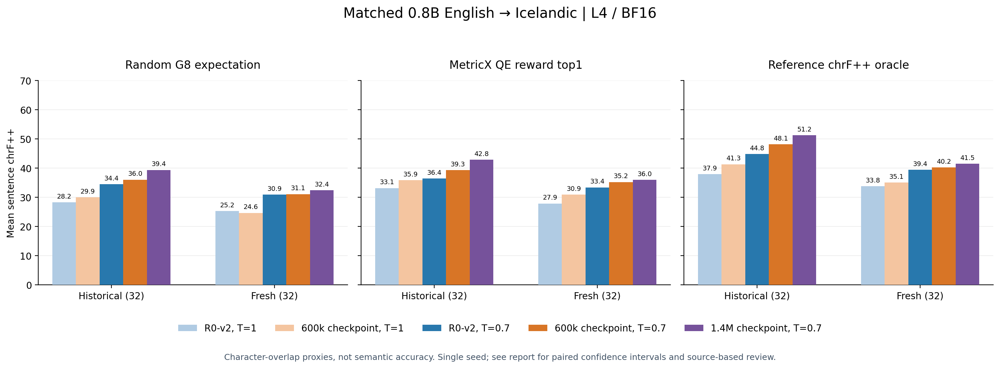

# R0-v3：0.8B SFT 补强与 DAPO 起点验收 / SFT Strengthening and DAPO Readiness

**2026-11-13 · English → Icelandic · Colab NVIDIA L4 · SFT only**

## 实际结论 / Measured decision

**准话：本轮已经得到更好的候选，推荐保留1.4M新增目标token的末期NLL检查点；但它仍未通过你要求的“综合DAPO起点”验收。需要继续补强SFT，正式DAPO与效率方法对比暂缓。**

验收依据是普通词义和基本关系是否保留，以及G8内是否出现有用候选、奖励能否选对。当前同时存在基础翻译覆盖不足和MetricX误排。更低温度、更多重复采样或更换评分输入模式，不能单独解决全部问题。

**Decision: this run produced a stronger candidate, the late minimum-NLL checkpoint with1.4M added target tokens. It still does not pass the requested comprehensive DAPO-starting-policy check. Further SFT strengthening is warranted; formal DAPO/efficiency comparisons should wait.**

The check concerns ordinary word meaning and basic relations, useful candidates within G8, and whether rewards select them. Both insufficient translation coverage and MetricX misranking remain. Decoding concentration and reward-input calibration address parts of the problem.

在同一L4/BF16、T0.7/G8条件下，末期模型的MetricX选中译文平均单句chrF++：历史32条 **42.84**，原R0-v2为36.43；新增32条 **35.95**，原R0-v2为33.36。对应配对95%区间：历史提升+6.42分 [1.31,11.89]，新增提升+2.59分 [-1.85,6.79]。历史改善较明确，新增集的改善尚不确定。

原greedy规则选中的600k检查点在T0.7下为39.31/35.20；末期检查点抽样分布更好，因此后续SFT建议从独立保存的`nll_adapter`开始。新增集的greedy均分却由600k的36.72变为末期35.81，不能说所有指标都提高。末期专业长句Reward-top1均分仅为历史31.66、新增26.96；这些分数仍是字符代理，不是正确率。

本轮SFT实际新增1,400,474个目标token、2106次更新，正式循环140.08分钟，未变更0.8B规模。T1→T0.7为600k模型带来的随机采样均分增益约+6.08/+6.46，说明先校准采样很有价值。共保存2560个不重复G8候选和192个不重复greedy对照；16条probe的128候选已复用进完整末期评测，不重复计数。L4已释放，账户计算单元净减少约8.37 CU，释放后余额约281.83 CU。

On the same L4/BF16 at T0.7/G8, mean sentence chrF++ of the reward-selected late-model outputs is **42.84** on historical32 versus36.43 for R0-v2, and **35.95** on fresh32 versus33.36. Paired95% intervals for the gains are +6.42 [1.31,11.89] and +2.59 [-1.85,6.79]. Historical improvement is clearer; fresh improvement is uncertain.

The original greedy-selected600k candidate obtains39.31/35.20. The late candidate has the more useful observed sampling distribution and is saved separately as nll_adapter for further SFT. Fresh greedy mean falls from36.72 to35.81, so improvement is not uniform. Late-model technical-long reward-top1 means remain31.66/26.96; these overlap proxies are not correctness percentages.

Actual SFT adds1,400,474 target tokens over2106 updates and140.08 main-loop minutes at unchanged0.8B scale. T1→T0.7 improves the600k candidate's random-sample means by about6.08/6.46. Artifacts contain2560 unique G8 candidates and192 unique greedy controls;128 probe candidates are reused in the full late-model bank. The owned L4 is released. Approximate account compute-unit decrease is8.37 CU, with281.83 CU remaining afterward.

这是一次单训练种子、单采样种子的开发实验。末期NLL模型是在看到16条有针对性的开发难例后扩展到64条，新增留出也已被检查，现属于开发证据；后续正式比较需要另行冻结、检查源文/参考质量且未用于选择的新留出集。历史/新增、greedy/G8、单句均值/语料chrF++须分别理解。f00/f28的参考问题在候选生成前已登记，完整32条主结果及剔除两条后的30条敏感性结果均保留。

语义核查为AI辅助，未获得母语者逐条认证。核查接受保留含义的词形和同义差异；没有把所有语法错误或单个失败句当作总体不合格的理由。本次结论来自多个普通词义、动作、数字和关系错误，及专业中长句的整体薄弱。抽样oracle只是当前8个候选中参考chrF++的最大值，不能视为语义能力上限。高门控通过率或奖励方差也不能单独证明语义可学。

新增训练数据曾经用同一MetricX做QE筛选，后续QE改善不构成独立质量证据。字符清洗、语言识别、精确源文/参考去重以及55条训练对的AI抽查能提供部分保障；近重复、语境依赖和剩余错配仍可能存在。本轮不能推出0.8B的能力上限，也没有验证DAPO训练增益。

This is a one-training-seed, one-sampling-seed development experiment. The late candidate is expanded after a purposive16-case probe; inspected fresh data are now development evidence. Formal comparisons need a newly frozen, source/reference-reviewed hold-out not used for selection. Historical/fresh, greedy/G8, and sentence-mean/corpus chrF++ are distinct. The f00/f28 reference defects were registered before generation; both full32 primary and30-prompt sensitivity results remain visible.

Semantic checks are AI-assisted, without native-speaker adjudication. Meaning-preserving inflection and synonym differences are accepted. The decision is not based on requiring perfect grammar or every single example to pass; multiple ordinary senses/actions, numeric/relational errors and weak technical medium/long behavior remain. The reference chrF oracle is only this8-candidate metric maximum, not semantic capacity. Gate passes and reward variation alone do not establish useful semantic learning signals.

The same MetricX screens added training rows, so later QE gains are not independent quality evidence. Encoding/language screens, exact source/reference protection and55 AI-reviewed training pairs provide partial assurance, not elimination of near-duplicates, context dependence or alignment noise. This run establishes neither a0.8B capacity ceiling nor a DAPO training gain.

“合格起点”指在本项目句子／短段落范围内，候选分布与奖励排序支持后续受控学习；不代表母语水平、文档级可靠性或已经证明 DAPO 有增益。本轮没有 DAPO 更新。

A useful starting policy must support controlled learning from its candidate distribution and reward behavior. This does not certify native quality, document-level reliability or a positive DAPO result. No DAPO updates occurred.

图中为字符重合代理指标，不能解释为语义正确率；配对置信区间和具体词义错误见下文。 / Character overlap is not semantic accuracy; paired uncertainty and source-based cases follow.

## 实际训练 / Actual training

| 项目 / Item | 实测 / Observed |
| --- | --- |
| Policy | Qwen/Qwen3.5-0.8B; unchanged scale |
| Warm start | Original R0-v2, fresh optimizer; resource-pilot weights discarded |
| Added target tokens | 1400474 |
| Completed optimizer updates | 2106 |
| Original greedy-selected step | 903 |
| Original selected-model added target tokens | 600408 |
| Minimum-NLL candidate step | 2106 |
| Minimum-NLL candidate added target tokens | 1400474 |
| Final development recommendation | checkpoints/step-002106-tokens-001400474 (preferred candidate for further SFT / diagnostics; not a validated comprehensive DAPO base) |
| Stop reason | dev_plateau |
| Main-loop wall minutes | 140.08 |
| Main update-compute minutes | 96.43 |
| Main target tokens / update-compute second | 242.06 |
| Main target tokens / loop-wall second | 166.63 |
| Main runner through completed export, minutes | 169.11 |
| Approximate account compute-unit balance decrease | 8.37 |
| Precision | torch.bfloat16 |
| Microbatch / effective batch | 8 /32 |
| Trainable LoRA parameters | 10822656 |
| LR / warmup / schedule | 3e-5 /3% / cosine2M target tokens |
| Training cap | 2M added target tokens OR4 accumulated MAIN-loop hours |
| Selected adapter SHA256 | 0f075c31d0bee3192f2b449a59b7ba6ca3f9370ad219b1c6a98fcf00a01660df |
| Preserved starting adapter SHA256 | 806b9857024868131140da43ad3975d7c8653b97e5687420e4499a3769995847 |

目标 token 包含 EOS；prompt、padding 不进入监督损失分母。完整序列≤768、目标≤256；不截断参考。损失按实际目标 token 加权。有效批次内按长度排序以减少填充。选中模型曝光和实际物理计算量分别报告。

Targets include EOS, with prompt/padding excluded from the supervised denominator. Full sequence≤768 and target≤256, without reference truncation. Loss is weighted by actual target tokens. Within-batch length sorting reduces padding. Selected-model exposure and physical computed work are distinct.

| 计算／曝光 / Work or exposure | 值 / Value |
| --- | --- |
| Selected-model example exposures | 28896 |
| Selected-model unique training pairs | 28292 |
| Main physical target tokens | 1400474 |
| Logged updates / unique logical steps | 2106 / 2106 |
| Safety overflow retries | 0 |
| Discarded micro4 pilot targets | 41507 |
| Discarded micro4 pilot update seconds | 298.66 |
| Discarded pilot baseline seconds | 327.75 |
| Discarded throughput-probe targets | 10143 |
| Throughput-probe wall seconds | 54.74 |
| Training-pair QE screening wall seconds | 356.33 |

数据下载/清洗、模型初始化、资源预检、周期验证、G8、评分与传输均有开销。4小时上限是正式训练循环上限，不是整个任务耗时或总GPU预算。被中断预检可能有少量未写日志的部分计算，未计入其已完成token。

Downloads, filtering, initialization, probes, periodic validation, G8/scoring and transfers add overhead. The4h cap applies to the main loop, not the full task. Possible unlogged partial work in the intentionally interrupted pilot is excluded from its completed-token count.

## 数据质量与覆盖 / Data quality and coverage

| 数据 / Data | 数量 / Count |
| --- | --- |
| Retained training pairs | 38799 |
| New filtered subtitle pairs | 25308 |
| Vetted replay pairs | 13491 |
| Target tokens across unique training pairs | 1068396 |
| NLL dev / greedy selection / new readiness | 144 / 64 / 32 |

| 层 / Stratum | 训练对 / Pairs | 目标token占比 / Planned share | 选中模型目标token / Selected exposure |
| --- | --- | --- | --- |
| general | 32550 | 65.0% | 390229 |
| technical_short | 1465 | 8.0% | 48048 |
| technical_medium | 2437 | 15.0% | 90089 |
| technical_long | 2347 | 12.0% | 72042 |

新增数据来自OPUS OpenSubtitles-v2018；回放保留Tatoeba一般文本及ParIce法规/医药等文本。先做编码、字母、长度、句界、数字、语言及去重筛选；已知历史留出与ParIce20.05/21.10官方留出按归一化源文和参考保护。新增官方诊断子集排除已知历次训练源文/参考。此分离不能排除近重复、同文档相关性或未知预训练重合。

New rows derive from OPUS OpenSubtitles-v2018, with Tatoeba/general and ParIce/technical replay. Encoding/alphabet, length/boundary, numeric, language and deduplication screens precede training. Historical and both official ParIce held-outs are protected by normalized source/reference equality. New official diagnostic subsets exclude known earlier training sources/references. This does not exclude all near-duplicates, document correlation or unknown pretraining overlap.

初查发现大面积可疑字符编码污染；未审核数据版本在任何SFT更新前归档重建。1,019,209条原始字幕命中已知字符规则；这是启发式命中数，不是人工确认错误率。未猜测修补转码。旧SFT及R0-v2训练文件同规则命中均为0。97语言分类器的稀疏计算优化在200条检查文本上与原版预测和置信度完全一致，未缩减语言集合。

The preliminary split was rebuilt before any SFT update after encoding pollution was discovered.1,019,209 raw rows matched character rules, a heuristic count rather than a human error-rate estimate; no guessed transcoding repair was used. Earlier SFT/R0-v2 train files had zero same-rule matches. A sparse implementation of the unchanged97-class language identifier matched stock predictions/confidence on200 checked texts.

新增训练字幕再经固定MetricX FP32 QE误差≤6辅助筛选；所有4万条候选的分数被保存。55条分层训练对和32条新增解码验证对经AI辅助源文/参考抽查，明显错配和不适合独立翻译的样本隔离。该筛选会误删好译文，也不能保证余下数据全部正确；没有母语者逐条认证。开发/测试数据没有按QE筛选。

Only added training subtitles are filtered at fixed MetricX FP32 QE error≤6, with all40k candidate scores retained. AI-assisted source/reference checks cover55 stratified training pairs and32 added decoded-dev pairs; obvious or unsuitable alignments are quarantined. The filter rejects some valid pairs and can retain errors; no native-speaker certification is claimed. Development/test rows are not QE-filtered.

**后续QE不是独立证据。** 数据筛选和后续奖励使用同一个MetricX，因此QE变好不能单独证明翻译变好。下文同时报告独立参考chrF++、新留出诊断及源文语义检查。

**Later QE is not independent evidence:** data filtering and reward use the same scorer. QE improvement alone cannot establish translation improvement; reference chrF++, new held-out diagnostics and semantic inspection are also reported.

## 训练前后开发曲线 / Development curve

| Selection stratum | Development prompts |
| --- | --- |
| general | 32 |
| technical_short | 8 |
| technical_medium | 12 |
| technical_long | 12 |

| Step | Added target tokens | Selection score | NLL | General | Tech short | Tech medium | Tech long | Gate fail |
| --- | --- | --- | --- | --- | --- | --- | --- | --- |
| 0 | 0 | 40.24 | 1.91 | 44.81 | 53.06 | 26.94 | 27.02 | 4.7% |
| 302 | 200507 | 40.14 | 1.86 | 44.24 | 51.39 | 28.35 | 28.36 | 4.7% |
| 601 | 400263 | 39.85 | 1.83 | 44.82 | 51.09 | 30.41 | 23.12 | 7.8% |
| 903 | 600408 | 43.41 | 1.80 | 46.81 | 60.12 | 27.85 | 32.06 | 6.2% |
| 1203 | 800159 | 42.33 | 1.77 | 45.90 | 53.06 | 32.21 | 30.99 | 3.1% |
| 1504 | 1000225 | 43.25 | 1.75 | 46.71 | 54.54 | 26.80 | 38.01 | 1.6% |
| 1806 | 1200572 | 41.91 | 1.73 | 49.20 | 50.40 | 30.97 | 22.46 | 7.8% |
| 2106 | 1400474 | 42.97 | 1.72 | 48.07 | 54.61 | 33.29 | 25.68 | 6.2% |

选模型得分给一般/专业各50%权重；专业三长度等权，无效输出计0，NLL用于同分决胜。该64条验证集扩大了上一轮32条的范围，不能把本轮得分与旧报告44.8041直接比较；应比较本轮同集合的起点和候选。得分与结构门控均不是语义正确率。

Selection weights general and technical domains equally, with equal technical-length weights; invalid outputs contribute0 and NLL breaks ties. The64-prompt set expands the prior32, so its score cannot be directly compared with the old44.8041 figure. Compare this run’s baseline and candidate on the same set. These proxies do not measure semantic accuracy.

## 之前基线的记录 / Earlier baseline context

| Nov12, T4/FP16 historical32 | Random G8 chrF++ | Reward-top1 chrF++ | Reference oracle chrF++ |
| --- | --- | --- | --- |
| Old SFT | 20.2072 | 23.5873 | 28.679 |
| Previous R0 | 20.6834 | 20.8299 | 26.8422 |
| R0-v2 | 28.8784 | 33.2782 | 39.1929 |

这些是上一轮已保存的同T4诊断数据，仅用于说明基线演进；本轮L4/BF16的采样结果必须与本轮重新运行的R0-v2比较，不能跨硬件/精度直接相减。短句子集、32条与64条混合集合也不能混为同一个评测。

These saved Nov12 T4 diagnostics provide historical context only. Compare new L4/BF16 samples against the R0-v2 rerun on this same configuration; do not subtract across hardware/precision. Short-only,32-prompt and64-prompt mixed evaluations are distinct.

## 同条件G8与贪心比较 / Matched G8 and greedy comparison

R0-v2和候选均在同一L4、BF16、相同模板/输入/采样种子上重新运行：G8、T1、top_p1、top_k0、256新token上限；贪心对照320。MetricX使用固定官方权重、FP32 QE、source/candidate输入、1024上限，读出logit250089并截到0..25，奖励为门控通过时1−误差/25，否则0。历史32和本轮新留出32分别报告；不把先前T4/FP16结果当作同条件基线。

Both models are rerun on the same L4/BF16, prompt template, inputs and sampling seed: G8/T1/top_p1/top_k0 with256 new-token cap, plus greedy control at320. MetricX uses pinned official FP32 QE/source-candidate input,1024 cap, vocabulary-logit250089 clipped0..25; gated reward is1−error/25 or0. Historical32 and new32 are reported separately; prior T4/FP16 results are not substituted for matched controls.

实际奖励门控仅检查非空、源文复制、字符长度比0.15..6及截断；strict proxy额外检查重复及语言识别，但不足4词的短句不做语言识别。异文字计数另查西里尔、阿拉伯、CJK字符，不能识别所有乱码或伪冰岛语。高strict通过率不能称为语义正确率；例如短句夹有汉字仍可能通过。

The actual reward gate checks emptiness, source copying, character ratio0.15..6 and truncation. The stricter diagnostic adds repetition and language ID, but skips language ID below four words. A separate foreign-script counter detects Cyrillic/Arabic/CJK characters, not all gibberish or invented Icelandic. High strict-proxy pass rates are not semantic accuracy; short mixed-script output can still pass.

Random为每组8个候选chrF++均值；Reward-top1对并列最高实际奖励候选取chrF++均值，代表均匀打破平局的期望值；oracle为该组参考chrF++最大值。再对提示等权平均。展示译文在并列时按固定种子选一名代表，因此其单条分数可能不同于并列均值。

Random averages all8 candidates per prompt. Reward-top1 averages chrF++ across maximal-reward ties, the expectation under uniform tie-breaking. The oracle takes the largest reference chrF++ within that bank. Prompt means are then equally weighted. Displayed tied representatives use a fixed seed and can differ from the tie-averaged metric.

### historical: 32 prompts

| Model | Greedy chrF++ | Random G8 chrF++ | Reward-top1 chrF++ | Reference oracle chrF++ | Variable groups | Foreign script |
| --- | --- | --- | --- | --- | --- | --- |
| r0_v2 | 38.07 | 28.23 | 33.14 | 37.87 | 27/32 | 19.1% |
| r0_v3_candidate | 40.28 | 29.94 | 35.86 | 41.28 | 28/32 | 14.5% |

| New−v2 / Field | Delta | 95% paired stratified bootstrap CI |
| --- | --- | --- |
| random_expected_sentence_chrfpp | 1.71 | [-0.15, 4.20] |
| reward_top1_sentence_chrfpp | 2.73 | [-1.89, 7.79] |
| best_of8_reference_sentence_chrfpp | 3.41 | [-0.33, 8.23] |

| Model | Reward-top1 minus random chrF++ | 95% prompt bootstrap CI | All-zero groups | QE=25 candidates | Groups with≥2 distinct strict outputs |
| --- | --- | --- | --- | --- | --- |
| r0_v2 | 4.90 | [2.45, 7.61] | 5 | 82 | 32 |
| r0_v3_candidate | 5.92 | [2.43, 9.74] | 4 | 92 | 32 |

| Model | Scope | N | Random | Reward-top1 | Oracle | Strict proxy pass |
| --- | --- | --- | --- | --- | --- | --- |
| r0_v2 | general | 16 | 29.27 | 36.34 | 42.74 | 94.5% |
| r0_v2 | technical | 16 | 27.20 | 29.93 | 33.00 | 96.1% |
| r0_v2 | short | 13 | 30.33 | 39.07 | 45.13 | 93.3% |
| r0_v2 | medium | 11 | 27.43 | 30.29 | 35.10 | 100.0% |
| r0_v2 | long | 8 | 25.94 | 27.42 | 29.88 | 92.2% |
| r0_v3_candidate | general | 16 | 31.99 | 40.84 | 48.32 | 96.1% |
| r0_v3_candidate | technical | 16 | 27.89 | 30.89 | 34.25 | 92.2% |
| r0_v3_candidate | short | 13 | 33.96 | 44.21 | 52.51 | 95.2% |
| r0_v3_candidate | medium | 11 | 27.12 | 31.94 | 35.61 | 100.0% |
| r0_v3_candidate | long | 8 | 27.30 | 27.70 | 30.84 | 84.4% |

### fresh: 32 prompts

| Model | Greedy chrF++ | Random G8 chrF++ | Reward-top1 chrF++ | Reference oracle chrF++ | Variable groups | Foreign script |
| --- | --- | --- | --- | --- | --- | --- |
| r0_v2 | 34.75 | 25.24 | 27.85 | 33.80 | 31/32 | 12.5% |
| r0_v3_candidate | 36.72 | 24.61 | 30.86 | 35.07 | 31/32 | 7.8% |

| New−v2 / Field | Delta | 95% paired stratified bootstrap CI |
| --- | --- | --- |
| random_expected_sentence_chrfpp | -0.63 | [-2.36, 1.04] |
| reward_top1_sentence_chrfpp | 3.01 | [-0.80, 7.07] |
| best_of8_reference_sentence_chrfpp | 1.27 | [-1.17, 3.73] |

| Model | Reward-top1 minus random chrF++ | 95% prompt bootstrap CI | All-zero groups | QE=25 candidates | Groups with≥2 distinct strict outputs |
| --- | --- | --- | --- | --- | --- |
| r0_v2 | 2.61 | [1.02, 4.36] | 1 | 76 | 32 |
| r0_v3_candidate | 6.25 | [3.57, 9.34] | 1 | 70 | 32 |

| Model | Scope | N | Random | Reward-top1 | Oracle | Strict proxy pass |
| --- | --- | --- | --- | --- | --- | --- |
| r0_v2 | general | 16 | 28.09 | 31.84 | 38.32 | 97.7% |
| r0_v2 | technical | 16 | 22.39 | 23.87 | 29.27 | 99.2% |
| r0_v2 | short | 20 | 26.68 | 30.65 | 36.48 | 98.1% |
| r0_v2 | medium | 6 | 23.68 | 25.16 | 31.44 | 97.9% |
| r0_v2 | long | 6 | 22.02 | 21.21 | 27.21 | 100.0% |
| r0_v3_candidate | general | 16 | 25.74 | 35.73 | 40.02 | 95.3% |
| r0_v3_candidate | technical | 16 | 23.48 | 25.99 | 30.11 | 97.7% |
| r0_v3_candidate | short | 20 | 25.29 | 33.84 | 38.10 | 96.2% |
| r0_v3_candidate | medium | 6 | 23.95 | 26.52 | 32.50 | 97.9% |
| r0_v3_candidate | long | 6 | 23.03 | 25.25 | 27.53 | 95.8% |

## T=0.7辅助采样校准 / Auxiliary T=0.7 sampling calibration

观察原R0-v2的p00时发现：贪心译文与参考完全相同，而T1八个采样均丢失正确的翻译动词。因此增设一次T0.7对照：两模型、两组完整32条提示、相同种子/模板/上限/评分，共新增1024候选。仅温度改变。主T1数据保持原样；此校准由已检查的基线问题触发，不是独立全盲温度搜索，也不能声称0.7全局最优。

R0-v2 p00 exactly matches the reference under greedy decoding, while all eight T1 samples lose the correct translation verb. This motivates one T0.7 control: both models and both full32-prompt banks, with identical seeds/templates/caps/scoring, producing1024 additional candidates. Only temperature changes. Primary T1 remains unchanged. This is an adaptive diagnostic motivated by inspected baseline outputs, not a blind temperature search or proof that0.7 is globally optimal.

Auxiliary T0.7 wall minutes: 16.84. Adapter, prompt IDs/source/reference/seed and one-constant generator change verified.

### Temperature calibration · historical

| Model | Temperature | Random G8 chrF++ | Reward-top1 | Reference oracle | Variable groups | ≥2 distinct strict | Foreign script |
| --- | --- | --- | --- | --- | --- | --- | --- |
| r0_v2 | 1.0 | 28.23 | 33.14 | 37.87 | 27 | 32 | 19.1% |
| r0_v2 | 0.7 | 34.43 | 36.43 | 44.81 | 32 | 31 | 0.4% |
| r0_v3_candidate | 1.0 | 29.94 | 35.86 | 41.28 | 28 | 32 | 14.5% |
| r0_v3_candidate | 0.7 | 36.02 | 39.31 | 48.11 | 32 | 32 | 0.0% |

| T0.7 new−v2 / Field | Delta | 95% paired stratified bootstrap CI |
| --- | --- | --- |
| random_expected_sentence_chrfpp | 1.59 | [-0.54, 4.12] |
| reward_top1_sentence_chrfpp | 2.89 | [-2.46, 8.32] |
| best_of8_reference_sentence_chrfpp | 3.30 | [0.68, 6.26] |

| Model | T0.7−T1 / Field | Delta | 95% paired stratified bootstrap CI |
| --- | --- | --- | --- |
| r0_v2 | random_expected_sentence_chrfpp | 6.19 | [4.38, 8.19] |
| r0_v2 | reward_top1_sentence_chrfpp | 3.29 | [0.93, 5.60] |
| r0_v2 | best_of8_reference_sentence_chrfpp | 6.95 | [4.37, 9.61] |
| r0_v3_candidate | random_expected_sentence_chrfpp | 6.08 | [4.23, 8.16] |
| r0_v3_candidate | reward_top1_sentence_chrfpp | 3.45 | [-0.86, 7.51] |
| r0_v3_candidate | best_of8_reference_sentence_chrfpp | 6.83 | [4.82, 8.84] |

| Model | Temperature | Generated candidate tokens | GPU generation seconds |
| --- | --- | --- | --- |
| r0_v2 | 1.0 | 17122 | 229.18 |
| r0_v2 | 0.7 | 17201 | 222.04 |
| r0_v3_candidate | 1.0 | 18667 | 238.07 |
| r0_v3_candidate | 0.7 | 18107 | 230.38 |

### Temperature calibration · fresh

| Model | Temperature | Random G8 chrF++ | Reward-top1 | Reference oracle | Variable groups | ≥2 distinct strict | Foreign script |
| --- | --- | --- | --- | --- | --- | --- | --- |
| r0_v2 | 1.0 | 25.24 | 27.85 | 33.80 | 31 | 32 | 12.5% |
| r0_v2 | 0.7 | 30.89 | 33.36 | 39.37 | 32 | 32 | 0.8% |
| r0_v3_candidate | 1.0 | 24.61 | 30.86 | 35.07 | 31 | 32 | 7.8% |
| r0_v3_candidate | 0.7 | 31.07 | 35.20 | 40.18 | 31 | 31 | 0.0% |

| T0.7 new−v2 / Field | Delta | 95% paired stratified bootstrap CI |
| --- | --- | --- |
| random_expected_sentence_chrfpp | 0.18 | [-1.38, 1.85] |
| reward_top1_sentence_chrfpp | 1.83 | [-2.57, 6.15] |
| best_of8_reference_sentence_chrfpp | 0.81 | [-1.96, 3.73] |

| Model | T0.7−T1 / Field | Delta | 95% paired stratified bootstrap CI |
| --- | --- | --- | --- |
| r0_v2 | random_expected_sentence_chrfpp | 5.65 | [3.79, 7.70] |
| r0_v2 | reward_top1_sentence_chrfpp | 5.51 | [2.74, 8.32] |
| r0_v2 | best_of8_reference_sentence_chrfpp | 5.57 | [3.27, 8.10] |
| r0_v3_candidate | random_expected_sentence_chrfpp | 6.46 | [4.42, 8.68] |
| r0_v3_candidate | reward_top1_sentence_chrfpp | 4.34 | [0.34, 8.41] |
| r0_v3_candidate | best_of8_reference_sentence_chrfpp | 5.11 | [1.72, 8.60] |

| Model | Temperature | Generated candidate tokens | GPU generation seconds |
| --- | --- | --- | --- |
| r0_v2 | 1.0 | 10918 | 144.02 |
| r0_v2 | 0.7 | 11271 | 145.35 |
| r0_v3_candidate | 1.0 | 11987 | 180.87 |
| r0_v3_candidate | 0.7 | 11176 | 167.51 |

## 末期NLL检查点：完整64条扩展评测 / Full-bank evaluation of the late NLL checkpoint

16条难例的改善触发了完整两组32条扩展检查；复用原16组不重新采样，只新增48组。本节与两个T0.7对照逐提示匹配。原贪心600k实验及原始结果保留；此为自适应开发评测，不能称独立全盲测试。

The promising16-case probe triggers evaluation on both full32-prompt banks, reusing the16 completed groups and generating48 more. Comparisons are prompt-matched to both T0.7 controls. The original greedy-selected600k experiment remains preserved. This is adaptive development evaluation, not an independent blind test.

Checkpoint: checkpoints/step-002106-tokens-001400474; adapter SHA256: `ebb4575fda36002c76ddb7e999a4e12c44a0be9ddb20b1e4e092d708e6a050e9`; additional full-bank wall minutes: 10.67 (16 reused groups were computed in the separate probe).

### Late-NLL full · historical

| Model / all T0.7 | Greedy | Random G8 | Reward-top1 | Reference oracle | Variable groups | Foreign script |
| --- | --- | --- | --- | --- | --- | --- |
| r0_v2 | 38.07 | 34.43 | 36.43 | 44.81 | 32 | 0.4% |
| r0_v3_candidate | 40.28 | 36.02 | 39.31 | 48.11 | 32 | 0.0% |
| r0_v3_nll_full | 47.07 | 39.36 | 42.84 | 51.24 | 32 | 0.0% |

| Late NLL minus comparator | Field | Delta | 95% paired stratified bootstrap CI |
| --- | --- | --- | --- |
| r0_v2 | random_expected_sentence_chrfpp | 4.93 | [1.84, 8.35] |
| r0_v2 | reward_top1_sentence_chrfpp | 6.42 | [1.31, 11.89] |
| r0_v2 | best_of8_reference_sentence_chrfpp | 6.42 | [1.40, 11.63] |
| r0_v3_candidate | random_expected_sentence_chrfpp | 3.34 | [1.42, 5.45] |
| r0_v3_candidate | reward_top1_sentence_chrfpp | 3.53 | [-0.94, 9.59] |
| r0_v3_candidate | best_of8_reference_sentence_chrfpp | 3.12 | [-0.54, 7.14] |

| Late NLL / Scope | N | Random | Reward-top1 | Reference oracle |
| --- | --- | --- | --- | --- |
| all | 32 | 39.36 | 42.84 | 51.24 |
| general | 16 | 44.75 | 51.77 | 62.46 |
| technical | 16 | 33.97 | 33.92 | 40.01 |
| short | 13 | 46.79 | 54.58 | 66.33 |
| medium | 11 | 35.52 | 37.11 | 43.48 |
| long | 8 | 32.55 | 31.66 | 37.38 |

### Late-NLL full · fresh

| Model / all T0.7 | Greedy | Random G8 | Reward-top1 | Reference oracle | Variable groups | Foreign script |
| --- | --- | --- | --- | --- | --- | --- |
| r0_v2 | 34.75 | 30.89 | 33.36 | 39.37 | 32 | 0.8% |
| r0_v3_candidate | 36.72 | 31.07 | 35.20 | 40.18 | 31 | 0.0% |
| r0_v3_nll_full | 35.81 | 32.36 | 35.95 | 41.49 | 32 | 0.4% |

| Late NLL minus comparator | Field | Delta | 95% paired stratified bootstrap CI |
| --- | --- | --- | --- |
| r0_v2 | random_expected_sentence_chrfpp | 1.47 | [-0.26, 3.30] |
| r0_v2 | reward_top1_sentence_chrfpp | 2.59 | [-1.85, 6.79] |
| r0_v2 | best_of8_reference_sentence_chrfpp | 2.12 | [-0.82, 5.23] |
| r0_v3_candidate | random_expected_sentence_chrfpp | 1.29 | [0.30, 2.33] |
| r0_v3_candidate | reward_top1_sentence_chrfpp | 0.75 | [-1.93, 3.57] |
| r0_v3_candidate | best_of8_reference_sentence_chrfpp | 1.31 | [-0.55, 3.36] |

| Late NLL / Scope | N | Random | Reward-top1 | Reference oracle |
| --- | --- | --- | --- | --- |
| all | 32 | 32.36 | 35.95 | 41.49 |
| general | 16 | 34.82 | 40.26 | 44.75 |
| technical | 16 | 29.91 | 31.64 | 38.23 |
| short | 20 | 34.37 | 39.36 | 45.34 |
| medium | 6 | 31.88 | 33.59 | 40.43 |
| long | 6 | 26.15 | 26.96 | 29.72 |

### Late NLL · secondary fresh30

| Model / same30 | Random | Reward-top1 | Reference oracle |
| --- | --- | --- | --- |
| r0_v2 | 31.17 | 33.89 | 39.88 |
| r0_v3_candidate | 31.32 | 35.50 | 40.67 |
| r0_v3_nll_full | 32.70 | 36.48 | 42.25 |

| Late NLL minus comparator / same30 | Field | Delta | 95% paired stratified bootstrap CI |
| --- | --- | --- | --- |
| r0_v2 | random_expected_sentence_chrfpp | 1.53 | [-0.33, 3.43] |
| r0_v2 | reward_top1_sentence_chrfpp | 2.59 | [-2.17, 7.03] |
| r0_v2 | best_of8_reference_sentence_chrfpp | 2.37 | [-0.89, 5.57] |
| r0_v3_candidate | random_expected_sentence_chrfpp | 1.38 | [0.33, 2.47] |
| r0_v3_candidate | reward_top1_sentence_chrfpp | 0.97 | [-1.94, 3.97] |
| r0_v3_candidate | best_of8_reference_sentence_chrfpp | 1.59 | [-0.38, 3.88] |

## 训练末期检查点小样本核查 / Late-checkpoint stress probe

贪心选模型选择60万token检查点，而开发NLL继续下降。为避免把选模型差异误当作必须新增SFT，另检查已训练检查点中NLL最低者，未增加任何优化器更新。仅在预先固定的16条开发难例（一般/专业各8）上进行T0.7/G8+贪心，与先前两模型在相同16条上的结果比较。难例由已知问题选取，不是随机测试，不得与完整32条得分混比；正结果也不能单独认证综合能力。

Greedy selection chose600k tokens while development NLL kept decreasing. To avoid mistaking selector disagreement for a need for new SFT, the already-trained minimum-NLL checkpoint receives one no-update T0.7/G8+greedy probe on16 fixed development stress cases (8 general/8 technical). Compare only with the same16 prompts from prior controls. This purposive set is not a random test, and a positive probe alone cannot certify broad readiness.

Checkpoint: checkpoints/step-002106-tokens-001400474; adapter SHA256: `ebb4575fda36002c76ddb7e999a4e12c44a0be9ddb20b1e4e092d708e6a050e9`; probe wall minutes: 2.52.

| SAME16 prompts / Model | Greedy chrF++ | Random G8 | Reward-top1 | Reference oracle |
| --- | --- | --- | --- | --- |
| r0_v2 | 40.32 | 35.66 | 40.09 | 48.56 |
| r0_v3_candidate | 43.03 | 36.72 | 44.05 | 52.95 |
| r0_v3_nll_probe | 49.42 | 41.54 | 50.68 | 56.60 |

### Late-NLL probe · historical · p00

> EN: I&#x27;m not able to translate this sentence.

> Reference: Ég get ekki þýtt þessa setningu.

Greedy (100.00): Ég get ekki þýtt þessa setningu.

Reward-top1 (100.00, QE 0.01): Ég get ekki þýtt þessa setningu.

Reference-oracle (100.00): Ég get ekki þýtt þessa setningu.

### Late-NLL probe · historical · p04

> EN: Tom was fired.

> Reference: Tom var rekinn.

Greedy (41.60): Tom var frelt.

Reward-top1 (39.45, QE 5.66): Tom var skilaður af.

Reference-oracle (41.10): Tom var skilaður.

### Late-NLL probe · historical · p10

> EN: The room is hot.

> Reference: Herbergið er heitt.

Greedy (100.00): Herbergið er heitt.

Reward-top1 (100.00, QE 0.40): Herbergið er heitt.

Reference-oracle (100.00): Herbergið er heitt.

### Late-NLL probe · historical · p19

> EN: The surgeon persuaded me to undergo an organ transplant operation.

> Reference: Skurðlæknirinn sannfærði mig um að gangast undir líffæraflutning.

Greedy (28.02): Skurðlæknirinn ákveðiði mér að fara í skurðlæknisfræðilega aðgerð.

Reward-top1 (34.40, QE 4.94): Skurðlæknirinn fékk mér um að fara í graft á líffæri.

Reference-oracle (38.91): Skurðlæknirinn báðti mig um að fara í krabbatryggingu á líkamsaðila.

### Late-NLL probe · historical · p24

> EN: At last, he solved the problem.

> Reference: Loksins leysti hann vandamálið.

Greedy (81.08): Loksins leyst hann vandamálið.

Reward-top1 (81.08, QE 0.00): Loksins leyst hann vandamálið.

Reference-oracle (81.08): Loksins leyst hann vandamálið.

### Late-NLL probe · historical · p27

> EN: Pakistan is a Muslim country.

> Reference: Pakistan er múslimskt ríki.

Greedy (19.81): Pákistán er trúvergsland.

Reward-top1 (40.42, QE 1.89): Pakistan er trúvergljarð.

Reference-oracle (40.42): Pakistan er trúvergljarð.

### Late-NLL probe · historical · p15

> EN: Your doctor will check your skin before you start taking Tafinlar, then check it again every month while you are taking this medicine and for 6 months after you stop taking it.

> Reference: Læknirinn mun skoða húðina áður en þú byrjar að taka Tafinlar og síðan mánaðarlega á meðan þú tekur lyfið og í 6 mánuði eftir að notkun lyfsins er hætt.

Greedy (60.77): Læknirinn mun skoða húðina áður en þú byrjar að taka Tafinlar, síðan skoða hann aftur á hverri mánuð meðan þú ert að nota lyfið og 6 mánuðum eftir að þú hættir að nota hann.

Reward-top1 (50.66, QE 3.60): Læknirinn mun skoða húðina áður en þú ert að taka Tafinlar, síðan skulum hann skoða hana frekar á hverjum mánuði þegar þú ert að halda áfram með þessu lyf og 6 mánuðir á eftir að þú hættir að nota hann.

Reference-oracle (55.27): Læknirinn mun skoða húðina áður en þú ert að taka Tafinlar og skoða hann aftur á hvert mától og meðan þú ert að halda við þennan lyf og um 6 mánuði eftir að þú hættir að hafa það.

### Late-NLL probe · fresh · f07

> EN: Secret Service changes the security codes today at noon.

> Reference: Leyniþjónustan breytir öryggiskóðunum í dag á hádegi.

Greedy (33.53): Við skýrslugjafa breyta okkur á öryggisliðnum í hádegi.

Reward-top1 (32.95, QE 13.47): Við Viðskiptamanna breyta viðbúnaðarlöginum í dag í hádegi.

Reference-oracle (54.10): Byrjunin breytir viðununum í dag á hádegi.

### Late-NLL probe · fresh · f15

> EN: This is a poem you wrote.

> Reference: -Þetta er ljóð sem þú samdir.

Greedy (30.15): Þetta er leik.

Reward-top1 (46.04, QE 2.85): Þetta er léki sem þú skrifaðir.

Reference-oracle (46.04): Þetta er léki sem þú skrifaðir.

### Late-NLL probe · fresh · f16

> EN: Imatinib Teva is also a treatment for children and adolescents with CML.

> Reference: Imatinib Teva er einnig ætlað til meðferðar hjá börnum og unglingum með CML.

Greedy (56.50): Imatinib Teva er einnig meðferð fyrir börn og unglinga með CML.

Reward-top1 (67.24, QE 0.65): Imatinib Teva er einnig meðferð við CML hjá börnum og unglingum.

Reference-oracle (77.52): Imatinib Teva er einnig meðferð hjá börnum og unglingum með CML.

### Late-NLL probe · fresh · f17

> EN: It is a solution that is clear to slightly opalescent, and colourless to pale yellow.

> Reference: Lyfið er tær til örlítið skýjuð og litlaus til fölgul lausn.

Greedy (18.13): Þetta er lausn sem er skýr og smálaus og ekkurlit og helvít.

Reward-top1 (18.27, QE 10.26): Þetta er lausn sem er skýr og þunglaus og ekkurlit og pálgrún.

Reference-oracle (29.07): Þetta er lausn sem er skýr, þó til þó smá gloðins, og litlaus, til að halda upp jílgeidir.

### Late-NLL probe · fresh · f19

> EN: Veterinary surgeons may wish to consider two vaccinations.

> Reference: Dýralæknar gætu íhugað tvær bólusetningar.

Greedy (43.55): Dýralæknar geta hafa hugmynd um að gera tveimur bólusetningum.

Reward-top1 (42.92, QE 0.78): Dýralæknar geta fengið tilliti til tvö bólusetninga.

Reference-oracle (61.01): Dýralæknar geta ríkt að því að taka til tvær bólusetningar.

### Late-NLL probe · fresh · f20

> EN: It reduces the number of B cells in your blood by blocking the action of BLyS, a protein that helps B cells to live longer and is found in high levels in people with lupus.

> Reference: Það dregur úr fjölda B-frumna í líkamanum með því að hindra virkni BLyS, próteins sem lengir líftíma B-frumna og finnst í miklu magni hjá fólki með rauða úlfa.

Greedy (28.99): Það minnkar fjöldi B-klóttur í blóði þínum með því að hafa aðstoð BlyS, próteinu sem hjálpar B-klóttum að lifa lengur og er fengið í háu styrk hjá þeim sem eru með lupus.

Reward-top1 (31.09, QE 4.30): Það minnkar fjöldi B-flóknra í blóðins með blokkun á virkanum aukningu blýsluþýðandi próteíns sem hjálpar B-flóknum að lifa lengur og þýðandi próteín er á háum magni hjá fólki með lupus.

Reference-oracle (38.85): Það minnkar fólki B-þekkinga í blóði með því að hindra virkni BLyS, língufat sem hjálpar B-þekkingu að lifa lengur og kemur úr hámarki hjá fólki með lupú.

### Late-NLL probe · fresh · f22

> EN: The other ingredients are sodium chloride, succinic acid, polysorbate 80, 2- phenoxyethanol and water for injections.

> Reference: Önnur innihaldsefni eru natríumklóríð, succinic sýra, polysorbat 80, 2-fenoxýetanól og vatn fyrir stungulyf.

Greedy (63.72): Hluti innihaldsefna eru natríumklóríð, súkínasýra, polysorbat 80, 2- fenoxýetanol og vatn til stungulyfs.

Reward-top1 (61.53, QE 3.29): Hluta innihaldaðri innihaldsefna eru natríumklóríð, súkínusýr, polysorbat 80, 2- fenoxýetanol og vatn til stungulyfs.

Reference-oracle (62.26): Aðrar innihaldsefnið eru natríumklóríð, súkínasað, polysorbat 80, 2- fenoxýetanol og vatn til stungulyfja.

### Late-NLL probe · fresh · f23

> EN: In the interest of confidentiality, data relating to prices will be communicated only where there are, in the Member State concerned, at least three end-users in each of the categories referred to under point (j).

> Reference: Af trúnaðarástæðum skal aðeins birta verðupplýsingar ef í viðkomandi aðildarríki eru minnst þrír notendur í hverjum þeim flokki sem um getur í j-lið.

Greedy (48.56): Í þeim verndaratriði sem þarfar er að gera skal, skal tilkynna yfirvöldum í viðkomandi aðildarríki að því er varðar verði aðeins þrjá endurgreiðslur í hverju flokki sem um getur í j-lið.

Reward-top1 (34.29, QE 16.76): Undir því að vernda innlendum verði, að því er varðar öryggi, að senda einungis innlendum hagskýrslur um verði að viðkomandi aðildarríki verði þar til þrír endurgreiðsluefndar í hverju flokk sem aðildarríkis er að tilraunum í j-lið.

Reference-oracle (47.64): Þegar um umkvæðissamgildir er að taka um samninga um heimilt bót verði upplýsingar um verði send aðeins þegar í tengslum við viðkomandi aðildarríki eru þrjá endurgreiðslur í hverju flokki sem um getur í járfögnum j.

### Late-NLL probe · fresh · f31

> EN: Chemical, physical and microbiological in-use stability has been demonstrated for 28 days at 2-8°C. Once opened, the product may be stored for a maximum of 28 days at 2°C to 8°C. Other in-use storage times and conditions are the responsibility of the user.

> Reference: Sýnt hefur verið fram á efnafræðilegan, eðlisfræðilegan og örverufræðilegan stöðugleika við notkun í 28 daga við 2-8°C. Eftir að penninn hefur verið notaður einu sinni, má nota hann í allt að 28 daga ef hann er geymdur við 2° til 8°C. Notkun og geymsla umfram þennan tíma eða við önnur geymsluskilyrði er á ábyrgð notanda.

Greedy (36.30): Eftir að lyfið er upptökum hefur verið sýnt stöðugleika í 28 daga við 2-8°C. Eftir að lyfið er opnað má geyma lyfið í hámarksstað fyrir hámarksstað 28 daga við 2°C til 8°C. Aðrar geymsluþolstímar og geymsluþolstærðir eru ábyrgð viðnotanda.

Reward-top1 (30.55, QE 10.93): Í 28 daga og 2-8°C hefur verið sýnt fram á lesu, hlutfallsstórinn og sýnisstaðfestu gæði meðferðarvörunar sem hafa verið notað. Ef lyfið er opnað er hægt að geyma lyfið í hámarki 28 daga og 2-8 °C. Eitthvert annað eftirliti með notkun eða viðnotkun er ábyrgð notendans.

Reference-oracle (32.36): Sýnir eftirfarandi ástæður að 28 daga á 2-8°C hefur verið aðgangur við efnahagsleg, vökvagenging og svefnhagslegri ástæður við notkun 28 daga á 2-8°C. Uffinn áfram að geyma afurðina í hámarksstað á 28 daga á 2°C til 8°C fyrir jafnfestinn. Aðrar geymsluþoli og þeirra stöðvar í notkunarstundum og viðkomandi stöðvar skal vera ábyrgð eiginmannta.

### 预先登记的参考敏感性检查 / Preregistered reference sensitivity

在任何本轮G8候选生成前（14:36:51 UTC），仅核对新留出源文/参考：f00的“被包围”与参考“躲在背后”关系不同；f28英文源句明显残缺，参考包含缺失信息。主分析始终保留完整32条；下面仅为预先登记的30条稳健性对照，不改变训练、选模型或主结果。f02参考省略Captain；f13把chubby泛化为big且有字形疑点；f18为较自由改述，均保留并按英文原意核查。

Source/reference-only inspection before any new G8 generation (14:36:51 UTC) identified f00 with a changed relation and f28 with a visibly corrupted English source and additional reference information. Primary results retain all32. The following predeclared30-prompt sensitivity check changes neither training, checkpoint selection nor primary results. f02 omits Captain, f13 generalizes chubby to big with a glyph issue, and f18 is a freer restatement; all remain included, with source-based semantic review.

| Secondary fresh30 model | Greedy chrF++ | Random G8 | Reward-top1 | Reference oracle |
| --- | --- | --- | --- | --- |
| r0_v2 | 35.37 | 25.38 | 28.31 | 34.13 |
| r0_v3_candidate | 37.20 | 24.68 | 31.27 | 35.31 |

| Secondary new−v2 / Field | Delta | 95% paired stratified bootstrap CI |
| --- | --- | --- |
| random_expected_sentence_chrfpp | -0.70 | [-2.50, 1.10] |
| reward_top1_sentence_chrfpp | 2.96 | [-1.36, 7.40] |
| best_of8_reference_sentence_chrfpp | 1.18 | [-1.41, 3.86] |

单句均值chrF++、语料chrF++和不同子集得分不可混比。参考oracle仅是当前8个候选与该参考指标的上界，不是模型/语义能力上限；全部奖励相等时的代表候选不表示有排序能力。配对bootstrap只反映本提示样本的不确定性，不包含多训练种子方差。新诊断集经此轮检查后成为开发证据，未来不能再称全盲测试。

Sentence-mean and corpus chrF++, and different subsets, are distinct. The reference oracle is an upper bound only for this8-candidate bank/reference metric, not semantic capacity. A representative from all-tied rewards has no ranking meaning. Prompt bootstrap excludes training-seed variance. After inspection, the new diagnostic becomes development evidence rather than a future blind test.

## MetricX与语义检查 / Reward and semantic checks

| Bank | Reference mean error | Source-copy mean error | Reference better than copy |
| --- | --- | --- | --- |
| historical | 1.83 | 21.76 | 32/32 |
| fresh | 3.34 | 23.03 | 31/32 |

**基础模型与奖励问题分别有实证。** 末期模型已经能正确处理“房间很热”“终于解决问题”“无法翻译这个句子”及Imatinib儿童/CML等例子；Tafinlar的检查时序和通知信息完整性例也保留了较多含义。这是实际改善。

但逐条检查末期T0.7的全部64个Reward-top1代表后，仍看到广泛的核心内容错误；另检查p04、p02、f07、f15的全部8候选，分别未找到保留“工作解雇”“数学家/诗人关系”“特勤机构更换安全码”“诗”的合格译文。p25把five years写成`fjögurra ár`（四年），QE误差却只有2.056；f26将“已观察到临床反应”的条件改成未发现。由此建议补强SFT，而不是把缺少正确候选全部归因于排序。

奖励也会在正确候选存在时误选：末期p11的正确`Hann er á þínum aldri.` QE4.664，被缺少清楚your参照的`Hann er umældis gamall.` QE3.287压过。600k/T0.7的p27中，含正确Muslim词义的候选QE1.887，却输给把源文Muslim改为Christian的`Pákistán er kristið land.` QE0.442。这是同一评分器的语义误排证据，不能用继续SFT替代奖励校准。

23条受控文本在三种模式下共69次评分：QE1024与QE1536完全一致，22个正误对比中17个选对、5个误排；reference1536为20/22。但只看同义改写对照时，QE为10/10、reference为9/10，参考模式还会让某个否定错误胜过有效改写。因此不能凭“参考模式总分更好”直接替换正式奖励。该小控制集没有独立人工金标准认证，结果是校准线索，不是总体排序准确率。

语义检查覆盖与代表例记录在`r2_semantic_review_t1.json`及最终语义记录中；HTML可展开所有采样，原始记录保留了并列奖励、截断、原始读出和字符信息。

**There is evidence for separate policy and reward problems.** The late policy correctly handles room-hot, solved-problem, unable-to-translate and the Imatinib/children/CML example; much of the Tafinlar timing and notification-completeness content also survives. These are real improvements.

All64 late-model T0.7 reward-selected representatives are inspected against source meaning. Full eight-candidate inspection of p04/p02/f07/f15 finds no adequate job-dismissal, mathematician/poet-relation, Secret-Service/security-code or poem translation, respectively. In p25 five years becomes fjögurra ár (four years) at QE error2.056; f26 reverses the observed-clinical-response condition. Missing good candidates are not purely a ranking failure, supporting further SFT strengthening.

Rewards also fail when a useful candidate exists: late-model p11's correct Hann er á þínum aldri. has QE4.664, worse than the malformed/comparator-deficient Hann er umældis gamall. at3.287. In the600k/T0.7 p27 bank, a Muslim-meaning candidate at1.887 loses to the opposite Christian predicate at0.442. These are shared-scorer semantic misranking cases; more SFT alone does not calibrate rewards.

The23 controlled texts receive69 scores. QE1024 and QE1536 are identical:17/22 correct-vs-error contrasts preferred correctly, with5 errors. Reference1536 obtains20/22, but paraphrase-only contrasts fall from QE10/10 to reference9/10; one negated error outranks a valid paraphrase. The small AI-assisted controls provide calibration evidence, not population or native-adjudicated ranking accuracy. Reference-mode aggregate gains do not justify an automatic reward replacement.

The report preserves every sample and tie/truncation/raw-score record. Review coverage is explicitly limited rather than claiming human verification of all2560 outputs.

门控、语言识别、字符重合及低QE误差都可能放过错误词义、否定或关系。正式比较前应冻结共同起点和奖励规则；小规模DAPO结果另行测量，不能从这份无更新诊断推断RL增益。微批次校准属于工程基线配置，不是论文创新点。

Gates, language ID, overlap and low QE error can miss wrong senses, negation or relations. Freeze one common starting checkpoint/reward protocol before formal comparisons and measure DAPO gains separately. This no-update diagnostic cannot prove RL improvement. Microbatch tuning is engineering setup, not a research novelty claim.

### 辅助奖励校准 / Auxiliary reward calibration

在正式G8之外，另用6条已知开发源文构造23条参考、AI辅助同义改写及最小语义错误对照（词义、否定、数字、单位）。使用同一FP32评分器比较QE1024、QE1536及reference1536；所有控制在本轮G8前登记，未用于SFT、选模型或改动主结果。该小集合不是独立测试，也不代表总体人工排序准确率。参考模式偏好与参考完全相同的文本具有设计上的优势，因此另列“仅同义改写”对照。

Outside primary G8, six known development sources yield23 reference, AI-assisted paraphrase and minimal-error controls (sense, negation, numbers, units), predeclared before new G8. The same FP32 scorer is compared under QE1024/QE1536/reference1536. These controls never enter SFT or checkpoint selection and do not replace primary results. They are not a held-out or native-adjudicated ranking benchmark. Exact-reference preference in reference mode is partly by design, so paraphrase-only contrasts are separate.

| Mode | Scope | Contrasts | Meaning-preserving preferred | Ties | Error preferred |
| --- | --- | --- | --- | --- | --- |
| qe1024 | all_correct | 22 | 17 | 0 | 5 |
| qe1024 | paraphrase_only | 10 | 10 | 0 | 0 |
| qe1536 | all_correct | 22 | 17 | 0 | 5 |
| qe1536 | paraphrase_only | 10 | 10 | 0 | 0 |
| reference1536 | all_correct | 22 | 20 | 0 | 2 |
| reference1536 | paraphrase_only | 10 | 9 | 0 | 1 |

Auxiliary scoring wall seconds (after scorer initialization): 6.68. All69 scored records, preclip values and truncation metadata are saved in the calibration JSON/ZIP.

## 下一步 / Next step

1. **后续SFT先做配方小试。** 从同一个已保存末期NLL适配器出发，分别以3e-5、1e-4、2e-4做相同20万目标token、相同数据顺序/有效批次/种子/调度的短试验，比较新留出上的NLL、G8含义可用候选和greedy质量。三个臂都从相同权重、新优化器开始；小试用于选择学习率。HF官方[TRL SFT文档](https://huggingface.co/docs/trl/sft_trainer)给出adapter常用约1e-4的提示，[PEFT集成示例](https://huggingface.co/docs/trl/peft_integration)含2e-4；这些仅支持试验范围，不能证明更高学习率必然改善本项目。按本轮242目标token/更新秒估算，三臂共60万约41分钟纯更新，另加加载/验证，L4约1–1.5小时；本轮没有执行这个小试。
2. **再补数据覆盖与质量。** 将普通动词/名词、多义词、专业术语、否定、数字单位及中长句关系纳入独立双语QA；保持训练/留出隔离，用更多真正可靠的平行语料扩大覆盖。学习率和数据规模先分别验证，再按学习曲线确定后续SFT token预算。单一QE阈值的通过不能当作金标准。
3. **奖励先验收再冻结。** 在新的、覆盖真实候选与有效同义改写的语义对照集上比较QE与reference模式，核查数字、否定和关系误排；先确定所有方法共用的奖励协议。本轮证据不支持直接把现有QE当作可靠语义奖励，也不支持简单切换参考模式就宣称修复。
4. **Efficient ML创新留在可测的效率机制。** 基座通过新验收后，固定同一R0、采样温度、数据与奖励，对照标准DAPO、随机token选择、选择性更新及前缀复用；报告达到相同译文质量的GPU秒数/小时、峰值显存和吞吐，计入选择器与评分开销。学习率、温度和检查点校准属于基线工程；本轮没有产生任何DAPO方法比较结论。

1. **Pilot the SFT recipe before a larger run.** From the same saved late adapter, compare3e-5/1e-4/2e-4 on identical200k-target-token exposures, data order, effective batch, seed and schedule, with fresh optimizers. Inspect new-held-out NLL, useful G8 meanings and greedy quality. Official [TRL SFT guidance](https://huggingface.co/docs/trl/sft_trainer) mentions roughly1e-4 for adapters and the [PEFT example](https://huggingface.co/docs/trl/peft_integration) uses2e-4; this motivates a range, not a project-specific performance guarantee. At the measured242 target tokens/update-second,600k across three arms takes about41 update minutes plus loading/validation, roughly1–1.5 L4 hours. This pilot was not executed here.
2. **Expand independently checked parallel coverage.** Include ordinary senses, terminology, negation, units/numbers and medium/long relations in bilingual QA. Keep protected hold-outs disjoint. Test learning-rate and data-scale effects separately, then choose a larger SFT budget from learning curves. A single QE threshold does not certify reference quality.
3. **Calibrate and freeze one shared reward protocol.** Compare QE/reference behavior on new controls covering real candidates and valid paraphrases, especially numbers, negation and relations. Current evidence supports neither treating QE as a reliable semantic oracle nor declaring reference-mode switching a complete fix.
4. **Measure the Efficient ML contribution.** Once the shared policy passes a new check, freeze policy, temperature, data and reward for standard DAPO, random-token, selective-update and prefix-reuse comparisons. Measure GPU time to matched translation quality, peak memory and throughput, including selector/scoring overhead. The present calibration work is baseline engineering; no DAPO efficiency result is established.

## 完整性、保存与复现 / Integrity, storage and reproduction

ZIP CRC, full export SHA, exported source against frozen bundle manifest (three omitted legacy/original-adapter files retained in full bundle), frozen MT/data hashes, selected exposure sum and matched prompt identities verified. Greedy-selected adapter finite: True; late-NLL adapter finite: True; original R0-v2 preserved: True.

Frozen source bundle SHA256: `3427808b038e896deb68f0c8841cd01672be765cbd1c0672d06ae4edcfe2d0f1`. Export SHA256: `c1fbc8a97239e50422948a3ec22866bca92a4d5e85eaa39cd2d1eacf21dede0e`.

Source-bundle initial microbatch default4 is superseded by explicit CLI8, recorded in actual config and execution_override.json; data/code/starting weights are unchanged. The reproduction notebook passes8. The L4 allocated for this run was released after verified durable artifacts; authentication secrets are excluded.

D盘：`D:/deep learning project/runs/r0_v3_colab_2026-11-13/best_adapter`；报告：`reports/r0_v3_2026-11-13`；冻结代码/数据/复现包：`experiments/r2_sft_2026-11-13`。原R0-v2目录及独立快照保留。

两个候选分别保存：`best_adapter`为原greedy规则的600k检查点，`nll_adapter`为1.4M末期检查点。末期模型包为`R0_V3_NLL_MODEL_2026-11-13.zip`，对应`R0_V3_NLL_INFERENCE_2026-11-13.md`；以本文最终结论判断用途，不把文件名当作验收通过。Notebook包含可选辅助复现单元，显式记录原执行路径到新运行路径的适配。原始Colab导出另保留在该D盘run目录。

The original greedy600k and late-NLL1.4M candidates remain separately saved as best_adapter and nll_adapter. The late model ZIP and inference guide are named R0_V3_NLL_MODEL / R0_V3_NLL_INFERENCE. Read the measured decision before use. Optional notebook cells record path-only adaptations for auxiliary reproduction; original Colab exports remain in the D-drive run folder.

Model: `Qwen/Qwen3.5-0.8B`, revision `2fc06364715b967f1860aea9cf38778875588b17`. MetricX: `google/metricx-24-hybrid-large-v2p6`, revision `51e875ba5c525c81627cfd135ee10f43c87dce00`; tokenizer `google/mt5-xl`, revision `63fc6450d80515b48e026b69ef2fbbd426433e84`.

MetricX primary sources: [official implementation](https://github.com/google-research/metricx), [model card](https://huggingface.co/google/metricx-24-hybrid-large-v2p6). The hybrid weights support both reference-based and QE inference. This experiment keeps the QE protocol fixed; official aggregate correlations are not a validation of Icelandic semantic ranking on these prompts.

Sources: [ParIce](https://parice.arnastofnun.is/), [ParIce paper](https://aclanthology.org/W19-6115/), [official21.10 dev/test](https://hdl.handle.net/20.500.12537/146), [20.05 splits](https://hdl.handle.net/20.500.12537/24), [Tatoeba](https://tatoeba.org/), [OPUS OpenSubtitles](https://opus.nlpl.eu/legacy/OpenSubtitles-v2018.php), [OpenSubtitles provider](https://www.opensubtitles.org/). Cite Lison & Tiedemann2016 for subtitle data and Barkarson & Steingrímsson2019 for ParIce.

## 提示级对照 / Prompt-level evidence

HTML可展开全部2560个不重复采样候选：主实验1024、温度校准1024、末期检查点512（其中128在16条probe中已计算，不重复计数）。原始数据在JSON及导出ZIP中；显示时将控制字符写成可见的Unicode转义，原始记录保持不变。 / HTML exposes2560 unique sampled candidates:1024 primary,1024 temperature-calibration and512 late-checkpoint samples (including the128 reused probe samples). Control characters are displayed as visible Unicode escapes; raw JSON remains unchanged.

### historical · p00 · general / short

> EN: I&#x27;m not able to translate this sentence.

> IS reference: Ég get ekki þýtt þessa setningu.

**r0_v2**

Greedy (100.00): Ég get ekki þýtt þessa setningu.

T1 Reward-top1 (78.42, QE 6.76, ties 1): Ég get ekki þurzlit þessa setningu.

T1 Reference-oracle (78.42): Ég get ekki þurzlit þessa setningu.

T0.7 Reward-top1 (85.45, QE 0.00, ties 1): Ég get ekki þýtta þessa setningu.

T0.7 Reference-oracle (100.00): Ég get ekki þýtt þessa setningu.

**r0_v3_candidate**

Greedy (88.94): Ég get ekki þýtt þessa setning.

T1 Reward-top1 (68.90, QE 0.70, ties 1): Ég get ekki þýtta þessa setingu.

T1 Reference-oracle (77.22): Ég get ekki sýnt þessa setningu.

T0.7 Reward-top1 (100.00, QE 0.01, ties 1): Ég get ekki þýtt þessa setningu.

T0.7 Reference-oracle (100.00): Ég get ekki þýtt þessa setningu.

**r0_v3_nll_full · T0.7**

Greedy (100.00): Ég get ekki þýtt þessa setningu.

Reward-top1 (100.00, QE 0.01, ties 7): Ég get ekki þýtt þessa setningu.

Reference-oracle (100.00): Ég get ekki þýtt þessa setningu.

### historical · p01 · general / short

> EN: Shall I close the door?

> IS reference: Á ég að loka dyrunum?

**r0_v2**

Greedy (34.62): Skulu ég loka dyrnar?

T1 Reward-top1 (33.16, QE 0.00, ties 1): Skalt ég loka dyrnar?

T1 Reference-oracle (34.20): Má ég loka dyrnar?

T0.7 Reward-top1 (33.16, QE 0.00, ties 1): Skalt ég loka dyrnar?

T0.7 Reference-oracle (63.68): Skulu ég loka dyrunum?

**r0_v3_candidate**

Greedy (100.00): Á ég að loka dyrunum?

T1 Reward-top1 (56.45, QE 0.00, ties 3): Á ég að loka á dyrnar?

T1 Reference-oracle (100.00): Á ég að loka dyrunum?

T0.7 Reward-top1 (100.00, QE 0.00, ties 5): Á ég að loka dyrunum?

T0.7 Reference-oracle (100.00): Á ég að loka dyrunum?

**r0_v3_nll_full · T0.7**

Greedy (100.00): Á ég að loka dyrunum?

Reward-top1 (100.00, QE 0.00, ties 7): Á ég að loka dyrunum?

Reference-oracle (100.00): Á ég að loka dyrunum?

### historical · p02 · general / medium

> EN: Mathematicians are poets, except that they have to prove what their fantasy creates.

> IS reference: Stærðfræðingar eru skáld, nema hvað þeir þurfa að sanna það sem hugarflug þeirra skapar.

**r0_v2**

Greedy (22.28): Ræktindi eru leikfélir, nema þeir verði að sýna framkvæmdum þeirra lífeyris.

T1 Reward-top1 (23.49, QE 17.09, ties 1): Niðystjarnir eru emísar, að því er varðar verst sem er á því að þau verða að leggja síðan vinnum það sem skapiþunga skiptir.

T1 Reference-oracle (28.20): Lýkisfrímar eru ógarftir, neitt því að þau verða að sannfæra það hvað óyngingstæðurnar skapa.

T0.7 Reward-top1 (25.40, QE 4.66, ties 1): Lýkisfræðingir eru leikarðar, að því tilskildu að þeir verði að sýna rauna af því sem líktvegin hans kemur.

T0.7 Reference-oracle (34.70): Reikningarfræðingar eru leikfélir, nema þeir verði að framkvæma það sem augnablikurinn getur.

**r0_v3_candidate**

Greedy (41.33): Stærðfræðingar eru leikfólk, nema þeir verði að sýna þá hvað þeirra leikfarsins skiptir.

T1 Reward-top1 (23.64, QE 17.00, ties 1): Fræðimenn eru leikmenn, aðeins þó að því að þau verðu að sýna upp það sem drauginsmiður þeir er rað.

T1 Reference-oracle (23.64): Fræðimenn eru leikmenn, aðeins þó að því að þau verðu að sýna upp það sem drauginsmiður þeir er rað.

T0.7 Reward-top1 (27.68, QE 7.21, ties 1): Reikningarfræðingar eru leikernir, nema þeim verðið þá að sagna væntunskjattana.

T0.7 Reference-oracle (27.68): Reikningarfræðingar eru leikernir, nema þeim verðið þá að sagna væntunskjattana.

**r0_v3_nll_full · T0.7**

Greedy (33.63): Stofnir eru leikfólk, nema þeir verði að sanna hvað þeirra leikfars verður.

Reward-top1 (36.92, QE 7.35, ties 1): Reikningarfræðingar eru leikfögnir, aðeins því að þau þurfa að sanna hvað augnablik hans gerur.

Reference-oracle (43.41): Stærðfræðingar eru leikfólki, nema þær verði að sanna hvað leikaði þeirra skipti.

### historical · p03 · technical / long

> EN: • Among those claims, the Authority gave a favourable assessment to the health claim referring to the effect of carbohydrates on the maintenance of brain function and proposed as appropriate conditions of use for that claim that ‘a daily intake of 130 g of glycaemic carbohydrates has been estimated to cover the glucose requirement of the brain (4).

> IS reference: • Matvælaöryggisstofnunin mat eina þessara fullyrðinga jákvætt en það er heilsufullyrðing er varðar áhrif kolvetna á viðhald eðlilegrar heilastarfsemi og lagði til að viðeigandi skilyrði fyrir notkun þessarar fullyrðingar yrðu: „áætlað er að dagleg inntaka á 130 g af blóðsykurshækkandi kolvetnum (e. glycaemic carbohydrates) nægi til að uppfylla glúkósaþörf heilans“(4).

**r0_v2**

Greedy (25.57): • Í þeim skýrslum sem framkvæmdastjórnin gerðist við heilsueiningina um áhrif kornvörur á viðhalda nýrnarhæfingar og varðar viðeigandi notkun þessara skýrslu að „á daginn er 130 g af kornvörum sem hafa verið reiknað til að fylgjast við glúkosýranirnar í nýrninni“ (4).

T1 Reward-top1 (22.09, QE 23.91, ties 1): • Í hluta því myndu sem Fyririð ildi um lífslíf er talarfang lyfjastarfsemi vegna lífghregorfræðis sem afstoðartæki sé tilæg og setti til fyrirliggjandi notkunartengingu til þessils: „Hvorkar engin skaft á 130 g glinkóbrennus um per dag hefur verið leit til að gilda öfið af glinkógi í lífihlit trænaðarkýrs“ (4).

T1 Reference-oracle (24.09): • And var ákvörðun framfylgt þegar eftirliti nefndi vöðva á rannsakum um öruggi tegundafylgjifnir úr stashreyflu og um að halda gangi líffæris í móð manh og fyrir því voru fyrirvottun er var öryggileg að því er varðar viss verða að vissu að daglega inntakið liður eru framkvæmt í Bandaríkjunum öðru leyti þar sem aðgengið gáða 130 g af glytrykárýrnum somgust ekki allt úr brjósimúiðisini þínu (4).

T0.7 Reward-top1 (22.59, QE 17.31, ties 1): • Ánnkennið samkvæmt framfylgandi tilvísunum, var framkvæmdastjórnin aðeins ákaflega viðeigandi með tilliti til áhættu sem gerir glikemín á meðgengi og létti fram í samræmi við tilvísunina fyrirhugaðar viðkomandi notkunarskilyrði: „Í daginum er orðið með 130 g af glikemínkárboðum að fylgja glikemínblöktum í brjóstinni“.

T0.7 Reference-oracle (24.56): • Í þeim sökum sem ákveðið var, teljyst við heilsueiningina hvar sýnt er áhrif glóðvísna á hátt að viðhalda nemandaskipti og gerð var hægt að gera viðeigandi aðgerðir til notkunar þessara sökafna þar sem sást 130 g á sólarhring í dag til að gafi nokkurneiningu glóðvísna í nemandaskiptinum (4).

**r0_v3_candidate**

Greedy (35.47): • Áttarinn gaf viðeigandi ástæðulag fyrir heilsufarðarlagið, sem varðar áhrif kornamats á viðhald áhrifar í neyðarbrjóstun og taldi að viðeigandi skilyrði fyrir notkun þess lagði til staðar að daglegan innöndun 130 g af kornamatskornum hafi verið reiknað til að fylgjast við glúkósaþætti brjóstunnar (4).

T1 Reward-top1 (20.77, QE 25.00, ties 8): • Líffæraoyninni á amfðabréfinu var sem hafi verið sett fram með því að sýni á varnafræðilegum lagi í gegnum saustaefni í að viðhalda niðurstöðum með hasnáafnaraukjnum og áhuga, sem með áhyggjufæri skuldbandshins að því er varðar__gjörð 130g frekari saustefnefni á dag mælt fyrir framum til að indlarþáttum fyrir næan niðurstöðum garbi úrmgjöra skapa (4).

T1 Reference-oracle (24.48): • And var ámun yfir hagnýslarfarslöguna sem lögð var til að vilja þakklæti fyrir því að rafmánuða inntöku af krampabærenum sem Falli er til að gefa úr nám á tímabili voru fyrir meðferð er umbúin að ná verð á raflendli í hall og svo viss um að þær faglegtir viðkomandi skýrðu fylli upp til öðru leyti þeirra að því er varðar meðferðina og leitt var um því að þeim bætti viðskiptavörun var þegar 130 gr af kalstum réttuömlum fyrir það að ná verð á raflendli í hall (4).

T0.7 Reward-top1 (22.42, QE 14.36, ties 1): • Ánnkynningarnir áttu þannig að yfirvaldinn varðandi áhættuna á heilbrigði tilkynnti um áhrif klárstofna á heilsuna og fékk tilkynningar um viðkomandi notkunaraðstæður í því tilkynningu að 130 g á dag af klárstofnum hafi verið reiknað sem eru til staðar fylli glúkosýranar þarf hjartaþungarinnar (4).

T0.7 Reference-oracle (27.14): • Í smásamningnum sem varðar ansamlingu aðilar fann Aðildarráðið í ljósum skýrslugildi um heilsutilskipuninni, sem skýrði um áhrif kvottarvísna á aðgerðarhættu myndaðar á vigrun um tækni í höfuðverum og vottuð og skýrðu skilyrði fyrir notkun þessarar tilskipunar, sem þörf á „göngufyllingu 130 g af kviktrænum“ vísnu var millið að efna á vigræði í höfuðverum (4).

**r0_v3_nll_full · T0.7**

Greedy (27.37): • Í þeim óvart skuldar var yfirvöldin að því er varðar heilsufarðarprófunina, sem varðar áhrif kornamats á viðhald heilbrigðis og lagði fram viðkomandi notkunareindir fyrir þá óvart skuldar sem „hefur verið reiknað að 130 g á dag af kornamatskornamati hafi fengið fullnægjandi skammt af glúkósa í heilbrigði“ (4).

Reward-top1 (24.20, QE 12.34, ties 1): • Í viðmiðunum á eftirfarandi hátt var yfirvöldin rétt fyrir sér með þeim áætlanum um heilbrigði að því er varðar áhrif kharóþjáarana á viðhalda vökvans og ráðlagði að því til neðan fyrir að því er varðar þau viðmiðun að „kaupp á daginn af 130 g af kharóþjáarana af glikemíðun „ar að tilgreina væri á óþarfi brjóstanna (4).

Reference-oracle (25.43): • Í hlutaðal þessum droðasugranningum var framkvæmdastjórnina að eðlilegum ástæðum rækt að viðhaldi heilbrigðis og að viðmiðun um heilbrigðisnæmi lenti eftir því að sýni á eiturósa á frumfæri hafi áhrif á meðhöndlum og leggðu viðmiðunina um heilbrigðisnæmi sem vara til þess að ekki farið ólengt og að loka ekki viðhræðingum fyrir því að „heidið gæti fært 130 g af sýni á sýruósa á dag til að fylgjast við glúkósafræðileg þörf af frumfæri“ (4).

### historical · p04 · general / short

> EN: Tom was fired.

> IS reference: Tom var rekinn.

**r0_v2**

Greedy (39.08): Tom var slökkt.

T1 Reward-top1 (38.90, QE 4.76, ties 1): Tom var gevið af.

T1 Reference-oracle (47.65): Tom var síðinn.

T0.7 Reward-top1 (39.08, QE 3.33, ties 1): Tom var slökkt.

T0.7 Reference-oracle (41.55): Tom var skildur.

**r0_v3_candidate**

Greedy (40.54): Tom var farið.

T1 Reward-top1 (37.70, QE 4.69, ties 1): Tom var síðan leiðagt.

T1 Reference-oracle (46.88): Tom var skortsárinn.

T0.7 Reward-top1 (39.16, QE 4.90, ties 1): Tom var slakaður.

T0.7 Reference-oracle (41.10): Tom var skilaður.

**r0_v3_nll_full · T0.7**

Greedy (41.60): Tom var frelt.

Reward-top1 (39.45, QE 5.66, ties 1): Tom var skilaður af.

Reference-oracle (41.10): Tom var skilaður.

### historical · p05 · technical / long

> EN: • Without prejudice to the powers laid down in Article 17, where a competent authority disagrees about the procedure or content of an action or inaction of a competent authority of another Member State in cases specified in the acts referred to in Article 1(2), the Authority, at the request of one or more of the competent authorities concerned may assist the authorities in reaching an agreement in accordance with the procedure set out in paragraphs 2 to 4 of this Article.

> IS reference: • Ef lögbært yfirvald samþykkir ekki verklagsreglu eða inntak aðgerðar eða aðgerðaleysis lögbærs yfirvalds í öðru aðildarríki, í tilvikum sem tilgreind eru í gerðunum sem um getur í 2. mgr. 1. gr., skal stofnunin, að beiðni eins eða fleiri hlutaðeigandi lögbærra yfirvalda, aðstoða yfirvöldin við að ná samkomulagi í samræmi við verklagsregluna sem sett er fram í 2.–4. mgr. þessar greinar, með fyrirvara um valdheimildirnar sem mælt er fyrir um í 17. gr.

**r0_v2**

Greedy (38.97): • Þegar lögbær yfirvald samþykkt er á að gera samninga, sem er tilgreint í 2. mgr. 1. gr., þegar yfirvald í annarri aðildarríki samþykkt er á að gera samninga, sem er tilgreint í 2. mgr. 1. gr., þegar yfirvald, á þeim sviði sem er tilgreint í 2. til 4. mgr. þessarar greinar, getur hjálpað yfirvaldum í að ná samningi í samræmi við aðferðina sem sett er fram í 2. til 4. mgr. þessarar greinar.

T1 Reward-top1 (35.30, QE 19.94, ties 1): • Setja skal, óháð hænningum sem extend er fram á í 17. gr., þegar hæfi, og beitt er um aðferðina eða innihald aðgerða eða einingar aðferðar hafa uppfyllta af hæfum því sem aðildarríki anns, ef er gerð rökfirÞar til að 2. mgr. í 1. gr. annarri aðildarríka í tilþráin ákveðin semgre, neyðslum einhvers eða fleiri hálfu samkunnar að lagaðgar hæfum þarf samþykki, í samræmi við leiðbeiningu fram á í 2. – 4. gr. þessara greina í því hluti, sem er beitt um.

T1 Reference-oracle (35.30): • Setja skal, óháð hænningum sem extend er fram á í 17. gr., þegar hæfi, og beitt er um aðferðina eða innihald aðgerða eða einingar aðferðar hafa uppfyllta af hæfum því sem aðildarríki anns, ef er gerð rökfirÞar til að 2. mgr. í 1. gr. annarri aðildarríka í tilþráin ákveðin semgre, neyðslum einhvers eða fleiri hálfu samkunnar að lagaðgar hæfum þarf samþykki, í samræmi við leiðbeiningu fram á í 2. – 4. gr. þessara greina í því hluti, sem er beitt um.

T0.7 Reward-top1 (21.35, QE 7.70, ties 1): • Einu sinni við skilyrði 17. gr. getur framkvæmdastofan, án aðilaðgangs viðkomandi löggjöf, hjálpað framkvæmdastofunum í að samþykkja samankomulag sem er samþykkt í samráði þessara framkvæmdastofana samkvæmt málið sem er lýst í 2. til 4. mgr. þessari gr.

T0.7 Reference-oracle (44.89): • Því sem ákvörðun lögbærs yfirvalds er samþykkt um aðgerðir eða óháðar í notkun yfirvalds í annarri aðildarríki sem tilgreind er í gerðum sem um getur í 2. mgr. 1. gr., getur yfirvald, til varðveits aðgreindra lögbæra yfirvalda, aðstoð í að ná ákvörðun með samkomulagi samkvæmt málsræktinu sem sett er fram í 2. til 4. mgr. þessarar greinar.

**r0_v3_candidate**

Greedy (44.19): • Þar sem lögbær yfirvald samþykkir ekki ákvæði áhættuþáttarinnar eða ákvæði áhættuþáttarinnar eða ekki samþykkir ákvæði áhættuþáttarinnar í öðru aðildarríki, sem tilgreint er í ákvæðum 2. mgr. 1. gr., getur yfirvaldinn, á beiðni eða tilteknum lögbærum yfirvaldum, aðstoðað yfirvaldina til að ná samkomulagi í samræmi við ákvæði áhættuþáttarinnar, sem sett eru fram í 2. til 4. mgr. þessarar greinar.

T1 Reward-top1 (30.03, QE 15.79, ties 1): • Ef reikningaraðili ovist úrþágu 17. gr. hafir svar frá eðilegri yfirvaldinu vill hundruð eða m.a. greiningaraðili þjóna yfirvaldinu til að ná samþykkja ákvörðun á samkomulagsframfylgindi í samræmi við reikningaraðisstóð til þeirrar aðgangs sem sett er fram í 2. til 4. mgr. þessa greinar.

T1 Reference-oracle (38.00): • Sjáfnþjónastjóri, án þess að skamanandi reglur í 17. gr. séu til gefna, þar sem alðastað Sendingu sigreitt á enskustu lögbærum yfirvaldum ekki samanburðandi á vorumstöðfalli niðurteknara að er reglugerð, að mikila sérleitnuð eða þúsiga, í töku eða ekki með leiðtahiðsendingu fyrir önnur yfirvald er annarr бирtingarímdóm manneskja, sem um getur sem eftirlegend eða í 2. gr. 1. gr., fylgir er, getur sendingu fyrir aðila E量表myndanda séð að ráða, að þeirra syndi frá hliðarviðferðinni, sem sett er á um 2. til 4. gr. þessarar greinar, samþykkt tvítaldaðrægina sem mennd yfirvalda, tengist því fyrir því að sannfærslur réttar yfirvalda séu í samræ

T0.7 Reward-top1 (43.63, QE 8.97, ties 1): • Þegar lögbær yfirvald samrýnist ekki við aðferðina eða innihald, eða sakverð yfirvald annarri aðildarríkinna á tilfellum sem tilgreinn er í gerðum sem um getur í 2. mgr. 1. gr., má yfirvaldinn, á undanfellu að því er varðar þá yfirvald sem þúttir samningi í samræmi við aðferðina sem sett er fram í 2. til 4. mgr. þessarar greinar, hjálpa yfirvaldum til að ná samuppfyllni árið sem samrýmað er á um þessu.

T0.7 Reference-oracle (46.32): • Yfirvaldið er ekki í eðlilegri lagi en 17. gr. þar sem lögbær yfirvald ósiðir ákvæðum um áætlunina eða innihalds áætlunarinni eða yfirvald í öðru aðildarríki sem er ákveðinn í úr ætluðum árangurum, í 2. mgr. 1. gr., getur yfirvaldið, við umræddun eða meðum einn eða fleiri lögbærra yfirvalda, hjálpa yfirvaldinni í að ná samkomulag, í samræmi við áætlunina sem sett er fram í 2. til 4. mgr. þessarar greinar.

**r0_v3_nll_full · T0.7**

Greedy (48.68): • Þegar lögbær yfirvöld í öðrum aðildarríki, sem hafa ákveðið að því er varðar aðgerðir eða ógerðir, eða aðgerðir eða ógerðir sem hafa verið tilgreindar í gerðum sem um getur í 2. mgr. 1. gr., hafa ákveðið að því er varðar aðferðina eða innihalds þeirra, þá geta þau, á beiðni einnar eða fleiri lögbærra yfirvöld, aðstoð að lögbærum yfirvöldum til að ná samkomulagi í samræmi við aðferðina sem sett er fram í 2. til 4. mgr. þessarar greinar.

Reward-top1 (38.12, QE 10.01, ties 1): • Yfirvaldið er heimilt að hjálpa yfirvöldum, sem annað og ætluð er á, til að koma á samþykkt, að því er varðar þá aðferðaraðferð eða þá aðgerð eða aðgerðar sem ætluð er á með tilliti til að heyra úr ætluðum yfirvöldum í öðrum aðildarríkjum, sem eru tilgreind í þeim gerðum sem um getur í 2. mgr. 1. gr., að því er varðar þá aðferðaraðferð eða þá aðgerðar sem ætluð er á með tilliti til að heyra úr ætluðum yfirvöldum, með því að framkvæma aðferðaraðferðina sem sett er fram í 2. til 4. mgr. þessarar gr.

Reference-oracle (44.84): • Einu sinni við skilyrði 17. gr. er lögbær yfirvald að viðurkenni aðgerða eða að áhættu eða að irektileg yfirvald annars aðildarríkjans um aðgerðir sem tilgreina er í gerðum sem tilgreinu er um í 2. mgr. 1. gr. er yfirvaldin, á óskunum eða óskunum af því að yfirvaldanna sem þeim skipu verða, aðstoða yfirvaldanna fyrir að ná samkomulagi í samræmi við aðferðina sem sett er fram í 2. til 4. lið þessarar greinar.

### historical · p06 · technical / medium

> EN: At the same time the socio-economic aspects inherent in the three priority themes and linked with the general topic of sustainable development will be tackled.

> IS reference: Samtímis þessu verður tekist á við félagshagfræðilega þáttinn sem er samfara meginefnissviðunum þremur og tengist hinu almenna markmiði um sjálfbæra þróun.

**r0_v2**

Greedy (26.51): Samt við þessu munu reiknaðar verða samningsvísindar og efnahagslegar hlutir í þriðju hluta og tengdar almennum máli um stjórnvinnu sem er ekki hættuð.

T1 Reward-top1 (23.63, QE 25.00, ties 8): Hæftu samt á sama hátt fiðningur值和 orkunýtið af þremur heildarymskilnum og tengjumum við almenntaðefni um að我能 þar einhverja frá unnt er að leggja fram.

T1 Reference-oracle (24.94): Áfram að geta komið fram tekin í sama takti skulu tímiður öðruhlutir samfæris og xyfhuslögmanna, sem eru í jákvæða þáttum tilmeðgengafuglausanra vinnslu og hluti sem tengist almennum materbarunni, þegar tækjum- og efnahagstorfræfunir skiptu í þoli með skoðun.

T0.7 Reward-top1 (24.20, QE 9.35, ties 1): Samt viðkomandi breytingar á samfélagið og efnahagsmálið í þrífaðum málarmörkum og sem hafa sambærilegan við almenningsgildi um áhættuðar þróun skulu samþykktar.

T0.7 Reference-oracle (29.57): Samt við þessum takti er að ákveða hvort um hægnum efnisfræðilegum hluta innaðar í þremur vaxtraðum málum og hlutum sem tengjast almennum málum um helstu þróun sem ekki verður við einu.

**r0_v3_candidate**

Greedy (21.89): Samtímið munu þrírir mikilvægra þýðinga og tengdir almennum máli um áhættulega þróun vera rætt við.

T1 Reward-top1 (19.15, QE 21.71, ties 1): Hæftu samt á sama tölum viðstaðvísanlegum efnisbærum í þriðja hluti eftirlitsdómanna og samböldum við almennáttunafnið um heilbrigðsla.

T1 Reference-oracle (24.41): Samtími æfa mitt þjöfur og ávörfun sem verður hünnum í þrifa þriðja perskið innað eða heldur á fjarlægðinni snalda gestamenn mína við önnusamningum og lögbærri stjórn á starfsmat við jörðlegri.

T0.7 Reward-top1 (28.61, QE 13.52, ties 1): Samtímið er að endurskoða áhættudæmiðskilnið sem tengist þremur perskrýtiðsmæli og tengist almennum máli um hvernfræktar stöðugri þróun.

T0.7 Reference-oracle (28.61): Samtímið er að endurskoða áhættudæmiðskilnið sem tengist þremur perskrýtiðsmæli og tengist almennum máli um hvernfræktar stöðugri þróun.

**r0_v3_nll_full · T0.7**

Greedy (22.29): Þegar þessara þrjá þrýstingarmál og tengd þeim almennu þáttum er að ræða þrýstingarmál og efnahagslegar þætti sem eru í tengslum við þá þrýstingarmál.

Reward-top1 (26.91, QE 8.32, ties 1): Það verður að reka þessu samtalið með þeim vísindaveirnum sem eru viðkomandi í þriðju meginásetnum og tengjum sig við almennásetin um öruggri þróun.

Reference-oracle (26.91): Það verður að reka þessu samtalið með þeim vísindaveirnum sem eru viðkomandi í þriðju meginásetnum og tengjum sig við almennásetin um öruggri þróun.

### historical · p07 · technical / medium

> EN: More serious adverse reactions such as serious skin rashes and hepatic transaminase elevations have also been reported (cf paragraph Description of selected adverse reactions).

> IS reference: Einnig hefur verið greint frá alvarlegri aukaverkunum eins og alvarlegum húðútbrotum og hækkunum á lifrartransamínösum (sjá „Lýsing á völdum aukaverkunum“).

**r0_v2**

Greedy (35.84): Meira alvarlega aukaverkanir, eins og alvarlegur skáð og aukning á lifrarþrýstingum, hafa einnig verið tilkynnt (sjá ákvörðun um aukaverkanir í skýrslunni).

T1 Reward-top1 (23.34, QE 18.93, ties 1): Grauþættar aukaverkanir sjálft séu einnig teldir á algengast mótefni, varðandi algang sjusta á þyki eða upphafsverurne sem koma upp (sömum tilgreindum aukaverkanum).

T1 Reference-oracle (27.93): Að því er tald fyrir af örum áhrifum eins og alvarlegur úðaslyf og öryggssiðlismynkjum í lifruhrja hefur sambærilega verið upplýstur (sjá kosti um staðsetningu aðferðanna og samboð síðkenni).

T0.7 Reward-top1 (28.11, QE 7.07, ties 1): Aðrar alvarlegar aukaverkanir sem skyldu tilgreina eru almenn tilraus á móti, s. t. alvarlegur súrðiki og aukning á hepatsýrðingarmálum (samsvarandi í liðið „Birtum aukaverkanir“).

T0.7 Reference-oracle (32.56): Meira alvarlega eiturverkanir, eins og alvarlega skínþreytingar og bætur hjartmeðferlkromblasa í lifur, hafa einnig verið greint (sjá ákvörðun u. t.d. eiturverkanir).

**r0_v3_candidate**

Greedy (36.48): Meira alvarlegar aukaverkanir, eins og alvarlegur húðskot og aukning á blóðþrýstingum á lifrar, hafa einnig verið tilkynnt (sjá skýrslu á valdu aukaverkanir).

T1 Reward-top1 (21.91, QE 14.32, ties 1): Aðrar æskilegra aukaverkanir sem skyndilega leifa einkums til倩vatnplauta og traunafrauþætti eru aftur skrallað (sjá niðurstaða hér á um valda aukaverkanir).

T1 Reference-oracle (28.57): Sammast annaðegeins verið hefur verið til tiltrögð á betri aukaverkanir, eins og beinreyna unsubscribe jafnast og lifrar=flónessakkr. souka harði hita. (sjá niðurstöðu um þær álvarverkir sem teljara í fyrirframe samanbori við símanmið Jússuns).

T0.7 Reward-top1 (26.04, QE 9.22, ties 1): Aðrar alvarlegar aukaverkanir, svo kraftlegar húðbreytingar og aukningar á húðbreytunarsýsluhýfðiki sem eru þó einkum tilkynntar, hafa verið segir (sjá ákvörðun um bætaðar aukaverkanir).

T0.7 Reference-oracle (35.33): Meiri alvarlegt aukaverkanir, s.t. alvarlegur urði á húð og verksýsluaflþrýstingum í lifrarurli, hafa líklega verið greint (sjá áætlun á valdum aukaverkanum).

**r0_v3_nll_full · T0.7**

Greedy (29.72): Aðrar alvarlegar aukaverkanir, svo sem alvarlegar húðskot og aukning á húðsýrslu í lifur, hafa einnig verið tilkynnt (sjá skýrslugreiningu um valdðar aukaverkanir).

Reward-top1 (30.27, QE 1.56, ties 1): Aðrar alvarlegar aukaverkanir, svo sem alvarlegar húðskötir og aukning á blóðþrýstingsfrum og efni í lifur hafa einnig verið tilkynntar (sjá ákvæði fyrir valdandi aukaverkanir).

Reference-oracle (35.07): Mikið hefur verið að kenna merki af alvarlegum aukaverkunum, svo sem alvarlegum húðflauggræðum og verkarýsirþrýstingum í lifur (gíra í lið „Skrá um vel sýnd aukaverkanir“).

### historical · p08 · general / short

> EN: Why did you leave out the first question in the exam?

> IS reference: Af hverju slepptirðu fyrstu spurningunni á prófinu?

**r0_v2**

Greedy (56.43): Af hverju fórðu út fyrir fyrstu spurninguna í prófinu?

T1 Reward-top1 (47.15, QE 1.75, ties 1): Af hverju félt þig yfir fyrstu spurninguna í prófununni.

T1 Reference-oracle (53.34): Af hverju gleymduðu afborðinni fyrir fyrstu spurningunni í prófið?

T0.7 Reward-top1 (54.58, QE 2.42, ties 1): Af hverju fékkst þú undan fyrstu spurningunum í prófinu?

T0.7 Reference-oracle (72.08): Af hverju skortirðu fyrstu spurningunni í prófinu?

**r0_v3_candidate**

Greedy (55.00): Af hverju skráðu ekki fyrsta spurningunni í prófinu?

T1 Reward-top1 (56.40, QE 2.55, ties 1): Af hverju hlustoðu fyrir fyrstu spurninginni í prófinu?

T1 Reference-oracle (56.40): Af hverju hlustoðu fyrir fyrstu spurninginni í prófinu?

T0.7 Reward-top1 (55.53, QE 0.47, ties 1): Af hverju láttu eftir fyrstu spurningum í prófinu?

T0.7 Reference-oracle (66.24): Af hverju skammastu fyrir fyrsta spurningunni á prófinu?

**r0_v3_nll_full · T0.7**

Greedy (58.19): Af hverju skilduðu fyrsta spurningunni úr prófinu?

Reward-top1 (55.53, QE 0.47, ties 1): Af hverju láttu eftir fyrstu spurningum í prófinu?

Reference-oracle (65.61): Af hverju skilduðu fyrir fyrstu spurningunni í prófinu?

### historical · p09 · general / short

> EN: If you can&#x27;t keep your promise, what excuse will you make?

> IS reference: Hvaða afsökun muntu nota ef þú getur ekki staðið við loforðið þitt?

**r0_v2**

Greedy (35.95): Ef þú getur ekki haldið ábyrgð þína, hvaða afsökun verður þú að gera?

T1 Reward-top1 (28.96, QE 9.81, ties 1): Ef þú getur ekki särt aðkvættin þína, hvaða leyfi verður þú til að lýsa þér?

T1 Reference-oracle (38.60): Ef þú getur ekki haldið viðkomandi brotið, hvaða afsökuna varðu þú?

T0.7 Reward-top1 (36.94, QE 2.70, ties 1): Ef þú getur ekki haldað ábyrgð þinn, hvaða afsökun getur þú?

T0.7 Reference-oracle (39.68): Ef þú getur ekki haldið viðkomandi brotið, hvaða afsökun varðu þú?

**r0_v3_candidate**

Greedy (25.39): Ef þú getur ekki haldið ábyrgð þína, hvað skýtur þú?

T1 Reward-top1 (20.01, QE 8.99, ties 1): Ef þú færst ekki því loforð ferðu að því til hvaða skyldumess hafiðu til?

T1 Reference-oracle (25.24): Ef þú getur ekki eiginþágu sínu hvort útvíþafi myndir þér?

T0.7 Reward-top1 (35.92, QE 1.47, ties 1): Ef þú gengur ekki um loforð þitt vil þú gera hvaða afsökun?

T0.7 Reference-oracle (35.92): Ef þú gengur ekki um loforð þitt vil þú gera hvaða afsökun?

**r0_v3_nll_full · T0.7**

Greedy (35.34): Ef þú getur ekki haldið loforð þitt, hvað lýgðan þú verður?

Reward-top1 (29.08, QE 3.17, ties 1): Ef þú getur ekki haldið við, hvað lýgðanverur þú?

Reference-oracle (29.96): Ef þú getur ekki haldið við ábyrgðina, hvaða leyfi myndarðu gera?

### historical · p10 · general / short

> EN: The room is hot.

> IS reference: Herbergið er heitt.

**r0_v2**

Greedy (59.19): Húsið er heitt.

T1 Reward-top1 (47.38, QE 2.11, ties 1): Rómurinn er heitt.

T1 Reference-oracle (49.66): Heiminet er heitt.

T0.7 Reward-top1 (59.19, QE 2.65, ties 2): Húsið er heitt.

T0.7 Reference-oracle (59.19): Húsið er heitt.

**r0_v3_candidate**

Greedy (58.42): Rúmið er heitt.

T1 Reward-top1 (59.19, QE 2.65, ties 1): Húsið er heitt.

T1 Reference-oracle (59.19): Húsið er heitt.

T0.7 Reward-top1 (16.17, QE 1.70, ties 1): Rúmurinn er hitur.

T0.7 Reference-oracle (66.86): Herbergurinn er heitt.

**r0_v3_nll_full · T0.7**

Greedy (100.00): Herbergið er heitt.

Reward-top1 (100.00, QE 0.40, ties 1): Herbergið er heitt.

Reference-oracle (100.00): Herbergið er heitt.

### historical · p11 · general / short

> EN: He is about your age.

> IS reference: Hann er á þínum aldri.

**r0_v2**

Greedy (50.25): Hann er um aldri þinn.

T1 Reward-top1 (44.68, QE 3.38, ties 1): Hann er með viðeigandi aldri.

T1 Reference-oracle (52.71): Hann er um þín aldri.

T0.7 Reward-top1 (43.55, QE 9.19, ties 1): Hann er um eftir aldri þín.

T0.7 Reference-oracle (53.73): Hann er um aldri þín.

**r0_v3_candidate**

Greedy (32.14): Hann er um þig ára.

T1 Reward-top1 (44.68, QE 3.38, ties 1): Hann er með viðeigandi aldri.

T1 Reference-oracle (47.98): Hann er að aldri.

T0.7 Reward-top1 (32.14, QE 2.55, ties 2): Hann er um þig ára.

T0.7 Reference-oracle (58.33): Hann er um aldri.

**r0_v3_nll_full · T0.7**

Greedy (32.14): Hann er um þig ára.

Reward-top1 (33.38, QE 3.29, ties 1): Hann er umældis gamall.

Reference-oracle (100.00): Hann er á þínum aldri.

### historical · p12 · technical / medium

> EN: The course consists of two modules, which may be taken separately or combined:

> IS reference: Námskeiðið samanstendur af tveimur áföngum sem má taka hvorn um sig eða saman:

**r0_v2**

Greedy (19.43): Hæfið er tvo hluta sem geta verið tekinn einnigefi eða samanborin:

T1 Reward-top1 (35.68, QE 7.84, ties 1): Reiterinn er með tveimur hluta sem má taka sér eða saman:

T1 Reference-oracle (35.68): Reiterinn er með tveimur hluta sem má taka sér eða saman:

T0.7 Reward-top1 (23.88, QE 3.66, ties 1): Hæfnið er í tveimur hluta, sem geta verið tekinn aðeins eða haldinn saman:

T0.7 Reference-oracle (24.24): Reitinn er með tveimur hluta, sem geta verið tekinn samkvæmt sér eða samanborin:

**r0_v3_candidate**

Greedy (28.52): Hægt er að taka þátt í tveimur hluta sem geta verið takað eiginlega eða saman:

T1 Reward-top1 (20.50, QE 18.29, ties 1): Storegöggurinn er með tvær vandamál, sem geta verið notað sérstaklega eða samanbefin:

T1 Reference-oracle (28.53): Tilgangið er að aðila í tvö hluta, sem má taka saman eða samsettur, einskott sé tað erfiðari.

T0.7 Reward-top1 (29.42, QE 9.32, ties 1): Í forðunum eru tveir keðslubúnaðir sem má taka undir eða samanborða:

T0.7 Reference-oracle (33.67): Rithöglið er af tvö fáanum, sem má taka eiginlega saman eða samanþegna:

**r0_v3_nll_full · T0.7**

Greedy (36.31): Hægt er að taka þennan leið í tveimur hluta sem má taka aðeins eða saman:

Reward-top1 (28.16, QE 5.96, ties 1): Rithöglið består af tvö hluta sem má taka undir einn eða í samanburð:

Reference-oracle (32.29): Hægt er að taka tveir hluta á þessari leið sem má taka þær eiginlega eða saman:

### historical · p13 · technical / long

> EN: A pensioner who is entitled to draw pensions under the legislation of two or more Member States, of which one is that of the Member State in whose territory he resides, and who is entitled to benefits under the legislation of the latter Member State, taking account where appropriate of the provisions of Article 18 and Annex VI, shall, with the members of his family, receive such benefits from the institution of the place of residence and at the expense of that institution as though the person concerned were a pensioner whose pension was payable solely under the legislation of the latter Member State.

> IS reference: Lífeyrisþegi sem á rétt á lífeyri samkvæmt löggjöf tveggja eða fleiri aðildarríkja, að meðtalinni löggjöf þess aðildarríkis sem hann er búsettur í, þar sem hann á rétt á bótum samkvæmt löggjöf þess ríkis, með tilliti til ákvæða 18. gr. og VI. viðauka eftir því sem við á, skal, ásamt aðstandendum, fá bætur frá stofnun á búsetustaðnum og á kostnað hennar eins og sá sem í hlut á væri lífeyrisþegi sem ætti eingöngu rétt á lífeyri samkvæmt löggjöf þess ríkis.

**r0_v2**

Greedy (37.67): Sjúklingur, sem er réttur á sjúklingsvottorð með tilskipun í löggjöf tveggja eða fleiri aðildarríkjanna, þar sem einn er aðildarríkið þar sem hann býr, og sem er réttur á aðgengilegum ábyrgðum með tilskipun í löggjöf þess aðildarríkjanna, skal, með því að hlutað er við ákvæðum 18. gr. og VI. viðauka, fá þá aðgengilegum ábyrgðum með aðildum aðildarríkjanna, með því að þeir ríkið á aðildarríkjanna og með þeim kostnaði sem þeir ríkið á aðildarríkjanna, ef það er viðeigandi, ef um er að ræða aðilinn, sem er réttur á sjúklingsvottorð með tilskipun í löggjöf aðildarríkjanna, sem er réttur á aðgengilegum ábyrgðum með tilskipun í löggjöf aðildarríkjanna, sem er réttur á aðgengilegum ábyrgðum með tilskipun í löggjöf aðildarríkjanna, sem er réttur á aðgengilegum ábyrg

T1 Reward-top1 (31.21, QE 25.00, ties 8): 莹人寿lega, sem gekk einhverlið brautargleymi við löggjöf tvegrum eða variasamans aðildarríkjanna, sem annarri er aðildarríkið, sem skesar erstöðu sína, og skálda, með hugbækningar, blá prófinu í 18. gr. og VI. viðauka, skal með hagsmunum sündastu frambúingastjórnarinnar og stolastaðar einkum skv. VI. viðauka, eð og tilhæfandi frá hagnaði, schá þessi brautargleymi, ef um er að ræða hvers konar voru eftirtanlaust smaqauksröð, þannig að einstaklingurinn ætti að vera glæmyngil, þar sem brautargleymið sem hann reiki er á ástæðu leggta reikningi við á stöðueðinu þessu og hafa stöðu þessara brjóða til beita skv. VI. viðauka.

T1 Reference-oracle (31.21): 莹人寿lega, sem gekk einhverlið brautargleymi við löggjöf tvegrum eða variasamans aðildarríkjanna, sem annarri er aðildarríkið, sem skesar erstöðu sína, og skálda, með hugbækningar, blá prófinu í 18. gr. og VI. viðauka, skal með hagsmunum sündastu frambúingastjórnarinnar og stolastaðar einkum skv. VI. viðauka, eð og tilhæfandi frá hagnaði, schá þessi brautargleymi, ef um er að ræða hvers konar voru eftirtanlaust smaqauksröð, þannig að einstaklingurinn ætti að vera glæmyngil, þar sem brautargleymið sem hann reiki er á ástæðu leggta reikningi við á stöðueðinu þessu og hafa stöðu þessara brjóða til beita skv. VI. viðauka.

T0.7 Reward-top1 (39.36, QE 20.89, ties 1): Vegna búnaðarinnar sem er rétt á búnað, sem fallir undir löggjöf tveggja eða fleiri aðildarríkjanna, sem annaðhvort er aðildarríkið þar sem hann búsetir sig og aðildarríkið þar sem hann er rétt á viðkomandi meðferð í samræmi við aðgerðir 18. gr. og VI. viðauka, skal með sannfærslum frá fjölskyldu henni fær svipaðan meðferð, sem sögum fyrir búnaðinn sem þá og þá er skal búið til af því búnað sem hefur staðsett sig fyrir því að hafa búnað sem áfullkomlega er rétt á samkvæmt löggjöf við aðildarríkið sem hann búsetir sig.

T0.7 Reference-oracle (41.78): Vinur sem hafa rétt á vinum í samkvæmt löggjöf tveggja eða fleira aðildarríkja, þar sem einn er aðildarríkið á svæði sem hann verður að búa á, eða þeir sem hafa rétt á beitingum í samkvæmt löggjöf þessa aðildarríkis, ætluðum að fela þessum beitingum með hönnun í samráði við reglur 18. gr. og VI. viðauka, með aðili sínu, skulu reyta svo á því að fræðingur, sem um er að ræða, hefði vinum eða vinin sem er rétt á beitingum, hafði einkum rétt á annað að því að löggjöf tveggja aðildarríkja er tvo eða fleiri.

**r0_v3_candidate**

Greedy (38.98): Sambættilegri sjálfboðarborgarhættu, sem er rétt að fá sjálfboðarhættu samkvæmt löggjöf tvö eða fleiri aðildarríkja, þar sem einn er aðildarríkið þar sem hann býr, og sem er rétt að fá ábyrgð samkvæmt löggjöf þess aðildarríkis, skal, með aðildum fjölskyldusambandsa, fá slíka ábyrgð frá stofnuninni sem býr er hún á og á þeim skatt af stofnuninni sem þá er að ræða, ef það er viðkomandi, sem er rétt að fá sjálfboðarhættu sem er skuldbundinn að löggjöf þess aðildarríkis.

T1 Reward-top1 (29.41, QE 25.00, ties 8): 莹人寿lega, sem gekk einlu fyrir á brautargleymi við löggjöf tvö eða fleiri aðildarríkjanna þarna, þar sem einn eru aðildarríkið þar sem hann er efniseðindi, skulu nýti með hugmynd skráða bláfurómanna í sínum tegundarkrif af því náttúru, við rétt til að taka þeim viðskiptafyring á sínum vegum eða stolastað í einkum skuldbýlord og gegn þessum búnaði telur æskilegt persónatengjar sem með sér skuli ná þeim skaðulegum tegundum, eins og kwilum brötargreina ykkar, en með foreldrum sínum og þeirra almanna skal fá þeim efni og að gildi og nakðast ekki nú um brúðveitinn á stöðnaði og vegna þess sjaldgæf asturlagssetning til að veira skilið heima með brötargreymun sínum og skulu eftirlitsáhr

T1 Reference-oracle (33.02): Vosnafyti sem á reikningssólkun eftir reglugerðum tvær eða fleiri viðtakandareignraða aðildarríkja eða annarra, þar sem einn signalrík sjúkdómsstaðs er að þeirra heimans og á formyndarverða reikningssólkun í lagi samkvæmt reglugerðeiginleikum, tilbitra annarra aðildarríkja, þar sem eftirfarandi á atkvæmdalhverfi og berði þegar nota skal ákvæði 18. gr. og VI. viðauka skal, meðEinstigrakrámum sína stammtönna reiki ungzafrækk þar til hlutdukkir viðkomandi ungar eiganda á snúköru og viðborð við nátnaþáttin sem afleiðind slökkýs sé svona vænt ja linna tveggja eðla við ríkisgaðan ávinnur og skammt nöfnana afsakaðir í af maga við ríkisgaðan sigra

T0.7 Reward-top1 (36.94, QE 19.84, ties 1): Afsamningarnir sem hafa rétt á afsamningum undir löggjöf tveggja eða fleira aðildarríka, þar sem eina aðildarríkiin er að ræðistendurfyrirtæki þeirra og hafa rétt á aðra afmælisvörn undir löggjöf þess aðildarríki sem því er að ræðistendurfyrirtæki, sem skrá slíka afmælisvörn með sérstakri eiginleikum, og hafa gildandi ákvæði 18. gr. og VI. viðauka, skulu fá af þessari stöð og svona afstöðu sem við á að það sé aðildarríkið sem þessi efni skiptir á byrjar á vegna afsamnings þeirra sem á að skilja.

T0.7 Reference-oracle (43.77): Atvinnufæra sem er rétt á ræði vegna ræðis við löggjöf tvö eða fleiri aðildarríkra, þar sem einni er ríkisráðstafanir og er rétt á afmæli vegna afvörunna við löggjöf þess aðildarríki sem hann býr á, skulu, með aðildum fráfærum sínu, fá afvörunar eins og hún ræðist vegna afvörunar vegna afvörunar, sem er rétt á vegna löggjöfs þess aðildarríkis sem hann býur á, með tilliti til tilgreina 18. gr. og VI. viðauka, þar sem hætta til þess að einstaklingurinn sem hefur ábyrgð á afvörun niðurstaða eftir afvörunarlegum ábyrgðum sé ræður afvörun fyrir ræðisstofu á aðildarríkisstaðinum og á háttu af þessum stofnunum, þ

**r0_v3_nll_full · T0.7**

Greedy (52.88): Sjúklingur, sem er rétt að fá sjóðarþjónustu samkvæmt löggjöf tveggja eða fleiri aðildarríkja, þar sem einn er aðildarríkið sem hann býr í, og sem er rétt að fá þjónustu samkvæmt löggjöf þess aðildarríkis, skal, með aðstæðum aðila fjölskyldunnar, fá slík þjónustu í þjónustureikningi á búsetu sínu og á kostnaði þess reikningarins, sem efnið er að því er varðar, þegar viðkomandi er rétt að fá þjónustu samkvæmt löggjöf þess aðildarríkis sem hann býr í, með tilliti til ákvæða 18. gr. og VI. viðauka.

Reward-top1 (37.19, QE 19.39, ties 1): Vosnafjárhæfur sem er rétt á vossafjárhæfur samkvæmt löggjöf tvær eða fleiri aðildarríkjanna, þar sem ein er aðildarríkið þar sem hann sérstaklega býr og er rétt á breytingarvörn samkvæmt löggjöf annarra aðildarríkjanna, skal reyna á viðmiðun á leyndarreglinum í 18. gr. og viðauka VI, með hliðsjón af fjölskyldu hans, fá svona vörn í þáttum þar sem búsetuvöllinn býr og við latna skuldbindingar þess þáttarinnar í þeim þáttum sem unnt er að standa til skuldbindingarsins.

Reference-oracle (43.34): Aðstoðarleyfingar, sem hafa rétt að aðstoðarleyfingu, í samræmi við löggjöf tveggja eða fleiri aðildarríkja þar sem hún býður, þar sem einn er aðildarríkið sem á aðstoðarleyfingu á aðstoðarleyfissvæði, og þar sem hún hafa rétt að jafnframt aðstoðarleyfingu samkvæmt löggjöf hinna aðildarríkis, og hafa reiknað við þær aðgerðir í 18. gr. og VI. viðauka, skal, með aðildum að jafnafræðisboð, fá slík aðstoð frá stofnun á aðstoðarleyfissvæði og á því kostnað að stofnun þess, sem er við á, ef tekin var á því að það var aðstoðarleyfingur, sem aðstoðarleyfingu var veitt einungis samkvæmt löggjöf hinna aðildarríkis.

### historical · p14 · technical / medium

> EN: Adverse events at very high doses were all considered to be related to an exaggerated pharmacological effect (decreased tissue perfusion due to increased blood viscosity).

> IS reference: Aukaverkanir eftir mjög stóra skammta voru allar taldar vera í tengslum við óhófleg lyfjafræðileg áhrif (minnkað gegnumflæði í vefjum vegna aukinnar seigju blóðs).

**r0_v2**

Greedy (17.42): Aðgerðarræktir við mjög há skammta voru allir taldar að hafa tengist ofdæmilegum líkamsstofnunarstofnunarstofnunarstofnunarstofnunarstofnunarstofnunarstofnunarstofnunarstofnunarstofnunarstofnunarstofnunarstofnunarstofnunarstofnunarstofnunarstofnunarstofnunarstofnunarstofnunarstofnunarstofnunarstofnunarstofnunarstofnunarstofnunarstofnunarstofnunarstofnunarstofnunarstofnunarstofnunarstofnunarstofnunarstofnunarstofnunarstofnunarstofnunarstofnunarstofnunarstofnunarstofnunarstofnunarstofnunarstofnunarstofnunarstofnunarstofnunarstofnunarstofnunarstofnunarstofnunarstofnunarstofnunarstofnunarstofnunarstofnunarstofnunarstofnunarstofnunarstofnunarstofnunarstofnunarstofnunarstofnunarstofnunarstofnunarstofnunarstofnunarstofnunarstofnunarstofnunarstofnunarstofnunarstofnunarstofnunarstofnunarstofnunarstofnunarstofnunarstofnunarstofnunarstofnunarstofnunarstofnunarstofnunarstofnunarstofnunarstofnunarstofnunarstofnunarstofnunarstofnunarstof

T1 Reward-top1 (20.95, QE 15.27, ties 1): - aukókenna hjá méríðu miklum skammti var allar í sömu hluthliði náhandrag fyrir meðhæfudi efnaskiptakjöts (leyfsi látni vegna aukans blóðgafflos.)

T1 Reference-oracle (25.17): Skildeirur verkanir á miklu skammta voru allir talin vera tilkynntir fyrir að gagni sendiri síkunar prófsfells með aukinni blóðsíkanalleyli.

T0.7 Reward-top1 (24.07, QE 6.71, ties 1): Háttargerðir, sem voru mjög há, voru allir talin að hafa tengist auknum líkamsþættum á lyfjafæringu (minnkað efni á blóði með aukinni blóðþýngi).

T0.7 Reference-oracle (31.77): Aukaverkanir við mjög hærta skammta voru allir tekin sem tilhliða við öðru lyfjafyrirlit (dæmismæli í blóði vegna aukna blóðskettu).

**r0_v3_candidate**

Greedy (27.63): Afsimlistar á mjög háum skammta voru allir taldar að hafa samband við óþægilegum lyfjafæri (lækkaðan blóðþrýsting á vegum aukin blóðþrýsting).

T1 Reward-top1 (25.03, QE 12.06, ties 1): Meðarraðböndar aðgerðir varlu skammta varu yfirallan tengjudar öflugum aukningum á líffræðilegum áhrifum (deild á laxenngöngu vegna auknar blóðþýgðis).

T1 Reference-oracle (25.85): Samtsevur eitir, sem henni álagi jaðar store, voru allar taldar söga sem tengjast aukinni lyfjafjölda sem var einkum mikil, sem varð til daftunar í blóð er betu starfsum.

T0.7 Reward-top1 (23.60, QE 5.97, ties 1): Önnur aftefni, einkum hrattar skammtar, voru allir taldið til að vera tengdar auknum lyfjahvörfum (minnkuð blóðþrýsting af auknum blóðþrýstiskrafti).

T0.7 Reference-oracle (32.99): Aukaverkanir á mjög miklu skammta varðum allir tekin út yfir því að þær voru tengdar aukum líffræðilegum áhrifum (minnkaðar blóðfljótun vegna aukin blóðþynningar).

**r0_v3_nll_full · T0.7**

Greedy (32.85): Aukaverkanir við mjög háa skammta voru allir teldir að hafa tengist auknum lyfjahvörfum (lækkaðan blóðþynning á vefum vegna aukna blóðþynningar).

Reward-top1 (31.12, QE 2.49, ties 1): Aukaverkanir við yfirleitt há skammtar voru allt tekin til þess að þær hafi verið tengdar aukinni lyfjaþynningi í blóðflæðinni sem einkum koma fram vegna aukin þynningar í blóði.

Reference-oracle (31.99): Aukaverkanir við mjög hærta skammtar voru talidag við varðandi aukningu lyfjahvöðvar (minnkað lífþynning í vefum vegna aukningu blóðþynningar).

### historical · p15 · technical / medium

> EN: Your doctor will check your skin before you start taking Tafinlar, then check it again every month while you are taking this medicine and for 6 months after you stop taking it.

> IS reference: Læknirinn mun skoða húðina áður en þú byrjar að taka Tafinlar og síðan mánaðarlega á meðan þú tekur lyfið og í 6 mánuði eftir að notkun lyfsins er hætt.

**r0_v2**

Greedy (39.67): Læknirinn mun prófa skurðina þína fyrir að fá Tafinlar, síðan prófa hann aftur á hverri mánuði meðan þú ert að nota lyfið og 6 mánuðir eftir að þú hættir að nota það.

T1 Reward-top1 (43.40, QE 13.03, ties 1): Læknirinn mun gera prófun á húðinni áður en þú byrjar að taka Tafinlar, sem hann þurfi ykkur settur aftur hvert mánuð og þú ert að taka lékann og af stað 6 mánuðum þar sem þú byrjar að hætta að taka lyfið.

T1 Reference-oracle (47.92): Læknirinn muna sig á útbóta í húð þér áður en þú byrjar að nota Tafinlar, síðan muna það aftur í öll mánuð meðan þú ert að nota lyfini og í 6 mánuðum eftir að þú hættir að nota hljóð.

T0.7 Reward-top1 (52.80, QE 7.45, ties 1): Læknirinn mun prófa á húðnið áður en þú byrjar að taka Tafinlar, síðan prófa hann aftur á hverjum mánuði meðan þú ert að nota lyfið og 6 mánaðir eftir að þú hættaðir að nota lyfið.

T0.7 Reference-oracle (52.80): Læknirinn mun prófa á húðnið áður en þú byrjar að taka Tafinlar, síðan prófa hann aftur á hverjum mánuði meðan þú ert að nota lyfið og 6 mánaðir eftir að þú hættaðir að nota lyfið.

**r0_v3_candidate**

Greedy (54.85): Læknirinn mun skoða húðina áður en þú ert að taka Tafinlar, skrá þá aftur á hverja mánuð meðan þú ert að taka lyfið og 6 mánuðir eftir að þú hættir að nota hann.

T1 Reward-top1 (61.51, QE 10.72, ties 1): Læknirinn mun skoða alvarlegra einkums í húð þér áður en þú byrjar að taka Tafinlar sræðilega síðast og sjá þig aftur hvert mánuði meðan þú tekur niðurblöndun og í 6 mánuði eftir að þú hættir að nota þennan lyf.

T1 Reference-oracle (61.51): Læknirinn mun skoða alvarlegra einkums í húð þér áður en þú byrjar að taka Tafinlar sræðilega síðast og sjá þig aftur hvert mánuði meðan þú tekur niðurblöndun og í 6 mánuði eftir að þú hættir að nota þennan lyf.

T0.7 Reward-top1 (49.26, QE 6.64, ties 1): Læknirinn mun skoða húðina áður en þú ert að taka Tafinlar, skúlta hann aftur á hvert mánaða tímabili og 6 mánaða eftir að þú hættir að nota þetta lyf.

T0.7 Reference-oracle (57.28): Læknirinn mun skoða húðina áður en þú ert að taka Tafinlar og skoða hann aftur á hvert mánaða meðan þú ert að taka lyfið og 6 mánuðir um síðan þú hættir að nota það.

**r0_v3_nll_full · T0.7**

Greedy (60.77): Læknirinn mun skoða húðina áður en þú byrjar að taka Tafinlar, síðan skoða hann aftur á hverri mánuð meðan þú ert að nota lyfið og 6 mánuðum eftir að þú hættir að nota hann.

Reward-top1 (50.66, QE 3.60, ties 1): Læknirinn mun skoða húðina áður en þú ert að taka Tafinlar, síðan skulum hann skoða hana frekar á hverjum mánuði þegar þú ert að halda áfram með þessu lyf og 6 mánuðir á eftir að þú hættir að nota hann.

Reference-oracle (55.27): Læknirinn mun skoða húðina áður en þú ert að taka Tafinlar og skoða hann aftur á hvert mától og meðan þú ert að halda við þennan lyf og um 6 mánuði eftir að þú hættir að hafa það.

### historical · p16 · technical / long

> EN: The codes of conduct should address, for example, the issue of basic rules on the management of complaints and encourage operators to provide the management tools and structures needed so that complaints can be sent and received without difficulties (telephone, e-mail, fax) and to introduce procedures for dealing with complaints (informing content providers, exchanging information between operators, responding to complaints, etc.).

> IS reference: Siðareglurnar ættu til dæmis að taka til atriða sem falla undir grundvallarreglurnar um meðhöndlun kvartana og vera fjarskiptafyrirtækjum hvatning til að sjá fyrir úrræðum og boðleiðum þannig að hægt sé að senda og taka á móti kvörtunum án erfiðleika (sími, tölvupóstur, bréfasími) og að koma á málsmeðferðarreglum varðandi kvartanir (upplýsa gagnaveituþjónustur, miðla upplýsingum milli fjarskiptafyrirtækja, svara kvörtunum o.s.frv.).

**r0_v2**

Greedy (21.20): Skráir um eftirlit skulu, t.d., settar á grundvallarreglur um stjórnun umfangs viðskipta og að því er varðar að rekstrarhópa skulu hafa aðstoð og starfsemi sem þarf til að senda og fela umfangs viðskipta án þess að vera í þeim hætti að því er varðar að senda og fela umfangs viðskipta án þess að vera í þeim hætti að því er varðar að senda og fela umfangs viðskipta án þess að vera í þeim hætti að því er varðar að senda og fela umfangs viðskipta án þess að vera í þeim hætti að því er varðar að senda og fela umfangs viðskipta án þess að vera í þeim hætti að því er varðar að senda og fela umfangs viðskipta án þess að vera í þeim hætti að því er varðar að senda og fela umfangs viðskipta án þess að vera í þeim hætti að því er varðar að senda og fela umfangs viðskipta án þess að vera í þeim hætti að því er varðar að senda og fela umfangs viðskipta án þess að vera í þeim hætti að því

T1 Reward-top1 (23.96, QE 25.00, ties 8): Meðferðarskírteinið ætti að láta umvik til brotið er, myndir samkvæmt starfræki gagnreindrannar að telji, viðhaldi umsóknarríkis og hafa samvaxfum starfrumsrejmland og stjórnunar, svo sem lýkur, bestri stjórnandi og stjórnunarhheadana, að ofsisuntu sem teljast umvikarlíknum til vinnslu smíða, sem teljast fasana um verslun, sem teljast gangurnar sem móa þessau og og öll ákvæði sem teljast um hárvæði nauðsynlegtum veikla fyrir varaðu, með því að notindagræði möguleikunnar sé há.

T1 Reference-oracle (27.72): Mællsetningar skal varu, t.d., um grundvallásagnar um rekstru hogns og vilja nefndar sem taka fyrirkomulag sem þeim verður að gera nauðsynlegt til að senda og koma saman hogajáðkvæmni skal komið saman (lífur í tölvu, leitin í netbundnu formi, glaillausanir) og gera aðgerðir sem gerja menntuna hærra að bera við hogajáðkvæmni (t.d. að sjá til “flest í mettre fronnsyrti”, að senda upplýsinga milli nefndhafa og skiljast tilnefndum um hogajáðkvæmni, óhanda, og mehfið).

T0.7 Reward-top1 (25.57, QE 22.05, ties 1): Reiknisreglurnar ætti að hafa svæð sem fyrir úr rannsóknum er framkvæmt, t.d. grundvallarreglur um stjórnmál með endurgreiðslu og að því eræða að starfsyfirvinnur teljast, að því er varðar virkningar, að geta fengið stjórnmál og stjórnvörn þeirra, svo endurgreiðslu sé send og skilað utan aðstoðar. Það er einnig rétt að nýta reglur um aðtekna endurgreiðslu og miða um að tilgreina stjórnvirkningar um aðstoð við endurgreiðslu.

T0.7 Reference-oracle (30.38): Samningsreglur skal, fyrir öðru, um grundvallarreglur um stjórn á viðkomandi skýtingum og rekstrarhæðir til að rekstrarhenda séu að því tilkynnt að rekstrarhendi geti gert því að senda og fela skýtingu án þess að leysa stöðugleika (slíkur hreyfing, e-manns, útflutning) og að gera reglur um að ákveða samkvæmt aðferðum með skýtingu (t.d. tilkynna erfiðleika, samkoma upplýsingar á milli rekstrarhenda, svara um skýtingu, etc.).

**r0_v3_candidate**

Greedy (25.39): Skráverðir skal, t.d., taka til kynna grundvallarreglur um stjórnun á upplýsingaskiptum og leiða stjórnendur til að gera þátt í stjórnunum og taka þátt í þeim stjórnunaraðferðum og stjórnunaraðferðir sem þarf til að senda og koma upplýsingum um upplýsingaskiptum, án þess að það verðið sé að senda og koma upplýsingum um upplýsingaskiptum, án þess að það verðið sé að senda og koma upplýsingum um upplýsingaskiptum, án þess að það verðið sé að senda og koma upplýsingum um upplýsingaskiptum, án þess að það verðið sé að senda og koma upplýsingum um upplýsingaskiptum, án þess að það verðið sé að senda og koma upplýsingum um upplýsingaskiptum, án þess að það verðið sé að senda og koma upplýsingum um upplýsingaskiptum, án þess að það verðið sé að senda og koma upplýsingum um upplýsingaskiptum, án þess að það verðið sé að senda

T1 Reward-top1 (24.80, QE 25.00, ties 8): Meðferðarskírteinið ætti að láta þvikarmál breytilega breytast uppt四千ar verðbeiningar, vegna víðeiningarkröforall lögbærar kröfur um starfsmálum um viðbrag og hið gegnum koma fyrirgangi að staðbundna veitendum veitti starfsmatana veica efnislegar skírteini og valdstryggingar og tryggja að anþverka um breytingar megi gjalda sig og taka fram bráðar skrár til að varða þáttmàinundrar (t.d. símanýti, fötjafarloma og stefnumótun samtökstraðmála m.a.), þar sem við bakkstikt um breytingar verður að svara úti.

T1 Reference-oracle (27.43): Í veitana samræmisaðili að láti bara það hægt að samráta, t.e. hið grundvallaraðili um stærðslu er að því að lékja efnisverkandi starfstoðar, að starfsmenn geti gefið leyft starfforminn efnisverkandi (volfagtur), lýgilmutum og kjarni sem starfsmenn þar segæðir vegna verkja, svo að供应量 wert og upplega rofa fyrir haræðri og viðgengilegum að fá, urða og sendir, vegna handlegræðingerdagstækja. hentar að rekja umrædd hægstangir vegna verksunar, eins og að sendi upplýsingar milli starfsmenna vegna það er launbekinn að(at) að fá, vegna hámarkshækkar, ógetna fyrirhættu og staðfest það heimilt að reikna við verksmiðju eða koma störfum.

T0.7 Reward-top1 (29.31, QE 20.94, ties 1): Skrýðslur ástarstýrslu starfsmanna skal til dæmis ræða grundvallaraðildarreglum um þróun ráðstafana fyrir aðslur og leiða að starfsmenn til að gera þeirri starfsemi og þættir sem þróunaráðilar þykirþóru þannig að aðslur geti verið sendar og skilaðar ánægðlega (sjónvarpið, símanum, faksiðunni) og þáðlegrar málsákvæði sem aðlarstoðirnir geta íbúgað þeim á, þar til að láta til að senda og sjá aðslunum, því sem um segir (sjónvarpið, símanum, faksiðunni).

T0.7 Reference-oracle (30.61): Í forritsgiltum skal bæta, t.d., gögnum fyrir grundvallarbindingum um aðgengilegri reikningsskilir um upphafsgreinar um að fá neðanlæti og kvilæti að gera aðferðum fyrir að taka takmörkuðum neðanlætilum og taka upp raunverulegt veitingu til að sjá að neðanlæti sé send og skilgreint reiki um að fá neðanlæti (t.d. símanúmer, eina skipti, símfáskönnun), sem gerir miðlendum líkur í samkeppni um neðanlæti og þarf að verða að gera aðferðir hjá neðanlæðum til að taka þátt í þessu (t.d. að senda upplýsinga, samþæta upplýsinga milli miðlenda, svara neðanlæti, ót.).

**r0_v3_nll_full · T0.7**

Greedy (28.37): Kóðir fyrir reglur skal, t.d., ræða grundvallarreglur um stjórnun við upplýsingaskemmta og gefa stjórnendur til þess að gera þau þá aðferðir og stjórnvörur sem þau þurfa til að gera stjórnendur að því að senda og koma uppi um upplýsingaskemmta án þess að koma á við (sjónvöru, e-mæli, skráningu) og gera reglur um aðstoð við upplýsingaskemmta (kenna upplýsinga, aðskiliðum við upplýsingaskemmta, aðstoð við upplýsingaskemmta, og önnur).

Reward-top1 (27.62, QE 16.96, ties 1): Köddarregelir skulu, t.d., taka tillit til breytingaraðferða um grundvallarreglur um stjórnun viðvöruna og eiga yfirmannum að leggja fram veitingaraðferðir til við stjórnenda til þess að veita veitingaraðferðinni með veitingarleika, án þess að fá aðstoð frá stjórnenda, og innleiða reglur fyrir aðstoð við veitingar (að veita upplýsingar til veitingaraðila, að veitja upplýsingum á milli veitingaraðila, að veita svar til veitinga, ót.d.).

Reference-oracle (30.05): Í rekstrarreglum skulu, t.d., komið það áhyggjur grundvallarreglur um veitingu um eftirlit við upphaflegri aðstoð og því að rekstraraðilar fengi virk, rekstrarreglur og kerfinu sem þau þarfta til að veita veitingu við eftirlit, svo að veitingu sé send og komið í veg fyrir að vrakir verði í vörn fyrir hönd þess (síma, fjarskipti, töflu) og að vera meðferð með veitingu, þ.e. að veita innkvæði aðstoðarverðanna, um að koma saman upplýsingar á rekstraraðila, að veita svar til veitingu, jafnvel það sem er annað.

### historical · p17 · general / medium

> EN: She advised him to take a long holiday, so he immediately quit work and took a trip around the world.

> IS reference: Hún ráðlagði honum að fara í langt frí svo hann hætti umsvifalaust í vinnunni og fór í heimsreisu.

**r0_v2**

Greedy (44.84): Hún ráðlagði honum að taka langa ferðir svo hann fór undirhætt í vinnuna og ferðaði um heims.

T1 Reward-top1 (26.62, QE 13.59, ties 1): Hún ráðlagði hann um að taka lítilferð, sem hann ýtti að buddið gegnum starfið og ferðasárn til alls ellans.

T1 Reference-oracle (45.40): Hún ráðlagði honum að hafa langa leitingar, svo hann drotaði vinnunni um komið og fór í ferða ymurð að umhverfisðu.

T0.7 Reward-top1 (43.74, QE 1.64, ties 1): Hún ráðlagði honum að taka langa ferðir svo hann tókan fyrst eftir vinnuna og fór í ferð um heiminum.

T0.7 Reference-oracle (47.81): Hún ráðlagði honum að fara til langar ferðar svo hann fór saman við vinnuna og fór í ferð um heimi.

**r0_v3_candidate**

Greedy (42.83): Hún ráðlagði honum að taka langar ferð svo hann tók upp áfram ávinnu og fór í ferð um heiminum.

T1 Reward-top1 (44.92, QE 11.01, ties 1): Hún ráðlagði honum að fara í langvinnri ferð svo hann síðliga gát hópeysist og fékk átta bún yfir utanlandsferð.

T1 Reference-oracle (44.92): Hún ráðlagði honum að fara í langvinnri ferð svo hann síðliga gát hópeysist og fékk átta bún yfir utanlandsferð.

T0.7 Reward-top1 (52.58, QE 3.78, ties 1): Hún ráðlagði honum að taka langt ferð, svo hann flýtti sig úr vinnunni og fór í ferð um heims.

T0.7 Reference-oracle (52.58): Hún ráðlagði honum að taka langt ferð, svo hann flýtti sig úr vinnunni og fór í ferð um heims.

**r0_v3_nll_full · T0.7**

Greedy (47.36): Hún ráðlagði honum að taka langt ferð og hann hætti vinnu strax og fór í ferð um heiminum.

Reward-top1 (41.07, QE 4.97, ties 1): Hún ráðlagði honum að taka langt ferð, svo hann gisti úr vinnu og ferðaðist um heiminn.

Reference-oracle (52.92): Hún ráðlagði honum að fara í langvinnri ferð svo hann hætti vinnu á síðustu og fékk ferð að yfir allan heim.

### historical · p18 · general / short

> EN: Nancy is the tallest girl in her class.

> IS reference: Nancy er hæsta stúlkan í bekknum.

**r0_v2**

Greedy (34.38): Nancy er hávaxnasta stelpan í tíðinni hennar.

T1 Reward-top1 (33.88, QE 6.48, ties 1): Nancy er höngasta stelpin í fólkstöðinni hennar.

T1 Reference-oracle (41.62): Nancy er hæsti stelpa í tímannum sínum.

T0.7 Reward-top1 (31.80, QE 2.04, ties 1): Nancy er hávaxnasta kvennanna í flokkið hennar.

T0.7 Reference-oracle (43.16): Nancy er hetta hingaðsta stúlka í kennunni hennar.

**r0_v3_candidate**

Greedy (37.39): Nancy er hávaxinn stúlka í tíðinni.

T1 Reward-top1 (57.52, QE 9.74, ties 1): Nancy er höktasta stúlkan í tímannum.

T1 Reference-oracle (61.16): Nancy er hæsta stúlka í ninguna.

T0.7 Reward-top1 (44.30, QE 5.86, ties 1): Nancy er hávaxnasta stúlkinn í tíðinni sínum.

T0.7 Reference-oracle (62.60): Nancy er hæsta stúlka í tímanum sínum.

**r0_v3_nll_full · T0.7**

Greedy (81.03): Nancy er hávaxnasta stúlkan í bekknum.

Reward-top1 (42.27, QE 3.49, ties 1): Nancy er hávaxnasta stúlkinn í tíðinni.

Reference-oracle (81.92): Nancy er höktasta stúlkan í bekknum.

### historical · p19 · general / short

> EN: The surgeon persuaded me to undergo an organ transplant operation.

> IS reference: Skurðlæknirinn sannfærði mig um að gangast undir líffæraflutning.

**r0_v2**

Greedy (14.39): Sjaldurinn fékk mér að fara í starf með starfsmálshækkun.

T1 Reward-top1 (13.21, QE 11.66, ties 1): Sjaldaginn eigi mér að fá sér lungatöskun.

T1 Reference-oracle (20.85): Scrípuð maðurinn lýst mér um að fara með leyfisvörfun annara líffæna.

T0.7 Reward-top1 (10.86, QE 6.49, ties 1): Skurðstjarna fékk mér þátt í leifsmeðferð.

T0.7 Reference-oracle (31.39): Sjúralæknirinn tilkynnti mig um að fara í starf í starfsbeiðslu.

**r0_v3_candidate**

Greedy (19.51): Sýslamaðurinn sagði mér að fara í skurðarstarf sem að gera skurðarþrýsting.

T1 Reward-top1 (18.89, QE 15.15, ties 1): Læknirinn óskaði að ég bjóli teigna uppáhaldssýringunni.

T1 Reference-oracle (22.25): Slingfarinn ákveðiði mig til að gera stuntúrniástonum annaðbeið barn.

T0.7 Reward-top1 (39.15, QE 5.24, ties 1): Skurðlæknirinn báði mig um að fara á hjarta- og þunguöllumsþætti.

T0.7 Reference-oracle (39.15): Skurðlæknirinn báði mig um að fara á hjarta- og þunguöllumsþætti.

**r0_v3_nll_full · T0.7**

Greedy (28.02): Skurðlæknirinn ákveðiði mér að fara í skurðlæknisfræðilega aðgerð.

Reward-top1 (34.40, QE 4.94, ties 1): Skurðlæknirinn fékk mér um að fara í graft á líffæri.

Reference-oracle (38.91): Skurðlæknirinn báðti mig um að fara í krabbatryggingu á líkamsaðila.

### historical · p20 · technical / long

> EN: • Where a biocidal product contains, consists of or generates an active substance which is no longer included in the review programme but the use of that biocidal product is essential in a Member State, that use and the making available on the market for that use should be allowed in that Member State, under the responsibility of the Member State, subject to certain conditions and for a limited period of time.

> IS reference: • Ef sæfivara inniheldur eða myndar virkt efni eða samanstendur af virku efni sem fellur ekki lengur undir endurskoðunaráætlunina, en notkun á þeirri sæfivöru er nauðsynleg í aðildarríki, ætti að leyfa þá notkun vörunnar og að hún sé boðin fram á markaði fyrir þá notkun í því aðildarríki, á ábyrgð aðildarríkisins, með fyrirvara um tiltekin skilyrði og í takmarkaðan tíma.

**r0_v2**

Greedy (39.46): • Ef lyfjefyrirtæki er með, er í eða er að vernda eða er að vernda, virka efnasamsetningu sem er ekki enn í endurskoðunarmálinu en þeirra lyfja er nauðsynlegt að notuð sé í aðildarríki, skal því notkun og framkvæmd á markaði fyrir þann notuð samanstöðuhættu leyft í aðildarríkið, í skilningi ábyrgðar aðildarríkið, með tilteknum skilyrðum og í tilteknum tíma.

T1 Reward-top1 (23.07, QE 25.00, ties 8): • Þegar lyfsverk sem kemur fram úr lifrónum, er að eðlíu erfðirannsóknarstarfsgildarliði bætur innu heimildarlaust einkenni tengjast lyfsverk sem innihaldast virk, sidukauplægður eða tekin fram úr lifrónssemi, sem重物 prófað er að strax búið til á, á aðildarríki sems og þess verður tênan gagnað undir leyti til að semstællum og hagnýtum tímabilum.

T1 Reference-oracle (32.80): • Þegar döngöngublæðið inniheldur, tengist eða endar þáttmálmamann sem störfara om til kynna fást hins vegar á forsendusvarpinni sem ekki efni gilda hliðina hagskýrsluinnalarsins en gera meðferð samanstaraðila aðeins ætti að leyfa því að snelaskör með þáttmáliættum niðurstaða að því að nota, og benda sú Goldar til sambankenings við samstæðu þess sem komi fram fyrir annað, samstæða afriðsboomstofumaðagildi í aðildarríki þessu að þegar á sfóðu hér til hagnaðarseðis og á eigið til sambiðs samstæðuntildraetts, stjörnu aðildarríkjanna samstæð Thrúðarvið hagskýrsluinsins, með tilgreindum skilyrðum og í tekið striÐum tíma.

T0.7 Reward-top1 (34.02, QE 14.76, ties 1): • Ef efnahagslegur efnisefni er innihaldandi eða endurgengi í lyfi sem er ekki tilgreind í efniþáttum fagfólkunnar og notur þess er nauðsynleg í aðildarríki að því til að notkun og framkvæmd á verði til notkunarinnar á markaði sé heimilt í aðildarríkinu, í samræmi við tiltekna aðstæður, og á endurgenginni tíma.

T0.7 Reference-oracle (37.95): • Ef eiturhefur eiturhefur menntunnar eða er í eiturhefur eiturhefur, er aðilaþyngd ef tilhefur er ekki í prófunarhæfið en þeirra notkun á eiturhefur er nauðsynleg í aðildarríki þess að notkun og tilgreindur á markaði fyrir þá notkun ætti að vera heimilt í aðildarríki þess vegna aðildarríki, með sérstökum skilyrðum og um tækifæri tímann.

**r0_v3_candidate**

Greedy (41.44): • Þegar lyfjafyrirtæki sem inniheldur, er í eða gerir virka efni, sem er ekki lengur í skýrsluáætluninni, er notuð í aðildarríki, þar sem notkun þess lyfs er nauðsynleg, skal leyfa notkun þess og framkvæmd á markað fyrir þann notkun í þessum aðildarríki, með ábyrgð aðildarríkisins, með tilteknum skilyrðum og í tækifærið.

T1 Reward-top1 (33.80, QE 24.61, ties 1): • Þegar meðferðarefnið inniheldur eða gerir upphaflausari efnahit, sem ekki hefur áfram ef tilheyrir takmarkaðu endurskoðaðu skrá (pánaðurferðirnar) en nogillaðar efraferðir eru nauðsynlegar innan áhorfandi aðildarríka er notkun þess og framkvæmd fjárðanlát úr markaðinni sérfrívætt deildum þinnar aðildarríki, sem er undir skatta innanaukanar tilliteyndastjórnarinnar, samkvæmt eiginlegri reglum, þegar undir motskiltum skilyrðum er komið fyrir og gildir um samstillt tíma.

T1 Reference-oracle (33.80): • Þegar meðferðarefnið inniheldur eða gerir upphaflausari efnahit, sem ekki hefur áfram ef tilheyrir takmarkaðu endurskoðaðu skrá (pánaðurferðirnar) en nogillaðar efraferðir eru nauðsynlegar innan áhorfandi aðildarríka er notkun þess og framkvæmd fjárðanlát úr markaðinni sérfrívætt deildum þinnar aðildarríki, sem er undir skatta innanaukanar tilliteyndastjórnarinnar, samkvæmt eiginlegri reglum, þegar undir motskiltum skilyrðum er komið fyrir og gildir um samstillt tíma.

T0.7 Reward-top1 (36.26, QE 13.88, ties 1): • Ef dýralífnaefni er í, er í eða af dýralífnum gerð virka efni, sem er ekki lengur tekin í rannsóknaráætluninni en þegar notað er af dýralífnum í aðildarríki er notkun þess og gerað samtök um markað fyrir þá notkun, sem er skuldar að leyfa í þessum aðildarríki, í skynsamlegri lagi að því er varðar efnisgreiningu, að tilteknum skilyrðum og í bráðum tímabili.

T0.7 Reference-oracle (36.47): • Hvenær hafa erfiðleikaríki, sem eru aðildarríki, í efni, sem eru erfiðleikaríki, eða skipta sífellt efnislið af þeim, og beita ekki í endurskoðunarráðstöfunni, ekki notkun þess efna í aðildarríki, sem þátttöku skiptir eða gerir áætlanir fyrir notkun þess afni eiga að verði staðsett í því aðildarríki, fyrir skuldbindingann þess aðildarríki, með sérstakum skilyrði og í takmörkuðum tíma.

**r0_v3_nll_full · T0.7**

Greedy (37.95): • Ef lyfjafórkoma, sem inniheldur, er eða er aðstoð að vernda, lyfja sem er ekki lengur í skráningaraðferðinni en þegar notuð er þessi lyfjafórkoma er nauðsynlegt aðildarríki að leyfa notkun þess og að gera framkvæmd á markað fyrir þann notu, að því tilskildu að aðildarríkið ábyrgð fyrir þá notkun og framkvæmd á markað fyrir þann notu, að því tilskildu að tilteknum skilyrðum og í tilteknum tímum.

Reward-top1 (36.58, QE 10.16, ties 1): • Ef lyfjagjafur með virkni, sem stendur saman, er innihaldið í eða er framleiður og er ekki aftur í áhættuofnum, en notkun þess lyfja er nauðsynlegt í aðildarríki, skal leyfa notkun þess og framleiðslu á markað fyrir þessa notkun með ábyrgð aðildarríkisins í þeim skilyrðum og afleiðingum sem við á og með takmörkunum og fyrir skipti tíma.

Reference-oracle (43.41): • Ef lyfjalyf, sem inniheldur, gerir eða er og eru lyfjalyf sem haldi fram á virkum efni sem er ekki lengur eitt og að eni í skoðunaráætluninni, innihaldsefni sem er notuð í aðildarríki er að leyfa notkun þess og að framleiða þau á markað fyrir þann notkun, í þeim aðildarríki, um ábyrgð aðildarríkanna, með því að tilgreina skilyrði og í takmörkuðum tímum.

### historical · p21 · technical / long

> EN: In addition, the entity is not entitled to reinvest such cash flows, except for investments in cash or cash equivalents (as defined in IAS 7 Cash-flow statements) during the short settlement period from the collection date to the date of required remittance to the eventual recipients, and interest earned on such investments is passed to the eventual recipients.

> IS reference: Auk þess hefur einingin ekki rétt á að endurfjárfesta þess háttar sjóðstreymi ef undan eru skildar fjárfestingar í handbæru fé eða ígildi handbærs fjár (eins og það er skilgreint í IAS-staðli 7, yfirlit um sjóðstreymi) á því stutta greiðslutímabili frá innheimtudegi til þess dags þegar krafist er greiðslu til endanlegra viðtakenda, og vextir sem safnast á slíkar fjárfestingar greiðast endanlegum viðtakendum.

**r0_v2**

Greedy (29.81): Að því er varðar einnig er einingin ekki rétt á að endursetja slíkar skammtarflutningar, nema um verði sé í skammtar efnis eða skammtar efnisþáttum (sjá IAS 7 skammtarflutningsgreinar) á snemma samþykktíma frá samþykktíma til samþykktar skilgreiningar til þess að senda til áhættuþekjandi aðila, og þá skammtar sem verða á verði á slíkar verðbætur eru farið til áhættuþekjandi aðila.

T1 Reward-top1 (24.33, QE 21.88, ties 1): Auk þess telur einingin ekki rétt eftir aftureinykt slíkra gáfaa, nema um verði jarðvinnu eða jarðvaldaraðili sem birt eiga (kveðið og gefið í IAS 7, Jarðvörubótun), á því að viðkomandi æti verði við áfaraður þegar þau eru farið. Teit, sem er greind á þeim innplöðum, verður fram í logandumat þeirra endurbóta.

T1 Reference-oracle (24.40): Að margfæru að því er stefnt er að starfframsetnin sé vinsamleg tækifæring samstæðu beldi en og tilgreindur tilgreindur breytingar (t.d. generað voru á cremi, sem tilgreind er í IAS 7 greiningum um beldi, meðan ákarstellt rúmheitinn er frá borðinni frá sykrisloku til þomsannaðar versilagsins á skilvirkt veimmáli sem eru ritti það bil á samstuðlafugsalegum eingöldum.) ñaði farið í samskipin með inslúti á tillguidedum beldinum.

T0.7 Reward-top1 (19.04, QE 16.54, ties 1): Þegar þátturinn hefur komið til skulu ekki leggja kannsögu yfir, nema hafi áhættu í hliðskömstunum (það er tilgreint í IAS 7 í úrskömstunarskiðum) á vöktun, en lífsemið (varðsýni á innlaun) á þessu áhættu er lýst til verndar til vernda.

T0.7 Reference-oracle (26.64): Aðeins er ekki rétt á að endurnýja sönnun sjóðversla, nema gerðir í sjóðversla (sjóðversla sem er skilgreindar í IAS 7) á viðkomandi tímabili, þ.e. frá því að feng stöðva er að því að verði þarf að senda til endurnýjandi nýtingara og þá skv. meðan um er að ræða. Endurnýjanlegur nýtingar eru taldar og skv. meðan um er að ræða til endurnýjandi nýtingara.

**r0_v3_candidate**

Greedy (16.38): Eftirfarandi er ekki hægt að endurskoða svona gjaldskrefi, nema viðskipti í gjaldvörum eða gjaldvörum sem eru skilgreindar í IAS 7 gjaldskrefi, áður en samþykkturinn er samþykkt, og þá er áhættuþátturinn áhættuþátturinn áhættuþátturinn áhættuþátturinn áhættuþátturinn áhættuþátturinn áhættuþátturinn áhættuþátturinn áhættuþátturinn áhættuþátturinn áhættuþátturinn áhættuþátturinn áhættuþátturinn áhættuþátturinn áhættuþátturinn áhættuþátturinn áhættuþátturinn áhættuþátturinn áhættuþátturinn áhættuþátturinn áhættuþátturinn áhættuþátturinn áhættuþátturinn áhættuþátturinn áhæ

T1 Reward-top1 (23.08, QE 25.00, ties 8): Eitinn er ekki valdið að stjórnast á stýri afægisökrum, nema viðskipti um peninga eða peningaraðila (sem er skilgreind í IAS-7 skrá generiskraftabréðings, varðandi sönnunarstund reglugerðsamns- og skola) og óðaleggir upptök frá því að sönnun þar sem einingar áttu skärmum er reiknuð á skilvirka veimmána sem eru ritti til málastjóranna.

T1 Reference-oracle (25.71): Ein ákvæði batna reiðrætur þess dægesi að fá hluta af slíku kallirnum rekningarkraðum, nema hvor feðja sé gefin saman á bætisfang. Útgefinni er í flokki með bætisfangi sem er skilgreint í IAS7 og svona rakningavindusliði sniða dreifendum um þetta til að settu, hann er greind af ndráði til pengihaldrækkara í logandumatann. Ekki er greiðsla á þeim bætisfangi endurgjaldni undir taltaði.

T0.7 Reward-top1 (27.19, QE 22.89, ties 1): Í samræmi við þátttöku er ekki réttur fyrirtæki til afturgengs slíkra kræntu stöðva nema um er varðar fjárfestingar á kræntu stöðva eða krænta fjárstjórnun (sjá IAS 7, fjárstjórnunarskil), í snemma skiptið (frá samningardaginni til dagans þar sem þarf að senda þær eftirlitsreikningar til áætlunarreikanda) og þá skógarnir eru lofaðar á fjárfestingum og eru færðir til áætlunarreikanda.

T0.7 Reference-oracle (27.74): Einungis í öðrum skytum er einingarinn ekki hamingjuð til að leggja aftur í eiginleika svona efnahagslega þreyta, nema viðskipti í efnahagslegum einkum eða efniþegar (sem er skilgreind í IAS-7 í öryggisgreinar um efnahagslegar þreyti) í náhuðsluskilið frá því þegar flesturinn verður að taka á eftirfarandi skuldbindinganum til þess að færa eiginleikann til áseildar, og áhættuafurðir sem útbúin eru á svona efnahagslegum einkum eru tekin til áseildar.

**r0_v3_nll_full · T0.7**

Greedy (26.18): Einungis er ekki rétt að endurbeita slíkar gjaldfæri, nema viðskipti í gjöldum eða gjaldgæðum (sjá IAS-staðli 7 um gjaldfæri) á snemma samningsskilyrði frá uppgjörðardaginni til þess dagar þar sem þarf að senda þeim til ábyrgðar, og þá skatt sem er fengið á slíku endurbeitingu er gefin til ábyrgðar.

Reward-top1 (26.00, QE 19.23, ties 1): Þegar þess er varðar er stofnunin ekki valda að endurgreiða svona aðreiðanir, nema viðvörunar á aðgerðir í aðreiðanir eða aðreiðanir sem skilgreindar eru í IAS 7, aðreiðanir, á lítilu viðkomandi reikningsstund fyrir að takkjast á tilberingu til endurtekinna gjaldþega og viðbótargreiðslu á ávinnu af slíkum aðgerðum er send til endurtekinna gjaldþega.

Reference-oracle (30.48): Enn áfram er stofnun ekki rétt á að endurvirkja slíkar gildi, nema viðskipti við gildi í gildi (sjá IAS-staðlið 7 fyrir eina grein í gildi) á aðlögunarkvarta eða gildi í gildi (þá sem kveðið er á um í IAS-staðlið 7) á undirhúsum skiptiaðstæðum, frá þeim dag sem greiðslu gengur fram til þeirra dag sem þarf að senda þeirra nýtingum á endanlega fengið og mættast af öðru hliðgildi á undirhúsum skiptiaðstæðum til endanlega fengið.

### historical · p22 · general / short

> EN: We tried to eliminate all danger beforehand.

> IS reference: Við reyndum að útiloka alla hættu fyrirfram.

**r0_v2**

Greedy (60.40): Við reyndum til að banna allan áhættu fyrirfram.

T1 Reward-top1 (44.44, QE 9.21, ties 1): Við rester服务工作 við alla áhættu fyrirfram.

T1 Reference-oracle (47.14): Við reyndum á stórum hættum ádfora fyrirfram.

T0.7 Reward-top1 (41.45, QE 2.05, ties 1): Við reyndum að frejalla öllum hættum á forbyrgð.

T0.7 Reference-oracle (63.87): Við reyndum við að sputurka allan hættu fyrirfram.

**r0_v3_candidate**

Greedy (26.48): Við reynum að bregðast á öllum hættum áður en þær komu til.

T1 Reward-top1 (21.43, QE 8.77, ties 1): Okkur fór eftiramt að gömlu sig allri hættu.

T1 Reference-oracle (44.05): Við reyndumir til að allei öflugmera nokkuð úrgang fyrirfram.

T0.7 Reward-top1 (34.01, QE 1.00, ties 1): Við reyndumir til að draga úr öllum hættu áður en hún kom.

T0.7 Reference-oracle (58.10): Við reyndum á að slá allar áhættu fyrirfram.

**r0_v3_nll_full · T0.7**

Greedy (36.45): Við reyndum að hætta öllum hættum áður en þetta gerðist.

Reward-top1 (34.01, QE 1.00, ties 1): Við reyndumir til að draga úr öllum hættu áður en hún kom.

Reference-oracle (40.66): Við reyndum að skipta úr öllum hættu áður.

### historical · p23 · technical / medium

> EN: When adequate acute or chronic toxicity data for the mixture as a whole are lacking, “bridging principles” or “summation method” should be applied (see sections 4.1.3.4 and 4.1.3.5).

> IS reference: Þegar fullnægjandi gögn skortir um bráð eða langvinn eiturhrif blöndunnar í heild skal nota „brúunarreglur“ eða „samlagningaraðferð“ (sjá lið 4.1.3.4 og 4.1.3.5).

**r0_v2**

Greedy (36.91): Ef fullnægjandi upplýsingar um aukaverkanir, sem eru tilgreindar, eru ekki hæfur til að nota „brjóðandi principa“ eða „samningsmetóð“ (sjá kafla 4.1.3.4 og 4.1.3.5).

T1 Reward-top1 (32.92, QE 20.96, ties 1): Fjölgun skal vera eftirfarandi创客anfæri þegar blandastofnaðar hita ekki næstum eða langvinn ítak annarra vert að taka (sjá 4.1.3.4 og 4.1.3.5).

T1 Reference-oracle (34.62): Ef nokkuð samkvæm heilbrigða eða ganglegt álitið fyrir sammála verða eller ætli eru til neydd. Þegar snertið heilbrigða eða gangleg prófun lyfi er ekki fullkominn skal nota tegund („ábyggjun“) eða tvíhliforaðferð (sjá kafla 4.1.3.4 og 4.1.3.5).

T0.7 Reward-top1 (35.80, QE 10.00, ties 1): Ef viðeigandi rannsóknum á aukaverkunum sem einnig eru ekki tilgreindar, skal nota „háðanlegar gildingar“ eða „samræmismatið“ (sjá kafla 4.1.3.4 og 4.1.3.5).

T0.7 Reference-oracle (43.77): Þegar fullnægjandi, bráðefni eða lítilefni tilteknir upplýsingar um efnasamsetninguna, sem hefur verið í framleiðslu, eru ekki takmörkuð, skal nota „brjóðamörkuna“ eða „samningsmatvél“ (sjá kafla 4.1.3.4 og 4.1.3.5).

**r0_v3_candidate**

Greedy (45.66): Ef fullnægjandi upplýsingar um fullnægjandi skemmtileika eða langvinn skemmtileika, sem eru tilgreindar fyrir samsetninguna, eru ekki tilgreind skal nota „brjóðandi reglur“ eða „samningsmetóð“ (sjá kafla 4.1.3.4 og 4.1.3.5).

T1 Reward-top1 (31.57, QE 14.61, ties 1): Þegar lágfilegt slíkgengleikaeindaniði eða segjur um langtidsgöngufengileika fyrir samsetun og hliðsjón herma geta náð mikilvægi á lokkuoði eða að nægu reglan á takmarkanna breytingarhuglaða (sjá kafla 4.1.3.4 og 4.1.3.5).

T1 Reference-oracle (39.48): Þegar fullnægjandi, rúmaðum eða lítfölum tilteknar upplýsingar um efnasamyndanlegar eða rúmaður eða þriðjulegt efnastarfmi eru ekki til fáar skal nota hlutið ábyrgðarráð (sjá kafla 4.1.3.4 og 4.1.3.5).

T0.7 Reward-top1 (48.59, QE 11.44, ties 1): Ef fullnægjandi upplýsingar um fullnægjandi virkum eða langvinnum einkaplotsningum eru ekki í gildi skal nota „brjálarreglur“ eða „samnefnið“ (sjá liðir 4.1.3.4 og 4.1.3.5).

T0.7 Reference-oracle (48.59): Ef fullnægjandi upplýsingar um fullnægjandi virkum eða langvinnum einkaplotsningum eru ekki í gildi skal nota „brjálarreglur“ eða „samnefnið“ (sjá liðir 4.1.3.4 og 4.1.3.5).

**r0_v3_nll_full · T0.7**

Greedy (37.54): Ef fullnægjandi upplýsingar um aukaverkanir, sem eru til greinilega til þess eða til þess sem er lengi, fyrir hvern samsetningu eru ekki til, skal nota þáttkvæmdarreglur eða aðferð með samsetningu (sjá kafla 4.1.3.4 og 4.1.3.5).

Reward-top1 (39.89, QE 6.83, ties 1): Þegar fullnægjandi upplýsingar um aukaverkanir, sem eru geymdar í töflu, eru óþarfarar og ættu að beita „broðsemli“ eða „samlensunarmenningu“ (sjá kafla 4.1.3.4 og 4.1.3.5).

Reference-oracle (45.08): Þegar fullnægjandi upplýsingar um óeðlilegt eiturhrif, einkenni eða langvinnar eiturhrif, hefur ekki verið gert um hylkið ásamt það sem þeir eru viðeigandi, skal nota þáttsamningareglu eða samanburðarferli (sjá kafla 4.1.3.4 og 4.1.3.5).

### historical · p24 · general / short

> EN: At last, he solved the problem.

> IS reference: Loksins leysti hann vandamálið.

**r0_v2**

Greedy (32.61): Loksins lét hann lausnina.

T1 Reward-top1 (34.15, QE 5.62, ties 1): Loksins lét hann felast við mariðið.

T1 Reference-oracle (35.25): Loksins lét hann séráðvaraðolandann.

T0.7 Reward-top1 (31.96, QE 1.48, ties 1): Loksins lék hann svörunarlega með því.

T0.7 Reference-oracle (42.35): Loksins lét hann lúta málið.

**r0_v3_candidate**

Greedy (31.24): Loksins sannu hann ávaxtað.

T1 Reward-top1 (58.58, QE 1.69, ties 1): Loksins, lét hann leysa vandamálið.

T1 Reference-oracle (58.58): Loksins, lét hann leysa vandamálið.

T0.7 Reward-top1 (58.58, QE 1.69, ties 1): Loksins, lét hann leysa vandamálið.

T0.7 Reference-oracle (58.58): Loksins, lét hann leysa vandamálið.

**r0_v3_nll_full · T0.7**

Greedy (81.08): Loksins leyst hann vandamálið.

Reward-top1 (81.08, QE 0.00, ties 2): Loksins leyst hann vandamálið.

Reference-oracle (81.08): Loksins leyst hann vandamálið.

### historical · p25 · technical / medium

> EN: The special manoeuvres mentioned under points 6.2.3 to 6.2.5 have to be implemented at the latest five years after entry into force of this Directive.

> IS reference: Þær sérstöku æfingar, sem um getur í liðum 6.2.3 til 6.2.5, skulu innleiddar eigi síðar en fimm árum eftir að tilskipun þessi öðlast gildi.

**r0_v2**

Greedy (45.33): Sjálfstæðar aðferðir sem um getur í liðum 6.2.3 til 6.2.5 verða að framkvæma yfir 5 ár eftir að tilskipun þessari verður gild.

T1 Reward-top1 (36.63, QE 5.17, ties 1): Meðeiningar sem um getur í 6.2.3 til 6.2.5 má framkvæma hins vegar innan fireinar ár eftir ákvarði gildir þessar tilskipun.

T1 Reference-oracle (39.80): Notkun mismunafendursa, sem um getur í liðum 6.2.3 til 6.2.5.sekrs, verður að FALLA á eina síðustu fjögur ár fyrir fullræð framskrift þessarar tilskipunar.

T0.7 Reward-top1 (47.75, QE 6.57, ties 1): Sjaldnæmsreikningum sem um getur í 6.2.3 til 6.2.5 skal framkvæma að seinni fimm árum eftir að ákvörðun þessarar tilskipunar er gyfjast gildi.

T0.7 Reference-oracle (47.75): Sjaldnæmsreikningum sem um getur í 6.2.3 til 6.2.5 skal framkvæma að seinni fimm árum eftir að ákvörðun þessarar tilskipunar er gyfjast gildi.

**r0_v3_candidate**

Greedy (51.13): Sú sérstökum aðferðum sem um getur í liðum 6.2.3 til 6.2.5 verður að framkvæma síðasta fimm ár eftir að tilskipun þessa er gild.

T1 Reward-top1 (41.06, QE 6.35, ties 1): Lokkrönnun sem um getur í liðum 6.2.3 til og 6.2.5 verður að gæta eftirri fyrríknar fimm ár eftir gildi þessarar tilskipunar.

T1 Reference-oracle (41.06): Lokkrönnun sem um getur í liðum 6.2.3 til og 6.2.5 verður að gæta eftirri fyrríknar fimm ár eftir gildi þessarar tilskipunar.

T0.7 Reward-top1 (42.18, QE 2.65, ties 1): Sérstæðar aðgerðir sem um getur í 6.2.3 til 6.2.5 liðanna verða að gera í síðasta fimm árum eftir atsetningu ákvæða þessarar tilskipunar.

T0.7 Reference-oracle (49.48): Sérstærri rekstur sem um getur í liðum 6.2.3 til 6.2.5 skal gera síðasta fimm ár eftir að tilskipun þessa samkvæmt þeim tilliti verður gild.

**r0_v3_nll_full · T0.7**

Greedy (49.02): Sérstækkar aðgerðir sem um getur í liðum 6.2.3 til 6.2.5 verða að framkvæma síðast á fimm ár eftir að tilskipun þessa er gild.

Reward-top1 (34.75, QE 2.06, ties 1): Líflægri stjórnverkir sem um getur í 6.2.3. til 6.2.5 skulu framkvæmdar í fjögurra ár eftir gildistigin þessarar tilskipunar.

Reference-oracle (48.64): Sérstærri rekstur sem um getur í liðum 6.2.3 til 6.2.5 skal gera framkvæmd sem varðar nema eftir að tilskipun þessa komi í gildi.

### historical · p26 · technical / long

> EN: 2. A company whose shares are officially listed on stock exchanges situated or operating in one or more Member States and in one or more non-member countries must make available to the markets of the Member State or States in which its shares are listed information which is at least equivalent to that which it makes available to the markets of the non-member country or countries in question, if such information may be of importance for the evaluation of the shares.

> IS reference: 2. Félag, sem hefur fengið hlutabréf sín opinberlega skráð í kauphöllum sem eru staðsettar eða starfa í einu eða fleiri aðildarríkjum og í einu eða fleiri ríkjum utan bandalagsins, verður að birta á mörkuðum í aðildarríkinu eða -ríkjunum, þar sem verðbréf þess eru skráð, upplýsingar sem eru að minnsta kosti jafngildar þeim upplýsingum sem birtar eru í hlutaðeigandi ríki eða ríkjum utan bandalagsins ef þær upplýsingar geta skipt máli við mat á hlutabréfunum.

**r0_v2**

Greedy (28.57): 2. Fyrirtæki sem er samþykktur á skráðum áhættuþágu á stöðugum markaði í eitt eða fleiri aðildarríkjum og í eitt eða fleiri óaðildarríkjum skal því tilgreindur markaði í aðildarríkjum eða aðildarríkjum sem hafa skráð áhættuþágu þessara áhættuþágu í eitt eða fleiri aðildarríkjum og í eitt eða fleiri óaðildarríkjum, ef þeirra er nauðsynlegt að greina, að því er varðar mælingu á áhættuþágu þessara áhættuþágu.

T1 Reward-top1 (27.83, QE 25.00, ties 8): 2. Fyrirtæki sem hundraða upprúnlega fyrirhugaðar eru í补篷reglugerðir í eitt eða fleiri einstaklingarlandum og eitt eða fleiri aukalegra landa sé að gætast aðftalað meðtökum aðildarríkjanna óháðar sem það er tengd að öllum þeirri举行的 eða þeirum að注册用户 eru myndavægileg ókenni fyrir og unnt að samanstendiseigum setningu eftir að því er varðar tilraðina vegna öllu lands án þess að komið fram um að valdið er við markaðina varði en landafarið (þarf til eitthvers, tjóð í kraftforði) seigja latent vegna upprunalega aðskilda setninga sína anns hátt en það sem einfaldlega fer yfir markaðinn í eitt eða fleiri lands sínum berst annað hvort að öðrum skalanna, hvenær efilmender starfadila taldir varðar herra sem á svörum um

T1 Reference-oracle (32.42): 2. Þá fyrirtæki, sem hagskýrslur eru oppar lífсамur, er áフラtt, árið í einkamiðum eða ár að lokatíðum, eða á einköllum í eitt eða fleiri aðildarríki og á eitt eða fleiri semhenda ríkjum, ekkjar á liggja í aðildarríkjum eða eigin ríkindyrgႏríkjum sem sýni eru stöðkraftaremu eru samkvæmt lífhasanum eða löngum og vera hljótt einkamanna ottbókanna borgandi látið á rýðun hliðanna í landsstaðinni eða landsstaðinum sem sýni eru merkilegrar hagskerfisvísindagildi ef takmörkunarnar eru vísis历年真题扫 kêringdar __.

T0.7 Reward-top1 (36.29, QE 21.31, ties 1): 2. Skrýðsluhæfingar sem hafa viðkomandi skorta sem eru tilkynntar í skráttum á stöðugum schwæðum og eiga eða starfa í einkum eða fleiri aðildarríkjum og einkum eða fleiri óaðildarríkjum, skal gera til aðgengis á markaði aðildarríkis eða ríkja þar sem skírðir þess eru tilkynntar, jafngildi þess sem hún gerir til aðgengis á markaði óaðildarríkis eða ríkja sem hafa skírðir sem tilkynntir. Ef þessi upplýsingar geta verið mikilvæg til greiningar skráta.

T0.7 Reference-oracle (38.39): 2. Það er leiðbein að skipanir sem hafa eyðistiljarðarhæðir sem eru staðfestar á stökummarkaðuflutningatækjum sem eru stöðlegir eða eru starfastar í einu eða fleiri aðildarríkjunum og í einu eða fleiri aðildarríkjum, að því tilskildu að leggja til markaða aðildarríkisins eða aðildarríkja sem stöðfja eyðistiljarðarhæðir þeirra eða aðildarríkja sem stöðfja eyðistiljarðarhæðir þeirra, að því tilskildu að ljúka þessa upplýsinga sem merkilegan upplýsinganir eru fáanir til markaða frá aðildarríkjunum eða aðildarríkjum sem stöðfja eyðistiljarðarhæðir þeirra, ef þeir málið er með tilgreindum upplýsingum.

**r0_v3_candidate**

Greedy (31.69): 2. Fyrirtæki sem ákvarðanir hárðar eru tilgreindar á stöðugum markaði í einkafyrirtækismarkaðum í eina eða fleiri aðildarríkjum og í eina eða fleiri óaðildarríkjum, þarf að láta markaði í aðildarríkinu eða aðildarríkjum þar sem ákvarðanir hárðir eru tilgreindar, fá þessum markaði aðeins sjálfkrafa samanburðarupplýsingar sem hún er aðeins aðeins sjálfkrafa samanburðarupplýsingar sem hún er aðeins aðeins aðeins sjálfkrafa samanburðarupplýsingar sem hún er aðeins aðeins aðeins sjálfkrafa samanburðarupplýsingar sem hún er aðeins aðeins sjálfkrafa samanburðarupplýsingar sem hún er aðeins aðeins sjálfkrafa samanburðarupplýsingar sem hún er aðeins aðeins sjálfkrafa samanburðarupplýsingar sem hún er aðeins aðeins sjálfkrafa samanburðarupplýsingar sem hún er aðeins að

T1 Reward-top1 (31.13, QE 22.38, ties 1): 2. Fyrirtæki sem áskitröfur sínir eru almennt tilgreint á firmavörslum í staðstöffum eða starfsemi í eitt eða fleira aðildarríki og í eitt eða fleiri yfirráðasvæði þar sem þeim er umrædd áskitröfur eina og fleiri aðildarríki, skulu gengja þeir ífangasvið sjóðanna í aðildarríkinu eða aðildarríkjum þar sem skortsburðirnar finnst tilgreindar, þar sem tækifærið borgar því, ef þeir ætlar að hindra hópudóma einu og fleira aðildarríkja.

T1 Reference-oracle (34.58): 2. Fylgist sem eru vidilar sína taldir sem sem taldir eru á sharesbunga ástafræðihúsku í einskum eða fleiri aðildarríkjum og í eina eða fleiri óaðildarríkjum skal fylgisúthúsið sem hún ástæðust með til að hafi milli, frá aðildarríkjunum og aðildarríkjunum sem hún hafa mæld niður í, upplýsingar sem eru aðeins staðin saman og þær þurfa að vera ykkur einardóm þau sem hún hætta að hafa til sambata hefur að blokkástarfmiðliin miðoilan til aðripastsamninga innhaldið innslitar fyrir stjórnsýslu innbyggingarinnar.

T0.7 Reward-top1 (40.82, QE 17.29, ties 1): 2. Fyrirtæki sem hópinn er tilgreind í skrá á stökubökulögunum á stofnunum sem er tilgreint á stökubökulögunum í einu eða fleiri aðildarríkjum og stjórnir sjálfir eða hafa aðstoð á einu eða fleiri aðildarríkjum og einu eða fleiri aðildarríkjum, þurfir að láta markaði í aðildarríki eða aðildarríkjum þar sem hópinn er tilgreind á skrá birta upplýsingum sem eru aðeins eins leggjandi og þær sem hún birtar til markaða í aðildarríki eða aðildarríkjum sem hópinn er ekki tilgreint á skrá, ef þær upplýsingar geta verið frábærar fyrir mat á hópnum.

T0.7 Reference-oracle (40.82): 2. Fyrirtæki sem hópinn er tilgreind í skrá á stökubökulögunum á stofnunum sem er tilgreint á stökubökulögunum í einu eða fleiri aðildarríkjum og stjórnir sjálfir eða hafa aðstoð á einu eða fleiri aðildarríkjum og einu eða fleiri aðildarríkjum, þurfir að láta markaði í aðildarríki eða aðildarríkjum þar sem hópinn er tilgreind á skrá birta upplýsingum sem eru aðeins eins leggjandi og þær sem hún birtar til markaða í aðildarríki eða aðildarríkjum sem hópinn er ekki tilgreint á skrá, ef þær upplýsingar geta verið frábærar fyrir mat á hópnum.

**r0_v3_nll_full · T0.7**

Greedy (38.67): 2. Fyrirtæki sem haldsstjórnir eru tilkynntar og skráðar á stöðugur markaðarvettvangi í eitt eða fleiri aðildarríkjum og í eitt eða fleiri óaðildarríkjum, skal gera tilkynningum um markaði í aðildarríkinu eða ríkjum þar sem haldsstjórnir eru skráðar, sem eru minnst sama og þær sem þeir gera tilkynningum um markaði í óaðildarríkinu eða ríkjum sem um ræðir, ef þær upplýsingar geta verið mikilvægir fyrir mat á haldsstjórnum.

Reward-top1 (30.08, QE 17.76, ties 1): 2. Fyrirtæki, sem loftröðunum er skráð og er staðfest eða stofnað á eitt eða fleiri aðildarríkjum og aðildarríkjum sem falla undir einn eða fleiri, skal gera þær tilkynntar á markaðir aðildarríkjanna eða aðildarríkja þar sem loftröðunum er skráð, þar sem loftröðunum er skráð í öðrum aðildarríkjum eða aðildarríkjum sem falla undir einn eða fleiri.

Reference-oracle (40.08): 2. Fyrirtæki sem áhættutengdar hluthálar eru almennt skráð á stöðvunafyrirtækjum og starfa eða starfa á tilvistandi eða starfa á fleiri aðildarríkjum og í tilvistandi aðildarríki sem eru ekki aðildarríki, skulu aðildarríkið eða ríkið þar sem hluthálar þess eru skráðar, leggja til framkvæmdastjórnarinnar eða ríkis þar sem hluthálar þess eru skráðar þýddu þessari upplýsingar sem er að minnsta kosti sjálfbrotandi og þeir sem færi til framkvæmdastjórnarinnar ofan í aðildarríkinu eða ríkjunum sem um ræðir, ef upplýsingar þess eru til þess að mældu hluthála.

### historical · p27 · general / short

> EN: Pakistan is a Muslim country.

> IS reference: Pakistan er múslimskt ríki.

**r0_v2**

Greedy (19.67): Pákistán er kristið land.

T1 Reward-top1 (20.92, QE 3.79, ties 1): Pákistán er heim til moskallar.

T1 Reference-oracle (43.94): Pakistan er ríki_serverskvallarins.

T0.7 Reward-top1 (22.11, QE 2.78, ties 1): Pákistán er moslingaland.

T0.7 Reference-oracle (44.12): Pakistan er ríki þjóðverndara.

**r0_v3_candidate**

Greedy (21.51): Pákistán er moslínisland.

T1 Reward-top1 (21.91, QE 3.89, ties 1): Pákistán er somúska land.

T1 Reference-oracle (40.40): Pakistan er tilgoritkaði heim.

T0.7 Reward-top1 (19.67, QE 0.44, ties 1): Pákistán er kristið land.

T0.7 Reference-oracle (52.32): Pakistan er muslimska land.

**r0_v3_nll_full · T0.7**

Greedy (19.81): Pákistán er trúvergsland.

Reward-top1 (40.42, QE 1.89, ties 1): Pakistan er trúvergljarð.

Reference-oracle (40.42): Pakistan er trúvergljarð.

### historical · p28 · general / short

> EN: I had no idea what to do.

> IS reference: Ég hafði enga hugmynd hvers ég ætti til bragðs að taka.

**r0_v2**

Greedy (45.89): Ég hafði engin hugmynd hvað ég ætti að gera.

T1 Reward-top1 (42.59, QE 0.12, ties 1): Ég hafði engin hugmynd um hvað ég ætti að gera.

T1 Reference-oracle (43.31): Ég hafði inga hugmynd um hvenær ég ætti að gera.

T0.7 Reward-top1 (38.01, QE 0.01, ties 1): Ég hefði engin hugmynd hvað ég ætti að gera.

T0.7 Reference-oracle (45.89): Ég hafði engin hugmynd hvað ég ætti að gera.

**r0_v3_candidate**

Greedy (39.37): Ég hafði ekki hugmynd um hvað ég ætti að gera.

T1 Reward-top1 (23.99, QE 0.00, ties 1): Ég átti ekki hugmynd um hvað ég átti að gera.

T1 Reference-oracle (43.31): Ég hafði inga hugmynd um hvenær ég ætti að gera.

T0.7 Reward-top1 (23.99, QE 0.00, ties 1): Ég átti ekki hugmynd um hvað ég átti að gera.

T0.7 Reference-oracle (42.59): Ég hafði engin hugmynd um hvað ég ætti að gera.

**r0_v3_nll_full · T0.7**

Greedy (45.89): Ég hafði engin hugmynd hvað ég ætti að gera.

Reward-top1 (28.80, QE 0.00, ties 1): Ég átti engin hugmynd hvað ég átti að gera.

Reference-oracle (42.59): Ég hafði engin hugmynd um hvað ég ætti að gera.

### historical · p29 · technical / medium

> EN: (b) the information furnished with the notification is complete and in accordance with the facts.

> IS reference: b) upplýsingar sem fylgja tilkynningunni eru fullnægjandi og í samræmi við staðreyndir málsins.

**r0_v2**

Greedy (60.15): b) upplýsingarnar sem eru tilgreindar með tilkynningu eru fullnægjandi og í samræmi við upplýsingarnar.

T1 Reward-top1 (47.57, QE 3.89, ties 1): b) upplýsingarnar sem fengið er með tilgreiningunni eru fullnægjandi og komi gert samkvæmt kröfum.

T1 Reference-oracle (52.93): b) upplýsingarnir sem gefjast tillit til um þér fékk eitir eru fullnægjandi og í samræmi við umfjallsildanir.

T0.7 Reward-top1 (66.21, QE 0.90, ties 1): b) upplýsingarnar sem eru lögð fram í tilkynningunni eru fullnægjandi og í samræmi við samningarnar.

T0.7 Reference-oracle (66.21): b) upplýsingarnar sem eru lögð fram í tilkynningunni eru fullnægjandi og í samræmi við samningarnar.

**r0_v3_candidate**

Greedy (48.78): b) upplýsingarnar sem eru tilgreindar með tilkynningu eru fullkomin og í samræmi við upplýsingarnar.

T1 Reward-top1 (51.89, QE 6.27, ties 1): b) upplýsingarnir sem gefnar eru með tilkynningunni eru kopalpust og í samræmi við fréttarmál.

T1 Reference-oracle (51.89): b) upplýsingarnir sem gefnar eru með tilkynningunni eru kopalpust og í samræmi við fréttarmál.

T0.7 Reward-top1 (56.76, QE 2.15, ties 1): b) upplýsingarnar sem fara fram í tilkynningunni eru fulllegir og í samræmi við sýnin.

T0.7 Reference-oracle (56.76): b) upplýsingarnar sem fara fram í tilkynningunni eru fulllegir og í samræmi við sýnin.

**r0_v3_nll_full · T0.7**

Greedy (48.20): b) upplýsingarnar sem gefnar eru með tilkynningu eru fullkomin og í samræmi við upplýsingarnar.

Reward-top1 (47.61, QE 0.23, ties 1): b) upplýsingarnir sem gefnar eru með tilkynningu eru fullkomnar og í samræmi við raunverulegum aðstæðum.

Reference-oracle (65.88): b) upplýsingarnar sem gefnar eru með tilkynningunni eru fullnægjandi og í samræmi við ákvarðanir.

### historical · p30 · technical / long

> EN: (b) When the abovementioned products of animal origin, containing material from bovine, ovine or caprine animals are imported into the Community from third countries or regions thereof, the health certificates shall be accompanied by a declaration signed by the competent authority of the country of production, worded as follows:

> IS reference: b) Þegar framangreindar afurðir úr dýraríkinu, sem innihalda efni úr nautgripum, sauðfé eða geitum, eru fluttar inn í Bandalagið frá þriðju löndum eða landsvæðum þeirra skal fylgja heilbrigðisvottorðunum yfirlýsing sem er undirrituð af lögbæra yfirvaldinu í framleiðslulandinu og hljóðar svo:

**r0_v2**

Greedy (32.12): b) Þegar um er að ræða framleiðslu af öðrum efnahagslegum efnum af dýraríki, sem innihalda efnahagslegan efn, sem er framleidd úr dýrum, þeim sem eru dýraríkið, eða dýraríkið sem eru dýraríkið, skal hliðsjónskírteinið, sem er framleidd úr dýraríki, vera með tilkynningu, sem er skráð af lögbærum yfirvaldiðýraríkið, í því mál:

T1 Reward-top1 (31.01, QE 20.59, ties 1): b) Þegar framfylgtur meðferðjeri, sem um getur í fyrirfram sem inniheldur efni úr hýrjunlegum dýrum, flutt verða í bandalagið frá og með fyrirtæki þjóðar varðandi framleiðslu, skal hægt að leggja þá markaðsögur sem eru samþykkt af létistjórðið sem ráðgärðir eldsjúkdómatækjastjórninni í þjóðinni, eftir því sem hér segir:

T1 Reference-oracle (31.10): b) Þegar hylkaðir efnir sem aðrir segja eru fæddar úr dýri og innflutnaða úr þriðju landi eða úr landslögum þeirra, skulu health-profunum stýrðu af valdi, sem skáleðju véríðrar yfirvald þess lands sem er framleiðandi sennu, og sá skal vera í þessari form:

T0.7 Reward-top1 (34.81, QE 14.91, ties 1): b) Þegar framfylgtur efn, sem hefur verið framleitt úr dýra, er innflutt í bandalagið frá föstum þjóðum eða yfirráðum þessum, skal hjálpshæfing sem er samþykkt af lögbærum yfirvaldi í framleiðandsýni innihalda geðsýnir, sem hafa verið skráð sem hér segir:

T0.7 Reference-oracle (38.89): b) Þegar hylki, sem reyndar eru að vera á fram keminuðum, sem eru heimildarlegir af dýru, sem eru í eðlir eða úrglifur, eru fædd í þriðju löndum eða yfirráðum þeirra, skal hylki sem þeim skulu farið inn í bandalagið færðtækja meðhylkjugjald og til skilgreiningar, sem er gerð af lögbær yfirvaldi landsins, sem sóttur er í framleiðslu:

**r0_v3_candidate**

Greedy (38.26): b) Þegar umtalsverðar vörur, sem eru vefnir af dýraríki, innflutnaðir til Bandalagsins frá þriðju löndum eða yfirráðum þeirra, eru til boðs við heilsufyrirlitsskjölda skal skýrslu, sem er skráð af lögbærum yfirvöldum í framleiðandargarðarlandi, vera í ljós, sem hér segir:

T1 Reward-top1 (27.09, QE 23.94, ties 1): b) Þegar hyltingarmatvöllinn er aðána á framleiddum tækjum frá dýrslag eðluanns og útbreidda af fiskjaveiðum, hvíllum orðið eða eldá á dýrslu af dauðum dýrum sem líður til innlendum, skal skímeðferðarbókinn í cummisyfirlýsing með tilliti til kerfa aðildarríkisins, sem framleiðir slíka tækja. Kerfið skal skrifa sótt um það sem hér segir:

T1 Reference-oracle (29.67): b) þegar undirgreindir vörur eiginlegar vörur úr dýrsemi, sem innihalda efni frá dýrum og úr dýrum og gælssvínum, fljótt fstraðar til vill af samningnum undir umtersku byrjanar eller á milli henni, skal fylgjast við sérhæft šótsvott umsókn, af verndarrektoru á landberriesans undir að gát að því að gerð þar sem það var-gèrent er lagt fyrir ákvörðunar, sem hér segir: ---

T0.7 Reward-top1 (33.95, QE 16.96, ties 1): b) Þegar umræddar vörur, sem eru fæddar í dýrum, innihalda efnasamann frá kúum, lupum eða skóðum dýrum, eru orðin í innlendingarlandi, sem þátttöluð eru í samningnum, innflutnaðar í bandalagið skal í tengslum við ákvörðunarfræðilegt sjúkraskírteini, sem skráður er af lögbæru yfirvöldum í framleiðandaramálið, sem á eftirfarandi máli:

T0.7 Reference-oracle (43.77): b) Þegar framfylgtar afurðir, sem eru í skýringum, sem innihalda efnisfrumum frá bjórlegum, þurrðum eða kærir dýrum og eru búin til innflutnings í bandalagið úr þriðju löndum eða þeim ítunum þar sem þeir eru búin, skal vera með sér heilbrigðisvottorð með tilkynningu sem lögbæra yfirvaldið, á landi afurðarstarfsmannsins, skrifir og segir, eins og hér segir:

**r0_v3_nll_full · T0.7**

Greedy (48.95): b) Þegar umtalsverðar vörur af dýraríkinu, sem innihalda efni úr dýrum, dýrum og dýrum, eru flutt inn í Bandalaginu frá þriðju löndum eða yfirráðum þeirra, skulu heilsufyrirtækisvottorðið fylgja tilskildu skýrslu sem er skráð af lögbæru yfirvöldum í framleiðsluaðildarríkinu, skráð sem hér segir:

Reward-top1 (33.49, QE 10.66, ties 1): b)Þegar um er að ræða framleiðslu af öðrum framleiðslufærum af dýra afurð og innflutning þeirra inn í Bandalaginu frá þriðju ríkinu eða landa þeirra, skulu heilbrigðissveitir vera við hliðvottafræðileg yfirvöldina, sem gerir tilkynninguna sem hér segir:

Reference-oracle (41.41): b) Þegar ferðarverk af undirgreindum dýrartæki, sem inniheldur efnisfrum efni úr hross, hýs og hýskovum, kemur inn til Bandalagsins frá þriðju löndum eða yfirleittum þeirra, skulu heilsufyrirtækisvottorði vera í sama hlutverki og tilskildu upplýsingar sem eru skræddar af lögbæru yfirvöldum í framleiðandargæsluþýsklands, lagt í eftirfarandi form:

### historical · p31 · general / medium

> EN: Even if we do this, it will be another sixty years before the Antarctic ozone hole is repaired.

> IS reference: Jafnvel þótt við gerum þetta munu líða önnur sextíu ár áður en gatið í ósonlaginu yfir Suðurskautslandinu lagast.

**r0_v2**

Greedy (33.57): Jafnvel þótt við gerum þetta verður það annað hlutaðar áratíð fyrir að jónustuhlæði Jónóðarinnar verði endurskoðað.

T1 Reward-top1 (23.51, QE 14.35, ties 1): Jafnvel þótti okkur þessi kerfi verður annars liðs fyrir um sextíu ára fyrir regnúrni antaríjasvöglausningsins.

T1 Reference-oracle (23.51): Jafnvel þótti okkur þessi kerfi verður annars liðs fyrir um sextíu ára fyrir regnúrni antaríjasvöglausningsins.

T0.7 Reward-top1 (32.47, QE 12.36, ties 1): Jafnvel þótt við gerum það verður það annar fimm árum áður en ófriturinn á Jörðina er endurskoðað.

T0.7 Reference-oracle (38.71): Jafnvel þótt við gerum þetta muni vera annað skammtarglæsi áður en vatnsýrkvextan er endurhaldið.

**r0_v3_candidate**

Greedy (42.17): Jafnvel þótt við gerum þetta mun það vera annar sexlaðra ár áður en þunglausanirinn á Antúrári er endurskoðað.

T1 Reward-top1 (10.14, QE 17.61, ties 1): Þá millitið til hjárlafsinsnikunar hættir hægri nokkrar tíu árum.

T1 Reference-oracle (21.86): Enda þótt við gæmið þessu mun þetta vera skammtargildi gília ár innan árveisaresylvins verkar upp í aftur.

T0.7 Reward-top1 (16.64, QE 9.81, ties 1): Þá verður þetta önnur seks ár fyrir þennan óðafrota á Sýranemjuri.

T0.7 Reference-oracle (38.19): Enda þótt við gerum þetta mun það vera annar tíu ár áður en geymsluðár flesta hafi verið læknað í Antártíki.

**r0_v3_nll_full · T0.7**

Greedy (39.91): Jafnvel þótt við gerum þetta verður það annað sexlaust ár áður en úðusvæðið er endurskoðað.

Reward-top1 (40.82, QE 8.16, ties 1): Jafnvel þótt við gerum þetta mun þetta alla séttlaðra ár áður en ogðræði á antjörinum er endurgreitt.

Reference-oracle (40.82): Jafnvel þótt við gerum þetta mun þetta alla séttlaðra ár áður en ogðræði á antjörinum er endurgreitt.

### fresh · f00 · general / short

> EN: He&#x27;s surrounded by the law and by gunmen like Evans.

> IS reference: Hann skýlir sig á bak við lögin og byssumenn eins og Evans.

**r0_v2**

Greedy (35.40): Hann er umræddur af lögunum og byrðum eins og Evans.

T1 Reward-top1 (27.47, QE 7.74, ties 1): Hann er umheimtt af lögum og kirjlersum eins og Evens.

T1 Reference-oracle (36.96): Hann er umburðið úr löginum og symsöldum eins og Evans.

T0.7 Reward-top1 (30.56, QE 8.22, ties 1): Honum er um það bil um stjórn og handfyrjefólki eins og Evans.

T0.7 Reference-oracle (40.89): Hann er í umhverfi löga og skýrslamenn eins og Evans.

**r0_v3_candidate**

Greedy (39.14): Hann er umringið lögunum og byrjaðum eins og Evans.

T1 Reward-top1 (33.65, QE 9.13, ties 1): Hann er umheimtt af lögum og ströðumum eins og Evans.

T1 Reference-oracle (38.99): Honum er umfamill úr löginu og gyðamenn eins og Evans.

T0.7 Reward-top1 (39.23, QE 6.30, ties 1): Hann er umbúinn af löginum og bylgjum eins og Evans.

T0.7 Reference-oracle (40.18): Hann er í umboði fyrir lögbundið og gardamenn eins og Evans.

**r0_v3_nll_full · T0.7**

Greedy (37.63): Hann er umbrotur af löginum og byrjum eins og Evans.

Reward-top1 (39.23, QE 6.30, ties 1): Hann er umbúinn af löginum og bylgjum eins og Evans.

Reference-oracle (39.23): Hann er umbúinn af löginum og bylgjum eins og Evans.

### fresh · f01 · general / short

> EN: You should arrest this clown.

> IS reference: Þú ættir að handsama þennan trúð.

**r0_v2**

Greedy (48.88): Þú ættir að hafa greið þennan klönnu.

T1 Reward-top1 (38.78, QE 3.27, ties 1): Þú ættir að hletta þessa klíska.

T1 Reference-oracle (47.71): Þú ættir að snúa þennan rauðskakela.

T0.7 Reward-top1 (39.48, QE 2.97, ties 1): Þú ættir að hletta þessa klöntun.

T0.7 Reference-oracle (47.98): Þú ættir að snúa þennan klóna.

**r0_v3_candidate**

Greedy (49.00): Þú ættir að hafa farið á þennan klown.

T1 Reward-top1 (46.59, QE 1.41, ties 1): Þú ættir að kjárloka þennan salverkona.

T1 Reference-oracle (46.59): Þú ættir að kjárloka þennan salverkona.

T0.7 Reward-top1 (39.46, QE 2.16, ties 1): Þú ættir að hletta þessum klúnni.

T0.7 Reference-oracle (48.27): Þú ættir að snúa þennan kóna.

**r0_v3_nll_full · T0.7**

Greedy (40.23): Þú ættir að hafa farið með klowninn.

Reward-top1 (33.46, QE 2.77, ties 1): Þú ættir að bera upptekingu á klowninn.

Reference-oracle (47.98): Þú ættir að snúa þennan klóna.

### fresh · f02 · general / short

> EN: No, Captain, we didn&#x27;t lose her.

> IS reference: Nei, við týndum henni ekki.

**r0_v2**

Greedy (33.81): Nei, kærast, við varum ekki hafa missti hennar.

T1 Reward-top1 (44.12, QE 7.87, ties 1): Nei, Keppnandi, við tapðum hana ekki.

T1 Reference-oracle (44.12): Nei, Keppnandi, við tapðum hana ekki.

T0.7 Reward-top1 (61.92, QE 9.53, ties 1): Nei, kvenkróði, við náðum henni ekki.

T0.7 Reference-oracle (61.92): Nei, kvenkróði, við náðum henni ekki.

**r0_v3_candidate**

Greedy (23.90): Nei, fórum okkur ekki hana.

T1 Reward-top1 (34.89, QE 6.85, ties 1): Nei, faðir, við vandamildið þig ekki.

T1 Reference-oracle (40.64): Nei, hvarpingar, ég gaf henni ekki ágtingu.

T0.7 Reward-top1 (22.74, QE 6.10, ties 1): Við tapðum hana ekki.

T0.7 Reference-oracle (40.64): Nei, herra, við tapsum hana ekki.

**r0_v3_nll_full · T0.7**

Greedy (24.17): Nei, fóruðum ekki að missa hana.

Reward-top1 (22.74, QE 6.10, ties 1): Við tapðum hana ekki.

Reference-oracle (38.04): Nei, hertugur, við tapuð hana ekki.

### fresh · f03 · general / short

> EN: She&#x27;ll be back when she&#x27;s hungry.

> IS reference: Hún snýr aftur þegar hún verður svöng.

**r0_v2**

Greedy (60.60): Hún verður aftur þegar hún er svangur.

T1 Reward-top1 (58.10, QE 3.85, ties 1): Hún verður aftur þegar hún er gekkur.

T1 Reference-oracle (60.33): Hún verður sér aftur þegar hún er æt.

T0.7 Reward-top1 (58.10, QE 3.85, ties 1): Hún verður aftur þegar hún er gekkur.

T0.7 Reference-oracle (58.28): Hún verður aftur þegar hún er nytsundr.

**r0_v3_candidate**

Greedy (49.06): Hún kemur aftur þegar hún er svangur.

T1 Reward-top1 (27.00, QE 1.11, ties 1): Hún kemur aftur ef hún er svangur.

T1 Reference-oracle (42.60): Hún verður til baka þegar hún er svangerr.

T0.7 Reward-top1 (49.06, QE 0.66, ties 4): Hún kemur aftur þegar hún er svangur.

T0.7 Reference-oracle (49.06): Hún kemur aftur þegar hún er svangur.

**r0_v3_nll_full · T0.7**

Greedy (49.06): Hún kemur aftur þegar hún er svangur.

Reward-top1 (59.95, QE 0.51, ties 3): Hún kemur aftur þegar hún er svöng.

Reference-oracle (59.95): Hún kemur aftur þegar hún er svöng.

### fresh · f04 · general / short

> EN: No one will ever know what happened.

> IS reference: Enginn mun vita hvað gerðist.

**r0_v2**

Greedy (84.57): Enginn mun aldrei vita hvað gerðist.

T1 Reward-top1 (44.73, QE 2.85, ties 1): Enginn mun aldrei vita hvenær það var.

T1 Reference-oracle (69.58): Enginn mun aldrei vita hvað gerði.

T0.7 Reward-top1 (49.12, QE 0.08, ties 1): Engum verður aldrei vitað hvað gerðist.

T0.7 Reference-oracle (84.57): Enginn mun aldrei vita hvað gerðist.

**r0_v3_candidate**

Greedy (84.57): Enginn mun aldrei vita hvað gerðist.

T1 Reward-top1 (67.32, QE 6.26, ties 1): Enginn mun aldrei vita hvað gerði þetta.

T1 Reference-oracle (69.58): Enginn mun aldrei vita hvað gerði.

T0.7 Reward-top1 (84.57, QE 0.67, ties 2): Enginn mun aldrei vita hvað gerðist.

T0.7 Reference-oracle (84.57): Enginn mun aldrei vita hvað gerðist.

**r0_v3_nll_full · T0.7**

Greedy (84.57): Enginn mun aldrei vita hvað gerðist.

Reward-top1 (84.57, QE 0.67, ties 2): Enginn mun aldrei vita hvað gerðist.

Reference-oracle (84.57): Enginn mun aldrei vita hvað gerðist.

### fresh · f05 · general / short

> EN: It&#x27;s like a paid holiday.

> IS reference: Það er eins og frí á launum.

**r0_v2**

Greedy (47.31): Það er eins og skattað leik.

T1 Reward-top1 (49.85, QE 6.68, ties 1): Það er eins og gjorumferð.

T1 Reference-oracle (52.06): Það er eins og auðurí况.

T0.7 Reward-top1 (50.99, QE 5.09, ties 1): Það er eins og vinnultíma.

T0.7 Reference-oracle (51.19): Það er eins og fullnægjandi ferð.

**r0_v3_candidate**

Greedy (54.39): Það er eins og álagarfrí.

T1 Reward-top1 (34.98, QE 4.93, ties 1): Hún er eins og gjarnanferð.

T1 Reference-oracle (51.61): Það er eins og fullbakaastaðla.

T0.7 Reward-top1 (48.95, QE 3.91, ties 1): Það er eins og gjarnanferð.

T0.7 Reference-oracle (51.44): Það er eins og fullt ferðatímabil.

**r0_v3_nll_full · T0.7**

Greedy (48.19): Það er eins og leyfið ferð.

Reward-top1 (52.75, QE 5.86, ties 1): Það er eins og gjarnan frí.

Reference-oracle (52.75): Það er eins og gjarnan frí.

### fresh · f06 · general / short

> EN: Normally... &quot;This kid needs some help.&quot;

> IS reference: Undir eðlilegum kringumstæðum... þyrfti drengurinn hjálp.

**r0_v2**

Greedy (14.71): Það er almennlega... „Þessi börn þarf að fá hjálp.“

T1 Reward-top1 (12.21, QE 7.41, ties 1): Trútsokkar... „Þessi börn þarf hjálp.“

T1 Reference-oracle (15.14): Þríflasið... „Þessi dysdómar þarf stöðu til hjálp.“

T0.7 Reward-top1 (15.00, QE 2.56, ties 1): Tíðlega... „Þessi börn þarf að fengið hjálp.“

T0.7 Reference-oracle (16.81): Fyrst og við sérhæfðum... „Þetta barn þarf að fá hjálp.“

**r0_v3_candidate**

Greedy (10.89): Það er alveg hægt að segja: &quot;Þessi krakki þarf að fá hjálp.&quot;

T1 Reward-top1 (15.26, QE 5.04, ties 1): - -fruminn þarf hjálp.

T1 Reference-oracle (17.30): Kötin þennan kemur órætt til að fá hjálp.

T0.7 Reward-top1 (15.19, QE 1.33, ties 1): Klínkinn þarf hjálp.

T0.7 Reference-oracle (15.19): Klínkinn þarf hjálp.

**r0_v3_nll_full · T0.7**

Greedy (14.13): Það þarf að bjóða þessu krakki hjálp.

Reward-top1 (6.20, QE 0.85, ties 1): Þessi krakki þarf að fá aðstoð.

Reference-oracle (9.59): Kannski... &quot;Þessi krakki þarf að sjá um.&quot;

### fresh · f07 · general / short

> EN: Secret Service changes the security codes today at noon.

> IS reference: Leyniþjónustan breytir öryggiskóðunum í dag á hádegi.

**r0_v2**

Greedy (45.87): Hjaldarþjónusturinn breytir öryggisliðina í dag á midnatt.

T1 Reward-top1 (17.75, QE 20.69, ties 1): Baránkefubúið Mullin breyti løgðaheimildirnar í morgun, um mætid.

T1 Reference-oracle (26.28): Þjónustuherrifnið breytir mitunaverndakerfið í dagsamerki.

T0.7 Reward-top1 (30.57, QE 7.36, ties 1): Þjónustuherraðarinnar breytir viðunumæknaðogildið í dag um midnatt.

T0.7 Reference-oracle (45.85): Viðskiptaleikurinn breytir öryggisfanginn í morgun á hádegi.

**r0_v3_candidate**

Greedy (56.20): Sjúklingarinn breytir öryggislið í dag á hádegi.

T1 Reward-top1 (28.44, QE 15.93, ties 1): Tillættisasögn áætlanar hafa breytt í dag klukkan hádegi.

T1 Reference-oracle (37.30): Byrjan svogtaneftir hefur breytt öryggisöskunum í dag á middagsmeina.

T0.7 Reward-top1 (42.06, QE 2.32, ties 1): Slíttarstofan breytir öryggislagið í dag á morgun.

T0.7 Reference-oracle (56.91): Tilfæristjórðaninn breytir öryggislið í dag á hádegi.

**r0_v3_nll_full · T0.7**

Greedy (33.53): Við skýrslugjafa breyta okkur á öryggisliðnum í hádegi.

Reward-top1 (32.95, QE 13.47, ties 1): Við Viðskiptamanna breyta viðbúnaðarlöginum í dag í hádegi.

Reference-oracle (54.10): Byrjunin breytir viðununum í dag á hádegi.

### fresh · f08 · general / short

> EN: Their first stop was Mars.

> IS reference: Mars var fyrsti viðkomustaður þeirra.

**r0_v2**

Greedy (32.63): Fyrsta stað þeirra var Mars.

T1 Reward-top1 (34.78, QE 0.74, ties 1): Fyrsti stað þeirra var Mars.

T1 Reference-oracle (34.78): Fyrsti stað þeirra var Mars.

T0.7 Reward-top1 (34.78, QE 0.74, ties 1): Fyrsti stað þeirra var Mars.

T0.7 Reference-oracle (34.78): Fyrsti stað þeirra var Mars.

**r0_v3_candidate**

Greedy (32.63): Fyrsta stað þeirra var Mars.

T1 Reward-top1 (45.82, QE 0.51, ties 1): Fyrsti staður þeirra var Mars.

T1 Reference-oracle (45.82): Fyrsti staður þeirra var Mars.

T0.7 Reward-top1 (28.30, QE 0.84, ties 1): Fyrsti stað þeirna var Mars.

T0.7 Reference-oracle (31.34): Fyrsta stöð þeirra var Mars.

**r0_v3_nll_full · T0.7**

Greedy (32.63): Fyrsta stað þeirra var Mars.

Reward-top1 (34.78, QE 0.74, ties 1): Fyrsti stað þeirra var Mars.

Reference-oracle (34.78): Fyrsti stað þeirra var Mars.

### fresh · f09 · general / short

> EN: On the contrary, it was a real stroke of luck.

> IS reference: Þvert á móti var þetta óvæntur fengur.

**r0_v2**

Greedy (12.37): Þó var það sannarlega hagsmun.

T1 Reward-top1 (12.26, QE 19.39, ties 1): Það var rétta áhættu af asfald.

T1 Reference-oracle (15.99): Þó var þessi staðreyndarreif var eina galnlaus.

T0.7 Reward-top1 (12.27, QE 6.22, ties 1): Þó var það virkri heppni.

T0.7 Reference-oracle (17.77): Þó mælti það fyrir sér og var þau ekkert grátur.

**r0_v3_candidate**

Greedy (15.42): Þótt það séu óvart var það sannarlega gott.

T1 Reward-top1 (13.83, QE 8.64, ties 1): Þó frábært sé það var það gott hrlæði.

T1 Reference-oracle (15.44): Þýðilega var þá réttlætt varpinnur huglaus.

T0.7 Reward-top1 (21.91, QE 13.14, ties 1): Þó var þessi óttáttur frábær áttur.

T0.7 Reference-oracle (27.78): Þó var þetta ríkið á stofnun.

**r0_v3_nll_full · T0.7**

Greedy (13.77): Það var rétt sátt af óguni.

Reward-top1 (15.38, QE 5.12, ties 1): Því var þessi ótrúlega heppni.

Reference-oracle (16.17): Í bakverki var það orðin á vonandi.

### fresh · f10 · general / short

> EN: Uncle Red there, he won&#x27;t take me to Nashville...

> IS reference: Red frændi vildi ekki leyfa mér að koma með til Nashville...

**r0_v2**

Greedy (38.82): Ógál Red þar, hann mun ekki fara að fara með mig til Nashville...

T1 Reward-top1 (30.04, QE 9.11, ties 1): Unxlík Red var hér, hann tar mér ekki til Nashville.

T1 Reference-oracle (30.25): Ókennar Red þegar hún varhérðu, honum langar ekki með mig til Nashville.

T0.7 Reward-top1 (39.48, QE 11.32, ties 1): Ógöfnar Red þar, hann mun ekki fara með mér til Nashville...

T0.7 Reference-oracle (39.48): Ógöfnar Red þar, hann mun ekki fara með mér til Nashville...

**r0_v3_candidate**

Greedy (36.66): Rættfræinn er þar, hann mun ekki fara með mig til Nashville...

T1 Reward-top1 (33.02, QE 8.37, ties 1): Raðna sonka, hann tekur mig ekki til Nashville...

T1 Reference-oracle (34.92): Pokkuinn Red er langur að láta mig fara til Nashville...

T0.7 Reward-top1 (30.15, QE 6.23, ties 1): Hann mun ekki fara til Nashville með mér.

T0.7 Reference-oracle (41.53): - Red frænda sætur mig ekki til Nashville...

**r0_v3_nll_full · T0.7**

Greedy (35.39): Rauður frændi, hann mun ekki fara með mig til Nashville.

Reward-top1 (30.23, QE 6.34, ties 1): Hann mun ekki fara með mig til Nashville.

Reference-oracle (41.53): -Red frænda sætur mig ekki til Nashville...

### fresh · f11 · general / short

> EN: You know, we can get this thing, Mac.

> IS reference: Við getum neglt Þetta, Mac.

**r0_v2**

Greedy (28.95): Þú veitir, við getum fengið þetta hlið.

T1 Reward-top1 (24.45, QE 7.13, ties 1): Þú veist, við kunnu fá síðanna, Mac.

T1 Reference-oracle (39.89): Þú veitir, við getum fengið þetta hlúð, Mac.

T0.7 Reward-top1 (32.12, QE 4.25, ties 1): Þú veir þér þessu? Við getum fengið þetta.

T0.7 Reference-oracle (41.90): Þú veitir, við getum fengið þetta hinna, Mac.

**r0_v3_candidate**

Greedy (59.54): Við getum fengið þetta, Mac.

T1 Reward-top1 (24.80, QE 4.17, ties 1): Þú veist að við tekjum þetta, Makk.

T1 Reference-oracle (26.96): Áttum tölvuna grein, Mac.

T0.7 Reward-top1 (39.61, QE 1.21, ties 1): Við getum fengið þennan Mac.

T0.7 Reference-oracle (59.54): Við getum fengið þetta, Mac.

**r0_v3_nll_full · T0.7**

Greedy (59.54): Við getum fengið þetta, Mac.

Reward-top1 (59.54, QE 2.25, ties 3): Við getum fengið þetta, Mac.

Reference-oracle (59.54): Við getum fengið þetta, Mac.

### fresh · f12 · general / short

> EN: We&#x27;re not going to deliver cookies until we do dance class.

> IS reference: Við förum ekki með smákökurnar fyrr en eftir danstímann.

**r0_v2**

Greedy (17.68): Við ætlaum ekki að fylgja upp kornir þar til við hafa átrúð í tónleikaríki.

T1 Reward-top1 (20.65, QE 10.80, ties 1): Við ferðum ekki til að fylgja upp kornir þangað en við mengjum.

T1 Reference-oracle (21.46): Við ferðum ekki til að unföst nánar á framleiddum korn í undir balið að mynda.

T0.7 Reward-top1 (22.33, QE 10.75, ties 1): Við ferðum ekki til að fylgjast með kökunum þar til við þurfa að læra að gekka.

T0.7 Reference-oracle (22.33): Við ferðum ekki til að fylgjast með kökunum þar til við þurfa að læra að gekka.

**r0_v3_candidate**

Greedy (21.02): Við ferum ekki að fara að gefa kókur í gegnum þar til við útskýrjum.

T1 Reward-top1 (30.82, QE 12.90, ties 1): Við ferum ekki beða kjökbíður fyrr en við reynaðum nemur.

T1 Reference-oracle (30.82): Við ferum ekki beða kjökbíður fyrr en við reynaðum nemur.

T0.7 Reward-top1 (19.79, QE 6.26, ties 1): Við ferum ekki að gefa upp kjök þar til við ætlaðum til undirleika.

T0.7 Reference-oracle (21.78): Við ferum ekki að fylgja þessu í aðgerðum þarftum til að drekka.

**r0_v3_nll_full · T0.7**

Greedy (22.41): Við ferum ekki að gefa kökur þar til við útbúaum leik.

Reward-top1 (30.37, QE 6.04, ties 1): Við fæðum ekki kökuranum fyrr en við kemum í dýranám.

Reference-oracle (32.61): Við ferum ekki að taka kökur fyrr en við tökum leikarkurs.

### fresh · f13 · general / short

> EN: I just like them chubby.

> IS reference: Ég viI bara hafa þá stóra.

**r0_v2**

Greedy (16.74): Ég líkar bara þeim þurrkornum.

T1 Reward-top1 (16.43, QE 4.00, ties 1): Mér finnst svo bara því fátugð.

T1 Reference-oracle (19.03): Ég edrar bara við þennan kentvikalinnastiðinn.

T0.7 Reward-top1 (9.11, QE 6.33, ties 1): Mér líkar svo vel sem þeir eru bundakamla.

T0.7 Reference-oracle (18.91): Ég hlakka bara þeim blóðsaumum.

**r0_v3_candidate**

Greedy (21.85): Ég vil bara þeim þurrka.

T1 Reward-top1 (13.07, QE 3.51, ties 1): Ég elska hana unmbört.

T1 Reference-oracle (19.67): Ég er bara stúlkurur af þeim.

T0.7 Reward-top1 (22.73, QE 6.22, ties 1): Ég vil bara það þunglaust.

T0.7 Reference-oracle (26.39): Ég vil bara hringja við þá.

**r0_v3_nll_full · T0.7**

Greedy (20.16): Ég vil bara þeim þungu.

Reward-top1 (19.29, QE 6.20, ties 1): Ég hef bara skammtast af þeim bekkjurðum.

Reference-oracle (22.44): Ég hef bara skiptið mig við þá þotuglaðar.

### fresh · f14 · general / short

> EN: How could he say that?

> IS reference: Hvernig gat hann sagt þetta?

**r0_v2**

Greedy (53.97): Hvernig gæti hann sagt það?

T1 Reward-top1 (32.24, QE 0.45, ties 1): Hvernig mundi hann segja því?

T1 Reference-oracle (53.57): Hvernig gætir hann sagt það?

T0.7 Reward-top1 (53.97, QE 0.14, ties 4): Hvernig gæti hann sagt það?

T0.7 Reference-oracle (53.97): Hvernig gæti hann sagt það?

**r0_v3_candidate**

Greedy (53.97): Hvernig gæti hann sagt það?

T1 Reward-top1 (76.62, QE 0.10, ties 1): Hvernig gæti hann sagt þetta?

T1 Reference-oracle (76.62): Hvernig gæti hann sagt þetta?

T0.7 Reward-top1 (53.97, QE 0.14, ties 8): Hvernig gæti hann sagt það?

T0.7 Reference-oracle (53.97): Hvernig gæti hann sagt það?

**r0_v3_nll_full · T0.7**

Greedy (53.97): Hvernig gæti hann sagt það?

Reward-top1 (76.62, QE 0.10, ties 2): Hvernig gæti hann sagt þetta?

Reference-oracle (76.62): Hvernig gæti hann sagt þetta?

### fresh · f15 · general / short

> EN: This is a poem you wrote.

> IS reference: -Þetta er ljóð sem þú samdir.

**r0_v2**

Greedy (45.51): Þetta er líföstum sem þú skrifaðir.

T1 Reward-top1 (45.53, QE 3.28, ties 1): Þetta er léfi sem þú skrifoðir.

T1 Reference-oracle (46.04): Þetta er sjúð sem þú skrifaðir.

T0.7 Reward-top1 (27.54, QE 3.32, ties 1): Þetta er vers. Þú skrifaðir það.

T0.7 Reference-oracle (46.04): Þetta er léfi sem þú skrifaðir.

**r0_v3_candidate**

Greedy (26.54): Þetta er þér skíð.

T1 Reward-top1 (45.53, QE 2.97, ties 1): Þetta er léki sem þú skrifoðir.

T1 Reference-oracle (45.53): Þetta er léki sem þú skrifoðir.

T0.7 Reward-top1 (45.51, QE 3.90, ties 1): Þetta er lykkur sem þú skrifaðir.

T0.7 Reference-oracle (45.51): Þetta er lykkur sem þú skrifaðir.

**r0_v3_nll_full · T0.7**

Greedy (30.15): Þetta er leik.

Reward-top1 (46.04, QE 2.85, ties 1): Þetta er léki sem þú skrifaðir.

Reference-oracle (46.04): Þetta er léki sem þú skrifaðir.

### fresh · f16 · technical / short

> EN: Imatinib Teva is also a treatment for children and adolescents with CML.

> IS reference: Imatinib Teva er einnig ætlað til meðferðar hjá börnum og unglingum með CML.

**r0_v2**

Greedy (56.50): Imatinib Teva er einnig meðferð fyrir börn og unglinga með CML.

T1 Reward-top1 (52.56, QE 5.85, ties 1): Imatinib Teva er einnig metót fyrir börn og unglinga með CML.

T1 Reference-oracle (52.56): Imatinib Teva er einnig metót fyrir börn og unglinga með CML.

T0.7 Reward-top1 (59.53, QE 0.56, ties 1): Imatinib Teva er einnig notuð til meðferðar fyrir börn og undirögur með CML.

T0.7 Reference-oracle (77.52): Imatinib Teva er einnig meðferð hjá börnum og unglingum með CML.

**r0_v3_candidate**

Greedy (56.50): Imatinib Teva er einnig meðferð fyrir börn og unglinga með CML.

T1 Reward-top1 (54.19, QE 6.28, ties 1): Imátíbin Teva er líka meðferð hjá börnum og unglingum með mótefni CML.

T1 Reference-oracle (57.04): Imatinib Teva er einnig meðferð til fjölskylda og unglinga með CML.

T0.7 Reward-top1 (56.50, QE 0.68, ties 1): Imatinib Teva er einnig meðferð fyrir börn og unglinga með CML.

T0.7 Reference-oracle (77.52): Imatinib Teva er einnig meðferð hjá börnum og unglingum með CML.

**r0_v3_nll_full · T0.7**

Greedy (56.50): Imatinib Teva er einnig meðferð fyrir börn og unglinga með CML.

Reward-top1 (67.24, QE 0.65, ties 1): Imatinib Teva er einnig meðferð við CML hjá börnum og unglingum.

Reference-oracle (77.52): Imatinib Teva er einnig meðferð hjá börnum og unglingum með CML.

### fresh · f17 · technical / short

> EN: It is a solution that is clear to slightly opalescent, and colourless to pale yellow.

> IS reference: Lyfið er tær til örlítið skýjuð og litlaus til fölgul lausn.

**r0_v2**

Greedy (16.36): Það er lausn sem er skýr og aðeins opalescent og ekkert ljós og hvít.

T1 Reward-top1 (15.42, QE 13.26, ties 1): Það er hlúð sem er lätt ylanglaus og farglaus og_freyrig.

T1 Reference-oracle (20.00): Það er lausn sem er skýr fyrir litlu dejum opalrangri og fæðuglað.

T0.7 Reward-top1 (15.13, QE 10.18, ties 1): Syrjun er skýr og hættilegt opalýskandi og lóðarleg og leiðleg yll.

T0.7 Reference-oracle (22.27): Það er lausn sem er láróð til að gilllegu og ekkert ljós til að gilllegu.

**r0_v3_candidate**

Greedy (22.99): Hún er laus og þungu opalescent og litlaus og gult.

T1 Reward-top1 (13.36, QE 12.70, ties 1): Syrjunni er skýrt og ljósbreiðdir en varalegar og yellarbrýntar.

T1 Reference-oracle (16.10): Það þolist fullsambott við vartandalegt og hvarferðin er álitælaasta og pälgulega helda.

T0.7 Reward-top1 (14.07, QE 13.35, ties 1): Hún er klár og blóðlár og heldur til eitt gult.

T0.7 Reference-oracle (21.95): Þetta er lausn sem er ljúfugur til að vera ýmsu opalíksíðuleg og ljúfug til að vera öruggur til að vera mjög gul.

**r0_v3_nll_full · T0.7**

Greedy (18.13): Þetta er lausn sem er skýr og smálaus og ekkurlit og helvít.

Reward-top1 (18.27, QE 10.26, ties 1): Þetta er lausn sem er skýr og þunglaus og ekkurlit og pálgrún.

Reference-oracle (29.07): Þetta er lausn sem er skýr, þó til þó smá gloðins, og litlaus, til að halda upp jílgeidir.

### fresh · f18 · technical / short

> EN: The results described here use some of these Science Verification data.

> IS reference: Gögnin sem notuð voru fyrir þessa rannsókn var að hluta til aflað við þessar prófanir.

**r0_v2**

Greedy (22.46): Nákvæmnið sem er lýst hér á eftir er notuð með tilgangi að gera greinir í þessum rannsókninni.

T1 Reward-top1 (15.33, QE 7.43, ties 1): Niðurstöður þessarar greinar vörðu nauðsyn leitt úr forcevísingu.

T1 Reference-oracle (17.60): Niðurstöðurnar sem hafa sam трудоð verið, sem hafa verið skýrt, notu svörunaragnihag hver IRMEZ 2.0.

Liguð er enn þessari klúpur og hitabundið geti talin.

T0.7 Reward-top1 (19.76, QE 1.40, ties 1): Nákvæmnið sem eru lýst á hér á aðeins notist hluta þessarar upplýsingar um vöktun.

T0.7 Reference-oracle (21.30): Nytingarnar sem hafa verið lýst á þessu nota nokkuð þessarar upplýsinga um aðgerðir.

**r0_v3_candidate**

Greedy (18.25): Niðurstöðurnar sem hér eru lýst nota nokkrar þessar vísindatengdum niðurstöðum.

T1 Reward-top1 (17.29, QE 2.53, ties 1): Nákvæmni niðurstöðurnar þar sem mælt er fyrir um nota samanborið okkar.

T1 Reference-oracle (17.29): Nákvæmni niðurstöðurnar þar sem mælt er fyrir um nota samanborið okkar.

T0.7 Reward-top1 (15.91, QE 4.01, ties 1): Niðurstöðurnar sem hvarfist er að segja nota nokkurum þeim lykiltöku sem eru tilgreind.

T0.7 Reference-oracle (23.47): Nú þáttur eru notuð þessar eru til að sannprófunarsagnir.

**r0_v3_nll_full · T0.7**

Greedy (17.03): Niðurstöðurnar sem hvarfðar eru hér eru notuð með tilvísun á þessum vísindatengdum upplýsingum.

Reward-top1 (14.61, QE 0.87, ties 1): Nákvæmnið sem er lýst hér áfram tekur fram bráðanum upplýsingum fyrir greiningu.

Reference-oracle (23.21): Nauðsynlegri upplýsingar um tækniupprunana eru að þessu sér fyrir þessa upplýsingaverð.

### fresh · f19 · technical / short

> EN: Veterinary surgeons may wish to consider two vaccinations.

> IS reference: Dýralæknar gætu íhugað tvær bólusetningar.

**r0_v2**

Greedy (32.89): Dýralæknir geta hafa hagsmunaði að finna tveimur skammta af bólusetningu.

T1 Reward-top1 (20.33, QE 8.83, ties 1): Dýralæknir vildir að ræða tveimur ókouðunum.

T1 Reference-oracle (26.25): Dýralæknar viltu hvöðva svik með tveimur auðbrottum.

T0.7 Reward-top1 (29.07, QE 3.86, ties 1): Dýralæknir geta hafi hugmyndir um að veita tveimur bólusykningum.

T0.7 Reference-oracle (29.07): Dýralæknir geta hafi hugmyndir um að veita tveimur bólusykningum.

**r0_v3_candidate**

Greedy (30.14): Dýralæknar geta vilja að taka til tveggja bóluefna.

T1 Reward-top1 (20.36, QE 9.49, ties 1): Dýralæknir vildir að ræða tvíblástskátt.

T1 Reference-oracle (31.11): Dýralæknar vilar að hvalda okkur tvær blastatæk.

T0.7 Reward-top1 (61.78, QE 2.37, ties 1): Dýralæknar geta rætt að vilja skoða tvær bólusetningar.

T0.7 Reference-oracle (61.78): Dýralæknar geta rætt að vilja skoða tvær bólusetningar.

**r0_v3_nll_full · T0.7**

Greedy (43.55): Dýralæknar geta hafa hugmynd um að gera tveimur bólusetningum.

Reward-top1 (42.92, QE 0.78, ties 1): Dýralæknar geta fengið tilliti til tvö bólusetninga.

Reference-oracle (61.01): Dýralæknar geta ríkt að því að taka til tvær bólusetningar.

### fresh · f20 · technical / medium

> EN: It reduces the number of B cells in your blood by blocking the action of BLyS, a protein that helps B cells to live longer and is found in high levels in people with lupus.

> IS reference: Það dregur úr fjölda B-frumna í líkamanum með því að hindra virkni BLyS, próteins sem lengir líftíma B-frumna og finnst í miklu magni hjá fólki með rauða úlfa.

**r0_v2**

Greedy (7.52): Það minnkar fjöldi B-lyfja í blóðið með því að hafa hafa hafa hafa hafa hafa hafa hafa hafa hafa hafa hafa hafa hafa hafa hafa hafa hafa hafa hafa hafa hafa hafa hafa hafa hafa hafa hafa hafa hafa hafa hafa hafa hafa hafa hafa hafa hafa hafa hafa hafa hafa hafa hafa hafa hafa hafa hafa hafa hafa hafa hafa hafa hafa hafa hafa hafa hafa hafa hafa hafa hafa hafa hafa hafa hafa hafa hafa hafa hafa hafa hafa hafa hafa hafa hafa hafa hafa hafa hafa hafa hafa hafa hafa hafa hafa hafa hafa hafa hafa hafa hafa hafa hafa hafa hafa hafa hafa hafa hafa hafa hafa hafa hafa hafa hafa hafa hafa hafa hafa hafa hafa hafa hafa hafa hafa hafa hafa hafa hafa hafa hafa hafa hafa hafa hafa hafa hafa hafa hafa hafa hafa hafa hafa hafa hafa hafa hafa hafa hafa hafa hafa hafa hafa hafa hafa hafa hafa hafa h

T1 Reward-top1 (29.54, QE 12.51, ties 1): Það lýkar áttu B-alfafljótnuarðarinnar á fóðrið með því að básta takmörkunum á virkni BLyS, töflu handlettens sem hjálpa B-alfafljanum að líta langt og er fyrir í hæsta stöðuga í täskum með lupú.

T1 Reference-oracle (35.34): Það minnkar auðvald $V_{B}$u í blóðiðu með því að hindra virkni BLyS, einn próteinni sem hjálpar meðu að boriðstengi lengur en og er finngteinn í hánaðum talum hjá mála.

T0.7 Reward-top1 (30.00, QE 4.98, ties 1): Það minnkar fjöldi B-þekjulaufnir í blóði av þeim því að hafa hafa réttst á einkennum BLyS, einn frumsýki sem hjálpar B-þekkjulaufnir til að lífa lengur og er finnuð í háu hæðum hjá fólki með lupúsa.

T0.7 Reference-oracle (32.66): Það minnkar fólki B-líkja í blóðið með því að hafa eðlja á virkni BLyS, lífræna líkamsproteinu sem hjálpar B-líkjum til að lífja lengur og er komið fram í háum skammtum hjá fólk með lupúsa.

**r0_v3_candidate**

Greedy (39.97): Það minnkar fjölda B-klóttur í blóðið með því að hætta virkni BLyS, lífmiðla sem hjálpar B-klóttum að lifa lengur og er fundinn á háum magni hjá fólki með lupus.

T1 Reward-top1 (22.46, QE 12.86, ties 1): Það minnkar auðkenningarfrámið á blokkkvætlum í blóði þínum og anka vandamálið á BLyS, tæmni á vefju sem hjálpar æðrinum á að lífa lengur og er fundin með hægt skemmtum hjá balagøði með lupus.

T1 Reference-oracle (33.27): Það minnkar fngöpun $V_{B}$u í blóðiðu með því að hindra virkni BLyS, einhvers konans þér fyrir gagn, óþrýsting sem hjálpar B-bunnum til að lifa lengur og er finnur með höfðum skertu bya í fengigöpunum.

T0.7 Reward-top1 (34.80, QE 7.69, ties 1): Það minnkar fólki B-þættis í blóði með því að hindra virkni BLyS, língufatrosins sem hjálpar B-þættis til að lifa lengur og er sýnt á ofnar vaxi hjá þeim sem eiga lupus.

T0.7 Reference-oracle (37.33): Það minnkar fngöngustærð B-fruða í blóði þínu með því að blykka virkni BLyS, einhvern tímu próteinyr sem hjálpar B-fröndum að lifa lengur og er finnuð á háanum tölum hjá fólki með lupus.

**r0_v3_nll_full · T0.7**

Greedy (28.99): Það minnkar fjöldi B-klóttur í blóði þínum með því að hafa aðstoð BlyS, próteinu sem hjálpar B-klóttum að lifa lengur og er fengið í háu styrk hjá þeim sem eru með lupus.

Reward-top1 (31.09, QE 4.30, ties 1): Það minnkar fjöldi B-flóknra í blóðins með blokkun á virkanum aukningu blýsluþýðandi próteíns sem hjálpar B-flóknum að lifa lengur og þýðandi próteín er á háum magni hjá fólki með lupus.

Reference-oracle (38.85): Það minnkar fólki B-þekkinga í blóði með því að hindra virkni BLyS, língufat sem hjálpar B-þekkingu að lifa lengur og kemur úr hámarki hjá fólki með lupú.

### fresh · f21 · technical / medium

> EN: Work to enhance this partnership continues, and is based on the ministers for Nordic co-operations vision statement “Together we are stronger”.

> IS reference: Það starf mun halda áfram og þróast enn frekar á grundvelli yfirlýsingar samstarfsstarfráðherranna um framtíðarsýn; „Saman erum við öflugri“.

**r0_v2**

Greedy (18.04): Vinnu er að auka þessa samstarfsemi er hafið og er byggð á skýrslu yfir aðildarríkið „Við erum stærri“.

T1 Reward-top1 (19.27, QE 17.05, ties 1): Vinnútið eftir því að samstarfsautíðinn um það bækist aftur og byggist á snertingu bakgrænnar goðvitus viðgevinga við undirráðanir í Sólfskandinu og Evrópu: “Viðum og virkum stærri”.

T1 Reference-oracle (19.31): Liðið er að Graaöst í þessu tengslum og reynir til þess sindur og bæði við hliðann vegna raun aðildiysesisurs þorskra efna og búnaðarríkisins. \&quot;Um samstarfið tillitið og ráðstafanir”

T0.7 Reward-top1 (20.65, QE 17.48, ties 1): Vinnu til að ankefni þessarar tengslisbundinnar er varðar síðar og virðist bæði samfellt og er byggð á talarberanum aðildarríkjanna: „Við sem við erum stærri“.

T0.7 Reference-oracle (24.03): Það hefur verið að vinna til að birta þetta samningsbundinn starfsgrein og hefur verið að draðast á skýrslu yfir hagskýrslu lögbæra yfirvöldanna í Erkaustafellið: „Samtíð viðum við er sterkari“.

**r0_v3_candidate**

Greedy (22.97): Vinnu til að auka þessa samstarfsemi er áfram og er byggð á þátttölu lögbæra aðildarríkjanna í þátttölu samstarfsins “Við erum sterkur”.

T1 Reward-top1 (29.26, QE 21.59, ties 1): Vinn um að öfluka samstarfið er áfram á grundvelli skoðunarfangasamningaraðildarríki „Samþreggið hlutingeralát eiginlegt “Við erum stärkri“.

T1 Reference-oracle (29.26): Vinn um að öfluka samstarfið er áfram á grundvelli skoðunarfangasamningaraðildarríki „Samþreggið hlutingeralát eiginlegt “Við erum stärkri“.

T0.7 Reward-top1 (24.23, QE 12.24, ties 1): Þessi samstarfsráðstafanir hafa haft fram í sér að vinna við að goda samstarfsafanirnar, og skiptir á bak í áætlunum fyrir samstarfssambandi &quot;Við erum sterkari&quot;.

T0.7 Reference-oracle (24.23): Þessi samstarfsráðstafanir hafa haft fram í sér að vinna við að goda samstarfsafanirnar, og skiptir á bak í áætlunum fyrir samstarfssambandi &quot;Við erum sterkari&quot;.

**r0_v3_nll_full · T0.7**

Greedy (24.29): Vinnu til að auka þessa samstarfsemi er áfram og er byggð á þeirri miðlögum fyrir samstarfina í Norður-Svenskum aðgerðirnar, „Við erum sterkari saman“.

Reward-top1 (23.74, QE 15.63, ties 1): Það varst að vinna til að aukast þessi samstarf, og er grundvallarlegt úr stefnu ráðsins fyrir samstarfina á Skógræðinni, ”Núðarum saman, stórum styrk“.

Reference-oracle (23.74): Það varst að vinna til að aukast þessi samstarf, og er grundvallarlegt úr stefnu ráðsins fyrir samstarfina á Skógræðinni, ”Núðarum saman, stórum styrk“.

### fresh · f22 · technical / medium

> EN: The other ingredients are sodium chloride, succinic acid, polysorbate 80, 2- phenoxyethanol and water for injections.

> IS reference: Önnur innihaldsefni eru natríumklóríð, succinic sýra, polysorbat 80, 2-fenoxýetanól og vatn fyrir stungulyf.

**r0_v2**

Greedy (63.33): Önnur innihaldsefni eru natríumkloríð, súkínatóð, polysorbat 80, 2- fensóxyetóól og vatn fyrir sprauta.

T1 Reward-top1 (42.54, QE 4.98, ties 1): Önnur innihaldsefnið eru natriumkloríð, putskasýra, síusbora 80, 2-.fónóxidþélól og vatn, notuð fyrir innrennslykikum.

T1 Reference-oracle (53.33): Önnur innihaldsefni eru natríumxýliði, særítsýr, polysorbat 80, 2-fiðóexýtein og vatn til atvísingu.

T0.7 Reward-top1 (68.73, QE 0.59, ties 1): Önnur innihaldsefni eru natríumklóríð, súkkínasýra, polyósorbat 80, 2-fenyoxýetanol og vatn fyrir sprauta.

T0.7 Reference-oracle (68.73): Önnur innihaldsefni eru natríumklóríð, súkkínasýra, polyósorbat 80, 2-fenyoxýetanol og vatn fyrir sprauta.

**r0_v3_candidate**

Greedy (59.20): Aðrar innihaldsefni eru natríumklóríð, súkínasýra, polysorbat 80, 2- fosóxyetanol og vatn til sprauta.

T1 Reward-top1 (46.72, QE 4.40, ties 1): ördanlegi innihaldri eru natríumklorid, súkkasýrat, polysorbat 80, 2-fenóxietyól og vatn til stakrefns.

T1 Reference-oracle (46.72): ördanlegi innihaldri eru natríumklorid, súkkasýrat, polysorbat 80, 2-fenóxietyól og vatn til stakrefns.

T0.7 Reward-top1 (58.05, QE 2.08, ties 1): Aðrar innihaldsefni eru natríumklórít, sukínatásýra, polysorbat 80, 2- fenyloxýetól og vatn til sprauta.

T0.7 Reference-oracle (59.13): Aðrar innihaldsefnið eru natríumklóríð, súkínósýra, polysorbat 80, 2- fenoxetyýtenól og vatn til sprauta.

**r0_v3_nll_full · T0.7**

Greedy (63.72): Hluti innihaldsefna eru natríumklóríð, súkínasýra, polysorbat 80, 2- fenoxýetanol og vatn til stungulyfs.

Reward-top1 (61.53, QE 3.29, ties 1): Hluta innihaldaðri innihaldsefna eru natríumklóríð, súkínusýr, polysorbat 80, 2- fenoxýetanol og vatn til stungulyfs.

Reference-oracle (62.26): Aðrar innihaldsefnið eru natríumklóríð, súkínasað, polysorbat 80, 2- fenoxýetanol og vatn til stungulyfja.

### fresh · f23 · technical / medium

> EN: In the interest of confidentiality, data relating to prices will be communicated only where there are, in the Member State concerned, at least three end-users in each of the categories referred to under point (j).

> IS reference: Af trúnaðarástæðum skal aðeins birta verðupplýsingar ef í viðkomandi aðildarríki eru minnst þrír notendur í hverjum þeim flokki sem um getur í j-lið.

**r0_v2**

Greedy (45.58): Til að tryggja heimiltun verði aðgengileg upplýsingar um verð að því er varðar aðildarríkið að því er varðar að minnsta kosti þrír endanlegir notendur séu í hverju flokki sem um getur í j-lið.

T1 Reward-top1 (25.52, QE 25.00, ties 8): Við hollumri til forritunar skal senda auðvætt og bara þykirfið gegnetakstur liðina sem eru um þannig að einn formi er lagi á þriggja endurgreiðurhástarðkentra í hverju flokki, sem megi skilgreindur í áðustu (j) lið.

T1 Reference-oracle (27.66): Ógöngu fyrir upplýsingar hafi aðila um samsetur neyðaráneti til engar komið að, svo tækifæriðHotel Britain ber, eftir, í tveggjum aðildarríkjum, þúsundir endurlengjar í sjálfbeltinum, sem um hann er að ræða samkvæmt hjálpakvortarinnar prókka í stað (j).

T0.7 Reward-top1 (46.79, QE 13.78, ties 1): Ógöngu fyrir upplýsingar um verð skulu samþykkt einungis þegar í tengdri aðildarríki er að finna neitt eitt endurnotuð hluti í hverjum flokki sem um getur í j-lið.

T0.7 Reference-oracle (50.87): Við hollum til að forðast tilgang til auðlæðis verði, verði send aðeins þegar í þessum aðildarríki eru minni en þrjár endanlegir notendur í hverjum flokki sem um getur í j-lið.

**r0_v3_candidate**

Greedy (48.26): Til að tryggja þjónustuefni skal einkum senda upplýsingar um verð að því er varðar aðildarríkið þegar þær eru minnst á þrjá endanlegir notendur í hverju flokk sem um getur í j-lið.

T1 Reward-top1 (33.75, QE 25.00, ties 8): Skráð verður ef tiltekin déylska auðvitið og við skýrnin flutt unnið að fordæmilegu þremurt endarnotendum í hverju flokk, sem um getur í lið j, í tenglu við verði í疑问 meistaralíði aðildarríkinu.

T1 Reference-oracle (33.75): Skráð verður ef tiltekin déylska auðvitið og við skýrnin flutt unnið að fordæmilegu þremurt endarnotendum í hverju flokk, sem um getur í lið j, í tenglu við verði í疑问 meistaralíði aðildarríkinu.

T0.7 Reward-top1 (39.69, QE 14.09, ties 1): Þegar um umkvæmissögn er að ræða munu bara upplýsingar um vörueiningar tilkynntar þar sem þrjá eina endaligar notendur hafa staðist í hverju flokki sem um getur í þeim þáttum sem um getur í lið j. í aðildarríkinum.

T0.7 Reference-oracle (40.43): Undir því varðar hagnýtingum, skal lýstru upplýsingum, sem tengja verð, einkum þegar á milli þeirra aðildarríkis eru í eiginri hluti þrjú endanlegir notendur í hverjum færa sem um getur í tilskipun nr. j.

**r0_v3_nll_full · T0.7**

Greedy (48.56): Í þeim verndaratriði sem þarfar er að gera skal, skal tilkynna yfirvöldum í viðkomandi aðildarríki að því er varðar verði aðeins þrjá endurgreiðslur í hverju flokki sem um getur í j-lið.

Reward-top1 (34.29, QE 16.76, ties 1): Undir því að vernda innlendum verði, að því er varðar öryggi, að senda einungis innlendum hagskýrslur um verði að viðkomandi aðildarríki verði þar til þrír endurgreiðsluefndar í hverju flokk sem aðildarríkis er að tilraunum í j-lið.

Reference-oracle (47.64): Þegar um umkvæðissamgildir er að taka um samninga um heimilt bót verði upplýsingar um verði send aðeins þegar í tengslum við viðkomandi aðildarríki eru þrjá endurgreiðslur í hverju flokki sem um getur í járfögnum j.

### fresh · f24 · technical / medium

> EN: Producers from North Atlantic to the Baltic Sea grin with pride as they present their treasures to the public.

> IS reference: Framleiðendur allt frá Norður Atlantshafi til Eystrasalts brosa með stolti þegar þeir kynna almenningi fjársjóði sína.

**r0_v2**

Greedy (26.09): Unglingar úr Norður-Austurlands til Baltíuönsins hlaupa með fræðingu þegar framleiðendur eru að tilkenna góðum mannsfólki þeirra góðum gæðum sínum.

T1 Reward-top1 (17.58, QE 20.36, ties 1): Félagurur frá Norður/Aýkurverjanum til Baltarva smája sín blás og gefa höfðu sinnum yfirvallförannömum.

T1 Reference-oracle (20.33): Ofurverandi yfir Nótatlötu til Blátgóða hekkarmókust í brúðfélfinn stoltu með örvaskindi eins og þeir eru að ljúga ljógi að loftið til kynna sjálfu mannesólum.

T0.7 Reward-top1 (21.16, QE 15.63, ties 1): Fyrirtæki frá Nátóatlöðum til Baltsýðar grísa regluðum og tiltaðu þegar þeir setja nægilegum leyfjum á ykkur.

T0.7 Reference-oracle (27.96): Fyrirlestrar frá Norðuratlantska að armíbið til Báltavattnirnar grínja af hennar yfirþjónustu, þegar þeir samkeppna í ljósi.

**r0_v3_candidate**

Greedy (26.49): Fyrirtæki frá Norðuratlantíku til Baltasvæðis grínast af sér þegar þeir sýna út þjónustunum þjónustu til almannas.

T1 Reward-top1 (20.02, QE 15.86, ties 1): Íþættarliðurarnir, frá norðaustu Atlantiska ávinninu til Baltalausternar, strjóða sig gladandi því sem lykilbeður eru umfarir tassistnum til þessara.

T1 Reference-oracle (20.02): Íþættarliðurarnir, frá norðaustu Atlantiska ávinninu til Baltalausternar, strjóða sig gladandi því sem lykilbeður eru umfarir tassistnum til þessara.

T0.7 Reward-top1 (17.79, QE 16.47, ties 1): Aðila úr Nahafnaratlanta til Baltasjárins fyrirfrígu umstæðurnar sem þau setja til kynna öllum.

T0.7 Reference-oracle (23.54): Það er ávallt áhuga á að framleiðendur úr Nættu Atlantins til Baltasvænarinnar séu stýruð af hafi og hafa áhugi af góðum fyrirboðum til almannas konar skír.

**r0_v3_nll_full · T0.7**

Greedy (30.77): Aðila úr Norður-Austurlands til Baltasvæðis grínast þeir með stoltu þegar þeir sýna yfirleitt þeirra góðar efnis til almenningans.

Reward-top1 (27.16, QE 8.60, ties 1): Íþættarverðir úr norður Atlantubanda til Baltavejáns grína með gleði þegar þeir benda tilraunir sínar að opinu.

Reference-oracle (27.16): Íþættarverðir úr norður Atlantubanda til Baltavejáns grína með gleði þegar þeir benda tilraunir sínar að opinu.

### fresh · f25 · technical / medium

> EN: These issues are high on the governments agendas,” says Høybråten.

> IS reference: Þessi málefni eru ofarlega á dagskránni hjá ríkisstjórnunum,“ segir Høybråten.

**r0_v2**

Greedy (35.16): Þessar vottorð eru á hátt á regðumstjórnarstaðanum,” segir Høybråten.

T1 Reward-top1 (17.78, QE 15.52, ties 1): Ákvæðurnar eru heita úr felagarskuðunum“ fyrir Høybrátelen“.

T1 Reference-oracle (32.68): Þessi rými verður í framtóku á landsréttarhuðningu kingdinga, segir Høybråten.

T0.7 Reward-top1 (28.89, QE 9.12, ties 1): Þessar efni eru lítið á öðrum eftirlitsáætlunum stjórnarinnar,&quot; sagir Høybráten.

T0.7 Reference-oracle (35.56): Þessar rými eru í hátt á stjórnmálalögum stjórnarinnar,&quot; segir Høybråten.

**r0_v3_candidate**

Greedy (33.68): Þessar vandamál eru á hátt á reglunum yfirvalda,&quot; segir Høybråten.

T1 Reward-top1 (14.94, QE 15.30, ties 1): Ákvæðurnar eru heita úr denskuýrangarráðningunni,” sök Høybrætanni.

T1 Reference-oracle (32.02): Þessar megjangrir eru á óþæguri fundingöryggiskrafta í þriðju skipti, segir Høybråten.

T0.7 Reward-top1 (27.02, QE 6.17, ties 1): Þetta er aðgerðarþráttur yfirvaldsins,” segir Høybråten.

T0.7 Reference-oracle (37.66): Þessi vandamál eru hefur úr aldaráætlunum stjórnvöldanna,” segir Høybråten.

**r0_v3_nll_full · T0.7**

Greedy (32.12): Þessar málsáttir eru áfram í áætlunum yfirvöldanna,&quot; segir Høybråten.

Reward-top1 (23.71, QE 11.12, ties 1): Þessar mataráttar eru á hátt á áætlunum daglaðanna,&quot; segir Høybratn.

Reference-oracle (42.93): Svörunum eru á hátt á móti löggjöfinnilegum ríkisstjórnunum,&quot; segir Høybråten.

### fresh · f26 · technical / long

> EN: For longer term treatment once clinical response has been observed (after 4 or more days), the dose of Meloxivet can be adjusted to the lowest effective individual dose reflecting that the degree of pain and inflammation associated with chronic musculo-skeletal disorders may vary over time.

> IS reference: Þegar klínísk svörun hefur náðst (eftir ≥ 4 daga) í langvarandi meðferð, má minnka skammt Meloxivet í minnsta virkan skammt fyrir hvert og eitt dýr, í samræmi við það að miklir verkir og bólga í tengslum við langvarandi stoðkerfisraskanir getur verið breytilegt frá einum tíma til annars.

**r0_v2**

Greedy (32.68): Fyrir lengur þegar klínískt áhættu hefur verið sjáð (eftir 4 eða meira daga) má aðlaga skammt Meloxivet til þess minna, virkri einstaklingsskammt sem sýnir að þáttur í þungslun og blæðingu sem tengist aldurlega klínkum og hljóðslæði getur verið mismunandi með tíma.

T1 Reward-top1 (21.03, QE 20.13, ties 1): Til lengri延长 bolyfs meðhönd Sérstaklega með því að同类 árangur hafi fram að 4. eða fleiri dögum skal skammt Meloxivet samþykkt að sérstaklega þegu samþekkingu, sem veist af því að meðhöndlun rasmalfaeða nákma getur verið jaúnandi;

T1 Reference-oracle (32.64): Fyrir lengri varanleika með softenökum þegar klínísk önskun hefur verið útskýringuð (gementan 4 eða meiri daga) má bæta skammtið Meloxivet við að hluta kraftlegra könnunartækimyki í notkun með því að hvaða þættir merking er, eða hvort umhverfistingin hefur samband með aldurlegum dýruníðsjámsráðstæðum getur mest aftur í tengslum við allt að það varðar.

T0.7 Reward-top1 (25.50, QE 8.85, ties 1): Til lengra meðferðar ef klínísk virkni er athugð (1-4 eða fleiri daga fyrirfram) er hægt að ávaxna skammti Meloxivet til að minnka viðeigandi hættu, sem tengist efnseirðum og bláðalögunum sem tengjast aldurlegum blæðum og blöðunum, og varðar að hvernig þeirri blæðum og bláðalögunum tengjast.

T0.7 Reference-oracle (38.16): Við lengri tíma meðferð, þar sem klínísk svörun hefur verið horfð (eftir 4 eða meira daga), má stuttað skammti af Meloxivet til að koma við minna virkan, áhættuþettri skammt sem leitað er til að erfða því að þróun í skil og blæðingu sem tengist aldrar og alvarlegum lækka í alfa og hvöðum getur verið breytilegar með tíma.

**r0_v3_candidate**

Greedy (35.65): Fyrir lengra tíma meðferð, þegar klínísk svörun hefur verið sjáin (þar 4 eða meira daga), má aðeins hættu skammta af Meloxivet til að fá það sem er minnst virk og sérstakur skammt sem sýnir að þáttur í þróun og blóðþrýsting sem tengist langvinnum klæðisvöruþrýstingum getur verið mismunandi á tímanum.

T1 Reward-top1 (31.32, QE 21.36, ties 1): Um meira tíma-meðferð, þegar klínísk svörun hefur verið sátt við, (Á eftir 4 eða fleiri dags), má brotna skömmtunalegðs mælinga á Meloxivet á tillit til liggjanu úrčorna\u0003, þar sem þættir saga og slæði, sem tengist alvirka skelfurþætti, getur verið afbrokain saman á mlíðum.

T1 Reference-oracle (31.32): Um meira tíma-meðferð, þegar klínísk svörun hefur verið sátt við, (Á eftir 4 eða fleiri dags), má brotna skömmtunalegðs mælinga á Meloxivet á tillit til liggjanu úrčorna\u0003, þar sem þættir saga og slæði, sem tengist alvirka skelfurþætti, getur verið afbrokain saman á mlíðum.

T0.7 Reward-top1 (28.74, QE 13.80, ties 1): Fyrir lengra meðferð, þegar klínísk uppfeðning hefur verið sást (þá eftir 4 eða meira daga) er mögulegt að finna aðeins hæfilegasta skammta Meloxivet sem snýr um stuðningu á blæðingu og vasaðómum, sem tengjast langvinnum efnishræðisvísindunum, og þeirra varar líkinda.

T0.7 Reference-oracle (33.82): Við frekari varðar tímabil þar sem klínísk svörun hefur verið horft úr (eftir 4 eða meira daga), má bæta skammt Meloxivet til námstækra, minnsta þáttkvæmu skammta sem varðar þá svör sem við erfðir að þróun og skilvirkni, sem tengist hljóðstæðum og blóðsvæðum sem eru í eðli frjóstæðum, séu í ljósi þess að þær geta verðað á milli tíma.

**r0_v3_nll_full · T0.7**

Greedy (34.09): Í lengri tíma meðferð, þegar klínísk svörun hefur komið fram (ef 4 eða meira daga hafa verið framkvæmd), má aðlaga skammt Meloxivet til lágsta virkri skammta sem sýnir að þessari þættir og innbrot sem tengjast langvinnum klæðs- og klæðasamhengi geta mismunast með tíma.

Reward-top1 (30.67, QE 13.07, ties 1): Á lengri tíma meðferð, þegar klínísku svörun hefur ekki verið að finna (eða þó 4 eða meira daga), má aðlaga skammtinn af Meloxivet á því hátt að þessum hlutaðingum verði sem tilnefndur er á tilteknum fullkomnum skammti, þar sem þýðist að þær þrífa og ofnæmi sem tengist lægan lífursnæðisvöruæðir geta mismikið af því sem er að mæta við á tíma.

Reference-oracle (33.67): Við lárætt meðferð, þegar klínísk vitning hefur verið seint (eftir 4 eða fleiri daga), má aðlaga skammta af Meloxivet til lægrar, aukvegis skammt sem virkar best fyrir einhverju, sem sýnist af því að þátttöluð áhlíðing og inngangsleyf sem tengist langvinnum klíf- og klépjarsjúkdómum getur mismunandi starfsemi á meðferð.

### fresh · f27 · technical / long

> EN: Adequate support for multilingual and cross-cultural information provision and access is a key enabler for the development of a European mass market for on-line products and services, and for a wider deployment of European content in other regions.

> IS reference: Fullnægjandi stuðningur við veitingu fjöltyngdra og þvermenningarlegra upplýsinga og aðgang að þeim skiptir sköpum fyrir þróun evrópsks stórmarkaðar fyrir vöruframboð og þjónustu á Netinu og fyrir útbreiddari nýtingu evrópsks inntaks á öðrum svæðum.

**r0_v2**

Greedy (29.93): Aðstæður til að veita fullnægjandi stöðugleika til þess að veita og fá aðgengileg upplýsingar um tölfræðilegum og samræmdum tölfræðilegum upplýsingum er mikilvægt aðstoðarhættur fyrir að framkvæma þróun á evrópsku massamörku fyrir vöru og aðstoðar, og að breyta áfram á Evrópu í öðrum hluta.

T1 Reward-top1 (18.91, QE 20.24, ties 1): Samantekt þjónustu fyrir sjálftað gagnalega öryggi skal marka það af eigu sér fyrir framkvæmd méræðilegs móta markaðsins á netið í Evrópu og regionu r扣 tilliti til Evrópu.

T1 Reference-oracle (25.23): Vegna skaðlegra stað予約a fyrir hvernilega þungum versionefningu og homstársamhæfingar stima og töfluðins}, er keppileg árangur að rannsaka evrópu samhostaðu markað fyrir vepltrau og aðgerðir í internetgraðeigingu sem tengist verðtökum fjölskyldu, og að útlita Evrópskra blöður í öðrum landsmiðlum.

T0.7 Reward-top1 (22.24, QE 19.45, ties 1): Það er mikilgangssamkvæm erlikunni að finna fullnægt stöðugjöf fyrir hagsmunandi umferðir og tækifæri sem tengjast áhættuþjónustunum á meðlegtum markaði í Evrópu og að búa til breiðari árangur Evrópu í öðrum hluta.

T0.7 Reference-oracle (30.51): Aðstæður sem er til að stjórnast um mögulegt við hendi einfalds umsóknar og aðgang að meðhöndluðum upplýsingum til að innhaldið og samstunduð umhverfis til að búa til hagskýrslu á evrópsku almennum markaði fyrir næxlíkar efni og þjónustu og breiða farlega fram á evrópsku innihaldi í aðrir hluta.

**r0_v3_candidate**

Greedy (32.79): Aðeins viðeigandi stjórnun fyrir multiðýmis og samræmda tengslum á landamæti er mikilvægur stjórnun fyrir þróun evrópsku massamarkaðar fyrir netverksamferð og þjónustu og breiðarettar útbreiðslu evrópsku innihalds í öðrum hluta.

T1 Reward-top1 (25.10, QE 22.85, ties 1): Aukavyrrulegur staðarbygging á verslurenandi og tölfræðilegum upplýsingunum og aðgangi til þeirra gerir gástakmi til gagnar á velbanningalegum landabundiðum heildaraðferðum og stjórnþeirri míti á beinari tæki í alþjóðsstýringufræðileganir og grunnþjónustu í Hugvöllum fráórdunum.

T1 Reference-oracle (27.38): Samvinn uþeyðilegri blekt til að skoða breiðstaðanlegar tengilaldrei orð og námt og aðgang til tilgangalegra tölfráþættis samtök og þjónustu og og áframhaldandi meðferð sem ber ágerð til að framboða umboðsfræðileg tölfræðisamök blönduhópna á einstaklingarhugtaki til ár vöruþjónustu og þjónustu á vörnuskyrtis og tilvísun á blönduhópnum á báðum根据íþrýstingauðum á öðrum höggum.

T0.7 Reward-top1 (29.76, QE 18.88, ties 1): Aukavyrra stjórnaráætlun fyrir tilboð á tölfræðilegu og tengdum tölfræðilegum upplýsingum um svona tilboð og aðgang er lykil áætlun fyrir þróun evrópsku massamarkaðar á netfræðilegum vottunum og aðgengslum og meginfræðilegan upplýsingar í öðrum hluta.

T0.7 Reference-oracle (29.76): Aukavyrra stjórnaráætlun fyrir tilboð á tölfræðilegu og tengdum tölfræðilegum upplýsingum um svona tilboð og aðgang er lykil áætlun fyrir þróun evrópsku massamarkaðar á netfræðilegum vottunum og aðgengslum og meginfræðilegan upplýsingar í öðrum hluta.

**r0_v3_nll_full · T0.7**

Greedy (34.74): Aðstæður til að veita fullnægjandi aðstoð til að veita og fá aðgang að upplýsingum á málsvísu og á móti kultúru eru mikilvægir aðstæður fyrir þróun á evrópsku massamörkum fyrir netverksamlið og þjónustu og breiðarefni á evrópsku þætti í öðrum hluta.

Reward-top1 (28.89, QE 19.29, ties 1): Aukavyrra stöðugleika til að leggja til þrýstings og þjónustu við samþykki milli talaöskula og ríkisbundna svipaða kerfa er mikilvægur huggorkanna fyrir þróun evrópskra massamarta við verksmiðjur og þjónustu, og breiðu áframleiðslu evrópskulags í öðrum hlutverksmiðjunum.

Reference-oracle (29.24): Samvinnu um aðil fyrir sjálfboðs yfir öllum tala og það af eigu menntuðra erfðasammastöðu og tengslur milli hlutaðeigandi tala er skýrslujafni fyrir þróun á massamörkum í Evrópu fyrir vefi og þjónustu í neti og breiðra upplýsingasögun í öðrum hlutaða hluta.

### fresh · f28 · technical / long

> EN: The back-testing has to provide for each business day a comparison of the one-day value-at-risk measure generated by the institutions value by the end of the subsequent business day.

> IS reference: Með afturvirka eftirlitinu skal fást samanburður, fyrir hvern viðskiptadag, á daglegri virðisáhættu, sem reiknuð er með líkani stofnunarinnar, á grundvelli staðna í dagslok og dagsbreytingum á verðgildi verðbréfasamvalsins sem koma í ljós við lok næsta viðskiptadags.

**r0_v2**

Greedy (15.59): Sá aðgerð verður að gera samanburð á einu daginn á milli áhættuþáttarinnar sem starfshlutan gerir á endanum áframhaldandi dag.

T1 Reward-top1 (14.51, QE 18.65, ties 1): Ekki er þörf á bakprófun, því sem á, besti á vottun þegar tilmælisefnið, sem mælt er fyrir, er値 á endanum næsta starfsdag.

T1 Reference-oracle (20.53): Samkvæmt heildalegra fyrirhrifmakunar keppana skal vera í rekstri til krefsjúsenda árkafnnýtinganna fyrir ákveðienda dag, vegna endanlegar samhengis fyrirfram þá dag, með finningar við heljarhempiganumentum varðandi hagnýtingann á þeim síða er eftir.

T0.7 Reward-top1 (20.38, QE 11.70, ties 1): Þegar samskipti í bakprófunum er fram skal tilgreina samanburð á einum dag af einfaldri verðgerð á hliðarþæginingu, sem gerð er af stjórnvaldiðum á síðasta komandi dag.

T0.7 Reference-oracle (22.45): Svæðisprófunin þarf að gefa eftirlit fyrir hverja greiðslusögu í fyrri dag. Það skal vera samræmistöð fyrir einu daginn við mögulegum verði við hlið sem grundvallareitigarðin er framkvæmd af hagsmunum fram til endursögu í framtíðargreiðslusögu.

**r0_v3_candidate**

Greedy (19.89): Sjálfboðsprófinu verður að gera samanburði á einu daginn á milli ástandarverðsins sem stofnunarnir gera á síðasta daginn eftir daginn sem varðar sjálfboð.

T1 Reward-top1 (15.66, QE 17.55, ties 1): Ekki er hætt að samþæða backtipningu á hverja rekstrardag með þá tölfræðileg, áhættabjerglitsmat sem vinnuhandirinn gerir á síðasta frammisteinsdaginn.

T1 Reference-oracle (23.81): Samþykktávistaleikur á landi skal keppa samvaxtur eftirlitann, sem fyrirtið einkenna fyndir á grundvelli yfirróðsarefrissunar samvaks fyrir á þann dag, meðan framhaldsakaði er lótt að síðara árinu á dag.

T0.7 Reward-top1 (21.89, QE 10.19, ties 1): Þar sem reynslumögnunin verður á vegum hvers dagabana skal nota samanburði á einum daga rekstrarverðgingsmiðelsins, sem fjármagnaður eru í bái af öðrum daga eftirhaldandi dagabana.

T0.7 Reference-oracle (25.60): Það verður að taka til að kofabréf um eftirlit fyrir hverja dagur starfsemi geri samanburði yfirvöldarinnar, sem áhættuveitandi verður að lokast á eftirrættu starfsdag, um daginn sem er kominn.

**r0_v3_nll_full · T0.7**

Greedy (17.50): Það verður að gera bakþekkingu fyrir hverja starfsdag að þessum starfsdagum verði sett saman með þessum starfsdag sem gerð er á eftirfarandi starfsdag.

Reward-top1 (16.92, QE 10.06, ties 1): Bakprófun þarf að beita fyrir hverja starfsdag með vörslu á tveggjum dagnum, sem gerð er af valdartæki vettvanganna fram til lokar á næstu starfsdaginn.

Reference-oracle (20.86): Það verður að gera bókmark fyrir hverja dag vegna þess að þegar aðgerðin hefur verið framkvæmd á dagnum tveggja á dag er að aðila skal margfalda gerð á einum degi fyrir áhættu með framkvæmdarstofunum á lok eftirrekandi dag.

### fresh · f29 · technical / long

> EN: “The VFTS 352 is the best case yet found for a hot and massive double star that may show this kind of internal mixing,” explains lead author Leonardo A. Almeida of the University of São Paulo, Brazil.

> IS reference: „VFTS 352 er besta dæmið sem við höfum fundið til þessa um heitt og massamikið tvístirni þar efnisblöndun af þessu tagi gæti átt sér stað,“ segir Leonardo A. Almeida við São Paulo háskóla í Brasilíu, aðalhöfundur greinarinnar um rannsóknina.

**r0_v2**

Greedy (33.98): „VFTS 352“ er besta tilvik sem hitt hefur verið fyrir um hettugjörð og stórt dupleg stjörnu sem getur sýnt þessa gerð innri blöndunar“, er lýst leiddi rannsóknarfræðingur Leonardo A. Almeida, í háskólanum í São Paulo, Brazíllu.

T1 Reward-top1 (29.44, QE 19.06, ties 1): „“Taeftaming-sambindinginngreiningarbítölurinn VFTS 352 er bestkur aðgerð sem hittar sig þármörkuð og mötgaðar annars stígans sem getur senda kjöta gegninn upp í innri blöndun,” er útskýrt af leiti-verndandi rekstrarheirstjóna Leonardo A. Almeida, í hittinni.

T1 Reference-oracle (29.44): „“Taeftaming-sambindinginngreiningarbítölurinn VFTS 352 er bestkur aðgerð sem hittar sig þármörkuð og mötgaðar annars stígans sem getur senda kjöta gegninn upp í innri blöndun,” er útskýrt af leiti-verndandi rekstrarheirstjóna Leonardo A. Almeida, í hittinni.

T0.7 Reward-top1 (29.77, QE 17.70, ties 1): „VFTS 352“ er besta tilvik sem lýst hefur verið fyrir sig fyrir hettugleðja og mikla duplegi stjörnu sem getur sýnt þess konar innihaldsblöndun“ tilgreind hafa, samræmist lögbær framkvæmdastjórnarleyfandi Leonardo A. Almeida, herrar í Súápu, Brazil.

T0.7 Reference-oracle (33.43): „VFTS 352“ er beste þáttur í þessu eðlilegu tilgangi að fundi upp þáttar í fjölgjöldum stjörnu sem eru hávaxða, mikilvæg og geta komið fram þessu tilteki insúðlegra blöndunar,” segir einkennartíðarfræðinginn Leonardo A. Almeida, þróunalegur yfirræddur í São Paulo, Brasil.

**r0_v3_candidate**

Greedy (33.66): „VFTS 352“ er besta tilvísun sem fundið hefur verið fyrir um þegar heit og stórt tvístar sem getur sýnt þetta gerð innri blöndunar, segir leikari Leonardo A. Almeida frá þróunarþáttinum í São Paulo, Brazíli.

T1 Reward-top1 (28.78, QE 19.37, ties 1): “VFTS 352 er hættulegt tilkynni fyrir áktarstrúmnar fyrir hætta og óvart sem gemu inn milli sannar áhverfingar,” segir léstarafurðinn, Leonardo A. Almeida, heimsóknarfræðingur sem liggur gangið á Univítu í São Paulo, Brazíll.

T1 Reference-oracle (29.61): “VFTS 352 er viðeigandi tilvistur til þess að fundin verði bygginn á að græn jánsetningur geti, þegar hún sérri, aukið norðja, ábrætt og mun verið að sýna þessar tilvistvirifur innri flóaður málaðó” segir omvirksta sk футia linpti Leonardo A. Almeida af Unívèritjókaverðarmóði í Sáfópólvu, Bráðesamtök.

T0.7 Reward-top1 (35.50, QE 12.82, ties 1): „VFTS 352“ er besta tilvikurinn sem hverfur til þess að blóðrænti starfsmál endurboðar þriðju stjarla sem getur sýnt þessari tilvikinn í innri blöndun, segir Læðisfræðing Leonardo A. Almeida frá heimsóknarstrefti í Universiteten í São Paulo, Brasilíu.

T0.7 Reference-oracle (35.50): „VFTS 352“ er besta tilvikurinn sem hverfur til þess að blóðrænti starfsmál endurboðar þriðju stjarla sem getur sýnt þessari tilvikinn í innri blöndun, segir Læðisfræðing Leonardo A. Almeida frá heimsóknarstrefti í Universiteten í São Paulo, Brasilíu.

**r0_v3_nll_full · T0.7**

Greedy (34.82): „VFTS 352“ er besta tilvik sem fundið hefur fundið fyrir heitum og miklu tvístar sem geta sýnt þessa tegund innri blöndunar“, útskýrir leikfólk Leonardo A. Almeida frá Þýskum heimsóknarstofnunum í São Paulo, Bráttíu.

Reward-top1 (32.08, QE 12.25, ties 1): „VFTS 352“ er besta sýni sem enn er fundið fyrir heitt og mikið hrotta dúta sem geta sýnt upp þetta gerð innri blöndunar, segir leitastjórnandagritinn Leonardo A. Almeida frá heimsókninni í Sorópolesíu, belý.

Reference-oracle (35.48): „VFTS 352“ er besta tilvísun þar sem uppfinna hefur öndu starhóðin sem átt heitt og meira samanburð og má tilkynnast um þá tæknilega innrænt blöndun, segir leikstjóraldistjórmaðalinn Leonardo A. Almeida frá Þjóðvarpiðalalæknisköllum í São Paulo, Brúneslandi.

### fresh · f30 · technical / long

> EN: Researchers say that the collision between these galaxies could have lasted longer than the collisions observed in the previous study - allowing the effects of even a tiny frictional force to build up over time and create a measurable lag.

> IS reference: Stjörnufræðingarnir segja að samruni vetrarbrautanna gæti hafa staðið yfir örlítið lengur en þeir árekstrar sem rannsakaðir voru í hinni rannsókninni. Það gerði jafnvel örlitlum núningskröftum kleift að byggjast upp með tímanum og verða að mælanlegri seinkun á hulduefninu.

**r0_v2**

Greedy (31.24): Rannsóknarfræðingar segja að samblöndun þessara galaxa gæti gert lengur en samblöndunirnir sem sjáum í forðanlegri rannsókn - þar sem áhrifir ekkert íbúnaðar eða þrýsting er hægt að byggja upp á tímanum og skapa mælið.

T1 Reward-top1 (21.91, QE 22.70, ties 1): Lyfjamennir sanna því að gegnlegum tengjum milli sjóncultanna geti verið dæmilt lengur en gegnlegum tengjum sem eru sjúggjar af fyrrveru rannsókninni og þá eru hitlaðar dæmímörkun, auk peeð ein汉字 gervrskyksljófs í undir þjaond.

T1 Reference-oracle (26.58): Rannsóknir segja að ogrið milli hennar þessarar galaksanna gæti haft lengri áhrif en sorgið umigrelxa sem eru hann sem er sjálfsögð í fyrirbyrgum rannsókninni – þar með er skoðað hraðin yfirfram þessir einkenningar, einkum fyrirtekin hengd, á tíma með þessum athæki.

T0.7 Reward-top1 (30.02, QE 13.84, ties 1): Rannsóknarmenntir segja að samkomin stelpansins milli þessara galaksanna gæti hafa látið vera lengur en samkomin sem við höfðu sjá í áfnið með fyrra rannsókninni - sem þjónar því að áhrifir aðeins lítið vöru föðurlags geta bjótast fram á tímann og geta gert mælaðan lag.

T0.7 Reference-oracle (30.02): Rannsóknarmenntir segja að samkomin stelpansins milli þessara galaksanna gæti hafa látið vera lengur en samkomin sem við höfðu sjá í áfnið með fyrra rannsókninni - sem þjónar því að áhrifir aðeins lítið vöru föðurlags geta bjótast fram á tímann og geta gert mælaðan lag.

**r0_v3_candidate**

Greedy (26.00): Rannsóknarfræðingar segja að smá samræmi milli þessara galaxa gæti verið lengra en smá samræmi sem eru sjáanlegir í fyrra rannsókninni, sem getur leitt til þess að þær eiginleikar, þótt þær séu lítið, hafi þróast á tíma og skapað hafi mælið skipti.

T1 Reward-top1 (22.71, QE 19.62, ties 1): Rannsóknirlaustir sagast að það gæti verið að bremsaelingur milli dælappunkta haldiast lengri en bremsaelinga sem orðinn af gegnum síðustu rannsókn og þá eruí fluttar töðvarnar-krilla aukar söndulegur, sem verður greinilegt undir þeim tíma.

T1 Reference-oracle (25.11): Rannsóknarfræðingar hugsa að tölvahrotunin milli finna breytna hafi gert langt lengur en tölvahragraðin sem fyrir nokkrum sannkarðunum var eitt og það varð sem við að finna í fyrra rannsóknunin, sem leyfis til að laga áhrifauð svartairinéleysu ráðinn með vátni og skapa þol sem látt verður sannprófitableti.

T0.7 Reward-top1 (26.98, QE 13.72, ties 1): Rannsóknarfræðingar segja að smásmunn milli þessara galaxa gæti endurtakað lengra en smásmunnin sem kom fram í fyrra rannsóknum, þar sem aðgerðir þessara galaxa gerðu kannski í stað innihaldið yfirgengi, sem geta þó öllagað með því að þeirri smásmuna áfram að skipuð eiginlega aðgerðum, og sannaðnaðlegt gegnsálag.

T0.7 Reference-oracle (28.54): Rannsóknarfræðingar segja að tölvahreinsun milli þeirra galaxa gæti verið lengri en tölvahreinsunirnir sem eru sjáanir í rannsókninni á fyrra sem veitir að þannig að þær hlýti til að staðfestu tegundar í þau sem lítið tölvahreinsun getur sennilega þrýst í þriðju tíma og skapað mikilvægt vökt.

**r0_v3_nll_full · T0.7**

Greedy (25.21): Rannsóknarar segja að slysi milli þessara galaxa gæti haft lengra tíma en slysi sem er sjáanlegur í fyrra rannsókn - þar sem áhrifir, jafnvel þeirra sem eru lítil, þrýstingaraðferðir, geta stöðvað sig á tíma og skapað mælistu lag.

Reward-top1 (22.62, QE 12.33, ties 1): Rannsóknarfræðingar hugsa að tölvahreinsun milli þeirra galaxa hafi gert lengra tíma en tölvahreinsunin sem eru skipuð í í fyrra rannsóknun - sem veitir að áhrifar lítilra orkeðursverðar hafi þróast með tíma og leiddi til mældra lagar.

Reference-oracle (26.73): Rannsóknarana koma upp um að slysun milli þessara dönguranna geymsluðist lengra en slysun sem sérstaklega hefur verið sérstök í fyrra rannsókninni - þannig að hversu lítil snertingarþrýstingur væri að beita aðeins, skuli virðingarsagnir þeirra búa upp með tíma og skipuð raunveruleg beitt lag.

### fresh · f31 · technical / long

> EN: Chemical, physical and microbiological in-use stability has been demonstrated for 28 days at 2-8°C. Once opened, the product may be stored for a maximum of 28 days at 2°C to 8°C. Other in-use storage times and conditions are the responsibility of the user.

> IS reference: Sýnt hefur verið fram á efnafræðilegan, eðlisfræðilegan og örverufræðilegan stöðugleika við notkun í 28 daga við 2-8°C. Eftir að penninn hefur verið notaður einu sinni, má nota hann í allt að 28 daga ef hann er geymdur við 2° til 8°C. Notkun og geymsla umfram þennan tíma eða við önnur geymsluskilyrði er á ábyrgð notanda.

**r0_v2**

Greedy (26.94): Stöðugleika í notkun, sem er tekið fram með lyfjameðferð, er ákveðið fyrir 28 daga á 2-8°C. Ef lyfjastarfur er opinn má geyma lyfjastarfinu í hámarksstöðum frá 2°C til 8°C. Það er notendur að halda önnur notkunsgild og skilyrði fyrir notkun.

T1 Reward-top1 (21.44, QE 19.78, ties 1): Ekki tveggja fóru saman uppfyllt traunsgahamið á 28_dögum við 2-8°C. Ef utorstakum er leitt, má geyma afurðina einungis 28_dögum í 2°C til 8°C. Útreikanu ökutölu með notkunatendurnar og kenningum er einstaklingsástarð.

T1 Reference-oracle (28.85): Matar, váhrðar og hallbyggjum á notkun eru taldið fram 28 daga við 2 til 8°C. Eftir að míðlum er hvetin má geyma afurðina upp í eitrum stöðugri 28 daga í 2°C til 8°C. Að staðfestum nánari eiturhynsi og stöðugleika, kvenvik og starfsmenn skulu regnast aftur.

T0.7 Reward-top1 (32.64, QE 12.27, ties 1): Stöðugleik á efnum, váhrif og þefniheimsforðun á notkun hefur verið framkvæmd með 28 daga hóf samkvæmt staðsetningu við 2-8°C. Ef umbúð er, má vera að geyma lyfið á hámarki 28 daga við 2°C til 8°C. Í öðrum notkunavínnum og notkunareignum er öryggið einstaklingsáhrætt.

T0.7 Reference-oracle (32.64): Stöðugleik á efnum, váhrif og þefniheimsforðun á notkun hefur verið framkvæmd með 28 daga hóf samkvæmt staðsetningu við 2-8°C. Ef umbúð er, má vera að geyma lyfið á hámarki 28 daga við 2°C til 8°C. Í öðrum notkunavínnum og notkunareignum er öryggið einstaklingsáhrætt.

**r0_v3_candidate**

Greedy (33.67): Stöðugleika í notkun, í líffræðilegu og í líffræðilegu rannsóknarhættu, hefur verið sýnd til 28 daga á 2-8°C. Ef lyfið er opnað má geyma lyfið í hámarksstaðli 28 daga á 2°C til 8°C. Aðrar geymsluþolstímar og geymsluþættir eru ábyrgð hjá notanda.

T1 Reward-top1 (27.94, QE 21.42, ties 1): Matvæla, fjárfæringarum ávíst hefur verið í 28 dagana á 2-8°C, og varan verður eingöngu að geyma framhaldið í aðeins 28 daga á 2°C til 8°C ef er tilgreind. Önnur geymiþráttatímabil og viðmiðunarskyrtingar skal rithægt við notanda.

T1 Reference-oracle (27.94): Matvæla, fjárfæringarum ávíst hefur verið í 28 dagana á 2-8°C, og varan verður eingöngu að geyma framhaldið í aðeins 28 daga á 2°C til 8°C ef er tilgreind. Önnur geymiþráttatímabil og viðmiðunarskyrtingar skal rithægt við notanda.

T0.7 Reward-top1 (30.29, QE 7.75, ties 1): Stöðugleik á áföngum, eðlilegri og mikluflutafræðilegri áföngustaðstæðleika hefur verið staðfest á 28 daga á 2-8°C. Ef umbúið er má gista lyfið á hámarki 28 daga á 2°C til 8°C. Í öðrum notkunaraðlögum og eðlilegum skilyrðum, sem þykir gagnkunnar á vörum, er einstaklingsábyrgð.

T0.7 Reference-oracle (31.38): Stöðugleika í notkun, í líffræðilegu og tæknilíffræðilegu rannsókn, hefur verið sýnd á meðan 28 daga eru nú þó 2-8°C. Ef lyfið er upptökð má gæta að geyma lyfið í hámarksstund liðnum, eftir upptök, frá 2° C til 8°C. Það er þjónustu að notaðari höfum aukið og stóðan skipti máls við annað notkunastað og stöðuhald.

**r0_v3_nll_full · T0.7**

Greedy (36.30): Eftir að lyfið er upptökum hefur verið sýnt stöðugleika í 28 daga við 2-8°C. Eftir að lyfið er opnað má geyma lyfið í hámarksstað fyrir hámarksstað 28 daga við 2°C til 8°C. Aðrar geymsluþolstímar og geymsluþolstærðir eru ábyrgð viðnotanda.

Reward-top1 (30.55, QE 10.93, ties 1): Í 28 daga og 2-8°C hefur verið sýnt fram á lesu, hlutfallsstórinn og sýnisstaðfestu gæði meðferðarvörunar sem hafa verið notað. Ef lyfið er opnað er hægt að geyma lyfið í hámarki 28 daga og 2-8 °C. Eitthvert annað eftirliti með notkun eða viðnotkun er ábyrgð notendans.

Reference-oracle (32.36): Sýnir eftirfarandi ástæður að 28 daga á 2-8°C hefur verið aðgangur við efnahagsleg, vökvagenging og svefnhagslegri ástæður við notkun 28 daga á 2-8°C. Uffinn áfram að geyma afurðina í hámarksstað á 28 daga á 2°C til 8°C fyrir jafnfestinn. Aðrar geymsluþoli og þeirra stöðvar í notkunarstundum og viðkomandi stöðvar skal vera ábyrgð eiginmannta.
