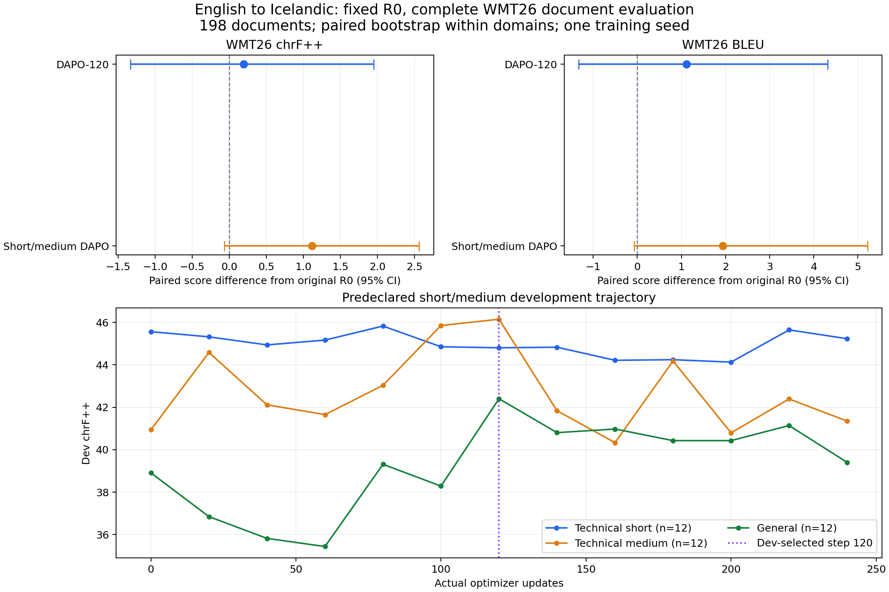

# WMT26与条件短中句DAPO：运行记录 / WMT26 and conditional short/medium DAPO record

2026-11-23夜间—2026-11-24 · Europe/Berlin

更新 / Updated: 2026-11-24T03:06:07.097763+00:00

**本轮总上限10小时，2026-11-23 21:50:49 CET开始，2026-11-24 07:50:49 CET截止；连接、代码准备、上传、评估、训练和回存全部计入。不会重置计时，不沿用白天截止。**

**Ten-hour total cap: 2026-11-23 21:50:49 CET to 2026-11-24 07:50:49 CET. Queue,preparation,upload,evaluation,training and persistence all count;no clock reset.**

## 最终判断与下一步 / Final interpretation and next step

**值得保留这版短中句DAPO候选，但不能称为已经证实综合更强的翻译模型。原P18 R0继续作为共同SFT起点；本轮新增的是DAPO候选，不把它改名为新的SFT R0。**

**Keep the specialized DAPO candidate, while recognizing that a reliably stronger general translation model has not been established. Original P18 remains the shared SFT R0. The new artifact is a DAPO candidate, not a relabeled SFT baseline.**

|模型 / Model|WMT26 chrF++|WMT26 BLEU|
|---|---:|---:|
|原P18 R0 / Original SFT R0|39.72|19.76|
|旧P22 DAPO-120 / Existing DAPO-120|39.91|20.87|
|本轮短中句DAPO，第120步 / Specialized endpoint|40.83|21.70|

本轮相对原R0：chrF++ **+1.12**，95%区间 **[-0.06,+2.56]**；BLEU **+1.94**，区间 **[-0.07,+5.22]**。两个点估计都更好，但区间仍略跨零，未通过预设的198文档主门槛。没有更换bootstrap seed、删掉困难文档或改用别的主指标来追求“通过”。

Relative to original R0, full WMT chrF++ is **+1.12** with95%CI **[-0.06,+2.56]**, and BLEU **+1.94** withCI **[-0.07,+5.22]**. Both point estimates improve, but both intervals narrowly include zero. The predeclared198-document primary rule is not met. Bootstrap seeds, difficult documents and the primary metric were not changed to obtain a pass.

### 中短句到底有没有信号 / What the short-medium evidence says

- **153篇所有输入单元≤40词的完整WMT文档**：chrF++ **40.42→41.88**，差值区间 **[+0.02,+2.69]**；BLEU **17.33→20.33**，区间 **[+0.46,+4.83]**。这是积极的探索性证据。该子集132篇为speech，且分析在初始WMT后补充、未校正多重比较，不能替代全量确认。
- **55篇所有单元≤12词的完整文档**：chrF++ **43.66→43.61**，BLEU **21.46→21.33**，均无可靠改善。**不能说纯短句已经变强。**
- **历史ParIce72条**：chrF++ **51.69→52.25**，BLEU **23.91→25.13**，两个区间均跨零。技术短句和中句点估计向好，通用组chrF++ **41.28→40.18**；仍有取舍和不确定性，不能只报最好的分组。

The153whole-document short/medium subset shows positive exploratory differences: chrF++ **+1.46**,CI **[+0.02,+2.69]**, and BLEU **+3.00**,CI **[+0.46,+4.83]**. However132documents are speech, the analysis was added after initial WMT, and multiplicity is unadjusted. The55all-short documents show no reliable gain. The historical72-pair ParIce set has positive overall/technical point estimates but zero-crossing intervals and a general-subset decline. Thus the evidence supports a promising short/medium candidate, not a confirmed pure-short or universal improvement.

### 具体译文说明什么 / What individual outputs show

盲化核查实际24个源单元，其中19个是实质内容、5个是格式/计数。19条内容中，同一助手判断原R0为P4/F13/U2，本轮为P5/F11/U3；只出现1条明确F→P，另有1条F→U，没有观察到P→F。样本小且非母语专家认证，**不把5/19称作全模型正确率**。

The actual blind audit contains24source units, including19substantive items and five formatting/counter items. On the19, the same assistant labeled original R0 P4/F13/U2 and the specialized candidate P5/F11/U3: oneF→P and oneF→U, with no observedP→F. This small, non-native-certified audit is **not a population correctness estimate**.

- Jade与Beck复合的例子中，原R0遗漏“告诉他”的关键动作，本轮恢复为`segja honum það`，是可追踪的实际语义改善。
- `volcano`、`organizing the strike`等简单但关键的词义，在三个模型里仍有明显问题；句子短并不自动容易。
- Robin Roefs的例子里，旧DAPO出现严重重复，本轮没有该重复，但三版仍有实质比赛信息错误。减少某个输出的重复，不等于整句翻译已正确。
- 所有抽样和全部三版译文都保存在逐例报告，不仅展示上述几个例子。WMT全量里251个明显纯格式单元三模型均逐字保留，不拿它们冒充翻译成功病例。

The Jade/Beck example recovers the missing tell-him action. Volcano and organizing the strike remain problematic across all three models. The old DAPO loops on the Robin Roefs example, whereas the new version does not, yet the new sentence still contains material match-information errors. The complete casebook retains every selected source/output. All three models copy the251obvious formatting units exactly; these are not counted as successful language translations in the substantive audit.

### 能否归因于SFT不够 / Does this prove insufficient SFT

**不能把本轮结果归结为“R0根本不能跑DAPO，必须继续SFT”。** 本轮没有任何新增SFT，却有方向一致的WMT/技术子集改善信号；也没有证据说明3B到容量上限。与此同时，关键词义错误仍在，不能说基座已经精通翻译。

The evidence does **not** support the absolute claim that R0 cannot undergo DAPO and must receive more SFT first. There were zero new SFT updates, yet positive WMT/technical signals appeared. Nor does this establish a3B capacity ceiling. Persistent key lexical errors also prevent claiming translation mastery.

本轮核实了采样/teacher概率一致、实际权重更新、全部240步目标复算与全量WMT重组；这排除了这些已检查实现环节的明显失效，**不是奖励语义正确性的证明**。本轮没有重新做逐源G8正确候选覆盖率与MetricX排序的独立核查，因此无法把剩余瓶颈的比例准确分给“候选能力不足”或“奖励错排”。贪心失败例不证明该源句八个候选全错；单个自动分数提高也不证明语义全对。

Sampler/teacher parity, actual parameter changes, all240objective replays and complete WMT reconstruction pass. This checks those implementation components, **not reward semantic validity**. This round does not repeat an independent per-source G8 correctness/ranker audit, so it cannot quantify the remaining candidate-coverage versus reward-ranking bottlenecks. A bad greedy output does not prove all eight samples are wrong; a higher automatic metric does not prove complete semantic correctness.

### 明确的下一步 / One concrete next step

**下一轮先复现本次短中句DAPO配方，不再盲目增加SFT或只延长训练。** 从同一原P18 R0、同一1200源句池出发，换一个预先固定的采样/顺序seed，最多120步，固定120步端点；不再根据WMT挑步数。沿用相同评分与解码，报告全量WMT、同一长度次要集及关键语义审查。可按本轮实测为单L4预留约3–4小时（含准备、评估与回存；排队不可保证）。这只是下一轮建议，本轮未启动它。

**Next, replicate this short/medium DAPO recipe rather than blindly add SFT or merely extend training.** Start from the same original P18 and1200-source pool with one new prespecified sampling/order seed, run up to120updates and evaluate the fixed120-step endpoint without WMT checkpoint selection. Preserve identical scoring/decoding and report full WMT, the same secondary subsets and key semantic checks. Based on this run, reserve roughly3–4hours on one L4 including setup/evaluation/export, excluding unpredictable queuing. This is a next-round recommendation; it was not launched here.

复现若支持短中句收益，再把“原R0→标准DAPO”锁为对照，研究选择性token更新/前缀复用，以同起点、同数据、同预算和真实GPU时间/显存比较。若仅分数改善、关键语义和复现均不支持，再审计实际G8候选与参考奖励，按证据决定奖励修正或少量定向SFT；不宣布容量到顶。本轮没有实现效率方法对照，不能把任何速度记作创新收益。

If replication supports the short/medium gain, freeze original-R0→standard-DAPO as the control before selective-token/prefix-reuse comparisons, matching starts,data,budgets and actual GPU time/memory. If gains remain metric-only or nonreplicable, audit actual G8 candidates and reference-based reward before choosing reward changes or targeted SFT. Do not infer a capacity ceiling. No efficiency-method comparison was implemented in this round, so no speed result is an innovation gain.

### 效率方向的实际证据 / What the profiling says about efficiency

整轮240步实际尝试514个源组、接受480组，生成4112个候选、152262个completion token。**新增排版多样性筛选仅额外剔除1组**；因此不能把本轮质量变化归因于这一筛选，或把它包装成已经验证的效率创新。接受率不等于正确候选覆盖率。

Across240updates, attempt514source groups, accept480, and generate4112candidates with152262completion tokens. **The extra formatting-diversity filter rejects only1otherwise-eligible group.** Quality changes cannot be attributed to this filter or presented as a validated efficiency innovation. Acceptance rate is not correct-candidate coverage.

全240步优化阶段累计59.24分钟；完整DAPO阶段另含生成、打分、teacher前向、开发评估、存盘等，共约2.39小时。模型选择实际花240步，最终候选只保留120步参数，不能隐藏搜索成本。后续应分别报告训练管线耗时、质量以及包括WMT/回存的实验总开销；loss上乘token mask并不自动证明矩阵运算变少，本轮也没有验证该速度收益。

Optimizer phases sum to59.24minutes; the complete DAPO phase, including generation,scoring,teacher passes,dev and snapshots, spans about2.39hours. Search consumed240updates even though the selected parameters are from120. Report training-pipeline time and quality separately from the entire evaluation/export-inclusive experiment. Multiplying losses by a token mask alone does not establish reduced matrix computation; no such speed gain was tested here.

### 已交付的checkpoint与资源 / Delivered checkpoint and resources

- 专项候选 / Specialized candidate: **P25-shortmid-step120**，完整适配器目录 / full adapter folder: `D:\deep learning project\runs\wmt26_shortmid_night_2026-11-23\snapshots\shortmid_selected_full\files\adapter`。
- 权重SHA256 / weights SHA256: `40ee8312ead89272fd5e8190a3b8e1da91d5f0ff641721840600585ff4308c86`。该适配器仍需同一Qwen3B通用基座，不能独立运行。
- 原R0未覆盖且哈希复核一致。20…240共12个常规权重及所选完整AdamW/RNG均回存；其他常规权重不冒称具有精确优化器续训状态。
- GPU分配到释放 / GPU allocation to release: **6.03h**；任务开始到释放 / request start to release: **6.23h**；账号计算单元余额变化 / account compute-unit difference: **11.68**（若存在其他账号活动不能独占归因）。科学结果导出、内部文件及checkpoint已校验，专属L4已释放并只读确认不在分配列表中。

Original R0 is hash-verified and preserved. All12regular checkpoints and the selected full AdamW/RNG state are saved. The account balance difference is not exclusive attribution if there was other account activity. Verified scientific exports and checkpoints are on D, and this run's L4 is released and confirmed absent. All neural work ran on Colab.

## 第一阶段已经得到的结果 / Completed first-stage finding

全部198个文档：chrF++ **39.72 → 39.91**，差值 **+0.19**，95%区间 [-1.33, +1.95]；BLEU **19.76 → 20.87**，差值 **+1.11**，95%区间 [-1.33, +4.31]。**点估计上升，但两个区间均跨零，不能据此认定旧DAPO-120可靠改善了WMT翻译。**

Across all 198 documents, chrF++ changed from **39.72 to 39.91** and BLEU from **19.76 to 20.87**. Both paired 95% intervals include zero. The positive point estimates do not establish a reliable WMT improvement from the existing DAPO-120 checkpoint. This is the first-stage finding, not a substitute for the conditional arm's final results.

分域结果方向不一致：social/software点估计上升，news/speech下降。software只有7个文档，区间特别宽；不能将整体BLEU增加解释为每一类文本都变好。旧的ParIce项目49.07与本轮WMT分数来自不同数据和评价单元，不能直接相减判断退化。

Domain results differ: social/software point estimates improve, while news/speech decline. The software subset contains only seven documents and has wide uncertainty. An overall BLEU increase does not mean every domain improves. The earlier ParIce score of 49.07 uses different data and evaluation units and cannot be subtracted from the WMT score to diagnose regression.

## 专项结果的当前判定 / Specialized endpoint finding

240次更新全部完成，没有按开发集暂时下降早停；固定规则在开发集选中第120步。全量WMT：chrF++ **39.72 → 40.83**（Δ+1.12，95%区间[-0.06,+2.56]），BLEU **19.76 → 21.70**（Δ+1.94，95%区间[-0.07,+5.22]）。**这是正向改善信号，但未通过事前固定的全量可靠提升门槛。不能把略跨零改写成已经证明无效，也不能改写成已经证明综合变强。**

All240 planned updates were completed without a metric-regression early stop. Dev-only selection chose step120. Full WMT chrF++ improved by +1.12 and BLEU by +1.94, with the paired intervals shown above. These are positive signals, but the predeclared full-test gain rule is not met. A narrowly zero-crossing interval proves neither ineffectiveness nor a reliable overall improvement.

<details><summary>已完成模型运算摘要 / Completed model-work summary</summary>

```json
{
  "unix": 1795486961.9638178,
  "initial_WMT_complete": true,
  "initial_reliable_gain": false,
  "shortmid_training_executed": true,
  "new_SFT_updates": 0,
  "all_GPU_work_finished": true,
  "original_R0_preserved": true
}
```

</details>

<details><summary>控制器状态 / Controller status</summary>

```json
{
  "UTC": "2026-11-24T03:04:52.791704+00:00",
  "unix": 1795489492.7917163,
  "phase": "VERIFIED_EXPORT_AND_OWNED_GPU_RELEASED"
}
```

</details>



<details><summary>最近模型进度 / Latest model progress</summary>

```json
{
  "phase": "exporting",
  "unix": 1795486961.9648433
}
```

</details>

<details><summary>最近专项训练进度 / Latest specialization progress</summary>

```json
{
  "event": "training_complete",
  "unix": 1795483873.189846,
  "updates": 240,
  "selected_step": 120
}
```

</details>

## 固定对照与分支 / Frozen comparison and branch

先在全部198个WMT26英→冰原始文档上，对比P18原R0与已有P22 DAPO-120。源文切成2551个单元，逐单元翻译后无损按映射重组；官方refA保持完整，仅用于评分。纯文本src_text输入，不替换gold_transcript，不额外提供图片或音频。所有长单元保留，不将句级输出错配到独立切分的参考。

Compare originalP18R0 and existingP22DAPO-120 on all198officialWMT26English→Icelandic documents.Segment source into2551units,translate and reconstruct by the lossless map;unchanged officialrefA is scoring-only.Text-onlysrc_text,no gold-transcript substitution or added media.Retain all long units;never pair independently split references by index.

初始“可靠收益”操作性门槛事前固定为：全量chrF++差值的分域文档配对95%区间下界>0，且BLEU点估计不降。只有两臂198文档完整、未达到门槛、GPU支持且预算够，才从原P18重新启动一次短中句专项DAPO。未完成评估不能算“没提升”。

The predeclared operational gain rule requires full-testchrF++paired stratified-document95%lower bound>0 andnonnegativeBLEUpointdelta.Only a complete198-document pair failing this rule,on a supportedGPU with enough time,triggers one short/mediumDAPOarm from originalP18.Incomplete evaluation is never treated as no gain.

## 原R0与旧DAPO-120 / R0 versus oldDAPO-120

|域 / Domain|n|R0 chrF++|候选 / Candidate|Δ / 95%CI|R0 BLEU|候选 / Candidate|Δ / 95%CI|
|---|---:|---:|---:|---|---:|---:|---|

|overall|198|39.719|39.912|+0.193 / [-1.33, +1.95]|19.757|20.869|+1.112 / [-1.33, +4.31]|

|news|14|41.778|40.730|-1.048 / [-3.82, +1.57]|19.129|18.939|-0.190 / [-2.14, +1.66]|

|social|44|38.486|39.386|+0.900 / [-0.66, +2.40]|17.217|18.557|+1.341 / [-0.91, +3.51]|

|software|7|32.823|34.594|+1.770 / [-8.81, +16.00]|25.778|30.579|+4.802 / [-6.92, +26.18]|

|speech|133|42.545|41.955|-0.589 / [-1.53, +0.09]|18.981|17.707|-1.273 / [-3.18, +0.08]|

<details><summary>指标签名和统计 / Metric signatures and statistics</summary>

```json
{
  "n": 198,
  "subsets": {
    "overall": {
      "n": 198,
      "chrfpp": {
        "before": 39.718915382450255,
        "after": 39.9115793795913,
        "delta": 0.19266399714104665,
        "delta95CI": [
          -1.3314760757591964,
          1.9518907463427535
        ]
      },
      "bleu": {
        "before": 19.757162284647453,
        "after": 20.868815047706505,
        "delta": 1.1116527630590518,
        "delta95CI": [
          -1.3250543547390972,
          4.313979544592103
        ]
      }
    },
    "news": {
      "n": 14,
      "chrfpp": {
        "before": 41.77819185305422,
        "after": 40.73006869197434,
        "delta": -1.0481231610798787,
        "delta95CI": [
          -3.8173933830672437,
          1.5731450335894608
        ]
      },
      "bleu": {
        "before": 19.12873247016357,
        "after": 18.938918651621957,
        "delta": -0.18981381854161228,
        "delta95CI": [
          -2.1388738463251435,
          1.6605856307583433
        ]
      }
    },
    "social": {
      "n": 44,
      "chrfpp": {
        "before": 38.48644895228668,
        "after": 39.38640141616532,
        "delta": 0.8999524638786411,
        "delta95CI": [
          -0.6600593010393364,
          2.4028544725221583
        ]
      },
      "bleu": {
        "before": 17.21667095007361,
        "after": 18.557204366070973,
        "delta": 1.3405334159973634,
        "delta95CI": [
          -0.913000860169938,
          3.512151929574884
        ]
      }
    },
    "software": {
      "n": 7,
      "chrfpp": {
        "before": 32.82341840199642,
        "after": 34.59389155975278,
        "delta": 1.7704731577563564,
        "delta95CI": [
          -8.805585049416718,
          16.002383838609095
        ]
      },
      "bleu": {
        "before": 25.77751309799614,
        "after": 30.57928312904659,
        "delta": 4.801770031050449,
        "delta95CI": [
          -6.916996802073886,
          26.17529807037737
        ]
      }
    },
    "speech": {
      "n": 133,
      "chrfpp": {
        "before": 42.54462434956653,
        "after": 41.95541241139758,
        "delta": -0.5892119381689511,
        "delta95CI": [
          -1.5268326141919422,
          0.09096008436538065
        ]
      },
      "bleu": {
        "before": 18.98072604506742,
        "after": 17.707233389214455,
        "delta": -1.2734926558529658,
        "delta95CI": [
          -3.1804647991666277,
          0.08437619694630151
        ]
      }
    }
  },
  "replicates": 2000,
  "bootstrap_unit": "Original document,stratified within domain",
  "not_official_human_rank": true,
  "signatures": {
    "chrfpp": "nrefs:1|case:mixed|eff:yes|nc:6|nw:2|space:no|version:2.6.0",
    "bleu": "nrefs:1|case:mixed|eff:no|tok:13a|smooth:exp|version:2.6.0"
  }
}
```

</details>

## 原R0与专项候选 / R0 versus specialized endpoint

|域 / Domain|n|R0 chrF++|候选 / Candidate|Δ / 95%CI|R0 BLEU|候选 / Candidate|Δ / 95%CI|
|---|---:|---:|---:|---|---:|---:|---|

|overall|198|39.719|40.835|+1.116 / [-0.06, +2.56]|19.757|21.697|+1.940 / [-0.07, +5.22]|

|news|14|41.778|42.772|+0.993 / [+0.11, +2.21]|19.129|19.455|+0.326 / [-0.17, +2.39]|

|social|44|38.486|39.231|+0.744 / [-1.31, +2.63]|17.217|19.022|+1.805 / [-1.31, +4.10]|

|software|7|32.823|38.183|+5.359 / [-0.18, +17.31]|25.778|32.010|+6.232 / [-1.64, +27.59]|

|speech|133|42.545|42.474|-0.071 / [-0.47, +0.34]|18.981|18.759|-0.222 / [-0.65, +0.21]|

<details><summary>指标签名和统计 / Metric signatures and statistics</summary>

```json
{
  "n": 198,
  "subsets": {
    "overall": {
      "n": 198,
      "chrfpp": {
        "before": 39.718915382450255,
        "after": 40.83466908840522,
        "delta": 1.1157537059549654,
        "delta95CI": [
          -0.06422553477964374,
          2.563144700650973
        ]
      },
      "bleu": {
        "before": 19.757162284647453,
        "after": 21.69729738999143,
        "delta": 1.9401351053439768,
        "delta95CI": [
          -0.06853441546312249,
          5.216621055582654
        ]
      }
    },
    "news": {
      "n": 14,
      "chrfpp": {
        "before": 41.77819185305422,
        "after": 42.77168437836896,
        "delta": 0.9934925253147426,
        "delta95CI": [
          0.10679595190068447,
          2.2143691012320517
        ]
      },
      "bleu": {
        "before": 19.12873247016357,
        "after": 19.455080298765647,
        "delta": 0.3263478286020778,
        "delta95CI": [
          -0.16503377747707465,
          2.3855205004155726
        ]
      }
    },
    "social": {
      "n": 44,
      "chrfpp": {
        "before": 38.48644895228668,
        "after": 39.23051771953461,
        "delta": 0.7440687672479314,
        "delta95CI": [
          -1.3050250802947052,
          2.6273302724674394
        ]
      },
      "bleu": {
        "before": 17.21667095007361,
        "after": 19.021641367501516,
        "delta": 1.8049704174279064,
        "delta95CI": [
          -1.313735791109968,
          4.100691954971634
        ]
      }
    },
    "software": {
      "n": 7,
      "chrfpp": {
        "before": 32.82341840199642,
        "after": 38.182743426068036,
        "delta": 5.359325024071616,
        "delta95CI": [
          -0.17847102531052172,
          17.306960941100172
        ]
      },
      "bleu": {
        "before": 25.77751309799614,
        "after": 32.00980303248556,
        "delta": 6.232289934489415,
        "delta95CI": [
          -1.6381994518101717,
          27.588329272428425
        ]
      }
    },
    "speech": {
      "n": 133,
      "chrfpp": {
        "before": 42.54462434956653,
        "after": 42.47404250643335,
        "delta": -0.0705818431331835,
        "delta95CI": [
          -0.4684877398753942,
          0.33713292748317086
        ]
      },
      "bleu": {
        "before": 18.98072604506742,
        "after": 18.758952724658243,
        "delta": -0.2217733204091772,
        "delta95CI": [
          -0.6499799149790688,
          0.2069507305607113
        ]
      }
    }
  },
  "replicates": 2000,
  "bootstrap_unit": "Original document,stratified within domain",
  "not_official_human_rank": true,
  "signatures": {
    "chrfpp": "nrefs:1|case:mixed|eff:yes|nc:6|nw:2|space:no|version:2.6.0",
    "bleu": "nrefs:1|case:mixed|eff:no|tok:13a|smooth:exp|version:2.6.0"
  }
}
```

</details>

<details><summary>实际分支决定与动态预留 / Executed branch and measured reserve</summary>

```json
{
  "unix": 1795475220.9559133,
  "initial_WMT_complete": true,
  "initial_reliable_gain": false,
  "conditional_training": true,
  "measured_initial_seconds": 6481.001841783524,
  "reserved_for_final_and_export_seconds": 7212.651197159291,
  "training_deadline_unix": 1795495836.3488028,
  "reason": "No reliable initial WMT gain;predeclared shortmid arm"
}
```

</details>

<details><summary>全量覆盖、耗时与截断 / Complete coverage, duration and truncation</summary>

```json
{
  "documents_per_arm": 198,
  "segments_per_arm": 2551,
  "seconds": 6481.0004115104675,
  "truncated": {
    "before": 19,
    "oldDAPO120": 14
  }
}
```

</details>

## 预先固定的短中句专项 / Predeclared short/medium specialization

训练源句1200条，通用、技术短句、技术中句各400；均来自已有SFT训练分区，源句≤40词，排除WMT源单元精确重合，保留困难例而非按模型表现挑样本。开发36条、历史项目留出72条，均与本轮训练来源/参考精确分离；该72条以前已经查看过，不能称为新盲测或WMT成绩。

The1200source pool has400general,400technical-short and400technical-medium items from existingSFTtraining data,all≤40source words and excluding exactWMTsource-unit overlap.Difficult cases remain;selection ignores model outputs.Dev36and historical project holdout72are source/reference disjoint from training.The72sources have been examined before and are neither fresh blind evidence norWMTscores.

同一原P18基座、G8/T0.7、raw MetricX源文+候选+参考奖励、AdamW LR3e-6、双侧clip0.2/0.28、两轮全局有效token损失。专项最多240次实际更新，每20步开发评估及保存权重；完整AdamW/RNG仅随最终所选checkpoint回存。无按分数下降早停；时间、数值、数据不足等技术保护仍有效。

SameP18start,G8/T.7,rawMetricXsource+candidate+reference reward,AdamWLR3e-6,dualclip.2/.28,twoepochs and global active-token loss.Up to240actual updates,dev/save every20.FullAdamW/RNG is durably exported with the selected checkpoint.No metric-regression early stop;time,numerical and data protections remain.

新增筛选仅拒绝有效候选词/标点序列完全相同的排版变体；保留问号、小数和词语差异，仍要求至少2有效候选与非零奖励方差。该规则不识别语义正确，不保证P/F混合；四个真实函数回归案例已通过。这是一次缩小任务和廉价排版过滤的探索性组合，不能把收益归因于其中单一因素。

The extra filter rejects only formatting variants with identical word/punctuation-token sequences,preserving question marks,decimals and lexical changes;≥2valid candidates and nonzero reward variance remain.It does not certify semanticP/Fmixtures.Fouractual-function regression cases passed.This combines a narrower task and cheap formatting filtering,not a single-variable causal ablation.

checkpoint只按开发集短/中句chrF++宏平均、BLEU及原R0整体/通用保留规则选择，WMT不参与挑步数。专项配置在初始WMT输出前已固定；末期仅对一个开发集所选候选再评WMT，属于条件执行后的探索性复测，不冒称未触碰确认性验收。原R0及所有旧检查点不覆盖，也不承诺必然得到更好模型。

Checkpoint choice uses dev macro short/mediumchrF++,BLEU and overall/general retention,neverWMTstep selection.The arm was frozen before initialWMToutputs;one dev-selected endpoint receives an exploratory WMTre-evaluation after conditional execution,not untouched confirmatory acceptance.OriginalR0 and all prior checkpoints remain;improvement is not guaranteed.

## 专项开发轨迹 / Specialization dev trajectory

|步 / Step|Overall chrF++|General chrF++|Short chrF++|Medium chrF++|Macro short/medium|
|---:|---:|---:|---:|---:|---:|

|0|41.771|38.907|45.561|40.940|43.250|

|20|43.373|36.849|45.318|44.579|44.949|

|40|41.703|35.823|44.938|42.117|43.527|

|60|41.423|35.440|45.164|41.652|43.408|

|80|43.084|39.314|45.826|43.033|44.430|

|100|44.248|38.286|44.851|45.851|45.351|

|120|45.169|42.401|44.803|46.147|45.475|

|140|42.444|40.805|44.829|41.836|43.333|

|160|41.451|40.976|44.213|40.334|42.273|

|180|43.540|40.429|44.241|44.178|44.210|

|200|41.596|40.429|44.127|40.795|42.461|

|220|43.026|41.140|45.644|42.392|44.018|

|240|41.986|39.406|45.231|41.349|43.290|

<details><summary>实际专项训练摘要 / Executed training summary</summary>

```json
{
  "total_optimizer_updates": 240,
  "selected_step": 120,
  "selected_tag": "shortmid_selected_full",
  "stop_reason": "maximum240_updates",
  "reward_recipe": "raw",
  "new_SFT_updates": 0,
  "all_GPU_work_finished": true,
  "source_attempts": 514,
  "automatic_proxy_not_human_semantic_truth": true
}
```

</details>

<details><summary>本地CPU独立重组与统计复算 / Independent CPU reconstruction and statistics replay</summary>

```json
{
  "UTC": "2026-11-24T02:23:50.929725+00:00",
  "CPU_only": true,
  "results": {
    "wmt_initial": {
      "exact_replay": true,
      "documents": 198,
      "segments_per_arm": 2551,
      "metrics_SHA256": "8e49cba3b2cde78558080256c954e3fd71e6ad80d4684f97cd83ef09c56cc221",
      "overall": {
        "n": 198,
        "chrfpp": {
          "before": 39.718915382450255,
          "after": 39.9115793795913,
          "delta": 0.19266399714104665,
          "delta95CI": [
            -1.3314760757591964,
            1.9518907463427535
          ]
        },
        "bleu": {
          "before": 19.757162284647453,
          "after": 20.868815047706505,
          "delta": 1.1116527630590518,
          "delta95CI": [
            -1.3250543547390972,
            4.313979544592103
          ]
        }
      }
    },
    "wmt_shortmid": {
      "exact_replay": true,
      "documents": 198,
      "segments_per_arm": 2551,
      "metrics_SHA256": "128ccfee260b05b1f3e52a31dd8134cad227d29d6e35e5bc89f6a7028bfc1ea1",
      "overall": {
        "n": 198,
        "chrfpp": {
          "before": 39.718915382450255,
          "after": 40.83466908840522,
          "delta": 1.1157537059549654,
          "delta95CI": [
            -0.06422553477964374,
            2.563144700650973
          ]
        },
        "bleu": {
          "before": 19.757162284647453,
          "after": 21.69729738999143,
          "delta": 1.9401351053439768,
          "delta95CI": [
            -0.06853441546312249,
            5.216621055582654
          ]
        }
      }
    }
  },
  "original_R0_SHA256": "7f7a4914c5f403e757fdb882c3576ac68f2b0fa6edc00e537087716b28ddb07e",
  "original_R0_unchanged": true
}
```

</details>

<details><summary>专项与旧DAPO的次要探索比较 / Secondary exploratory comparison with old DAPO</summary>

```json
{
  "UTC": "2026-11-24T02:23:50.928722+00:00",
  "exploratory_secondary_not_checkpoint_selection": true,
  "before": "oldDAPO120",
  "after": "shortmidDAPO",
  "results": {
    "n": 198,
    "subsets": {
      "overall": {
        "n": 198,
        "chrfpp": {
          "before": 39.9115793795913,
          "after": 40.83466908840522,
          "delta": 0.9230897088139187,
          "delta95CI": [
            -0.23252254322531235,
            2.152128780401405
          ]
        },
        "bleu": {
          "before": 20.868815047706505,
          "after": 21.69729738999143,
          "delta": 0.828482342284925,
          "delta95CI": [
            0.03813289365651364,
            1.9711372703596501
          ]
        }
      },
      "news": {
        "n": 14,
        "chrfpp": {
          "before": 40.73006869197434,
          "after": 42.77168437836896,
          "delta": 2.0416156863946213,
          "delta95CI": [
            -0.077858820314332,
            4.470691585737687
          ]
        },
        "bleu": {
          "before": 18.938918651621957,
          "after": 19.455080298765647,
          "delta": 0.5161616471436901,
          "delta95CI": [
            0.11449166469483885,
            2.279198632111474
          ]
        }
      },
      "social": {
        "n": 44,
        "chrfpp": {
          "before": 39.38640141616532,
          "after": 39.23051771953461,
          "delta": -0.15588369663070978,
          "delta95CI": [
            -1.7804446533292935,
            1.4487336016264547
          ]
        },
        "bleu": {
          "before": 18.557204366070973,
          "after": 19.021641367501516,
          "delta": 0.464437001430543,
          "delta95CI": [
            -1.4426117085262626,
            1.5983929021733554
          ]
        }
      },
      "software": {
        "n": 7,
        "chrfpp": {
          "before": 34.59389155975278,
          "after": 38.182743426068036,
          "delta": 3.5888518663152595,
          "delta95CI": [
            -3.5748333429468673,
            10.237921711634367
          ]
        },
        "bleu": {
          "before": 30.57928312904659,
          "after": 32.00980303248556,
          "delta": 1.4305199034389666,
          "delta95CI": [
            -4.169240270092021,
            7.680688818594531
          ]
        }
      },
      "speech": {
        "n": 133,
        "chrfpp": {
          "before": 41.95541241139758,
          "after": 42.47404250643335,
          "delta": 0.5186300950357676,
          "delta95CI": [
            -0.22784411339341784,
            1.543890431708625
          ]
        },
        "bleu": {
          "before": 17.707233389214455,
          "after": 18.758952724658243,
          "delta": 1.0517193354437886,
          "delta95CI": [
            -0.2816653519463819,
            2.9054404451206275
          ]
        }
      }
    },
    "replicates": 2000,
    "bootstrap_unit": "Original document,stratified within domain",
    "not_official_human_rank": true,
    "signatures": {
      "chrfpp": "nrefs:1|case:mixed|eff:yes|nc:6|nw:2|space:no|version:2.6.0",
      "bleu": "nrefs:1|case:mixed|eff:no|tok:13a|smooth:exp|version:2.6.0"
    }
  }
}
```

</details>

<details><summary>WMT完整文档长度子集次要分析 / Secondary WMT whole-document length subsets</summary>

```json
{
  "UTC": "2026-11-24T02:23:55.070976+00:00",
  "plan_SHA256": "5e1ab95a12a255a8272f54e7d95cae178c526b6d5000cb95719381ea4bc7c900",
  "exploratory_secondary_no_multiple_comparison_adjustment": true,
  "not_official_sentence_aligned_scores": true,
  "full_official_document_references_preserved": true,
  "results": {
    "all_units_short": {
      "n": 55,
      "domains": {
        "speech": 55
      },
      "comparisons": {
        "oldDAPO120": {
          "chrfpp": {
            "before": 43.663353636228614,
            "after": 43.84633436119727,
            "delta": 0.18298072496865814,
            "delta95CI": [
              -0.5140290590315809,
              0.886137257344545
            ],
            "signature": "nrefs:1|case:mixed|eff:yes|nc:6|nw:2|space:no|version:2.6.0"
          },
          "bleu": {
            "before": 21.461884621015923,
            "after": 21.154894603067756,
            "delta": -0.3069900179481664,
            "delta95CI": [
              -1.1025288817874868,
              0.558039612591832
            ],
            "signature": "nrefs:1|case:mixed|eff:no|tok:13a|smooth:exp|version:2.6.0"
          }
        },
        "shortmidDAPO": {
          "chrfpp": {
            "before": 43.663353636228614,
            "after": 43.60557982357613,
            "delta": -0.057773812652484935,
            "delta95CI": [
              -0.8819388625221534,
              0.7594650863215217
            ],
            "signature": "nrefs:1|case:mixed|eff:yes|nc:6|nw:2|space:no|version:2.6.0"
          },
          "bleu": {
            "before": 21.461884621015923,
            "after": 21.332574123781775,
            "delta": -0.12931049723414745,
            "delta95CI": [
              -0.8957177125706304,
              0.5938665795526485
            ],
            "signature": "nrefs:1|case:mixed|eff:no|tok:13a|smooth:exp|version:2.6.0"
          }
        }
      }
    },
    "all_units_shortmid": {
      "n": 153,
      "domains": {
        "news": 3,
        "social": 18,
        "speech": 132
      },
      "comparisons": {
        "oldDAPO120": {
          "chrfpp": {
            "before": 40.41964639023854,
            "after": 41.248562716970014,
            "delta": 0.8289163267314734,
            "delta95CI": [
              -0.28441466496450546,
              1.9556987244001394
            ],
            "signature": "nrefs:1|case:mixed|eff:yes|nc:6|nw:2|space:no|version:2.6.0"
          },
          "bleu": {
            "before": 17.329282554426904,
            "after": 18.855321683083016,
            "delta": 1.5260391286561124,
            "delta95CI": [
              -0.6053580292885986,
              3.4712405038641445
            ],
            "signature": "nrefs:1|case:mixed|eff:no|tok:13a|smooth:exp|version:2.6.0"
          }
        },
        "shortmidDAPO": {
          "chrfpp": {
            "before": 40.41964639023854,
            "after": 41.8757197074851,
            "delta": 1.4560733172465632,
            "delta95CI": [
              0.02282859637512367,
              2.6889796555164307
            ],
            "signature": "nrefs:1|case:mixed|eff:yes|nc:6|nw:2|space:no|version:2.6.0"
          },
          "bleu": {
            "before": 17.329282554426904,
            "after": 20.330419171522845,
            "delta": 3.0011366170959413,
            "delta95CI": [
              0.46384999572185015,
              4.827658373453065
            ],
            "signature": "nrefs:1|case:mixed|eff:no|tok:13a|smooth:exp|version:2.6.0"
          }
        }
      }
    }
  }
}
```

</details>

<details><summary>输出长度和截断诊断 / Output-length and truncation diagnostics</summary>

```json
{
  "UTC": "2026-11-24T02:32:02.474873+00:00",
  "not_semantic_correctness_or_eligibility": true,
  "source_copies_can_be_appropriate_for_code_or_names": true,
  "all_truncated_outputs_retained_in_primary_metrics": true,
  "results": {
    "R0": {
      "overall": {
        "n": 2551,
        "completion_tokens": 88858,
        "truncated": 19,
        "empty": 0,
        "format_or_counter_source_units": 251,
        "exact_source_copies": 297,
        "substantive_exact_source_copies": 46,
        "hypothesis_chars": 186096,
        "source_chars": 166814
      },
      "short": {
        "n": 1857,
        "completion_tokens": 25252,
        "truncated": 1,
        "empty": 0,
        "format_or_counter_source_units": 251,
        "exact_source_copies": 297,
        "substantive_exact_source_copies": 46,
        "hypothesis_chars": 47243,
        "source_chars": 45836
      },
      "medium": {
        "n": 612,
        "completion_tokens": 43589,
        "truncated": 9,
        "empty": 0,
        "format_or_counter_source_units": 0,
        "exact_source_copies": 0,
        "substantive_exact_source_copies": 0,
        "hypothesis_chars": 92928,
        "source_chars": 78559
      },
      "long": {
        "n": 82,
        "completion_tokens": 20017,
        "truncated": 9,
        "empty": 0,
        "format_or_counter_source_units": 0,
        "exact_source_copies": 0,
        "substantive_exact_source_copies": 0,
        "hypothesis_chars": 45925,
        "source_chars": 42419
      },
      "news": {
        "n": 396,
        "completion_tokens": 19143,
        "truncated": 3,
        "empty": 0,
        "format_or_counter_source_units": 156,
        "exact_source_copies": 156,
        "substantive_exact_source_copies": 0,
        "hypothesis_chars": 41384,
        "source_chars": 38410
      },
      "social": {
        "n": 728,
        "completion_tokens": 41799,
        "truncated": 12,
        "empty": 0,
        "format_or_counter_source_units": 95,
        "exact_source_copies": 108,
        "substantive_exact_source_copies": 13,
        "hypothesis_chars": 86742,
        "source_chars": 65931
      },
      "software": {
        "n": 7,
        "completion_tokens": 5720,
        "truncated": 4,
        "empty": 0,
        "format_or_counter_source_units": 0,
        "exact_source_copies": 0,
        "substantive_exact_source_copies": 0,
        "hypothesis_chars": 15184,
        "source_chars": 19385
      },
      "speech": {
        "n": 1420,
        "completion_tokens": 22196,
        "truncated": 0,
        "empty": 0,
        "format_or_counter_source_units": 0,
        "exact_source_copies": 33,
        "substantive_exact_source_copies": 33,
        "hypothesis_chars": 42786,
        "source_chars": 43088
      }
    },
    "oldDAPO120": {
      "overall": {
        "n": 2551,
        "completion_tokens": 83671,
        "truncated": 14,
        "empty": 0,
        "format_or_counter_source_units": 251,
        "exact_source_copies": 300,
        "substantive_exact_source_copies": 49,
        "hypothesis_chars": 181548,
        "source_chars": 166814
      },
      "short": {
        "n": 1857,
        "completion_tokens": 24083,
        "truncated": 0,
        "empty": 0,
        "format_or_counter_source_units": 251,
        "exact_source_copies": 300,
        "substantive_exact_source_copies": 49,
        "hypothesis_chars": 45726,
        "source_chars": 45836
      },
      "medium": {
        "n": 612,
        "completion_tokens": 39662,
        "truncated": 6,
        "empty": 0,
        "format_or_counter_source_units": 0,
        "exact_source_copies": 0,
        "substantive_exact_source_copies": 0,
        "hypothesis_chars": 87818,
        "source_chars": 78559
      },
      "long": {
        "n": 82,
        "completion_tokens": 19926,
        "truncated": 8,
        "empty": 0,
        "format_or_counter_source_units": 0,
        "exact_source_copies": 0,
        "substantive_exact_source_copies": 0,
        "hypothesis_chars": 48004,
        "source_chars": 42419
      },
      "news": {
        "n": 396,
        "completion_tokens": 19608,
        "truncated": 4,
        "empty": 0,
        "format_or_counter_source_units": 156,
        "exact_source_copies": 156,
        "substantive_exact_source_copies": 0,
        "hypothesis_chars": 45228,
        "source_chars": 38410
      },
      "social": {
        "n": 728,
        "completion_tokens": 35384,
        "truncated": 6,
        "empty": 0,
        "format_or_counter_source_units": 95,
        "exact_source_copies": 110,
        "substantive_exact_source_copies": 15,
        "hypothesis_chars": 75909,
        "source_chars": 65931
      },
      "software": {
        "n": 7,
        "completion_tokens": 5701,
        "truncated": 3,
        "empty": 0,
        "format_or_counter_source_units": 0,
        "exact_source_copies": 0,
        "substantive_exact_source_copies": 0,
        "hypothesis_chars": 15723,
        "source_chars": 19385
      },
      "speech": {
        "n": 1420,
        "completion_tokens": 22978,
        "truncated": 1,
        "empty": 0,
        "format_or_counter_source_units": 0,
        "exact_source_copies": 34,
        "substantive_exact_source_copies": 34,
        "hypothesis_chars": 44688,
        "source_chars": 43088
      }
    },
    "shortmidDAPO": {
      "overall": {
        "n": 2551,
        "completion_tokens": 84922,
        "truncated": 15,
        "empty": 0,
        "format_or_counter_source_units": 251,
        "exact_source_copies": 300,
        "substantive_exact_source_copies": 49,
        "hypothesis_chars": 177125,
        "source_chars": 166814
      },
      "short": {
        "n": 1857,
        "completion_tokens": 26354,
        "truncated": 2,
        "empty": 0,
        "format_or_counter_source_units": 251,
        "exact_source_copies": 300,
        "substantive_exact_source_copies": 49,
        "hypothesis_chars": 48631,
        "source_chars": 45836
      },
      "medium": {
        "n": 612,
        "completion_tokens": 38660,
        "truncated": 4,
        "empty": 0,
        "format_or_counter_source_units": 0,
        "exact_source_copies": 0,
        "substantive_exact_source_copies": 0,
        "hypothesis_chars": 82752,
        "source_chars": 78559
      },
      "long": {
        "n": 82,
        "completion_tokens": 19908,
        "truncated": 9,
        "empty": 0,
        "format_or_counter_source_units": 0,
        "exact_source_copies": 0,
        "substantive_exact_source_copies": 0,
        "hypothesis_chars": 45742,
        "source_chars": 42419
      },
      "news": {
        "n": 396,
        "completion_tokens": 17399,
        "truncated": 1,
        "empty": 0,
        "format_or_counter_source_units": 156,
        "exact_source_copies": 156,
        "substantive_exact_source_copies": 0,
        "hypothesis_chars": 37769,
        "source_chars": 38410
      },
      "social": {
        "n": 728,
        "completion_tokens": 39873,
        "truncated": 10,
        "empty": 0,
        "format_or_counter_source_units": 95,
        "exact_source_copies": 110,
        "substantive_exact_source_copies": 15,
        "hypothesis_chars": 82257,
        "source_chars": 65931
      },
      "software": {
        "n": 7,
        "completion_tokens": 5359,
        "truncated": 4,
        "empty": 0,
        "format_or_counter_source_units": 0,
        "exact_source_copies": 0,
        "substantive_exact_source_copies": 0,
        "hypothesis_chars": 14176,
        "source_chars": 19385
      },
      "speech": {
        "n": 1420,
        "completion_tokens": 22291,
        "truncated": 0,
        "empty": 0,
        "format_or_counter_source_units": 0,
        "exact_source_copies": 34,
        "substantive_exact_source_copies": 34,
        "hypothesis_chars": 42923,
        "source_chars": 43088
      }
    }
  }
}
```

</details>

<details><summary>历史短中句留出评估 / Historical short-medium holdout results</summary>

```json
{
  "UTC": "2026-11-24T02:30:55.276630+00:00",
  "n": 72,
  "one_seed": true,
  "historical_previously_inspected_holdout": true,
  "not_official_WMT_benchmark": true,
  "no_checkpoint_selection_on_final": true,
  "metrics": {
    "overall": {
      "n": 72,
      "chrfpp": {
        "before": 51.689443922997825,
        "after": 52.252745541140335,
        "delta": 0.5633016181425106,
        "delta95CI": [
          -0.6321734397569143,
          1.9226264693838557
        ],
        "replicates": 2000
      },
      "bleu": {
        "before": 23.912664988725634,
        "after": 25.125972422862908,
        "delta": 1.213307434137274,
        "delta95CI": [
          -0.8018512485891278,
          3.851623619363464
        ],
        "replicates": 2000
      }
    },
    "general": {
      "n": 24,
      "chrfpp": {
        "before": 41.27591984362387,
        "after": 40.178094571945586,
        "delta": -1.097825271678282,
        "delta95CI": [
          -2.9283613249373817,
          0.2494189399532996
        ],
        "replicates": 2000
      },
      "bleu": {
        "before": 13.90370181868657,
        "after": 13.588905087810586,
        "delta": -0.3147967308759849,
        "delta95CI": [
          -0.8528365164394358,
          0.25995759919612094
        ],
        "replicates": 2000
      }
    },
    "technical_short": {
      "n": 24,
      "chrfpp": {
        "before": 61.137210022973086,
        "after": 62.398113276636714,
        "delta": 1.2609032536636278,
        "delta95CI": [
          -0.8567471477418388,
          4.090301806875181
        ],
        "replicates": 2000
      },
      "bleu": {
        "before": 43.77913147458642,
        "after": 44.10981057634706,
        "delta": 0.3306791017606372,
        "delta95CI": [
          -3.019384017410542,
          2.4342947275386306
        ],
        "replicates": 2000
      }
    },
    "technical_medium": {
      "n": 24,
      "chrfpp": {
        "before": 50.86194726128321,
        "after": 51.62877696556822,
        "delta": 0.7668297042850085,
        "delta95CI": [
          -0.8572533709727469,
          2.711954904146014
        ],
        "replicates": 2000
      },
      "bleu": {
        "before": 19.29737320061204,
        "after": 21.61601697595604,
        "delta": 2.3186437753440003,
        "delta95CI": [
          -1.6308336872477875,
          6.866140334832679
        ],
        "replicates": 2000
      }
    },
    "technical": {
      "n": 48,
      "chrfpp": {
        "before": 53.92841188066102,
        "after": 54.8638941132384,
        "delta": 0.9354822325773853,
        "delta95CI": [
          -0.45497040325719346,
          2.460461328453308
        ],
        "replicates": 2000
      },
      "bleu": {
        "before": 26.678145650175935,
        "after": 28.458827702878065,
        "delta": 1.7806820527021294,
        "delta95CI": [
          -1.0824674517723056,
          4.800218152130124
        ],
        "replicates": 2000
      }
    }
  },
  "input_SHA256": {
    "before_greedy.jsonl": "faf3899ebbf9b2d4eb66cd7d6fc718f87d7b777b6568c329c0f790734dd1bff4",
    "after_greedy.jsonl": "891a624a11ed0479037257e2a7703d76a3479d065a7237908a5e05825ca0458d"
  },
  "metric_signatures": {
    "chrfpp": "nrefs:1|case:mixed|eff:yes|nc:6|nw:2|space:no|version:2.6.0",
    "bleu": "nrefs:1|case:mixed|eff:no|tok:13a|smooth:exp|version:2.6.0"
  }
}
```

</details>

<details><summary>实际训练目标逐步复算 / Replay of every actual optimizer update</summary>

```json
{
  "UTC": "2026-11-24T03:04:44.683506+00:00",
  "passed": true,
  "actual_updates": 240,
  "max_loss_delta": 2.4089716853248344e-08,
  "rows": [
    {
      "step": 1,
      "tokens": 1311,
      "loss_delta": 1.69016221929566e-08,
      "clip_fraction_delta": 0.0,
      "ratio_mean_delta": 0.0
    },
    {
      "step": 2,
      "tokens": 1311,
      "loss_delta": 3.761367377286273e-09,
      "clip_fraction_delta": 0.0,
      "ratio_mean_delta": 1.454893094887666e-08
    },
    {
      "step": 3,
      "tokens": 1637,
      "loss_delta": 1.4975191951391818e-08,
      "clip_fraction_delta": 0.0,
      "ratio_mean_delta": 0.0
    },
    {
      "step": 4,
      "tokens": 1637,
      "loss_delta": 8.550116187971968e-09,
      "clip_fraction_delta": 0.0,
      "ratio_mean_delta": 2.098402007710831e-09
    },
    {
      "step": 5,
      "tokens": 1201,
      "loss_delta": 7.899666512947712e-09,
      "clip_fraction_delta": 0.0,
      "ratio_mean_delta": 0.0
    },
    {
      "step": 6,
      "tokens": 1201,
      "loss_delta": 2.0438512290596456e-08,
      "clip_fraction_delta": 0.0,
      "ratio_mean_delta": 8.02315502923534e-09
    },
    {
      "step": 7,
      "tokens": 805,
      "loss_delta": 5.1997879647880385e-09,
      "clip_fraction_delta": 0.0,
      "ratio_mean_delta": 0.0
    },
    {
      "step": 8,
      "tokens": 805,
      "loss_delta": 1.706830578263041e-08,
      "clip_fraction_delta": 0.0,
      "ratio_mean_delta": 1.1812941735911409e-09
    },
    {
      "step": 9,
      "tokens": 700,
      "loss_delta": 3.3713877210794774e-09,
      "clip_fraction_delta": 0.0,
      "ratio_mean_delta": 0.0
    },
    {
      "step": 10,
      "tokens": 700,
      "loss_delta": 1.0746295332764166e-08,
      "clip_fraction_delta": 0.0,
      "ratio_mean_delta": 7.6059464282352e-09
    },
    {
      "step": 11,
      "tokens": 857,
      "loss_delta": 1.3991573524774203e-11,
      "clip_fraction_delta": 0.0,
      "ratio_mean_delta": 0.0
    },
    {
      "step": 12,
      "tokens": 857,
      "loss_delta": 1.93003844460235e-09,
      "clip_fraction_delta": 0.0,
      "ratio_mean_delta": 1.0796126326262367e-08
    },
    {
      "step": 13,
      "tokens": 1140,
      "loss_delta": 7.8263774246079e-09,
      "clip_fraction_delta": 0.0,
      "ratio_mean_delta": 0.0
    },
    {
      "step": 14,
      "tokens": 1140,
      "loss_delta": 8.808207361404863e-09,
      "clip_fraction_delta": 0.0,
      "ratio_mean_delta": 6.20049600552619e-09
    },
    {
      "step": 15,
      "tokens": 1676,
      "loss_delta": 8.885628657341604e-09,
      "clip_fraction_delta": 0.0,
      "ratio_mean_delta": 0.0
    },
    {
      "step": 16,
      "tokens": 1676,
      "loss_delta": 2.2912140122677283e-08,
      "clip_fraction_delta": 0.0,
      "ratio_mean_delta": 2.3953394934217442e-08
    },
    {
      "step": 17,
      "tokens": 1140,
      "loss_delta": 3.4130240682272994e-09,
      "clip_fraction_delta": 0.0,
      "ratio_mean_delta": 0.0
    },
    {
      "step": 18,
      "tokens": 1140,
      "loss_delta": 5.923985428504114e-09,
      "clip_fraction_delta": 0.0,
      "ratio_mean_delta": 1.5400545061439175e-08
    },
    {
      "step": 19,
      "tokens": 1289,
      "loss_delta": 4.761786867590878e-10,
      "clip_fraction_delta": 0.0,
      "ratio_mean_delta": 0.0
    },
    {
      "step": 20,
      "tokens": 1289,
      "loss_delta": 2.1921712389794124e-08,
      "clip_fraction_delta": 0.0,
      "ratio_mean_delta": 5.150218251870342e-09
    },
    {
      "step": 21,
      "tokens": 1298,
      "loss_delta": 3.0803198186601932e-09,
      "clip_fraction_delta": 0.0,
      "ratio_mean_delta": 0.0
    },
    {
      "step": 22,
      "tokens": 1298,
      "loss_delta": 6.634580777126198e-09,
      "clip_fraction_delta": 0.0,
      "ratio_mean_delta": 7.649401334575145e-09
    },
    {
      "step": 23,
      "tokens": 1136,
      "loss_delta": 5.405267920321338e-09,
      "clip_fraction_delta": 0.0,
      "ratio_mean_delta": 0.0
    },
    {
      "step": 24,
      "tokens": 1136,
      "loss_delta": 6.778163424633887e-09,
      "clip_fraction_delta": 0.0,
      "ratio_mean_delta": 7.692846359930172e-10
    },
    {
      "step": 25,
      "tokens": 1491,
      "loss_delta": 1.3719206035101017e-08,
      "clip_fraction_delta": 0.0,
      "ratio_mean_delta": 0.0
    },
    {
      "step": 26,
      "tokens": 1491,
      "loss_delta": 4.1971051183142816e-09,
      "clip_fraction_delta": 0.0,
      "ratio_mean_delta": 1.3641684448728597e-08
    },
    {
      "step": 27,
      "tokens": 1075,
      "loss_delta": 6.182844815988409e-09,
      "clip_fraction_delta": 0.0,
      "ratio_mean_delta": 0.0
    },
    {
      "step": 28,
      "tokens": 1075,
      "loss_delta": 1.553745564934067e-09,
      "clip_fraction_delta": 0.0,
      "ratio_mean_delta": 1.1298982860452611e-08
    },
    {
      "step": 29,
      "tokens": 1196,
      "loss_delta": 8.75178462859949e-09,
      "clip_fraction_delta": 0.0,
      "ratio_mean_delta": 0.0
    },
    {
      "step": 30,
      "tokens": 1196,
      "loss_delta": 2.3469161627119595e-09,
      "clip_fraction_delta": 0.0,
      "ratio_mean_delta": 9.84531134395894e-09
    },
    {
      "step": 31,
      "tokens": 1509,
      "loss_delta": 2.4089716853248344e-08,
      "clip_fraction_delta": 0.0,
      "ratio_mean_delta": 0.0
    },
    {
      "step": 32,
      "tokens": 1509,
      "loss_delta": 1.4323775207603084e-08,
      "clip_fraction_delta": 0.0,
      "ratio_mean_delta": 2.9728518535776516e-08
    },
    {
      "step": 33,
      "tokens": 1288,
      "loss_delta": 9.005737450912266e-09,
      "clip_fraction_delta": 0.0,
      "ratio_mean_delta": 0.0
    },
    {
      "step": 34,
      "tokens": 1288,
      "loss_delta": 1.7186286553616537e-08,
      "clip_fraction_delta": 0.0,
      "ratio_mean_delta": 2.851717417762245e-09
    },
    {
      "step": 35,
      "tokens": 774,
      "loss_delta": 1.9064137005142534e-09,
      "clip_fraction_delta": 0.0,
      "ratio_mean_delta": 0.0
    },
    {
      "step": 36,
      "tokens": 774,
      "loss_delta": 2.3157676040663766e-08,
      "clip_fraction_delta": 0.0,
      "ratio_mean_delta": 1.8589009997960204e-08
    },
    {
      "step": 37,
      "tokens": 1006,
      "loss_delta": 7.767193242746995e-10,
      "clip_fraction_delta": 0.0,
      "ratio_mean_delta": 0.0
    },
    {
      "step": 38,
      "tokens": 1006,
      "loss_delta": 1.486123784580004e-08,
      "clip_fraction_delta": 0.0,
      "ratio_mean_delta": 4.085471072556857e-09
    },
    {
      "step": 39,
      "tokens": 886,
      "loss_delta": 4.3360437081141345e-09,
      "clip_fraction_delta": 0.0,
      "ratio_mean_delta": 0.0
    },
    {
      "step": 40,
      "tokens": 886,
      "loss_delta": 8.968585315377586e-09,
      "clip_fraction_delta": 0.0,
      "ratio_mean_delta": 2.1480335288259766e-09
    },
    {
      "step": 41,
      "tokens": 861,
      "loss_delta": 6.806983698925961e-09,
      "clip_fraction_delta": 0.0,
      "ratio_mean_delta": 0.0
    },
    {
      "step": 42,
      "tokens": 861,
      "loss_delta": 1.6914993954120217e-08,
      "clip_fraction_delta": 0.0,
      "ratio_mean_delta": 2.0944771472741763e-08
    },
    {
      "step": 43,
      "tokens": 1492,
      "loss_delta": 1.0179006182213512e-08,
      "clip_fraction_delta": 0.0,
      "ratio_mean_delta": 0.0
    },
    {
      "step": 44,
      "tokens": 1492,
      "loss_delta": 7.3013579574704446e-09,
      "clip_fraction_delta": 0.0,
      "ratio_mean_delta": 8.023032238568817e-09
    },
    {
      "step": 45,
      "tokens": 2088,
      "loss_delta": 3.508962976087049e-09,
      "clip_fraction_delta": 0.0,
      "ratio_mean_delta": 0.0
    },
    {
      "step": 46,
      "tokens": 2088,
      "loss_delta": 1.3215707809349775e-08,
      "clip_fraction_delta": 0.0,
      "ratio_mean_delta": 7.213323161003871e-09
    },
    {
      "step": 47,
      "tokens": 1576,
      "loss_delta": 3.441047813010356e-09,
      "clip_fraction_delta": 0.0,
      "ratio_mean_delta": 0.0
    },
    {
      "step": 48,
      "tokens": 1576,
      "loss_delta": 6.193931351324011e-09,
      "clip_fraction_delta": 0.0,
      "ratio_mean_delta": 5.8224681742657936e-09
    },
    {
      "step": 49,
      "tokens": 2294,
      "loss_delta": 6.212132683258709e-09,
      "clip_fraction_delta": 0.0,
      "ratio_mean_delta": 0.0
    },
    {
      "step": 50,
      "tokens": 2294,
      "loss_delta": 1.3749338462903937e-08,
      "clip_fraction_delta": 0.0,
      "ratio_mean_delta": 3.728056308105465e-09
    },
    {
      "step": 51,
      "tokens": 1561,
      "loss_delta": 2.4796053374638583e-09,
      "clip_fraction_delta": 0.0,
      "ratio_mean_delta": 0.0
    },
    {
      "step": 52,
      "tokens": 1561,
      "loss_delta": 1.2522127763522906e-08,
      "clip_fraction_delta": 0.0,
      "ratio_mean_delta": 1.7307139055233733e-09
    },
    {
      "step": 53,
      "tokens": 1724,
      "loss_delta": 3.840355094694714e-09,
      "clip_fraction_delta": 0.0,
      "ratio_mean_delta": 0.0
    },
    {
      "step": 54,
      "tokens": 1724,
      "loss_delta": 9.93721413836135e-09,
      "clip_fraction_delta": 0.0,
      "ratio_mean_delta": 2.4489842376240745e-09
    },
    {
      "step": 55,
      "tokens": 789,
      "loss_delta": 9.096625376570078e-09,
      "clip_fraction_delta": 0.0,
      "ratio_mean_delta": 0.0
    },
    {
      "step": 56,
      "tokens": 789,
      "loss_delta": 1.0878755896115422e-08,
      "clip_fraction_delta": 0.0,
      "ratio_mean_delta": 8.34038915709101e-09
    },
    {
      "step": 57,
      "tokens": 1612,
      "loss_delta": 2.20813578186152e-09,
      "clip_fraction_delta": 0.0,
      "ratio_mean_delta": 0.0
    },
    {
      "step": 58,
      "tokens": 1612,
      "loss_delta": 6.467574972107704e-09,
      "clip_fraction_delta": 0.0,
      "ratio_mean_delta": 2.9419834346455787e-09
    },
    {
      "step": 59,
      "tokens": 711,
      "loss_delta": 6.2570779460480175e-09,
      "clip_fraction_delta": 0.0,
      "ratio_mean_delta": 0.0
    },
    {
      "step": 60,
      "tokens": 711,
      "loss_delta": 1.124269161621727e-08,
      "clip_fraction_delta": 0.0,
      "ratio_mean_delta": 9.74264890984955e-10
    },
    {
      "step": 61,
      "tokens": 773,
      "loss_delta": 3.574838931819091e-09,
      "clip_fraction_delta": 0.0,
      "ratio_mean_delta": 0.0
    },
    {
      "step": 62,
      "tokens": 773,
      "loss_delta": 1.2614031659474723e-09,
      "clip_fraction_delta": 0.0,
      "ratio_mean_delta": 2.1170820652116618e-09
    },
    {
      "step": 63,
      "tokens": 1198,
      "loss_delta": 3.2005467772572294e-09,
      "clip_fraction_delta": 0.0,
      "ratio_mean_delta": 0.0
    },
    {
      "step": 64,
      "tokens": 1198,
      "loss_delta": 2.6582011145200035e-09,
      "clip_fraction_delta": 0.0,
      "ratio_mean_delta": 1.004057725850771e-08
    },
    {
      "step": 65,
      "tokens": 1656,
      "loss_delta": 1.5777088073487544e-08,
      "clip_fraction_delta": 0.0,
      "ratio_mean_delta": 0.0
    },
    {
      "step": 66,
      "tokens": 1656,
      "loss_delta": 9.676201019256925e-09,
      "clip_fraction_delta": 0.0,
      "ratio_mean_delta": 4.083020921363811e-09
    },
    {
      "step": 67,
      "tokens": 1400,
      "loss_delta": 8.146411606055337e-09,
      "clip_fraction_delta": 0.0,
      "ratio_mean_delta": 0.0
    },
    {
      "step": 68,
      "tokens": 1400,
      "loss_delta": 1.1683033854584246e-08,
      "clip_fraction_delta": 0.0,
      "ratio_mean_delta": 2.4260669140296898e-08
    },
    {
      "step": 69,
      "tokens": 1736,
      "loss_delta": 3.3323215298253217e-09,
      "clip_fraction_delta": 0.0,
      "ratio_mean_delta": 0.0
    },
    {
      "step": 70,
      "tokens": 1736,
      "loss_delta": 1.6853054438104031e-09,
      "clip_fraction_delta": 0.0,
      "ratio_mean_delta": 1.0138941464177265e-08
    },
    {
      "step": 71,
      "tokens": 1489,
      "loss_delta": 6.529891002915456e-10,
      "clip_fraction_delta": 0.0,
      "ratio_mean_delta": 0.0
    },
    {
      "step": 72,
      "tokens": 1489,
      "loss_delta": 4.715861423587597e-09,
      "clip_fraction_delta": 0.0,
      "ratio_mean_delta": 1.7784996697578492e-08
    },
    {
      "step": 73,
      "tokens": 921,
      "loss_delta": 5.484160226637558e-09,
      "clip_fraction_delta": 0.0,
      "ratio_mean_delta": 0.0
    },
    {
      "step": 74,
      "tokens": 921,
      "loss_delta": 1.154079544906858e-08,
      "clip_fraction_delta": 0.0,
      "ratio_mean_delta": 1.580620445640335e-08
    },
    {
      "step": 75,
      "tokens": 930,
      "loss_delta": 9.027820442597534e-09,
      "clip_fraction_delta": 0.0,
      "ratio_mean_delta": 0.0
    },
    {
      "step": 76,
      "tokens": 930,
      "loss_delta": 1.134291156140721e-08,
      "clip_fraction_delta": 0.0,
      "ratio_mean_delta": 5.547605375078035e-09
    },
    {
      "step": 77,
      "tokens": 1081,
      "loss_delta": 1.1964393547073127e-08,
      "clip_fraction_delta": 0.0,
      "ratio_mean_delta": 0.0
    },
    {
      "step": 78,
      "tokens": 1081,
      "loss_delta": 2.753024912205415e-09,
      "clip_fraction_delta": 0.0,
      "ratio_mean_delta": 1.2876289035013144e-08
    },
    {
      "step": 79,
      "tokens": 916,
      "loss_delta": 1.4591313428347075e-08,
      "clip_fraction_delta": 0.0,
      "ratio_mean_delta": 0.0
    },
    {
      "step": 80,
      "tokens": 916,
      "loss_delta": 1.094881470209419e-09,
      "clip_fraction_delta": 0.0,
      "ratio_mean_delta": 5.158403038052484e-09
    },
    {
      "step": 81,
      "tokens": 2121,
      "loss_delta": 7.05374760337496e-09,
      "clip_fraction_delta": 0.0,
      "ratio_mean_delta": 0.0
    },
    {
      "step": 82,
      "tokens": 2121,
      "loss_delta": 1.299919084873924e-08,
      "clip_fraction_delta": 0.0,
      "ratio_mean_delta": 3.0418678687027523e-09
    },
    {
      "step": 83,
      "tokens": 1044,
      "loss_delta": 2.0613429095595048e-08,
      "clip_fraction_delta": 0.0,
      "ratio_mean_delta": 0.0
    },
    {
      "step": 84,
      "tokens": 1044,
      "loss_delta": 1.1996998977581441e-08,
      "clip_fraction_delta": 0.0,
      "ratio_mean_delta": 6.516296058300952e-09
    },
    {
      "step": 85,
      "tokens": 1303,
      "loss_delta": 3.848272409068265e-09,
      "clip_fraction_delta": 0.0,
      "ratio_mean_delta": 0.0
    },
    {
      "step": 86,
      "tokens": 1303,
      "loss_delta": 1.4052841582241904e-08,
      "clip_fraction_delta": 0.0,
      "ratio_mean_delta": 7.3362320662795355e-09
    },
    {
      "step": 87,
      "tokens": 1300,
      "loss_delta": 1.4687986830269617e-08,
      "clip_fraction_delta": 0.0,
      "ratio_mean_delta": 0.0
    },
    {
      "step": 88,
      "tokens": 1300,
      "loss_delta": 3.894358793776753e-11,
      "clip_fraction_delta": 0.0,
      "ratio_mean_delta": 1.1935362143056238e-08
    },
    {
      "step": 89,
      "tokens": 641,
      "loss_delta": 4.567984671728295e-09,
      "clip_fraction_delta": 0.0,
      "ratio_mean_delta": 0.0
    },
    {
      "step": 90,
      "tokens": 641,
      "loss_delta": 1.2783586342268727e-10,
      "clip_fraction_delta": 0.0,
      "ratio_mean_delta": 5.6624451794107244e-09
    },
    {
      "step": 91,
      "tokens": 896,
      "loss_delta": 8.070076419619543e-09,
      "clip_fraction_delta": 0.0,
      "ratio_mean_delta": 0.0
    },
    {
      "step": 92,
      "tokens": 896,
      "loss_delta": 8.168223243620876e-09,
      "clip_fraction_delta": 0.0,
      "ratio_mean_delta": 7.533415558036438e-09
    },
    {
      "step": 93,
      "tokens": 442,
      "loss_delta": 1.3242901317211953e-08,
      "clip_fraction_delta": 0.0,
      "ratio_mean_delta": 0.0
    },
    {
      "step": 94,
      "tokens": 442,
      "loss_delta": 2.5427291591717527e-09,
      "clip_fraction_delta": 0.0,
      "ratio_mean_delta": 7.788378830753118e-10
    },
    {
      "step": 95,
      "tokens": 849,
      "loss_delta": 1.3365959847591591e-08,
      "clip_fraction_delta": 0.0,
      "ratio_mean_delta": 0.0
    },
    {
      "step": 96,
      "tokens": 849,
      "loss_delta": 5.90895361286814e-09,
      "clip_fraction_delta": 0.0,
      "ratio_mean_delta": 2.361205109213671e-08
    },
    {
      "step": 97,
      "tokens": 1566,
      "loss_delta": 1.269417647213611e-08,
      "clip_fraction_delta": 0.0,
      "ratio_mean_delta": 0.0
    },
    {
      "step": 98,
      "tokens": 1566,
      "loss_delta": 6.544311516309964e-10,
      "clip_fraction_delta": 0.0,
      "ratio_mean_delta": 2.055813308476928e-08
    },
    {
      "step": 99,
      "tokens": 1957,
      "loss_delta": 3.4238120914797943e-09,
      "clip_fraction_delta": 0.0,
      "ratio_mean_delta": 0.0
    },
    {
      "step": 100,
      "tokens": 1957,
      "loss_delta": 1.0895696244545006e-08,
      "clip_fraction_delta": 0.0,
      "ratio_mean_delta": 2.278201849392758e-09
    },
    {
      "step": 101,
      "tokens": 1323,
      "loss_delta": 3.8490090767395735e-09,
      "clip_fraction_delta": 0.0,
      "ratio_mean_delta": 0.0
    },
    {
      "step": 102,
      "tokens": 1323,
      "loss_delta": 7.869735044185866e-09,
      "clip_fraction_delta": 0.0,
      "ratio_mean_delta": 8.774442283865369e-09
    },
    {
      "step": 103,
      "tokens": 1139,
      "loss_delta": 1.0859433813986685e-08,
      "clip_fraction_delta": 0.0,
      "ratio_mean_delta": 0.0
    },
    {
      "step": 104,
      "tokens": 1139,
      "loss_delta": 7.879316189091101e-09,
      "clip_fraction_delta": 0.0,
      "ratio_mean_delta": 5.862638818854293e-09
    },
    {
      "step": 105,
      "tokens": 846,
      "loss_delta": 1.1746113318111817e-09,
      "clip_fraction_delta": 0.0,
      "ratio_mean_delta": 0.0
    },
    {
      "step": 106,
      "tokens": 846,
      "loss_delta": 1.6892752065233996e-08,
      "clip_fraction_delta": 0.0,
      "ratio_mean_delta": 1.4719329977097573e-08
    },
    {
      "step": 107,
      "tokens": 1425,
      "loss_delta": 7.85966812293093e-09,
      "clip_fraction_delta": 0.0,
      "ratio_mean_delta": 0.0
    },
    {
      "step": 108,
      "tokens": 1425,
      "loss_delta": 1.0120136222091514e-09,
      "clip_fraction_delta": 0.0,
      "ratio_mean_delta": 1.4630273326154963e-08
    },
    {
      "step": 109,
      "tokens": 1135,
      "loss_delta": 9.840017897722042e-09,
      "clip_fraction_delta": 0.0,
      "ratio_mean_delta": 0.0
    },
    {
      "step": 110,
      "tokens": 1135,
      "loss_delta": 8.204427900948552e-10,
      "clip_fraction_delta": 0.0,
      "ratio_mean_delta": 2.056893577684349e-08
    },
    {
      "step": 111,
      "tokens": 745,
      "loss_delta": 3.915617630481649e-09,
      "clip_fraction_delta": 0.0,
      "ratio_mean_delta": 0.0
    },
    {
      "step": 112,
      "tokens": 745,
      "loss_delta": 5.638947160775676e-09,
      "clip_fraction_delta": 0.0,
      "ratio_mean_delta": 4.322054270033959e-09
    },
    {
      "step": 113,
      "tokens": 441,
      "loss_delta": 1.0594850207226725e-08,
      "clip_fraction_delta": 0.0,
      "ratio_mean_delta": 0.0
    },
    {
      "step": 114,
      "tokens": 441,
      "loss_delta": 8.067114130134653e-09,
      "clip_fraction_delta": 0.0,
      "ratio_mean_delta": 6.510938121984111e-09
    },
    {
      "step": 115,
      "tokens": 1782,
      "loss_delta": 2.994003447942539e-10,
      "clip_fraction_delta": 0.0,
      "ratio_mean_delta": 0.0
    },
    {
      "step": 116,
      "tokens": 1782,
      "loss_delta": 4.896554071931458e-09,
      "clip_fraction_delta": 0.0,
      "ratio_mean_delta": 1.5106248474339168e-09
    },
    {
      "step": 117,
      "tokens": 997,
      "loss_delta": 1.2496201781675431e-09,
      "clip_fraction_delta": 0.0,
      "ratio_mean_delta": 0.0
    },
    {
      "step": 118,
      "tokens": 997,
      "loss_delta": 5.290155325951562e-09,
      "clip_fraction_delta": 0.0,
      "ratio_mean_delta": 1.0440851516690941e-08
    },
    {
      "step": 119,
      "tokens": 1334,
      "loss_delta": 1.0460909883550779e-08,
      "clip_fraction_delta": 0.0,
      "ratio_mean_delta": 0.0
    },
    {
      "step": 120,
      "tokens": 1334,
      "loss_delta": 1.2132936145353712e-08,
      "clip_fraction_delta": 0.0,
      "ratio_mean_delta": 1.7975128052682976e-09
    },
    {
      "step": 121,
      "tokens": 1007,
      "loss_delta": 9.93304774023207e-09,
      "clip_fraction_delta": 0.0,
      "ratio_mean_delta": 0.0
    },
    {
      "step": 122,
      "tokens": 1007,
      "loss_delta": 1.2919271118183584e-08,
      "clip_fraction_delta": 0.0,
      "ratio_mean_delta": 8.486850555655678e-09
    },
    {
      "step": 123,
      "tokens": 982,
      "loss_delta": 4.705662607728915e-09,
      "clip_fraction_delta": 0.0,
      "ratio_mean_delta": 0.0
    },
    {
      "step": 124,
      "tokens": 982,
      "loss_delta": 3.4197423642856606e-09,
      "clip_fraction_delta": 0.0,
      "ratio_mean_delta": 2.1886547019178693e-09
    },
    {
      "step": 125,
      "tokens": 1203,
      "loss_delta": 1.8047665098497312e-08,
      "clip_fraction_delta": 0.0,
      "ratio_mean_delta": 0.0
    },
    {
      "step": 126,
      "tokens": 1203,
      "loss_delta": 4.349210672160986e-09,
      "clip_fraction_delta": 0.0,
      "ratio_mean_delta": 1.1581978154318051e-08
    },
    {
      "step": 127,
      "tokens": 1291,
      "loss_delta": 1.0489823048381863e-08,
      "clip_fraction_delta": 0.0,
      "ratio_mean_delta": 0.0
    },
    {
      "step": 128,
      "tokens": 1291,
      "loss_delta": 2.3788342806002616e-09,
      "clip_fraction_delta": 0.0,
      "ratio_mean_delta": 5.470309094590675e-09
    },
    {
      "step": 129,
      "tokens": 1454,
      "loss_delta": 3.683015697975023e-11,
      "clip_fraction_delta": 0.0,
      "ratio_mean_delta": 0.0
    },
    {
      "step": 130,
      "tokens": 1454,
      "loss_delta": 4.009897866443651e-09,
      "clip_fraction_delta": 0.0,
      "ratio_mean_delta": 4.371271122849407e-10
    },
    {
      "step": 131,
      "tokens": 1245,
      "loss_delta": 4.709724443774377e-09,
      "clip_fraction_delta": 0.0,
      "ratio_mean_delta": 0.0
    },
    {
      "step": 132,
      "tokens": 1245,
      "loss_delta": 7.054262625427743e-10,
      "clip_fraction_delta": 0.0,
      "ratio_mean_delta": 4.341473180957678e-09
    },
    {
      "step": 133,
      "tokens": 1073,
      "loss_delta": 3.939080039580545e-09,
      "clip_fraction_delta": 0.0,
      "ratio_mean_delta": 0.0
    },
    {
      "step": 134,
      "tokens": 1073,
      "loss_delta": 1.0014040985328876e-10,
      "clip_fraction_delta": 0.0,
      "ratio_mean_delta": 9.797465505556602e-09
    },
    {
      "step": 135,
      "tokens": 826,
      "loss_delta": 7.212112407284366e-09,
      "clip_fraction_delta": 0.0,
      "ratio_mean_delta": 0.0
    },
    {
      "step": 136,
      "tokens": 826,
      "loss_delta": 4.582683317891356e-09,
      "clip_fraction_delta": 0.0,
      "ratio_mean_delta": 3.6211478260383956e-09
    },
    {
      "step": 137,
      "tokens": 1351,
      "loss_delta": 8.949891027940082e-09,
      "clip_fraction_delta": 0.0,
      "ratio_mean_delta": 0.0
    },
    {
      "step": 138,
      "tokens": 1351,
      "loss_delta": 4.606567533677053e-09,
      "clip_fraction_delta": 0.0,
      "ratio_mean_delta": 1.521493708800392e-08
    },
    {
      "step": 139,
      "tokens": 713,
      "loss_delta": 3.960733348067069e-09,
      "clip_fraction_delta": 0.0,
      "ratio_mean_delta": 0.0
    },
    {
      "step": 140,
      "tokens": 713,
      "loss_delta": 5.857682633218786e-09,
      "clip_fraction_delta": 0.0,
      "ratio_mean_delta": 5.239629508047017e-09
    },
    {
      "step": 141,
      "tokens": 1189,
      "loss_delta": 1.713459256945382e-08,
      "clip_fraction_delta": 0.0,
      "ratio_mean_delta": 0.0
    },
    {
      "step": 142,
      "tokens": 1189,
      "loss_delta": 8.395334302746527e-09,
      "clip_fraction_delta": 0.0,
      "ratio_mean_delta": 8.330319656302265e-09
    },
    {
      "step": 143,
      "tokens": 1426,
      "loss_delta": 2.7303719771221147e-09,
      "clip_fraction_delta": 0.0,
      "ratio_mean_delta": 0.0
    },
    {
      "step": 144,
      "tokens": 1426,
      "loss_delta": 1.445229596587494e-08,
      "clip_fraction_delta": 0.0,
      "ratio_mean_delta": 8.735530521164492e-09
    },
    {
      "step": 145,
      "tokens": 1876,
      "loss_delta": 1.0082584572801423e-08,
      "clip_fraction_delta": 0.0,
      "ratio_mean_delta": 0.0
    },
    {
      "step": 146,
      "tokens": 1876,
      "loss_delta": 1.1184523168727978e-09,
      "clip_fraction_delta": 0.0,
      "ratio_mean_delta": 1.8880050300928986e-08
    },
    {
      "step": 147,
      "tokens": 1180,
      "loss_delta": 1.9716414608600408e-08,
      "clip_fraction_delta": 0.0,
      "ratio_mean_delta": 0.0
    },
    {
      "step": 148,
      "tokens": 1180,
      "loss_delta": 9.092429493345877e-09,
      "clip_fraction_delta": 0.0,
      "ratio_mean_delta": 6.72572619819789e-09
    },
    {
      "step": 149,
      "tokens": 1029,
      "loss_delta": 1.6511290310688986e-08,
      "clip_fraction_delta": 0.0,
      "ratio_mean_delta": 0.0
    },
    {
      "step": 150,
      "tokens": 1029,
      "loss_delta": 3.5654774133142553e-09,
      "clip_fraction_delta": 0.0,
      "ratio_mean_delta": 6.857314716057772e-09
    },
    {
      "step": 151,
      "tokens": 699,
      "loss_delta": 8.120759788904884e-10,
      "clip_fraction_delta": 0.0,
      "ratio_mean_delta": 0.0
    },
    {
      "step": 152,
      "tokens": 699,
      "loss_delta": 1.5016938169527816e-08,
      "clip_fraction_delta": 0.0,
      "ratio_mean_delta": 7.042531890988357e-09
    },
    {
      "step": 153,
      "tokens": 2021,
      "loss_delta": 9.618635957164834e-09,
      "clip_fraction_delta": 0.0,
      "ratio_mean_delta": 0.0
    },
    {
      "step": 154,
      "tokens": 2021,
      "loss_delta": 9.785278596088909e-09,
      "clip_fraction_delta": 0.0,
      "ratio_mean_delta": 8.000922036011104e-09
    },
    {
      "step": 155,
      "tokens": 1168,
      "loss_delta": 1.0070722710614488e-09,
      "clip_fraction_delta": 0.0,
      "ratio_mean_delta": 0.0
    },
    {
      "step": 156,
      "tokens": 1168,
      "loss_delta": 2.401477615723846e-09,
      "clip_fraction_delta": 0.0,
      "ratio_mean_delta": 1.4128040626282257e-08
    },
    {
      "step": 157,
      "tokens": 567,
      "loss_delta": 3.267944387319588e-09,
      "clip_fraction_delta": 0.0,
      "ratio_mean_delta": 0.0
    },
    {
      "step": 158,
      "tokens": 567,
      "loss_delta": 1.1017078749286924e-08,
      "clip_fraction_delta": 0.0,
      "ratio_mean_delta": 1.479135480764171e-09
    },
    {
      "step": 159,
      "tokens": 1169,
      "loss_delta": 8.19398553869588e-09,
      "clip_fraction_delta": 0.0,
      "ratio_mean_delta": 0.0
    },
    {
      "step": 160,
      "tokens": 1169,
      "loss_delta": 1.1256836151152944e-08,
      "clip_fraction_delta": 0.0,
      "ratio_mean_delta": 1.390378079335619e-08
    },
    {
      "step": 161,
      "tokens": 1077,
      "loss_delta": 4.940300904476835e-09,
      "clip_fraction_delta": 0.0,
      "ratio_mean_delta": 0.0
    },
    {
      "step": 162,
      "tokens": 1077,
      "loss_delta": 1.873166562832429e-09,
      "clip_fraction_delta": 0.0,
      "ratio_mean_delta": 2.0975335912609694e-09
    },
    {
      "step": 163,
      "tokens": 1513,
      "loss_delta": 7.010079792688084e-09,
      "clip_fraction_delta": 0.0,
      "ratio_mean_delta": 0.0
    },
    {
      "step": 164,
      "tokens": 1513,
      "loss_delta": 1.5990177474104438e-08,
      "clip_fraction_delta": 0.0,
      "ratio_mean_delta": 2.476052252120553e-09
    },
    {
      "step": 165,
      "tokens": 863,
      "loss_delta": 1.3266220635910209e-08,
      "clip_fraction_delta": 0.0,
      "ratio_mean_delta": 0.0
    },
    {
      "step": 166,
      "tokens": 863,
      "loss_delta": 1.081653905332658e-08,
      "clip_fraction_delta": 0.0,
      "ratio_mean_delta": 2.925964692757077e-09
    },
    {
      "step": 167,
      "tokens": 684,
      "loss_delta": 4.4796071210079225e-09,
      "clip_fraction_delta": 0.0,
      "ratio_mean_delta": 0.0
    },
    {
      "step": 168,
      "tokens": 684,
      "loss_delta": 1.963079154093661e-09,
      "clip_fraction_delta": 0.0,
      "ratio_mean_delta": 1.478455824432956e-08
    },
    {
      "step": 169,
      "tokens": 827,
      "loss_delta": 1.7399797182932053e-08,
      "clip_fraction_delta": 0.0,
      "ratio_mean_delta": 0.0
    },
    {
      "step": 170,
      "tokens": 827,
      "loss_delta": 4.442376848323715e-11,
      "clip_fraction_delta": 0.0,
      "ratio_mean_delta": 1.0699462649199631e-08
    },
    {
      "step": 171,
      "tokens": 1914,
      "loss_delta": 1.6383054034924127e-08,
      "clip_fraction_delta": 0.0,
      "ratio_mean_delta": 0.0
    },
    {
      "step": 172,
      "tokens": 1914,
      "loss_delta": 7.05847196663667e-09,
      "clip_fraction_delta": 0.0,
      "ratio_mean_delta": 2.7569374561053905e-09
    },
    {
      "step": 173,
      "tokens": 2080,
      "loss_delta": 1.4789447259737354e-08,
      "clip_fraction_delta": 0.0,
      "ratio_mean_delta": 0.0
    },
    {
      "step": 174,
      "tokens": 2080,
      "loss_delta": 1.0065358366229127e-08,
      "clip_fraction_delta": 0.0,
      "ratio_mean_delta": 1.7964890908217512e-08
    },
    {
      "step": 175,
      "tokens": 929,
      "loss_delta": 2.589708329725493e-09,
      "clip_fraction_delta": 0.0,
      "ratio_mean_delta": 0.0
    },
    {
      "step": 176,
      "tokens": 929,
      "loss_delta": 4.698834592253842e-09,
      "clip_fraction_delta": 0.0,
      "ratio_mean_delta": 7.99332144918452e-09
    },
    {
      "step": 177,
      "tokens": 724,
      "loss_delta": 4.5511315896473725e-09,
      "clip_fraction_delta": 0.0,
      "ratio_mean_delta": 0.0
    },
    {
      "step": 178,
      "tokens": 724,
      "loss_delta": 1.2445756196466373e-08,
      "clip_fraction_delta": 0.0,
      "ratio_mean_delta": 7.526800294144209e-10
    },
    {
      "step": 179,
      "tokens": 939,
      "loss_delta": 3.994942401625706e-09,
      "clip_fraction_delta": 0.0,
      "ratio_mean_delta": 0.0
    },
    {
      "step": 180,
      "tokens": 939,
      "loss_delta": 6.7740395862103675e-09,
      "clip_fraction_delta": 0.0,
      "ratio_mean_delta": 1.2443235331005553e-10
    },
    {
      "step": 181,
      "tokens": 982,
      "loss_delta": 1.4775499033916478e-08,
      "clip_fraction_delta": 0.0,
      "ratio_mean_delta": 0.0
    },
    {
      "step": 182,
      "tokens": 982,
      "loss_delta": 2.9738847200783125e-09,
      "clip_fraction_delta": 0.0,
      "ratio_mean_delta": 1.0254069815474054e-08
    },
    {
      "step": 183,
      "tokens": 743,
      "loss_delta": 8.883366479917054e-09,
      "clip_fraction_delta": 0.0,
      "ratio_mean_delta": 0.0
    },
    {
      "step": 184,
      "tokens": 743,
      "loss_delta": 9.698276386832516e-09,
      "clip_fraction_delta": 0.0,
      "ratio_mean_delta": 8.042074672864885e-09
    },
    {
      "step": 185,
      "tokens": 1470,
      "loss_delta": 1.3925668111702816e-08,
      "clip_fraction_delta": 0.0,
      "ratio_mean_delta": 0.0
    },
    {
      "step": 186,
      "tokens": 1470,
      "loss_delta": 2.066680980863933e-09,
      "clip_fraction_delta": 0.0,
      "ratio_mean_delta": 3.405810633516637e-09
    },
    {
      "step": 187,
      "tokens": 827,
      "loss_delta": 5.094683588197091e-09,
      "clip_fraction_delta": 0.0,
      "ratio_mean_delta": 0.0
    },
    {
      "step": 188,
      "tokens": 827,
      "loss_delta": 1.2182798835719266e-08,
      "clip_fraction_delta": 0.0,
      "ratio_mean_delta": 5.292443372439948e-09
    },
    {
      "step": 189,
      "tokens": 1264,
      "loss_delta": 1.3802583694912107e-08,
      "clip_fraction_delta": 0.0,
      "ratio_mean_delta": 0.0
    },
    {
      "step": 190,
      "tokens": 1264,
      "loss_delta": 5.931859251354348e-09,
      "clip_fraction_delta": 0.0,
      "ratio_mean_delta": 1.8608438123735027e-08
    },
    {
      "step": 191,
      "tokens": 716,
      "loss_delta": 5.931328128302993e-10,
      "clip_fraction_delta": 0.0,
      "ratio_mean_delta": 0.0
    },
    {
      "step": 192,
      "tokens": 716,
      "loss_delta": 1.4745506610874815e-08,
      "clip_fraction_delta": 0.0,
      "ratio_mean_delta": 1.4108841428495111e-08
    },
    {
      "step": 193,
      "tokens": 548,
      "loss_delta": 4.439077674889269e-09,
      "clip_fraction_delta": 0.0,
      "ratio_mean_delta": 0.0
    },
    {
      "step": 194,
      "tokens": 548,
      "loss_delta": 1.3211968385648531e-08,
      "clip_fraction_delta": 0.0,
      "ratio_mean_delta": 5.3682254197440216e-09
    },
    {
      "step": 195,
      "tokens": 1575,
      "loss_delta": 2.39194681075916e-09,
      "clip_fraction_delta": 0.0,
      "ratio_mean_delta": 0.0
    },
    {
      "step": 196,
      "tokens": 1575,
      "loss_delta": 8.701664342206095e-09,
      "clip_fraction_delta": 0.0,
      "ratio_mean_delta": 1.7789401063339483e-09
    },
    {
      "step": 197,
      "tokens": 1315,
      "loss_delta": 3.326224772177977e-09,
      "clip_fraction_delta": 0.0,
      "ratio_mean_delta": 0.0
    },
    {
      "step": 198,
      "tokens": 1315,
      "loss_delta": 8.592341959191407e-09,
      "clip_fraction_delta": 0.0,
      "ratio_mean_delta": 4.179743884336062e-09
    },
    {
      "step": 199,
      "tokens": 602,
      "loss_delta": 3.3348541983446722e-09,
      "clip_fraction_delta": 0.0,
      "ratio_mean_delta": 0.0
    },
    {
      "step": 200,
      "tokens": 602,
      "loss_delta": 8.824455194345049e-09,
      "clip_fraction_delta": 0.0,
      "ratio_mean_delta": 4.906698936046894e-09
    },
    {
      "step": 201,
      "tokens": 690,
      "loss_delta": 1.1214338567142046e-08,
      "clip_fraction_delta": 0.0,
      "ratio_mean_delta": 0.0
    },
    {
      "step": 202,
      "tokens": 690,
      "loss_delta": 2.2899365416037543e-09,
      "clip_fraction_delta": 0.0,
      "ratio_mean_delta": 2.6812774778228743e-08
    },
    {
      "step": 203,
      "tokens": 1467,
      "loss_delta": 8.141216279247687e-09,
      "clip_fraction_delta": 0.0,
      "ratio_mean_delta": 0.0
    },
    {
      "step": 204,
      "tokens": 1467,
      "loss_delta": 5.789181453663694e-09,
      "clip_fraction_delta": 0.0,
      "ratio_mean_delta": 9.798077904576985e-09
    },
    {
      "step": 205,
      "tokens": 1965,
      "loss_delta": 3.1355267236798934e-09,
      "clip_fraction_delta": 0.0,
      "ratio_mean_delta": 0.0
    },
    {
      "step": 206,
      "tokens": 1965,
      "loss_delta": 7.045590289141146e-09,
      "clip_fraction_delta": 0.0,
      "ratio_mean_delta": 8.899182946109363e-09
    },
    {
      "step": 207,
      "tokens": 1376,
      "loss_delta": 4.0386641010636826e-09,
      "clip_fraction_delta": 0.0,
      "ratio_mean_delta": 0.0
    },
    {
      "step": 208,
      "tokens": 1376,
      "loss_delta": 4.355580559417538e-09,
      "clip_fraction_delta": 0.0,
      "ratio_mean_delta": 8.259375849917205e-09
    },
    {
      "step": 209,
      "tokens": 1255,
      "loss_delta": 9.069820324251673e-09,
      "clip_fraction_delta": 0.0,
      "ratio_mean_delta": 0.0
    },
    {
      "step": 210,
      "tokens": 1255,
      "loss_delta": 1.3732383514174218e-08,
      "clip_fraction_delta": 0.0,
      "ratio_mean_delta": 9.932965561176843e-10
    },
    {
      "step": 211,
      "tokens": 1920,
      "loss_delta": 6.5037359803232775e-09,
      "clip_fraction_delta": 0.0,
      "ratio_mean_delta": 0.0
    },
    {
      "step": 212,
      "tokens": 1920,
      "loss_delta": 6.551081883562904e-09,
      "clip_fraction_delta": 0.0,
      "ratio_mean_delta": 1.8363608522697916e-08
    },
    {
      "step": 213,
      "tokens": 1020,
      "loss_delta": 3.083864701797223e-09,
      "clip_fraction_delta": 0.0,
      "ratio_mean_delta": 0.0
    },
    {
      "step": 214,
      "tokens": 1020,
      "loss_delta": 3.2256616405712535e-09,
      "clip_fraction_delta": 0.0,
      "ratio_mean_delta": 9.334059192234179e-09
    },
    {
      "step": 215,
      "tokens": 917,
      "loss_delta": 4.4019464219557936e-09,
      "clip_fraction_delta": 0.0,
      "ratio_mean_delta": 0.0
    },
    {
      "step": 216,
      "tokens": 917,
      "loss_delta": 5.648812936506764e-09,
      "clip_fraction_delta": 0.0,
      "ratio_mean_delta": 8.895382763718374e-09
    },
    {
      "step": 217,
      "tokens": 1096,
      "loss_delta": 1.7738466008554443e-09,
      "clip_fraction_delta": 0.0,
      "ratio_mean_delta": 0.0
    },
    {
      "step": 218,
      "tokens": 1096,
      "loss_delta": 7.592600020922546e-10,
      "clip_fraction_delta": 0.0,
      "ratio_mean_delta": 2.0723581295456484e-08
    },
    {
      "step": 219,
      "tokens": 884,
      "loss_delta": 1.559227839724453e-09,
      "clip_fraction_delta": 0.0,
      "ratio_mean_delta": 0.0
    },
    {
      "step": 220,
      "tokens": 884,
      "loss_delta": 7.351895437920919e-09,
      "clip_fraction_delta": 0.0,
      "ratio_mean_delta": 9.647526444389598e-09
    },
    {
      "step": 221,
      "tokens": 561,
      "loss_delta": 2.685645445615892e-09,
      "clip_fraction_delta": 0.0,
      "ratio_mean_delta": 0.0
    },
    {
      "step": 222,
      "tokens": 561,
      "loss_delta": 2.1596197583712007e-08,
      "clip_fraction_delta": 0.0,
      "ratio_mean_delta": 6.512211658815659e-09
    },
    {
      "step": 223,
      "tokens": 682,
      "loss_delta": 2.9802834505820996e-09,
      "clip_fraction_delta": 0.0,
      "ratio_mean_delta": 0.0
    },
    {
      "step": 224,
      "tokens": 682,
      "loss_delta": 1.1636018884542132e-09,
      "clip_fraction_delta": 0.0,
      "ratio_mean_delta": 3.2555290685465366e-09
    },
    {
      "step": 225,
      "tokens": 1491,
      "loss_delta": 4.869162580078967e-09,
      "clip_fraction_delta": 0.0,
      "ratio_mean_delta": 0.0
    },
    {
      "step": 226,
      "tokens": 1491,
      "loss_delta": 1.4805458317668219e-09,
      "clip_fraction_delta": 0.0,
      "ratio_mean_delta": 7.09972314272278e-09
    },
    {
      "step": 227,
      "tokens": 1150,
      "loss_delta": 3.917347108153835e-09,
      "clip_fraction_delta": 0.0,
      "ratio_mean_delta": 0.0
    },
    {
      "step": 228,
      "tokens": 1150,
      "loss_delta": 4.899689336548829e-09,
      "clip_fraction_delta": 0.0,
      "ratio_mean_delta": 5.716257245325096e-09
    },
    {
      "step": 229,
      "tokens": 956,
      "loss_delta": 1.790945001328703e-08,
      "clip_fraction_delta": 0.0,
      "ratio_mean_delta": 0.0
    },
    {
      "step": 230,
      "tokens": 956,
      "loss_delta": 1.1233161399323843e-08,
      "clip_fraction_delta": 0.0,
      "ratio_mean_delta": 1.63162117150506e-08
    },
    {
      "step": 231,
      "tokens": 1254,
      "loss_delta": 2.1537762892598344e-10,
      "clip_fraction_delta": 0.0,
      "ratio_mean_delta": 0.0
    },
    {
      "step": 232,
      "tokens": 1254,
      "loss_delta": 1.0594298321432716e-08,
      "clip_fraction_delta": 0.0,
      "ratio_mean_delta": 1.8024191694721026e-08
    },
    {
      "step": 233,
      "tokens": 1457,
      "loss_delta": 1.864530805792408e-08,
      "clip_fraction_delta": 0.0,
      "ratio_mean_delta": 0.0
    },
    {
      "step": 234,
      "tokens": 1457,
      "loss_delta": 5.5404138035210215e-09,
      "clip_fraction_delta": 0.0,
      "ratio_mean_delta": 1.2591223841340593e-08
    },
    {
      "step": 235,
      "tokens": 1044,
      "loss_delta": 3.614896458559169e-09,
      "clip_fraction_delta": 0.0,
      "ratio_mean_delta": 0.0
    },
    {
      "step": 236,
      "tokens": 1044,
      "loss_delta": 1.0353192267040234e-08,
      "clip_fraction_delta": 0.0,
      "ratio_mean_delta": 3.253651792434198e-10
    },
    {
      "step": 237,
      "tokens": 1704,
      "loss_delta": 7.646245782366723e-09,
      "clip_fraction_delta": 0.0,
      "ratio_mean_delta": 0.0
    },
    {
      "step": 238,
      "tokens": 1704,
      "loss_delta": 1.254875484080209e-08,
      "clip_fraction_delta": 0.0,
      "ratio_mean_delta": 1.7779246741511656e-08
    },
    {
      "step": 239,
      "tokens": 1643,
      "loss_delta": 7.698680566095226e-09,
      "clip_fraction_delta": 0.0,
      "ratio_mean_delta": 0.0
    },
    {
      "step": 240,
      "tokens": 1643,
      "loss_delta": 8.678557924385322e-09,
      "clip_fraction_delta": 0.0,
      "ratio_mean_delta": 9.033614412068403e-09
    }
  ],
  "global_active_token_denominator_verified": true,
  "old_logps_bound_to_actual_rollouts": true,
  "sampler_teacher_checks": [
    {
      "id": "ParIce21:ema:269236",
      "rollout_start_step": 0,
      "mean": 7.694690665011818e-06,
      "p99": 5.193948745727538e-05,
      "maximum": 9.179115295410156e-05,
      "tokens": 311
    },
    {
      "id": "ParIce21:ema:31343",
      "rollout_start_step": 0,
      "mean": 2.329402894944643e-06,
      "p99": 6.008148193359375e-05,
      "maximum": 7.343292236328125e-05,
      "tokens": 187
    },
    {
      "id": "ParIce21:ema:190868",
      "rollout_start_step": 0,
      "mean": 2.955029884280488e-06,
      "p99": 3.5350322723388654e-05,
      "maximum": 0.00010371208190917969,
      "tokens": 392
    },
    {
      "id": "ParIce21:ema:307980",
      "rollout_start_step": 0,
      "mean": 2.741340592111872e-06,
      "p99": 3.0457973480224613e-05,
      "maximum": 3.528594970703125e-05,
      "tokens": 421
    },
    {
      "id": "ParIce21:eso:3185",
      "rollout_start_step": 2,
      "mean": 4.520798786884412e-06,
      "p99": 4.225254058837891e-05,
      "maximum": 6.389617919921875e-05,
      "tokens": 540
    },
    {
      "id": "ParIce21:ema:190491",
      "rollout_start_step": 2,
      "mean": 4.830780316143173e-06,
      "p99": 4.69350814819336e-05,
      "maximum": 7.224082946777344e-05,
      "tokens": 777
    },
    {
      "id": "ParIce21:ema:284803",
      "rollout_start_step": 2,
      "mean": 1.7857808925347879e-06,
      "p99": 2.2679567337036173e-05,
      "maximum": 3.695487976074219e-05,
      "tokens": 227
    },
    {
      "id": "OpenSubtitles18:1004375",
      "rollout_start_step": 2,
      "mean": 1.6511871115321272e-06,
      "p99": 1.793861389160156e-05,
      "maximum": 1.8596649169921875e-05,
      "tokens": 93
    },
    {
      "id": "OpenSubtitles18:248417",
      "rollout_start_step": 4,
      "mean": 4.515101435331992e-06,
      "p99": 3.2955408096313475e-05,
      "maximum": 3.4749507904052734e-05,
      "tokens": 87
    },
    {
      "id": "ParIce21:ema:20178",
      "rollout_start_step": 4,
      "mean": 6.287956009553926e-06,
      "p99": 6.145238876342775e-05,
      "maximum": 9.703636169433594e-05,
      "tokens": 346
    },
    {
      "id": "ParIce21:ema:34028",
      "rollout_start_step": 4,
      "mean": 3.934784840347467e-06,
      "p99": 4.0758848190307505e-05,
      "maximum": 0.00010669231414794922,
      "tokens": 684
    },
    {
      "id": "OpenSubtitles18:466836",
      "rollout_start_step": 4,
      "mean": 1.0259295858564395e-06,
      "p99": 6.301403045654329e-06,
      "maximum": 2.193450927734375e-05,
      "tokens": 84
    },
    {
      "id": "ParIce21:tatoeba:3921",
      "rollout_start_step": 6,
      "mean": 2.868043806722935e-06,
      "p99": 1.316070556640624e-05,
      "maximum": 7.05718994140625e-05,
      "tokens": 121
    },
    {
      "id": "ParIce21:ema:78985",
      "rollout_start_step": 6,
      "mean": 2.8971086961525493e-06,
      "p99": 3.7255287170410154e-05,
      "maximum": 6.532669067382812e-05,
      "tokens": 288
    },
    {
      "id": "ParIce21:tatoeba:8308",
      "rollout_start_step": 6,
      "mean": 3.842585414480435e-06,
      "p99": 2.4044513702392553e-05,
      "maximum": 3.075599670410156e-05,
      "tokens": 121
    },
    {
      "id": "ParIce21:ema:94250",
      "rollout_start_step": 6,
      "mean": 6.9829621985336005e-06,
      "p99": 4.220008850097656e-05,
      "maximum": 5.221366882324219e-05,
      "tokens": 275
    },
    {
      "id": "OpenSubtitles18:1026457",
      "rollout_start_step": 8,
      "mean": 2.988366822957065e-06,
      "p99": 4.1596889495849616e-05,
      "maximum": 5.53131103515625e-05,
      "tokens": 152
    },
    {
      "id": "ParIce21:ema:76091",
      "rollout_start_step": 8,
      "mean": 4.190969567548439e-06,
      "p99": 4.8537254333496144e-05,
      "maximum": 6.210803985595703e-05,
      "tokens": 183
    },
    {
      "id": "ParIce21:ema:305345",
      "rollout_start_step": 8,
      "mean": 3.8927062021110895e-06,
      "p99": 3.876686096191407e-05,
      "maximum": 0.00010275840759277344,
      "tokens": 248
    },
    {
      "id": "ParIce21:ema:390387",
      "rollout_start_step": 8,
      "mean": 3.1491611054708556e-06,
      "p99": 4.28009033203125e-05,
      "maximum": 4.506111145019531e-05,
      "tokens": 117
    },
    {
      "id": "ParIce21:tatoeba:7723",
      "rollout_start_step": 10,
      "mean": 1.4469295514384706e-06,
      "p99": 1.6931891441345218e-05,
      "maximum": 2.3365020751953125e-05,
      "tokens": 87
    },
    {
      "id": "ParIce21:ema:397010",
      "rollout_start_step": 10,
      "mean": 4.735438578377811e-06,
      "p99": 3.9044618606567386e-05,
      "maximum": 5.173683166503906e-05,
      "tokens": 220
    },
    {
      "id": "ParIce21:tatoeba:5895",
      "rollout_start_step": 10,
      "mean": 5.265569384175015e-06,
      "p99": 4.6515464782714775e-05,
      "maximum": 8.869171142578125e-05,
      "tokens": 181
    },
    {
      "id": "ParIce21:ema:26913",
      "rollout_start_step": 10,
      "mean": 3.2253506624478446e-06,
      "p99": 4.00543212890625e-05,
      "maximum": 4.673004150390625e-05,
      "tokens": 369
    },
    {
      "id": "ParIce21:eea:662825",
      "rollout_start_step": 12,
      "mean": 1.21595766622875e-06,
      "p99": 6.495118141173984e-06,
      "maximum": 4.673004150390625e-05,
      "tokens": 479
    },
    {
      "id": "ParIce21:ema:392047",
      "rollout_start_step": 12,
      "mean": 2.7250516006981954e-06,
      "p99": 2.734303474426269e-05,
      "maximum": 3.790855407714844e-05,
      "tokens": 215
    },
    {
      "id": "ParIce21:ema:105256",
      "rollout_start_step": 12,
      "mean": 1.4418339992900062e-06,
      "p99": 3.170967102050781e-05,
      "maximum": 4.458427429199219e-05,
      "tokens": 356
    },
    {
      "id": "OpenSubtitles18:220434",
      "rollout_start_step": 12,
      "mean": 4.496400968731803e-06,
      "p99": 2.413034439086914e-05,
      "maximum": 2.6464462280273438e-05,
      "tokens": 90
    },
    {
      "id": "ParIce21:eea:1002150",
      "rollout_start_step": 14,
      "mean": 4.391954734017538e-06,
      "p99": 4.213333129882812e-05,
      "maximum": 8.606910705566406e-05,
      "tokens": 657
    },
    {
      "id": "OpenSubtitles18:1415496",
      "rollout_start_step": 14,
      "mean": 6.941419532798439e-06,
      "p99": 4.76062297821045e-05,
      "maximum": 4.887580871582031e-05,
      "tokens": 72
    },
    {
      "id": "ParIce21:eea:2773594",
      "rollout_start_step": 14,
      "mean": 4.568114358164492e-06,
      "p99": 4.5108795166015636e-05,
      "maximum": 6.139278411865234e-05,
      "tokens": 441
    },
    {
      "id": "ParIce21:ema:24862",
      "rollout_start_step": 14,
      "mean": 2.7424341277998265e-06,
      "p99": 3.3307075500488265e-05,
      "maximum": 6.872415542602539e-05,
      "tokens": 506
    },
    {
      "id": "ParIce21:ema:255470",
      "rollout_start_step": 16,
      "mean": 9.466196819987418e-07,
      "p99": 1.9293464720249175e-06,
      "maximum": 4.0531158447265625e-06,
      "tokens": 288
    },
    {
      "id": "ParIce21:ema:363368",
      "rollout_start_step": 16,
      "mean": 3.7384174871258467e-06,
      "p99": 3.850460052490229e-05,
      "maximum": 0.0001316070556640625,
      "tokens": 486
    },
    {
      "id": "ParIce21:ema:42050",
      "rollout_start_step": 16,
      "mean": 3.2322892900996173e-06,
      "p99": 2.887964248657227e-05,
      "maximum": 3.170967102050781e-05,
      "tokens": 242
    },
    {
      "id": "ParIce21:ted2020:1188",
      "rollout_start_step": 16,
      "mean": 5.1045162043619125e-06,
      "p99": 4.607439041137695e-05,
      "maximum": 4.661083221435547e-05,
      "tokens": 124
    },
    {
      "id": "ParIce21:ema:392199",
      "rollout_start_step": 18,
      "mean": 2.439294352470874e-06,
      "p99": 3.103911876678468e-05,
      "maximum": 4.589557647705078e-05,
      "tokens": 230
    },
    {
      "id": "ParIce21:eea:1407335",
      "rollout_start_step": 18,
      "mean": 3.2092465449131743e-06,
      "p99": 4.265308380126949e-05,
      "maximum": 9.441375732421875e-05,
      "tokens": 381
    },
    {
      "id": "ParIce21:ema:261695",
      "rollout_start_step": 18,
      "mean": 5.1194983902639255e-06,
      "p99": 5.04446029663086e-05,
      "maximum": 6.937980651855469e-05,
      "tokens": 589
    },
    {
      "id": "OpenSubtitles18:906925",
      "rollout_start_step": 18,
      "mean": 2.3567127841948256e-06,
      "p99": 3.993511199951172e-05,
      "maximum": 3.993511199951172e-05,
      "tokens": 89
    },
    {
      "id": "ParIce21:eea:540724",
      "rollout_start_step": 20,
      "mean": 4.3415890395866015e-06,
      "p99": 4.391193389892577e-05,
      "maximum": 9.238719940185547e-05,
      "tokens": 492
    },
    {
      "id": "ParIce21:eso:9328",
      "rollout_start_step": 20,
      "mean": 6.169864037173128e-06,
      "p99": 5.476951599121089e-05,
      "maximum": 0.00019979476928710938,
      "tokens": 549
    },
    {
      "id": "OpenSubtitles18:580171",
      "rollout_start_step": 20,
      "mean": 5.6854785562165945e-06,
      "p99": 4.696846008300781e-05,
      "maximum": 4.863739013671875e-05,
      "tokens": 160
    },
    {
      "id": "OpenSubtitles18:1527586",
      "rollout_start_step": 20,
      "mean": 1.8649694567036782e-06,
      "p99": 1.0223388671874958e-05,
      "maximum": 1.52587890625e-05,
      "tokens": 97
    },
    {
      "id": "OpenSubtitles18:7953",
      "rollout_start_step": 22,
      "mean": 3.3396096270061974e-06,
      "p99": 3.0517578125e-05,
      "maximum": 3.0517578125e-05,
      "tokens": 127
    },
    {
      "id": "ParIce21:eea:316092",
      "rollout_start_step": 22,
      "mean": 9.484361574257505e-07,
      "p99": 4.820525646209717e-06,
      "maximum": 8.672475814819336e-06,
      "tokens": 514
    },
    {
      "id": "ParIce21:eso:9059",
      "rollout_start_step": 22,
      "mean": 5.712058193075445e-06,
      "p99": 4.703283309936525e-05,
      "maximum": 7.200241088867188e-05,
      "tokens": 395
    },
    {
      "id": "OpenSubtitles18:1559742",
      "rollout_start_step": 22,
      "mean": 4.935517038688886e-06,
      "p99": 4.4276714324951384e-05,
      "maximum": 8.463859558105469e-05,
      "tokens": 100
    },
    {
      "id": "ParIce21:ema:126300",
      "rollout_start_step": 24,
      "mean": 4.865364174006629e-06,
      "p99": 5.462050437927246e-05,
      "maximum": 6.222724914550781e-05,
      "tokens": 282
    },
    {
      "id": "ParIce21:ema:303672",
      "rollout_start_step": 24,
      "mean": 3.5585691058893826e-06,
      "p99": 3.6571025848388696e-05,
      "maximum": 6.389617919921875e-05,
      "tokens": 403
    },
    {
      "id": "ParIce21:eso:5335",
      "rollout_start_step": 24,
      "mean": 4.6568205108243885e-06,
      "p99": 4.1513442993164036e-05,
      "maximum": 8.249282836914062e-05,
      "tokens": 600
    },
    {
      "id": "ParIce21:ema:157972",
      "rollout_start_step": 24,
      "mean": 3.453773683014174e-06,
      "p99": 3.999471664428711e-05,
      "maximum": 5.435943603515625e-05,
      "tokens": 206
    },
    {
      "id": "ParIce21:eea:1238122",
      "rollout_start_step": 26,
      "mean": 3.985237920048438e-06,
      "p99": 4.1124820709228504e-05,
      "maximum": 5.2928924560546875e-05,
      "tokens": 418
    },
    {
      "id": "ParIce21:eea:2453993",
      "rollout_start_step": 26,
      "mean": 7.322965098164203e-06,
      "p99": 5.7296752929687485e-05,
      "maximum": 6.437301635742188e-05,
      "tokens": 218
    },
    {
      "id": "ParIce21:tatoeba:2236",
      "rollout_start_step": 26,
      "mean": 3.905920483007589e-06,
      "p99": 4.884958267211915e-05,
      "maximum": 7.891654968261719e-05,
      "tokens": 170
    },
    {
      "id": "ParIce21:ema:238021",
      "rollout_start_step": 26,
      "mean": 2.749205238724354e-06,
      "p99": 2.4437904357910156e-05,
      "maximum": 4.0411949157714844e-05,
      "tokens": 269
    },
    {
      "id": "ParIce21:eea:613789",
      "rollout_start_step": 28,
      "mean": 9.884733752610293e-07,
      "p99": 1.9068247638642788e-06,
      "maximum": 4.029273986816406e-05,
      "tokens": 513
    },
    {
      "id": "ParIce21:tatoeba:6709",
      "rollout_start_step": 28,
      "mean": 2.4332543776644775e-06,
      "p99": 1.6622543334960944e-05,
      "maximum": 1.9311904907226562e-05,
      "tokens": 95
    },
    {
      "id": "ParIce21:ema:302741",
      "rollout_start_step": 28,
      "mean": 8.149610481069658e-06,
      "p99": 5.945920944213859e-05,
      "maximum": 0.000102996826171875,
      "tokens": 400
    },
    {
      "id": "ParIce21:ema:299452",
      "rollout_start_step": 28,
      "mean": 2.0566226896064226e-06,
      "p99": 2.4704933166503826e-05,
      "maximum": 5.53131103515625e-05,
      "tokens": 188
    },
    {
      "id": "ParIce21:ema:196043",
      "rollout_start_step": 30,
      "mean": 4.266794222290231e-06,
      "p99": 4.272460937499974e-05,
      "maximum": 0.00010132789611816406,
      "tokens": 1091
    },
    {
      "id": "ParIce21:ema:339554",
      "rollout_start_step": 30,
      "mean": 4.037987049880047e-06,
      "p99": 4.4255256652832046e-05,
      "maximum": 9.012222290039062e-05,
      "tokens": 192
    },
    {
      "id": "OpenSubtitles18:1284378",
      "rollout_start_step": 30,
      "mean": 2.2131387813529654e-06,
      "p99": 1.5764236450195314e-05,
      "maximum": 1.6689300537109375e-05,
      "tokens": 98
    },
    {
      "id": "OpenSubtitles18:373461",
      "rollout_start_step": 30,
      "mean": 6.1296366815621894e-06,
      "p99": 4.0348768234252946e-05,
      "maximum": 4.291534423828125e-05,
      "tokens": 128
    },
    {
      "id": "OpenSubtitles18:142119",
      "rollout_start_step": 32,
      "mean": 7.654438095299536e-06,
      "p99": 6.43372535705568e-05,
      "maximum": 8.487701416015625e-05,
      "tokens": 158
    },
    {
      "id": "ParIce21:ema:94027",
      "rollout_start_step": 32,
      "mean": 3.7264787562764866e-06,
      "p99": 4.9101114273071084e-05,
      "maximum": 7.486343383789062e-05,
      "tokens": 398
    },
    {
      "id": "ParIce21:ema:96959",
      "rollout_start_step": 32,
      "mean": 4.862605093682815e-06,
      "p99": 5.0849914550781243e-05,
      "maximum": 9.66787338256836e-05,
      "tokens": 597
    },
    {
      "id": "OpenSubtitles18:19891",
      "rollout_start_step": 32,
      "mean": 3.374731975074812e-06,
      "p99": 3.820896148681636e-05,
      "maximum": 4.6133995056152344e-05,
      "tokens": 135
    },
    {
      "id": "ParIce21:ema:105600",
      "rollout_start_step": 34,
      "mean": 8.26950185725446e-07,
      "p99": 2.026466972893104e-06,
      "maximum": 6.67572021484375e-06,
      "tokens": 209
    },
    {
      "id": "ParIce21:ema:97472",
      "rollout_start_step": 34,
      "mean": 2.8575727685269196e-06,
      "p99": 3.7670135498046875e-05,
      "maximum": 0.00011110305786132812,
      "tokens": 251
    },
    {
      "id": "ParIce21:ema:213885",
      "rollout_start_step": 34,
      "mean": 2.892692826666971e-06,
      "p99": 3.9720535278320345e-05,
      "maximum": 4.4345855712890625e-05,
      "tokens": 233
    },
    {
      "id": "OpenSubtitles18:1559219",
      "rollout_start_step": 34,
      "mean": 2.0253553036947083e-06,
      "p99": 1.5497207641601562e-05,
      "maximum": 1.5497207641601562e-05,
      "tokens": 81
    },
    {
      "id": "ParIce21:ema:345828",
      "rollout_start_step": 36,
      "mean": 5.0088407945202194e-06,
      "p99": 5.061149597167963e-05,
      "maximum": 6.651878356933594e-05,
      "tokens": 399
    },
    {
      "id": "ParIce21:ema:97467",
      "rollout_start_step": 36,
      "mean": 2.8777014829417122e-06,
      "p99": 4.5472383499145364e-05,
      "maximum": 6.103515625e-05,
      "tokens": 331
    },
    {
      "id": "OpenSubtitles18:534046",
      "rollout_start_step": 36,
      "mean": 3.994068332820925e-06,
      "p99": 3.508567810058593e-05,
      "maximum": 5.054473876953125e-05,
      "tokens": 104
    },
    {
      "id": "ParIce21:tatoeba:8621",
      "rollout_start_step": 36,
      "mean": 4.1420955268502565e-06,
      "p99": 4.104614257812499e-05,
      "maximum": 0.00014483928680419922,
      "tokens": 172
    },
    {
      "id": "ParIce21:ema:61278",
      "rollout_start_step": 38,
      "mean": 2.26426183149085e-06,
      "p99": 4.2138099670410186e-05,
      "maximum": 4.279613494873047e-05,
      "tokens": 224
    },
    {
      "id": "ParIce21:ema:277652",
      "rollout_start_step": 38,
      "mean": 2.6574505114365596e-06,
      "p99": 3.123283386230469e-05,
      "maximum": 4.482269287109375e-05,
      "tokens": 147
    },
    {
      "id": "ParIce21:ema:363531",
      "rollout_start_step": 38,
      "mean": 3.374188560665247e-06,
      "p99": 5.104064941406255e-05,
      "maximum": 6.580352783203125e-05,
      "tokens": 245
    },
    {
      "id": "ParIce21:ema:168901",
      "rollout_start_step": 38,
      "mean": 5.716408995279262e-06,
      "p99": 5.470752716064457e-05,
      "maximum": 8.726119995117188e-05,
      "tokens": 270
    },
    {
      "id": "OpenSubtitles18:678238",
      "rollout_start_step": 40,
      "mean": 2.2487555798654604e-06,
      "p99": 2.67767906188964e-05,
      "maximum": 3.62396240234375e-05,
      "tokens": 102
    },
    {
      "id": "OpenSubtitles18:1237362",
      "rollout_start_step": 40,
      "mean": 2.6262184324265115e-06,
      "p99": 2.3369789123535155e-05,
      "maximum": 4.7147274017333984e-05,
      "tokens": 115
    },
    {
      "id": "ParIce21:ema:61077",
      "rollout_start_step": 40,
      "mean": 1.5350769848695385e-06,
      "p99": 5.9604644775390625e-06,
      "maximum": 6.771087646484375e-05,
      "tokens": 322
    },
    {
      "id": "ParIce21:ema:40703",
      "rollout_start_step": 40,
      "mean": 3.4938104206674577e-06,
      "p99": 3.961801528930675e-05,
      "maximum": 6.67572021484375e-05,
      "tokens": 322
    },
    {
      "id": "ParIce21:ema:188364",
      "rollout_start_step": 42,
      "mean": 1.6352135372549606e-06,
      "p99": 1.5900433063507083e-05,
      "maximum": 3.933906555175781e-05,
      "tokens": 627
    },
    {
      "id": "ParIce21:eea:1193439",
      "rollout_start_step": 42,
      "mean": 5.265880327482117e-06,
      "p99": 4.62794303894043e-05,
      "maximum": 5.936622619628906e-05,
      "tokens": 690
    },
    {
      "id": "OpenSubtitles18:326637",
      "rollout_start_step": 42,
      "mean": 6.584989246848322e-06,
      "p99": 4.546642303466798e-05,
      "maximum": 5.6743621826171875e-05,
      "tokens": 87
    },
    {
      "id": "OpenSubtitles18:629821",
      "rollout_start_step": 42,
      "mean": 2.9353240930421718e-06,
      "p99": 2.6226043701171875e-05,
      "maximum": 2.6226043701171875e-05,
      "tokens": 88
    },
    {
      "id": "ParIce21:ema:51447",
      "rollout_start_step": 44,
      "mean": 5.973414322840327e-06,
      "p99": 4.73213195800781e-05,
      "maximum": 9.584426879882812e-05,
      "tokens": 393
    },
    {
      "id": "ParIce21:ema:344437",
      "rollout_start_step": 44,
      "mean": 2.942258728237747e-06,
      "p99": 4.0160417556762924e-05,
      "maximum": 5.9604644775390625e-05,
      "tokens": 403
    },
    {
      "id": "ParIce21:ema:142075",
      "rollout_start_step": 44,
      "mean": 3.6315699580671055e-06,
      "p99": 4.300355911254872e-05,
      "maximum": 9.274482727050781e-05,
      "tokens": 708
    },
    {
      "id": "ParIce21:eea:322584",
      "rollout_start_step": 44,
      "mean": 4.675589469517746e-06,
      "p99": 4.77796792984008e-05,
      "maximum": 6.866455078125e-05,
      "tokens": 584
    },
    {
      "id": "ParIce21:ema:19197",
      "rollout_start_step": 46,
      "mean": 1.0129637816203859e-06,
      "p99": 4.1711330413818235e-06,
      "maximum": 4.6253204345703125e-05,
      "tokens": 238
    },
    {
      "id": "ParIce21:ema:21455",
      "rollout_start_step": 46,
      "mean": 3.794975316367581e-06,
      "p99": 3.407716751098634e-05,
      "maximum": 4.6253204345703125e-05,
      "tokens": 202
    },
    {
      "id": "ParIce21:ema:99958",
      "rollout_start_step": 46,
      "mean": 4.3168824071268495e-06,
      "p99": 5.1844120025634804e-05,
      "maximum": 0.00011682510375976562,
      "tokens": 692
    },
    {
      "id": "ParIce21:ema:351706",
      "rollout_start_step": 46,
      "mean": 2.5135214773445726e-06,
      "p99": 3.057718276977539e-05,
      "maximum": 5.245208740234375e-05,
      "tokens": 444
    },
    {
      "id": "ParIce21:eea:2345030",
      "rollout_start_step": 48,
      "mean": 4.733872693996546e-06,
      "p99": 4.8217773437499894e-05,
      "maximum": 6.771087646484375e-05,
      "tokens": 769
    },
    {
      "id": "ParIce21:eso:10058",
      "rollout_start_step": 48,
      "mean": 5.3296724734227384e-06,
      "p99": 4.3147802352905265e-05,
      "maximum": 6.29425048828125e-05,
      "tokens": 536
    },
    {
      "id": "ParIce21:eea:2027576",
      "rollout_start_step": 48,
      "mean": 5.822458872439404e-06,
      "p99": 4.611492156982429e-05,
      "maximum": 0.0001266002655029297,
      "tokens": 644
    },
    {
      "id": "ParIce21:ema:151803",
      "rollout_start_step": 48,
      "mean": 2.492616624564285e-06,
      "p99": 3.753662109375001e-05,
      "maximum": 9.942054748535156e-05,
      "tokens": 345
    },
    {
      "id": "ParIce21:ema:307179",
      "rollout_start_step": 50,
      "mean": 3.6442979253811546e-06,
      "p99": 4.295825958251949e-05,
      "maximum": 7.581710815429688e-05,
      "tokens": 698
    },
    {
      "id": "ParIce21:ema:275801",
      "rollout_start_step": 50,
      "mean": 5.7454028645511e-06,
      "p99": 4.132032394409174e-05,
      "maximum": 7.164478302001953e-05,
      "tokens": 280
    },
    {
      "id": "ParIce21:eso:9315",
      "rollout_start_step": 50,
      "mean": 6.952956486564631e-06,
      "p99": 5.749106407165527e-05,
      "maximum": 7.987022399902344e-05,
      "tokens": 254
    },
    {
      "id": "ParIce21:eea:2027578",
      "rollout_start_step": 50,
      "mean": 7.098668286869995e-06,
      "p99": 4.981994628906237e-05,
      "maximum": 6.937980651855469e-05,
      "tokens": 329
    },
    {
      "id": "ParIce21:ema:48360",
      "rollout_start_step": 52,
      "mean": 5.35979866819279e-06,
      "p99": 4.825592041015626e-05,
      "maximum": 7.18832015991211e-05,
      "tokens": 445
    },
    {
      "id": "ParIce21:ema:319347",
      "rollout_start_step": 52,
      "mean": 3.716914662351319e-06,
      "p99": 4.493474960327145e-05,
      "maximum": 0.00010037422180175781,
      "tokens": 480
    },
    {
      "id": "ParIce21:ema:353522",
      "rollout_start_step": 52,
      "mean": 3.856723664325824e-06,
      "p99": 4.9595832824707054e-05,
      "maximum": 6.341934204101562e-05,
      "tokens": 539
    },
    {
      "id": "ParIce21:ema:371304",
      "rollout_start_step": 52,
      "mean": 3.086493297661701e-06,
      "p99": 3.838539123535156e-05,
      "maximum": 4.57763671875e-05,
      "tokens": 260
    },
    {
      "id": "OpenSubtitles18:239773",
      "rollout_start_step": 54,
      "mean": 3.1406288946848635e-06,
      "p99": 2.5076866149902335e-05,
      "maximum": 2.7179718017578125e-05,
      "tokens": 85
    },
    {
      "id": "ParIce21:ema:353530",
      "rollout_start_step": 54,
      "mean": 4.683684358406308e-06,
      "p99": 4.3851137161254886e-05,
      "maximum": 4.875659942626953e-05,
      "tokens": 242
    },
    {
      "id": "ParIce21:ema:48039",
      "rollout_start_step": 54,
      "mean": 2.537604987128538e-06,
      "p99": 4.1515827178954914e-05,
      "maximum": 6.222724914550781e-05,
      "tokens": 193
    },
    {
      "id": "ParIce21:eso:7793",
      "rollout_start_step": 54,
      "mean": 6.947266590943272e-06,
      "p99": 5.9890747070312484e-05,
      "maximum": 9.918212890625e-05,
      "tokens": 269
    },
    {
      "id": "ParIce21:ema:259408",
      "rollout_start_step": 56,
      "mean": 2.5509722904089525e-06,
      "p99": 4.52280044555663e-05,
      "maximum": 7.510185241699219e-05,
      "tokens": 247
    },
    {
      "id": "OpenSubtitles18:735973",
      "rollout_start_step": 56,
      "mean": 4.5644126183513684e-06,
      "p99": 3.9762258529663053e-05,
      "maximum": 4.100799560546875e-05,
      "tokens": 116
    },
    {
      "id": "ParIce21:eea:2394452",
      "rollout_start_step": 56,
      "mean": 5.579689085091942e-06,
      "p99": 4.083156585693359e-05,
      "maximum": 7.557868957519531e-05,
      "tokens": 613
    },
    {
      "id": "ParIce21:ema:90691",
      "rollout_start_step": 56,
      "mean": 5.266452364631355e-06,
      "p99": 5.175769329071034e-05,
      "maximum": 9.107589721679688e-05,
      "tokens": 636
    },
    {
      "id": "OpenSubtitles18:428631",
      "rollout_start_step": 58,
      "mean": 1.2176357461524482e-06,
      "p99": 7.510185241699219e-06,
      "maximum": 7.510185241699219e-06,
      "tokens": 93
    },
    {
      "id": "ParIce21:ema:281464",
      "rollout_start_step": 58,
      "mean": 3.2646483977653012e-06,
      "p99": 4.839897155761719e-05,
      "maximum": 6.127357482910156e-05,
      "tokens": 207
    },
    {
      "id": "ParIce21:ema:211864",
      "rollout_start_step": 58,
      "mean": 3.6540889886015215e-06,
      "p99": 4.095315933227536e-05,
      "maximum": 8.20159912109375e-05,
      "tokens": 288
    },
    {
      "id": "OpenSubtitles18:961271",
      "rollout_start_step": 58,
      "mean": 3.0259053692901486e-06,
      "p99": 1.9431114196777344e-05,
      "maximum": 1.9431114196777344e-05,
      "tokens": 123
    },
    {
      "id": "ParIce21:eea:1100308",
      "rollout_start_step": 60,
      "mean": 4.291159244700424e-06,
      "p99": 4.8547983169555664e-05,
      "maximum": 6.818771362304688e-05,
      "tokens": 276
    },
    {
      "id": "ParIce21:ema:322427",
      "rollout_start_step": 60,
      "mean": 4.272477529003186e-06,
      "p99": 4.743814468383776e-05,
      "maximum": 0.00015687942504882812,
      "tokens": 185
    },
    {
      "id": "ParIce21:ema:246468",
      "rollout_start_step": 60,
      "mean": 3.3618862599179726e-06,
      "p99": 2.62558460235596e-05,
      "maximum": 3.457069396972656e-05,
      "tokens": 224
    },
    {
      "id": "OpenSubtitles18:754034",
      "rollout_start_step": 60,
      "mean": 1.7702654701326734e-06,
      "p99": 8.58306884765625e-06,
      "maximum": 8.58306884765625e-06,
      "tokens": 88
    },
    {
      "id": "ParIce21:ema:293821",
      "rollout_start_step": 62,
      "mean": 4.751865681996037e-06,
      "p99": 4.41145896911621e-05,
      "maximum": 6.532669067382812e-05,
      "tokens": 500
    },
    {
      "id": "ParIce21:ema:27260",
      "rollout_start_step": 62,
      "mean": 1.1667688758746024e-06,
      "p99": 1.2010335922241211e-05,
      "maximum": 2.2292137145996094e-05,
      "tokens": 318
    },
    {
      "id": "OpenSubtitles18:1441255",
      "rollout_start_step": 62,
      "mean": 9.695778323092734e-07,
      "p99": 3.4486502408981366e-06,
      "maximum": 5.125999450683594e-06,
      "tokens": 95
    },
    {
      "id": "ParIce21:ema:321187",
      "rollout_start_step": 62,
      "mean": 3.5921066559022586e-06,
      "p99": 5.3281784057617205e-05,
      "maximum": 9.500980377197266e-05,
      "tokens": 285
    },
    {
      "id": "ParIce21:ema:202695",
      "rollout_start_step": 64,
      "mean": 6.411087394275807e-06,
      "p99": 6.222724914550776e-05,
      "maximum": 0.00017642974853515625,
      "tokens": 481
    },
    {
      "id": "ParIce21:tatoeba:7676",
      "rollout_start_step": 64,
      "mean": 2.0211212154563894e-06,
      "p99": 2.7238130569458016e-05,
      "maximum": 3.355741500854492e-05,
      "tokens": 120
    },
    {
      "id": "ParIce21:eea:518400",
      "rollout_start_step": 64,
      "mean": 5.039988687993124e-06,
      "p99": 5.226850509643555e-05,
      "maximum": 9.250640869140625e-05,
      "tokens": 755
    },
    {
      "id": "ParIce21:ema:302396",
      "rollout_start_step": 64,
      "mean": 1.7281269946541518e-06,
      "p99": 2.205371856689453e-05,
      "maximum": 3.516674041748047e-05,
      "tokens": 300
    },
    {
      "id": "ParIce21:eea:133320",
      "rollout_start_step": 66,
      "mean": 5.851405968884785e-06,
      "p99": 5.078315734863281e-05,
      "maximum": 0.00010657310485839844,
      "tokens": 730
    },
    {
      "id": "ParIce21:ema:374954",
      "rollout_start_step": 66,
      "mean": 1.5492321613695044e-06,
      "p99": 1.1889338493347146e-05,
      "maximum": 1.3880431652069092e-05,
      "tokens": 159
    },
    {
      "id": "ParIce21:tatoeba:7301",
      "rollout_start_step": 66,
      "mean": 1.269567016793161e-06,
      "p99": 8.141994476318408e-06,
      "maximum": 1.341104507446289e-05,
      "tokens": 161
    },
    {
      "id": "ParIce21:eso:4160",
      "rollout_start_step": 66,
      "mean": 2.9313226636418222e-06,
      "p99": 4.358172416687011e-05,
      "maximum": 6.389617919921875e-05,
      "tokens": 350
    },
    {
      "id": "ParIce21:ema:34555",
      "rollout_start_step": 68,
      "mean": 1.1863877680233996e-06,
      "p99": 2.2798776626586914e-06,
      "maximum": 7.128715515136719e-05,
      "tokens": 310
    },
    {
      "id": "ParIce21:eea:1598672",
      "rollout_start_step": 68,
      "mean": 4.917282461305583e-06,
      "p99": 5.058288574218749e-05,
      "maximum": 9.489059448242188e-05,
      "tokens": 885
    },
    {
      "id": "ParIce21:ema:203100",
      "rollout_start_step": 68,
      "mean": 2.7985685469126084e-06,
      "p99": 3.008842468261717e-05,
      "maximum": 4.696846008300781e-05,
      "tokens": 237
    },
    {
      "id": "OpenSubtitles18:1551875",
      "rollout_start_step": 68,
      "mean": 6.275467019297534e-06,
      "p99": 5.38396835327148e-05,
      "maximum": 0.0001125335693359375,
      "tokens": 304
    },
    {
      "id": "OpenSubtitles18:214529",
      "rollout_start_step": 70,
      "mean": 1.2768669061339704e-06,
      "p99": 1.0114908218383763e-05,
      "maximum": 1.8835067749023438e-05,
      "tokens": 96
    },
    {
      "id": "ParIce21:ema:335676",
      "rollout_start_step": 70,
      "mean": 4.326452443214451e-06,
      "p99": 5.356073379516602e-05,
      "maximum": 9.435415267944336e-05,
      "tokens": 248
    },
    {
      "id": "ParIce21:eea:2916262",
      "rollout_start_step": 70,
      "mean": 2.3797348020268748e-06,
      "p99": 3.0442476272583015e-05,
      "maximum": 0.00010800361633300781,
      "tokens": 729
    },
    {
      "id": "ParIce21:ema:133275",
      "rollout_start_step": 70,
      "mean": 3.6603055719047336e-06,
      "p99": 4.954934120178225e-05,
      "maximum": 6.818771362304688e-05,
      "tokens": 416
    },
    {
      "id": "OpenSubtitles18:779936",
      "rollout_start_step": 72,
      "mean": 4.0232746163508575e-06,
      "p99": 3.786087036132813e-05,
      "maximum": 5.817413330078125e-05,
      "tokens": 145
    },
    {
      "id": "ParIce21:ema:163348",
      "rollout_start_step": 72,
      "mean": 2.0594297118949255e-06,
      "p99": 3.025114536285389e-05,
      "maximum": 5.447864532470703e-05,
      "tokens": 280
    },
    {
      "id": "ParIce21:ema:247428",
      "rollout_start_step": 72,
      "mean": 3.251867820991717e-06,
      "p99": 3.746628761291501e-05,
      "maximum": 7.62939453125e-05,
      "tokens": 178
    },
    {
      "id": "ParIce21:eea:3295271",
      "rollout_start_step": 72,
      "mean": 8.661283836367013e-06,
      "p99": 5.5764913558959936e-05,
      "maximum": 0.00011861324310302734,
      "tokens": 318
    },
    {
      "id": "ParIce21:eea:3364233",
      "rollout_start_step": 74,
      "mean": 5.981949031116205e-06,
      "p99": 5.2461624145507695e-05,
      "maximum": 6.961822509765625e-05,
      "tokens": 349
    },
    {
      "id": "ParIce21:ema:367561",
      "rollout_start_step": 74,
      "mean": 4.876399353320576e-06,
      "p99": 3.918707370758054e-05,
      "maximum": 8.392333984375e-05,
      "tokens": 206
    },
    {
      "id": "OpenSubtitles18:1260628",
      "rollout_start_step": 74,
      "mean": 2.3797004092726243e-06,
      "p99": 2.0875930786132786e-05,
      "maximum": 2.4080276489257812e-05,
      "tokens": 97
    },
    {
      "id": "ParIce21:ema:95189",
      "rollout_start_step": 74,
      "mean": 1.391956187531299e-06,
      "p99": 1.36843323707581e-05,
      "maximum": 2.765655517578125e-05,
      "tokens": 278
    },
    {
      "id": "ParIce21:ema:53275",
      "rollout_start_step": 76,
      "mean": 4.210764393974386e-06,
      "p99": 3.763318061828611e-05,
      "maximum": 7.236003875732422e-05,
      "tokens": 250
    },
    {
      "id": "ParIce21:ema:247829",
      "rollout_start_step": 76,
      "mean": 3.86144124254288e-06,
      "p99": 4.3413639068603686e-05,
      "maximum": 6.628036499023438e-05,
      "tokens": 377
    },
    {
      "id": "ParIce21:eea:2864057",
      "rollout_start_step": 76,
      "mean": 2.4955963413673523e-06,
      "p99": 1.8775463104248047e-05,
      "maximum": 6.318092346191406e-05,
      "tokens": 244
    },
    {
      "id": "ParIce21:tatoeba:828",
      "rollout_start_step": 76,
      "mean": 2.8405350728159345e-06,
      "p99": 3.121376037597655e-05,
      "maximum": 8.225440979003906e-05,
      "tokens": 210
    },
    {
      "id": "ParIce21:eea:3169307",
      "rollout_start_step": 78,
      "mean": 3.731719709776371e-06,
      "p99": 3.503322601318359e-05,
      "maximum": 3.790855407714844e-05,
      "tokens": 205
    },
    {
      "id": "ParIce21:eea:1431126",
      "rollout_start_step": 78,
      "mean": 7.565545212168431e-06,
      "p99": 5.140304565429707e-05,
      "maximum": 0.0002307891845703125,
      "tokens": 271
    },
    {
      "id": "ParIce21:eso:2045",
      "rollout_start_step": 78,
      "mean": 6.4316181792597794e-06,
      "p99": 6.024360656738245e-05,
      "maximum": 8.916854858398438e-05,
      "tokens": 274
    },
    {
      "id": "OpenSubtitles18:1567377",
      "rollout_start_step": 78,
      "mean": 6.492801946317094e-06,
      "p99": 4.452466964721676e-05,
      "maximum": 5.245208740234375e-05,
      "tokens": 166
    },
    {
      "id": "ParIce21:ema:254267",
      "rollout_start_step": 80,
      "mean": 3.380201020760444e-06,
      "p99": 3.587722778320313e-05,
      "maximum": 8.821487426757812e-05,
      "tokens": 777
    },
    {
      "id": "ParIce21:ema:380097",
      "rollout_start_step": 80,
      "mean": 6.226447190615743e-06,
      "p99": 4.300594329833984e-05,
      "maximum": 8.499622344970703e-05,
      "tokens": 575
    },
    {
      "id": "ParIce21:ema:99999",
      "rollout_start_step": 80,
      "mean": 3.0407481875539777e-06,
      "p99": 3.8743019104003906e-05,
      "maximum": 9.179115295410156e-05,
      "tokens": 637
    },
    {
      "id": "ParIce21:tatoeba:1535",
      "rollout_start_step": 80,
      "mean": 3.6724188376093947e-06,
      "p99": 3.0059814453124983e-05,
      "maximum": 4.935264587402344e-05,
      "tokens": 132
    },
    {
      "id": "OpenSubtitles18:1342574",
      "rollout_start_step": 82,
      "mean": 3.18134654701925e-06,
      "p99": 2.4223327636718674e-05,
      "maximum": 3.62396240234375e-05,
      "tokens": 91
    },
    {
      "id": "OpenSubtitles18:979323",
      "rollout_start_step": 82,
      "mean": 5.500820691354975e-06,
      "p99": 4.184246063232422e-05,
      "maximum": 4.935264587402344e-05,
      "tokens": 176
    },
    {
      "id": "ParIce21:ema:20103",
      "rollout_start_step": 82,
      "mean": 3.9931436826056775e-06,
      "p99": 4.924297332763648e-05,
      "maximum": 8.869171142578125e-05,
      "tokens": 455
    },
    {
      "id": "ParIce21:ema:106405",
      "rollout_start_step": 82,
      "mean": 1.011884693976155e-06,
      "p99": 5.3942203521728516e-06,
      "maximum": 9.5367431640625e-06,
      "tokens": 322
    },
    {
      "id": "OpenSubtitles18:1355221",
      "rollout_start_step": 84,
      "mean": 6.874443329252244e-07,
      "p99": 1.9725412130355835e-06,
      "maximum": 1.9725412130355835e-06,
      "tokens": 80
    },
    {
      "id": "ParIce21:statisl:1198",
      "rollout_start_step": 84,
      "mean": 3.887200566330588e-06,
      "p99": 4.394173622131356e-05,
      "maximum": 8.690357208251953e-05,
      "tokens": 490
    },
    {
      "id": "ParIce21:ema:184955",
      "rollout_start_step": 84,
      "mean": 5.93755456167213e-06,
      "p99": 7.703781127929692e-05,
      "maximum": 0.00011539459228515625,
      "tokens": 285
    },
    {
      "id": "ParIce21:eea:1352998",
      "rollout_start_step": 84,
      "mean": 4.67596563527969e-06,
      "p99": 3.89611721038818e-05,
      "maximum": 7.56978988647461e-05,
      "tokens": 448
    },
    {
      "id": "ParIce21:ema:40719",
      "rollout_start_step": 86,
      "mean": 7.811451939876361e-06,
      "p99": 6.339669227600089e-05,
      "maximum": 9.870529174804688e-05,
      "tokens": 354
    },
    {
      "id": "ParIce21:eea:2991701",
      "rollout_start_step": 86,
      "mean": 5.481694723892223e-06,
      "p99": 5.773305892944384e-05,
      "maximum": 0.00012087821960449219,
      "tokens": 466
    },
    {
      "id": "ParIce21:ema:258102",
      "rollout_start_step": 86,
      "mean": 2.394651614704794e-06,
      "p99": 3.9588212966918895e-05,
      "maximum": 7.033348083496094e-05,
      "tokens": 288
    },
    {
      "id": "ParIce21:ema:370857",
      "rollout_start_step": 86,
      "mean": 5.599813639863467e-06,
      "p99": 5.578756332397462e-05,
      "maximum": 6.866455078125e-05,
      "tokens": 192
    },
    {
      "id": "OpenSubtitles18:1007005",
      "rollout_start_step": 88,
      "mean": 1.65635371761002e-06,
      "p99": 1.113295555114745e-05,
      "maximum": 2.6941299438476562e-05,
      "tokens": 90
    },
    {
      "id": "ParIce21:ema:105657",
      "rollout_start_step": 88,
      "mean": 1.0811002174418e-06,
      "p99": 7.271766662597656e-06,
      "maximum": 1.4185905456542969e-05,
      "tokens": 247
    },
    {
      "id": "ParIce21:ema:340401",
      "rollout_start_step": 88,
      "mean": 1.5835031949480604e-06,
      "p99": 2.589225769042973e-05,
      "maximum": 3.6716461181640625e-05,
      "tokens": 161
    },
    {
      "id": "ParIce21:tatoeba:700",
      "rollout_start_step": 88,
      "mean": 5.280492355840916e-06,
      "p99": 5.375385284423839e-05,
      "maximum": 6.0558319091796875e-05,
      "tokens": 143
    },
    {
      "id": "ParIce21:ema:278628",
      "rollout_start_step": 90,
      "mean": 2.7569535067515826e-06,
      "p99": 3.5881996154785156e-05,
      "maximum": 3.5881996154785156e-05,
      "tokens": 152
    },
    {
      "id": "ParIce21:ema:286238",
      "rollout_start_step": 90,
      "mean": 3.494536338647021e-06,
      "p99": 5.4800510406494234e-05,
      "maximum": 7.343292236328125e-05,
      "tokens": 142
    },
    {
      "id": "ParIce21:ema:344717",
      "rollout_start_step": 90,
      "mean": 1.974808006000143e-06,
      "p99": 2.4127960205077973e-05,
      "maximum": 4.5418739318847656e-05,
      "tokens": 485
    },
    {
      "id": "ParIce21:tatoeba:4154",
      "rollout_start_step": 90,
      "mean": 2.50709194186782e-06,
      "p99": 2.127170562744142e-05,
      "maximum": 2.6464462280273438e-05,
      "tokens": 117
    },
    {
      "id": "OpenSubtitles18:298877",
      "rollout_start_step": 92,
      "mean": 6.469257437411401e-07,
      "p99": 2.5033950805664062e-06,
      "maximum": 2.5033950805664062e-06,
      "tokens": 49
    },
    {
      "id": "OpenSubtitles18:433587",
      "rollout_start_step": 92,
      "mean": 2.015513254520718e-06,
      "p99": 1.9311904907226562e-05,
      "maximum": 1.9311904907226562e-05,
      "tokens": 101
    },
    {
      "id": "OpenSubtitles18:14986",
      "rollout_start_step": 92,
      "mean": 3.056378538916981e-06,
      "p99": 2.0384788513183594e-05,
      "maximum": 2.0384788513183594e-05,
      "tokens": 99
    },
    {
      "id": "OpenSubtitles18:349325",
      "rollout_start_step": 92,
      "mean": 4.351542309926405e-06,
      "p99": 5.109786987304686e-05,
      "maximum": 6.4849853515625e-05,
      "tokens": 193
    },
    {
      "id": "ParIce21:ema:208894",
      "rollout_start_step": 94,
      "mean": 2.7091192009720544e-06,
      "p99": 3.075599670410156e-05,
      "maximum": 4.2438507080078125e-05,
      "tokens": 176
    },
    {
      "id": "OpenSubtitles18:1448768",
      "rollout_start_step": 94,
      "mean": 6.34018010878077e-06,
      "p99": 4.068374633789065e-05,
      "maximum": 4.780292510986328e-05,
      "tokens": 139
    },
    {
      "id": "ParIce21:ema:95107",
      "rollout_start_step": 94,
      "mean": 2.644493976339652e-06,
      "p99": 2.927184104919435e-05,
      "maximum": 5.435943603515625e-05,
      "tokens": 239
    },
    {
      "id": "ParIce21:ema:107485",
      "rollout_start_step": 94,
      "mean": 1.1762754470885861e-06,
      "p99": 1.089811325073243e-05,
      "maximum": 2.3603439331054688e-05,
      "tokens": 295
    },
    {
      "id": "ParIce21:ema:357517",
      "rollout_start_step": 96,
      "mean": 4.258270053208057e-06,
      "p99": 3.9577484130859375e-05,
      "maximum": 5.459785461425781e-05,
      "tokens": 147
    },
    {
      "id": "ParIce21:eea:2992807",
      "rollout_start_step": 96,
      "mean": 1.970922358025426e-06,
      "p99": 3.0646324157714835e-05,
      "maximum": 6.270408630371094e-05,
      "tokens": 624
    },
    {
      "id": "ParIce21:ema:247522",
      "rollout_start_step": 96,
      "mean": 2.078675590914495e-06,
      "p99": 3.222703933715821e-05,
      "maximum": 5.245208740234375e-05,
      "tokens": 384
    },
    {
      "id": "ParIce21:eea:1536365",
      "rollout_start_step": 96,
      "mean": 5.707154031920603e-06,
      "p99": 4.8375129699707026e-05,
      "maximum": 9.775161743164062e-05,
      "tokens": 411
    },
    {
      "id": "ParIce21:eea:2720900",
      "rollout_start_step": 98,
      "mean": 3.4666607916913876e-06,
      "p99": 3.6678314208984355e-05,
      "maximum": 5.036592483520508e-05,
      "tokens": 709
    },
    {
      "id": "OpenSubtitles18:381404",
      "rollout_start_step": 98,
      "mean": 3.4820504783927376e-06,
      "p99": 3.178119659423826e-05,
      "maximum": 5.364418029785156e-05,
      "tokens": 119
    },
    {
      "id": "ParIce21:ema:264421",
      "rollout_start_step": 98,
      "mean": 2.2113373832877956e-06,
      "p99": 3.201901912689181e-05,
      "maximum": 9.85860824584961e-05,
      "tokens": 895
    },
    {
      "id": "ParIce21:ema:76189",
      "rollout_start_step": 98,
      "mean": 4.864955153105667e-06,
      "p99": 7.034063339233365e-05,
      "maximum": 0.0002289414405822754,
      "tokens": 234
    },
    {
      "id": "ParIce21:ema:396779",
      "rollout_start_step": 100,
      "mean": 5.553708216961536e-06,
      "p99": 4.7248601913452104e-05,
      "maximum": 8.702278137207031e-05,
      "tokens": 444
    },
    {
      "id": "OpenSubtitles18:800398",
      "rollout_start_step": 100,
      "mean": 3.0761440081998143e-06,
      "p99": 2.181291580200197e-05,
      "maximum": 2.5272369384765625e-05,
      "tokens": 120
    },
    {
      "id": "ParIce21:ema:312765",
      "rollout_start_step": 100,
      "mean": 2.6103437339866286e-06,
      "p99": 3.542900085449214e-05,
      "maximum": 0.00010192394256591797,
      "tokens": 505
    },
    {
      "id": "OpenSubtitles18:1534168",
      "rollout_start_step": 100,
      "mean": 5.743418732103108e-06,
      "p99": 4.297018051147461e-05,
      "maximum": 8.726119995117188e-05,
      "tokens": 254
    },
    {
      "id": "ParIce21:ema:387269",
      "rollout_start_step": 102,
      "mean": 3.670027840849366e-06,
      "p99": 4.949688911437982e-05,
      "maximum": 5.4717063903808594e-05,
      "tokens": 262
    },
    {
      "id": "ParIce21:ted2020:1015",
      "rollout_start_step": 102,
      "mean": 2.8505000972288136e-06,
      "p99": 5.340576171875008e-05,
      "maximum": 5.793571472167969e-05,
      "tokens": 133
    },
    {
      "id": "ParIce21:ema:41985",
      "rollout_start_step": 102,
      "mean": 1.6136147912105778e-06,
      "p99": 1.790523529052735e-05,
      "maximum": 4.1961669921875e-05,
      "tokens": 491
    },
    {
      "id": "ParIce21:ema:333168",
      "rollout_start_step": 102,
      "mean": 1.59441001298691e-06,
      "p99": 1.4543533325195312e-05,
      "maximum": 6.4849853515625e-05,
      "tokens": 253
    },
    {
      "id": "OpenSubtitles18:302317",
      "rollout_start_step": 104,
      "mean": 2.5568679946207428e-06,
      "p99": 1.827001571655279e-05,
      "maximum": 4.57763671875e-05,
      "tokens": 84
    },
    {
      "id": "ParIce21:eea:3278797",
      "rollout_start_step": 104,
      "mean": 2.053412372013041e-06,
      "p99": 2.1756291389465406e-05,
      "maximum": 3.4332275390625e-05,
      "tokens": 390
    },
    {
      "id": "ParIce21:ema:258238",
      "rollout_start_step": 104,
      "mean": 4.305536766170147e-06,
      "p99": 3.394961357116705e-05,
      "maximum": 4.9233436584472656e-05,
      "tokens": 260
    },
    {
      "id": "OpenSubtitles18:813076",
      "rollout_start_step": 104,
      "mean": 9.94374540803327e-07,
      "p99": 1.907128535094671e-06,
      "maximum": 1.5020370483398438e-05,
      "tokens": 112
    },
    {
      "id": "ParIce21:ema:154946",
      "rollout_start_step": 106,
      "mean": 2.0616925126027317e-06,
      "p99": 2.219080924987796e-05,
      "maximum": 8.7738037109375e-05,
      "tokens": 196
    },
    {
      "id": "ParIce21:ema:96616",
      "rollout_start_step": 106,
      "mean": 4.4225973182345684e-06,
      "p99": 4.270076751708974e-05,
      "maximum": 5.5789947509765625e-05,
      "tokens": 511
    },
    {
      "id": "ParIce21:ema:364480",
      "rollout_start_step": 106,
      "mean": 4.1479119222471705e-06,
      "p99": 4.235744476318345e-05,
      "maximum": 6.937980651855469e-05,
      "tokens": 299
    },
    {
      "id": "ParIce21:ema:82480",
      "rollout_start_step": 106,
      "mean": 3.4116230436063336e-06,
      "p99": 4.32467460632324e-05,
      "maximum": 5.698204040527344e-05,
      "tokens": 419
    },
    {
      "id": "OpenSubtitles18:40293",
      "rollout_start_step": 108,
      "mean": 2.059164933684986e-06,
      "p99": 1.9755363464355418e-05,
      "maximum": 2.008676528930664e-05,
      "tokens": 105
    },
    {
      "id": "ParIce21:eea:1712988",
      "rollout_start_step": 108,
      "mean": 5.275387966265434e-06,
      "p99": 3.90481948852539e-05,
      "maximum": 6.175041198730469e-05,
      "tokens": 538
    },
    {
      "id": "ParIce21:ema:350308",
      "rollout_start_step": 108,
      "mean": 3.39955151404767e-06,
      "p99": 4.458427429199219e-05,
      "maximum": 0.00010418891906738281,
      "tokens": 222
    },
    {
      "id": "ParIce21:ema:375457",
      "rollout_start_step": 108,
      "mean": 3.3704199623756453e-06,
      "p99": 3.959536552429201e-05,
      "maximum": 7.200241088867188e-05,
      "tokens": 270
    },
    {
      "id": "ParIce21:ema:153641",
      "rollout_start_step": 110,
      "mean": 1.484296830085441e-06,
      "p99": 2.966001629829169e-06,
      "maximum": 5.626678466796875e-05,
      "tokens": 200
    },
    {
      "id": "OpenSubtitles18:1227326",
      "rollout_start_step": 110,
      "mean": 1.5673731847224797e-06,
      "p99": 1.8491744995117134e-05,
      "maximum": 1.8596649169921875e-05,
      "tokens": 102
    },
    {
      "id": "OpenSubtitles18:1375987",
      "rollout_start_step": 110,
      "mean": 4.200246132553867e-06,
      "p99": 4.55290079116822e-05,
      "maximum": 6.264448165893555e-05,
      "tokens": 106
    },
    {
      "id": "ParIce21:ema:65426",
      "rollout_start_step": 110,
      "mean": 3.2697700064736247e-06,
      "p99": 4.0245056152343644e-05,
      "maximum": 4.9591064453125e-05,
      "tokens": 337
    },
    {
      "id": "OpenSubtitles18:597724",
      "rollout_start_step": 112,
      "mean": 2.7083611634545243e-06,
      "p99": 2.2387504577636666e-05,
      "maximum": 2.5272369384765625e-05,
      "tokens": 108
    },
    {
      "id": "OpenSubtitles18:721350",
      "rollout_start_step": 112,
      "mean": 2.882538609025919e-06,
      "p99": 2.396106719970703e-05,
      "maximum": 3.5762786865234375e-05,
      "tokens": 102
    },
    {
      "id": "OpenSubtitles18:719662",
      "rollout_start_step": 112,
      "mean": 1.7000694886145799e-06,
      "p99": 2.1219253540039062e-05,
      "maximum": 2.2411346435546875e-05,
      "tokens": 112
    },
    {
      "id": "ParIce21:tatoeba:4074",
      "rollout_start_step": 112,
      "mean": 7.1143372864554765e-06,
      "p99": 3.740429878234862e-05,
      "maximum": 4.100799560546875e-05,
      "tokens": 119
    },
    {
      "id": "ParIce21:ema:375621",
      "rollout_start_step": 114,
      "mean": 1.514840272121594e-06,
      "p99": 1.4511048793792673e-05,
      "maximum": 2.1576881408691406e-05,
      "tokens": 228
    },
    {
      "id": "ParIce21:statisl:1637",
      "rollout_start_step": 114,
      "mean": 8.353248882866355e-06,
      "p99": 6.286621093750007e-05,
      "maximum": 7.581710815429688e-05,
      "tokens": 705
    },
    {
      "id": "ParIce21:ema:157557",
      "rollout_start_step": 114,
      "mean": 4.423150714745266e-06,
      "p99": 4.766225814819335e-05,
      "maximum": 0.00013947486877441406,
      "tokens": 775
    },
    {
      "id": "OpenSubtitles18:1521037",
      "rollout_start_step": 114,
      "mean": 1.8566196654073547e-06,
      "p99": 9.645223617553695e-06,
      "maximum": 1.2516975402832031e-05,
      "tokens": 74
    },
    {
      "id": "ParIce21:ema:76795",
      "rollout_start_step": 116,
      "mean": 3.102609061185197e-06,
      "p99": 3.552436828613281e-05,
      "maximum": 0.0001277923583984375,
      "tokens": 447
    },
    {
      "id": "ParIce21:ema:320709",
      "rollout_start_step": 116,
      "mean": 4.572740130875006e-06,
      "p99": 4.6110153198242534e-05,
      "maximum": 8.225440979003906e-05,
      "tokens": 291
    },
    {
      "id": "OpenSubtitles18:1392368",
      "rollout_start_step": 116,
      "mean": 6.9077763397658906e-06,
      "p99": 6.1023235321044906e-05,
      "maximum": 9.226799011230469e-05,
      "tokens": 162
    },
    {
      "id": "OpenSubtitles18:932433",
      "rollout_start_step": 116,
      "mean": 3.1390190528814932e-06,
      "p99": 2.3288726806640593e-05,
      "maximum": 2.7179718017578125e-05,
      "tokens": 97
    },
    {
      "id": "ParIce21:ema:187721",
      "rollout_start_step": 118,
      "mean": 2.1328119559753262e-06,
      "p99": 1.8709897994995007e-05,
      "maximum": 3.2007694244384766e-05,
      "tokens": 187
    },
    {
      "id": "ParIce21:eea:1224116",
      "rollout_start_step": 118,
      "mean": 2.905659182038557e-06,
      "p99": 3.618597984313961e-05,
      "maximum": 6.29425048828125e-05,
      "tokens": 182
    },
    {
      "id": "ParIce21:ema:159419",
      "rollout_start_step": 118,
      "mean": 5.214041850020524e-06,
      "p99": 4.4586658477783215e-05,
      "maximum": 5.650520324707031e-05,
      "tokens": 515
    },
    {
      "id": "ParIce21:eea:2582764",
      "rollout_start_step": 118,
      "mean": 6.052206938294249e-06,
      "p99": 4.613637924194336e-05,
      "maximum": 8.20159912109375e-05,
      "tokens": 450
    },
    {
      "id": "OpenSubtitles18:698640",
      "rollout_start_step": 120,
      "mean": 4.401860749680964e-06,
      "p99": 3.814697265625e-05,
      "maximum": 3.814697265625e-05,
      "tokens": 88
    },
    {
      "id": "ParIce21:tatoeba:7768",
      "rollout_start_step": 120,
      "mean": 6.80785267652964e-06,
      "p99": 5.355000495910644e-05,
      "maximum": 6.341934204101562e-05,
      "tokens": 132
    },
    {
      "id": "OpenSubtitles18:1179650",
      "rollout_start_step": 120,
      "mean": 2.8248767394809786e-06,
      "p99": 2.4694204330444357e-05,
      "maximum": 3.3020973205566406e-05,
      "tokens": 136
    },
    {
      "id": "ParIce21:ema:21153",
      "rollout_start_step": 120,
      "mean": 5.407729334007023e-06,
      "p99": 4.571676254272461e-05,
      "maximum": 7.2479248046875e-05,
      "tokens": 651
    },
    {
      "id": "ParIce21:ema:364594",
      "rollout_start_step": 122,
      "mean": 7.008963870556674e-06,
      "p99": 5.215167999267581e-05,
      "maximum": 6.270408630371094e-05,
      "tokens": 208
    },
    {
      "id": "ParIce21:ema:328851",
      "rollout_start_step": 122,
      "mean": 6.087602632387501e-06,
      "p99": 6.163597106933582e-05,
      "maximum": 0.00010013580322265625,
      "tokens": 240
    },
    {
      "id": "ParIce21:ema:49613",
      "rollout_start_step": 122,
      "mean": 5.153121552936568e-06,
      "p99": 6.128549575805664e-05,
      "maximum": 8.344650268554688e-05,
      "tokens": 320
    },
    {
      "id": "ParIce21:ema:332700",
      "rollout_start_step": 122,
      "mean": 3.002567742998644e-06,
      "p99": 3.1054019927978516e-05,
      "maximum": 5.5789947509765625e-05,
      "tokens": 214
    },
    {
      "id": "ParIce21:ema:27563",
      "rollout_start_step": 124,
      "mean": 4.661215019465595e-06,
      "p99": 4.404544830322266e-05,
      "maximum": 6.437301635742188e-05,
      "tokens": 527
    },
    {
      "id": "OpenSubtitles18:967754",
      "rollout_start_step": 124,
      "mean": 2.3740205373480953e-06,
      "p99": 1.3232231140136719e-05,
      "maximum": 1.3232231140136719e-05,
      "tokens": 89
    },
    {
      "id": "OpenSubtitles18:1420441",
      "rollout_start_step": 124,
      "mean": 5.931454426909954e-06,
      "p99": 5.918145179748551e-05,
      "maximum": 9.012222290039062e-05,
      "tokens": 246
    },
    {
      "id": "ParIce21:ema:283625",
      "rollout_start_step": 124,
      "mean": 5.768791667312025e-06,
      "p99": 4.36544418334961e-05,
      "maximum": 6.592273712158203e-05,
      "tokens": 341
    },
    {
      "id": "ParIce21:ema:359145",
      "rollout_start_step": 126,
      "mean": 3.2920969485971317e-06,
      "p99": 4.528522491455071e-05,
      "maximum": 6.222724914550781e-05,
      "tokens": 559
    },
    {
      "id": "ParIce21:eso:8678",
      "rollout_start_step": 126,
      "mean": 6.188691948533319e-06,
      "p99": 6.133794784545895e-05,
      "maximum": 6.604194641113281e-05,
      "tokens": 338
    },
    {
      "id": "ParIce21:ema:285190",
      "rollout_start_step": 126,
      "mean": 5.482910528092976e-06,
      "p99": 5.838394165039061e-05,
      "maximum": 8.058547973632812e-05,
      "tokens": 253
    },
    {
      "id": "OpenSubtitles18:1095674",
      "rollout_start_step": 126,
      "mean": 3.744903361421295e-06,
      "p99": 2.9575824737548743e-05,
      "maximum": 4.38690185546875e-05,
      "tokens": 141
    },
    {
      "id": "ParIce21:ema:347868",
      "rollout_start_step": 128,
      "mean": 4.535650336011189e-06,
      "p99": 5.822777748107908e-05,
      "maximum": 8.869171142578125e-05,
      "tokens": 672
    },
    {
      "id": "ParIce21:tatoeba:7780",
      "rollout_start_step": 128,
      "mean": 2.0966930187813392e-06,
      "p99": 3.5171508789062685e-05,
      "maximum": 5.53131103515625e-05,
      "tokens": 149
    },
    {
      "id": "ParIce21:ema:277345",
      "rollout_start_step": 128,
      "mean": 4.776102570010379e-06,
      "p99": 3.7956237792968774e-05,
      "maximum": 7.152557373046875e-05,
      "tokens": 189
    },
    {
      "id": "ParIce21:ema:169976",
      "rollout_start_step": 128,
      "mean": 3.9275791983111e-06,
      "p99": 3.458738327026367e-05,
      "maximum": 5.555152893066406e-05,
      "tokens": 444
    },
    {
      "id": "ParIce21:statisl:1045",
      "rollout_start_step": 130,
      "mean": 5.237530938802201e-06,
      "p99": 4.480600357055656e-05,
      "maximum": 5.6743621826171875e-05,
      "tokens": 435
    },
    {
      "id": "ParIce21:ema:102321",
      "rollout_start_step": 130,
      "mean": 9.643675059860105e-07,
      "p99": 1.135021448135357e-05,
      "maximum": 2.47955322265625e-05,
      "tokens": 323
    },
    {
      "id": "ParIce21:tatoeba:283",
      "rollout_start_step": 130,
      "mean": 3.8118675703601954e-06,
      "p99": 5.406379699707028e-05,
      "maximum": 6.151199340820312e-05,
      "tokens": 137
    },
    {
      "id": "ParIce21:ema:342072",
      "rollout_start_step": 130,
      "mean": 2.202872141684306e-06,
      "p99": 3.392279148101803e-05,
      "maximum": 0.00010156631469726562,
      "tokens": 350
    },
    {
      "id": "ParIce21:ema:68389",
      "rollout_start_step": 132,
      "mean": 3.352023640599912e-06,
      "p99": 3.8967132568359415e-05,
      "maximum": 0.000110626220703125,
      "tokens": 245
    },
    {
      "id": "OpenSubtitles18:966723",
      "rollout_start_step": 132,
      "mean": 2.8024881629193402e-06,
      "p99": 2.6118457317352295e-05,
      "maximum": 9.989738464355469e-05,
      "tokens": 154
    },
    {
      "id": "ParIce21:eea:13306",
      "rollout_start_step": 132,
      "mean": 4.97601889291414e-06,
      "p99": 4.526376724243166e-05,
      "maximum": 0.0001342296600341797,
      "tokens": 384
    },
    {
      "id": "ParIce21:eso:7373",
      "rollout_start_step": 132,
      "mean": 2.773924564119876e-06,
      "p99": 3.2608509063720726e-05,
      "maximum": 5.435943603515625e-05,
      "tokens": 290
    },
    {
      "id": "ParIce21:ema:353674",
      "rollout_start_step": 134,
      "mean": 4.170577863253825e-06,
      "p99": 3.929734230041503e-05,
      "maximum": 5.2928924560546875e-05,
      "tokens": 368
    },
    {
      "id": "ParIce21:ema:190774",
      "rollout_start_step": 134,
      "mean": 2.771868647030106e-06,
      "p99": 3.1667947769165036e-05,
      "maximum": 4.64320182800293e-05,
      "tokens": 295
    },
    {
      "id": "OpenSubtitles18:837375",
      "rollout_start_step": 134,
      "mean": 6.890115233915139e-07,
      "p99": 1.8998980522155762e-06,
      "maximum": 1.8998980522155762e-06,
      "tokens": 64
    },
    {
      "id": "OpenSubtitles18:1384902",
      "rollout_start_step": 134,
      "mean": 1.1520854913573149e-06,
      "p99": 6.780624389648417e-06,
      "maximum": 1.1920928955078125e-05,
      "tokens": 99
    },
    {
      "id": "ParIce21:ema:345483",
      "rollout_start_step": 136,
      "mean": 2.1100370057955867e-06,
      "p99": 3.0794143676757425e-05,
      "maximum": 6.151199340820312e-05,
      "tokens": 385
    },
    {
      "id": "ParIce21:ema:167603",
      "rollout_start_step": 136,
      "mean": 2.8165715448961934e-06,
      "p99": 2.9113292694091787e-05,
      "maximum": 8.273124694824219e-05,
      "tokens": 563
    },
    {
      "id": "ParIce21:ema:97248",
      "rollout_start_step": 136,
      "mean": 2.202987952797675e-06,
      "p99": 3.9577484130859375e-05,
      "maximum": 7.534027099609375e-05,
      "tokens": 277
    },
    {
      "id": "OpenSubtitles18:1248517",
      "rollout_start_step": 136,
      "mean": 5.4626981557767466e-06,
      "p99": 4.678964614868164e-05,
      "maximum": 5.424022674560547e-05,
      "tokens": 126
    },
    {
      "id": "ParIce21:ema:93305",
      "rollout_start_step": 138,
      "mean": 2.0384147897221083e-06,
      "p99": 2.63291597366333e-05,
      "maximum": 4.076957702636719e-05,
      "tokens": 179
    },
    {
      "id": "ParIce21:ema:225606",
      "rollout_start_step": 138,
      "mean": 3.81344169841924e-06,
      "p99": 3.4252405166626036e-05,
      "maximum": 5.054473876953125e-05,
      "tokens": 128
    },
    {
      "id": "OpenSubtitles18:685018",
      "rollout_start_step": 138,
      "mean": 8.484597680597455e-07,
      "p99": 5.1120296120643616e-06,
      "maximum": 2.193450927734375e-05,
      "tokens": 176
    },
    {
      "id": "ParIce21:ema:246574",
      "rollout_start_step": 138,
      "mean": 2.9187963866846806e-06,
      "p99": 4.406929016113301e-05,
      "maximum": 5.507469177246094e-05,
      "tokens": 230
    },
    {
      "id": "ParIce21:ema:329738",
      "rollout_start_step": 140,
      "mean": 5.589807511305939e-06,
      "p99": 3.822922706604003e-05,
      "maximum": 6.413459777832031e-05,
      "tokens": 307
    },
    {
      "id": "ParIce21:ema:244439",
      "rollout_start_step": 140,
      "mean": 4.2119588151318016e-06,
      "p99": 3.856658935546884e-05,
      "maximum": 5.435943603515625e-05,
      "tokens": 397
    },
    {
      "id": "ParIce21:ema:143704",
      "rollout_start_step": 140,
      "mean": 1.516173497179124e-06,
      "p99": 1.8149614334106445e-05,
      "maximum": 4.410743713378906e-05,
      "tokens": 333
    },
    {
      "id": "OpenSubtitles18:540241",
      "rollout_start_step": 140,
      "mean": 6.274079274641502e-06,
      "p99": 5.4001808166503906e-05,
      "maximum": 6.413459777832031e-05,
      "tokens": 152
    },
    {
      "id": "ParIce21:ema:188580",
      "rollout_start_step": 142,
      "mean": 4.1706715356028955e-06,
      "p99": 4.171848297119141e-05,
      "maximum": 6.437301635742188e-05,
      "tokens": 802
    },
    {
      "id": "OpenSubtitles18:1064365",
      "rollout_start_step": 142,
      "mean": 5.918238787711269e-06,
      "p99": 5.2661895751953124e-05,
      "maximum": 6.0439109802246094e-05,
      "tokens": 115
    },
    {
      "id": "ParIce21:ema:281289",
      "rollout_start_step": 142,
      "mean": 4.532299129993355e-06,
      "p99": 5.025386810302739e-05,
      "maximum": 6.961822509765625e-05,
      "tokens": 264
    },
    {
      "id": "ParIce21:ema:381158",
      "rollout_start_step": 142,
      "mean": 1.7124647898788922e-06,
      "p99": 2.2530555725097656e-05,
      "maximum": 5.066394805908203e-05,
      "tokens": 245
    },
    {
      "id": "ParIce21:ema:260619",
      "rollout_start_step": 144,
      "mean": 3.5825027681055216e-06,
      "p99": 4.079341888427754e-05,
      "maximum": 8.416175842285156e-05,
      "tokens": 806
    },
    {
      "id": "OpenSubtitles18:1010639",
      "rollout_start_step": 144,
      "mean": 5.130980478071127e-06,
      "p99": 4.568099975585945e-05,
      "maximum": 6.628036499023438e-05,
      "tokens": 81
    },
    {
      "id": "ParIce21:eso:3399",
      "rollout_start_step": 144,
      "mean": 4.943391012619354e-06,
      "p99": 4.6977996826171866e-05,
      "maximum": 0.00020456314086914062,
      "tokens": 538
    },
    {
      "id": "ParIce21:ema:92150",
      "rollout_start_step": 144,
      "mean": 5.179094538030786e-06,
      "p99": 5.2362680435180664e-05,
      "maximum": 0.000152587890625,
      "tokens": 451
    },
    {
      "id": "ParIce21:tatoeba:718",
      "rollout_start_step": 146,
      "mean": 6.199949199586099e-06,
      "p99": 8.660674095153818e-05,
      "maximum": 8.928775787353516e-05,
      "tokens": 214
    },
    {
      "id": "OpenSubtitles18:741327",
      "rollout_start_step": 146,
      "mean": 5.548326494564221e-06,
      "p99": 5.4521560668945273e-05,
      "maximum": 8.0108642578125e-05,
      "tokens": 138
    },
    {
      "id": "ParIce21:eea:233002",
      "rollout_start_step": 146,
      "mean": 6.1900738628660985e-06,
      "p99": 5.431175231933582e-05,
      "maximum": 8.130073547363281e-05,
      "tokens": 511
    },
    {
      "id": "ParIce21:ema:31605",
      "rollout_start_step": 146,
      "mean": 3.367752192673379e-06,
      "p99": 4.029273986816406e-05,
      "maximum": 0.00010406970977783203,
      "tokens": 317
    },
    {
      "id": "OpenSubtitles18:109898",
      "rollout_start_step": 148,
      "mean": 3.022916832709908e-06,
      "p99": 3.0813217163085926e-05,
      "maximum": 3.7789344787597656e-05,
      "tokens": 129
    },
    {
      "id": "OpenSubtitles18:968808",
      "rollout_start_step": 148,
      "mean": 4.592501458206215e-06,
      "p99": 3.5152435302734374e-05,
      "maximum": 8.749961853027344e-05,
      "tokens": 129
    },
    {
      "id": "ParIce21:ema:178435",
      "rollout_start_step": 148,
      "mean": 4.788387658086106e-06,
      "p99": 4.240036010742191e-05,
      "maximum": 7.283687591552734e-05,
      "tokens": 580
    },
    {
      "id": "ParIce21:ema:316407",
      "rollout_start_step": 148,
      "mean": 2.2671740187464254e-06,
      "p99": 2.1421909332275386e-05,
      "maximum": 2.2172927856445312e-05,
      "tokens": 191
    },
    {
      "id": "ParIce21:ema:161995",
      "rollout_start_step": 150,
      "mean": 2.4797117953765763e-06,
      "p99": 2.3365020751953125e-05,
      "maximum": 3.123283386230469e-05,
      "tokens": 163
    },
    {
      "id": "ParIce21:tatoeba:2581",
      "rollout_start_step": 150,
      "mean": 2.9537628367542742e-06,
      "p99": 3.899335861206044e-05,
      "maximum": 5.0067901611328125e-05,
      "tokens": 304
    },
    {
      "id": "ParIce21:ema:354938",
      "rollout_start_step": 150,
      "mean": 1.3517676670070995e-06,
      "p99": 1.4543533325195312e-05,
      "maximum": 2.288818359375e-05,
      "tokens": 146
    },
    {
      "id": "OpenSubtitles18:844973",
      "rollout_start_step": 150,
      "mean": 2.482550450812871e-06,
      "p99": 3.405809402465828e-05,
      "maximum": 4.601478576660156e-05,
      "tokens": 86
    },
    {
      "id": "ParIce21:eso:3924",
      "rollout_start_step": 152,
      "mean": 3.716719546466927e-06,
      "p99": 4.4474601745605514e-05,
      "maximum": 5.435943603515625e-05,
      "tokens": 440
    },
    {
      "id": "ParIce21:ema:373534",
      "rollout_start_step": 152,
      "mean": 4.3305772677865255e-06,
      "p99": 4.3287277221679674e-05,
      "maximum": 6.92605972290039e-05,
      "tokens": 394
    },
    {
      "id": "ParIce21:eea:2337265",
      "rollout_start_step": 152,
      "mean": 6.28509673186073e-06,
      "p99": 5.3045153617858835e-05,
      "maximum": 6.580352783203125e-05,
      "tokens": 356
    },
    {
      "id": "ParIce21:ema:22648",
      "rollout_start_step": 152,
      "mean": 3.0251279477689013e-06,
      "p99": 4.342794418334966e-05,
      "maximum": 0.000110626220703125,
      "tokens": 831
    },
    {
      "id": "ParIce21:ema:173033",
      "rollout_start_step": 154,
      "mean": 2.1899626294873494e-06,
      "p99": 1.6435980796813965e-05,
      "maximum": 0.00010180473327636719,
      "tokens": 227
    },
    {
      "id": "OpenSubtitles18:18405",
      "rollout_start_step": 154,
      "mean": 4.9250666180200886e-06,
      "p99": 4.384517669677731e-05,
      "maximum": 5.1021575927734375e-05,
      "tokens": 71
    },
    {
      "id": "ParIce21:ema:179825",
      "rollout_start_step": 154,
      "mean": 3.743417053203093e-06,
      "p99": 3.3454895019531235e-05,
      "maximum": 7.104873657226562e-05,
      "tokens": 685
    },
    {
      "id": "ParIce21:ema:401508",
      "rollout_start_step": 154,
      "mean": 7.230754649016662e-07,
      "p99": 1.6723133740015328e-06,
      "maximum": 2.86102294921875e-06,
      "tokens": 185
    },
    {
      "id": "ParIce21:ema:57702",
      "rollout_start_step": 156,
      "mean": 6.078518312084278e-06,
      "p99": 5.4605007171630846e-05,
      "maximum": 7.62939453125e-05,
      "tokens": 243
    },
    {
      "id": "OpenSubtitles18:1296496",
      "rollout_start_step": 156,
      "mean": 4.575404678193577e-06,
      "p99": 4.8519372940063475e-05,
      "maximum": 6.771087646484375e-05,
      "tokens": 110
    },
    {
      "id": "OpenSubtitles18:1444796",
      "rollout_start_step": 156,
      "mean": 3.230280286475187e-06,
      "p99": 2.6345252990722656e-05,
      "maximum": 2.6345252990722656e-05,
      "tokens": 89
    },
    {
      "id": "ParIce21:ema:225579",
      "rollout_start_step": 156,
      "mean": 2.8322882225779723e-06,
      "p99": 3.3235549926757834e-05,
      "maximum": 5.793571472167969e-05,
      "tokens": 125
    },
    {
      "id": "ParIce21:eea:2789131",
      "rollout_start_step": 158,
      "mean": 4.483759761156277e-06,
      "p99": 3.90261411666871e-05,
      "maximum": 0.00011372566223144531,
      "tokens": 466
    },
    {
      "id": "ParIce21:eea:2607914",
      "rollout_start_step": 158,
      "mean": 7.225867145345612e-06,
      "p99": 4.3191909790039055e-05,
      "maximum": 4.363059997558594e-05,
      "tokens": 222
    },
    {
      "id": "ParIce21:ema:179435",
      "rollout_start_step": 158,
      "mean": 5.9866573510568865e-06,
      "p99": 6.362199783325215e-05,
      "maximum": 0.0001138448715209961,
      "tokens": 328
    },
    {
      "id": "OpenSubtitles18:988629",
      "rollout_start_step": 158,
      "mean": 2.4602251600711147e-06,
      "p99": 2.1755695343017578e-05,
      "maximum": 7.176399230957031e-05,
      "tokens": 153
    },
    {
      "id": "ParIce21:ema:387901",
      "rollout_start_step": 160,
      "mean": 4.442298516481924e-06,
      "p99": 4.9367547035217075e-05,
      "maximum": 5.9604644775390625e-05,
      "tokens": 286
    },
    {
      "id": "ParIce21:ema:94303",
      "rollout_start_step": 160,
      "mean": 4.961400955872498e-06,
      "p99": 6.450176239013679e-05,
      "maximum": 0.00010967254638671875,
      "tokens": 233
    },
    {
      "id": "ParIce21:tatoeba:7918",
      "rollout_start_step": 160,
      "mean": 9.151906962100699e-06,
      "p99": 8.218765258789117e-05,
      "maximum": 0.00010442733764648438,
      "tokens": 260
    },
    {
      "id": "ParIce21:ema:375715",
      "rollout_start_step": 160,
      "mean": 2.3700610241561336e-06,
      "p99": 3.382444381713848e-05,
      "maximum": 6.67572021484375e-05,
      "tokens": 298
    },
    {
      "id": "ParIce21:eea:1876",
      "rollout_start_step": 162,
      "mean": 3.6394538342936465e-06,
      "p99": 4.455566406249997e-05,
      "maximum": 5.078315734863281e-05,
      "tokens": 279
    },
    {
      "id": "ParIce21:ted2020:205",
      "rollout_start_step": 162,
      "mean": 5.393474029987323e-06,
      "p99": 4.514217376708958e-05,
      "maximum": 8.320808410644531e-05,
      "tokens": 859
    },
    {
      "id": "ParIce21:ema:370299",
      "rollout_start_step": 162,
      "mean": 3.267533766579356e-06,
      "p99": 3.555953502655034e-05,
      "maximum": 7.343292236328125e-05,
      "tokens": 252
    },
    {
      "id": "ParIce21:tatoeba:2108",
      "rollout_start_step": 162,
      "mean": 5.873100263204655e-06,
      "p99": 5.024790763854982e-05,
      "maximum": 5.340576171875e-05,
      "tokens": 123
    },
    {
      "id": "OpenSubtitles18:644368",
      "rollout_start_step": 164,
      "mean": 2.1971675301929715e-06,
      "p99": 1.3053417205810547e-05,
      "maximum": 1.3053417205810547e-05,
      "tokens": 105
    },
    {
      "id": "ParIce21:eea:2334611",
      "rollout_start_step": 164,
      "mean": 9.432893310913689e-06,
      "p99": 5.355477333068852e-05,
      "maximum": 0.00011205673217773438,
      "tokens": 566
    },
    {
      "id": "OpenSubtitles18:786803",
      "rollout_start_step": 164,
      "mean": 3.1218897869881145e-06,
      "p99": 1.828193664550781e-05,
      "maximum": 3.0994415283203125e-05,
      "tokens": 105
    },
    {
      "id": "OpenSubtitles18:1231466",
      "rollout_start_step": 164,
      "mean": 2.609995342037559e-06,
      "p99": 3.2176971435546884e-05,
      "maximum": 4.5299530029296875e-05,
      "tokens": 87
    },
    {
      "id": "OpenSubtitles18:234994",
      "rollout_start_step": 166,
      "mean": 3.137123228677073e-06,
      "p99": 2.3305416107177734e-05,
      "maximum": 2.3305416107177734e-05,
      "tokens": 89
    },
    {
      "id": "ParIce21:tatoeba:3340",
      "rollout_start_step": 166,
      "mean": 5.421960726353598e-06,
      "p99": 5.40900230407715e-05,
      "maximum": 5.900859832763672e-05,
      "tokens": 272
    },
    {
      "id": "ParIce21:tatoeba:9112",
      "rollout_start_step": 166,
      "mean": 8.732783744032964e-07,
      "p99": 1.8954160623252392e-06,
      "maximum": 1.9073486328125e-06,
      "tokens": 103
    },
    {
      "id": "ParIce21:tatoeba:4076",
      "rollout_start_step": 166,
      "mean": 5.057990853432867e-06,
      "p99": 5.869269371032716e-05,
      "maximum": 6.031990051269531e-05,
      "tokens": 220
    },
    {
      "id": "ParIce21:ema:397133",
      "rollout_start_step": 168,
      "mean": 3.7601367687428976e-06,
      "p99": 4.8923492431640575e-05,
      "maximum": 6.67572021484375e-05,
      "tokens": 241
    },
    {
      "id": "ParIce21:ema:208871",
      "rollout_start_step": 168,
      "mean": 5.6081641043786874e-06,
      "p99": 4.279851913452148e-05,
      "maximum": 7.140636444091797e-05,
      "tokens": 233
    },
    {
      "id": "ParIce21:ema:332738",
      "rollout_start_step": 168,
      "mean": 1.5550287678601001e-06,
      "p99": 2.4271011352539106e-05,
      "maximum": 4.100799560546875e-05,
      "tokens": 202
    },
    {
      "id": "ParIce21:tatoeba:2112",
      "rollout_start_step": 168,
      "mean": 5.781038460054634e-06,
      "p99": 4.941225051879883e-05,
      "maximum": 0.0001201629638671875,
      "tokens": 151
    },
    {
      "id": "ParIce21:ema:43832",
      "rollout_start_step": 170,
      "mean": 3.813330334457709e-06,
      "p99": 4.57763671875e-05,
      "maximum": 7.62939453125e-05,
      "tokens": 368
    },
    {
      "id": "ParIce21:ema:155203",
      "rollout_start_step": 170,
      "mean": 2.541432711973783e-06,
      "p99": 3.528594970703125e-05,
      "maximum": 6.699562072753906e-05,
      "tokens": 427
    },
    {
      "id": "ParIce21:ema:20355",
      "rollout_start_step": 170,
      "mean": 5.7761584835390265e-06,
      "p99": 5.242824554443359e-05,
      "maximum": 9.489059448242188e-05,
      "tokens": 282
    },
    {
      "id": "ParIce21:ema:29782",
      "rollout_start_step": 170,
      "mean": 4.20428918504159e-06,
      "p99": 4.1341781616210905e-05,
      "maximum": 9.036064147949219e-05,
      "tokens": 837
    },
    {
      "id": "ParIce21:ema:134892",
      "rollout_start_step": 172,
      "mean": 4.724019067725401e-06,
      "p99": 4.7769546508789e-05,
      "maximum": 5.9604644775390625e-05,
      "tokens": 393
    },
    {
      "id": "ParIce21:ema:115881",
      "rollout_start_step": 172,
      "mean": 3.5265162532975106e-06,
      "p99": 3.655433654785152e-05,
      "maximum": 9.989738464355469e-05,
      "tokens": 240
    },
    {
      "id": "ParIce21:ema:249046",
      "rollout_start_step": 172,
      "mean": 6.528897215451255e-06,
      "p99": 5.1612854003906146e-05,
      "maximum": 0.00022363662719726562,
      "tokens": 795
    },
    {
      "id": "ParIce21:ema:337897",
      "rollout_start_step": 172,
      "mean": 4.250912357092518e-06,
      "p99": 5.1027238368988046e-05,
      "maximum": 8.177757263183594e-05,
      "tokens": 652
    },
    {
      "id": "ParIce21:ema:48244",
      "rollout_start_step": 174,
      "mean": 4.0983252824110924e-06,
      "p99": 3.3553838729858395e-05,
      "maximum": 4.9591064453125e-05,
      "tokens": 124
    },
    {
      "id": "ParIce21:ema:175590",
      "rollout_start_step": 174,
      "mean": 3.459115597378524e-06,
      "p99": 3.5305023193359385e-05,
      "maximum": 4.4345855712890625e-05,
      "tokens": 397
    },
    {
      "id": "ParIce21:ema:291223",
      "rollout_start_step": 174,
      "mean": 3.950211008043885e-06,
      "p99": 2.7704238891601567e-05,
      "maximum": 3.123283386230469e-05,
      "tokens": 173
    },
    {
      "id": "ParIce21:ema:107183",
      "rollout_start_step": 174,
      "mean": 1.612721557062335e-06,
      "p99": 1.6230344772338844e-05,
      "maximum": 5.9604644775390625e-05,
      "tokens": 235
    },
    {
      "id": "ParIce21:ted2020:718",
      "rollout_start_step": 176,
      "mean": 6.307901585475295e-06,
      "p99": 4.792213439941405e-05,
      "maximum": 6.961822509765625e-05,
      "tokens": 281
    },
    {
      "id": "ParIce21:ema:94422",
      "rollout_start_step": 176,
      "mean": 5.595523617346541e-06,
      "p99": 3.779172897338864e-05,
      "maximum": 6.937980651855469e-05,
      "tokens": 162
    },
    {
      "id": "ParIce21:ema:176979",
      "rollout_start_step": 176,
      "mean": 2.557656959977533e-06,
      "p99": 2.7112960815429653e-05,
      "maximum": 4.220008850097656e-05,
      "tokens": 193
    },
    {
      "id": "OpenSubtitles18:872417",
      "rollout_start_step": 176,
      "mean": 1.3687296028696105e-06,
      "p99": 9.606480598449677e-06,
      "maximum": 1.52587890625e-05,
      "tokens": 88
    },
    {
      "id": "ParIce21:ema:86523",
      "rollout_start_step": 178,
      "mean": 3.401778802547132e-06,
      "p99": 5.749702453613283e-05,
      "maximum": 5.91278076171875e-05,
      "tokens": 239
    },
    {
      "id": "OpenSubtitles18:398748",
      "rollout_start_step": 178,
      "mean": 3.15173360414011e-06,
      "p99": 3.311216831207268e-05,
      "maximum": 4.887580871582031e-05,
      "tokens": 102
    },
    {
      "id": "OpenSubtitles18:979567",
      "rollout_start_step": 178,
      "mean": 3.38481253369206e-06,
      "p99": 2.8014183044433594e-05,
      "maximum": 3.3736228942871094e-05,
      "tokens": 176
    },
    {
      "id": "ParIce21:ema:168773",
      "rollout_start_step": 178,
      "mean": 4.7429788261858985e-06,
      "p99": 5.195140838623052e-05,
      "maximum": 0.00010311603546142578,
      "tokens": 422
    },
    {
      "id": "OpenSubtitles18:1392590",
      "rollout_start_step": 180,
      "mean": 5.102396435107643e-06,
      "p99": 5.093812942504868e-05,
      "maximum": 6.139278411865234e-05,
      "tokens": 131
    },
    {
      "id": "ParIce21:ema:358792",
      "rollout_start_step": 180,
      "mean": 2.803839221851219e-06,
      "p99": 3.3974647521972656e-05,
      "maximum": 3.3974647521972656e-05,
      "tokens": 231
    },
    {
      "id": "ParIce21:ema:160711",
      "rollout_start_step": 180,
      "mean": 3.955050876343587e-06,
      "p99": 5.506038665771464e-05,
      "maximum": 7.450580596923828e-05,
      "tokens": 399
    },
    {
      "id": "ParIce21:ema:302360",
      "rollout_start_step": 180,
      "mean": 1.374124480623335e-06,
      "p99": 8.451938629150395e-06,
      "maximum": 5.269050598144531e-05,
      "tokens": 221
    },
    {
      "id": "ParIce21:tatoeba:3825",
      "rollout_start_step": 182,
      "mean": 5.16912097116408e-06,
      "p99": 3.6549568176269554e-05,
      "maximum": 4.4345855712890625e-05,
      "tokens": 111
    },
    {
      "id": "ParIce21:tatoeba:3251",
      "rollout_start_step": 182,
      "mean": 3.5440298579257465e-06,
      "p99": 3.252029418945312e-05,
      "maximum": 3.62396240234375e-05,
      "tokens": 79
    },
    {
      "id": "ParIce21:ema:123480",
      "rollout_start_step": 182,
      "mean": 2.3350725376995265e-06,
      "p99": 2.9385089874267578e-05,
      "maximum": 4.696846008300781e-05,
      "tokens": 216
    },
    {
      "id": "ParIce21:ema:59312",
      "rollout_start_step": 182,
      "mean": 6.384145104474493e-06,
      "p99": 6.693601608276367e-05,
      "maximum": 9.393692016601562e-05,
      "tokens": 337
    },
    {
      "id": "ParIce21:ema:215172",
      "rollout_start_step": 184,
      "mean": 3.424167115855841e-06,
      "p99": 5.011558532714846e-05,
      "maximum": 0.00010824203491210938,
      "tokens": 397
    },
    {
      "id": "ParIce21:ema:346076",
      "rollout_start_step": 184,
      "mean": 3.0545080203336696e-06,
      "p99": 3.62396240234375e-05,
      "maximum": 8.940696716308594e-05,
      "tokens": 526
    },
    {
      "id": "ParIce21:ema:179580",
      "rollout_start_step": 184,
      "mean": 6.035186495033502e-06,
      "p99": 6.322860717773433e-05,
      "maximum": 0.00016951560974121094,
      "tokens": 388
    },
    {
      "id": "OpenSubtitles18:783062",
      "rollout_start_step": 184,
      "mean": 5.809218886661642e-06,
      "p99": 4.094839096069336e-05,
      "maximum": 4.094839096069336e-05,
      "tokens": 159
    },
    {
      "id": "OpenSubtitles18:1419925",
      "rollout_start_step": 186,
      "mean": 2.9212188351962837e-06,
      "p99": 3.427267074584961e-05,
      "maximum": 7.43865966796875e-05,
      "tokens": 111
    },
    {
      "id": "ParIce21:ema:370448",
      "rollout_start_step": 186,
      "mean": 2.6432102752475353e-06,
      "p99": 3.514647483825683e-05,
      "maximum": 3.528594970703125e-05,
      "tokens": 210
    },
    {
      "id": "ParIce21:ema:135018",
      "rollout_start_step": 186,
      "mean": 6.315992454589653e-06,
      "p99": 6.744503974914532e-05,
      "maximum": 0.00013780593872070312,
      "tokens": 398
    },
    {
      "id": "OpenSubtitles18:1532915",
      "rollout_start_step": 186,
      "mean": 3.737883448425068e-06,
      "p99": 3.22747230529785e-05,
      "maximum": 5.7220458984375e-05,
      "tokens": 108
    },
    {
      "id": "ParIce21:eea:1297025",
      "rollout_start_step": 188,
      "mean": 4.091205473585451e-06,
      "p99": 4.165470600128164e-05,
      "maximum": 0.00012636184692382812,
      "tokens": 596
    },
    {
      "id": "ParIce21:ema:381098",
      "rollout_start_step": 188,
      "mean": 5.13880904864598e-06,
      "p99": 5.12361526489259e-05,
      "maximum": 6.747245788574219e-05,
      "tokens": 236
    },
    {
      "id": "ParIce21:ema:109880",
      "rollout_start_step": 188,
      "mean": 5.020165650154293e-06,
      "p99": 7.577419281005851e-05,
      "maximum": 0.00010323524475097656,
      "tokens": 319
    },
    {
      "id": "OpenSubtitles18:772002",
      "rollout_start_step": 188,
      "mean": 1.4873636403141401e-06,
      "p99": 1.4114379882812484e-05,
      "maximum": 2.5510787963867188e-05,
      "tokens": 113
    },
    {
      "id": "ParIce21:ema:390569",
      "rollout_start_step": 190,
      "mean": 3.846606695682168e-06,
      "p99": 4.2505264282226556e-05,
      "maximum": 0.00013947486877441406,
      "tokens": 219
    },
    {
      "id": "ParIce21:ema:194129",
      "rollout_start_step": 190,
      "mean": 2.309575683079948e-06,
      "p99": 2.3167133331298944e-05,
      "maximum": 6.532669067382812e-05,
      "tokens": 249
    },
    {
      "id": "OpenSubtitles18:148511",
      "rollout_start_step": 190,
      "mean": 4.5562655992219855e-06,
      "p99": 4.198908805847169e-05,
      "maximum": 0.00010418891906738281,
      "tokens": 112
    },
    {
      "id": "ParIce21:ema:148106",
      "rollout_start_step": 190,
      "mean": 9.14724837992467e-07,
      "p99": 2.1457672119140625e-06,
      "maximum": 2.1457672119140625e-06,
      "tokens": 136
    },
    {
      "id": "OpenSubtitles18:617560",
      "rollout_start_step": 192,
      "mean": 7.003066991929507e-06,
      "p99": 7.303714752197268e-05,
      "maximum": 7.867813110351562e-05,
      "tokens": 92
    },
    {
      "id": "ParIce21:ema:63138",
      "rollout_start_step": 192,
      "mean": 4.5114862053523926e-06,
      "p99": 5.105972290039067e-05,
      "maximum": 0.00011897087097167969,
      "tokens": 189
    },
    {
      "id": "OpenSubtitles18:954139",
      "rollout_start_step": 192,
      "mean": 6.5042357744946485e-06,
      "p99": 9.41085815429687e-05,
      "maximum": 0.000110626220703125,
      "tokens": 157
    },
    {
      "id": "OpenSubtitles18:193138",
      "rollout_start_step": 192,
      "mean": 4.026941129805809e-06,
      "p99": 2.6205778121948237e-05,
      "maximum": 2.86102294921875e-05,
      "tokens": 110
    },
    {
      "id": "ParIce21:ema:51538",
      "rollout_start_step": 194,
      "mean": 3.7779523979202476e-06,
      "p99": 4.093170166015624e-05,
      "maximum": 6.866455078125e-05,
      "tokens": 517
    },
    {
      "id": "ParIce21:ema:287594",
      "rollout_start_step": 194,
      "mean": 2.8967187471749276e-06,
      "p99": 3.561019897460942e-05,
      "maximum": 7.319450378417969e-05,
      "tokens": 433
    },
    {
      "id": "ParIce21:ema:100073",
      "rollout_start_step": 194,
      "mean": 4.122836789763956e-06,
      "p99": 3.4637451171875054e-05,
      "maximum": 5.316734313964844e-05,
      "tokens": 465
    },
    {
      "id": "ParIce21:ema:96999",
      "rollout_start_step": 194,
      "mean": 3.863687186855813e-06,
      "p99": 3.923416137695311e-05,
      "maximum": 4.1484832763671875e-05,
      "tokens": 160
    },
    {
      "id": "ParIce21:ema:281935",
      "rollout_start_step": 196,
      "mean": 4.414637321836778e-06,
      "p99": 6.365776062011719e-05,
      "maximum": 6.818771362304688e-05,
      "tokens": 240
    },
    {
      "id": "OpenSubtitles18:929952",
      "rollout_start_step": 196,
      "mean": 1.6568180158095668e-06,
      "p99": 1.8239021301269518e-05,
      "maximum": 2.193450927734375e-05,
      "tokens": 116
    },
    {
      "id": "ParIce21:ema:20686",
      "rollout_start_step": 196,
      "mean": 3.5967784673321796e-06,
      "p99": 3.6269128322601305e-05,
      "maximum": 6.4849853515625e-05,
      "tokens": 350
    },
    {
      "id": "ParIce21:eea:3402174",
      "rollout_start_step": 196,
      "mean": 3.167642932163134e-06,
      "p99": 4.303455352783203e-05,
      "maximum": 6.771087646484375e-05,
      "tokens": 609
    },
    {
      "id": "OpenSubtitles18:881536",
      "rollout_start_step": 198,
      "mean": 2.473593332859429e-06,
      "p99": 2.3365020751953125e-05,
      "maximum": 2.3365020751953125e-05,
      "tokens": 91
    },
    {
      "id": "OpenSubtitles18:1110531",
      "rollout_start_step": 198,
      "mean": 4.584035727122818e-06,
      "p99": 4.8122406005859355e-05,
      "maximum": 5.817413330078125e-05,
      "tokens": 107
    },
    {
      "id": "OpenSubtitles18:1300599",
      "rollout_start_step": 198,
      "mean": 2.1103438660993765e-06,
      "p99": 1.2035369873046934e-05,
      "maximum": 2.3365020751953125e-05,
      "tokens": 89
    },
    {
      "id": "ParIce21:ema:239178",
      "rollout_start_step": 198,
      "mean": 6.72050226442133e-06,
      "p99": 5.132913589477548e-05,
      "maximum": 0.00015497207641601562,
      "tokens": 315
    },
    {
      "id": "OpenSubtitles18:1311364",
      "rollout_start_step": 200,
      "mean": 1.215775004226316e-06,
      "p99": 5.358979105949411e-06,
      "maximum": 2.7179718017578125e-05,
      "tokens": 128
    },
    {
      "id": "OpenSubtitles18:1287138",
      "rollout_start_step": 200,
      "mean": 4.082409134298359e-06,
      "p99": 3.4954547882080075e-05,
      "maximum": 3.62396240234375e-05,
      "tokens": 99
    },
    {
      "id": "ParIce21:ema:371566",
      "rollout_start_step": 200,
      "mean": 3.328355263336953e-06,
      "p99": 3.606796264648437e-05,
      "maximum": 5.9604644775390625e-05,
      "tokens": 344
    },
    {
      "id": "ParIce21:ema:163863",
      "rollout_start_step": 200,
      "mean": 1.1641415362302586e-06,
      "p99": 6.723403930664046e-06,
      "maximum": 1.049041748046875e-05,
      "tokens": 119
    },
    {
      "id": "ParIce21:ema:325434",
      "rollout_start_step": 202,
      "mean": 4.060629856255604e-06,
      "p99": 3.977775573730472e-05,
      "maximum": 8.678436279296875e-05,
      "tokens": 427
    },
    {
      "id": "ParIce21:ema:105134",
      "rollout_start_step": 202,
      "mean": 1.7657143609912438e-06,
      "p99": 2.9325485229492188e-05,
      "maximum": 7.390975952148438e-05,
      "tokens": 276
    },
    {
      "id": "ParIce21:ema:178448",
      "rollout_start_step": 202,
      "mean": 3.6124520357816436e-06,
      "p99": 3.8088560104369994e-05,
      "maximum": 0.00013017654418945312,
      "tokens": 275
    },
    {
      "id": "ParIce21:ema:372712",
      "rollout_start_step": 202,
      "mean": 3.43706121724704e-06,
      "p99": 3.58819961547852e-05,
      "maximum": 0.00010013580322265625,
      "tokens": 489
    },
    {
      "id": "ParIce21:ema:58055",
      "rollout_start_step": 204,
      "mean": 3.5941696984359465e-06,
      "p99": 5.1975250244140625e-05,
      "maximum": 7.772445678710938e-05,
      "tokens": 285
    },
    {
      "id": "ParIce21:eea:854216",
      "rollout_start_step": 204,
      "mean": 3.748381360038006e-06,
      "p99": 3.320276737213133e-05,
      "maximum": 8.392333984375e-05,
      "tokens": 620
    },
    {
      "id": "ParIce21:eea:518572",
      "rollout_start_step": 204,
      "mean": 6.492310897500935e-06,
      "p99": 5.4705739021301246e-05,
      "maximum": 0.00011587142944335938,
      "tokens": 812
    },
    {
      "id": "ParIce21:ema:353369",
      "rollout_start_step": 204,
      "mean": 1.9464159699341066e-06,
      "p99": 3.877878189086914e-05,
      "maximum": 6.937980651855469e-05,
      "tokens": 248
    },
    {
      "id": "ParIce21:tatoeba:6702",
      "rollout_start_step": 206,
      "mean": 6.109387698896135e-06,
      "p99": 5.9604644775390625e-05,
      "maximum": 7.152557373046875e-05,
      "tokens": 152
    },
    {
      "id": "ParIce21:eea:2946043",
      "rollout_start_step": 206,
      "mean": 4.536233318558704e-06,
      "p99": 4.0321350097656224e-05,
      "maximum": 5.459785461425781e-05,
      "tokens": 545
    },
    {
      "id": "ParIce21:eea:232968",
      "rollout_start_step": 206,
      "mean": 8.60955753974987e-06,
      "p99": 6.074309349060055e-05,
      "maximum": 7.796287536621094e-05,
      "tokens": 406
    },
    {
      "id": "ParIce21:ema:388274",
      "rollout_start_step": 206,
      "mean": 7.27029998469602e-06,
      "p99": 6.194114685058571e-05,
      "maximum": 0.000102996826171875,
      "tokens": 273
    },
    {
      "id": "ParIce21:ema:220824",
      "rollout_start_step": 208,
      "mean": 4.169571609506299e-06,
      "p99": 5.0115585327148394e-05,
      "maximum": 7.367134094238281e-05,
      "tokens": 399
    },
    {
      "id": "ParIce21:ema:60457",
      "rollout_start_step": 208,
      "mean": 1.7887629373849179e-06,
      "p99": 9.156763553619375e-06,
      "maximum": 0.00011205673217773438,
      "tokens": 184
    },
    {
      "id": "ParIce21:ema:268725",
      "rollout_start_step": 208,
      "mean": 3.455881220507503e-06,
      "p99": 3.842949867248524e-05,
      "maximum": 5.435943603515625e-05,
      "tokens": 280
    },
    {
      "id": "ParIce21:ema:102613",
      "rollout_start_step": 208,
      "mean": 8.017044864706806e-06,
      "p99": 7.061243057250969e-05,
      "maximum": 0.00011897087097167969,
      "tokens": 392
    },
    {
      "id": "ParIce21:tatoeba:6414",
      "rollout_start_step": 210,
      "mean": 2.005987071127139e-06,
      "p99": 2.0853281021118114e-05,
      "maximum": 3.5762786865234375e-05,
      "tokens": 157
    },
    {
      "id": "ParIce21:eea:1431221",
      "rollout_start_step": 210,
      "mean": 3.9623558934410775e-06,
      "p99": 4.8459768295288044e-05,
      "maximum": 9.369850158691406e-05,
      "tokens": 608
    },
    {
      "id": "ParIce21:ema:172650",
      "rollout_start_step": 210,
      "mean": 3.972365273336588e-06,
      "p99": 4.427433013916006e-05,
      "maximum": 8.0108642578125e-05,
      "tokens": 586
    },
    {
      "id": "ParIce21:eea:85793",
      "rollout_start_step": 210,
      "mean": 6.596172249631366e-06,
      "p99": 5.997657775878916e-05,
      "maximum": 0.0001062154769897461,
      "tokens": 569
    },
    {
      "id": "OpenSubtitles18:108181",
      "rollout_start_step": 212,
      "mean": 1.4651228768384912e-06,
      "p99": 9.551644325256348e-06,
      "maximum": 1.1652708053588867e-05,
      "tokens": 132
    },
    {
      "id": "OpenSubtitles18:1088180",
      "rollout_start_step": 212,
      "mean": 5.153276171798914e-06,
      "p99": 4.112720489501951e-05,
      "maximum": 7.534027099609375e-05,
      "tokens": 118
    },
    {
      "id": "OpenSubtitles18:229825",
      "rollout_start_step": 212,
      "mean": 4.429188059373086e-06,
      "p99": 3.365278244018554e-05,
      "maximum": 3.457069396972656e-05,
      "tokens": 71
    },
    {
      "id": "ParIce21:eea:660552",
      "rollout_start_step": 212,
      "mean": 5.244951703137952e-06,
      "p99": 4.08077239990234e-05,
      "maximum": 0.0001068115234375,
      "tokens": 699
    },
    {
      "id": "ParIce21:ema:154944",
      "rollout_start_step": 214,
      "mean": 3.9575626601481195e-06,
      "p99": 7.449150085449236e-05,
      "maximum": 7.62939453125e-05,
      "tokens": 208
    },
    {
      "id": "ParIce21:ema:383676",
      "rollout_start_step": 214,
      "mean": 4.5525057993542914e-06,
      "p99": 4.208087921142581e-05,
      "maximum": 5.2928924560546875e-05,
      "tokens": 277
    },
    {
      "id": "ParIce21:tatoeba:2317",
      "rollout_start_step": 214,
      "mean": 7.992871534107897e-06,
      "p99": 5.86652755737304e-05,
      "maximum": 6.723403930664062e-05,
      "tokens": 175
    },
    {
      "id": "ParIce21:ema:353366",
      "rollout_start_step": 214,
      "mean": 1.1325504388979773e-06,
      "p99": 2.518296241760254e-06,
      "maximum": 2.86102294921875e-06,
      "tokens": 257
    },
    {
      "id": "ParIce21:ema:314931",
      "rollout_start_step": 216,
      "mean": 3.3774466681017786e-06,
      "p99": 3.639936447143556e-05,
      "maximum": 4.601478576660156e-05,
      "tokens": 383
    },
    {
      "id": "ParIce21:ema:212991",
      "rollout_start_step": 216,
      "mean": 1.573411463226547e-06,
      "p99": 1.9818544387817383e-05,
      "maximum": 5.459785461425781e-05,
      "tokens": 281
    },
    {
      "id": "ParIce21:tatoeba:738",
      "rollout_start_step": 216,
      "mean": 4.5836285949008015e-06,
      "p99": 4.4839978218078706e-05,
      "maximum": 6.42538070678711e-05,
      "tokens": 202
    },
    {
      "id": "ParIce21:ema:93013",
      "rollout_start_step": 216,
      "mean": 4.357094508030148e-06,
      "p99": 4.7876834869384786e-05,
      "maximum": 8.344650268554688e-05,
      "tokens": 230
    },
    {
      "id": "OpenSubtitles18:1337118",
      "rollout_start_step": 218,
      "mean": 3.5972511642836452e-06,
      "p99": 3.283739089965815e-05,
      "maximum": 5.3882598876953125e-05,
      "tokens": 193
    },
    {
      "id": "ParIce21:ema:157139",
      "rollout_start_step": 218,
      "mean": 3.764305412374088e-06,
      "p99": 3.146171569824129e-05,
      "maximum": 0.00010836124420166016,
      "tokens": 193
    },
    {
      "id": "ParIce21:ema:379012",
      "rollout_start_step": 218,
      "mean": 3.8846845149982815e-06,
      "p99": 3.0192136764526355e-05,
      "maximum": 4.2438507080078125e-05,
      "tokens": 222
    },
    {
      "id": "ParIce21:ema:62334",
      "rollout_start_step": 218,
      "mean": 5.691023618504192e-06,
      "p99": 5.614757537841797e-05,
      "maximum": 0.00012111663818359375,
      "tokens": 276
    },
    {
      "id": "OpenSubtitles18:1257645",
      "rollout_start_step": 220,
      "mean": 5.455047434682047e-06,
      "p99": 4.578828811645519e-05,
      "maximum": 6.008148193359375e-05,
      "tokens": 196
    },
    {
      "id": "OpenSubtitles18:110414",
      "rollout_start_step": 220,
      "mean": 4.3928889386666855e-06,
      "p99": 2.7322769165039027e-05,
      "maximum": 4.082918167114258e-05,
      "tokens": 108
    },
    {
      "id": "OpenSubtitles18:401764",
      "rollout_start_step": 220,
      "mean": 3.6991927090577268e-06,
      "p99": 4.153788089752188e-05,
      "maximum": 4.5299530029296875e-05,
      "tokens": 119
    },
    {
      "id": "OpenSubtitles18:6169",
      "rollout_start_step": 220,
      "mean": 4.4417608549554846e-06,
      "p99": 2.8447508811950676e-05,
      "maximum": 4.744529724121094e-05,
      "tokens": 138
    },
    {
      "id": "ParIce21:ema:363246",
      "rollout_start_step": 222,
      "mean": 2.287905732634025e-06,
      "p99": 4.691123962402342e-05,
      "maximum": 5.078315734863281e-05,
      "tokens": 257
    },
    {
      "id": "ParIce21:ema:385663",
      "rollout_start_step": 222,
      "mean": 1.6629100698921391e-06,
      "p99": 1.178741455078125e-05,
      "maximum": 2.574920654296875e-05,
      "tokens": 154
    },
    {
      "id": "ParIce21:tatoeba:9215",
      "rollout_start_step": 222,
      "mean": 2.404347158876233e-06,
      "p99": 1.6125142574310257e-05,
      "maximum": 2.086162567138672e-05,
      "tokens": 102
    },
    {
      "id": "ParIce21:ema:68039",
      "rollout_start_step": 222,
      "mean": 6.503095781121933e-06,
      "p99": 5.2995681762695184e-05,
      "maximum": 9.083747863769531e-05,
      "tokens": 169
    },
    {
      "id": "ParIce21:eso:347",
      "rollout_start_step": 224,
      "mean": 5.649031696575489e-06,
      "p99": 5.5541992187499954e-05,
      "maximum": 9.107589721679688e-05,
      "tokens": 268
    },
    {
      "id": "ParIce21:ema:291508",
      "rollout_start_step": 224,
      "mean": 2.4377252965439953e-06,
      "p99": 3.0741691589355604e-05,
      "maximum": 5.173683166503906e-05,
      "tokens": 265
    },
    {
      "id": "ParIce21:ema:253322",
      "rollout_start_step": 224,
      "mean": 1.5333481461594029e-06,
      "p99": 1.638621091842654e-05,
      "maximum": 4.601478576660156e-05,
      "tokens": 880
    },
    {
      "id": "OpenSubtitles18:412815",
      "rollout_start_step": 224,
      "mean": 3.4654556523095475e-06,
      "p99": 2.837598323822029e-05,
      "maximum": 4.2557716369628906e-05,
      "tokens": 78
    },
    {
      "id": "ParIce21:ema:246059",
      "rollout_start_step": 226,
      "mean": 3.1806313708142597e-06,
      "p99": 2.6984214782714866e-05,
      "maximum": 4.4345855712890625e-05,
      "tokens": 199
    },
    {
      "id": "ParIce21:eea:2758221",
      "rollout_start_step": 226,
      "mean": 7.197634794077386e-06,
      "p99": 6.146907806396488e-05,
      "maximum": 7.534027099609375e-05,
      "tokens": 403
    },
    {
      "id": "ParIce21:eea:1444762",
      "rollout_start_step": 226,
      "mean": 6.890545969014729e-06,
      "p99": 6.756067276000996e-05,
      "maximum": 0.00012040138244628906,
      "tokens": 447
    },
    {
      "id": "ParIce21:tatoeba:7970",
      "rollout_start_step": 226,
      "mean": 4.391968042846832e-06,
      "p99": 4.9591064453125e-05,
      "maximum": 5.340576171875e-05,
      "tokens": 101
    },
    {
      "id": "OpenSubtitles18:917646",
      "rollout_start_step": 228,
      "mean": 4.520523396718519e-06,
      "p99": 3.0443072319030792e-05,
      "maximum": 5.0067901611328125e-05,
      "tokens": 106
    },
    {
      "id": "ParIce21:ema:330428",
      "rollout_start_step": 228,
      "mean": 2.7781803906169726e-06,
      "p99": 3.893494606018046e-05,
      "maximum": 8.153915405273438e-05,
      "tokens": 324
    },
    {
      "id": "ParIce21:ema:211696",
      "rollout_start_step": 228,
      "mean": 3.5508640521467885e-06,
      "p99": 4.143714904785166e-05,
      "maximum": 5.3882598876953125e-05,
      "tokens": 415
    },
    {
      "id": "OpenSubtitles18:54701",
      "rollout_start_step": 228,
      "mean": 4.843346984286269e-06,
      "p99": 4.550218582153322e-05,
      "maximum": 6.389617919921875e-05,
      "tokens": 111
    },
    {
      "id": "ParIce21:eso:6951",
      "rollout_start_step": 230,
      "mean": 4.116175842543826e-06,
      "p99": 4.834890365600581e-05,
      "maximum": 9.632110595703125e-05,
      "tokens": 518
    },
    {
      "id": "ParIce21:ema:302221",
      "rollout_start_step": 230,
      "mean": 2.5586622482391246e-06,
      "p99": 3.118634223937986e-05,
      "maximum": 5.2928924560546875e-05,
      "tokens": 319
    },
    {
      "id": "ParIce21:ema:233832",
      "rollout_start_step": 230,
      "mean": 1.3671617605998005e-06,
      "p99": 3.5725533962249756e-06,
      "maximum": 0.00010156631469726562,
      "tokens": 265
    },
    {
      "id": "ParIce21:tatoeba:6216",
      "rollout_start_step": 230,
      "mean": 2.6035239857803484e-06,
      "p99": 4.587411880493166e-05,
      "maximum": 4.696846008300781e-05,
      "tokens": 152
    },
    {
      "id": "ParIce21:ema:128513",
      "rollout_start_step": 232,
      "mean": 2.3945720454860644e-06,
      "p99": 5.571365356445311e-05,
      "maximum": 6.020069122314453e-05,
      "tokens": 253
    },
    {
      "id": "ParIce21:ema:315165",
      "rollout_start_step": 232,
      "mean": 1.3857876363469284e-06,
      "p99": 1.011133193969716e-05,
      "maximum": 2.288818359375e-05,
      "tokens": 159
    },
    {
      "id": "ParIce21:ema:332343",
      "rollout_start_step": 232,
      "mean": 1.5128192159880477e-06,
      "p99": 2.6922821998596876e-05,
      "maximum": 3.528594970703125e-05,
      "tokens": 519
    },
    {
      "id": "ParIce21:eso:392",
      "rollout_start_step": 232,
      "mean": 4.921818884949435e-06,
      "p99": 4.997849464416504e-05,
      "maximum": 7.450580596923828e-05,
      "tokens": 526
    },
    {
      "id": "ParIce21:ema:296574",
      "rollout_start_step": 234,
      "mean": 4.450396851827878e-06,
      "p99": 5.471348762512193e-05,
      "maximum": 0.00012731552124023438,
      "tokens": 280
    },
    {
      "id": "ParIce21:ema:193551",
      "rollout_start_step": 234,
      "mean": 4.154671786603295e-06,
      "p99": 4.714488983154292e-05,
      "maximum": 6.771087646484375e-05,
      "tokens": 299
    },
    {
      "id": "ParIce21:ema:201639",
      "rollout_start_step": 234,
      "mean": 4.310954820738701e-06,
      "p99": 3.550052642822266e-05,
      "maximum": 7.617473602294922e-05,
      "tokens": 345
    },
    {
      "id": "ParIce21:ema:304868",
      "rollout_start_step": 234,
      "mean": 4.954218630596567e-06,
      "p99": 3.568649291992189e-05,
      "maximum": 7.414817810058594e-05,
      "tokens": 120
    },
    {
      "id": "ParIce21:ema:246779",
      "rollout_start_step": 236,
      "mean": 3.132851845629429e-06,
      "p99": 4.7721862792968715e-05,
      "maximum": 6.198883056640625e-05,
      "tokens": 747
    },
    {
      "id": "ParIce21:ema:130580",
      "rollout_start_step": 236,
      "mean": 2.8864278730763183e-06,
      "p99": 3.306388854980465e-05,
      "maximum": 3.802776336669922e-05,
      "tokens": 262
    },
    {
      "id": "ParIce21:ema:197999",
      "rollout_start_step": 236,
      "mean": 3.303310229501463e-06,
      "p99": 4.3666362762451126e-05,
      "maximum": 5.7697296142578125e-05,
      "tokens": 506
    },
    {
      "id": "ParIce21:ema:104839",
      "rollout_start_step": 236,
      "mean": 3.1082722731423533e-06,
      "p99": 4.06837463378907e-05,
      "maximum": 5.8591365814208984e-05,
      "tokens": 189
    },
    {
      "id": "ParIce21:ema:55773",
      "rollout_start_step": 238,
      "mean": 3.837337755886803e-06,
      "p99": 4.5757293701171784e-05,
      "maximum": 7.343292236328125e-05,
      "tokens": 535
    },
    {
      "id": "ParIce21:ema:362812",
      "rollout_start_step": 238,
      "mean": 3.7653890967904603e-06,
      "p99": 4.285573959350586e-05,
      "maximum": 7.796287536621094e-05,
      "tokens": 651
    },
    {
      "id": "ParIce21:ema:396777",
      "rollout_start_step": 238,
      "mean": 3.486963107551541e-06,
      "p99": 4.687547683715826e-05,
      "maximum": 6.127357482910156e-05,
      "tokens": 227
    },
    {
      "id": "ParIce21:ema:351095",
      "rollout_start_step": 238,
      "mean": 2.880807305416511e-06,
      "p99": 3.548622131347657e-05,
      "maximum": 4.172325134277344e-05,
      "tokens": 230
    }
  ]
}
```

</details>

<details><summary>采样、优化与模型选择成本 / Sampling, optimization and model-selection cost</summary>

```json
{
  "UTC": "2026-11-24T03:04:44.693509+00:00",
  "sampling": {
    "selected_checkpoint": {
      "optimizer_updates": 120,
      "source_attempts": 251,
      "accepted_source_groups": 240,
      "group_acceptance_fraction": 0.9561752988047809,
      "generated_candidate_sequences": 2008,
      "generated_completion_tokens": 77374,
      "active_optimization_token_passes": 147018,
      "optimizer_phase_seconds": 1780.8279141939902,
      "incremental_format_filter_rejections": 1,
      "groups_with_any_truncated_completion": 1,
      "acceptance_is_not_correct_candidate_coverage": true
    },
    "whole_exploration": {
      "optimizer_updates": 240,
      "source_attempts": 514,
      "accepted_source_groups": 480,
      "group_acceptance_fraction": 0.933852140077821,
      "generated_candidate_sequences": 4112,
      "generated_completion_tokens": 152262,
      "active_optimization_token_passes": 286204,
      "optimizer_phase_seconds": 3554.505331712996,
      "incremental_format_filter_rejections": 1,
      "groups_with_any_truncated_completion": 3,
      "acceptance_is_not_correct_candidate_coverage": true
    }
  },
  "selected_checkpoint_cost_is_not_total_search_cost": true,
  "whole_exploration_includes_all240_updates_and_dev_selection": true,
  "no_selective_token_update_or_prefix_reuse_comparison_implemented_in_this_run": true
}
```

</details>

<details><summary>预先选定WMT短中句语义核查 / Preselected WMT short-medium semantic audit</summary>

```json
{
  "UTC": "2026-11-24T02:27:51.989383+00:00",
  "source_units": 24,
  "unique_blind_pairs": 52,
  "arm_source_pairs": 72,
  "counts": {
    "all_preselected": {
      "R0": {
        "n": 24,
        "P": 9,
        "F": 13,
        "U": 2
      },
      "oldDAPO120": {
        "n": 24,
        "P": 9,
        "F": 11,
        "U": 4
      },
      "shortmidDAPO": {
        "n": 24,
        "P": 10,
        "F": 11,
        "U": 3
      }
    },
    "substantive_only": {
      "R0": {
        "n": 19,
        "P": 4,
        "F": 13,
        "U": 2
      },
      "oldDAPO120": {
        "n": 19,
        "P": 4,
        "F": 11,
        "U": 4
      },
      "shortmidDAPO": {
        "n": 19,
        "P": 5,
        "F": 11,
        "U": 3
      }
    },
    "formatting_only": {
      "R0": {
        "n": 5,
        "P": 5,
        "F": 0,
        "U": 0
      },
      "oldDAPO120": {
        "n": 5,
        "P": 5,
        "F": 0,
        "U": 0
      },
      "shortmidDAPO": {
        "n": 5,
        "P": 5,
        "F": 0,
        "U": 0
      }
    }
  },
  "transitions": {
    "all_preselected": {
      "oldDAPO120": {
        "P→P": 9,
        "F→F": 11,
        "U→U": 2,
        "F→U": 2
      },
      "shortmidDAPO": {
        "P→P": 9,
        "F→F": 11,
        "U→U": 2,
        "F→P": 1,
        "F→U": 1
      }
    },
    "substantive_only": {
      "oldDAPO120": {
        "P→P": 4,
        "F→F": 11,
        "U→U": 2,
        "F→U": 2
      },
      "shortmidDAPO": {
        "P→P": 4,
        "F→F": 11,
        "U→U": 2,
        "F→P": 1,
        "F→U": 1
      }
    },
    "formatting_only": {
      "oldDAPO120": {
        "P→P": 5
      },
      "shortmidDAPO": {
        "P→P": 5
      }
    }
  },
  "availability": {
    "news": {
      "short": {
        "available": 188,
        "selected": 4
      },
      "medium": {
        "available": 184,
        "selected": 4
      }
    },
    "social": {
      "short": {
        "available": 378,
        "selected": 4
      },
      "medium": {
        "available": 300,
        "selected": 4
      }
    },
    "software": {
      "short": {
        "available": 0,
        "selected": 0
      },
      "medium": {
        "available": 0,
        "selected": 0
      }
    },
    "speech": {
      "short": {
        "available": 1291,
        "selected": 4
      },
      "medium": {
        "available": 128,
        "selected": 4
      }
    }
  },
  "same_assistant_not_independent_or_native_certification": true,
  "not_population_correctness_rate": true,
  "source_only_fidelity_not_sentence_reference_alignment": true,
  "not_used_to_select_checkpoint": true,
  "software_not_covered_by_shortmedium_audit": true
}
```

</details>

<details><summary>检查点目录与恢复条件 / Checkpoint catalog and resume conditions</summary>

```json
{
  "UTC": "2026-11-24T03:05:24.559295+00:00",
  "original_R0_path": "D:\\deep learning project\\runs\\r0_3b_recovery_sft_2026-11-21\\final_selected_adapter",
  "original_R0_SHA256": "7f7a4914c5f403e757fdb882c3576ac68f2b0fa6edc00e537087716b28ddb07e",
  "original_R0_unchanged": true,
  "checkpoints": [
    {
      "tag": "shortmid_selected_full",
      "step": 120,
      "adapter_path": "D:\\deep learning project\\runs\\wmt26_shortmid_night_2026-11-23\\snapshots\\shortmid_selected_full\\files\\adapter",
      "adapter_SHA256": "40ee8312ead89272fd5e8190a3b8e1da91d5f0ff641721840600585ff4308c86",
      "optimizer_RNG_path": "D:\\deep learning project\\runs\\wmt26_shortmid_night_2026-11-23\\snapshots\\shortmid_selected_full\\files\\optimizer_rng.pt",
      "archive_SHA256": "151f77626999d8fbaab9450a10614648f512fdc9c429e1c191e6510dbfad34b1",
      "archive_bytes": 1334173519,
      "transfer_and_file_hashes_verified": true
    },
    {
      "tag": "step_020",
      "step": 20,
      "adapter_path": "D:\\deep learning project\\runs\\wmt26_shortmid_night_2026-11-23\\snapshots\\step_020\\files\\adapter",
      "adapter_SHA256": "af8e2501c99716d60a4450c194623b65586632341c8d5fec0eb761be0fcd1e8a",
      "optimizer_RNG_path": null,
      "archive_SHA256": "b99ba85d34b13ae008b41fd3fac3643dc00916a230e765b2defe21cd93297dff",
      "archive_bytes": 445692843,
      "transfer_and_file_hashes_verified": true
    },
    {
      "tag": "step_040",
      "step": 40,
      "adapter_path": "D:\\deep learning project\\runs\\wmt26_shortmid_night_2026-11-23\\snapshots\\step_040\\files\\adapter",
      "adapter_SHA256": "25ecbbfb39f2c3407ffd1662806dd40678c2210412ae1fd4ce149d5b204671ad",
      "optimizer_RNG_path": null,
      "archive_SHA256": "bad31e1c28a2cd5e29c4dc1d89d2bd65ab3f9a6133555edc603b625e0ba41426",
      "archive_bytes": 445693824,
      "transfer_and_file_hashes_verified": true
    },
    {
      "tag": "step_060",
      "step": 60,
      "adapter_path": "D:\\deep learning project\\runs\\wmt26_shortmid_night_2026-11-23\\snapshots\\step_060\\files\\adapter",
      "adapter_SHA256": "61676d79aa3ee501b156d6522b410b753eeef7b266346afde4e7eecaa6f88bd8",
      "optimizer_RNG_path": null,
      "archive_SHA256": "ee894f8511873b07eb3c0e87373ca02265b7d03cfbad6e08ad3930ac510bd8ec",
      "archive_bytes": 445691610,
      "transfer_and_file_hashes_verified": true
    },
    {
      "tag": "step_080",
      "step": 80,
      "adapter_path": "D:\\deep learning project\\runs\\wmt26_shortmid_night_2026-11-23\\snapshots\\step_080\\files\\adapter",
      "adapter_SHA256": "298264ba7aa67c361e7d3b770320dbecff5e9e8b627cc89623dc414fa8d636b6",
      "optimizer_RNG_path": null,
      "archive_SHA256": "ecd28a0dd672d286994b04b35517a0451b09a61f337673abc9cda02e93f591fe",
      "archive_bytes": 445694362,
      "transfer_and_file_hashes_verified": true
    },
    {
      "tag": "step_100",
      "step": 100,
      "adapter_path": "D:\\deep learning project\\runs\\wmt26_shortmid_night_2026-11-23\\snapshots\\step_100\\files\\adapter",
      "adapter_SHA256": "31fb9f93e7a36a0d0426ac524bffe9b41113ac0d83e80b33eb7b98e122f9153a",
      "optimizer_RNG_path": null,
      "archive_SHA256": "e65f6973d14855a8874402f9c48b7e8bd7d39213839d98ba4ad1ccdee3a7e164",
      "archive_bytes": 445694525,
      "transfer_and_file_hashes_verified": true
    },
    {
      "tag": "step_120",
      "step": 120,
      "adapter_path": "D:\\deep learning project\\runs\\wmt26_shortmid_night_2026-11-23\\snapshots\\step_120\\files\\adapter",
      "adapter_SHA256": "40ee8312ead89272fd5e8190a3b8e1da91d5f0ff641721840600585ff4308c86",
      "optimizer_RNG_path": null,
      "archive_SHA256": "5eeb0b2c6d185f5739e83a6cec173836cd3acd2945837e89879ecda5a8675cad",
      "archive_bytes": 445689932,
      "transfer_and_file_hashes_verified": true
    },
    {
      "tag": "step_140",
      "step": 140,
      "adapter_path": "D:\\deep learning project\\runs\\wmt26_shortmid_night_2026-11-23\\snapshots\\step_140\\files\\adapter",
      "adapter_SHA256": "022c781a3d5f434d288ad2e8c86750abf47af4fe9b788c8ebfabe7bed93e7874",
      "optimizer_RNG_path": null,
      "archive_SHA256": "f5fe55a9921180cc751ca6b7cfe94ee6e88faa45f107b58547dfa9679ba13479",
      "archive_bytes": 445693187,
      "transfer_and_file_hashes_verified": true
    },
    {
      "tag": "step_160",
      "step": 160,
      "adapter_path": "D:\\deep learning project\\runs\\wmt26_shortmid_night_2026-11-23\\snapshots\\step_160\\files\\adapter",
      "adapter_SHA256": "5877daa3e3233674c73896492c121a1a0c214970d66ca43cab31a4ec6adba836",
      "optimizer_RNG_path": null,
      "archive_SHA256": "9296f5869aa76180d972c3eb486bec5cb6746e9aee55a43f4c857ecf8c64268a",
      "archive_bytes": 445691052,
      "transfer_and_file_hashes_verified": true
    },
    {
      "tag": "step_180",
      "step": 180,
      "adapter_path": "D:\\deep learning project\\runs\\wmt26_shortmid_night_2026-11-23\\snapshots\\step_180\\files\\adapter",
      "adapter_SHA256": "eecbf77ec72c66836eb12b7c234933a8fd9ab04da6a4c7d7e9c6630048161bd5",
      "optimizer_RNG_path": null,
      "archive_SHA256": "6404bbf926260290333c986be7ac8079eca8895839deab4d4981701cebb22533",
      "archive_bytes": 445691632,
      "transfer_and_file_hashes_verified": true
    },
    {
      "tag": "step_200",
      "step": 200,
      "adapter_path": "D:\\deep learning project\\runs\\wmt26_shortmid_night_2026-11-23\\snapshots\\step_200\\files\\adapter",
      "adapter_SHA256": "1683ab5445101e997f435bf005e490a86fdd2261745ac6b7fc432a21704d86f8",
      "optimizer_RNG_path": null,
      "archive_SHA256": "eac4ae93d598de0001a6db936056860bd570d0038750ce93278dda9f68aa66a6",
      "archive_bytes": 445690791,
      "transfer_and_file_hashes_verified": true
    },
    {
      "tag": "step_220",
      "step": 220,
      "adapter_path": "D:\\deep learning project\\runs\\wmt26_shortmid_night_2026-11-23\\snapshots\\step_220\\files\\adapter",
      "adapter_SHA256": "4827ae5d9369f2ccd4edf38bd1ee1304ae63dd1558d7e439ce37595663a9c7ee",
      "optimizer_RNG_path": null,
      "archive_SHA256": "e2adf5642055433f765097019796b27aa7caaab86f983da17d2aa05f71b9a62d",
      "archive_bytes": 445690840,
      "transfer_and_file_hashes_verified": true
    },
    {
      "tag": "step_240",
      "step": 240,
      "adapter_path": "D:\\deep learning project\\runs\\wmt26_shortmid_night_2026-11-23\\snapshots\\step_240\\files\\adapter",
      "adapter_SHA256": "1a33af1ed9324e33445a909710815bc427c72e12db3841ea56c1858934cff86f",
      "optimizer_RNG_path": null,
      "archive_SHA256": "2cc2d6865e33ef510bba96d082b2820ac378c6fe254b86f53cedd44997022666",
      "archive_bytes": 445692824,
      "transfer_and_file_hashes_verified": true
    }
  ],
  "full_optimizer_and_RNG_only_for_selected": true,
  "regular_weights_can_be_warm_started_but_not_claimed_exact_optimizer_resume": true
}
```

</details>

<details><summary>资源和计算单元记录 / Resource and compute-unit ledger</summary>

```json
{
  "UTC": "2026-11-24T03:05:24.583094+00:00",
  "budget": {
    "user_request_anchor_unix": 1795467049.0,
    "deadline_unix": 1795503049.0,
    "training_deadline_unix": 1795497649.0,
    "evaluation_deadline_unix": 1795495849.0,
    "maximum_user_wall_hours": 10,
    "preparation_and_queue_included": true,
    "deadline_Berlin": "2026-11-24T07:50:49+01:00",
    "allocation_cutoff_unix": 1795477849.0,
    "no_deadline_reset": true
  },
  "allocated_GPU_hours": 6.0344229150480695,
  "wall_to_release_hours": 6.228822821180025,
  "release_within_10h": true,
  "account_compute_unit_difference": 11.684326121448237,
  "GPU_power_integral_kWh_approximate_active_monitor_only": 0.3467691556532109,
  "energy_is_not_billing_or_full_system_energy": true,
  "root_monitor_samples": 3622,
  "root_monitor_phases": {
    "download_reward": {
      "samples": 6,
      "span_seconds": 25.1264123990004,
      "max_GPU_used_MiB": 254.0,
      "max_process_RSS_bytes": 2057887744
    },
    "initial_WMT26": {
      "samples": 1291,
      "span_seconds": 6494.722947659,
      "max_GPU_used_MiB": 13878.0,
      "max_process_RSS_bytes": 8642564096
    },
    "new_endpoint_WMT": {
      "samples": 613,
      "span_seconds": 3081.200146949999,
      "max_GPU_used_MiB": 13846.0,
      "max_process_RSS_bytes": 17250689024
    },
    "shortmid_DAPO": {
      "samples": 1712,
      "span_seconds": 8618.333725949,
      "max_GPU_used_MiB": 17460.0,
      "max_process_RSS_bytes": 16251559936
    }
  },
  "nested_training_monitor_not_double_counted": true,
  "all_neural_work_on_Colab": true,
  "local_cpu_preparation_statistics_and_capped_transfer_only": true
}
```

</details>

## 短中句结论怎样判定 / How short-medium conclusions are assessed

WMT参考保留原始文档，因此本轮不会制造“源句第i句对应参考第i句”的伪对齐，也不会冒称得到官方短句chrF++。整篇重组后的198文档分数是主要WMT证据；按源文事前固定的24条短中单元用于盲化语义核查，另用ParIce历史72条对齐句对检查专项方向。核查原目标每域最多4短+4中，但software没有满足条件的单元，实际固定24条，未事后补样；其中19条是实质语言内容，5条是格式/计数单元，分开统计。切分单元可能含HTML或代码，不能把2551个单元全部称为自然语言句子。

WMT references remain at document level. We do not fabricate an alignment between source sentence i and reference sentence i or label a derived score as official short-sentence chrF++. The198 reconstructed documents provide the primary WMT evidence. The pre-output audit selection actually contains24 source units: the intended maximum was four short plus four medium per domain, but software has no eligible unit. No post-output replacements were added. Report the19 substantive language units separately from five formatting/counter units. A separate historical ParIce set of72 aligned pairs checks specialization. The2551 segmented units may include HTML or code and are not all natural-language sentences.

语义核查由同一助手完成，只能作为可追踪的辅助检查，不是冰岛语母语专家认证，不是总体正确率，也不用于选checkpoint。完整源文、三个模型译文、标签和理由见[逐例报告](WMT26_SEMANTIC_CASEBOOK_2026-11-24.html)。

This same-assistant audit is a traceable auxiliary check, not independent Icelandic-native certification or a population correctness rate. It is not used to select a checkpoint. The[complete casebook](WMT26_SEMANTIC_CASEBOOK_2026-11-24.html) contains every selected source, all three outputs, labels and reasons.

## 限制与完整性 / Limits and integrity

本轮是按句翻译再重组的纯文本系统比较，不能解释为完整上下文翻译或官方人工排名。WMT26有133个speech、44个social、14个news、7个software文档。文档数量以speech为主，但语料级指标并非各文档等权平均，还受篇幅与n-gram数量影响；不能仅据文档数推断整体分数的领域权重。小域区间不宜过度解释。置信区间按原文档在域内配对bootstrap2000次，不把切分句当作独立文档，也不包含训练种子不确定性。

This compares a text-only sentence translation and document reconstruction system, not full-context inference or official human rankings. There are 133 speech, 44 social, 14 news and 7 software documents. Speech dominates document counts, but corpus metrics are not equal-weight document means: text length and n-gram counts also matter. Domain counts alone do not determine aggregate score weights. Small-domain intervals are uncertain. The 2000 paired bootstrap resamples operate on original documents within domains and exclude training-seed uncertainty.

若未获得GPU或未完成198文档，报告资源/实际配对覆盖，不填造全量分数。回存每块结果、原始输出、映射、模型/代码哈希和资源日志。正常流程在科学结果与检查点导出验证完成后释放本轮绑定GPU；硬截止保护优先，即使导出未完成也不能突破10小时。本机只做CPU准备/统计和限速传输，不运行神经模型。

Unavailable GPUs or incomplete coverage are reported without invented full-test scores. Preserve completed batches, raw outputs, reconstruction maps, model/code hashes and resource logs. Normal release follows verified result/checkpoint exports. The hard ten-hour release guard takes priority even if exports are incomplete. Host work is CPU preparation/statistics and capped transfer only.

## 补充的WMT长度子集 / Additional WMT source-length subsets

次要分析保留完整官方文档及refA，按源句单元最大长度选取：所有单元≤12词的55篇（全为speech）；所有单元≤40词的153篇（news 3、social 18、speech 132，无software）。它们包含所有满足条件的文档，没有按模型分数或译文质量筛选。文档内仍可能有多句，因此不叫“官方对齐短句分数”。领域构成不同，子集成绩不能只归因于句长。

The secondary subsets preserve whole official documents and refA: 55 documents whose every source unit has at most12 words (all speech), and 153 whose every unit has at most40 words (3 news,18 social,132 speech,no software). Include every matching document without filtering by model score or output quality. Documents may contain several sentences, so these are not official sentence-aligned scores. Their different domain composition prevents a length-only causal interpretation.

12/40词阈值沿用原方案；本项文档子集分析在初始WMT结果之后、专项WMT分数产生前补充固定。它属于探索性次要分析，不改变198文档主结论、提升门槛或开发集checkpoint选择，也未做多重比较校正。

The12/40-word thresholds come from the original protocol. This whole-document subset analysis was added after the initial WMT comparison but before the specialized endpoint scores. It is exploratory, does not redefine the198-document primary result or select a checkpoint, and has no multiplicity adjustment.

<details><summary>长度子集冻结记录 / Frozen length-subset record</summary>

```json
{
  "UTC": "2026-11-24T01:55:16.094155+00:00",
  "subsets": {
    "all_units_short": [
      "WMT26_###_speech_###_eng_Latn_###_isl_Latn_###_id_-mq0GbDK7z0_208.10-237.14",
      "WMT26_###_speech_###_eng_Latn_###_isl_Latn_###_id_0h7x1mNNp00_397.37-427.25",
      "WMT26_###_speech_###_eng_Latn_###_isl_Latn_###_id_1Gh4WXcxyqI_125.42-147.94",
      "WMT26_###_speech_###_eng_Latn_###_isl_Latn_###_id_1qjyUTbOcYQ_405.93-428.49",
      "WMT26_###_speech_###_eng_Latn_###_isl_Latn_###_id_41XEMIizNT0_283.06-305.98",
      "WMT26_###_speech_###_eng_Latn_###_isl_Latn_###_id_4blwqpW7PMM_58.54-81.61",
      "WMT26_###_speech_###_eng_Latn_###_isl_Latn_###_id_7oqKs1rR72c_260.10-283.42",
      "WMT26_###_speech_###_eng_Latn_###_isl_Latn_###_id_8XlI5cgSx6U_102.82-128.90",
      "WMT26_###_speech_###_eng_Latn_###_isl_Latn_###_id_9IeX7K4VagU_100.94-131.50",
      "WMT26_###_speech_###_eng_Latn_###_isl_Latn_###_id_9TvhZXNy3_A_390.49-414.49",
      "WMT26_###_speech_###_eng_Latn_###_isl_Latn_###_id_Auw6MEpdcXo_8.26-32.66",
      "WMT26_###_speech_###_eng_Latn_###_isl_Latn_###_id_CZV3NGjmD_4_512.25-535.21",
      "WMT26_###_speech_###_eng_Latn_###_isl_Latn_###_id_ChCENfpn3SI_270.22-293.66",
      "WMT26_###_speech_###_eng_Latn_###_isl_Latn_###_id_DLphUAYmyU8_230.18-260.02",
      "WMT26_###_speech_###_eng_Latn_###_isl_Latn_###_id_Du3ig3lqroQ_315.90-340.34",
      "WMT26_###_speech_###_eng_Latn_###_isl_Latn_###_id_DuuFaWv0z2s_276.10-300.02",
      "WMT26_###_speech_###_eng_Latn_###_isl_Latn_###_id_HK_WrMjWYMQ_1.74-32.30",
      "WMT26_###_speech_###_eng_Latn_###_isl_Latn_###_id_H_IyQKh3Y-E_513.09-543.53",
      "WMT26_###_speech_###_eng_Latn_###_isl_Latn_###_id_H_IyQKh3Y-E_552.21-577.97",
      "WMT26_###_speech_###_eng_Latn_###_isl_Latn_###_id_HhFrTSyaoro_560.01-581.85",
      "WMT26_###_speech_###_eng_Latn_###_isl_Latn_###_id_J3dOequkz-U_544.77-574.09",
      "WMT26_###_speech_###_eng_Latn_###_isl_Latn_###_id_JJhudcvoRLw_371.89-396.89",
      "WMT26_###_speech_###_eng_Latn_###_isl_Latn_###_id_K6VTfICJi5E_318.90-345.02",
      "WMT26_###_speech_###_eng_Latn_###_isl_Latn_###_id_LHGNUrDHl10_213.14-240.58",
      "WMT26_###_speech_###_eng_Latn_###_isl_Latn_###_id_LSIbp6V7oac_543.81-565.69",
      "WMT26_###_speech_###_eng_Latn_###_isl_Latn_###_id_MuqsWr-VbBY_171.66-200.26",
      "WMT26_###_speech_###_eng_Latn_###_isl_Latn_###_id_NDIfBLyrh5w_252.52-275.41",
      "WMT26_###_speech_###_eng_Latn_###_isl_Latn_###_id_NgaWqZogruw_554.81-582.25",
      "WMT26_###_speech_###_eng_Latn_###_isl_Latn_###_id_OACgFwwL4IA_419.81-444.65",
      "WMT26_###_speech_###_eng_Latn_###_isl_Latn_###_id_U7B-iNVxbAU_100.46-125.34",
      "WMT26_###_speech_###_eng_Latn_###_isl_Latn_###_id_URDI_PdMfDE_167.62-190.18",
      "WMT26_###_speech_###_eng_Latn_###_isl_Latn_###_id_URDI_PdMfDE_191.70-214.86",
      "WMT26_###_speech_###_eng_Latn_###_isl_Latn_###_id_URDI_PdMfDE_379.90-405.82",
      "WMT26_###_speech_###_eng_Latn_###_isl_Latn_###_id_URDI_PdMfDE_451.34-480.94",
      "WMT26_###_speech_###_eng_Latn_###_isl_Latn_###_id_XkzW07Js0xQ_91.22-112.26",
      "WMT26_###_speech_###_eng_Latn_###_isl_Latn_###_id_Y5QbxPIjLiQ_301.98-327.78",
      "WMT26_###_speech_###_eng_Latn_###_isl_Latn_###_id_Z0SVHVhGSYQ_207.26-241.58",
      "WMT26_###_speech_###_eng_Latn_###_isl_Latn_###_id_auGI7UuFEaw_521.45-553.21",
      "WMT26_###_speech_###_eng_Latn_###_isl_Latn_###_id_c5h2yMQvcMM_202.62-227.94",
      "WMT26_###_speech_###_eng_Latn_###_isl_Latn_###_id_c5h2yMQvcMM_558.69-585.09",
      "WMT26_###_speech_###_eng_Latn_###_isl_Latn_###_id_ePUm-G4-5KA_537.77-571.49",
      "WMT26_###_speech_###_eng_Latn_###_isl_Latn_###_id_eRnd22r-0TY_320.42-347.10",
      "WMT26_###_speech_###_eng_Latn_###_isl_Latn_###_id_fognAUr27Vs_335.98-362.81",
      "WMT26_###_speech_###_eng_Latn_###_isl_Latn_###_id_j0WayMzpnnA_205.94-239.30",
      "WMT26_###_speech_###_eng_Latn_###_isl_Latn_###_id_jt8nlWs6fxI_253.66-284.38",
      "WMT26_###_speech_###_eng_Latn_###_isl_Latn_###_id_k5gMkBk5od8_306.22-332.54",
      "WMT26_###_speech_###_eng_Latn_###_isl_Latn_###_id_lg647NcK8dI_520.82-545.62",
      "WMT26_###_speech_###_eng_Latn_###_isl_Latn_###_id_mQB8o2hYcJs_199.90-226.06",
      "WMT26_###_speech_###_eng_Latn_###_isl_Latn_###_id_nDSBqALYKLM_550.17-574.57",
      "WMT26_###_speech_###_eng_Latn_###_isl_Latn_###_id_nDiChil8UJc_477.01-498.65",
      "WMT26_###_speech_###_eng_Latn_###_isl_Latn_###_id_o5rhwYz5-6g_467.49-490.61",
      "WMT26_###_speech_###_eng_Latn_###_isl_Latn_###_id_rJQL_li3ZLY_162.26-186.54",
      "WMT26_###_speech_###_eng_Latn_###_isl_Latn_###_id_uotjZYzvBos_270.62-305.82",
      "WMT26_###_speech_###_eng_Latn_###_isl_Latn_###_id_vAG7mQyDIm8_11.06-33.34",
      "WMT26_###_speech_###_eng_Latn_###_isl_Latn_###_id_zenqLJSAZCA_179.46-204.38"
    ],
    "all_units_shortmid": [
      "WMT26_###_news_###_eng_Latn_###_isl_Latn_###_brisbanetimes.com.au.377358",
      "WMT26_###_news_###_eng_Latn_###_isl_Latn_###_independent.621710",
      "WMT26_###_news_###_eng_Latn_###_isl_Latn_###_standard.co.uk.318402",
      "WMT26_###_social_###_eng_Latn_###_isl_Latn_###_116262537088801211",
      "WMT26_###_social_###_eng_Latn_###_isl_Latn_###_116263980704077579",
      "WMT26_###_social_###_eng_Latn_###_isl_Latn_###_116271214450071868",
      "WMT26_###_social_###_eng_Latn_###_isl_Latn_###_116275315400173791",
      "WMT26_###_social_###_eng_Latn_###_isl_Latn_###_116275558955164199",
      "WMT26_###_social_###_eng_Latn_###_isl_Latn_###_116278623536232887",
      "WMT26_###_social_###_eng_Latn_###_isl_Latn_###_116278962821552279",
      "WMT26_###_social_###_eng_Latn_###_isl_Latn_###_116279097259730021",
      "WMT26_###_social_###_eng_Latn_###_isl_Latn_###_116280135588655283",
      "WMT26_###_social_###_eng_Latn_###_isl_Latn_###_116286463458632564",
      "WMT26_###_social_###_eng_Latn_###_isl_Latn_###_116290645081164150",
      "WMT26_###_social_###_eng_Latn_###_isl_Latn_###_116300951682093312",
      "WMT26_###_social_###_eng_Latn_###_isl_Latn_###_116310264142407902",
      "WMT26_###_social_###_eng_Latn_###_isl_Latn_###_116314838220040204",
      "WMT26_###_social_###_eng_Latn_###_isl_Latn_###_116316727640084135",
      "WMT26_###_social_###_eng_Latn_###_isl_Latn_###_116323770130977156",
      "WMT26_###_social_###_eng_Latn_###_isl_Latn_###_116324996271553134",
      "WMT26_###_social_###_eng_Latn_###_isl_Latn_###_116428427866713261",
      "WMT26_###_speech_###_eng_Latn_###_isl_Latn_###_id_-RES1w2khM0_283.06-307.82",
      "WMT26_###_speech_###_eng_Latn_###_isl_Latn_###_id_-mq0GbDK7z0_208.10-237.14",
      "WMT26_###_speech_###_eng_Latn_###_isl_Latn_###_id_0h7x1mNNp00_397.37-427.25",
      "WMT26_###_speech_###_eng_Latn_###_isl_Latn_###_id_1DJUl6tjPQE_36.54-65.38",
      "WMT26_###_speech_###_eng_Latn_###_isl_Latn_###_id_1DJUl6tjPQE_449.81-471.69",
      "WMT26_###_speech_###_eng_Latn_###_isl_Latn_###_id_1Gh4WXcxyqI_125.42-147.94",
      "WMT26_###_speech_###_eng_Latn_###_isl_Latn_###_id_1qjyUTbOcYQ_405.93-428.49",
      "WMT26_###_speech_###_eng_Latn_###_isl_Latn_###_id_41XEMIizNT0_283.06-305.98",
      "WMT26_###_speech_###_eng_Latn_###_isl_Latn_###_id_4WYV0LoMeUI_230.34-260.90",
      "WMT26_###_speech_###_eng_Latn_###_isl_Latn_###_id_4blwqpW7PMM_58.54-81.61",
      "WMT26_###_speech_###_eng_Latn_###_isl_Latn_###_id_5K9g6Np8GSE_570.18-593.70",
      "WMT26_###_speech_###_eng_Latn_###_isl_Latn_###_id_7hfDV6llS74_152.38-178.10",
      "WMT26_###_speech_###_eng_Latn_###_isl_Latn_###_id_7hfDV6llS74_319.30-343.86",
      "WMT26_###_speech_###_eng_Latn_###_isl_Latn_###_id_7hwytTvPeik_346.64-373.39",
      "WMT26_###_speech_###_eng_Latn_###_isl_Latn_###_id_7oqKs1rR72c_260.10-283.42",
      "WMT26_###_speech_###_eng_Latn_###_isl_Latn_###_id_87lPYx3Fk9s_326.58-349.26",
      "WMT26_###_speech_###_eng_Latn_###_isl_Latn_###_id_8XlI5cgSx6U_102.82-128.90",
      "WMT26_###_speech_###_eng_Latn_###_isl_Latn_###_id_8qySWrw9aw0_395.13-425.49",
      "WMT26_###_speech_###_eng_Latn_###_isl_Latn_###_id_8qySWrw9aw0_526.37-554.69",
      "WMT26_###_speech_###_eng_Latn_###_isl_Latn_###_id_9IeX7K4VagU_100.94-131.50",
      "WMT26_###_speech_###_eng_Latn_###_isl_Latn_###_id_9TvhZXNy3_A_390.49-414.49",
      "WMT26_###_speech_###_eng_Latn_###_isl_Latn_###_id_Al1l0c0YgDc_92.24-122.28",
      "WMT26_###_speech_###_eng_Latn_###_isl_Latn_###_id_Auw6MEpdcXo_8.26-32.66",
      "WMT26_###_speech_###_eng_Latn_###_isl_Latn_###_id_CBaUEcESqF0_100.42-128.62",
      "WMT26_###_speech_###_eng_Latn_###_isl_Latn_###_id_CZV3NGjmD_4_512.25-535.21",
      "WMT26_###_speech_###_eng_Latn_###_isl_Latn_###_id_ChCENfpn3SI_270.22-293.66",
      "WMT26_###_speech_###_eng_Latn_###_isl_Latn_###_id_DLphUAYmyU8_230.18-260.02",
      "WMT26_###_speech_###_eng_Latn_###_isl_Latn_###_id_DoyuETGQVsE_18.26-48.22",
      "WMT26_###_speech_###_eng_Latn_###_isl_Latn_###_id_Du3ig3lqroQ_172.14-195.02",
      "WMT26_###_speech_###_eng_Latn_###_isl_Latn_###_id_Du3ig3lqroQ_256.82-287.46",
      "WMT26_###_speech_###_eng_Latn_###_isl_Latn_###_id_Du3ig3lqroQ_315.90-340.34",
      "WMT26_###_speech_###_eng_Latn_###_isl_Latn_###_id_DuuFaWv0z2s_276.10-300.02",
      "WMT26_###_speech_###_eng_Latn_###_isl_Latn_###_id_EB7PG8XL0jA_280.42-309.62",
      "WMT26_###_speech_###_eng_Latn_###_isl_Latn_###_id_EFsy6RTGGDg_0.00-31.74",
      "WMT26_###_speech_###_eng_Latn_###_isl_Latn_###_id_FFzcmQr1w9A_320.98-351.42",
      "WMT26_###_speech_###_eng_Latn_###_isl_Latn_###_id_GcvbtvPQP9w_512.61-536.73",
      "WMT26_###_speech_###_eng_Latn_###_isl_Latn_###_id_Gt3R4ImToG8_32.30-58.79",
      "WMT26_###_speech_###_eng_Latn_###_isl_Latn_###_id_HK_WrMjWYMQ_1.74-32.30",
      "WMT26_###_speech_###_eng_Latn_###_isl_Latn_###_id_H_IyQKh3Y-E_513.09-543.53",
      "WMT26_###_speech_###_eng_Latn_###_isl_Latn_###_id_H_IyQKh3Y-E_552.21-577.97",
      "WMT26_###_speech_###_eng_Latn_###_isl_Latn_###_id_HhFrTSyaoro_560.01-581.85",
      "WMT26_###_speech_###_eng_Latn_###_isl_Latn_###_id_HsNaOCgpEeE_18.06-48.94",
      "WMT26_###_speech_###_eng_Latn_###_isl_Latn_###_id_IE-mB3pJdEA_259.97-289.53",
      "WMT26_###_speech_###_eng_Latn_###_isl_Latn_###_id_IRjSGtsTdK4_323.22-358.30",
      "WMT26_###_speech_###_eng_Latn_###_isl_Latn_###_id_ImPuPw8Q87I_166.02-194.86",
      "WMT26_###_speech_###_eng_Latn_###_isl_Latn_###_id_J3dOequkz-U_544.77-574.09",
      "WMT26_###_speech_###_eng_Latn_###_isl_Latn_###_id_JJhudcvoRLw_371.89-396.89",
      "WMT26_###_speech_###_eng_Latn_###_isl_Latn_###_id_Jx7b1-6iKoA_241.30-262.78",
      "WMT26_###_speech_###_eng_Latn_###_isl_Latn_###_id_K6VTfICJi5E_318.90-345.02",
      "WMT26_###_speech_###_eng_Latn_###_isl_Latn_###_id_Kpz8bwtUSLo_301.42-328.38",
      "WMT26_###_speech_###_eng_Latn_###_isl_Latn_###_id_LHGNUrDHl10_213.14-240.58",
      "WMT26_###_speech_###_eng_Latn_###_isl_Latn_###_id_LQ7zL4eyVOU_413.17-440.73",
      "WMT26_###_speech_###_eng_Latn_###_isl_Latn_###_id_LSIbp6V7oac_543.81-565.69",
      "WMT26_###_speech_###_eng_Latn_###_isl_Latn_###_id_MuqsWr-VbBY_171.66-200.26",
      "WMT26_###_speech_###_eng_Latn_###_isl_Latn_###_id_NCIYrdbRXa8_169.01-196.96",
      "WMT26_###_speech_###_eng_Latn_###_isl_Latn_###_id_NDIfBLyrh5w_252.52-275.41",
      "WMT26_###_speech_###_eng_Latn_###_isl_Latn_###_id_NgaWqZogruw_554.81-582.25",
      "WMT26_###_speech_###_eng_Latn_###_isl_Latn_###_id_OACgFwwL4IA_419.81-444.65",
      "WMT26_###_speech_###_eng_Latn_###_isl_Latn_###_id_OACgFwwL4IA_523.45-546.65",
      "WMT26_###_speech_###_eng_Latn_###_isl_Latn_###_id_P4JmObkYoNE_2.90-27.46",
      "WMT26_###_speech_###_eng_Latn_###_isl_Latn_###_id_QWFTUymI2nE_153.29-179.05",
      "WMT26_###_speech_###_eng_Latn_###_isl_Latn_###_id_R5pVPHcnj5s_0.00-26.67",
      "WMT26_###_speech_###_eng_Latn_###_isl_Latn_###_id_RJUgPw-C8Tk_378.09-408.17",
      "WMT26_###_speech_###_eng_Latn_###_isl_Latn_###_id_RJUgPw-C8Tk_424.49-448.77",
      "WMT26_###_speech_###_eng_Latn_###_isl_Latn_###_id_RyIUiGhs29Q_97.12-121.04",
      "WMT26_###_speech_###_eng_Latn_###_isl_Latn_###_id_TELSYv3zYz4_457.25-487.45",
      "WMT26_###_speech_###_eng_Latn_###_isl_Latn_###_id_TQC2bxe5qHI_81.66-105.62",
      "WMT26_###_speech_###_eng_Latn_###_isl_Latn_###_id_U7B-iNVxbAU_100.46-125.34",
      "WMT26_###_speech_###_eng_Latn_###_isl_Latn_###_id_URDI_PdMfDE_167.62-190.18",
      "WMT26_###_speech_###_eng_Latn_###_isl_Latn_###_id_URDI_PdMfDE_191.70-214.86",
      "WMT26_###_speech_###_eng_Latn_###_isl_Latn_###_id_URDI_PdMfDE_379.90-405.82",
      "WMT26_###_speech_###_eng_Latn_###_isl_Latn_###_id_URDI_PdMfDE_451.34-480.94",
      "WMT26_###_speech_###_eng_Latn_###_isl_Latn_###_id_UsSF5mtdVYw_364.41-393.29",
      "WMT26_###_speech_###_eng_Latn_###_isl_Latn_###_id_XVMyQ6JO7EI_411.26-435.86",
      "WMT26_###_speech_###_eng_Latn_###_isl_Latn_###_id_XkzW07Js0xQ_91.22-112.26",
      "WMT26_###_speech_###_eng_Latn_###_isl_Latn_###_id_XrwolWfzuoQ_125.78-155.82",
      "WMT26_###_speech_###_eng_Latn_###_isl_Latn_###_id_Y5QbxPIjLiQ_263.26-299.14",
      "WMT26_###_speech_###_eng_Latn_###_isl_Latn_###_id_Y5QbxPIjLiQ_301.98-327.78",
      "WMT26_###_speech_###_eng_Latn_###_isl_Latn_###_id_YHBWB8dJHpQ_385.16-406.72",
      "WMT26_###_speech_###_eng_Latn_###_isl_Latn_###_id_YI2lLY74DOs_480.93-511.37",
      "WMT26_###_speech_###_eng_Latn_###_isl_Latn_###_id_YgO_7nZ-Lkw_462.45-493.25",
      "WMT26_###_speech_###_eng_Latn_###_isl_Latn_###_id_Ys4VD3Pb3UU_250.10-278.14",
      "WMT26_###_speech_###_eng_Latn_###_isl_Latn_###_id_Z0SVHVhGSYQ_207.26-241.58",
      "WMT26_###_speech_###_eng_Latn_###_isl_Latn_###_id_Z3Dmu8G4BZM_133.86-160.58",
      "WMT26_###_speech_###_eng_Latn_###_isl_Latn_###_id__0aDlAxsg6c_439.81-466.77",
      "WMT26_###_speech_###_eng_Latn_###_isl_Latn_###_id_a_JAELAp3Do_14.30-38.82",
      "WMT26_###_speech_###_eng_Latn_###_isl_Latn_###_id_affukv0XHtI_389.49-410.93",
      "WMT26_###_speech_###_eng_Latn_###_isl_Latn_###_id_auGI7UuFEaw_521.45-553.21",
      "WMT26_###_speech_###_eng_Latn_###_isl_Latn_###_id_b7MWNLH25yo_492.53-515.61",
      "WMT26_###_speech_###_eng_Latn_###_isl_Latn_###_id_c5h2yMQvcMM_202.62-227.94",
      "WMT26_###_speech_###_eng_Latn_###_isl_Latn_###_id_c5h2yMQvcMM_558.69-585.09",
      "WMT26_###_speech_###_eng_Latn_###_isl_Latn_###_id_dZcVMyxWqhw_136.34-158.62",
      "WMT26_###_speech_###_eng_Latn_###_isl_Latn_###_id_ePUm-G4-5KA_537.77-571.49",
      "WMT26_###_speech_###_eng_Latn_###_isl_Latn_###_id_eRnd22r-0TY_320.42-347.10",
      "WMT26_###_speech_###_eng_Latn_###_isl_Latn_###_id_fU27zRSgYlk_305.90-334.14",
      "WMT26_###_speech_###_eng_Latn_###_isl_Latn_###_id_fYRLPtdKrW0_24.70-47.18",
      "WMT26_###_speech_###_eng_Latn_###_isl_Latn_###_id_fognAUr27Vs_335.98-362.81",
      "WMT26_###_speech_###_eng_Latn_###_isl_Latn_###_id_fzkizSWouvo_370.13-395.81",
      "WMT26_###_speech_###_eng_Latn_###_isl_Latn_###_id_gFeXDvUgX50_109.25-136.85",
      "WMT26_###_speech_###_eng_Latn_###_isl_Latn_###_id_gjtOvlByOyk_0.78-24.58",
      "WMT26_###_speech_###_eng_Latn_###_isl_Latn_###_id_hURipDkwAmo_21.30-52.02",
      "WMT26_###_speech_###_eng_Latn_###_isl_Latn_###_id_hz_0yNnxVeM_129.06-157.70",
      "WMT26_###_speech_###_eng_Latn_###_isl_Latn_###_id_iKPehn7Os00_287.58-312.34",
      "WMT26_###_speech_###_eng_Latn_###_isl_Latn_###_id_ifsslZjFgG4_464.45-488.05",
      "WMT26_###_speech_###_eng_Latn_###_isl_Latn_###_id_izmv7HZCQNY_282.38-311.90",
      "WMT26_###_speech_###_eng_Latn_###_isl_Latn_###_id_j0WayMzpnnA_205.94-239.30",
      "WMT26_###_speech_###_eng_Latn_###_isl_Latn_###_id_jt8nlWs6fxI_253.66-284.38",
      "WMT26_###_speech_###_eng_Latn_###_isl_Latn_###_id_k5gMkBk5od8_306.22-332.54",
      "WMT26_###_speech_###_eng_Latn_###_isl_Latn_###_id_kS9Icvd0cD0_487.25-509.33",
      "WMT26_###_speech_###_eng_Latn_###_isl_Latn_###_id_lE36Py-ta8k_274.06-302.42",
      "WMT26_###_speech_###_eng_Latn_###_isl_Latn_###_id_lg647NcK8dI_418.46-442.94",
      "WMT26_###_speech_###_eng_Latn_###_isl_Latn_###_id_lg647NcK8dI_520.82-545.62",
      "WMT26_###_speech_###_eng_Latn_###_isl_Latn_###_id_mQB8o2hYcJs_199.90-226.06",
      "WMT26_###_speech_###_eng_Latn_###_isl_Latn_###_id_nDSBqALYKLM_550.17-574.57",
      "WMT26_###_speech_###_eng_Latn_###_isl_Latn_###_id_nDiChil8UJc_477.01-498.65",
      "WMT26_###_speech_###_eng_Latn_###_isl_Latn_###_id_o5rhwYz5-6g_304.42-326.06",
      "WMT26_###_speech_###_eng_Latn_###_isl_Latn_###_id_o5rhwYz5-6g_467.49-490.61",
      "WMT26_###_speech_###_eng_Latn_###_isl_Latn_###_id_oE5aAhhg7IY_314.94-344.54",
      "WMT26_###_speech_###_eng_Latn_###_isl_Latn_###_id_ouZmDmQHjRk_141.18-167.10",
      "WMT26_###_speech_###_eng_Latn_###_isl_Latn_###_id_pdUl_VIXkJk_0.00-27.66",
      "WMT26_###_speech_###_eng_Latn_###_isl_Latn_###_id_pk_IcWjlrTQ_558.93-589.65",
      "WMT26_###_speech_###_eng_Latn_###_isl_Latn_###_id_qBvTwhwAmdY_4.30-26.30",
      "WMT26_###_speech_###_eng_Latn_###_isl_Latn_###_id_rJQL_li3ZLY_162.26-186.54",
      "WMT26_###_speech_###_eng_Latn_###_isl_Latn_###_id_tGCyIxMYXrk_466.93-494.37",
      "WMT26_###_speech_###_eng_Latn_###_isl_Latn_###_id_topID8MmjJo_318.34-342.78",
      "WMT26_###_speech_###_eng_Latn_###_isl_Latn_###_id_uotjZYzvBos_270.62-305.82",
      "WMT26_###_speech_###_eng_Latn_###_isl_Latn_###_id_vAG7mQyDIm8_11.06-33.34",
      "WMT26_###_speech_###_eng_Latn_###_isl_Latn_###_id_vphdPHJpi6k_470.17-499.53",
      "WMT26_###_speech_###_eng_Latn_###_isl_Latn_###_id_wguF3SScd5I_508.45-530.37",
      "WMT26_###_speech_###_eng_Latn_###_isl_Latn_###_id_xkhTKnSltac_432.65-466.53",
      "WMT26_###_speech_###_eng_Latn_###_isl_Latn_###_id_xoz5opBjq9E_352.98-381.21",
      "WMT26_###_speech_###_eng_Latn_###_isl_Latn_###_id_zenqLJSAZCA_179.46-204.38"
    ]
  },
  "counts": {
    "all_units_short": {
      "n": 55,
      "domains": {
        "speech": 55
      }
    },
    "all_units_shortmid": {
      "n": 153,
      "domains": {
        "news": 3,
        "social": 18,
        "speech": 132
      }
    }
  },
  "source_SHA256": "838a7afdcef0c58ecacdec36c1a8b98bae86c94d098ccee24c609012506f8f3d",
  "source_only": true,
  "reference_not_used_for_selection": true,
  "thresholds_already_fixed_in_original_protocol": [
    12,
    40
  ],
  "analysis_added_after_initial_primary_WMT_and_dev_selection_but_before_specialized_WMT_scores": true,
  "exploratory_secondary_not_checkpoint_selection_or_primary_redefinition": true,
  "complete_original_documents_and_unchanged_official_refA": true
}
```

</details>

### 次要长度结果 / Secondary length results

|完整文档条件 / Whole-document condition|n|模型 / Model|R0 chrF++|候选 / Candidate|Δ / 95%CI|R0 BLEU|候选 / Candidate|Δ / 95%CI|
|---|---:|---|---:|---:|---|---:|---:|---|

|all_units_short|55|oldDAPO120|43.663|43.846|+0.183 / [-0.51, +0.89]|21.462|21.155|-0.307 / [-1.10, +0.56]|

|all_units_short|55|shortmidDAPO|43.663|43.606|-0.058 / [-0.88, +0.76]|21.462|21.333|-0.129 / [-0.90, +0.59]|

|all_units_shortmid|153|oldDAPO120|40.420|41.249|+0.829 / [-0.28, +1.96]|17.329|18.855|+1.526 / [-0.61, +3.47]|

|all_units_shortmid|153|shortmidDAPO|40.420|41.876|+1.456 / [+0.02, +2.69]|17.329|20.330|+3.001 / [+0.46, +4.83]|

<details><summary>领域文本量 / Text volume by domain</summary>

```json
{
  "UTC": "2026-11-24T02:23:51.682614+00:00",
  "domains": {
    "news": {
      "documents": 14,
      "source_words": 6363,
      "source_characters": 38636,
      "reference_characters": 41472
    },
    "social": {
      "documents": 44,
      "source_words": 11090,
      "source_characters": 66360,
      "reference_characters": 71728
    },
    "software": {
      "documents": 7,
      "source_words": 2485,
      "source_characters": 19385,
      "reference_characters": 20876
    },
    "speech": {
      "documents": 133,
      "source_words": 8585,
      "source_characters": 44375,
      "reference_characters": 43107
    }
  },
  "corpus_metrics_are_not_equal_weight_document_means": true,
  "reference_lengths_used_only_for_descriptive_profile_not_subset_selection": true
}
```

</details>

<details><summary>输入冻结与无损检查 / Input freeze and lossless checks</summary>

```json
{
  "UTC": "2026-11-23T20:54:44.903462+00:00",
  "source_segmentation_checks": {
    "passed": true,
    "synthetic_boundary_cases": 7,
    "decimal_and_abbreviation_protected": true,
    "lossless": true
  },
  "documents": 198,
  "segments": 2551,
  "all_documents_losslessly_reconstructed": true,
  "units": {
    "short": 1857,
    "medium": 612,
    "long": 82
  },
  "max_source_words": 462,
  "training_sources": 1200,
  "train_strata": {
    "technical_short": 400,
    "general": 400,
    "technical_medium": 400
  },
  "dev_sources": 36,
  "historical_test_sources": 72,
  "WMT_training_source_exact_overlap": 0,
  "references_not_used_for_segmentation": true,
  "no_GPU_started": true
}
```

</details>

<details><summary>实际协议 / Executable protocol</summary>

```json
{
  "UTC": "2026-11-23T20:54:44.708331+00:00",
  "parent_SHA256": "7f7a4914c5f403e757fdb882c3576ac68f2b0fa6edc00e537087716b28ddb07e",
  "candidate_SHA256": "104ad503ce563a46b54fcf6d6580e5da01c7fc9228f5e741e3adeb1d232d5852",
  "budget": {
    "user_request_anchor_unix": 1795467049.0,
    "deadline_unix": 1795503049.0,
    "training_deadline_unix": 1795497649.0,
    "evaluation_deadline_unix": 1795495849.0,
    "maximum_user_wall_hours": 10,
    "preparation_and_queue_included": true,
    "deadline_Berlin": "2026-11-24T07:50:49+01:00",
    "allocation_cutoff_unix": 1795477849.0,
    "no_deadline_reset": true
  },
  "base_revision": "aa8e72537993ba99e69dfaafa59ed015b17504d1",
  "WMT26_documents": 198,
  "WMT26_segments": 2551,
  "source_only_segmentation": true,
  "precision": "FP32",
  "attention": "sdpa",
  "TF32": false,
  "greedy_batch_size": 4,
  "greedy_max_new_tokens": 1024,
  "source_prompt_limit": 2048,
  "initial_comparison": [
    "originalP18",
    "oldDAPO120"
  ],
  "conditional_training_trigger": "Both initial198document arms complete,and not(chrF++paired95%lower>0 and BLEUpointdelta>=0);never use incomplete results as no gain",
  "training_start": "OriginalP18R0,fresh optimizer;not continuing oldDAPO120",
  "training_sampling": {
    "G": 8,
    "T": 0.7,
    "top_p": 1,
    "top_k": 0,
    "maximum": 512
  },
  "training_optimizer": {
    "lr": 3e-06,
    "clip_grad": 1,
    "epochs_per_rollout": 2,
    "accepted_sources": 4
  },
  "training_max_updates": 240,
  "quality_metric_early_stopping": false,
  "training_source_limit_words": 40,
  "training_eligibility": "At least2valid,nonzero actual reward variance,and>=2distinct whitespace-normalized word/punctuation token sequences;not certified P/F",
  "training_reward": "Same pinned MetricX24hybrid source+candidate+reference,raw reward;no absolute score gate",
  "training_selection": "Dev only:macro short/medium chrF++,then BLEU;retain overall/general chrF within1.5;earliest tie.OriginalR0 remains retained.",
  "test_policy": "No WMT data in training or checkpoint selection.After conditional predeclared arm,one exploratory endpoint WMT re-evaluation only;not fresh confirmatory evidence.",
  "ParIce_final": "Historical72-source short/medium project holdout,not fresh and not official WMT",
  "reward_gate_SHA256": "0e9c3753d814dbc2e6d7b76487ea78bcc16dc1d482fe9604f890abc5ac961d36",
  "data_manifest": {
    "dev.jsonl": "5c875292d3a1bc7148f64ef3b1ca05747f4b5053f620dec1f1fd06ba4c8723b1",
    "evaluation.jsonl": "8c53b0c3551c058fd53086cf7b091f64437d91d5321642ef6d81021c193bb423",
    "reconstruction_map.jsonl": "6f64244a0ad1e09977d6a6c3e7659f72b81e2ee68631649eda0a5414a300ada1",
    "review_selection.json": "9c350eb8fecaec4699e0b617ae9f9e717a19160cf93b62b2e642331685e47783",
    "train.jsonl": "7ee490240d9cb63c6ad943cd26682e5ef482aec3533f53609b1e5a09cc83fe3e",
    "wmt_documents.jsonl": "9c22775597f3f07b4c87ae1f6b5014d5259272f2643ff4d4c1a55ad150164976",
    "wmt_segments.jsonl": "838a7afdcef0c58ecacdec36c1a8b98bae86c94d098ccee24c609012506f8f3d"
  },
  "new_SFT_updates": 0,
  "training_data_is_predeclared": true
}
```

</details>

<details><summary>科学导出验证 / Scientific export verification</summary>

```json
{
  "bytes": 11600244,
  "sha256": "fe692d5e37e50007bfe01648293e0d07583fd0f93935980e7a46b9f06284d545",
  "parts": [
    {
      "name": "part_000.bin",
      "bytes": 6291456,
      "sha256": "9e6112ba1a7789c26a4a857e52bcd76aa923fdea84d856594887195e01dde7b9"
    },
    {
      "name": "part_001.bin",
      "bytes": 5308788,
      "sha256": "d58b9c5f1a9a846f3379d9ee7df0a768b8e82f71e9f4d7eeb4a32feaf7f05ae7"
    }
  ],
  "all_GPU_work_finished": true,
  "failed": false,
  "unix": 1795486963.2924776,
  "verified_UTC": "2026-11-24T03:04:29.851810+00:00",
  "local_path": "D:\\deep learning project\\runs\\wmt26_shortmid_night_2026-11-23\\p25_export.zip",
  "durable_path": "D:\\deep learning project\\runs\\wmt26_shortmid_night_2026-11-23\\p25_export_verified_copy.zip"
}
```

</details>

<details><summary>最终完成与资源 / Final completion and resources</summary>

```json
{
  "UTC": "2026-11-24T03:06:06.919258+00:00",
  "verified_scientific_export": true,
  "checkpoint_count": 13,
  "original_R0_unchanged": true,
  "owned_GPU_released_and_absent": true,
  "all_neural_work_on_Colab": true,
  "within_10h": true,
  "semantic_and_statistical_report_finalization_pending": false,
  "actual_optimizer_updates": 240,
  "selected_step": 120,
  "independent_WMT_replay_passed": true,
  "all_actual_optimizer_objectives_replayed": true,
  "blinded_audit_source_units": 24,
  "substantive_audit_sources": 19,
  "formatting_audit_sources": 5,
  "annotated_unique_source_candidate_pairs": 52,
  "all_prior_models_preserved": true,
  "new_SFT_updates": 0,
  "no_additional_replication_started": true,
  "analysis_finalized_unix": 1795489566.9192755,
  "request_to_analysis_finalization_hours": 6.254977576600181
}
```

</details>

## 文件入口 / Artifact index

- [冻结输入 / Frozen inputs](../../experiments/wmt26_shortmid_night_2026-11-23/source/data/)
- [配置与模型指纹 / Protocol and model hashes](../../experiments/wmt26_shortmid_night_2026-11-23/protocol.json)
- [输入与切分证明 / Input and segmentation proof](../../experiments/wmt26_shortmid_night_2026-11-23/input_freeze.json)
- [后台事件 / Controller events](../../runs/wmt26_shortmid_night_2026-11-23/background/events.jsonl)

来源 / Sources: [WMT26official data](https://github.com/wmt-conference/wmt26-general-mt),[pySBD](https://github.com/nipunsadvilkar/pySBD).

- [完整执行与复现步骤 / Executed workflow and reproducibility](EXECUTION_REPRODUCIBILITY_2026-11-24.html)
- [全部逐例语义核查 / Complete semantic casebook](WMT26_SEMANTIC_CASEBOOK_2026-11-24.html)
- [独立结论与下一步 / Standalone interpretation](CONCLUSIONS_AND_NEXT_STEP_2026-11-24.html)
- [检查点目录 / Checkpoint catalog](../../runs/wmt26_shortmid_night_2026-11-23/checkpoint_catalog.json)
- [资源与预算 / Resource ledger](../../runs/wmt26_shortmid_night_2026-11-23/resource_ledger.json)

- [完整原始科学结果ZIP / Raw scientific export ZIP](../../runs/wmt26_shortmid_night_2026-11-23/p25_export.zip)
